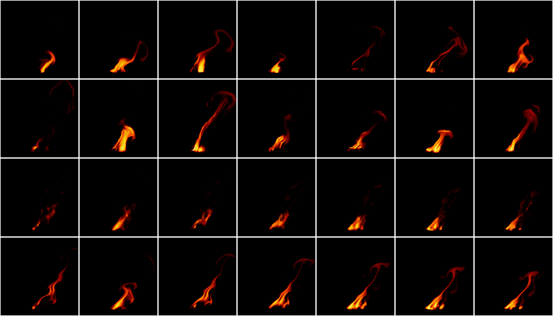
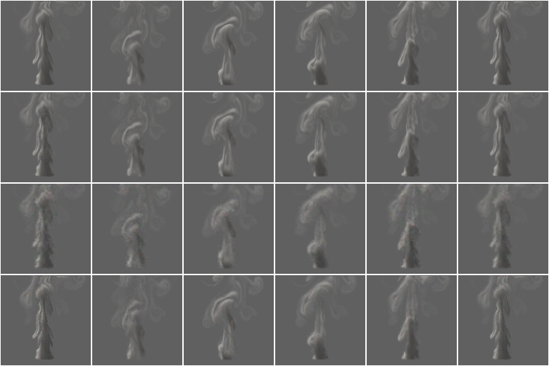
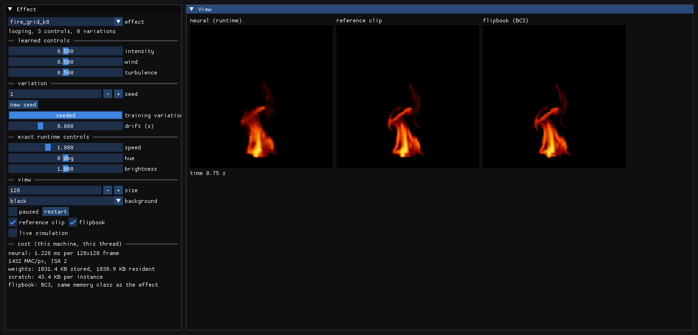

# NeuralVFX

**[Demo videos](videos/README.md):** the showcase scenes, each learned effect at three settings, its controls swept
live, a minute without a loop, the simulator against the learned effect, the whole library by category, a crowd of
165 effects and lit sprites, all rendered on the CPU.

Neural visual effects for games that run on **one CPU core**. Each effect (fire, smoke, an explosion; later steam and a
magic portal) is small and trained offline. At run time it draws sprites (64-256 px) from time, artist controls (intensity, wind, turbulence) and
a seed, with no GPU. The idea follows NVIDIA's small-network-per-asset work (RTX Neural Shaders, Neural Texture
Compression), but runs on a CPU instead of tensor cores.

Two kinds of effect:

- **Frame models** (studies A to C): a network that stores an effect's frames in feature volumes and reproduces them.
- **Rollout effects** (study D): a few stored simulation states (start points) and a small network that moves the
  effect forward one frame at a time, driven by the same kind of noise that forces the simulation. The effect is a
  chaotic system: after about a second the start point no longer decides the picture, the noise does. So the frames
  in between are not stored, only made to look right, and every seed gives a new run that never repeats.

Rollout effects can also run **on one another** (a prototype, [docs/COMPOSE.md](docs/COMPOSE.md)): an explosion's
blast bends a fire, its cloud is handed to the smoke model, embers light new fires, and scripted force fields (wind,
gusts, vortex rings, attractors, heat sources, extinguishers) shape them. Scenes are written as small text scripts
that `nvfx_scene_script` plays without allocating per frame; `nvfx_fireball` renders the 9-second fireball scene in
C++ and profiles every stage, and its script version gives the same frames to the bit. Engines play scene scripts
through a C API (`nvfx_scene.h`) and read their fields for gameplay, or take the effects alone as lit sprites (colour,
albedo, emission, normal and thickness) to light with their own lights; a Godot 4 plugin does so and is tested headless.

C++23, no third-party runtime dependencies, a C API for engines, no Python.

- **Results:** [docs/REPORT.md](docs/REPORT.md) covers quality against memory and milliseconds, flipbooks at
  matched memory, NVIDIA's claims and the honest limits. The generated tables with intervals are in
  [results/experiments/SUMMARY.md](results/experiments/SUMMARY.md).
- **Plan and decisions:** [docs/PLAN.md](docs/PLAN.md).
- **3D, the plan:** [TODO.md](TODO.md): every effect in 3D. First a small demo here (study N: a 3D fire from our own
  3D solver, a small 3D rollout model, a volume renderer and API, videos), then big on a PC: 158 effects in 3D (fire,
  smoke, blasts, engines, clouds, rain, snow, fog, storms, wind, water, liquids, granular flows, volcanoes, ice,
  lightning, optics, designed effects), each simulated as accurately as the PC allows and checked against
  measurements where a real counterpart exists, a full weather system with regimes and transitions, 3D scenes and the
  library rebuilt in 3D.
- **3D demo (study N):** [docs/STUDY_3D.md](docs/STUDY_3D.md): a 3D fire from our own 3D solver (not a validated fire
  code), learned as a 16 x 24 x 16 state that drives seeded 64 x 96 x 64 detail, drawn by a physically based volume
  renderer and played through a volume C API (`nvfx_volume.h`). On its held-out test it follows a real run better than
  the simulation run on the coarse grid with the same detail (picture from four cameras at 1 s: +2.20 dB [+1.09, +3.12])
  but looks worse when played on (motion and coverage, mostly where it runs away: when the wind blows towards -x), and
  holding the first frame still beats it after a second. About 70 ms a step on one busy core (provisional). Videos: [videos/README.md](videos/README.md) §9.
  Study N2 (STUDY_3D.md §14) fixed the runaway (ambient air at the model's open edges, long rollouts in training): no runaway over 30 s, better than study N's model on a new test, but by its rule it did not pass, so study N's model and videos remain the demo.
- **Engine integration:** [docs/ENGINES.md](docs/ENGINES.md) (C API for effects and scenes, threading, Unreal, Unity,
  the Godot 4 plugin, lit sprites for an engine's own lighting: §11).
- **Putting it in your engine:** [docs/INTEGRATION.md](docs/INTEGRATION.md): which API when, the frame loop and threads,
  textures and colour space, effect packs (one checked file with the models and the catalogue), calibration,
  determinism, memory, the version and ABI; the C++ wrapper `include/neuralfx/nvfx.hpp`.
- **More effects:** [docs/EFFECTS.md](docs/EFFECTS.md) (steam and magic: presets, training, the test, a scene).
- **Effect library:** [docs/LIBRARY.md](docs/LIBRARY.md): 223 named effects ready to place (fires, smokes, explosions,
  steam, magic, ambient, sparks, lights, dust, trails, weather, combat, engines, underwater, water, earth, gas) from the
  thirty trained models and
  procedural elements, with a C API to spawn and drive them, a gallery, and the Godot node `NeuralVFXStage`. Trails (a
  rocket's smoke, a vehicle's dust wake, a carried torch, a comet) move with the game's object and leave their material
  in the world behind it; rain, snow, ash and leaves are procedural and ride the effects' air. The third round added 70
  (storms, hail, an aurora, a rainbow, meteors, bullet impacts, blood, muzzle flashes, beams, shields, buffs and props),
  half from new procedural elements: hail, aurora, rainbow, meteors, beams, shields, glints, spatter and shards.
- **Energy effects:** [docs/EFFECTS_ENERGY.md](docs/EFFECTS_ENERGY.md) (a flamethrower's jet, a plasma orb and a dust
  devil: presets, training, the test, a fire-whirl scene).
- **Atmosphere effects:** [docs/EFFECTS_ATMOSPHERE.md](docs/EFFECTS_ATMOSPHERE.md) (fog, dust and cloud: presets, training, the test, a scene).
- **Fire effects:** [docs/EFFECTS_BLAZE.md](docs/EFFECTS_BLAZE.md) (a wildfire front, a bed of coals and a mushroom cloud: presets, training, the test, a scene).
- **Flow effects:** [docs/EFFECTS_FLOW.md](docs/EFFECTS_FLOW.md) (a rocket launch's blast, smoke in puffs and ink in water: presets, training, the test, a lift-off scene).
- **Water:** [docs/EFFECTS_WATER.md](docs/EFFECTS_WATER.md) (waterfalls, fountains, splashes, drips, bubbles, rain shafts: the ordered body learned from four new presets, the random detail a deterministic seeded simulation; the test, 23 library entries, a scene).
- **Earth:** [docs/EFFECTS_EARTH.md](docs/EFFECTS_EARTH.md) (lava under a cracking crust, a volcanic eruption's ash column and umbrella, a powder-snow avalanche that plays once: three presets, the test (lava works, the eruption works narrowly, the avalanche is weak), ten library entries, a volcano scene).
- **Air effects:** [docs/EFFECTS_AIR.md](docs/EFFECTS_AIR.md) (a candle flame, smoke rings and heavy gas along the ground: three presets, the test (the candle and the smoke ring work, heavy gas falls short), twelve library entries, a crypt scene).
- **Data and licences:** [docs/DATA.md](docs/DATA.md).
- **Footage:** [docs/FOOTAGE.md](docs/FOOTAGE.md): start points estimated from frames (study J), so a rollout effect
  continues what footage shows (`nvfx_estimate`); validated on simulated renders only.
- **Viewer:** [docs/VIEWER.md](docs/VIEWER.md).

## Results in brief

From [docs/REPORT.md](docs/REPORT.md), measured on simulated fire, smoke and explosions at 128 x 128 on one AVX2 core:

- **Rollout effects (study D):** endless, controllable, never-repeating effects in **82 to 274 KB** per effect. At
  settings and seeds never seen in training, their detail statistically ties a 45 MB flipbook library and beats the
  1 MB control model on smoke. The learned dynamics follow a real run 2 to 5 dB better than the same simulation at
  the same resolution for the first second. Played in 6 s shards from the start points, a minute looks like the
  first 10 s. The price is **0.8 to 0.9 ms per 128 x 128 frame** (0.4 to 0.5 ms at 64 x 64) and 4.0 MB per playing
  instance.
- **Rollout effects in 8-bit integers (study K, [docs/REPORT.md](docs/REPORT.md) §13):** the stepper's second
  convolution runs in 8-bit integers by default since its rule passed: on held-out settings and seeds it followed real
  runs and played as float does on all eleven effects, and with AVX-512 VNNI a frame costs about a tenth less than float
  on the same build (18% less at 64 px; 0.54 against 0.75 ms at 128 px against the float default on AVX2, most of
  that the AVX-512 build's; provisional). Without VNNI it barely pays (1 to 5%).
- **More effects** ([docs/EFFECTS.md](docs/EFFECTS.md)): steam and a magic portal, new presets of the simulator
  trained with study D's recipe (82 KB each). Steam plays as well as fire and smoke: at unseen settings and seeds its
  motion is right and its average picture ties a second real run, 4.3 dB closer than the nearest flipbook. Magic was
  weaker: it only tied a coarse simulation and its detail was worse than a flipbook's. A scene script plays both with
  fire and an explosion.
- **Fast swirls (study L, [docs/REPORT.md](docs/REPORT.md) §12.1):** why magic, the plasma orb and the dust devil only
  tied a coarse simulation (the 32-cell stepper first; a once-a-frame lock in the detail layer made magic's saw-teeth;
  a sink hidden by a clamp kept the dust devil from regrowing its column), and three replacements that passed a rule
  set before validation, tested once on fresh seeds: +0.94, +0.45 and +0.21 dB at 1 s.
- **Ordered and random (studies M, M2 and M3, [docs/REPORT.md](docs/REPORT.md) §14, `nvfx_ordered`):** fire's average
  picture came 0.39 dB closer to a real run's with an ensemble-mean fine-tune and a larger sub-grid swirl (replaced);
  the same fixes on seven more effects replaced nothing: the mean state brought the explosion 3.4 dB and dust 1.1 dB
  closer on validation but failed margins narrower than those measures' spread, and the rest tied or traded. Study M3
  retried the mean state with a rule planned for power (margins from the null, 30 settings) and **replaced the explosion
  and dust**: on held-out settings their average pictures came 2.9 and 1.3 dB closer to a real run's, nothing worse.
- **The most visible flaws (study O, [docs/REPORT.md](docs/REPORT.md) §16):** the learned waterfall's horizontal bands
  were its detail layer's once-a-frame lock, stamped one frame's fall apart (effects take `passes N`; the falls and the
  library play the water in 2); the lift-off's square blast was its tile, the effect's whole domain, which the
  simulator's billows fill too (the scene plays it as three tiles); the rocket thruster's exhaust no longer curls up (a
  cold field on its tail). The mushroom cloud and the splash, retrained under a rule planned for power and tested once,
  were **replaced**: on held-out settings their average pictures came 1.18 and 0.40 dB closer to a real run's, and the
  mushroom follows a run 0.85 dB better at 1 s.
- **Large effects drawn at half size (study P, [docs/STUDY_P.md](docs/STUDY_P.md), REPORT §17):** a half-size instance
  moves to the bit as the native one does and costs 0.29 to 0.34 of it at 512 px; with the bilinear 2x it stays within
  the null's margins of native against the simulator on every measure for all six effects tried. A small learned 2x
  with seeded micro-detail, tested once by a rule committed first, **did not pass**: it beat bilinear on PSNR, SSIM and
  the high band together for none of the six, and cost more than 0.55 of native for two. Both ship as an experimental
  opt-in (`nvfx_instance_set_upscale`, NVFX_VERSION 7).
- **Memory, against production block compression:** for equal quality, a network per effect clip needs **2.4 to
  4.3 times less memory than a BC7 flipbook** at 8 bits, and 7.5 times less [4.2, 8.3] with features trained for 4
  bits. **Against ASTC** (mobile GPUs; 8x8 to 12x12 blocks hold every frame at full size in 121 to 256 KB) the ratios
  fall to **1.0 to 1.9 times** at 8 bits and about 2.5 times at 4 bits. At equal memory the networks beat BC7
  flipbooks by +2.4 to +6.3 dB at every budget; against ASTC they win at two budgets and tie at three. First
  published against our own BC3-layout encoder: 3.6 to 5.9 times, and 9.1 times at 4 bits; the BC3 format, not the
  encoder, made that baseline weak.
- **Sparse features (study F3)** store only the grid points a clip needs (36 KB instead of 67.5 KB at 4 bits, same
  quality): **13.8 times less memory [7.9, 16.6] than a BC7 flipbook as stored, 4.7 times [3.3, 7.7] against every
  format.** Flipbooks can drop their empty space too: trimmed to their content, 8.8x (BC7) and 3.1x (every format);
  keeping only their non-empty blocks, 5.6x and **2.2x [1.6, 2.8]**. NVIDIA claims "up to 8x" for Neural Texture
  Compression against block compression: met here against BC7 flipbooks that keep or trim their empty space, not
  against ASTC or block-sparse flipbooks. (Against our BC3 layout F3 first reported 16.8x, 10.7x and 6.7x.)
- **Disk:** packed losslessly on both sides, 8-bit networks need a little more disk than packed ASTC flipbooks; trained
  for 4 bits with a rate term they need 2.2 times less (5.1 times less than BC7). **Video codecs win on disk** (AV1
  needs 2.6 times less than the best network). In memory the networks win against video: about 115 KB against 2.6 to
  23 MB for a running decoder.
- **Controls:** one 1 MB model per effect plays unseen settings better than a 45 MB flipbook library
  (+1.0 to +2.5 dB), but its unseen-setting flames look softer than the real simulation.
- **Variation:** endless non-repeating playback by drifting between learned variations; variations are softer than
  real ones and are blends of the training seeds.
- **Later studies** ([docs/DCM.md](docs/DCM.md), [docs/COMPOSE.md](docs/COMPOSE.md)): the owner's diffusion-context
  mixer, adapted to generating effects, survives in one use (a prior against drift that lets fire play one continuous
  run); its fine-detail mixer fails its rule twice. A codec from the learned dynamics wins only at low quality.
  Computing on LZ- or grammar-compressed data is slower than dense code here; LZ tokens and lighter models in the
  coder decode 4 to 38 times faster. Training with couplings in the loop improves the explosion inside scenes. The
  composed fireball runs at 80 frames per second at 1280 x 720 (37 at 1920 x 1080) on 4 threads, 10.6 times faster
  than first written.
- **Cost of frame models:** 0.25 ms (73 KB model) to 0.87 ms (292 KB model) per 128 x 128 frame; 0.07-0.33 ms at 64 x 64;
  8-37 times cheaper than simulating, 35-125 times dearer than playing a flipbook (one CPU core; the same code ran
  1.2-1.4 times slower in an earlier session of the same cloud VM type).







## How it works

| piece | where | what |
|---|---|---|
| simulation | `src/sim`, `nvfx_sim` | a 2D stable-fluids solver (temperature, soot, vorticity, curl noise, combustion expansion) that renders fire, smoke and explosions, and since study D steam and a magic portal ([docs/EFFECTS.md](docs/EFFECTS.md)), to premultiplied RGBA clips with labelled controls: unlimited training and test data |
| ingest | `src/core/ingest.cpp`, `nvfx_ingest` | owner footage into clips via ffmpeg, with a licence check and a licence register |
| footage to start points | `src/footage`, `nvfx_estimate` | a rollout effect's state estimated from a few frames: an inverse renderer (a per-pixel MLP over a pyramid of the frame), refinement through the effect's learned renderer, a motion network and assimilation through the effect's stepper; writes a copy of the effect with start points from the footage ([docs/FOOTAGE.md](docs/FOOTAGE.md), study J; validated on simulated renders only) |
| models | `src/core/model.cpp` | a **grid** family (learned feature volumes over x, y and t, blended by the controls, sampled bilinearly, then a small MLP with FiLM conditioning) and a **conv** family (a learned latent, three upsampling convolutions); `.nvfx` files store features at 16 bits, 2 to 8 bits (bit-packed below 8) or vector-quantised |
| rollout effects | `src/core/rollout.cpp`, `src/train/rollout_train.cpp`, `src/runtime/rt_rollout.hpp` | start points plus a learned stepper on a 32 x 32 grid (advection and pressure projection built in; the network supplies forces and the sub-grid closure, conditioned on the controls and fed the simulation's kind of noise), a detail layer that carries full-resolution heat and soot with the learned flow, and a per-pixel renderer; trained by backpropagation through time, then on its own rollouts with statistical losses |
| trainer | `src/train`, `nvfx_train` | hand-written gradients (checked against finite differences), Adam, multithreaded; per-clip variation codes |
| runtime | `src/runtime`, `include/neuralfx/nvfx.h` | the shipping library: C API, per-ISA SIMD (SSE2, AVX2, AVX-512), no allocation per frame, seeds and endless drift, exact hue, brightness and speed, bake to flipbook; for rollout effects an optional prior against drift (study G's denoiser, a separate 1.57 MB file) so one continuous rollout plays for a minute without shards ([docs/DCM.md](docs/DCM.md) G2.13) |
| baselines | `src/core/flipbook.cpp`, `src/core/block_formats.cpp` | flipbooks at matched memory: frame count, resolution, motion vectors, raw RGBA8 or block compression: our own BC3-layout encoder (BC1 + BC4), and BC7 and ASTC (4x4 to 12x12) through open-source encoders fetched at build time ([docs/DATA.md](docs/DATA.md) §5) |
| compression study F2 | `src/codec`, `nvfx_f2` | quantisation-aware, rate-aware and vector-quantised training, and video codecs (x264, x265, VP9, AV1) through ffmpeg as baselines, memory and disk apart ([results/compression](results/compression/README.md)) |
| lossless packing | `src/core/cm.cpp`, `nvfx_pack` | a context-mixing coder (context models, logistic mixer, APMs, binary arithmetic coder) that knows the tensors' shapes: `.nvfx` to `.nvfz` and back, bit-exact; flipbooks coded the same way for comparison ([results/compression](results/compression/README.md)) |
| metrics | `src/core/metrics.cpp` | PSNR (full and active-region), SSIM, temporal PSNR, flicker, spectrum and motion statistics, paired bootstrap |
| evaluation | `nvfx_experiment` | the whole study end to end: compression, controls, variation, timing, figures, report |
| viewer | `viewer/`, `nvfx_viewer` | Dear ImGui: sliders for every control, side by side with the reference, a flipbook and the live simulation; a scene mode that edits scene scripts live (rebuilt off the frame as you type, errors at their line, the last good scene playing on, inputs, rule buttons and a field probe); [docs/VIEWER.md](docs/VIEWER.md) |
| composed effects | `src/compose`, `nvfx_fireball`, `nvfx_scene_script` | a prototype: rollout effects coupled through their fields (tiles of one domain, hand-over between models, pushes, transfers, force fields and field effects), with particles, light, distortion and bloom; scene scripts (a text format with a hand-written parser and a runner that allocates nothing per frame, `examples/scenes`); trails (a moving source leaving heat and soot in world-space tiles that fade and are recycled) and procedural weather (rain that thins smoke, snow that melts over fire); [docs/COMPOSE.md](docs/COMPOSE.md) |
| scene C API | `include/neuralfx/nvfx_scene.h`, `src/compose/nvfx_scene.cpp` | scene scripts for engines, in libnvfx: a clock in seconds, the picture as RGBA, the fields for gameplay (a point, a tile grid, a region), inputs, rule triggers and module moves and controls; optionally the effects alone as engine layers (lit sprites: colour, albedo, emission, normal and thickness, as RGBA8, RGBA16F or RGBA32F; §11); the script runner's frames to the bit, no allocation per frame; [docs/ENGINES.md](docs/ENGINES.md) §7 |
| effect library | `library/*.nvfxl`, `src/library`, `include/neuralfx/nvfx_library.h` | 223 named, ready-to-use effects (campfire, candelabra, smoke rings, dry-ice fog, waterfall, fountain, splash, rain shaft, wildfire, coals, mushroom cloud, rocket launch, locomotive chimney, ink cloud, grenade, steam vent, portal, lightning strike, ground fog, dust impact, flamethrower, plasma orb, dust devil, rocket trail, rain, thunderstorm, aurora, bullet impacts, laser, shield, level-up, lava flow, volcano eruption, avalanche, erupting geyser, haboob, sea spray, ...) built from the thirty trained models and the compositor's procedural elements, written in the scene-script language; a C API to list them and spawn, drive, move (trails stay in the world) and stop instances on a stage (a scene with rooms), no allocation per frame; [docs/LIBRARY.md](docs/LIBRARY.md) |
| effect packs and the C++ wrapper | `include/neuralfx/nvfx_pack.h`, `src/pack`, `include/neuralfx/nvfx.hpp` | one file an engine ships (`.nvfxp`): the models, the catalogue, a manifest with a SHA-256 per member, the entries' models and optional manager costs, members coded by the context-mixing coder's fast model (the full library: 614 kB against 1.54 MB loose, loaded in 0.12 s); a library, scenes and models from a pack; a header-only C++23 wrapper over the five C APIs (RAII handles, spans, `std::expected`, no exceptions); `nvfx_version()`; [docs/INTEGRATION.md](docs/INTEGRATION.md) |
| effect manager | `include/neuralfx/nvfx_manager.h`, `src/manager` | many rollout effects within a CPU budget per frame, in libnvfx: sizes and update rates from on-screen size and priority with hysteresis, frames between updates by crossfade, copies sharing a simulation (optionally offset in time), pauses off screen, proxies for the far field when the budget is short, the engine's threads or its own with the same pictures on any number, no allocation per frame; [docs/MANAGER.md](docs/MANAGER.md) |
| Godot 4 plugin | `engines/godot` | a GDExtension (godot-cpp at a pinned tag): `NeuralVFXScene`, `NeuralVFXStage` (the effect library) and `NeuralVFXEffect` nodes into textures (and the lit-sprite layers as four more), demo projects and a headless test in Godot 4.4.1 (`engines/godot/test.sh`); [docs/ENGINES.md](docs/ENGINES.md) §8 |
| 3D effects (study N) | `src/sim3d`, `src/render3d`, `src/core/rollout3d.cpp`, `src/train/rollout3d_train.cpp`, `include/neuralfx/nvfx_volume.h`, `nvfx_3d` | a small 3D demo ([docs/STUDY_3D.md](docs/STUDY_3D.md)): our own 3D fire simulator (not a validated fire code), a volume renderer (Planck emission through the CIE 1931 colour matching functions, soot absorption and single scattering, any camera), a 3D rollout model (a 16 x 24 x 16 learned state, 3 x 3 x 3 convolutions with FiLM, a 3D projection, seeded 64 x 96 x 64 detail) and a C API that gives engines its fields as 3D textures or pictures for any camera ([docs/ENGINES.md](docs/ENGINES.md) §12) |
| context mixing | `src/dcm`, `nvfx_dcm` | the owner's diffusion-context mixing (DCM) from CameraDetector: a PAQ8-style mixer with a frozen, versioned inference copy and a nested mixer search, k-means contexts without LibTorch, and a value-domain mixer (a value and a Laplace scale per prediction) for generating and coding effects; docs/DCM.md (study G) |

## Build and test

Ubuntu 24.04: `g++-14`, CMake 3.25+, Ninja, `libgtest-dev`, `zlib1g-dev` (and `ffmpeg` for videos and the video test).

```sh
cmake -S . -B build -G Ninja -DCMAKE_BUILD_TYPE=Release -DCMAKE_CXX_COMPILER=g++-14
cmake --build build
ctest --test-dir build                     # 488 tests: sim, metrics, codecs, gradients, runtime parity, composition, scene scripts, field effects, trails, engine layers, weather, procedural sky, combat and magic elements, context mixing, denoiser, lossless coder, low-bit, vector-quantised, sparse and multi-level features, video codecs, BC7 and ASTC flipbooks, allocation, C API for effects and scenes, the effect library, the effect manager, effect packs and the C++ wrapper, start points from footage, 3D volumes (study N's simulator, renderer, model, gradients and C API; study N2's ambient edges, schedules and long stage), effects drawn at half size and upscaled (study P)
```

Options: `NEURALFX_BUILD_VIEWER` (GLFW + OpenGL; fetches Dear ImGui), `NEURALFX_BUILD_SHARED` (libnvfx.so for engines),
`NEURALFX_BUILD_GODOT` (the Godot 4 GDExtension; fetches godot-cpp, needs Python 3 to generate its bindings; see
`engines/godot/test.sh`), `NEURALFX_FETCH_ENCODERS` (on by default: fetches BC7 and ASTC encoders for the flipbook
baselines; study code only, [docs/DATA.md](docs/DATA.md) §5), `NEURALFX_BUILD_TOOLS`, `NEURALFX_BUILD_TESTS`,
`NEURALFX_BUILD_BENCH`, `NEURALFX_WERROR` (CI).

The trainer and the tools need AVX2 + FMA (checked at start). The runtime falls back to SSE2 code on older x86-64.

## Quick start

```sh
export NEURALVFX_DATA=$HOME/nvfx-data              # clips, weights and videos live here, never in git
build/nvfx_sim --effect fire --out $NEURALVFX_DATA/fire.nfxclip --sheet fire.png
build/nvfx_train --clips $NEURALVFX_DATA/fire.nfxclip --out $NEURALVFX_DATA/fire.nvfx --bits 8
build/nvfx_eval baselines --clip $NEURALVFX_DATA/fire.nfxclip           # flipbooks at every memory size
build/nvfx_eval model --clip $NEURALVFX_DATA/fire.nfxclip --model $NEURALVFX_DATA/fire.nvfx
build/nvfx_c_host $NEURALVFX_DATA/fire.nvfx 128 5                       # what an engine does, with timings
build/nvfx_train --rollout fire --out $NEURALVFX_DATA/fire_rollout.nvfx   # a rollout effect (about 40 min on 4 cores)
```

The whole evaluation of studies A to C (about two hours on 4 cores): `build/nvfx_experiment all`, then on an idle
machine `build/nvfx_experiment timing` and `build/nvfx_experiment report`. Study D: `build/nvfx_experiment d` (chaos,
training, evaluation; about three hours), then `d-timing` on an idle machine and `report`.

## Tools

| tool | what |
|---|---|
| `nvfx_sim` | simulate one clip (fire, smoke, explosion, steam, magic); `--bench` reports the solver's cost per frame |
| `nvfx_ingest` | footage into a clip, after a licence check; adds a row to the licence register |
| `nvfx_estimate` | start points for a rollout effect estimated from footage (a clip, a video or frames, after the same licence check): writes a copy of the effect that continues from the footage; `--preview` draws the footage frame and the effect from it ([docs/FOOTAGE.md](docs/FOOTAGE.md) §8) |
| `nvfx_study_j` | study J: `inverse`, `motion` (the networks), `val`, `val-endless`, `test`, `test-endless`, `report` ([docs/FOOTAGE.md](docs/FOOTAGE.md) §9) |
| `nvfx_swirl` | study L: why fast and regular swirls (magic, the orb, the vortex) failed and their replacements: `diag`, `dstats`, `coarse`, `advect`, `column` (diagnosis), `train`, `set`, `val`, `test`, `collapse`, `cost`, `look` ([docs/REPORT.md](docs/REPORT.md) §12.1) |
| `nvfx_d2` | study D2: the detail layer's constants tuned on pooled endless statistics: `probe`, `tune` (CMA-ES), `candidates`, `val`, `test`, `write`, `cost` ([docs/REPORT.md](docs/REPORT.md) §6.9; nothing kept) |
| `nvfx_study_k` | study K: the rollout runner's stage profile (`profile`), tracking and endless statistics at float and int8 (`track`, `endless`), the rule (`decide`) and the cost (`timing`); `tools/study_k/time.sh` re-times it ([docs/REPORT.md](docs/REPORT.md) §13) |
| `nvfx_train` | train a frame model from one or more clips (controls and variation codes come from the clips), or with `--rollout` a rollout effect from the simulation |
| `nvfx_eval` | score the flipbook ladder or a model against a reference clip |
| `nvfx_experiment` | the full study: `data`, `a` (`a-flipbooks`: only the flipbook rows still missing), `b`, `c`, `media`, `timing`, `report`; study D: `d-chaos`, `d-train`, `d-tune`, `d-finish`, `d-eval`, `d-timing`, `d-report` (with `--effects steam,magic` for the effects added later, [docs/EFFECTS.md](docs/EFFECTS.md)); study G: `g-fine` (design G1, DCM-fine, end to end); to come: `g-data`, `g-pilot`, `g-search`, `g-eval`, `g-timing` |
| `nvfx_c_host` | the engine loop in plain C, with timings; `--scene` plays a scene script through the scene API (and with `--expect` compares every frame with `nvfx_scene_script --profile`); `--self-test` checks the error paths |
| `nvfx_library_host` | the effect library from plain C: lists a catalogue, plays a stage of spawned effects; `--self-test` checks the API ([docs/LIBRARY.md](docs/LIBRARY.md) §3) |
| `nvfx_lit_host` | lit sprites from plain C: reads a stage's engine layers every frame and relights them with a moving light, writing PNG; `--self-test` checks the layers ([docs/ENGINES.md](docs/ENGINES.md) §11) |
| `nvfx_gallery` | the effect library's gallery: a labelled contact sheet, a walk-through video (`--clip` seconds each), keyframes against frozen SHA-256, `--check` (every entry parsed, played, zero allocations; moving ones moved), `--list`, `--print`, `--starts`, `--shot` (spawns may move) ([docs/LIBRARY.md](docs/LIBRARY.md) §4) |
| `nvfx_viewer` | live viewer with sliders; `--scene FILE` edits a scene script live |
| `nvfx_fireball` | a scene of composed effects written in C++ (a fireball with smoke, fires and embers) to video, with a profile of every stage |
| `nvfx_scene_script` | plays a scene script (`examples/scenes/*.nvfxs`) to video, keyframes and a sheet; `--check` and `--print` check and reformat a script; `--verify` compares keyframes with frozen SHA-256 |
| `nvfx_crowd` | the effect manager's benchmark: a battlefield of fires, smoke, steam, torches and explosions at a budget, timed per tick, with the levels used, memory, a video and contact sheets; `--unmanaged` plays every instance with `nvfx.h` alone; `tools/manager/time_crowd.sh` re-times it ([docs/MANAGER.md](docs/MANAGER.md) §7) |
| `nvfx_lod` | the quality of the manager's levels of detail against full-rate, full-resolution playback: `val`, `test`, `sheet` ([docs/MANAGER.md](docs/MANAGER.md) §5) |
| `nvfx_dcm` | context mixing: `selftest` runs a small synthetic mixer search under both objectives (ROC-AUC and Laplace bits); `version FILE` prints the SHA-256 version of a serialised mixer; DCM-fine (G1): `record`, `experts`, `search-fine` (with `--pilot`), `train-fine`, `eval-fine`, `bench-experts`, `fine-summary`; the coarse-state denoiser (G2): `ddpm-train`, `ddpm-sample`, `ddpm-time`, `contexts` |
| `nvfx_prior` | the runtime's prior against drift (docs/DCM.md G2.13): `parity` (study G's test run through the reference and the runtime, bit by bit), `pass` (one denoiser pass per ISA), `time` (frame cost with and without the prior, and of shards: mean, p99, worst) |
| `nvfx_pack_host` | an engine's start and frame loop in C++ with the wrapper: a pack, the library on a stage, the manager, a PNG sheet ([docs/INTEGRATION.md](docs/INTEGRATION.md)) |
| `nvfx_pack` | effect packs: `pack`, `list`, `verify`, `extract`, `measure` ([docs/INTEGRATION.md](docs/INTEGRATION.md) §5); and pack a `.nvfx` into a `.nvfz` and back (`--unpack`), bit-exact; `--h3` for format 2 (light or fast literal models, LZ tokens, seekable segments: 4 to 38 times faster decoding for 2 to 23% more disk); `--report DIR` for sizes and ratios; `--study` for the measurement in results/compression (`--flipbooks-only` adds the flipbooks `cm.csv` lacks) |
| `nvfx_g3` | study G's G3: a codec for authored effect runs from the learned dynamics (closed-loop coarse corrections, an integer context-mixing coder) and a frame model plus a coded residual, against video codecs (through ffmpeg) and flipbooks; `probe`, `ladder`, `baselines`, `g3b`, `summary`, `timing` ([docs/DCM.md](docs/DCM.md) §8) |
| `nvfx_g_extras` | study G's extras (stage S8): one renderer for every model (G4a), a shard critic (G5a), a mixer of the stepper and a coarse solver for smoke (G5b); none kept ([docs/DCM.md](docs/DCM.md) §10) |
| `nvfx_study_h` | study H's measurements: products on LZ78/RePair-compressed data against dense code (`--h1`), the run-aware detail step (`--h2`); scripts in `tools/study_h/` |
| `nvfx_f2` | studies F2 and F3 (results/compression): `data`, `flipbooks` (our BC3 layout and raw, then BC7 and ASTC), `trim` (the same flipbooks without their empty space), `train` (low-bit, quantisation-aware, rate-aware, vector-quantised and sparse models), `rescore`, `pairs`, `video` (x264, x265, VP9, AV1 through ffmpeg), `report` (equal-quality ratios against each flipbook baseline and codec, memory and disk, with intervals; `--figure`, `--pareto`), `g3c`, `g3c-report`, `timing` |
| `nvfx_3d` | study N, a small 3D demo: `pilot`, `look`, `record`, `train`, `finish`, `truth`, `track`, `real`, `play`, `compare`, `freeze`, `video`, `timing`, `edge`; study N2 (`--study n2`): `edgecheck`, `reedge`, `choose` ([docs/STUDY_3D.md](docs/STUDY_3D.md) §12, §14.13) |
| `nvfx_study_p` | study P, large effects drawn at half size and upscaled: `pin`, `info`, `check`, `tiles`, `train`, `calib`, `dev`, `eval` (validation with the null, the test once), `margins`, `choose`, `decide`, `cost`, `video`, and the development steps `anatomy`, `bench`, `tile-eval` ([docs/STUDY_P.md](docs/STUDY_P.md)) |
| `neuralfx_arch_bench` | Phase 0 architecture microbenchmark |

## Layout

| path | what |
|---|---|
| `include/neuralfx/` | public headers: `nvfx.h` (C API), `nvfx_scene.h` (C API for scenes), `nvfx_library.h` (C API for the effect library), `nvfx_manager.h` (C API for many effects), `nvfx_volume.h` (C API for 3D effects), `sim3d`, `render3d`, `rollout3d` (study N), `clip`, `sim`, `model`, `train`, `rollout`, `rollout_train`, `footage`, `metrics`, `flipbook`, `ingest`, `image_io`, `noise`, `cm` (lossless coder), `video_codec` (video baselines); `dcm/` (context mixing) |
| `src/core`, `src/sim`, `src/sim3d`, `src/render3d`, `src/train`, `src/runtime`, `src/manager`, `src/compose`, `src/library`, `src/dcm`, `src/codec`, `src/common`, `src/proto` | libraries (see the table above); `src/codec` runs video codecs through ffmpeg as baselines; `src/proto` holds the Phase 0 prototypes |
| `tools/`, `examples/`, `viewer/`, `bench/` | executables |
| `library/` | the effect library's catalogue (`.nvfxl` files in the scene-script language; the models are in the data folder) |
| `engines/godot/` | the Godot 4 GDExtension, its demo project and its headless test |
| `tests/` | GoogleTest suites, the allocation test, the C host self-test (the viewer's tests are in `viewer/`) |
| `docs/` | plan, report, composed effects, footage, engines, data, viewer, figures |
| `results/` | small text results (CSVs and generated summaries); no images, clips or weights |

## Rules

- C++23 and the CPU only, for the runtime and the product. No GPU. No Python.
- No pretrained networks without the owner's approval.
- No raw video, frames, clips or model weights in git. Data lives under `NEURALVFX_DATA`.
- Measure honestly: clips and control settings held out from training, 95% intervals in square brackets, ties
  reported as ties.
- Documentation in plain English with British spelling.
