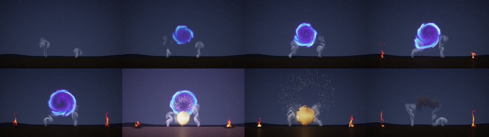

# More effects: steam and magic

Status: **done** (13 October 2026). Audience: dev, research, artists. Two effects that a game would want joined fire,
smoke and the explosion: **steam** (a vent's jet of white vapour) and **magic** (a spinning portal of violet to white
light). Both come from the project's own 2D fluid simulator with new sources, forces and drawing. They were trained
as rollout effects with study D's recipe ([REPORT.md](REPORT.md) §6) and tested as study D was: on held-out settings
and seeds, by tracking from the true state and by endless statistics against real runs and the nearest training
flipbook. A scene script shows them with study D's fire and explosion (§6).

## 1. Bottom line

- **Steam works as well as study D's fire and smoke.** From its true state it follows a held-out run 2.6 dB better
  than the same simulation on the same 32-cell grid with the same detail layer at 1 s, and 1.6 to 2.0 dB better at 2
  and 8 s. Played endlessly at settings and seeds it never saw, its motion is right (ratio 0.99) and its average
  picture ties a second real run (-0.63 dB [-1.51, +0.17]) and is 4.3 dB closer than the nearest training flipbook.
  Its fine detail is closer to the real than the coarse simulation's but not as close as the flipbook's (spectrum
  distance 0.20 against 0.12; floor 0.09).
- **Magic comes out weaker.** It ties the coarse simulation with the same detail layer at every tracking horizon, and
  both lose 10 to 11 dB against simply holding the true frame over the first frame. Endless, its average picture is
  3.8 dB closer than the nearest flipbook's but 7 dB from a second real run, its motion is 17% high, and its detail is
  worse than both the flipbook's and the coarse simulation's (spectrum 0.16 against 0.10 and 0.12; floor 0.02). The
  pictures show why: the detail layer turns the fast, smooth spiral arms into saw-toothed scales. Its look is still a
  usable portal (§6), but it is the weakest of the five rollout effects so far.
- Each is **82 KB** stored (8 start points; fine fields grown at instance start, as fire's), 2.4 MB per instance at
  128 px. Steam costs what fire costs per frame and magic about a quarter more: 1.14 and 1.55 ms at 128 px on a
  quiet machine where fire took 1.22 ms in the same rounds (§5).
- A **scene script** (`examples/scenes/portal.nvfxs`) plays both with study D's fire and explosion: a portal opens
  between two steam vents, its violet light falls on the steam, a pulse lights two braziers, and it collapses in a
  burst. The compositor gained one thing for it: a module may light the scene in its own colour (`glow`). Every
  existing scene is unchanged to the bit.

## 2. The effects

Both are presets of the existing solver (`src/sim/sim.cpp`): the same grid, advection, vorticity confinement, curl
noise and pressure solve, with their own sources, forces and drawing. Each has three normalised controls, as the
study's effects have. Lengths are in cells of a 128-cell frame and times in seconds.

| | steam | magic |
|---|---|---|
| what it is | a vent in the floor blowing a jet of white vapour that slows, spreads and fades | a ring of energy around the middle of the frame, spun into spiral arms that are drawn into the centre |
| source | a vent 11 to 20 cells wide (intensity), 8 cells up; vapour density 1.2 to 2.0, a little warmth (0.35 to 0.6), an upward jet of 85 to 160 cells per second; broken up by the flicker noise at a rate of 2.0 per second (fire: 2.6) | a ring of radius 24 to 36 cells (intensity), about 9 cells thick; energy (the solver's heat) 0.8 to 1.3 and a little dark mist (its soot); broken up by the flicker noise at a rate of 1.8 per second |
| forces | buoyancy 70 (fire and smoke: 150), soot weight 0.2; wind up to 75 cells per second with drag 2.5 per second; velocity damping 0.35 per second; confinement 0.4 to 3.0 and curl noise 10 to 65 (turbulence) | no buoyancy and no wind. A swirl force around the middle, strongest at the ring, whose damping (1.2 per second) holds the ring's speed near 40 to 160 cells per second (spin): about 0.2 to 1 turn a second. A sink in the middle (a divergence of -25 per second over 9 cells, as the explosion's expansion but inwards) pulls the arms in. Confinement 1 to 5, curl noise 10 to 80 |
| decay | vapour fades at 0.65 per second, warmth at 0.9 | energy fades at 1.3 per second, mist at 1.0 |
| drawing | reflected light only: white, a little blue in its shade, self-shadowed towards the light more softly than smoke; cover 1 - exp(-2 density) | emitted light: violet where faint, through blue and cyan to white where strongest, over a thin dark violet mist |
| controls | intensity, wind, turbulence | intensity, **spin** (slow to fast; the solver's second control), turbulence |

Steam keeps the controls' names; magic's second control is named `spin` (`sim::control_names`, so the model files,
the runtime and scene scripts call it that). Fire, smoke and explosion clips are unchanged to the byte (a test hashes
a clip of each, made before the change: `Sim.StudyEffectsAreUnchangedByTheNewOnes`).

**How chaotic they are** (`nvfx_experiment d-chaos --effects steam,magic`, as [REPORT.md](REPORT.md) §6.1: active
PSNR against the undisturbed run, mean over 4 runs):

| effect | case | 1 frame | 0.5 s | 1 s | 2 s | 8 s |
|---|---|---:|---:|---:|---:|---:|
| steam | start nudged by 1e-3, same seed | 73.5 | 66.9 | 65.6 | 63.3 | 58.8 |
| steam | start nudged by 1e-1, same seed | 52.6 | 42.6 | 39.8 | 35.0 | 38.7 |
| steam | same start, other seed | 28.7 | 16.7 | 14.1 | 13.1 | 12.3 |
| steam | other start, same seed | 11.1 | 12.8 | 14.6 | 17.1 | 26.8 |
| magic | start nudged by 1e-3, same seed | 67.1 | 61.6 | 63.0 | 58.1 | 54.1 |
| magic | start nudged by 1e-1, same seed | 41.2 | 39.0 | 43.9 | 48.4 | 50.8 |
| magic | same start, other seed | 20.6 | 16.2 | 15.8 | 14.5 | 14.6 |
| magic | other start, same seed | 16.4 | 23.3 | 38.0 | 43.2 | 47.2 |

Steam behaves as fire and smoke do: a small error in the start stays invisible for seconds, the seed takes over within
a second, and the noise slowly pulls runs with the same seed together. Magic is much less chaotic: its forcing
dominates, so two runs with the same seed from different start points meet within a second (38 dB at 1 s, 47 dB at
8 s), and even a 10% nudge heals. What magic looks like after a second is decided by its seed, not by its start.

## 3. Training

Study D's recipe, unchanged (`rollout::recipe_for`: steam and magic take fire's settings): 160 runs of 240 frames from
an empty grid with random controls and their own seeds (training salt 1), the stepper's three stages, the renderer on
200 frames of 100 runs, the detail constants chosen by matching frame statistics of endless runs against real runs at
the controls of four training runs with new seeds (validation; the test's settings and seeds are never used), and 8
start points. As study D's own models were, each was trained in three saved steps (`d-train --stages12 1`, then
`d-tune` for stage 3, then `d-finish`), so that a container restart would cost one step, not the whole effect. One
thread each, on a machine shared with four other agents (magic was paused for about 42 minutes while the load was
high):

| effect | simulation | stages 1-2 (loss, s) | stage 3 (loss, s) | renderer (training samples) | contrast, swirl, grow | detail score | stored |
|---|---:|---|---|---:|---|---:|---:|
| steam | 21.3 min, recorded in 431 s | 0.0804, 9317 | 0.0974, 1855 | 37.7 dB | 1, 0.5, 4 | 0.72 | 82 KB |
| magic | 21.3 min, recorded in 601 s | 0.0308, 11257 | 0.0290, 1876 | 37.6 dB | 1, 0, 1 | 0.39 | 82 KB |

The last step (renderer, detail constants, start points) took 18 minutes for each. About 3.5 CPU-hours per effect in all; study D took 1 to 1.3
hours on 4 cores per effect. The steppers saved by `--stages12` before it kept start points had none, which the model
loader refuses; a scratch tool gave each a placeholder start point (weights unchanged) and `d-finish` replaced it with
the real ones. `d-train --stages12` now keeps start points itself.

Both models were frozen before their test: `results/experiments/fx_frozen.csv` has their SHA-256 (the files are
under the data root's `fx/models/d`).

## 4. The test

Run once, after freezing, exactly as study D's (`nvfx_experiment d-eval --effects steam,magic`; every number with its
interval in [results/experiments/fx/D_SUMMARY.md](../results/experiments/fx/D_SUMMARY.md)):
- **Tracking:** 8 held-out runs (salt 2: other seeds and settings), each started from its true state (coarse and fine)
  with its own noise seed, against the simulation on the same 32-cell grid with the same detail layer
  (`coarse_sim_detail`), the plain coarse simulation and holding the first frame. Active PSNR, paired over runs.
- **Endless:** the ten held-out settings of study B, a seed never used for these effects, 10 s each. Frame statistics
  against a real run at that setting: a second real run with another seed is the floor; the nearest of the 45 training
  flipbooks of study B's grid (made for these effects as study B made its library: 64 frames at 128 px, seed 1;
  looped) is the baseline. Paired over the 10 settings, 95% bootstrap intervals; an interval across zero is a tie.
- **One minute:** a 60 s neural run in 6 s shards at two held-out settings, cut into 10 s windows.

### 4.1 Tracking from the true state

Active PSNR (dB), mean over 8 held-out runs:

| effect | method | 1 frame | 8 frames | 1 s | 2 s | 8 s |
|---|---|---:|---:|---:|---:|---:|
| steam | neural | 27.9 | 19.9 | 16.6 | 15.0 | 13.6 |
| steam | coarse simulation + detail | 27.9 | 17.2 | 14.0 | 13.4 | 11.6 |
| steam | coarse simulation | 20.9 | 18.3 | 15.7 | 14.6 | 12.5 |
| steam | holding the first frame | 23.1 | 12.4 | 11.6 | 11.4 | 11.5 |
| magic | neural | 21.4 | 18.2 | 17.6 | 17.3 | 16.4 |
| magic | coarse simulation + detail | 22.2 | 18.3 | 17.6 | 17.3 | 17.1 |
| magic | coarse simulation | 19.9 | 18.4 | 17.9 | 17.9 | 17.8 |
| magic | holding the first frame | 32.3 | 18.7 | 14.7 | 14.7 | 15.4 |

Neural minus coarse simulation + detail, paired over runs:

| effect | 1 frame | 8 frames | 1 s | 2 s | 8 s |
|---|---|---|---|---|---|
| steam | -0.07 (tie) | +2.70 [+2.20, +3.30] | +2.60 [+2.12, +3.02] | +1.59 [+0.58, +2.52] | +1.95 [+1.07, +2.92] |
| magic | -0.76 (tie) | -0.14 (tie) | +0.09 (tie) | -0.06 (tie) | -0.75 (tie) |

- **Steam's learned dynamics follow a run better than the simulation at the same resolution**, as fire's and smoke's
  did ([REPORT.md](REPORT.md) §6.4: +2.1 dB at 1 s), and unlike smoke it is still ahead at 8 s.
- **Magic ties.** Its renderer is not the problem (33.5 dB on the true fields; drawn by the simulation's renderer, the
  same dynamics score the same). Both 32-cell methods lose 10 to 11 dB in the first frame against holding the true
  frame: on a coarse grid, and in a detail layer moved by the coarse flow, the fast thin spiral arms smear at once.
  The frame held still stays level with them for a quarter of a second; from half a second on the neural run and the
  coarse simulation are ahead of it.

### 4.2 Endless runs at settings never seen

Means over the 10 held-out settings (spectrum distance and coverage distance: lower is better; motion ratio: 1 is
right; mean-frame PSNR: higher is closer):

| effect | method | spectrum | motion | coverage | mean-frame PSNR |
|---|---|---:|---:|---:|---:|
| steam | real, other seed (floor) | 0.094 | 1.17 | 0.016 | 30.4 |
| steam | **neural rollout (82 KB)** | 0.203 | 0.99 | 0.018 | 29.8 |
| steam | nearest training flipbook | 0.120 | 1.10 | 0.017 | 25.5 |
| steam | coarse simulation + detail | 0.330 | 0.63 | 0.016 | 28.1 |
| steam | coarse simulation | 1.344 | 0.35 | 0.016 | 28.0 |
| magic | real, other seed (floor) | 0.024 | 1.02 | 0.007 | 35.0 |
| magic | **neural rollout (82 KB)** | 0.162 | 1.17 | 0.009 | 28.0 |
| magic | nearest training flipbook | 0.101 | 1.00 | 0.013 | 24.2 |
| magic | coarse simulation + detail | 0.116 | 1.33 | 0.010 | 28.8 |
| magic | coarse simulation | 1.115 | 0.76 | 0.010 | 27.3 |

Neural minus each other method, paired over the 10 settings (motion as the error |ln ratio|):

| effect | statistic | nearest flipbook | coarse simulation + detail | real, other seed |
|---|---|---|---|---|
| steam | spectrum distance | +0.083 [+0.041, +0.129] | **-0.127 [-0.166, -0.086]** | +0.109 [+0.064, +0.151] |
| steam | mean-frame PSNR (dB) | **+4.31 [+2.64, +5.73]** | **+1.66 [+0.17, +3.12]** | -0.63 (tie) |
| steam | motion error | **-0.135 [-0.219, -0.043]** | **-0.371 [-0.505, -0.217]** | **-0.072 [-0.124, -0.031]** |
| steam | coverage distance | +0.0017 (tie) | - | +0.0023 (tie) |
| magic | spectrum distance | +0.062 [+0.028, +0.094] | +0.046 [+0.007, +0.085] | +0.139 [+0.101, +0.178] |
| magic | mean-frame PSNR (dB) | **+3.77 [+1.45, +5.85]** | -0.79 (tie) | -7.05 [-9.36, -5.11] |
| magic | motion error | +0.084 [+0.040, +0.127] | **-0.127 [-0.156, -0.099]** | +0.130 [+0.089, +0.173] |
| magic | coverage distance | **-0.0039 [-0.0065, -0.0015]** | - | +0.0018 [+0.0003, +0.0035] |

(Bold: the neural rollout is better.)
- **Steam** plays like the real thing in motion and average picture: its motion error is even smaller than a second
  real run's (that run's motion was 17% high), its average picture ties the real floor, and it beats the 45 MB flipbook
  library and the coarse simulation on both. Its detail is between the two: better than the coarse simulation's, worse
  than the flipbook's. Study D's fire and smoke were behind the flipbook on detail too, but within their intervals
  (§6.5 there: spectrum 0.195 and 0.143 against 0.158 and 0.136).
- **Magic** is closer than the flipbook only in its average picture and coverage (the flipbook shows the nearest
  training setting's portal, of the wrong size). Its detail and motion are worse than the flipbook's, its detail worse
  than the coarse simulation's, and it is 7 dB from the floor, which for magic is very high (35 dB: two real runs of
  the same setting look much alike, §2).

### 4.3 One minute without a restart

| effect | spectrum distance | motion ratio | mean-frame PSNR |
|---|---|---|---|
| steam | 0.16-0.32 | 0.74-1.42 | 27.7-34.9 |
| magic | 0.12-0.35 | 1.11-1.39 | 22.0-31.2 |

Ranges over six 10 s windows at each of two held-out settings: the last windows are as good as the first, so neither
drifts over a minute of shards.

## 5. Memory and cost

The same network as study D's, so the same memory: 82 KB stored, 163 KB resident, 2.4 MB of working memory per
instance at 128 px. Per frame through `nvfx_render` on one pinned core (AVX2), with study D's three effects measured in
the same rounds, on a quiet machine: four rounds, the least of them and the range
([d_timing_quiet.csv](../results/experiments/fx/d_timing_quiet.csv); the first figures, from the shared machine, are in
[d_timing.csv](../results/experiments/fx/d_timing.csv) and
[d_timing_fire_smoke_same_session.csv](../results/experiments/fx/d_timing_fire_smoke_same_session.csv)):

| effect | 64 px | 128 px | 256 px | restart |
|---|---:|---:|---:|---:|
| steam | 0.66 ms (to 0.70) | 1.14 ms (to 1.76) | 2.94 ms (to 3.18) | 20 ms (1 s warm-up) |
| magic | 0.67 ms (to 0.89) | 1.55 ms (to 1.61) | 2.20 ms (to 2.37) | 16 ms (1 s warm-up) |
| fire (same rounds) | 0.66 ms (to 1.10) | 1.22 ms (to 1.26) | 3.04 ms (to 3.34) | 20 ms |
| smoke (same rounds) | 0.64 ms (to 0.90) | 1.12 ms (to 1.13) | 2.93 ms (to 3.11) | 0.5 ms |
| explosion (same rounds) | 0.63 ms (to 0.68) | 1.05 ms (to 1.70) | 2.19 ms (to 2.32) | 0.3 ms |

Steam costs what fire costs (its 128 px rounds fell at 1.14 to 1.20 ms or at 1.65 to 1.76 ms; single slow rounds
like these hit every effect in turn, from the virtual machine); magic costs about a quarter more at 128 px, and less
at 256 px. This session ran slower than earlier quiet ones: study D's effects took 1.05 to 1.22 ms at 128 px against
0.8 to 0.9 ms ([REPORT.md](REPORT.md) §6.7), and the fireball 19 to 20 ms per frame against 14 to 16 ms in round 3's
quiet session. The build before these effects and study D2 were merged gave the same times as the build with them,
measured alternately in this session (the fireball +0.23 ms [-0.04, +0.48] with them, a tie;
[round4_fireball_pairs.csv](../results/quiet/round4_fireball_pairs.csv)), so the difference is the machine.

Like fire, both grow their fine fields at instance start, so a restart costs a 1 s warm-up (16 to 20 ms); storing
64-pixel fine fields as smoke does would make it 0.4 ms for 64 KB more.

## 6. The scene

`examples/scenes/portal.nvfxs` (10 s at 1280 x 720 and 30 fps, about 80 lines). Night. Two steam vents hiss in the
ground (the steam model drawn by a field-shader look, so the scene's light colours it), unevenly (their intensity
follows noise). A portal (the magic model, 460 world pixels wide) opens between them over two seconds, growing and
spinning faster; its violet light falls on the steam and the ground, and the steam leans in towards it (the vents'
wind control). At 3.6 s a pulse runs out from it (a shock front) and lights two braziers (study D's fire) when it
reaches them. At 7.4 s the portal collapses: the explosion model bursts where it was, with embers and a flash, the
steam is blown aside and the flames bend (pushes from the bus). The video and the full keyframes are under the data
root's `fx/` (outside git); the keyframes' SHA-256 are in `results/experiments/fx_frozen.csv` and
`ctest -R ScriptedPortalFrozen` checks them (skipped without the effects in `NEURALFX_MODELS_FX`).



It plays without an allocation in its frame loop. On a quiet machine its stages take 22 ms per frame (median of the
sum, two runs) on 2 threads and 13 ms on 4; on the shared machine, 51 ms on 2 threads.

**One thing was added to the compositor for it** ([COMPOSE.md](COMPOSE.md) §4.3): a module's `glow (r, g, b)`.
The scene's light was made only from the bus's heat in fire colours, so the portal would have lit the steam orange.
A module that glows now lights the scene in its own colour (heat squared times the light's gain, as the fires' light)
while its heat stays on the bus for rules and haze. Scenes without it take exactly the old path:
`ScriptedFireballBitExact` still matches its frozen keyframes, and a test checks the colour
(`Compose.GlowingModuleLightsInItsOwnColour`). The new effects need no field-shader look of their own: magic is drawn
by its learned renderer (light it emits is not lit by the scene), and steam by the existing shader with white soot and
no emission (`look vapour` in the script).

What works: the effects read as steam and a portal, they couple with study D's through the bus (the burst moves the
steam), and the light ties them together. What does not, yet: the portal's arms show the saw-toothed detail of §4.2;
the explosion drawn small with the cloud look is a flat ball in its first frames; the braziers are small flames, as
fire's tiles make one flame each.

## 7. What it means

- **New effects cost about 3.5 CPU-hours each and no new code in the trainer or the runtime.** A simulator preset
  (source, forces, drawing), a name, and study D's recipe gave two working rollout effects of 82 KB.
- **The recipe carries over to effects like those it was made for.** Steam, a buoyant plume like fire and smoke, came
  out as good as they did: the right motion, the real average picture, detail between the flipbook's and the coarse
  simulation's.
- **It does not carry over unchanged to a fast, regular swirl.** Magic's flow is a fast rotation (up to about 1.3
  coarse cells per frame at the ring) with thin, smooth arms. The 32-cell state and the detail layer (fine fields moved
  by the coarse flow, new material broken up by flicker noise) smear and serrate them, so the learned dynamics gain
  nothing over a coarse simulation and the detail is worse than a flipbook's. Fixes worth trying, none tested here: a
  finer coarse grid for magic, a detail layer advected in rotating coordinates or with a smaller contrast for it, or
  start points with fine fields (as smoke's).
- The detail calibration picked swirl 0 and grow 1 for magic (no sub-grid swirl, no rescaling of existing structure),
  the most conservative setting, which is consistent with the detail layer fighting the effect rather than helping it.

## 8. Reproduce

```sh
build/nvfx_experiment d-chaos  --effects steam,magic --root $NEURALVFX_DATA/fx --results results/experiments/fx
build/nvfx_experiment d-train  --effects steam --stages12 1 --root $NEURALVFX_DATA/fx --results results/experiments/fx --threads 1
build/nvfx_experiment d-tune   --effects steam --root $NEURALVFX_DATA/fx --results results/experiments/fx --threads 1
build/nvfx_experiment d-finish --effects steam --root $NEURALVFX_DATA/fx --results results/experiments/fx --threads 1
#   (the same for magic; or d-train without --stages12 for all three steps at once)
build/nvfx_experiment d-eval   --effects steam,magic --root $NEURALVFX_DATA/fx --results results/experiments/fx --threads 2 --figures DIR
build/nvfx_experiment d-report --root $NEURALVFX_DATA/fx --results results/experiments/fx    # D_SUMMARY.md
build/nvfx_experiment d-timing --effects steam,magic --root $NEURALVFX_DATA/fx --results results/experiments/fx
build/nvfx_scene_script --script examples/scenes/portal.nvfxs --models DIR --out portal.mp4 --keyframes DIR --sheet sheet.png
build/nvfx_sim --effect magic --spin 0.8 --sheet magic.png    # the simulator's presets alone
```

`DIR` for the scene holds `steam.nvfx` and `magic.nvfx` and study D's v2 `fire.nvfx` and `explosion.nvfx`.
