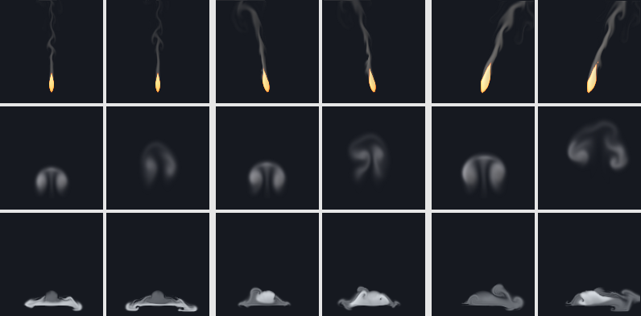

# Air effects: a candle, smoke rings and heavy gas

**Status: paused** (15 October 2026, about 22:00 UTC), on the coordinator's word; nothing below §4's design has been run.
- **Done:** the three presets (`src/sim/sim.cpp`, final at commit ce716ef; every earlier effect's clips the same to the
  byte), their sim and recipe tests, the hash test extended, §2 below, and the test's design and rule (§4), committed
  before any training.
- **Not done:** the smoke ring's and heavy gas's training, the mean state for the ring, `d-chaos`, the one test of each
  effect, timing, the library entries (`library/air.nvfxl`; a draft of its looks is under the data root's
  `fx_air/libdev`), the crypt scene, the videos, REPORT §6.17 and the README, LIBRARY and ENGINES counts.
- **Models:** only the candle. Its stages 1-2 (`fx_air/jobs/state/candle.train12.nvfx`, 92 min) and 3
  (`candle.tune.nvfx`) are done; its last step (`d-finish`: renderer, detail constants, start points) was still running
  at the pause, writing `fx_air/models/d/candle.nvfx` and then `jobs/state/candle.finish.nvfx` and `candle.all.done`
  (log: `fx_air/logs/train_candle.log`). Under it, `fx_air/jobs/pipeline.sh` (pid 14829) was waiting for the candle; it
  could not be stopped from this session, and when the candle finishes it runs the candle's `d-chaos`, freezes it,
  runs its test once and then trains the smoke ring and heavy gas. Stop it (`kill 14829`) if no new work is wanted.
- **Resume** (one heavy job at a time; each step leaves a marker in `fx_air/jobs/state` and is skipped when done; the
  frozen tool is `fx_air/jobs/nvfx_experiment_train`, built at ce716ef):
  `cd /root/nvfx-data/fx_air/jobs && EFFECTS=candle ./queue.sh` (finishes the candle if its training was cut), then
  `nohup setsid ./pipeline.sh &` (for each effect: train, the ring's mean state, `d-chaos`, freeze into
  `results/experiments/fx_air_frozen.csv`, the test once with `--seed-base 6400000` into `fx_air/test/EFFECT`). Then merge
  each test's `d_track.csv`, `d_stats.csv` and `d_long.csv` into `results/experiments/fx_air` and run
  `nvfx_experiment d-report --root /root/nvfx-data/fx_air --results results/experiments/fx_air`.

Status before the pause: **in progress**. The design of the test and the rule below (§4) were written and committed
before any model was trained, and so was the one method of a later study that this round uses (§3). Audience: dev,
research, artists.

Three effects of the air, after the water round ([EFFECTS_WATER.md](EFFECTS_WATER.md)): a **candle** (a small, calm,
teardrop flame on a wick, mostly steady, flickering and leaning in a draught, with a thin wisp of smoke; it must read
at small sizes: a candle, a torch head, a lantern), a **smoke ring** (one vortex ring puffed from an opening, rising and
spreading slowly as it rolls, then breaking up; it plays once, for 4 s) and **heavy gas** (a dense, cold vapour released
near the ground that spills and flows along it as a gravity current with a rolling front, pools in the low places and
thins: dry-ice fog, a toxic spill, swamp gas, stage fog). They come from the project's own 2D fluid simulator with new
sources, forces and drawing, and are trained and tested as the earlier rounds' were: study D's recipe and protocol
([REPORT.md](REPORT.md) §6), on held-out settings with seeds of this round's own.

## 2. The effects

All three are presets of the existing solver (`src/sim/sim.cpp`, in a block of their own: `add_air_sources`,
`add_air_forces`, `air_decay`, `render_air`). Each has three controls in [0, 1]:

| | candle | smokering | heavygas |
|---|---|---|---|
| controls | intensity (size), **draught** (0.5 still air; less blows from the right and leans it left, more from the left), turbulence (flicker) | intensity (strength), wind, turbulence | intensity (release rate), **flow** (0 to the left, 0.5 both ways, 1 to the right), turbulence |
| plays | loops | **once**, 120 frames (4 s) | loops |

Every force is a function of what a learned stepper sees: the state where it acts, the position, the controls and the
run's two noise fields (the curl noise's stream function and the source flicker). Nothing follows a clock of its own.
The smoke ring, which plays once, is made at its first step (as the explosion's burst is) and otherwise follows the
time since its start only through the two decays a learned one-shot sees as inputs (exp(-t / 0.15 s), exp(-t / 1 s)),
as the mushroom does. Rings that repeat (a smoker's rings, a censer's) are the one-shot spawned again, so their timing is
the game's, not a noise gate's (round 7's puffs were weak where a gate timed by noise set their rhythm).

**The smoke ring's length, 120 frames (4 s).** It forms in its first half second (the puff rolls up into the two
cores), rises and spreads as it rolls for about two seconds, slowing as its rotation decays, and in the last second and
a half the curl noise, which stirs it harder as it ages, breaks it up while its smoke thins. Three seconds (the
explosion's length) would cut it off while it still rolls as a ring; five (the mushroom's) would add a second of a
faint, broken haze, and the mushroom showed that a long one-shot, whose look changes over its length, is the hard case
for the learned stepper.

Lengths are in cells of a 128-cell frame and times in seconds; d = 2 draught - 1 and ψ is the curl noise's stream
function where the force acts.

| | candle | smokering | heavygas |
|---|---|---|---|
| what it is | a small flame on a wick in the middle of its frame, 12% up: a teardrop of hot gas (rounded below, pointed above), pale yellow-white inside, orange at its edge; above its tip the gas burns out and goes on rising as a warm, unseen plume that carries a thin grey wisp of smoke to the top of the frame; a draught leans the flame and streams the smoke away | a ring puffed from an opening in the middle near the bottom of the frame: two vortices turning in opposite senses (a ring seen from the side), each core full of warm grey smoke; it rises as it rolls, slows and spreads, and in its last second and a half breaks up into a fading haze | a cold white vapour poured out over a low mound in the middle of the frame; it spills down both sides (or one, with the flow) as a gravity current with a rolling head, runs into a hollow on either side and pools there against a low lip at the frame's edge, thinning slowly |
| source | a teardrop 8 to 15 cells wide and 20 to 36 tall (intensity) whose heat ((1.6 to 1.85) times its shape) and an upward flow of 16 to 26 cells per second are drawn in at 12 per second; it leans by 0.5 d (1 + 0.5 ψ) of its height, and its height breathes by (0.05 + 0.3 turbulence) times the flicker noise (rate 1.2 per second) | at its first step the two cores (Lamb-Oseen vortices) 22 to 32 cells apart (intensity), each 0.7 of the half-spacing across, with the circulation that would carry them up at 24 to 40 cells per second; smoke 1.0 to 1.4 in the cores, lumpy with the flicker noise (rate 1.4), warmth 0.3 of it; for about 0.3 s a little smoke trails out of the opening behind (exp(-t / 0.15 s)) | an oval 16 to 28 cells wide and 14 high (intensity), 26 cells up over the mound: the density is drawn (6 per second) towards (1.2 to 2.0) times a surge, 0.2 + 0.8 smoothstep(-0.35, 0.35, ψ at the release), so the spill swells and slackens over a second or two, broken up by the flicker noise (rate 0.8); it is poured down at 10 to 18 cells per second and sideways at (2 flow - 1) (14 to 32) |
| forces | buoyancy 200, no soot weight; the draught drags the material (3 per second) towards 40 d (1 + 0.6 ψ) cells per second, gusting with the curl noise, and stirs it with curl noise of 18 \|d\| more, so the flame flickers more the harder it blows; velocity damping 0.3; confinement 0.15 to 1.05 and curl noise 2 to 24 (turbulence) | buoyancy 30; **the wind moves the clear air** (drawn at 0.8 per second towards 18 (2 wind - 1) cells per second; the smoky cores five times less), so it carries the ring without stopping its cores turning; damping 0.35 (the ring slows); confinement 0.2 to 1.2, curl noise 4 to 30, and on the smoke curl noise of (10 + 40 turbulence)(1 - exp(-t / 1 s)) more: it breaks up as it ages | no heat; weight 18; **the floor**: a mound 12 cells up (32 cells wide at its top, sloping to the hollows' 4 by 28 cells from the middle), the hollows 18 cells wide, lips rising to 12 cells at the frame's edges; the air in it is still and downward flow stops within 4 cells above it (fog's ground, following the profile), over a closed bottom border; a draught along the floor drags the gas within 25 cells of it (0.8 per second) towards (2 flow - 1) 16 cells per second; damping 0.2; confinement 0.2 to 1.4, curl noise 3 to 17 |
| decay | above a heat of 0.2 the gas burns out at up to 9 per second (the flame's end) and leaves (0.07 + 0.15 turbulence + 0.15 \|d\|) of the heat it loses as soot (the wisp; more when the flame gutters); the plume's warmth fades at 0.3 per second, the smoke at 0.8 | smoke 0.25 per second, warmth 0.8; both spread (4 cells squared a second), so the cores stay broad blobs | 0.08 per second; what the flow carries into the floor is gone |
| drawing | emitted light from a ramp that starts at heat 0.3 (dull red, orange, yellow, a pale yellow-white core), so the warm plume is not seen; grey smoke shaded towards the light | pale grey smoke lit from above and to the left, shaded by itself | a cold white vapour, a little blue where it is deep, barely shaded |

They keep the study's control names but for the candle's second, `draught`, and heavy gas's, `flow`
(`sim::control_names`, so the model files, the runtime and scene scripts call them that; `nvfx_sim` takes `--draught`
and `--flow`). The smoke ring keeps `wind`. Every earlier effect's clips are unchanged to the byte:
`Sim.StudyEffectsAreUnchangedByTheNewOnes` now also hashes clips of the ten effects of rounds 7 and 8 (wildfire, coals,
mushroom, launch, puffs, ink, waterfall, fountain, splash, rainshaft) made before these three existed, and full-size
clips (128 px, 64 frames) of all 21 earlier effects at two settings were compared byte for byte before and after (the
data root's `fx_air/jobs/state/baseline_clips.sha256`). Tests of the new presets:
`Sim.AirEffectsHaveTheirOwnControlsAndOnlyTheRingPlaysOnce`, `Sim.CandleIsASmallSteadyTeardropWithAWispThatLeansInADraught`,
`Sim.SmokeRingRisesAsAVortexPairThatSpreadsAndBreaksUp`, `Sim.HeavyGasSpillsAlongTheFloorAndPoolsInTheHollows`, and in
the recipe `Rollout.AirEffectsTakeTheirRecipes`.

**How they were designed.** Each was looked at with contact sheets at several settings (from an empty grid and in the
steady state) and a scratch probe that printed the amount, centroid and extent of the heat and the smoke over time and
the speed where there is material. What changed on the way:
- **Candle.** The first flame, an egg of heat over the wick with an upward push, accelerated at once into a thin pencil
  with a long red tail, under a cap of smoke that stalled halfway up the frame (the plume cooled and lost its lift). A
  teardrop drawn in whole (its heat and its flow), a fast burn-out above a heat of 0.2 with a light ramp that starts at
  0.3, a plume that cools slowly and more buoyancy gave a steady teardrop with a straight wisp that reaches the top of
  the frame in about two seconds. A draught that leaned only the flame's top looked broken; the whole teardrop now
  leans from the wick, in gusts.
- **Smoke ring.** The first ring had smoke in a puff between its cores too, which wrapped over the top as a hood, and its
  cores wound the smoke into thin spirals (the kind of thin, regular structure that study L found the 32-cell state
  loses). Smoke only within the cores' solid turning and a little spreading keep the cores broad. A wind that dragged
  the smoke towards its speed (as the other effects' wind) stopped the cores turning and hardly moved the ring; the wind
  now moves the clear air, which carries the ring. Without a break-up it was still a tidy ring after 4 s; the curl noise
  now stirs its smoke harder as it ages.
- **Heavy gas.** The first release, low and heavy (weight 35 to 60), spread into a flat layer 10 cells deep that read as
  a stripe, and it covered the floor evenly once settled. Lighter gas (18) and a bigger release give a layer 15 to 25
  cells deep with a rolling head; a release that swells and slackens with the curl noise sends new fronts out over the
  pool; a release at 46 cells read as a tap pouring from mid-air, at 26 it spills onto the mound. The floor's mound,
  hollows and lips are what the gas pools in; they are not drawn (the scene's or the game's ground is).

How fast they move, at two settings (all controls 0.5 and all 1; cells of a 128-cell frame per second where there is
material, median and 99th percentile; the looping effects over frames 150 to 240, the smoke ring over its 120 frames; a
coarse cell is 4 cells, a frame 1/30 s; the same probe for fire and smoke):

| effect | median | 99th percentile | in coarse cells a frame (99th) |
|---|---:|---:|---:|
| fire | 54 to 69 | 129 to 131 | 1.07 to 1.09 |
| smoke | 39 to 60 | 108 to 130 | 0.90 to 1.08 |
| candle | 35 to 36 | 66 to 82 | 0.55 to 0.68 |
| smokering | 16 to 26 | 78 to 98 | 0.65 to 0.82 |
| heavygas | 7 to 14 | 17 to 31 | 0.14 to 0.26 |

The candle's flame is calm (its gas is held in the teardrop) and only its plume moves at fire's pace; the ring turns
at two thirds to four fifths of fire's fastest flow, well under magic's 1.3 to 1.9 coarse cells a frame that study L
found the 32-cell state smears; heavy gas is the slowest after ink.

## 3. Training

Study D's recipe (`rollout::recipe_for`), in its three saved steps (`d-train --stages12 1`, `d-tune`, `d-finish`), one
effect at a time, one thread, `nice 15`, each from a frozen copy of the tool, resumable (the data root's
`fx_air/jobs`). Its branches decide the rest: the candle takes fire's settings (160 runs of 240 frames, 8 start points,
fine fields grown at instance start); heavy gas lingers as fog does, so it keeps 64-pixel fine fields with its 8 start
points (one new line in the recipe); the smoke ring plays once, so it takes the one-shot branch (240 runs of its 120
frames, 16 start points at its first frame with 64-pixel fine fields).

**A method of a later study, decided before any training or validation: the smoke ring gets study M3's mean state**
([REPORT.md](REPORT.md) §14.9). A one-shot played from one of 16 stored first states at another intensity stays the
size of its stored start (the explosion's and dust's fault, §14.1); the mean state moves each start point to the
requested controls by a quadratic fit of the training runs' first coarse states (`nvfx_ordered --study m3 fitmean
--block 2`, on this effect's own salt-1 training runs, under the data root's `fx_air`; `setmean` writes it into the
finished model), and study M3 found it better on held-out settings for both one-shots it was tried on and worse on
nothing. It is added after `d-finish` and before the model is frozen; the file that is frozen and tested is the one with
the mean state. Nothing else from studies D2, L, M, M2 or M3 is used: the ensemble-mean fine-tune helped fire and magic
but not steam or the jet (§14.8), the swirl at 16 pixels changes only the detail spectrum and helps or hurts with the
swirl's strength, and two detail passes are for flows faster than a coarse cell a frame, which these are not.

## 4. The test

**Written before any model was trained, and committed with it.** Each model is frozen by its SHA-256
(`results/experiments/fx_air_frozen.csv`) before its own test, and each test runs **once**, with `nvfx_experiment d-eval`
and `d-report` unchanged: study D's protocol ([REPORT.md](REPORT.md) §6.4 to §6.6), exactly as rounds 7 and 8 tested
their effects ([EFFECTS_BLAZE.md](EFFECTS_BLAZE.md) §4, [EFFECTS_FLOW.md](EFFECTS_FLOW.md) §4). The models train one at a
time on the shared machine, so the test runs in parts on this one design (`d-eval --effects candle`, then the others as
each is frozen), each into a folder of its own, the rows then merged into one set of CSVs under
`results/experiments/fx_air`. Every run of the test is independent and seeded by its effect, run and setting, so the
split changes no number.

- **Seeds: this round's own, 6,400,000 and up** (`--seed-base 6400000`; this round owns 6,400,000 to 6,799,999 and uses
  no other seeds in its test): the held-out tracking runs 6,400,000 + run; the real runs at the held-out settings
  6,500,000 + setting and 6,510,000 + setting; the neural run 6,520,000 + setting; the coarse simulation 6,530,000 +
  setting; the one-minute runs 6,540,000 + setting. Training and validation use the recipe's own seeds (600,000 + run,
  and those derived from the training runs for the detail constants), as every round's did.
- **Tracking from the true state:** 8 held-out runs per effect (salt 2's settings, which no training or validation run
  used), each started from its true state (coarse and fine fields; the candle and heavy gas after 100 frames, the smoke
  ring after its first frame) with its own noise seed: 240 frames (the smoke ring: to its last frame, 119). The neural
  rollout through the runtime against the simulation on the same 32-cell grid with the same detail layer
  (`coarse_sim_detail`), the plain coarse simulation, holding the first frame, and the neural dynamics drawn by the
  simulation's renderer. Active PSNR at 1 and 8 frames and at 1, 2 and 8 s (the smoke ring: 1 and 8 frames, 1 and 2 s;
  `d-eval`'s next horizon, 4 s, is past its last frame); the neural run minus `coarse_sim_detail`, paired over the 8
  runs.
- **Endless runs at settings never seen:** the ten held-out settings of study B (`b_test_settings`: none on study B's
  training grid), 10 s each after a 5 s warm-up of the real runs (the smoke ring: its 4 s from its start). Frame
  statistics against a real run: detail spectrum distance, motion ratio (as the error |ln ratio|), coverage distance and
  mean-frame PSNR. Compared with a second real run with another seed (the floor), the nearest of the 45 training
  flipbooks of study B's grid (made for these effects as study B made its library: 64 frames at 128 px, seed 1, looped;
  the smoke ring's are 64 frames held on the last, as the explosion's, since its 120 frames are less than twice 64), and
  the coarse simulation with the detail layer and without.
- **One minute:** a 60 s neural run in shards at the first two held-out settings, cut into 10 s windows, each against
  the real 10 s run (the candle and heavy gas; the smoke ring plays once).
- **Precision:** the runtime plays the effects as they ship, at its default precision, int8 since study K
  ([REPORT.md](REPORT.md) §13); `d-eval` sets none, so the `neural` rows are int8.
- **Statistics:** every difference paired (over runs or settings), with a 95% bootstrap interval of 10,000 resamples
  (`metrics::paired_bootstrap`); an interval across zero is a tie, reported as a tie. Every number is reported.

**The rule, decided now, as rounds 7 and 8 decided theirs.** An effect
- **works** if it tracks its runs better than `coarse_sim_detail` at 1 s (interval above zero) and, played endlessly,
  its average picture is closer than the nearest flipbook's (mean-frame PSNR interval above zero) and its motion error is
  no worse than the flipbook's (interval not above zero);
- is **weak** if it ties or loses to `coarse_sim_detail` at tracking at 1 s, or if, played endlessly, its average picture
  or its motion error loses to the flipbook's (interval on the worse side);
- otherwise **falls short**: it neither works nor is weak (as launch and ink did in round 7: tracking better, the average
  picture tied with the flipbook's).

For the smoke ring the question the study L lesson raises is answered beside the rule, not by it: whether the learned
ring holds its shape (two cores carrying the smoke, rising together) through its first two seconds, judged on the
test's first held-out setting by eye, from frames of the real run and the neural run side by side, and by the share of
its smoke in the left and the right half of the frame (a ring that holds its shape keeps it near a half each).
