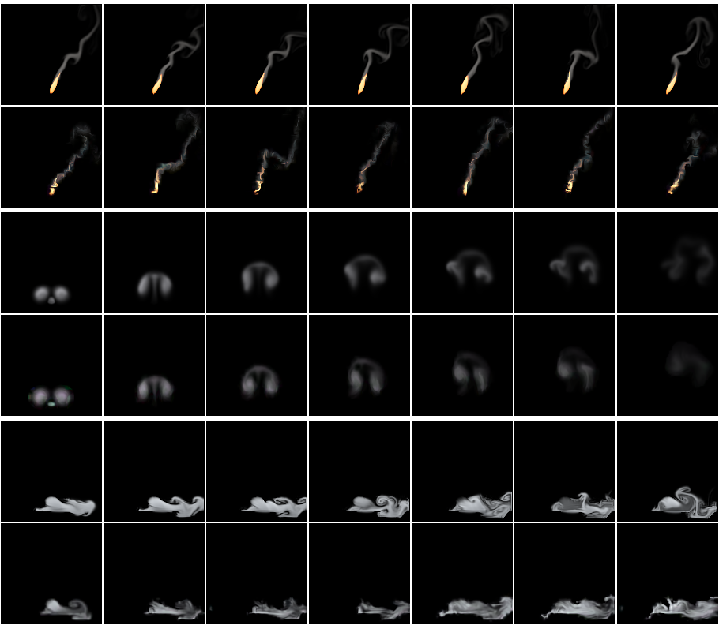
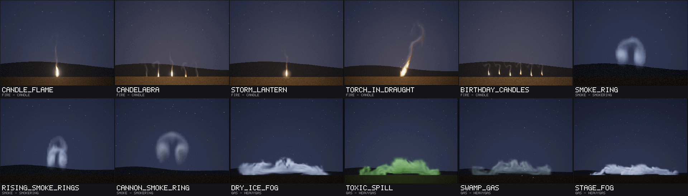
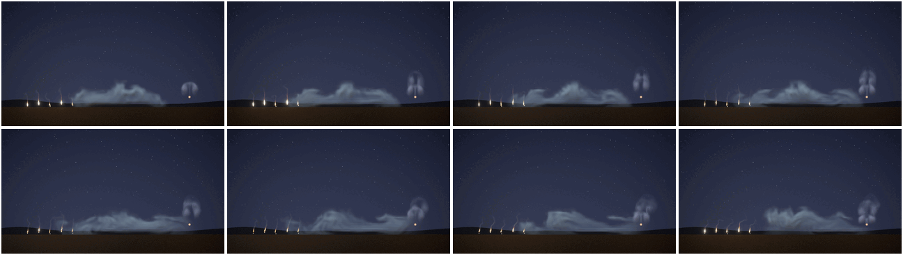

# Air effects: a candle, smoke rings and heavy gas

Status: **done** (20 October 2026; paused from 15 to 20 October). Audience: dev, research, artists. The design of the
test and the rule (§4) were written and committed before any model was trained, and so was the one method of a later
study that this round uses (§3); each model was frozen by its SHA-256 before its one test.

Three effects of the air, after the water round ([EFFECTS_WATER.md](EFFECTS_WATER.md)): a **candle** (a small, calm,
teardrop flame on a wick, mostly steady, flickering and leaning in a draught, with a thin wisp of smoke; it must read
at small sizes: a candle, a torch head, a lantern), a **smoke ring** (one vortex ring puffed from an opening, rising and
spreading slowly as it rolls, then breaking up; it plays once, for 4 s) and **heavy gas** (a dense, cold vapour released
near the ground that spills and flows along it as a gravity current with a rolling front, pools in the low places and
thins: dry-ice fog, a toxic spill, swamp gas, stage fog). They come from the project's own 2D fluid simulator with new
sources, forces and drawing, and are trained and tested as the earlier rounds' were: study D's recipe and protocol
([REPORT.md](REPORT.md) §6), on held-out settings with seeds of this round's own.

## 1. Bottom line

- **The candle works, by the rule set before the test.** From its true state it follows a held-out run 2.9 dB
  [2.4, 3.4] better than the same simulation on the same 32-cell grid with the same detail layer at 1 s (+1.6 at 2 s, a
  tie at 8 s). Played endlessly at settings and seeds it never saw, its average picture is 2.5 dB [0.5, 4.6] closer to
  a real run's than the nearest training flipbook's and its motion error ties the flipbook's (motion ratio 1.06 against
  0.94; a second real run: 1.01); its detail is further from real than the flipbook's (spectrum distance 0.132 against
  0.080). **By eye it is weaker than its numbers**: the learned flame does not hold the simulator's rounded teardrop.
  With the strong sub-grid swirl its calibration chose (3) it is ragged and torn, and its wisp has blue-green fringes;
  the library and the scene play it with a gentler swirl (1, scale 9) and draw it with a field-shader look, which gives
  a narrow, flickering flame on its wick with a grey wisp (§4.6).
- **The smoke ring works, and tracks better than any effect so far**: +7.5 dB [6.6, 8.4] over the coarse simulation at
  1 s and +7.0 [5.6, 8.3] at 2 s. Endless, its average picture is 3.7 dB [2.6, 4.6] closer than the flipbook's and
  **ties a second real run** (+0.2 [-1.9, +2.2]); its motion error is smaller than the flipbook's and ties a second real
  run (motion ratio 1.03; the flipbook 0.84). **It holds its shape**: two cores carrying the smoke, rising together; at
  the test's first held-out setting the share of its cover left of its centre stays at 0.48 to 0.53 through its first two
  seconds (the real run's 0.48 to 0.50), and its centre rises within 0.03 of the frame of the real one's (§4.5). Its weak part is its
  detail: spectrum distance 0.72 against the flipbook's 0.09, and its learned renderer loses its first frame (-4.8 dB;
  25 dB on the true fields of the fresh ring).
- **Heavy gas falls short of the bar without being weak.** It tracks better than the coarse simulation at 1 s (+1.6 dB
  [0.9, 2.2]) and 2 s (+2.1), and ties it at 8 s; but played endlessly its average picture only **ties** the nearest
  flipbook's (+0.2 dB [-1.4, +1.7]), where the rule asks for it to be closer, and its motion error ties the flipbook's
  too (as launch and ink in round 7). Its detail is closer to real than the flipbook's (spectrum distance 0.129 against
  0.198). By eye its layer is streakier than the simulator's: its rolling fronts come out as horizontal streaks and thin
  curls, and its release thins and swells more (§4.2).
- **Cost (provisional, a shared machine, load 5 to 6 on 4 cores):** 82 KB stored for the candle, 294 KB for the ring (16
  start points with 64-pixel fine fields and the mean state), 146 KB for heavy gas; 2.4 to 2.5 MB per instance at 128
  px. At the runtime's int8 default on the AVX-512 build, 0.48 (candle), 0.57 (ring) and 0.43 ms (heavy gas) per 128 px
  frame, where study D's fire took 0.65 ms and its explosion 0.54 in the same rounds (§5).
- **A scene script** (`examples/scenes/crypt.nvfxs`, 9 s) plays all three in a ruined crypt at night: candles flicker
  and lean when the door is thrown open, a tomb's cold vapour spills across the floor and is driven along it by the
  draught, and a censer puffs rings that rise and break up. Its keyframes are frozen (`ctest -R ScriptedCryptFrozen`,
  float on AVX2). **Twelve library entries** (`library/air.nvfxl`) use the models, three of them with frozen keyframes:
  the candles fair, the rings good to fair, the gases fair (§6).
- **What it took:** a preset each, one line in the recipe (heavy gas keeps fine fields with its start points, as fog
  does), study M3's mean state for the one-shot, 2.0 to 2.3 hours of one thread each on the shared machine, and no new
  code in the trainer, the runtime or the compositor.

## 2. The effects

All three are presets of the existing solver (`src/sim/sim.cpp`, in a block of their own: `add_air_sources`,
`add_air_forces`, `air_decay`, `render_air`). Each has three controls in [0, 1]:

| | candle | smokering | heavygas |
|---|---|---|---|
| controls | intensity (size), **draught** (0.5 still air; less blows from the right and leans it left, more from the left), turbulence (flicker) | intensity (strength), wind, turbulence | intensity (release rate), **flow** (0 to the left, 0.5 both ways, 1 to the right), turbulence |
| plays | loops | **once**, 120 frames (4 s) | loops |

Every force is a function of what a learned stepper sees: the state where it acts, the position, the controls and the
run's two noise fields (the curl noise's stream function and the source flicker). Nothing follows a clock of its own.
The smoke ring, which plays once, is made at its first step (as the explosion's burst is) and otherwise follows the
time since its start only through the two decays a learned one-shot sees as inputs (exp(-t / 0.15 s), exp(-t / 1 s)),
as the mushroom does. Rings that repeat (a smoker's rings, a censer's) are the one-shot spawned again, so their timing is
the game's, not a noise gate's (round 7's puffs were weak where a gate timed by noise set their rhythm).

**The smoke ring's length, 120 frames (4 s).** It forms in its first half second (the puff rolls up into the two
cores), rises and spreads as it rolls for about two seconds, slowing as its rotation decays, and in the last second and
a half the curl noise, which stirs it harder as it ages, breaks it up while its smoke thins. Three seconds (the
explosion's length) would cut it off while it still rolls as a ring; five (the mushroom's) would add a second of a
faint, broken haze, and the mushroom showed that a long one-shot, whose look changes over its length, is the hard case
for the learned stepper.

Lengths are in cells of a 128-cell frame and times in seconds; d = 2 draught - 1 and ψ is the curl noise's stream
function where the force acts.

| | candle | smokering | heavygas |
|---|---|---|---|
| what it is | a small flame on a wick in the middle of its frame, 12% up: a teardrop of hot gas (rounded below, pointed above), pale yellow-white inside, orange at its edge; above its tip the gas burns out and goes on rising as a warm, unseen plume that carries a thin grey wisp of smoke to the top of the frame; a draught leans the flame and streams the smoke away | a ring puffed from an opening in the middle near the bottom of the frame: two vortices turning in opposite senses (a ring seen from the side), each core full of warm grey smoke; it rises as it rolls, slows and spreads, and in its last second and a half breaks up into a fading haze | a cold white vapour poured out over a low mound in the middle of the frame; it spills down both sides (or one, with the flow) as a gravity current with a rolling head, runs into a hollow on either side and pools there against a low lip at the frame's edge, thinning slowly |
| source | a teardrop 8 to 15 cells wide and 20 to 36 tall (intensity) whose heat ((1.6 to 1.85) times its shape) and an upward flow of 16 to 26 cells per second are drawn in at 12 per second; it leans by 0.5 d (1 + 0.5 ψ) of its height, and its height breathes by (0.05 + 0.3 turbulence) times the flicker noise (rate 1.2 per second) | at its first step the two cores (Lamb-Oseen vortices) 22 to 32 cells apart (intensity), each 0.7 of the half-spacing across, with the circulation that would carry them up at 24 to 40 cells per second; smoke 1.0 to 1.4 in the cores, lumpy with the flicker noise (rate 1.4), warmth 0.3 of it; for about 0.3 s a little smoke trails out of the opening behind (exp(-t / 0.15 s)) | an oval 16 to 28 cells wide and 14 high (intensity), 26 cells up over the mound: the density is drawn (6 per second) towards (1.2 to 2.0) times a surge, 0.2 + 0.8 smoothstep(-0.35, 0.35, ψ at the release), so the spill swells and slackens over a second or two, broken up by the flicker noise (rate 0.8); it is poured down at 10 to 18 cells per second and sideways at (2 flow - 1) (14 to 32) |
| forces | buoyancy 200, no soot weight; the draught drags the material (3 per second) towards 40 d (1 + 0.6 ψ) cells per second, gusting with the curl noise, and stirs it with curl noise of 18 \|d\| more, so the flame flickers more the harder it blows; velocity damping 0.3; confinement 0.15 to 1.05 and curl noise 2 to 24 (turbulence) | buoyancy 30; **the wind moves the clear air** (drawn at 0.8 per second towards 18 (2 wind - 1) cells per second; the smoky cores five times less), so it carries the ring without stopping its cores turning; damping 0.35 (the ring slows); confinement 0.2 to 1.2, curl noise 4 to 30, and on the smoke curl noise of (10 + 40 turbulence)(1 - exp(-t / 1 s)) more: it breaks up as it ages | no heat; weight 18; **the floor**: a mound 12 cells up (32 cells wide at its top, sloping to the hollows' 4 by 28 cells from the middle), the hollows 18 cells wide, lips rising to 12 cells at the frame's edges; the air in it is still and downward flow stops within 4 cells above it (fog's ground, following the profile), over a closed bottom border; a draught along the floor drags the gas within 25 cells of it (0.8 per second) towards (2 flow - 1) 16 cells per second; damping 0.2; confinement 0.2 to 1.4, curl noise 3 to 17 |
| decay | above a heat of 0.2 the gas burns out at up to 9 per second (the flame's end) and leaves (0.07 + 0.15 turbulence + 0.15 \|d\|) of the heat it loses as soot (the wisp; more when the flame gutters); the plume's warmth fades at 0.3 per second, the smoke at 0.8 | smoke 0.25 per second, warmth 0.8; both spread (4 cells squared a second), so the cores stay broad blobs | 0.08 per second; what the flow carries into the floor is gone |
| drawing | emitted light from a ramp that starts at heat 0.3 (dull red, orange, yellow, a pale yellow-white core), so the warm plume is not seen; grey smoke shaded towards the light | pale grey smoke lit from above and to the left, shaded by itself | a cold white vapour, a little blue where it is deep, barely shaded |

They keep the study's control names but for the candle's second, `draught`, and heavy gas's, `flow`
(`sim::control_names`, so the model files, the runtime and scene scripts call them that; `nvfx_sim` takes `--draught`
and `--flow`). The smoke ring keeps `wind`. Every earlier effect's clips are unchanged to the byte:
`Sim.StudyEffectsAreUnchangedByTheNewOnes` now also hashes clips of the ten effects of rounds 7 and 8 (wildfire, coals,
mushroom, launch, puffs, ink, waterfall, fountain, splash, rainshaft) made before these three existed, and full-size
clips (128 px, 64 frames) of all 21 earlier effects at two settings were compared byte for byte before and after (the
data root's `fx_air/jobs/state/baseline_clips.sha256`). Tests of the new presets:
`Sim.AirEffectsHaveTheirOwnControlsAndOnlyTheRingPlaysOnce`, `Sim.CandleIsASmallSteadyTeardropWithAWispThatLeansInADraught`,
`Sim.SmokeRingRisesAsAVortexPairThatSpreadsAndBreaksUp`, `Sim.HeavyGasSpillsAlongTheFloorAndPoolsInTheHollows`, and in
the recipe `Rollout.AirEffectsTakeTheirRecipes`.

**How they were designed.** Each was looked at with contact sheets at several settings (from an empty grid and in the
steady state) and a scratch probe that printed the amount, centroid and extent of the heat and the smoke over time and
the speed where there is material. What changed on the way:
- **Candle.** The first flame, an egg of heat over the wick with an upward push, accelerated at once into a thin pencil
  with a long red tail, under a cap of smoke that stalled halfway up the frame (the plume cooled and lost its lift). A
  teardrop drawn in whole (its heat and its flow), a fast burn-out above a heat of 0.2 with a light ramp that starts at
  0.3, a plume that cools slowly and more buoyancy gave a steady teardrop with a straight wisp that reaches the top of
  the frame in about two seconds. A draught that leaned only the flame's top looked broken; the whole teardrop now
  leans from the wick, in gusts.
- **Smoke ring.** The first ring had smoke in a puff between its cores too, which wrapped over the top as a hood, and its
  cores wound the smoke into thin spirals (the kind of thin, regular structure that study L found the 32-cell state
  loses). Smoke only within the cores' solid turning and a little spreading keep the cores broad. A wind that dragged
  the smoke towards its speed (as the other effects' wind) stopped the cores turning and hardly moved the ring; the wind
  now moves the clear air, which carries the ring. Without a break-up it was still a tidy ring after 4 s; the curl noise
  now stirs its smoke harder as it ages.
- **Heavy gas.** The first release, low and heavy (weight 35 to 60), spread into a flat layer 10 cells deep that read as
  a stripe, and it covered the floor evenly once settled. Lighter gas (18) and a bigger release give a layer 15 to 25
  cells deep with a rolling head; a release that swells and slackens with the curl noise sends new fronts out over the
  pool; a release at 46 cells read as a tap pouring from mid-air, at 26 it spills onto the mound. The floor's mound,
  hollows and lips are what the gas pools in; they are not drawn (the scene's or the game's ground is).


How fast they move, at two settings (all controls 0.5 and all 1; cells of a 128-cell frame per second where there is
material, median and 99th percentile; the looping effects over frames 150 to 240, the smoke ring over its 120 frames; a
coarse cell is 4 cells, a frame 1/30 s; the same probe for fire and smoke):

| effect | median | 99th percentile | in coarse cells a frame (99th) |
|---|---:|---:|---:|
| fire | 54 to 69 | 129 to 131 | 1.07 to 1.09 |
| smoke | 39 to 60 | 108 to 130 | 0.90 to 1.08 |
| candle | 35 to 36 | 66 to 82 | 0.55 to 0.68 |
| smokering | 16 to 26 | 78 to 98 | 0.65 to 0.82 |
| heavygas | 7 to 14 | 17 to 31 | 0.14 to 0.26 |

The candle's flame is calm (its gas is held in the teardrop) and only its plume moves at fire's pace; the ring turns
at two thirds to four fifths of fire's fastest flow, well under magic's 1.3 to 1.9 coarse cells a frame that study L
found the 32-cell state smears; heavy gas is the slowest after ink.

## 3. Training

Study D's recipe (`rollout::recipe_for`), in its three saved steps (`d-train --stages12 1`, `d-tune`, `d-finish`), one
effect at a time, one thread, `nice 15`, each from a frozen copy of the tool, resumable (the data root's
`fx_air/jobs`). Its branches decide the rest: the candle takes fire's settings (160 runs of 240 frames, 8 start points,
fine fields grown at instance start); heavy gas lingers as fog does, so it keeps 64-pixel fine fields with its 8 start
points (one new line in the recipe); the smoke ring plays once, so it takes the one-shot branch (240 runs of its 120
frames, 16 start points at its first frame with 64-pixel fine fields).

**A method of a later study, decided before any training or validation: the smoke ring gets study M3's mean state**
([REPORT.md](REPORT.md) §14.9). A one-shot played from one of 16 stored first states at another intensity stays the
size of its stored start (the explosion's and dust's fault, §14.1); the mean state moves each start point to the
requested controls by a quadratic fit of the training runs' first coarse states (`nvfx_ordered --study m3 fitmean
--block 2`, on this effect's own salt-1 training runs, under the data root's `fx_air`; `setmean` writes it into the
finished model), and study M3 found it better on held-out settings for both one-shots it was tried on and worse on
nothing. It is added after `d-finish` and before the model is frozen; the file that is frozen and tested is the one with
the mean state. Nothing else from studies D2, L, M, M2 or M3 is used: the ensemble-mean fine-tune helped fire and magic
but not steam or the jet (§14.8), the swirl at 16 pixels changes only the detail spectrum and helps or hurts with the
swirl's strength, and two detail passes are for flows faster than a coarse cell a frame, which these are not.

**How it ran.** Each effect in study D's three saved steps from the same frozen copy of the tool (built at commit ce716ef,
`fx_air/jobs/nvfx_experiment_train`), one thread, `nice 15`, by a resumable queue (`fx_air/jobs/pipeline.sh`: train, the
ring's mean state, `d-chaos`, freeze, the test), on a machine shared with three other agents (load 5 to 13 on 4
cores). The candle and the ring trained on 15 and 16 October; the round was then paused, and the machine restarted on 20
October, killing the queue between the ring's test and heavy gas's training; heavy gas trained on 20 October from the same
tool, its preset the same to the byte in the committed code (full-size clips at two settings compared,
`fx_air/jobs/state/*.preset.sha256`, as were the other two's). No step had to run again.

| effect | runs x frames | simulation (recorded in) | stages 1-2 (loss, s) | stage 3 (loss, s) | renderer (training samples) | contrast, swirl, grow | detail score | start points | stored |
|---|---|---|---|---|---:|---|---:|---:|---:|
| candle | 160 x 240 | 21.3 min (342 s) | 0.0400, 5210 | 0.0391, 1306 | 35.0 dB | 0.5, 3, 1 | 0.45 | 8 (grown) | 82 KB |
| smokering | 240 x 120 | 16.0 min (196 s) | 0.0067, 6151 | 0.0064, 1086 | 42.3 dB | 0.5, 0, 1 | 0.92 | 16 (64 px fine) | 274 KB, 294 KB with the mean state |
| heavygas | 160 x 240 | 21.3 min (202 s) | 0.0212, 4865 | 0.0208, 1184 | 40.0 dB | 1, 0, 1 | 0.45 | 8 (64 px fine) | 146 KB |

In all 2.3 hours for the candle (138 minutes: 93 for stages 1 and 2, 26 for stage 3, 20 for the last step), 2.3 for the
ring (137 minutes and 3 for its mean state) and 2.0 for heavy gas (120 minutes), each alone. The loss columns are not
comparable between effects (each is normalised by its own state's scale). The calibration chose the strongest sub-grid
swirl (3) for the candle, as for launch and the water bodies, and none for the ring and heavy gas; half the contrast for
the candle and the ring (new material arrives less broken up). **The ring's mean state**: the quadratic fit of its
training runs' first coarse states explains, cross-validated, 99.9% of the variation over the control space in its
velocity and 91% in its heat and soot (the explosion's: 81 to 98%); `setmean` added 20.5 KB.

Each model was frozen before its test: [fx_air_frozen.csv](../results/experiments/fx_air_frozen.csv) has their SHA-256
(the files are under the data root's `fx_air/models/d`, copies under `fx_air/models/frozen`).

**How chaotic they are** (`nvfx_experiment d-chaos`, as [REPORT.md](REPORT.md) §6.1: active PSNR against the
undisturbed run, mean over 4 runs; [d_chaos.csv](../results/experiments/fx_air/d_chaos.csv); the tool's own seeds,
as every round's):

| effect | case | 1 frame | 0.5 s | 1 s | 2 s | 4 s | 8 s |
|---|---|---:|---:|---:|---:|---:|---:|
| candle | start nudged by 1e-3, same seed | 75.6 | 70.6 | 68.8 | 65.7 | 60.5 | 62.1 |
| candle | start nudged by 1e-1, same seed | 54.4 | 47.4 | 43.4 | 38.0 | 29.8 | 38.0 |
| candle | same start, other seed | 36.4 | 25.1 | 21.9 | 18.8 | 17.9 | 17.6 |
| candle | other start, same seed | 18.6 | 19.1 | 18.9 | 20.3 | 21.6 | 26.6 |
| smokering | start nudged by 1e-3, same seed | 74.6 | 70.4 | 69.3 | 66.5 | 66.3 (its last frame) | - |
| smokering | start nudged by 1e-1, same seed | 54.9 | 48.9 | 48.1 | 49.6 | 53.8 | - |
| smokering | same start, other seed | 60.9 | 30.9 | 24.7 | 21.4 | 24.6 | - |
| smokering | other start, same seed | 31.3 | 34.1 | 36.3 | 37.9 | 41.9 | - |
| heavygas | start nudged by 1e-3, same seed | 77.4 | 70.9 | 70.2 | 69.2 | 68.1 | 67.0 |
| heavygas | start nudged by 1e-1, same seed | 58.3 | 48.6 | 46.4 | 43.7 | 43.9 | 46.4 |
| heavygas | same start, other seed | 39.1 | 21.0 | 16.0 | 13.0 | 12.2 | 12.9 |
| heavygas | other start, same seed | 10.3 | 10.5 | 10.8 | 11.7 | 14.0 | 18.2 |

- **The candle behaves as fire does, calmer**: a small error stays small for seconds, and the seed takes over within a
  second, less completely than fire's (22 dB from another seed after 1 s, fire's 13): its flame stays on its wick, only
  its tip and its wisp move.
- **The ring is the most predictable effect so far**: another seed leaves it at 25 dB after a second and 21 after two (the
  explosion: 16 and 14), and runs from other start points with the same seed draw together (42 dB at 4 s): the puff
  decides the ring, the noise only how it breaks up.
- **Heavy gas behaves as fog does**: another seed decides the look within a second (16 dB), and runs from other starts
  are far apart for seconds (11 to 12 dB), drawn together only slowly by the same seed (18 dB at 8 s).

## 4. The test

**Written before any model was trained, and committed with it.** Each model is frozen by its SHA-256
(`results/experiments/fx_air_frozen.csv`) before its own test, and each test runs **once**, with `nvfx_experiment d-eval`
and `d-report` unchanged: study D's protocol ([REPORT.md](REPORT.md) §6.4 to §6.6), exactly as rounds 7 and 8 tested
their effects ([EFFECTS_BLAZE.md](EFFECTS_BLAZE.md) §4, [EFFECTS_FLOW.md](EFFECTS_FLOW.md) §4). The models train one at a
time on the shared machine, so the test runs in parts on this one design (`d-eval --effects candle`, then the others as
each is frozen), each into a folder of its own, the rows then merged into one set of CSVs under
`results/experiments/fx_air`. Every run of the test is independent and seeded by its effect, run and setting, so the
split changes no number.

- **Seeds: this round's own, 6,400,000 and up** (`--seed-base 6400000`; this round owns 6,400,000 to 6,799,999 and uses
  no other seeds in its test): the held-out tracking runs 6,400,000 + run; the real runs at the held-out settings
  6,500,000 + setting and 6,510,000 + setting; the neural run 6,520,000 + setting; the coarse simulation 6,530,000 +
  setting; the one-minute runs 6,540,000 + setting. Training and validation use the recipe's own seeds (600,000 + run,
  and those derived from the training runs for the detail constants), as every round's did.
- **Tracking from the true state:** 8 held-out runs per effect (salt 2's settings, which no training or validation run
  used), each started from its true state (coarse and fine fields; the candle and heavy gas after 100 frames, the smoke
  ring after its first frame) with its own noise seed: 240 frames (the smoke ring: to its last frame, 119). The neural
  rollout through the runtime against the simulation on the same 32-cell grid with the same detail layer
  (`coarse_sim_detail`), the plain coarse simulation, holding the first frame, and the neural dynamics drawn by the
  simulation's renderer. Active PSNR at 1 and 8 frames and at 1, 2 and 8 s (the smoke ring: 1 and 8 frames, 1 and 2 s;
  `d-eval`'s next horizon, 4 s, is past its last frame); the neural run minus `coarse_sim_detail`, paired over the 8
  runs.
- **Endless runs at settings never seen:** the ten held-out settings of study B (`b_test_settings`: none on study B's
  training grid), 10 s each after a 5 s warm-up of the real runs (the smoke ring: its 4 s from its start). Frame
  statistics against a real run: detail spectrum distance, motion ratio (as the error |ln ratio|), coverage distance and
  mean-frame PSNR. Compared with a second real run with another seed (the floor), the nearest of the 45 training
  flipbooks of study B's grid (made for these effects as study B made its library: 64 frames at 128 px, seed 1, looped;
  the smoke ring's are 64 frames held on the last, as the explosion's, since its 120 frames are less than twice 64), and
  the coarse simulation with the detail layer and without.
- **One minute:** a 60 s neural run in shards at the first two held-out settings, cut into 10 s windows, each against
  the real 10 s run (the candle and heavy gas; the smoke ring plays once).
- **Precision:** the runtime plays the effects as they ship, at its default precision, int8 since study K
  ([REPORT.md](REPORT.md) §13); `d-eval` sets none, so the `neural` rows are int8.
- **Statistics:** every difference paired (over runs or settings), with a 95% bootstrap interval of 10,000 resamples
  (`metrics::paired_bootstrap`); an interval across zero is a tie, reported as a tie. Every number is reported.

**The rule, decided now, as rounds 7 and 8 decided theirs.** An effect
- **works** if it tracks its runs better than `coarse_sim_detail` at 1 s (interval above zero) and, played endlessly,
  its average picture is closer than the nearest flipbook's (mean-frame PSNR interval above zero) and its motion error is
  no worse than the flipbook's (interval not above zero);
- is **weak** if it ties or loses to `coarse_sim_detail` at tracking at 1 s, or if, played endlessly, its average picture
  or its motion error loses to the flipbook's (interval on the worse side);
- otherwise **falls short**: it neither works nor is weak (as launch and ink did in round 7: tracking better, the average
  picture tied with the flipbook's).

For the smoke ring the question the study L lesson raises is answered beside the rule, not by it: whether the learned
ring holds its shape (two cores carrying the smoke, rising together) through its first two seconds, judged on the
test's first held-out setting by eye, from frames of the real run and the neural run side by side, and by the share of
its smoke in the left and the right half of the frame (a ring that holds its shape keeps it near a half each).

**How it ran.** The design held. Each test ran once, with the frozen tool, into a folder of its own under the data
root (`fx_air/test/EFFECT`), right after its model was frozen: the candle on 15 October (3.4 minutes, one thread), the
ring on 16 October (1.3 minutes) and heavy gas on 20 October (2.8 minutes); their rows were merged into
[d_track.csv](../results/experiments/fx_air/d_track.csv), [d_stats.csv](../results/experiments/fx_air/d_stats.csv) and
[d_long.csv](../results/experiments/fx_air/d_long.csv), and `d-report` wrote
[D_SUMMARY.md](../results/experiments/fx_air/D_SUMMARY.md). The `neural` rows played at int8 (the runtime's default;
the AVX-512 build with VNNI).

### 4.1 Tracking from the true state

Active PSNR (dB), mean over 8 held-out runs (the ring's last horizon is 2 s):

| effect | method | 1 frame | 8 frames | 1 s | 2 s | 8 s |
|---|---|---:|---:|---:|---:|---:|
| candle | neural | 29.1 | 20.2 | 18.2 | 16.3 | 14.8 |
| candle | neural dynamics, simulation's renderer | 31.3 | 20.2 | 18.2 | 16.2 | 14.7 |
| candle | coarse simulation + detail | 27.7 | 17.3 | 15.3 | 14.7 | 14.1 |
| candle | coarse simulation | 20.1 | 17.5 | 16.1 | 15.4 | 14.9 |
| candle | holding the first frame | 31.1 | 17.2 | 15.3 | 15.1 | 14.6 |
| smokering | neural | 24.6 | 27.8 | 29.9 | 27.5 | - |
| smokering | neural dynamics, simulation's renderer | 30.9 | 31.6 | 30.7 | 27.6 | - |
| smokering | coarse simulation + detail | 29.4 | 27.1 | 22.4 | 20.5 | - |
| smokering | coarse simulation | 27.4 | 27.0 | 23.7 | 21.5 | - |
| smokering | holding the first frame | 24.3 | 12.2 | 10.7 | 12.0 | - |
| heavygas | neural | 32.1 | 21.5 | 17.0 | 15.1 | 11.5 |
| heavygas | neural dynamics, simulation's renderer | 34.7 | 21.8 | 17.1 | 15.2 | 11.5 |
| heavygas | coarse simulation + detail | 35.6 | 20.5 | 15.4 | 13.0 | 11.6 |
| heavygas | coarse simulation | 19.1 | 18.9 | 17.6 | 15.7 | 14.3 |
| heavygas | holding the first frame | 34.9 | 18.1 | 10.9 | 8.8 | 8.3 |

Neural minus coarse simulation + detail, paired over runs (95% intervals; bold: the neural rollout is better):

| effect | 1 frame | 8 frames | 1 s | 2 s | 8 s |
|---|---|---|---|---|---|
| candle | +1.45 [-0.07, +2.77] (tie) | **+2.85 [+1.99, +3.73]** | **+2.90 [+2.35, +3.41]** | **+1.61 [+0.76, +2.41]** | +0.72 [-0.28, +1.70] (tie) |
| candle, neural dynamics with the simulation's renderer | **+3.63 [+2.05, +5.10]** | **+2.83 [+2.04, +3.62]** | **+2.92 [+2.32, +3.46]** | **+1.58 [+0.72, +2.36]** | +0.65 [-0.31, +1.49] (tie) |
| smokering | -4.79 [-5.79, -3.94] | **+0.69 [+0.32, +1.07]** | **+7.51 [+6.62, +8.44]** | **+6.98 [+5.63, +8.34]** | - |
| smokering, neural dynamics with the simulation's renderer | **+1.52 [+0.65, +2.24]** | **+4.54 [+4.21, +4.86]** | **+8.34 [+7.35, +9.32]** | **+7.09 [+5.60, +8.62]** | - |
| heavygas | -3.50 [-5.16, -1.89] | **+1.03 [+0.57, +1.46]** | **+1.61 [+0.92, +2.15]** | **+2.11 [+1.57, +2.64]** | -0.10 [-0.44, +0.29] (tie) |
| heavygas, neural dynamics with the simulation's renderer | -0.90 [-2.11, +0.53] (tie) | **+1.29 [+0.77, +1.78]** | **+1.70 [+0.97, +2.30]** | **+2.20 [+1.66, +2.72]** | -0.12 [-0.46, +0.28] (tie) |

- **All three learned dynamics follow a run better than the simulation on the same grid from the eighth frame to 2 s.**
  The ring by 7.5 dB at 1 s, more than any effect so far (the coals' 4.7 and the explosion's 4.7 were the most): the 32-cell
  simulation of two vortices loses their turning (its ring falls apart and lags), while the learned stepper carries the
  ring as it was trained to, from the same first state every time (§3: the puff decides the ring). The candle by 2.9 dB,
  as fire's flames do (2.1 in study D); heavy gas by 1.6, as fog (2.1), and a tie at 8 s.
- **The ring's and heavy gas's first frames are lost to their renderers, not their dynamics**: drawn by the simulation's
  renderer the same dynamics lead (+1.5) or tie (-0.9) at the first frame. The ring's learned renderer reaches 25 dB on
  the true fields of its first frame (31.5 over its first second; the fresh ring, two dense smoky cores, is rare in its
  training samples, as the explosion's fresh fireball was) and shows magenta and green tints there. Heavy gas's renderer
  reaches 36 dB on the true fields; its first frame is lost to the coarse-to-fine lock on a dense new release.
- As on fog and launch, the plain coarse simulation, with no detail, scores a little higher on heavy gas from 1 s (17.6
  dB against 17.0): a blurred picture is the best guess in PSNR once the detail has decorrelated, though far too smooth to
  use (its spectrum distance in §4.2: 1.22).

### 4.2 Endless runs at settings never seen

Means over the 10 held-out settings (spectrum distance and coverage distance: lower is better; motion ratio: 1 is
right; mean-frame PSNR: higher is closer):

| effect | method | spectrum | motion | coverage | mean-frame PSNR |
|---|---|---:|---:|---:|---:|
| candle | real, other seed (floor) | 0.015 | 1.01 | 0.0019 | 38.5 |
| candle | **neural rollout (82 KB)** | 0.132 | 1.06 | 0.0051 | 26.8 |
| candle | nearest training flipbook | 0.080 | 0.94 | 0.0051 | 24.3 |
| candle | coarse simulation + detail | 0.127 | 0.92 | 0.0064 | 26.6 |
| candle | coarse simulation | 0.708 | 0.39 | 0.0108 | 25.9 |
| smokering | real, other seed (floor) | 0.049 | 1.01 | 0.0010 | 33.7 |
| smokering | **neural rollout (294 KB)** | 0.718 | 1.03 | 0.0016 | 33.9 |
| smokering | nearest training flipbook (64 frames, held) | 0.091 | 0.84 | 0.0051 | 30.2 |
| smokering | coarse simulation + detail | 0.987 | 0.92 | 0.0010 | 32.9 |
| smokering | coarse simulation | 0.319 | 0.82 | 0.0011 | 33.3 |
| heavygas | real, other seed (floor) | 0.078 | 0.97 | 0.0111 | 26.4 |
| heavygas | **neural rollout (146 KB)** | 0.129 | 1.06 | 0.0141 | 22.3 |
| heavygas | nearest training flipbook | 0.198 | 0.98 | 0.0132 | 22.1 |
| heavygas | coarse simulation + detail | 0.156 | 1.11 | 0.0156 | 23.1 |
| heavygas | coarse simulation | 1.218 | 0.54 | 0.0085 | 24.3 |

Neural minus each other method, paired over the 10 settings (motion as the error |ln ratio|; bold: the neural rollout
is better):

| effect | statistic | nearest flipbook | coarse simulation + detail | real, other seed |
|---|---|---|---|---|
| candle | spectrum distance | +0.052 [+0.026, +0.079] | +0.006 [-0.009, +0.019] (tie) | +0.117 [+0.098, +0.137] |
| candle | mean-frame PSNR (dB) | **+2.53 [+0.53, +4.58]** | +0.28 [-1.02, +1.76] (tie) | -11.66 [-14.91, -8.72] |
| candle | motion error | -0.042 [-0.203, +0.105] (tie) | +0.001 [-0.096, +0.093] (tie) | +0.092 [+0.018, +0.178] |
| candle | coverage distance | -0.0000 [-0.0023, +0.0025] (tie) | - | +0.0032 [+0.0018, +0.0049] |
| smokering | spectrum distance | +0.627 [+0.594, +0.662] | **-0.268 [-0.340, -0.190]** | +0.669 [+0.642, +0.698] |
| smokering | mean-frame PSNR (dB) | **+3.70 [+2.63, +4.64]** | +0.96 [-0.24, +2.28] (tie) | +0.21 [-1.91, +2.22] (tie) |
| smokering | motion error | **-0.150 [-0.237, -0.071]** | -0.015 [-0.052, +0.026] (tie) | +0.013 [-0.028, +0.052] (tie) |
| smokering | coverage distance | **-0.0035 [-0.0053, -0.0018]** | - | +0.0006 [+0.0002, +0.0011] |
| heavygas | spectrum distance | **-0.069 [-0.121, -0.015]** | -0.027 [-0.065, +0.015] (tie) | +0.051 [+0.006, +0.093] |
| heavygas | mean-frame PSNR (dB) | +0.16 [-1.42, +1.71] (tie) | -0.80 [-2.03, +0.42] (tie) | -4.07 [-6.17, -1.68] |
| heavygas | motion error | -0.120 [-0.260, +0.019] (tie) | -0.002 [-0.092, +0.079] (tie) | +0.013 [-0.094, +0.119] (tie) |
| heavygas | coverage distance | +0.0009 [-0.0036, +0.0055] (tie) | - | +0.0030 [-0.0049, +0.0084] (tie) |

- **The candle**: its average picture is closer than a flipbook's of a neighbouring setting (whose flame leans the
  wrong way or is the wrong size) and its motion ties the flipbook's, but both are far from a second real run's: the
  average picture 11.7 dB [8.7, 14.9] below the floor, the largest gap of this round. A candle's frame is mostly empty
  and its flame stands still, so two real runs agree closely (38.5 dB), and the learned flame, narrower than the real
  teardrop and with the detail layer's shreds, is in its mean frame a different shape. Its detail ties the coarse
  simulation's and is further from real than the flipbook's.
- **The ring** is, in its average picture and its motion, as close to a real run as a second real run is (both ties),
  and closer than the flipbook (a neighbouring setting's ring, which then holds its last frame for half of the 4 s).
  Its detail is the furthest from real of any effect so far (0.72): not studied here. The real ring is very smooth (its
  smoke spreads), so the measure is sensitive to whatever fine structure the detail layer and the learned renderer add
  (the coarse simulation with the same detail layer is further still, 0.99, and without it 0.32); the renderer's tints
  on the fresh ring may add to it.
- **Heavy gas** ties the flipbook on the average picture, the motion and the coverage, and beats it on detail; it ties
  the coarse simulation on everything but is 4.1 dB [1.7, 6.2] behind a second real run in its average picture. By eye
  (the figure below) the learned layer is streakier than the simulator's: its rolling fronts come out as horizontal
  streaks and thin curls, and its release over the mound thins and swells more than the real one.



### 4.3 One minute without a restart

| effect | spectrum distance | motion ratio | mean-frame PSNR |
|---|---|---|---|
| candle | 0.08-0.19 | 0.76-1.58 | 24.7-30.0 |
| heavygas | 0.05-0.16 | 0.96-1.39 | 19.2-25.4 |

Ranges over six 10 s windows at each of the first two held-out settings (the ring plays once). Neither drifts: the last
windows are as good as the first. The candle moves too little at the first setting (0.76 to 0.98) and too much at the
second (1.30 to 1.58) in every window, as in its 10 s runs there; heavy gas moves too much in four of the six windows at
the second (1.37 to 1.39).

### 4.4 By the rule

- **The candle works**: it tracks better than the coarse simulation at 1 s (+2.90 [2.35, 3.41]), its average picture is
  closer than the flipbook's (+2.53 [0.53, 4.58]) and its motion error ties the flipbook's.
- **The smoke ring works**: +7.51 [6.62, 8.44] at 1 s, an average picture closer than the flipbook's (+3.70 [2.63, 4.64])
  and a motion error smaller than it (-0.150 [-0.237, -0.071]). Its detail, far worse than the flipbook's, does not decide
  by the rule, but it is the thing to improve.
- **Heavy gas falls short**: it tracks better than the coarse simulation at 1 s (+1.61 [0.92, 2.15]) and its motion error
  ties the flipbook's, but its average picture only ties the flipbook's (+0.16 [-1.42, +1.71]), where the rule asks for
  an interval above zero; nor does it lose anything the rule names as weak.

### 4.5 Does the learned ring hold its shape?

Answered beside the rule, as decided (§4). At the test's first held-out setting (controls 0.31, 0.88, 0.74: a weak puff
in a wind to the right, turbulent), the real run (seed 6,500,000) and the neural run (6,520,000) as `d-eval` made them,
by the share of each frame's cover (alpha) left of its own centre and the centre's height (a scratch measurement, not part
of `d-eval`; the second setting, 0.10, 0.45, 0.38, beside it):

| | 0 s | 0.5 s | 1 s | 1.5 s | 2 s | 3 s | 4 s |
|---|---|---|---|---|---|---|---|
| setting 0, real: left share, centre height | 0.50, 0.18 | 0.50, 0.28 | 0.50, 0.35 | 0.49, 0.40 | 0.48, 0.44 | 0.49, 0.49 | 0.49, 0.51 |
| setting 0, neural | 0.48, 0.18 | 0.51, 0.27 | 0.52, 0.32 | 0.53, 0.37 | 0.51, 0.41 | 0.51, 0.47 | 0.54, 0.51 |
| setting 1, real | 0.48, 0.17 | 0.48, 0.26 | 0.47, 0.32 | 0.47, 0.36 | 0.46, 0.39 | 0.46, 0.41 | 0.46, 0.42 |
| setting 1, neural | 0.48, 0.18 | 0.49, 0.25 | 0.51, 0.32 | 0.51, 0.36 | 0.53, 0.40 | 0.52, 0.45 | 0.51, 0.49 |

**It does.** Through its first two seconds the learned ring keeps its two cores carrying the smoke, balanced (0.48 to
0.53 left of centre) and rising with the real ring (within 0.03 of the frame's height; the weak puff a little slower, the
weakest a little faster at the end), and then breaks up into a haze as the real one does (figure above, middle rows).
Two differences by eye: its rolled-up curls are softer than the real ring's, and the weakest puffs keep rising a little
where the real ring stalls. Study L's lesson held: kept broad and slow (0.65 to 0.82 coarse cells a frame, §2), a
regular rotation is carried by the 32-cell state.

### 4.6 After the test: the candle's detail as the library draws it

Not part of the test's design. The candle model's calibration chose the strongest sub-grid swirl (3), which tears its
small flame into shreds; the library and the scene play it with `swirl 1, swirl_scale 9` (as launch). The same test, run
once more after the test on a copy of the frozen model with that swirl (same tool, seeds and settings, into its own
folder under the data root's `fx_air/check_swirl1`), says what the gentler look costs and gains:

| | tracking at 1 s, against coarse simulation + detail | spectrum distance | motion ratio | mean-frame PSNR against the flipbook |
|---|---|---:|---:|---|
| as calibrated (swirl 3), the test | +2.90 [+2.35, +3.41] | 0.132 | 1.06 | +2.53 [+0.53, +4.58] |
| the library's (swirl 1, scale 9) | +4.29 [+3.58, +5.01] | 0.236 | 0.84 | +2.67 [+0.60, +4.78] |

As for launch: the smoother flame follows a run better and its average picture is as close, but its fine detail is
further from the simulation's and it moves 16% too little. By eye it is the better candle (§6). The library also draws
it with a field-shader look (`candlelight`), as the mushroom's entries draw it with `cloud`, since its learned renderer
gives the wisp blue-green fringes; that look was not measured.

## 5. Memory and cost

Per frame through `nvfx_render` on one pinned core, with study D's fire and explosion measured in the same session
(`nvfx_experiment d-timing`, twelve rounds back to back, 20 October 2026; [d_timing.csv](../results/experiments/fx_air/d_timing.csv)
has the first round, [d_timing_rounds.csv](../results/experiments/fx_air/d_timing_rounds.csv) all of them): the least of
the rounds' medians and, in brackets, the median of the rounds. All at the runtime's default precision, int8 (the AVX2
rows force the AVX2 build, whose int8 kernels the runtime takes on a CPU without VNNI; the AVX-512 row is what this
machine plays by default). **Provisional**: the machine was shared with three other agents' jobs (load 5 to 6 on 4 cores
during the rounds).

| effect | stored | resident | per instance at 128 px | 64 px, AVX2 | 128 px, AVX2 | 256 px, AVX2 | 128 px, AVX-512 (the default) | restart (AVX2, 128 px) |
|---|---:|---:|---:|---:|---:|---:|---:|---:|
| candle | 82 KB | 163 KB | 2.4 MB | 0.44 ms (0.46) | 0.70 ms (0.73) | 1.60 ms (1.66) | **0.48 ms** (0.50) | 15 ms (1 s warm-up) |
| smokering | 294 KB | 804 KB | 2.5 MB | 0.59 ms (0.63) | 0.76 ms (0.79) | 1.02 ms (1.11) | **0.57 ms** (0.60) | 0.4 ms |
| heavygas | 146 KB | 419 KB | 2.4 MB | 0.43 ms (0.44) | 0.63 ms (0.65) | 1.19 ms (1.24) | **0.43 ms** (0.44) | 0.4 ms |
| fire (study D's, same session) | 82 KB | 163 KB | 2.4 MB | 0.45 ms (0.47) | 0.89 ms (0.91) | 2.29 ms (2.38) | 0.65 ms (0.67) | 15 ms (1 s warm-up) |
| explosion (study D's, same session) | 274 KB | 804 KB | 2.4 MB | 0.43 ms (0.44) | 0.73 ms (0.75) | 1.44 ms (1.58) | 0.54 ms (0.58) | 0.3 ms |

The same network as study D's, so the same per-pixel work (1012 multiply-adds per pixel at 128 px). All three cost less
than fire at 128 and 256 px: much of their frames is empty or smooth, which the detail layer and the renderer pass
quickly. The candle grows its fine fields at instance start, as fire does (a restart costs a 1 s warm-up, 15 ms); the
ring and heavy gas store theirs with their start points and restart in under half a millisecond. The ring's mean state
is applied once, when it starts. For scale, the 32-cell simulation of each with its own renderer costs 3.2 to 3.3
(candle), 4.1 to 4.2 (ring: its smoke's spreading is a pass of its own) and 2.6 to 2.7 ms (heavy gas) in our scalar
code, against 1.2 ms for fire's.

## 6. The library and a scene

**Twelve library entries** (`library/air.nvfxl`; the models in `library/models.nvfxl`, the candle there with `swirl 1,
swirl_scale 9`), judged by eye from sheets, close shots, a 30-second play of the loops and each one-shot through its
length ([LIBRARY.md](LIBRARY.md) has the notes):
- the candle: `candle_flame`, `candelabra`, `storm_lantern`, `torch_in_draught` and `birthday_candles`, **fair**: they read
  as candle flames at small sizes, each on its wick with a thin wisp, leaning and fluttering in a draught; the learned
  flame is narrower than the simulator's teardrop and its wisp has a faint red glow just above the flame. They are drawn
  by a field-shader look (`candlelight`), as the learned renderer gave the wisp blue-green fringes.
- the smoke ring: `smoke_ring` **good**, `rising_smoke_rings` and `cannon_smoke_ring` **fair**: a ring seen side-on, two
  rolled cores under a hood of smoke, rising, spreading and breaking up; repeated rings are the one-shot started again
  in turn on three modules every 1.8 s, so they overlap as they rise; the cannon's big ring breaks into two columns at
  the end. Drawn by looks (`incense`, `powder`).
- heavy gas: `dry_ice_fog`, `toxic_spill`, `swamp_gas` and `stage_fog`, **fair**: a low layer of vapour poured out and
  flowing along the ground with soft rolling fronts; streaky at times, and the two releases of `stage_fog` stay two humps
  more than one layer. The tile's mound and hollows are not drawn: an entry stands the mound's top on the ground, so its
  hollows are under the ground line and the pools in them are hidden.

Three of them have frozen keyframes (`candelabra`, `smoke_ring`, `dry_ice_fog`: `ctest -R LibraryAirKeyframesFrozen`,
[frozen_air.csv](../results/library/frozen_air.csv), float on AVX2); they are the same on one and two threads. What it
took: a candle tile's wick is 12.5% up its middle, so its modules stand there with `sink 0.125`; a ring's opening is 11%
up (`sink 0.11`); the ring's module needs another name than `ring`, a word of the language; the looks of a file are
declared before its first entry, and two of this file's first names (`toxic`, `marsh`) were taken by other files' looks.
Nothing was added to the compositor, the runtime or the library's code.



**The scene**: `examples/scenes/crypt.nvfxs` (9 s at 1280 x 720 and 30 fps, about 85 lines). The floor of a ruined crypt,
open to the night. A row of five candles burns on the left (the candle model, drawn by the `candlelight` look); in the
middle a cold vapour spills out of a broken tomb and flows along the floor both ways (a heavy gas tile 900 world pixels
wide, its mound the tomb's broken lid); on the right a censer's coals glow and it puffs a ring of incense every 1.6 s
(three smoke ring modules started in turn; study M3's mean state moves each to the scene's controls). At 2.5 s the door
on the left is thrown open: a draught blows in (the candles' `draught` control to 0.8 with gusts and their turbulence
up, the vapour's `flow` to 0.9, the rings' `wind` to 0.8), a little moonlight and a few dead leaves come in with it;
at 6.2 s it swings to and the air calms. Nothing was added to the compositor or the runtime.



The video (rendered at the runtime's int8 default) and the full keyframes are under the data root's `fx_air/scene`
(outside git); the keyframes' SHA-256 are in [fx_air_frozen.csv](../results/experiments/fx_air_frozen.csv) and `ctest -R
ScriptedCryptFrozen` checks them (pinned to float on the AVX2 build, skipped without the effects in
`NEURALFX_MODELS_AIR`, by default `$NEURALVFX_DATA/fx_air/models/scene`). They are the same on 1 and 2 threads. It plays
without an allocation in its frame loop, at 19 ms per frame on 2 threads at float and 28 ms at int8 on the busy machine
(the modules' steps 4.8 and 2.6 ms of it; the rest varied with the other agents' jobs; provisional).

What works: the three read as candles, a crypt's cold vapour and a censer's rings, and one draught moves all three. What
does not, yet: nothing draws the candles, the tomb or the censer (only their flames, vapour, coals and smoke); the candles
are small at this scale; the vapour's tile shows a soft flat top at times; the rings are pale and ghostly.

## 7. What it means

- **Broad, slow structures learn well, even a regular rotation.** The smoke ring, a vortex pair turning at two thirds of
  fire's fastest flow, is carried by the 32-cell state better than any effect so far (7.5 dB over the coarse simulation
  at 1 s) and holds its shape, where magic's fast arms smeared (study L). The design rules of the earlier rounds (broad
  structures, moderate speeds, every force a function of what the stepper sees) were enough; nothing in the recipe had to
  change for it, and study M3's mean state let a one-shot played at other controls start at their size.
- **A one-shot as the library's repeating element works.** Rings that repeat are the 4 s one-shot started again, so
  their rhythm is the game's: the irregular timing that made round 7's puffs weak does not arise.
- **A small, still flame is a hard picture.** The candle's statistics pass, but its flame is two or three coarse cells
  wide, and the coarse state and the detail layer do not keep the rounded teardrop: the learned flame is narrower and,
  with the calibrated swirl, ragged. Its average picture is the furthest from a second real run of the round (11.7 dB),
  since two real candles agree so closely. A finer coarse state for small effects, or a detail layer that keeps a
  source's fixed shape (study M's lobed fire base is the same fault), are the things to try.
- **Heavy gas is fog's kind of effect, and lands where fog and ink did**: better than the coarse simulation at following
  a run, tied with a flipbook on its average picture. Its rolling fronts are thin curls that the learned layer turns into
  streaks.
- **The detail calibration again chose a look the eye dislikes** (the candle's swirl 3, as launch's): the library overrides
  it by eye, at a measured price (§4.6).

## 8. Reproduce

```sh
build/nvfx_sim --effect candle --intensity 0.5 --draught 0.7 --sheet candle.png   # the simulator's presets alone
build/nvfx_sim --effect smokering --intensity 0.6 --frames 120 --sheet ring.png
build/nvfx_sim --effect heavygas --intensity 0.6 --flow 0.2 --bg black --sheet gas.png
D=$NEURALVFX_DATA/fx_air
cd $D/jobs && ./queue.sh            # (EFFECTS=candle first) study D's three steps per effect, resumable
nohup setsid ./pipeline.sh &        # train, the ring's mean state, d-chaos, freeze, the test once (--seed-base 6400000)
#   the ring's mean state by hand:
build/nvfx_ordered fitmean --effect smokering --study m3 --root $D --block 2
build/nvfx_ordered setmean --model $D/jobs/state/smokering.finish.nvfx --meanstate $D/m3/meanstate/smokering_b2.txt --out smokering.nvfx
build/nvfx_experiment d-eval --effects candle --root $D --results $D/test/candle --figures FIGS --threads 1 --seed-base 6400000
build/nvfx_experiment d-report --root $D --results results/experiments/fx_air      # after the rows are merged
build/nvfx_experiment d-timing --effects fire,explosion,candle,smokering,heavygas --root $D/timing --results DIR
build/nvfx_scene_script --script examples/scenes/crypt.nvfxs --models $D/models/scene --out crypt.mp4 --keyframes DIR
build/nvfx_gallery --library library --models $NEURALVFX_DATA/library/models --only candelabra,smoke_ring --sheet sheet.png
```

`$D/timing/models/d` holds study D's `fire.nvfx` and `explosion.nvfx` with the three frozen models; `$D/models/scene`
holds `candle.nvfx`, `smokering.nvfx` and `heavygas.nvfx` (`ctest -R ScriptedCryptFrozen` reads it from
`NEURALFX_MODELS_AIR`). The check after the test (§4.6) is `d-eval --effects candle` on a copy of the frozen model whose
detail swirl is set to 1 and its scale to 9 (`nvfx_ordered set --values "swirl=1;swirl_scale=9"`).

**Checks** after main (study O's merge, 37b08cd) was merged in, on the shared machine: the full ctest, 470 of 470 (8
new: four sim tests, a recipe test, `ScriptedCryptFrozen`, `SceneScriptChecks.crypt` and `LibraryAirKeyframesFrozen`);
`nvfx_alloc_test`, no allocation per frame; `nvfx_gallery --check`, 203 effects, all 203 played with the shared models
(66 played and 137 parsed and checked without them), 0 failed; and the Godot test, 0 failures.
