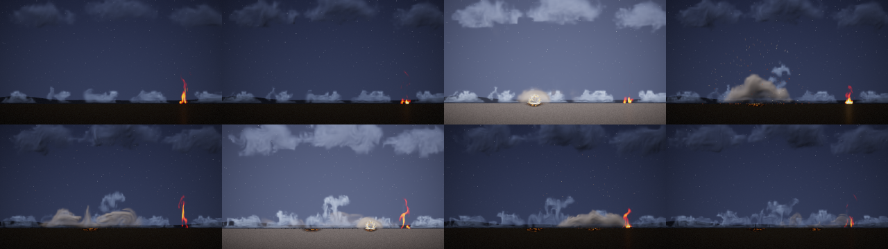

# More effects: fog, dust and cloud

Status: **done** (14 October 2026; dust replaced by study M3's, with a mean state, 15 October 2026, §9). Audience: dev,
research, artists. Three atmosphere effects for a game engine's library, after steam and magic
([EFFECTS.md](EFFECTS.md)): **fog** (a cold, heavy gas that sinks and rolls along the ground), **dust** (an impact's
burst that rolls out low along the ground and settles; it plays once) and **cloud** (a persistent, slowly boiling mass
with no source to be seen). All three come from the project's own 2D fluid simulator with new sources, forces and
drawing. They were trained as rollout effects with study D's recipe ([REPORT.md](REPORT.md) §6) and tested as study D,
steam and magic were: on held-out settings and seeds, by tracking from the true state and by endless statistics against
real runs and the nearest training flipbook. A scene script shows them together with study D's fire (§6).

## 1. Bottom line

- **All three learned their motion.** From the true state each follows a held-out run better than the same simulation
  on the same 32-cell grid with the same detail layer: at 1 s by +2.1 dB [+1.7, +2.5] (fog), +3.4 [+2.7, +4.1] (dust)
  and +2.6 [+1.8, +3.3] (cloud), and still ahead at 2 s (+2.0 to +3.1). Played endlessly at settings and seeds they
  never saw, their motion error ties a second real run's on fog and cloud and is a little larger on dust (+0.16
  [+0.00, +0.31]). None has magic's trouble: these are slow, large flows that the 32-cell state carries.
- **Dust is the best of the three, and its detail ties the real floor**, which none of study D's effects, steam or
  magic did: spectrum distance 0.128 against 0.108 between two real runs (+0.020 [-0.040, +0.067]) and 0.146 for the
  nearest flipbook (a tie). Its average picture is 2 dB from the floor and from the flipbook ([-3.5, -0.5] and [-3.0,
  -0.8]), probably because each run starts from the nearest of 16 stored bursts, not one of the exact setting's size.
- **Fog** ties the nearest flipbook on detail, average picture, motion and coverage, and ties the coarse simulation with
  the detail layer on detail and motion, but its average picture is 1.6 dB behind that simulation's [-3.1, -0.3] and
  4.9 dB from the floor [-5.9, -4.0], the furthest of the three.
- **Cloud** has the right motion and an average picture 1.5 dB closer than the nearest flipbook's [+0.3, +2.4], but its
  detail is the weakest: two and a half times the flipbook's spectrum distance (0.345 against 0.132; +0.21 [+0.12,
  +0.31]), with puffs stretched into streaks along its drift. Its first frame from a true state loses 12 dB, nearly all
  of it to the learned renderer (33.9 dB on the true fields), not the dynamics (-1.6 dB).
- **Cost (provisional, shared machine):** 146 KB stored for fog and cloud, 274 KB for dust (64-pixel fine fields with
  their start points, as smoke and the explosion keep), 2.4 MB per instance at 128 px; 0.9 to 1.2 ms per 128 px frame
  at best, where study D's fire took 1.3 ms and smoke 1.1 ms in the same session; restarts take 0.3 to 0.4 ms (§5).
- **A scene script** (`examples/scenes/moor.nvfxs`) plays all three with study D's fire: lightning in a storm cloud
  strikes a foggy moor twice, and the dust of each strike rolls out through the fog. Its keyframes are frozen
  (`ctest -R ScriptedMoorFrozen`); no new code in the compositor or the runtime (§6).
- **What it took:** a ground (still air over a closed bottom border) for fog and dust, and dust's burst tied to the dust
  itself; 2.6 to 3.7 CPU-hours of training each, with study D's recipe unchanged and no new code in the trainer or the
  runtime. The recipe's own branches decide the rest: dust plays once, so it takes the explosion's; fog and cloud linger,
  so they keep fine fields with their start points, as smoke does.

## 2. The effects

All three are presets of the existing solver (`src/sim/sim.cpp`, in a block of their own: `add_atmos_sources`,
`add_atmos_forces`, `add_atmos_divergence`, `render_atmos`): the same grid, advection, vorticity confinement, curl noise
and pressure solve, with their own sources, forces and drawing. None of them has heat. Their material is the solver's
soot, its weight is what moves them up or down, and they give no light, so a scene neither lights nor hazes the air
around them. Each has the study's three controls (intensity, wind, turbulence), normalised to [0, 1]. Lengths are in
cells of a 128-cell frame and times in seconds.

| | fog | dust | cloud |
|---|---|---|---|
| what it is | cold, heavy gas released a little above the ground: it sinks, runs out along the ground both ways with rolling, curling fronts, and slowly thins | dust thrown up by an impact: a burst that rises a little, falls back and runs out along the ground as a low, wide, rolling bank, then settles and thins | a slowly boiling mass of cloud or thick smoke, wider than tall and flatter below, with no source to be seen; it never fades away |
| plays | loops | **once** (3 s), as the explosion | loops |
| source | a release 26 to 46 cells wide (intensity), 26 cells up: gas density 0.5 to 1.0, poured down at 4 to 12 cells per second, broken up by the flicker noise at a rate of 1.0 per second | one burst at the start: a mound 15 to 23 cells wide and 6 to 9 cells high on the ground, density 1.0 to 1.6, its edge and lumps from the flicker noise (rate 1.4, as the explosion's) | none to be seen: inside an extent 67 to 102 cells wide and 33 to 51 cells high (intensity), whose edge the flicker noise moves, the density is drawn towards a target (0.6 to 1.2 times a pattern of puffs from the flicker noise, rate 0.6) at 0.4 per second; outside it, what the flow carries out thins at 1.5 per second |
| forces | weight 20 (it sinks); wind up to 20 cells per second with drag 1.5 per second; velocity damping 0.4 per second; confinement 0.2 to 1.4 and curl noise 3 to 17 (turbulence) | weight 150; the burst throws the dust out: a divergence of 22 to 34 per second (intensity) where the dust is thick, fading with a time constant of 0.1 s (the explosion's expansion, tied to the dust instead of the heat); wind up to 50; damping 0.6; confinement 1.5 to 5.5 and curl noise 20 to 100 | weight -20 (its thick parts rise a little); wind up to 40 cells per second with drag 1.0; damping 1.3 (slow, smooth motion); confinement 0.2 to 1.0 and curl noise 3 to 19 |
| ground | a band of still air 3 cells high at the bottom of the frame, over a closed bottom border (no flow through the ground) | the same | none (open, as every other effect) |
| decay | 0.12 per second | 0.25 per second | 0.10 per second (outside the extent 1.5) |
| drawing | pale, soft mist: cover 1 - exp(-1.0 density), grey-white (0.86, 0.88, 0.90) and barely shaded (light towards the light exp(-0.08 depth)) | brown-grey, deeply self-shadowed: cover 1 - exp(-2.0 density), (0.62, 0.54, 0.43) in light to (0.19, 0.17, 0.14) in shade (exp(-0.45 depth)) | white (0.97) with grey-blue shade (0.42, 0.45, 0.52) (exp(-0.45 depth)), cover 1 - exp(-2.6 density) |
| controls | intensity (release rate and volume), wind (drift left or right), turbulence | intensity (impact energy and size), wind, turbulence | intensity (density and coverage), wind (drift), turbulence (boiling) |

They keep the study's control names (`sim::control_names`). The earlier effects' clips are unchanged to the byte: the
hash test (`Sim.StudyEffectsAreUnchangedByTheNewOnes`) now also holds steam's and magic's clips, made before this round,
and full-size clips of all five at two settings were compared byte for byte before and after. Tests of the new presets:
`Sim.AtmosphereEffectsHaveNoHeatAndGiveNoLight`, `Sim.FogSinksAndSpreadsAlongTheGround`,
`Sim.DustRisesSpreadsAndSettles`, `Sim.CloudStaysAliveAndDriftsWithTheWind`.

**How they were designed.** Each was looked at with `nvfx_sim --sheet` (and a scratch probe that printed the amount,
centroid and extent of the material) at several control settings until it read as what it is at 128 px. What changed
on the way:
- **The ground.** The solver's borders are open, so a heavy gas first poured out of the bottom of the frame. The ground
  is a band of still air (a force, before the pressure solve, as a learned stepper's network can supply) over a closed
  bottom border in the pressure solve. With the band alone fog spreads about as well, but part of dust's burst escapes
  downwards through the open border (in the probe its cloud rose to 0.26 of the frame in half a second instead of
  0.31). A learned stepper's pressure solve is open on all sides ([REPORT.md](REPORT.md) §6.2), so its network has to
  learn what the closed border does; §4 says how well.
- **Dust** took the most tries. A burst that expands (as the explosion's) rose as a mushroom of smoke with a hollow
  middle; a vortex pair blowing onto a bed of dust rolled thin curls along the ground, the kind of thin, regular
  structure that magic's lesson says the 32-cell state cannot carry. What reads as dust is a heavy mound thrown out by
  a short burst where the dust itself is (so it stays filled), which falls back and runs out along the ground as two
  rolling fronts.
- **Cloud** first grew tentacles (strong confinement and curl noise pulled arms out of the mass). It is now slow and
  well damped, its puffs come from its source (drawn towards a pattern the flicker noise breaks up, so a learned
  stepper sees the noise that shapes it), and the wind blows material through it: puffs form upwind, drift across and
  thin away downwind, while the mass stays where it is.

**How chaotic they are** (`nvfx_experiment d-chaos --effects fog,dust,cloud`, as [REPORT.md](REPORT.md) §6.1: active
PSNR against the undisturbed run, mean over 4 runs; [d_chaos.csv](../results/experiments/fx_atmos/d_chaos.csv)):

| effect | case | 1 frame | 0.5 s | 1 s | 2 s | 3 s | 8 s |
|---|---|---:|---:|---:|---:|---:|---:|
| fog | start nudged by 1e-3, same seed | 91.4 | 76.3 | 75.9 | 74.7 | 73.2 | 74.7 |
| fog | start nudged by 1e-1, same seed | 62.8 | 55.7 | 53.9 | 51.8 | 51.3 | 55.2 |
| fog | same start, other seed | 23.3 | 22.5 | 20.6 | 18.8 | 19.2 | 19.9 |
| fog | other start, same seed | 16.4 | 18.1 | 18.7 | 19.8 | 20.9 | 29.2 |
| dust | start nudged by 1e-3, same seed | 80.4 | 73.7 | 68.6 | 64.4 | 59.2 | - |
| dust | start nudged by 1e-1, same seed | 54.2 | 49.7 | 43.6 | 40.9 | 37.8 | - |
| dust | same start, other seed | 54.9 | 21.8 | 15.9 | 14.7 | 15.0 | - |
| dust | other start, same seed | 19.7 | 22.2 | 21.2 | 21.5 | 23.6 | - |
| cloud | start nudged by 1e-3, same seed | 88.6 | 76.6 | 78.1 | 79.6 | 80.2 | 90.4 |
| cloud | start nudged by 1e-1, same seed | 65.7 | 57.9 | 57.5 | 59.0 | 59.5 | 67.1 |
| cloud | same start, other seed | 43.8 | 23.6 | 20.6 | 17.1 | 17.0 | 17.2 |
| cloud | other start, same seed | 17.2 | 19.5 | 21.2 | 24.7 | 27.9 | 41.6 |

All three are calmer than fire and steam: an error in the start stays invisible for seconds (fog and cloud are still
above 70 dB after 8 s from a 1e-3 nudge, and a 10% nudge heals). The seed still takes over, within a second for dust
and one to two seconds for cloud; for fog more slowly and less (20 dB after 1 s against steam's 14), since its noise
moves only the release and a weak stir. Cloud is forced as magic is: two runs with the same seed from different start points
meet (42 dB after 8 s), so what a cloud looks like after a few seconds is decided by its seed.

## 3. Training

Study D's recipe, unchanged (`rollout::recipe_for`), as steam and magic were trained: runs from an empty grid with
random controls and seeds of their own (training salt 1), the stepper's three stages, the renderer on 200 frames of 100
runs, the detail constants chosen by matching frame statistics of endless runs against real runs at the controls of
four training runs with new seeds (validation; the test's settings and seeds are never used), and the start points.
Two of the recipe's branches apply as they do to study D's own effects, and the code now says so instead of naming the
explosion and smoke:
- **Dust plays once, so it takes the explosion's branch** (`!sim::effect_loops(e)`): 240 runs of 90 frames (3 s), 16
  start points at its first frame with 64-pixel fine fields (the burst's shape is the look), burn-in of up to 32
  frames. The looping recipe's 160 runs of 240 frames would have trained frames that the one-shot test and runtime
  never play (both stop at 90).
- **Fog and cloud keep 64-pixel fine fields with their 8 start points, as smoke does** (the recipe's reason for smoke,
  "it lingers: growing its detail would take seconds", holds even more for them). Steam and magic, gone within a second or
  two, grow theirs at instance start as fire does.

Each was trained in study D's three saved steps (`d-train --stages12 1`, `d-tune` for stage 3, `d-finish`), one thread
each, `nice 10`, two at a time, on a machine shared with three other agents (load 6 to 13 on 4 cores while fog and
dust trained). The container restarted once, during cloud's stages 1 and 2 (at iteration 1250 of 4000); nothing of that
step was saved, so it ran again from the start (about 40 minutes lost; the logs under the data root's
`fx_atmos/logs` record it).

| effect | runs x frames | simulation | stages 1-2 (loss, s) | stage 3 (loss, s) | renderer (training samples) | contrast, swirl, grow | detail score | start points | stored |
|---|---|---:|---|---|---:|---|---:|---:|---:|
| fog | 160 x 240 | 21.3 min, recorded in 353 s | 0.0169, 7028 | 0.0156, 1395 | 43.1 dB | 1, 0, 1 | 0.52 | 8 (64 px fine) | 146 KB |
| dust | 240 x 90 | 12.0 min, recorded in 141 s | 0.0256, 7107 | 0.0382, 1256 | 38.1 dB | 1, 0, 2 | 0.71 | 16 (64 px fine) | 274 KB |
| cloud | 160 x 240 | 21.3 min, recorded in 537 s | 0.0107, 8147 | 0.0100, 2172 | 38.3 dB | 1, 0, 1 | 0.62 | 8 (64 px fine) | 146 KB |

The last step (renderer, detail constants, start points) took 17 minutes for fog, 10 for dust and 32 for cloud
(pinned to one core, as its calibration starts a thread per core). In all 2.8, 2.6 and 3.7 CPU-hours (cloud's without
the lost attempt), against 3.5 for steam and magic: the same iterations, on shares of the machine that changed with its
load. The loss columns are not comparable between effects (each is normalised by its own state's scale), nor stage
3's with stages 1-2's (it adds the activity term: dust's rose, fog's and cloud's fell). The detail calibration chose no
sub-grid swirl for all three, as it did for magic; fog and cloud keep existing structure as it is (grow 1), dust may
double it (grow 2).

Each model was frozen before its test: [fx_atmos_frozen.csv](../results/experiments/fx_atmos_frozen.csv) has their
SHA-256 (the files are under the data root's `fx_atmos/models/d`); fog's and dust's were recorded while cloud trained,
cloud's when it was done.

## 4. The test

Its design was committed before it ran, and each model was frozen before its own test
([fx_atmos_frozen.csv](../results/experiments/fx_atmos_frozen.csv) has their SHA-256). **The test ran in two parts on
this one design:** fog and dust were frozen and tested while cloud was still training (cloud's stages 1 and 2 had to run
again after the container restarted, and two cores were idle); cloud was frozen and tested in the same way afterwards.
Each test ran once, with the same tool, settings and seeds; the second run's rows were appended to the first's CSVs. It
is study D's protocol ([REPORT.md](REPORT.md) §6.4 to §6.6), as steam and magic were tested ([EFFECTS.md](EFFECTS.md)
§4), with `nvfx_experiment d-eval` unchanged (`--effects fog,dust`, then `--effects cloud`). Nothing the test uses was
seen in training or in the choice of the detail constants: training used runs of salt 1 (seeds 600000 upwards), and the detail constants were chosen on
validation runs at the controls of the first four training runs with seeds of their own (the training seed x 7 + 12345
for the real runs, x 31 + 777 for the model's).

- **Tracking (§4.1):** 8 held-out runs per effect (salt 2: seeds 700000 to 700007, with controls drawn from that salt),
  each started from its true state (coarse and fine; fog and cloud after 100 frames, dust after its first frame) with
  its own noise seed. Methods: the neural rollout through the runtime; the simulation on the same 32-cell grid with the
  same detail layer (`coarse_sim_detail`); the plain coarse simulation; holding the first frame. Active PSNR at 1 and 8
  frames and 1, 2 and 8 s (dust: to its last frame, 3 s), mean over runs, and neural minus `coarse_sim_detail` paired
  over runs.
- **Endless (§4.2):** the ten held-out settings of study B (its generator, seed 2026), 10 s each (dust: its 3 s). The
  reference is a real run at that setting with seed 900000 + setting (fog and cloud warmed up 5 s). Methods: a second
  real run with seed 910000 + setting (the floor); the neural rollout with seed 920000 + setting, played as it ships
  (shards from the start points); the nearest of the 45 training flipbooks of study B's grid, made for these effects
  as study B made its library (64 frames at 128 px, seed 1; looped, dust held on its last frame); the coarse simulation
  with and without the detail layer, seed 930000 + setting. Statistics against the reference: detail spectrum
  distance, motion ratio, coverage distance and mean-frame PSNR.
- **One minute (§4.3):** a 60 s neural run in shards (seed 940000 + setting) at the first two held-out settings, cut
  into 10 s windows, each scored against the 10 s reference (fog and cloud; dust plays once).
- **Intervals:** paired over runs or settings, 95% bootstrap intervals from 10,000 resamples
  (`metrics::paired_bootstrap`); an interval across zero is a tie.
- **No pass mark,** as for steam and magic. Each effect is reported against the coarse simulation with the same detail
  layer (does the learned stepper earn its place?), the nearest flipbook (does it beat a 45 MB library?) and the floor
  (how far from real is it?).

### 4.1 Tracking from the true state

Active PSNR (dB), mean over 8 held-out runs (dust's horizons stop at 2 s; its run ends at 3 s):

| effect | method | 1 frame | 8 frames | 1 s | 2 s | 8 s |
|---|---|---:|---:|---:|---:|---:|
| fog | neural | 35.4 | 27.4 | 22.0 | 20.6 | 19.3 |
| fog | coarse simulation + detail | 35.4 | 24.4 | 19.8 | 18.6 | 18.5 |
| fog | coarse simulation | 24.5 | 23.6 | 22.3 | 21.6 | 21.8 |
| fog | holding the first frame | 39.1 | 22.7 | 16.3 | 14.9 | 15.1 |
| dust | neural | 23.4 | 20.1 | 18.3 | 16.6 | - |
| dust | coarse simulation + detail | 23.2 | 18.6 | 14.9 | 13.4 | - |
| dust | coarse simulation | 19.2 | 19.0 | 16.1 | 15.8 | - |
| dust | holding the first frame | 11.1 | 8.0 | 8.4 | 9.9 | - |
| cloud | neural | 33.5 | 30.4 | 25.4 | 23.5 | 21.1 |
| cloud | neural dynamics, simulation's renderer | 44.0 | 32.2 | 25.4 | 23.1 | 21.0 |
| cloud | coarse simulation + detail | 45.6 | 31.0 | 22.8 | 20.4 | 19.3 |
| cloud | coarse simulation | 28.4 | 27.3 | 24.3 | 22.7 | 21.9 |
| cloud | holding the first frame | 46.2 | 29.6 | 21.0 | 17.2 | 16.8 |

Neural minus coarse simulation + detail, paired over runs:

| effect | 1 frame | 8 frames | 1 s | 2 s | 8 s |
|---|---|---|---|---|---|
| fog | +0.03 (tie) | +2.97 [+2.19, +3.83] | +2.11 [+1.70, +2.53] | +2.02 [+1.60, +2.46] | +0.82 [+0.12, +1.62] |
| dust | +0.22 (tie) | +1.54 [+0.45, +2.69] | +3.42 [+2.69, +4.07] | +3.13 [+2.28, +3.97] | - |
| cloud | **-12.09 [-13.30, -10.71]** | **-0.62 [-1.15, -0.11]** | +2.59 [+1.81, +3.28] | +3.08 [+2.31, +3.87] | +1.88 [+1.39, +2.40] |
| cloud, neural dynamics with the simulation's renderer | **-1.63 [-2.71, -0.49]** | +1.21 [+0.88, +1.53] | +2.52 [+1.88, +3.07] | +2.76 [+2.07, +3.44] | +1.72 [+1.24, +2.21] |

(Bold: the neural rollout is worse.)

- **The learned dynamics follow a run better than the simulation at the same resolution** on all three, as on fire,
  smoke and steam: 2 to 3.5 dB ahead at 1 and 2 s, and fog and cloud are still ahead at 8 s, where smoke was behind.
- **Cloud's first frames are a renderer problem**, as the explosion's were in study D: the learned renderer reaches
  33.9 dB on the true fields (fog's 37.9, dust's 31.6), while the coarse simulation with the detail layer starts from
  the true fine fields and draws them with the simulation's own renderer, almost the true frame (45.6 dB). Drawn by that
  renderer, the neural dynamics lose 1.6 dB in the first frame and lead from the eighth.
- **The plain coarse simulation, with no detail, scores higher than both from about 1 s** on fog (22.3 against 22.0,
  21.8 against 19.3 at 8 s) and late on cloud (21.9 against 21.1 at 8 s). These are smooth, slow effects: once the
  detail has decorrelated, a blurred picture is the best guess in PSNR. Its detail is far too smooth to use (§4.2:
  spectrum distance 0.7 to 1.3).

### 4.2 Endless runs at settings never seen

Means over the 10 held-out settings (spectrum distance and coverage distance: lower is better; motion ratio: 1 is
right; mean-frame PSNR: higher is closer):

| effect | method | spectrum | motion | coverage | mean-frame PSNR |
|---|---|---:|---:|---:|---:|
| fog | real, other seed (floor) | 0.096 | 1.14 | 0.0035 | 34.2 |
| fog | **neural rollout (146 KB)** | 0.281 | 1.27 | 0.0053 | 29.3 |
| fog | nearest training flipbook | 0.153 | 1.42 | 0.0054 | 30.3 |
| fog | coarse simulation + detail | 0.233 | 1.12 | 0.0056 | 30.9 |
| fog | coarse simulation | 1.309 | 0.53 | 0.0042 | 33.0 |
| dust | real, other seed (floor) | 0.108 | 0.99 | 0.0102 | 28.4 |
| dust | **neural rollout (274 KB)** | 0.128 | 0.98 | 0.0199 | 26.4 |
| dust | nearest training flipbook | 0.146 | 0.60 | 0.0141 | 28.3 |
| dust | coarse simulation + detail | 0.196 | 0.97 | 0.0117 | 26.0 |
| dust | coarse simulation | 1.270 | 0.61 | 0.0103 | 26.5 |
| cloud | real, other seed (floor) | 0.066 | 0.99 | 0.0039 | 31.7 |
| cloud | **neural rollout (146 KB)** | 0.345 | 1.19 | 0.0069 | 29.6 |
| cloud | nearest training flipbook | 0.132 | 1.44 | 0.0082 | 28.1 |
| cloud | coarse simulation + detail | 0.677 | 1.22 | 0.0052 | 29.2 |
| cloud | coarse simulation | 0.688 | 0.72 | 0.0046 | 30.1 |

Neural minus each other method, paired over the 10 settings (motion as the error |ln ratio|):

| effect | statistic | nearest flipbook | coarse simulation + detail | real, other seed |
|---|---|---|---|---|
| fog | spectrum distance | +0.128 (tie) [-0.022, +0.245] | +0.047 (tie) | +0.185 [+0.106, +0.269] |
| fog | mean-frame PSNR (dB) | -1.01 (tie) [-2.51, +0.21] | -1.55 [-3.05, -0.28] | -4.93 [-5.91, -3.95] |
| fog | motion error | -0.133 (tie) | +0.072 (tie) | +0.081 (tie) |
| fog | coverage distance | -0.0001 (tie) | - | +0.0018 (tie) |
| dust | spectrum distance | -0.018 (tie) | **-0.068 [-0.108, -0.027]** | +0.020 (tie) [-0.040, +0.067] |
| dust | mean-frame PSNR (dB) | -1.92 [-2.98, -0.77] | +0.37 (tie) | -1.99 [-3.54, -0.54] |
| dust | motion error | -0.241 (tie) [-0.553, +0.039] | +0.071 (tie) | +0.159 [+0.004, +0.312] |
| dust | coverage distance | +0.0057 [+0.0000, +0.0116] | - | +0.0096 [+0.0008, +0.0209] |
| cloud | spectrum distance | +0.212 [+0.119, +0.310] | **-0.333 [-0.388, -0.278]** | +0.278 [+0.201, +0.355] |
| cloud | mean-frame PSNR (dB) | **+1.49 [+0.33, +2.41]** | +0.40 (tie) | -2.14 [-3.35, -1.12] |
| cloud | motion error | **-0.179 [-0.323, -0.028]** | -0.020 (tie) | +0.075 (tie) |
| cloud | coverage distance | -0.0013 (tie) | - | +0.0030 [+0.0018, +0.0043] |

(Bold: the neural rollout is better.)
- **Dust** has the detail of a real run: its spectrum distance ties a second real run's and the nearest flipbook's and
  beats the coarse simulation's. Its motion is right on average (0.98) but varies with the setting (0.52 to 1.75), so its
  motion error is a little larger than the floor's. Its average picture and coverage are behind: each run starts from
  the nearest of 16 stored bursts, so the burst has the right kind of shape but not the exact size of the setting.
- **Fog** ties the 45 MB flipbook library on every statistic, in 146 KB, and ties the coarse simulation with the detail
  layer on detail and motion. Its average picture is the weakest of the three (4.9 dB from the floor), and at one of
  the ten settings its motion is twice the real one (2.18).
- **Cloud** gets the motion and the average picture right (both better than the flipbook's) but not the detail: the
  puffs are drawn out into horizontal streaks along the drift (probably the detail layer carrying fine material along
  the coarse flow while the source keeps adding new material). It is still far closer than the coarse simulation with
  the same detail layer (0.345 against 0.677).

### 4.3 One minute without a restart

| effect | spectrum distance | motion ratio | mean-frame PSNR |
|---|---|---|---|
| fog | 0.19-0.70 | 0.94-2.23 | 28.0-34.0 |
| cloud | 0.28-0.56 | 0.92-1.96 | 27.8-32.5 |

Ranges over six 10 s windows at each of the first two held-out settings (dust plays once). Neither drifts: the last
windows are as good as the first. At the second setting both move too fast in every window (fog 1.6 to 2.2, cloud 1.5
to 2.0), as in their 10 s runs there: a fault of the setting, not of the length.

## 5. Memory and cost

Per frame through `nvfx_render` on one pinned core (AVX2), with study D's fire and smoke measured in the same session
(`nvfx_experiment d-timing`, five rounds back to back): the least of the five rounds and, in brackets, the slowest
([d_timing.csv](../results/experiments/fx_atmos/d_timing.csv)). **Provisional:** the machine was shared with other
agents' jobs (load 1 to 2 on 4 cores), and study D's fire, 1.22 ms at 128 px in the last quiet session
([EFFECTS.md](EFFECTS.md) §5), took 1.30 to 2.24 ms here.

| effect | stored | resident | per instance at 128 px | 64 px | 128 px | 256 px | restart |
|---|---:|---:|---:|---:|---:|---:|---:|
| fog | 146 KB | 419 KB | 2.4 MB | 0.62 ms (0.97) | 0.90 ms (1.35) | 1.66 ms (3.08) | 0.4 ms |
| dust | 274 KB | 804 KB | 2.4 MB | 0.65 ms (1.29) | 1.16 ms (2.06) | 2.65 ms (4.49) | 0.3 ms |
| cloud | 146 KB | 419 KB | 2.4 MB | 0.69 ms (1.12) | 1.11 ms (1.69) | 2.19 ms (3.34) | 0.4 ms |
| fire (same session) | 82 KB | 163 KB | 2.4 MB | 0.66 ms (0.84) | 1.30 ms (2.24) | 3.76 ms (5.57) | 23 ms (1 s warm-up) |
| smoke (same session) | 146 KB | 419 KB | 2.4 MB | 0.64 ms (1.06) | 1.14 ms (1.91) | 3.03 ms (4.75) | 0.4 ms |

The same network as study D's, so the same per-pixel work (1012 multiply-adds per pixel at 128 px) and the same
working memory. Fog and cloud store their start points as smoke does and dust as the explosion does, so they have
smoke's and the explosion's memory, and their restarts cost what smoke's do: 0.3 to 0.4 ms instead of fire's 1 s
warm-up. Within the noise of this machine all three cost what fire and smoke cost per frame, fog a little less
(probably because much of its frame is empty). They should be re-timed on a quiet machine with study D's effects, as steam and magic were.

**Re-timed on a quiet machine** (14 October 2026, one job at a time, four rounds with every rollout effect in them;
least of the rounds: [round5_effect_timing_quiet.csv](../results/experiments/round5_effect_timing_quiet.csv)): at
128 px fog 0.88 ms, dust 1.05 ms and cloud 1.08 ms, against fire's 1.26 ms and smoke's 1.14 ms in the same rounds;
at 64 px 0.59 to 0.71 ms (fire 0.69); at 256 px fog 1.63, dust 2.66 and cloud 2.06 ms (fire 3.07, smoke 3.16). All
three cost no more than fire and smoke, fog clearly less. This session's machine was slower than earlier ones (the
fireball took 26 ms per frame at 720p on 4 threads, against 19 to 20 ms in round 4's quiet session), so compare these
with fire's in the same rounds. The moor scene took 25.1 to 25.9 ms per frame on 2 threads and 14.9 to 15.5 ms on 4
(two runs each), without an allocation in its frame loop.

## 6. The scene

`examples/scenes/moor.nvfxs` (10 s at 1280 x 720 and 30 fps, about 90 lines). Night on a moor, under a bank of storm
cloud (three cloud modules, drawn by a field-shader look, dark grey-blue) drifting to the right with a wind that
wavers. Frost-white fog lies along the ground (five fog modules side by side, each 340 world pixels wide, drawn by a
field-shader look so that the scene lights it), and a campfire (study D's v2 fire) burns in it. At 2.5 s lightning
flashes in the cloud (a flash of the scene's light, lighting cloud, fog and ground) and strikes the moor: a shock, hot
debris and embers, a scorch mark, and the dust model bursts from the strike, drawn brown by a third look. While the
dust runs out along the ground, the bus pushes the fog with its flow, so the fog is thrown aside and part of it up. At
5.8 s a second strike lands near the fire; its dust bends the flames. The video and the full keyframes are under the
data root's `fx_atmos/scene` (outside git); the keyframes' SHA-256 are in `results/experiments/fx_atmos_frozen.csv`
and `ctest -R ScriptedMoorFrozen` checks them (skipped without the effects in `NEURALFX_MODELS_ATMOS`).



It plays without an allocation in its frame loop. Its stages take 25 ms per frame (median of the sum) on 2 threads and
21 ms on 4, on the shared machine (46 ms on 2 threads while the video was being encoded alongside).

**Nothing was added to the compositor or the runtime.** The effects carry no heat, so they neither light the scene nor
haze it; the field shader's soot is their material. Two things were learned in writing it:
- **Fog tiles must be small.** The fog layer is about a quarter of its tile's height, so fog drawn 500 world pixels
  wide stood 125 pixels high and read as a row of cumulus on the ground; five narrower releases read as ground fog.
- **Pushes on the fog act only while the dust runs out, and gently** (their gain is an expression of the time since
  each strike). Pushed by every other module's flow for the whole scene, the fog was lifted into tall columns that
  stayed up: the learned fog does not bring down fog that is high up, as it never saw any in training. Even with the
  gentle push, the blast lifts some fog that then stays up as pale plumes.

What works: each effect reads as what it is at this scale, the dust rolls through the fog and moves it, and one light
ties them together. What does not, yet: the lifted fog stays up; the five fog releases show as five gentle bumps; there
is no lightning bolt to see (the scripts have no such element), only its flash.

## 7. What it means

- **The recipe carries to slow, large flows, including one-shot effects.** Fog, dust and cloud are slow flows on the
  scale of the frame, the kind that steam was and magic was not. All three learned their motion, as steam did, with
  study D's recipe and no change to it beyond what its own branches decide.
- **A heavy gas needs a ground, and a learned stepper can learn one.** The ground is a closed border in the
  simulation's pressure solve that the stepper's own solve does not have, yet fog and dust follow held-out runs 2 to
  3 dB better than the coarse simulation, which has the closed border built in.
- **Where the detail comes from seems to decide how it looks.** Dust's detail comes from its stored burst (64-pixel
  fine fields) moved by the flow, and ties the real floor. Cloud's keeps arriving from a source inside a drifting flow,
  and the detail layer draws it out into streaks; with magic's serrated arms, this is the second effect whose new
  material the detail layer handles badly. Fixes worth trying, none tested here: a smaller detail contrast for cloud,
  or new material placed by the source's own pattern rather than broken up by the flicker noise.
- **The learned renderer, not the dynamics, loses cloud's first frame,** as it lost the explosion's in study D: 34 dB
  on the true fields, where the simulation's own renderer is exact.
- **A scene uses them with no new code.** Fog's look comes from the scene's light, and it stays where its training put
  it: a scene must not push it high, as the model never learned to bring it down.

## 8. Reproduce

```sh
build/nvfx_sim --effect fog --intensity 0.8 --wind 0.6 --sheet fog.png       # the simulator's presets alone
build/nvfx_sim --effect dust --intensity 0.6 --frames 90 --sheet dust.png
build/nvfx_sim --effect cloud --turbulence 0.8 --sheet cloud.png
R="--root $NEURALVFX_DATA/fx_atmos --results results/experiments/fx_atmos"
build/nvfx_experiment d-chaos  --effects fog,dust,cloud $R --threads 1
build/nvfx_experiment d-train  --effects fog --stages12 1 $R --threads 1
build/nvfx_experiment d-tune   --effects fog $R --threads 1
build/nvfx_experiment d-finish --effects fog $R --threads 1
#   (the same for dust and cloud; or d-train without --stages12 for all three steps at once)
build/nvfx_experiment d-eval   --effects fog,dust $R --threads 1 --figures DIR    # the test (fog and dust)
build/nvfx_experiment d-eval   --effects cloud --root $NEURALVFX_DATA/fx_atmos --results DIR4 --threads 1 --figures DIR
#   (cloud's test; its rows of DIR4's d_track.csv, d_stats.csv and d_long.csv appended to those of results/experiments/fx_atmos)
build/nvfx_experiment d-report $R                                            # D_SUMMARY.md
build/nvfx_experiment d-timing --effects fire,smoke,fog,dust,cloud --root DIR2 --results results/experiments/fx_atmos
build/nvfx_scene_script --script examples/scenes/moor.nvfxs --models DIR3 --out moor.mp4 --keyframes DIR --sheet sheet.png
```

`DIR2/models/d` holds study D's `fire.nvfx` and `smoke.nvfx` and the three models; `DIR3` holds `fog.nvfx`,
`dust.nvfx`, `cloud.nvfx` and study D's v2 `fire.nvfx` (`ctest -R ScriptedMoorFrozen` reads it from
`NEURALFX_MODELS_ATMOS`, by default `$NEURALVFX_DATA/fx_atmos/models/scene`).

## 9. Study M3: dust with a mean state (15 October 2026)

Dust's average picture was 2 dB from the floor (§1), most likely because each run starts from the nearest of 16 stored
bursts rather than one of the setting's own size. Study M3 ([REPORT.md](REPORT.md) §14.9) tested study M's **mean
state** on it: the ordered coarse state (u, v and dust per block of 2 x 2 cells) fitted as a quadratic in the three
controls to the first states of dust's 240 training runs, and each stored burst begun at controls c moved by
mu(c) - mu(its own controls), so that its size is the controls' and its own fluctuations stay. Under a rule planned for
power (margins from the null, 30 settings) it met the rule on validation and on its test, and **replaces round 5's
dust**: on 30 held-out settings with fresh seeds its average picture is **1.32 dB [0.75, 1.91]** closer to a real
run's (5.7 to 4.4 dB below the floor), its motion error smaller (|ln motion ratio| -0.089 [-0.138, -0.043]) and its
coverage closer (-0.0045 [-0.0063, -0.0027]); its detail spectrum ties (-0.009 [-0.020, +0.002]) and tracking from the
true state is the same (a run's own start is moved by nothing).
- File: the data root's `m3/models/dust.nvfx` (301,443 bytes against 280,927: the mean state's 10,240 coefficients at
  fp16; SHA-256 `938440a4...`). Cost (provisional): within about +0.15 ms per frame at 256 px and +0.05 ms at 128 px.
- **The moor** was drawn again (its frozen keyframes after the first strike updated): the first strike, at controls
  (0.9, 0.55, 0.6), throws up a wider and taller bank of dust than before, the size of a strong strike rather than of
  stored burst 0; the second, at (0.6, 0.6, 0.5), a slightly smaller one than stored burst 7 gave. The same dust, its
  rolling front and settling unchanged, no new artefacts.
- The library's dust entries give controls, so their bursts change size the same way ([LIBRARY.md](LIBRARY.md) §4);
  the dust devil (the vortex model) and the dust trail are unchanged.
