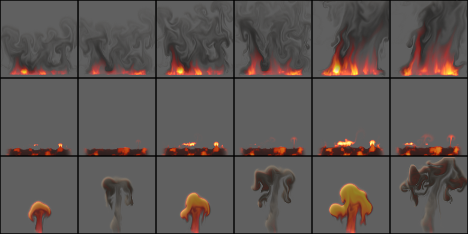
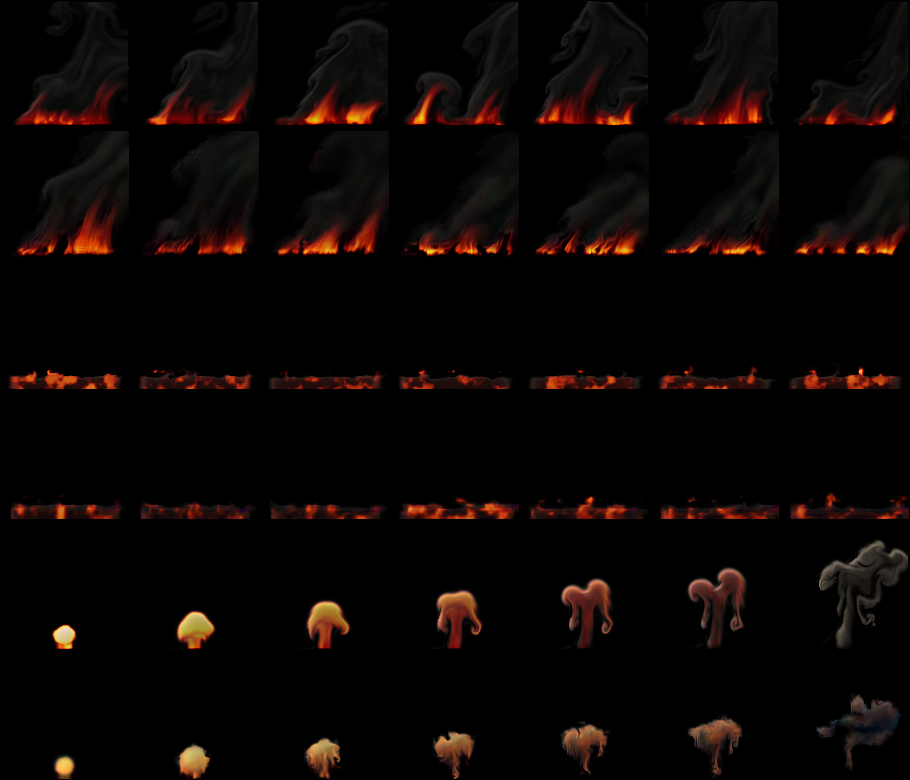
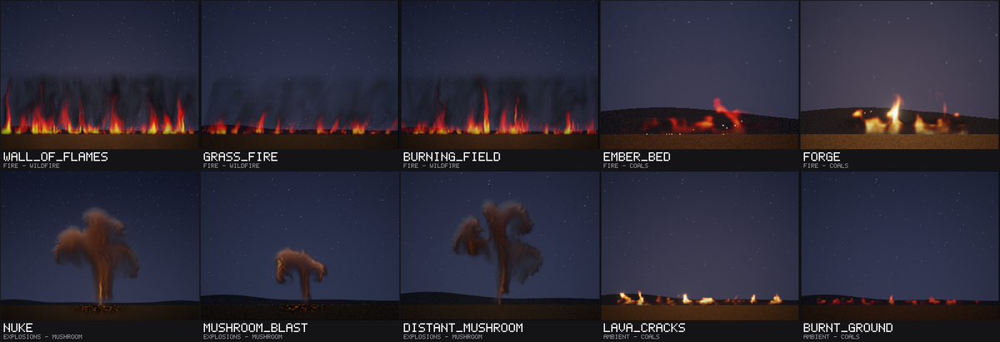
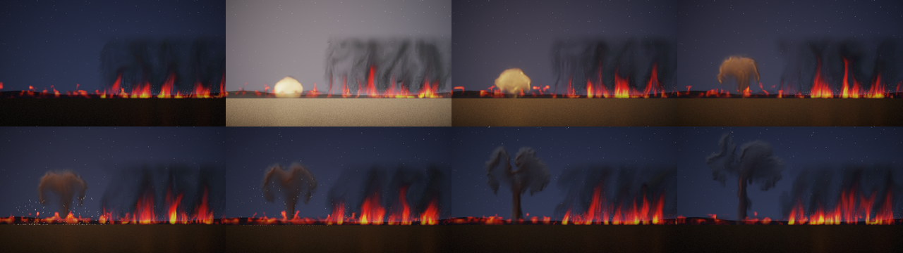

# Fire effects: wildfire, coals and a mushroom cloud

Status: **done** (15 October 2026). Audience: dev, research, artists. Three effects a game would want next to
fire, smoke and the explosion: a **wildfire** (a wide front of flames along the ground, as in a burning field, a wall
of fire or a grass fire: the whole width burns, where study D's fire makes one flame per tile), **coals** (a bed of
glowing embers on the ground, as in a dying campfire, a forge or cracked lava ground) and a **mushroom** cloud (a large
explosion's fireball that rises on a stem and cools into a rolling cap of smoke; it plays once, for 5 s). They come
from the project's own 2D fluid simulator with new sources, forces and drawing, and are trained and tested exactly as
the last six were ([EFFECTS_ENERGY.md](EFFECTS_ENERGY.md), [EFFECTS_ATMOSPHERE.md](EFFECTS_ATMOSPHERE.md)): study D's
recipe and protocol ([REPORT.md](REPORT.md) §6), on held-out settings and seeds. A scene script plays all three
together (§6), and ten new library entries use them (§6).

## 1. Bottom line

- **The wildfire works, by the rule set before the test.** From its true state it follows a held-out run 3.0 dB
  [2.6, 3.4] better than the same simulation on the same 32-cell grid with the same detail layer at 1 s, and is still
  ahead at 2 s (+4.0) and 8 s (+4.0). Played endlessly at settings and seeds it never saw, its average picture is 4.1 dB
  [2.6, 5.4] closer to a real run than the nearest training flipbook's, its motion error ties the flipbook's (motion
  ratio 0.95 against 1.27; a second real run: 1.04) and its detail ties it (spectrum distance 0.16 against 0.12; floor
  0.04).
- **The coals work too**, and track better than any looping effect so far: +4.7 dB [4.2, 5.1] over the coarse
  simulation at 1 s (as much as study D's explosion), +4.3 at 8 s. Endless, their average picture is 1.9 dB [0.6, 3.2]
  closer than the flipbook's and their motion is better than the flipbook's and ties a second real run (0.94 against
  0.99), but their detail is twice as far from real as the flipbook's (0.137 against 0.073): the learned bed glows
  dimmer and more evenly than the real one.
- **The mushroom is weak**, as magic, the orb and the vortex were. It loses to the coarse simulation from 1 s (-1.1 dB
  [-1.8, -0.5]; -3.0 [-3.7, -2.5] at 4 s), and the same dynamics drawn by the simulation's renderer lose as much, so
  the dynamics, not only the renderer, fall behind; its learned renderer also loses 6 dB on the first frame (16 dB on
  the true fields of the fresh fireball). Endless, its average picture is 2.4 dB [1.5, 3.4] further from real than the
  flipbook's, its detail three times as far (0.26 against 0.10) and its cover too wide; only its motion ties the
  flipbook's. The learned cloud loses its stem and its rolled cap and turns ragged; its own renderer adds blue and
  green fringes. With the explosion's field-shader look (`look cloud`) it still reads as a mushroom cloud in a scene
  and in the library (fair), but it is the weakest of the three.
- **Study O replaced it** ([REPORT.md](REPORT.md) §16.3, §4.5 below): the same model with a mean state (each stored
  burst moved to the requested controls) and its stepper fine-tuned on 30-frame windows. On 30 held-out settings it
  follows a run 0.85 dB [0.73, 0.97] better at 1 s and its average picture is 1.18 dB [0.91, 1.45] closer to a real
  run's, with closer detail and coverage, by a rule written before its validation. It is still weak by this round's
  rule (§4.5), and its cap is still ragged.
- **Study Q refit its renderer** ([REPORT.md](REPORT.md) §21, [STUDY_Q.md](STUDY_Q.md) §4.8) with the first frames among
  its samples: on 60 held-out settings its first frame is 2.04 dB [1.97, 2.12] closer, its detail and motion closer, the
  young fireball paler and without green tints; the cap is unchanged.
- **Cost (provisional, a busy shared machine):** 82 KB stored for the wildfire and the coals, 274 KB for the mushroom
  (16 start points with 64-pixel fine fields, as the explosion's); 2.5 MB per instance at 128 px. At the runtime's
  int8 default on the AVX-512 build, 0.50 (wildfire), 0.72 (coals) and 0.73 ms (mushroom) per 128 px frame, where
  study D's fire took 0.71 ms and its explosion 0.58 ms in the same rounds (§5).
- **A scene script** (`examples/scenes/prairie.nvfxs`) plays all three: a grass fire's front, the coals it has left,
  and a mushroom cloud on the horizon whose shock wave bends the flames. Its keyframes are frozen (`ctest -R
  ScriptedPrairieFrozen`). **Ten library entries** use the models, among them a new `wall_of_flames` (the wildfire
  model's continuous front, where the old one was nine separate fire flames): good for the wildfire's three, fair for
  the coals' and the mushroom's (§6).
- **What it took:** a preset each, a one-shot length of the effect's own (`sim::one_shot_frames`: the mushroom needs
  5 s), study D's recipe otherwise unchanged, 2.7 to 3.7 CPU-hours of training each, and no new code in the trainer or
  the runtime.

## 2. The effects

All three are presets of the existing solver (`src/sim/sim.cpp`, in a block of their own: `add_blaze_sources`,
`add_blaze_forces`, `add_blaze_divergence`, `blaze_decay`, `render_blaze`): the same grid, advection, vorticity
confinement, curl noise and pressure solve, with their own sources, forces, decay and drawing. Each has the study's
three controls (intensity, wind, turbulence; `sim::control_names`), normalised to [0, 1]. Lengths are in cells of a
128-cell frame and times in seconds.

The lessons of the earlier rounds shaped them. Magic's fast, regular spiral smeared on the 32-cell state, so these keep
their flow at fire's speeds or below and their structures broad: the wildfire's tongues are 10 to 20 cells across, the
coal bed is 13 to 23 cells high (four to six coarse cells), and the mushroom's cap rolls over in two broad rolls of 20
to 30 cells, not a thin ring. And every force is a function of what a learned stepper sees: the state where it acts,
the position, the controls and the run's two noise fields (the curl noise's stream function ψ and the source flicker);
the mushroom, which plays once, also follows the time since its start, but only through the two decays a learned
one-shot sees as inputs (exp(-t / 0.15 s) and exp(-t / 1 s)).

| | wildfire | coals | mushroom |
|---|---|---|---|
| what it is | a front of flames along the bottom of the frame, 84% of its width: the whole width burns, in tongues that merge and part; smoke rolls off the top; the wind leans it | a low, wide bed of glowing coals: dark char with hot patches that crawl and pulse, short flames licking up here and there, a thin smoke | a fireball on the ground that rises on a stem of dust and cools into a cap that rolls over at its edges, darkening from orange to grey-brown smoke as it climbs, then stops and spreads |
| plays | loops | loops | **once**, 150 frames (5 s): the cap needs about 2.5 s to rise and roll over and 2.5 s more to darken and spread (the explosion and dust play 3 s) |
| source | a band 6% up, 8 to 13 cells high (intensity), its ends tapering over the outer fifth: heat (1.0 to 1.6) × (0.35 + 0.65 c(flicker)) × (0.6 + 0.4 ψ), where c is fire's flicker curve; so all of it burns, in tongues where the flicker is high and stronger and weaker stretches that move along it with the curl noise. Smoke 0.3 to 0.6 per second, an upward push of 16 to 34 cells per second; flicker rate 2.2 per second (fire: 2.6) | a bed 90% of the frame wide (its ends taper), its top 10 to 18% up (intensity) and lumpy (it moves with the flicker: ±20%). In it the heat is drawn at 5 per second towards (0.9 to 1.6) × (0.08 + 0.92 c(flicker)) × (1 + 0.4 ψ): hot patches where the flicker is high, dull ones elsewhere, brightening and dimming with the curl noise (the pulse); flicker rate 0.8 per second, so the pattern crawls. Char (the solver's soot) is drawn up to 0.9 at the same rate. Where the flicker is highest (more of the bed at higher intensity), flames start at the bed's top: heat 0.8 to 1.3, pushed up at 14 to 34 cells per second, a little smoke | one burst at the start: a ball of radius 10 to 15 cells (intensity) on the ground, heat 2.2 to 3.0, a little smoke, its edge and lumps from the flicker noise (rate 1.4, as the explosion's). Then the base, a patch 15 to 23 cells wide: heat (1.4 to 1.9) × (0.12 + 0.88 exp(-t / 1 s)), dust (3 to 4 per second) and an upward draught (25 to 45 cells per second) × (0.3 + 0.7 exp(-t / 1 s)): a bright base that dims, and a stem of dust drawn up into the cap |
| forces | buoyancy 115, soot weight 6; wind up to 70 cells per second with drag 2.0; velocity damping 0.2; confinement 0.6 to 3.6 and curl noise 10 to 65 (turbulence) | the bed's air is still (its velocity zeroed below 60% of its top, fading out by 90%), so only the flames rise; buoyancy 90, soot weight 2; wind up to 45 with drag 1.8; damping 0.6; confinement 0.3 to 1.8, curl noise 5 to 35 | the hot gas expands for its first moments (a divergence of 6 to 12 per second, fading with a time constant of 0.15 s, as the explosion's); buoyancy 45, soot weight 2; a closed ground (the pressure solve's bottom border, as fog's and dust's); **stable air** above 55 to 65% of the height (intensity): hot gas there is pushed down (3 × buoyancy × heat, fading in over 15% of the height), so the cap stops rising and spreads; **sheared wind**: material is dragged (1.2 per second) towards a wind of (2 wind - 1) × 45 cells per second times the height fraction, so the cap leans further than the stem; damping 0.5; confinement 0.3 to 1.3, curl noise 5 to 30 |
| decay | heat 3.2 - 1.0 intensity per second (short flames at low intensity), smoke 0.3; the burning gas turns to smoke at 1.5 × its heat per second | heat 4.5 per second (the flames are short), smoke 3.0 (it is thin) | heat 0.45 per second (the cap glows for two or three seconds), smoke 0.12; the burning gas turns to smoke at 0.45 × its heat per second |
| drawing | emitted light in fire's colours over grey smoke shaded towards the light | emitted light from deep red through red and orange to yellow over dark char (0.08 grey where dense, paler where thin) | the explosion's colours (fire's at 0.75 of the heat) over brown-grey smoke |
| controls | intensity (height and fierceness), wind (lean), turbulence | intensity (how hot and lively: brighter patches, more flames), wind (the flames and smoke lean), turbulence | intensity (yield: the size of the burst, the cap's height), wind (lean and shear), turbulence |

They keep the study's control names. `sim::one_shot_frames` gives a one-shot's length (90 for the explosion and dust,
150 for the mushroom), which the recipe and study D's steps now read where they had 90 (§3). Every earlier effect's
clips are unchanged to the byte: `Sim.StudyEffectsAreUnchangedByTheNewOnes` now also hashes clips of jet, orb, vortex,
fog, dust and cloud made before this round, and full-size clips of all eleven at two settings were compared byte for
byte before and after. Tests of the new presets: `Sim.BlazeEffectsAreNamedAndOnlyTheMushroomPlaysOnce`,
`Sim.WildfireBurnsAcrossTheWholeWidthWithSmokeAboveAndLeansWithTheWind`, `Sim.CoalsGlowLowAndWideAndTheirGlowCrawls`,
`Sim.MushroomRisesIntoACapThatSpreadsAndDarkens`, and `Rollout.OneShotEffectsTakeTheExplosionsRecipe` for the
mushroom's recipe.

**How they were designed.** Each was looked at with `nvfx_sim --sheet` and a scratch probe (sheets of several settings
side by side, and the amount, centroid, extent and speed of the material over time) at several control settings until
it read as what it is at 128 px. What changed on the way:
- **Wildfire.** The first front, shaped by the flicker alone, burnt in a few separate tongues with gaps between them at
  low intensity, and its flames reached the top of the frame as thin red streaks; its smoke was invisible. A base level
  of burning along the whole front (35% of the source wherever the flicker is low), heat that cools faster (more so at
  low intensity), a thicker source and smoke made from what burns gave a continuous burning front, tongues of flame in
  the lower third to half and a rolling bank of smoke above. Its fastest flow at the strongest settings was 1.4 coarse
  cells a frame; less buoyancy and a weaker push brought it to 1.2 (fire: 1.0, magic: 1.9).
- **Coals.** The first bed, 8 cells high, was a thin glowing line, and its flames rose as small smoke rings on stalks
  (mushroom-shaped puffs). The bed is now twice as high; its hot patches are sparser (most of it dull red under dark
  char); the flames' heat fades at 4.5 per second (fire's: 1.25) and their smoke at 3, so they are short tongues and a
  haze rather than puffs.
- **Mushroom.** At first the fireball rose to the top of the frame within a second and its cap broke into thin swirls,
  the kind of thin, regular structure that magic's lesson warns against. Less buoyancy, a smaller and slower burst,
  weaker confinement and the stable layer above it slowed it to about 2.5 s for the climb, kept its rolls broad and the
  cap inside the frame. The cap then split into two lobes with a gap between them (a rising 2D thermal becomes a vortex
  pair); a stem of dust that keeps rising from the base fills the gap and reads as the stem.



How fast they move, at two settings (all controls 0.5 and all 1; cells of a 128-cell frame per second where there is
material, median and 99th percentile; a coarse cell is 4 of them, a frame 1/30 s; looping effects in the steady state,
frames 150 to 240; the one-shots over their whole length):

| effect | median | 99th percentile | in coarse cells a frame (99th) |
|---|---:|---:|---:|
| fire | 52 to 71 | 96 to 124 | 0.80 to 1.04 |
| explosion | 32 to 63 | 70 to 153 | 0.58 to 1.27 |
| wildfire | 33 to 82 | 85 to 144 | 0.71 to 1.20 |
| coals | 0 to 2 | 19 to 41 | 0.16 to 0.34 |
| mushroom | 17 to 26 | 52 to 68 | 0.44 to 0.56 |

The wildfire moves as fire does (its strongest settings a little faster), the coals' bed stands still and only its
small flames move, and the mushroom is slower than the explosion: a large cloud seen from further away.

**How chaotic they are** (`nvfx_experiment d-chaos --effects wildfire,coals,mushroom`, as [REPORT.md](REPORT.md) §6.1:
active PSNR against the undisturbed run, mean over 4 runs; [d_chaos.csv](../results/experiments/fx_blaze/d_chaos.csv)):

| effect | case | 1 frame | 0.5 s | 1 s | 2 s | 4 s | 8 s |
|---|---|---:|---:|---:|---:|---:|---:|
| wildfire | start nudged by 1e-3, same seed | 76.7 | 69.0 | 66.6 | 62.3 | 57.7 | 53.2 |
| wildfire | start nudged by 1e-1, same seed | 53.4 | 44.2 | 41.0 | 37.2 | 35.7 | 33.7 |
| wildfire | same start, other seed | 26.5 | 20.9 | 19.9 | 19.1 | 17.3 | 18.5 |
| wildfire | other start, same seed | 16.0 | 17.3 | 18.7 | 21.0 | 24.9 | 28.4 |
| coals | start nudged by 1e-3, same seed | 90.8 | 88.1 | 89.0 | 95.8 | 99.0 | 96.0 |
| coals | start nudged by 1e-1, same seed | 66.3 | 62.4 | 65.2 | 69.0 | 75.1 | 84.3 |
| coals | same start, other seed | 25.4 | 13.4 | 14.8 | 13.5 | 14.6 | 13.6 |
| coals | other start, same seed | 17.1 | 29.8 | 36.3 | 41.6 | 52.5 | 64.5 |
| mushroom | start nudged by 1e-3, same seed | 73.6 | 68.7 | 66.6 | 64.0 | 62.1 | - |
| mushroom | start nudged by 1e-1, same seed | 51.5 | 40.9 | 36.8 | 31.8 | 30.0 | - |
| mushroom | same start, other seed | 31.0 | 18.4 | 14.4 | 12.2 | 13.0 | - |
| mushroom | other start, same seed | 16.3 | 17.9 | 18.3 | 17.0 | 16.9 | - |

- **The wildfire behaves as fire does**, with a seed that takes over a little more slowly (20 dB from another seed
  after a second, fire's 13): its front always burns in the same place, only its tongues and smoke move.
- **The coals are forced, as cloud and the orb are**: an error in the start heals rather than grows (a 10% nudge is at
  84 dB after 8 s), another seed decides the look within half a second, and two runs with the same seed from different
  start points meet (65 dB after 8 s). What a bed of coals looks like is decided by its seed and nothing else.
- **The mushroom behaves as the explosion does**: the seed takes over within a second, and a run from another start
  with the same seed never meets it (17 dB): the burst decides the cloud's shape.

## 3. Training

Study D's recipe, unchanged (`rollout::recipe_for`), as the last six were trained: runs from an empty grid with random
controls and seeds of their own (training salt 1), the stepper's three stages, the renderer on 200 frames of 100 runs,
the detail constants chosen by matching frame statistics of endless runs against real runs at the controls of four
training runs with new seeds (validation; the test's settings and seeds are never used), and the start points. Its
branches decide the rest:
- **Wildfire and coals take fire's settings**: 160 runs of 240 frames, 8 start points, fine fields grown at instance
  start (a 1 s warm-up).
- **The mushroom plays once, so it takes the explosion's branch** (`!sim::effect_loops(e)`): 240 runs, 16 start points
  at its first frame with 64-pixel fine fields, burn-in of up to 32 frames, at its own length: 150 frames instead of
  90. That length is the only thing new in the recipe (`sim::one_shot_frames`), and two places that assumed 90 frames
  now read it: the detail constants are calibrated over the one-shot's whole length (`finish_model`; the explosion's
  and dust's 89 frames, as before) and study D's steps (`d-chaos`, `d-eval`) track and play it to its end.

Each was trained in study D's three saved steps (`d-train --stages12 1`, `d-tune` for stage 3, `d-finish`), one
thread each, `nice 10`, from a copy of the tool (`DATA/fx_blaze/jobs/train.sh`, resumable after a restart; logs under
`DATA/fx_blaze/logs`), on a machine shared with two other agents (load 8 to 14 on 4 cores). The wildfire trained alone;
the coals and the mushroom side by side once two cores were free. No step had to run again.

| effect | runs x frames | simulation | stages 1-2 (loss, s) | stage 3 (loss, s) | renderer (training samples) | contrast, swirl, grow | detail score | start points | stored |
|---|---|---:|---|---|---:|---|---:|---:|---:|
| wildfire | 160 x 240 | 21.3 min, recorded in 292 s | 0.0275, 7063 | 0.0277, 1218 | 34.7 dB | 1, 0.5, 1 | 0.41 | 8 (grown) | 82 KB |
| coals | 160 x 240 | 21.3 min, recorded in 324 s | 0.0553, 8134 | 0.0529, 2363 | 37.8 dB | 0.5, 0, 1 | 0.39 | 8 (grown) | 82 KB |
| mushroom | 240 x 150 | 20.0 min, recorded in 336 s | 0.0282, 7904 | 0.0484, 2300 | 29.2 dB | 1, 0.5, 1 | 0.45 | 16 (64 px fine) | 274 KB |

In all 2.7 CPU-hours for the wildfire (161 minutes: 123 for stages 1 and 2, 25 for stage 3, 13 for the last step), 3.7
for the coals (220 minutes) and 3.5 for the mushroom (208 minutes); the coals and the mushroom shared the machine with
each other as well. The loss columns are not comparable between effects (each is normalised by its own state's scale),
nor stage 3's with stages 1-2's (it adds the activity term: the mushroom's rose, as dust's did). The calibration chose
no sub-grid swirl and half the contrast for the coals (new material arrives smoother: their bed's pattern comes from
the source, not from the flow), and a modest swirl (0.5) for the wildfire and the mushroom. The mushroom's renderer is
the weakest of any effect so far on its training samples (29.2 dB; the explosion's 34.7): the fresh fireball and the
cold cap are far apart in what they look like.

Each model was frozen before the test: [fx_blaze_frozen.csv](../results/experiments/fx_blaze_frozen.csv) has their
SHA-256 (the files are under the data root's `fx_blaze/models/d`). The wildfire was trained by a copy of the tool built
from the working tree before the coals' and the mushroom's presets were final; its preset is the same to the byte in
the committed code (full-size clips at two settings were compared, `DATA/fx_blaze/jobs/state/*.preset.sha256`), and so
are the coals' and the mushroom's.

## 4. The test

Written before any test is run, as the last two rounds' were. Each model is frozen (its SHA-256 in
`results/experiments/fx_blaze_frozen.csv`) before the test, and the test runs once, for all three effects
(`nvfx_experiment d-eval --effects wildfire,coals,mushroom`, then `d-report`), on study D's protocol exactly as the
last six were tested ([EFFECTS_ENERGY.md](EFFECTS_ENERGY.md) §4). Every run of the test is independent and seeded by
its effect, run and setting.

- **Precision.** The runtime plays the models as it ships them: rollout effects at int8 by default since study K
  ([REPORT.md](REPORT.md) §13: the stepper's second convolution in 8 bits, on the AVX-512 build with VNNI, which this
  machine has). The `neural` rows are int8; `neural_dynamics_true_renderer` is the float reference implementation
  (`rollout::step`), as in every earlier round.
- **Tracking from the true state:** 8 held-out runs per effect (salt 2: seeds 700000 to 700007 with controls drawn
  from that salt, which no training or validation run used), each started from its true state (coarse and fine
  fields; wildfire and coals after 100 frames, the mushroom after its first frame) with its own noise seed: 240 frames
  (the mushroom: to its last frame, 149). The neural rollout through the runtime against the simulation on the same
  32-cell grid with the same detail layer (`coarse_sim_detail`), the plain coarse simulation, holding the first frame,
  and the neural dynamics drawn by the simulation's renderer. Active PSNR at 1 and 8 frames and at 1, 2 and 8 s (the
  mushroom: 1 and 8 frames, 1, 2 and 4 s); the neural run minus `coarse_sim_detail`, paired over the 8 runs.
- **Endless runs at settings never seen:** the ten held-out settings of study B (`b_test_settings`: none on study B's
  training grid), 10 s each after the start (the mushroom: its 5 s), with seeds never used for these effects (900000 + k
  and 910000 + k for the two real runs, wildfire and coals warmed up 5 s; 920000 + k for the neural run, played as it
  ships, in shards from the start points; 930000 + k for the coarse simulation). Frame statistics against a real run:
  detail spectrum distance, motion ratio (as the error |ln ratio|), coverage distance and mean-frame PSNR. Compared with
  a second real run with another seed (the floor), the nearest of the 45 training flipbooks of study B's grid (made for
  these effects as study B made its library: 128 px, seed 1, 64 frames looped; **the mushroom's are its whole 150
  frames**, since 64 frames held on the last would leave more than half of its 5 s still: a flipbook library 2.3 times
  study B's), and the coarse simulation with the detail layer and without.
- **One minute:** a 60 s neural run in shards at the first two held-out settings, cut into 10 s windows, each against
  the real 10 s run (wildfire and coals; the mushroom plays once).
- **Statistics:** every difference paired (over runs or settings), with a 95% bootstrap interval of 10,000 resamples
  (`metrics::paired_bootstrap`); an interval across zero is a tie. Every number is reported, ties as ties.

What counts as working, decided now, as for the energy effects: an effect **works** if it tracks its runs better than
`coarse_sim_detail` at 1 s (interval above zero) and, played endlessly, its average picture is closer than the nearest
flipbook's and its motion error is no worse than the flipbook's (interval not above zero). An effect that ties or loses
to the coarse simulation at tracking at 1 s, or whose detail and motion both lose to the flipbook, is reported as
**weak**, as magic, the orb and the vortex were.

The test ran once, for all three, on 15 October 2026 (`d-eval`, two threads, 11 minutes;
[D_SUMMARY.md](../results/experiments/fx_blaze/D_SUMMARY.md),
[d_track.csv](../results/experiments/fx_blaze/d_track.csv), [d_stats.csv](../results/experiments/fx_blaze/d_stats.csv),
[d_long.csv](../results/experiments/fx_blaze/d_long.csv)). The `neural` rows played at int8 (the runtime's default; the
AVX-512 build with VNNI).

### 4.1 Tracking from the true state

Active PSNR (dB), mean over 8 held-out runs (the mushroom's last horizon is 4 s, its run ending at 5 s):

| effect | method | 1 frame | 8 frames | 1 s | 2 s | 8 s (mushroom: 4 s) |
|---|---|---:|---:|---:|---:|---:|
| wildfire | neural | 29.1 | 24.3 | 22.8 | 22.2 | 19.9 |
| wildfire | neural dynamics, simulation's renderer | 30.2 | 24.3 | 22.8 | 22.2 | 19.8 |
| wildfire | coarse simulation + detail | 24.4 | 21.5 | 19.8 | 18.2 | 15.9 |
| wildfire | coarse simulation | 24.8 | 22.5 | 21.1 | 19.2 | 16.6 |
| wildfire | holding the first frame | 30.0 | 17.6 | 15.5 | 15.5 | 15.1 |
| coals | neural | 31.3 | 23.5 | 20.9 | 19.6 | 19.1 |
| coals | neural dynamics, simulation's renderer | 34.7 | 23.6 | 20.7 | 19.4 | 18.8 |
| coals | coarse simulation + detail | 30.7 | 18.8 | 16.2 | 14.8 | 14.9 |
| coals | coarse simulation | 21.8 | 19.8 | 18.9 | 17.7 | 17.4 |
| coals | holding the first frame | 34.0 | 18.0 | 16.1 | 13.3 | 13.1 |
| mushroom | neural | 15.5 | 15.2 | 13.7 | 12.5 | 12.0 |
| mushroom | neural dynamics, simulation's renderer | 17.5 | 15.2 | 13.4 | 12.4 | 12.0 |
| mushroom | coarse simulation + detail | 21.4 | 14.8 | 14.8 | 15.1 | 15.0 |
| mushroom | coarse simulation | 19.3 | 16.8 | 16.3 | 16.3 | 16.0 |
| mushroom | holding the first frame | 11.4 | 5.4 | 5.2 | 6.3 | 8.1 |

Neural minus coarse simulation + detail, paired over runs (95% intervals; bold: the neural rollout is worse):

| effect | 1 frame | 8 frames | 1 s | 2 s | 8 s (mushroom: 4 s) |
|---|---|---|---|---|---|
| wildfire | +4.62 [+3.81, +5.38] | +2.77 [+2.10, +3.40] | +2.98 [+2.56, +3.36] | +3.99 [+3.50, +4.56] | +3.95 [+3.47, +4.45] |
| coals | +0.61 [-0.95, +2.30] (tie) | +4.71 [+4.11, +5.38] | +4.65 [+4.18, +5.06] | +4.80 [+4.15, +5.46] | +4.27 [+3.44, +5.11] |
| mushroom | **-5.96 [-7.49, -4.37]** | +0.42 [-0.26, +1.05] (tie) | **-1.10 [-1.76, -0.53]** | **-2.55 [-3.27, -1.76]** | **-3.04 [-3.69, -2.45]** |
| mushroom, neural dynamics with the simulation's renderer | **-3.98 [-5.21, -2.53]** | +0.39 [-0.14, +0.92] (tie) | **-1.41 [-2.07, -0.85]** | **-2.70 [-3.41, -1.92]** | **-3.04 [-3.68, -2.45]** |

(The paired differences at 4 s are from the same bootstrap as `d-report`'s, `metrics::paired_bootstrap` with 10,000
resamples, on the rows of `d_track.csv`; `d-report` prints 1 and 8 frames, 1, 2 and 8 s.)

- **The wildfire's and the coals' learned dynamics follow a run better than the simulation at the same resolution at
  every horizon**, the coals by 4 to 5 dB from the eighth frame, more than any looping effect so far (fire, smoke,
  steam, the jet, fog and cloud: 2.1 to 2.6 dB at 1 s; study D's explosion: 4.7). Both are calm flows
  that the 32-cell state carries well: the wildfire's front stays where it burns, and the coals' bed stands still while
  its pattern follows the noise the stepper sees.
- **Their renderers are sound**: 34.7 dB (wildfire) and 33.0 dB (coals) on the true fields, mean over the first 30
  frames. The coals' first frame loses a little to their renderer (+0.6, a tie, where the simulation's renderer on the
  same dynamics leads by 4.1 dB).
- **The mushroom's are not.** Its learned renderer reaches only 15.7 dB on the true fields of the first frame and 20.8
  dB over the first second (the explosion's in study D: 21 dB): the white-hot young fireball is rare in its training
  samples, as the explosion's was. But unlike the explosion's, its dynamics lose too: drawn by the simulation's renderer
  they tie the coarse simulation at 8 frames and fall behind from 1 s, by 3 dB at 4 s. The plain coarse simulation,
  without the detail layer, follows the runs best of all from the eighth frame.

### 4.2 Endless runs at settings never seen

Means over the 10 held-out settings (spectrum distance and coverage distance: lower is better; motion ratio: 1 is
right; mean-frame PSNR: higher is closer):

| effect | method | spectrum | motion | coverage | mean-frame PSNR |
|---|---|---:|---:|---:|---:|
| wildfire | real, other seed (floor) | 0.039 | 1.04 | 0.025 | 29.0 |
| wildfire | **neural rollout (82 KB)** | 0.159 | 0.95 | 0.031 | 26.0 |
| wildfire | nearest training flipbook | 0.121 | 1.27 | 0.055 | 21.9 |
| wildfire | coarse simulation + detail | 0.278 | 0.78 | 0.052 | 22.6 |
| wildfire | coarse simulation | 0.740 | 0.40 | 0.043 | 22.5 |
| coals | real, other seed (floor) | 0.069 | 0.99 | 0.004 | 31.6 |
| coals | **neural rollout (82 KB)** | 0.137 | 0.94 | 0.005 | 29.7 |
| coals | nearest training flipbook | 0.073 | 1.29 | 0.004 | 27.8 |
| coals | coarse simulation + detail | 0.090 | 0.91 | 0.012 | 27.4 |
| coals | coarse simulation | 0.456 | 0.72 | 0.008 | 29.9 |
| mushroom | real, other seed (floor) | 0.089 | 1.01 | 0.017 | 24.9 |
| mushroom | **neural rollout (274 KB)** | 0.260 | 0.78 | 0.038 | 23.0 |
| mushroom | nearest training flipbook (150 frames) | 0.098 | 1.10 | 0.020 | 25.4 |
| mushroom | coarse simulation + detail | 0.122 | 0.96 | 0.013 | 24.5 |
| mushroom | coarse simulation | 0.875 | 0.68 | 0.019 | 24.4 |

Neural minus each other method, paired over the 10 settings (motion as the error |ln ratio|; bold: the neural rollout
is better):

| effect | statistic | nearest flipbook | coarse simulation + detail | real, other seed |
|---|---|---|---|---|
| wildfire | spectrum distance | +0.038 [-0.016, +0.088] (tie) | **-0.119 [-0.204, -0.043]** | +0.119 [+0.089, +0.152] |
| wildfire | mean-frame PSNR (dB) | **+4.08 [+2.62, +5.36]** | **+3.43 [+2.07, +4.67]** | -3.00 [-3.91, -2.19] |
| wildfire | motion error | -0.088 [-0.206, +0.027] (tie) | **-0.100 [-0.181, -0.016]** | +0.107 [+0.047, +0.161] |
| wildfire | coverage distance | **-0.024 [-0.036, -0.012]** | - | +0.006 [+0.001, +0.012] |
| coals | spectrum distance | +0.064 [+0.034, +0.095] | +0.047 [+0.022, +0.073] | +0.068 [+0.032, +0.102] |
| coals | mean-frame PSNR (dB) | **+1.94 [+0.62, +3.15]** | **+2.35 [+1.39, +3.30]** | -1.85 [-2.73, -1.01] |
| coals | motion error | **-0.126 [-0.230, -0.021]** | -0.041 [-0.103, +0.023] (tie) | +0.020 [-0.025, +0.062] (tie) |
| coals | coverage distance | +0.001 [-0.000, +0.002] (tie) | - | +0.001 [+0.001, +0.002] |
| mushroom | spectrum distance | +0.162 [+0.101, +0.244] | +0.138 [+0.056, +0.238] | +0.171 [+0.094, +0.268] |
| mushroom | mean-frame PSNR (dB) | -2.40 [-3.43, -1.52] | -1.43 [-2.43, -0.52] | -1.87 [-2.96, -0.96] |
| mushroom | motion error | +0.155 [-0.007, +0.317] (tie) | +0.176 [+0.025, +0.324] | +0.183 [+0.006, +0.367] |
| mushroom | coverage distance | +0.018 [+0.009, +0.030] | - | +0.020 [+0.005, +0.036] |

- **The wildfire** plays with the right motion (0.95; a flipbook of a neighbouring setting moves 27% too much), an
  average picture 4 dB closer than the flipbook's and its coverage closer too: a flipbook of another setting puts the
  front's flames and smoke in the wrong places. Its detail ties the flipbook's and beats the coarse simulation's, but is
  0.12 from the floor: the detail layer's striped, serrated flame bases (the figure below) are its weak part.
- **The coals** move as real coals do (motion tied with a second real run), with an average picture closer than the
  flipbook's and the coarse simulation's. Their detail is the weak part: the learned bed glows more evenly and more
  dimly than the real one (its hot patches are fewer and duller), which a flipbook of a neighbouring setting, a real
  bed, does not do (0.073, near the floor of 0.069).
- **The mushroom** loses on everything but motion, which ties the flipbook's: its learned cloud spreads wider than the
  real one (coverage twice the floor's distance), its cap does not roll over into the rolled lobes on a stem that the
  real one makes, and its detail is ragged. Since the flipbooks here cover the mushroom's whole 5 s, they are real
  mushrooms of a neighbouring setting, which is hard to beat; a library of 64-frame flipbooks would have held the last
  frame from 2.1 s.



### 4.3 One minute without a restart

| effect | spectrum distance | motion ratio | mean-frame PSNR |
|---|---|---|---|
| wildfire | 0.10-0.22 | 0.68-1.32 | 26.3-29.9 |
| coals | 0.09-0.13 | 0.89-1.16 | 29.5-31.6 |

Ranges over six 10 s windows at each of the first two held-out settings (the mushroom plays once). Neither drifts: the
last windows are as good as the first. The wildfire moves too little at the first setting in every window (0.68 to
0.90) and a little too much at the second (0.98 to 1.32): a fault of the settings, as in its 10 s runs.

### 4.4 By the rule

- **The wildfire works**: it tracks better than the coarse simulation at 1 s (+2.98 [2.56, 3.36]), its average picture
  is closer than the flipbook's (+4.08 [2.62, 5.36]) and its motion error ties the flipbook's.
- **The coals work**: +4.65 [4.18, 5.06] at 1 s, an average picture closer than the flipbook's (+1.94 [0.62, 3.15]) and
  a motion error smaller than the flipbook's. Their detail, worse than the flipbook's, does not decide by the rule, but
  it is the thing to improve.
- **The mushroom is weak**: it loses to the coarse simulation at 1 s (-1.10 [-1.76, -0.53]), and endless its average
  picture and detail lose to the flipbook (its motion ties).

### 4.5 Study O: the mushroom replaced

Study O ([REPORT.md](REPORT.md) §16.3) tried what later studies found helps, under a rule planned for power and written
before its validation: the mean state (study M3: each of the 16 stored first states moved to the requested controls by
a quadratic fit of the training runs' first states; 77 to 96% of their variation explained), the stepper fine-tuned
on 30-frame windows (study L), the ensemble-mean fine-tune (study M), and each fine-tune with the mean state. Every one
met the rule on validation; the chosen one, **the mean state with the 30-frame fine-tune** (`ms_u30`), met it again on
the test, run once on 30 held-out settings with fresh seeds: its average picture 1.18 dB [0.91, 1.45] closer to a real
run's (better at 29 of 30 settings), tracking at 1 s 0.85 dB [0.73, 0.97] better, detail spectrum distance -0.013
[-0.026, -0.000], coverage distance -0.0041 [-0.0074, -0.0011], motion tied. The library's and the prairie's mushroom is
now that file (`o_fix/models/mushroom.nvfx` under the data root, 301,443 bytes, SHA-256 `4a2f08a0...`; the old one is
untouched). What is still wrong: its mean frame is still 5.75 dB below a second set of real runs (it was 6.93) and its
detail six times the floor's; its tracking at 1 s, 14.43 dB on the test, has gained most of the 1.1 dB it lost to the
coarse simulation with the detail layer in this round's test, but this round's rule was not run again, so it is still
counted weak. By eye the old and the new are hard to tell apart: the same stem and cap at 2 s, the same ragged cap
hanging down in lobes after 3 to 4 s, the new cap a little more of one piece at 5 s (the figure of REPORT §16.3.4).

## 5. Memory and cost

**Quiet re-timing** (15 October 2026, [results/quiet](../results/quiet/README.md) round 6, nothing else running): per 128 x
128 frame at the default (int8, AVX-512), the wildfire 0.53 ms, the coals 0.80 and the mushroom 0.60; at float on AVX2
0.73, 1.07 and 0.84. The figures below come from a
busy session; the machine's speed varies between sessions, so compare figures only within one.


Per frame through `nvfx_render` on one pinned core, with study D's fire and explosion measured in the same session
(`nvfx_experiment d-timing`, four rounds back to back): the least of the four rounds and, in brackets, the greatest
([d_timing_rounds.csv](../results/experiments/fx_blaze/d_timing_rounds.csv), the first round in
[d_timing.csv](../results/experiments/fx_blaze/d_timing.csv)). The instances play at their default precision, int8
(study K); the ISA is forced per row, so the AVX2 rows are int8 without VNNI and the AVX-512 row is the default build.
**Provisional:** the machine was shared with other agents' jobs (load average 12 to 14 on 4 cores).

| effect | stored | resident | per instance at 128 px | AVX2, 64 px | AVX2, 128 px | AVX2, 256 px | AVX-512, 128 px (the default) | restart (AVX2, 128 px) |
|---|---:|---:|---:|---:|---:|---:|---:|---:|
| wildfire | 82 KB | 163 KB | 2.5 MB | 0.46 ms (0.49) | 0.70 ms (0.74) | 1.64 ms (2.45) | **0.50 ms** (0.54) | 17 ms (1 s warm-up) |
| coals | 82 KB | 163 KB | 2.5 MB | 0.61 ms (0.64) | 0.97 ms (1.16) | 2.07 ms (2.22) | **0.72 ms** (0.77) | 17 ms (1 s warm-up) |
| mushroom | 274 KB | 804 KB | 2.5 MB | 0.51 ms (0.55) | 0.97 ms (1.13) | 1.77 ms (1.91) | **0.73 ms** (0.75) | 0.2 ms |
| fire (study D, same session) | 82 KB | 163 KB | 2.5 MB | 0.47 ms (0.49) | 0.91 ms (1.10) | 2.43 ms (2.70) | 0.71 ms (0.83) | 15 ms |
| explosion (study D, same session) | 274 KB | 804 KB | 2.5 MB | 0.45 ms (0.51) | 0.79 ms (0.92) | 1.70 ms (2.06) | 0.58 ms (0.68) | 0.2 ms |

The same network as study D's, so the same per-pixel work (1012 multiply-adds per pixel at 128 px) and working memory
(2.5 MB per instance at 128 px with int8's buffers). The wildfire costs what fire costs or less (much of its frame is
smoke that the detail layer and the renderer handle as quickly); the coals and the mushroom about 1 to 1.25 times
fire's at 128 px. Like fire, the wildfire and the coals grow their fine fields at instance start, so a restart costs a
1 s warm-up (15 to 23 ms); the mushroom stores its start points with fine fields, as the explosion does, and restarts
in 0.2 ms. For scale, the 32-cell simulation of each with its own renderer costs 2.5 to 3.0 (wildfire), 8.6 to 9.0
(coals: its bed's pattern evaluates the flicker noise in every cell twice a step) and 2.3 to 2.9 ms (mushroom) in our
scalar code, against 1.3 to 1.5 ms for fire's. They should be re-timed on a quiet machine with study D's effects in the
same rounds (`tools/study_k/time.sh` times all rollout effects).

## 6. The library and a scene

**Ten library entries** (`library/blaze.nvfxl`; the models in `library/models.nvfxl`), judged by eye from sheets, a
30-second play of every loop and each one-shot through its length ([LIBRARY.md](LIBRARY.md) has the notes):
- the wildfire: `wall_of_flames` (rewritten: five overlapping tiles of the wildfire model, a continuous front, where it
  was nine separate fire flames that read as tongues side by side), `grass_fire` and `burning_field`, all **good**;
- the coals: `ember_bed`, `forge`, `lava_cracks` and `burnt_ground`, **fair** (`lava_cracks` weak to fair): at night
  their dark char is lost against the ground, so they read as glowing patches with small flames rather than a heap;
- the mushroom: `nuke`, `mushroom_blast` and `distant_mushroom`, **fair**: the flash, the fireball, the stem and the
  darkening read, but the cap is ragged and its edges hang down like branches. They draw the mushroom with the
  explosion entries' look `cloud`, since its own renderer gives blue and green fringes.

Two of them have frozen keyframes (`wall_of_flames`, `distant_mushroom`: `ctest -R LibraryKeyframesFrozen`, pinned to
float). What it took: a wildfire tile's front fills the middle 84% of the tile and the feather that softens the smoke's
top also fades the tile's sides, so tiles overlap by about half their width; the coals' bed lies in the bottom sixth of
its tile and the scene's ground hides what is drawn below its line, so coals stand on the ground line and are best a
little larger than their box; a one-shot's module fades out by `opacity` over its last second, as the explosion's do.



**The scene**: `examples/scenes/prairie.nvfxs` (8 s at 1280 x 720 and 30 fps, about 60 lines). Night on a prairie. A
grass fire has burnt through the left of the field, which lies as a bed of glowing coals with a few small flames
(three coals tiles); its front still burns on the right, leaning in a light wind (four wildfire tiles). At 2 s a huge
blast on the horizon behind the burnt ground: a flash of the scene's light, and the mushroom model wakes (drawn by the
`cloud` look) and climbs, rolling over and darkening to smoke. At 4 s its shock wave arrives: a shock front, a camera
shake, the flames lie down before it (their wind control is raised for a second), the coals flare and throw up sparks,
and ash begins to fall (`emit ash`). Nothing was added to the compositor or the runtime.



The video (rendered at the runtime's int8 default) and the full keyframes are under the data root's `fx_blaze/scene`
(outside git); the keyframes' SHA-256 are in `results/experiments/fx_blaze_frozen.csv` and `ctest -R
ScriptedPrairieFrozen` checks them (pinned to float, skipped without the effects in `NEURALFX_MODELS_BLAZE`, by default
`$NEURALVFX_DATA/fx_blaze/models/scene`, whose `mushroom.nvfx` links study O's since it replaced the round's, REPORT
§16.3; the keyframes from 2.1 s on changed with it). They are the same on 1 and 2 threads. It plays without an allocation in its
frame loop, at 47 ms per frame on 2 threads and 36 ms on 4 on the busy machine (its eight modules' steps 3 to 8 ms of
it; provisional).

What works: the three read as a grass fire, burnt ground and a distant mushroom cloud, one flash lights them and one
shock wave moves them. What does not, yet: the coals are a thin strip at this scale; the wildfire's smoke ends in a
soft line at its tiles' tops; the mushroom's cap is ragged, and late in its life it looks more like a tree of smoke than
a mushroom; its last frame is held while it fades. Since study O (the mushroom replaced, §4.5) its fireball is bigger
and brighter and its cap wider on a clearer stem from 3.4 to 4.6 s (the keyframes above are the new ones); the tree
of smoke late on is the same.

## 7. What it means

- **Effects shaped for the 32-cell state learn well, and the stiller they are, the better they track.** The wildfire
  (fire's speeds) and the coals (a still bed driven by the noise the stepper sees) follow held-out runs 3 to 5 dB better
  than the coarse simulation and play endlessly with the right motion; the coals track better than any looping effect
  so far.
- **A long one-shot is the hard case.** The mushroom's look changes completely over its 5 s (a white fireball, an
  orange cap, grey-brown smoke), and its shape depends on two broad rolls staying attached to a stem. The learned
  stepper loses the shape within a second or two, and its renderer, which sees the white fireball rarely, loses the
  first frames. Dust and the explosion, 3 s long, were easier. Untested fixes: the explosion's coupled training of study
  I or its first-second hand-off ([COMPOSE.md](COMPOSE.md) §10), more start points along the run (not only at its first
  frame), or a stepper that is told the time since the start more finely than by two decays.
- **Detail is still the weak part.** The wildfire's detail ties a flipbook's but its flame bases show the detail
  layer's stripes; the coals' learned bed glows too evenly. Neither is a problem of motion.
- **The library got a real wall of fire.** One wildfire tile burns along its whole width, so a wall is five overlapping
  tiles rather than nine flames side by side.

## 8. Reproduce

```sh
build/nvfx_sim --effect wildfire --intensity 0.6 --wind 0.3 --sheet wildfire.png   # the simulator's presets alone
build/nvfx_sim --effect coals --intensity 0.8 --sheet coals.png
build/nvfx_sim --effect mushroom --intensity 0.8 --frames 150 --sheet mushroom.png
R="--root $NEURALVFX_DATA/fx_blaze --results results/experiments/fx_blaze"
build/nvfx_experiment d-chaos  --effects wildfire,coals,mushroom $R --threads 1
build/nvfx_experiment d-train  --effects wildfire --stages12 1 $R --threads 1
build/nvfx_experiment d-tune   --effects wildfire $R --threads 1
build/nvfx_experiment d-finish --effects wildfire $R --threads 1
#   (the same for coals and mushroom)
build/nvfx_experiment d-eval   --effects wildfire,coals,mushroom $R --threads 2 --figures DIR   # the test, once
build/nvfx_experiment d-report $R                                                             # D_SUMMARY.md
build/nvfx_experiment d-timing --effects fire,explosion,wildfire,coals,mushroom --root ROOT --results DIR
build/nvfx_scene_script --script examples/scenes/prairie.nvfxs --models DIR3 --out prairie.mp4 --keyframes DIR --sheet sheet.png
build/nvfx_gallery --library library --models DATA/library/models --only wall_of_flames,nuke --sheet sheet.png
```

`ROOT/models/d` for the timing holds study D's `fire.nvfx` and `explosion.nvfx` with the three new models; `DIR3`
holds `wildfire.nvfx`, `coals.nvfx` and `mushroom.nvfx`.
