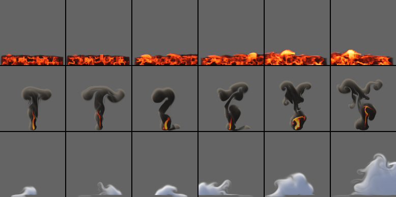
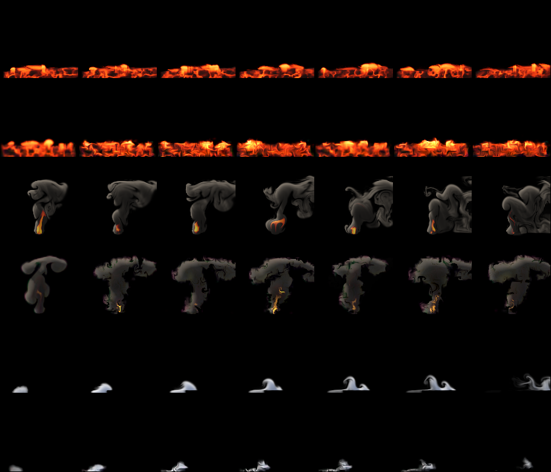

# Earth effects: lava, an eruption and an avalanche

> **Status: paused** (15 October 2026, 22:00 UTC; the week's compute ran out). **Done:** the three presets with their
> tests and the byte-for-byte check of all 21 earlier effects (§2), `d-chaos` (§2), the test's design, committed before
> any test (§4); **lava** trained (2.2 h: renderer 34.7 dB, 146 KB), frozen
> (`results/experiments/fx_earth_frozen.csv`, SHA-256 `b291382b...`) and tested once: it **works** by the rule (tracking
> at 1 s +1.09 dB [+0.70, +1.43] over `coarse_sim_detail`; endless mean frame +1.22 dB [+0.11, +2.45] over the nearest
> flipbook, motion error tied, -0.069 [-0.205, +0.060]; spectrum +0.039 [+0.014, +0.061] worse than the flipbook's;
> `results/experiments/fx_earth/D_SUMMARY.md`). **Not done:** the eruption's and the avalanche's training and tests, the
> cost (`d-timing`), the library entries (`library/earth.nvfxl` is an unjudged draft), the volcano scene's look and frozen
> keyframes (`examples/scenes/volcano.nvfxs` parses; `ScriptedVolcanoFrozen` has no rows yet), the videos, REPORT §6.16,
> README/ENGINES counts, the merge of main and the final checks. **Models** (data root `/root/nvfx-data/fx_earth`):
> `models/d/lava.nvfx` (frozen; a read-only copy in `models/frozen/`, linked into `library/models`); the eruption's
> `d-train` started automatically at 21:57 UTC from the queue and was left running (`logs/eruption.d-train.log`;
> `jobs/train.sh` then runs its `d-tune` and `d-finish`); the queue is paused (`jobs/PAUSED`), so the avalanche will not
> start. **To resume:**
> ```sh
> D=/root/nvfx-data/fx_earth; cat $D/logs/queue.log                     # what ran
> rm $D/jobs/PAUSED; $D/jobs/train.sh eruption                           # resumes at its first unfinished step
> # freeze: sha256sum $D/models/d/eruption.nvfx, a row in results/experiments/fx_earth_frozen.csv, commit and push; then
> $D/jobs/test.sh eruption                                               # the test, once (refuses an unfrozen model)
> $D/jobs/train.sh avalanche && (freeze as above) && $D/jobs/test.sh avalanche
> cp $D/test/*/d_{track,stats,long}.csv ...                              # merge each effect's rows into results/experiments/fx_earth
> build/nvfx_experiment d-report --root $D --results results/experiments/fx_earth
> ```

Status: **in progress** (15 October 2026). The presets, their training plan and the test's design (§4) are written
and committed before any test runs; the results follow them. Audience: dev, research, artists. Three effects a game
would want next to fire, smoke and dust: **lava** (glowing molten rock that flows slowly along the ground and pools,
under a dark crust that cracks to show the glow, bubbling slowly), a volcanic **eruption** (a jet of hot dark ash from a
vent that rises and spreads into an umbrella under a stable layer, while its heavy parts collapse back down its sides)
and a powder-snow **avalanche** (a cloud of snow that runs along the ground in one direction, growing and billowing up
as it goes, then settling; it plays once, for 5 s). They come from the project's own 2D fluid simulator with new
sources, forces and drawing, and are trained and tested as the last nine were ([EFFECTS_BLAZE.md](EFFECTS_BLAZE.md),
[EFFECTS_FLOW.md](EFFECTS_FLOW.md), [EFFECTS_WATER.md](EFFECTS_WATER.md)): study D's recipe and protocol
([REPORT.md](REPORT.md) §6), on held-out settings and seeds of this round's own (6,000,000 to 6,399,999).

## 1. Bottom line

(After the test.)

## 2. The effects

All three are presets of the existing solver (`src/sim/sim.cpp`, in a block of their own: `add_earth_sources`,
`add_earth_forces`, `add_earth_divergence`, `earth_ground`, `earth_decay`, `render_earth`): the same grid, advection,
vorticity confinement, curl noise and pressure solve, with their own sources, forces, decay and drawing. Each has three
controls in [0, 1]: intensity, a second control (lava's `flow`, the eruption's `wind`, the avalanche's `direction`;
`sim::control_names`) and turbulence. Lengths are in cells of a 128-cell frame and times in seconds; s is the slope,
2 × the second control - 1 (-1 to the left, 0 level, 1 to the right).

The lessons of the earlier rounds shaped them. Magic's fast, regular spiral smeared on the 32-cell state (study L), so
all three move at or below fire's speeds (below) and keep their structures broad: lava's crust plates are 10 to 20 cells
across between seams 4 to 8 cells wide, its bubbles a coarse cell or more; the eruption's column is 15 to 23 cells
wide at the vent; the avalanche is one cloud. And every force is a function of what a learned stepper sees: the state
where it acts, the position, the controls and the run's two noise fields (the curl noise's stream function ψ and the
source flicker f). Nothing follows a clock of its own (round 7's puffs were weak for that reason): lava's bubbles and
crust are where the noise puts them, and the avalanche, which plays once, follows the time since its start only
through the two decays a learned one-shot sees as inputs (exp(-t / 0.15 s) and exp(-t / 1 s)).

| | lava | eruption | avalanche |
|---|---|---|---|
| what it is | a band of molten rock along the bottom of the frame: dark crust in plates, glowing seams between them that crawl, slow bubbles that lift the surface into glowing domes; on a slope it flows that way, slowly, deeper downhill; on the level it is a still, deeper pool | a column of dark ash blown up from a vent at the bottom of the middle, glowing only near the vent; it rises, stops under a stable layer and runs out sideways into an umbrella; the cooler, denser ash of its rim collapses back down its sides and runs out along the ground; a sheared wind leans it | a slab of snow breaks loose on the upslope side and runs down the slope as a white cloud that swells and billows up as it goes, then slows where the slope runs out and settles; on the level it only slumps |
| plays | loops | loops | **once**, 150 frames (5 s): the cloud's snow peaks after about 2.4 s (frame 73, median over the training settings with a real slope) and its body comes to rest by about 4.4 s (frame 131; the latest 175); at 5 s a median 29% of its peak snow is still in the air, settling (4% at 7 s). Five seconds hold the run, the growth and the start of the settling; what a longer clip would add is a thinning haze, which a library module fades out anyway (§6) |
| source | a band 96% of the frame wide (its ends taper), its surface (13 to 20%, intensity) × (1.1 - 0.25 \|s\| + 0.25 s × the distance along it) of the height, lumpy with the flicker along it: rock is drawn to a density of 1 (3 per second) and its heat slowly (1.2 per second) towards a pattern: (0.8 to 1.4) × (0.03 + 0.97 seam × (0.55 + 0.45 c(ψ))), where a seam is a zero line of the flicker noise (1 - smoothstep(0.05, 0.22, \|f\|), flicker rate 0.6 per second): dark plates with glowing seams between them that crawl as the noise moves and are carried by the flow before they fade | a vent 5% up the middle of the frame, 16 to 23 cells wide (intensity): ash (2 to 3) and heat (1.5 to 2.0) blown up at 50 to 75 cells per second, broken up by the flicker noise (rate 2.0 per second); its rim carries a quarter of the heat and 30% more ash | in its first moments (at the first age input's rate, exp(-t / 0.15 s) / 0.15 s), a mound on the ground at 0.5 - 0.32 s of the width (upslope of the middle), half-width 13 to 20 cells and 10 to 17 high (intensity), density 2 to 3, its edge from the flicker noise (rate 1.4), set moving down the slope at 35 s cells per second |
| forces | no buoyancy or weight: the flow is imposed, as a viscous flow is. The rock's velocity is drawn (4 per second) towards a flow along the slope that is still at the ground and fastest at the surface (s × 6 to 20 cells per second, intensity), and its vertical motion towards rest, except in a **bubble**: where the flicker along the band (smoothed over a coarse cell either side) is above 0.42 - 0.22 turbulence, the surface is lifted at 10 to 22 cells per second into a dome that is heated towards 1.2 × the hottest glow; lifted rock above the surface falls back at 15 cells per second. Confinement 0.05 to 0.3, curl noise 1 to 7, velocity damping 2.0 | buoyancy 70, ash weight 12; **stable air** above (55 to 75%, intensity) of the height: hot ash there is pushed down (4 × buoyancy × heat) and its vertical motion damped (3 per second), and just below it the ash is pushed outwards (45 cells per second², away from the middle): the umbrella; **collapse**: below 30 to 60% of the stable layer's height, ash that carries less than a quarter to 45% of its own amount in heat is pulled down at (20 to 50) × ash cells per second², and on the ground (as fog's and dust's: still air 3 cells high over a closed bottom) it runs out sideways; **sheared wind**: drag 1.0 per second towards (2 wind - 1) × 40 cells per second × the height fraction; confinement 0.3 to 1.5, curl noise 4 to 24, damping 0.4 | snow weight 25; on the slope the snow's velocity is drawn (2 per second) towards (25 to 55, intensity) × tanh(3 s) cells per second, which runs out over 45 to 80% of the frame from the release; **suspension**: while snow moves faster than 10 to 45 cells per second, 85% of its weight is held up; **entrainment**: where it runs it swells (a divergence of (0.9 to 2.1) × (0.3 + 0.7 exp(-t / 1 s)) × the slope's flow over its fastest, below half the height), so it grows as it goes and stops growing where the slope runs out; the ground holds what settles; confinement 0.4 to 1.6, curl noise 10 to 50, damping 0.6 |
| decay | heat 0.3 per second outside the band's pattern, rock 0.05 | heat 0.6 per second, ash 0.08 | snow 0.12 per second; it picks up snow from the ground below 40% of the height where it runs fast (15 to 60 cells per second; (1.5 to 3) × (0.3 + 0.7 exp(-t / 1 s)) per second towards a density of 1.5), and a cloud that has slowed (below 5 to 25 cells per second) settles out at 0.45 per second (0.9 at the ground) |
| drawing | emitted light by heat (black, deep red, red-orange, orange, yellow, white-yellow) over dark rock (0.05 to 0.1 grey, faintly lit from above) | dark grey-brown ash, lit from above and to the left and deeply shaded by itself; fire's colours where the heat is above 0.85 (at the vent) | white snow, grey-blue in its own shade; no light of its own |
| controls | intensity (temperature and flow rate: brighter, a faster flow, a deeper band), flow (downhill to the left, level, downhill to the right), turbulence (bubbling) | intensity (eruption rate: a wider, faster, denser jet, a higher umbrella, more collapse), wind (lean and shear), turbulence | intensity (size: a bigger slab, a faster and faster-growing cloud), direction (runs left, slumps on the level, runs right), turbulence |

All three lie on the ground (the pressure solve's closed bottom border, as fog's, dust's, the mushroom's, launch's and
the water's). Where material leaves the frame, at its sides and top, the outermost cells take their inner neighbours'
values (`earth_decay`): the scalar advection's correction reads a stale border there, which drew a bright line of
material along the border where lava or snow flowed out (the earlier effects keep the solver as it was). The lava and
the eruption warm up for 150 frames before a clip is recorded, as fog and the water do.

Every earlier effect's clips are unchanged to the byte: `Sim.StudyEffectsAreUnchangedByTheNewOnes` now hashes clips of
all 21 earlier effects (round 7's six and the water's four added, hashed before this round's code), and full-size clips
(128 px, 64 frames) of all 21 at two settings were compared byte for byte before and after (42 SHA-256, identical).
Tests of the new presets: `Sim.EarthEffectsAreNamedAndOnlyTheAvalanchePlaysOnce`,
`Sim.LavaFlowsAlongTheGroundAndPoolsUnderACrustThatCracks`, `Sim.EruptionRisesIntoAnUmbrellaAndItsHeavyAshFallsBack`,
`Sim.AvalancheRunsDownhillGrowsAndSettles`, and in the recipe `Rollout.EarthEffectsKeepFineFieldsAndTheAvalanchePlaysOnce`.

**How they were designed.** Each was looked at with sheets of several settings side by side and a scratch probe that
printed the amount, centroid, extent and speed of the material over time. What changed on the way:
- **Lava.** The first band glowed orange all over, and its bubbles (the curl noise above a level, over the band's whole
  depth) lifted tall square columns. A heat pattern drawn mostly to a dark crust, with seams at the curl noise's zero
  lines, read as lava, but the value noise's lattice drew the seams as straight lines with right-angled steps; the
  flicker noise's zero lines give an irregular network of plates instead. Bubbles now lift only a dome at the surface,
  where the flicker along the band is high (smoothed over a coarse cell either side, so they are at least a coarse cell
  wide). With rock as heavy as dust, the band drained out of the open sides of the frame (the pressure solve holds no
  weight at its border) and drew vertical streaks there; with no weight, a flow imposed on it and lifted rock falling
  back at a set speed, the band stays where it is.
- **Eruption.** The first column was a thin, translucent plume that glowed orange over its whole height and rose out of
  the frame. Denser, darker ash, a glow only where the ash is hottest, heavier ash, damped vertical motion in the stable
  layer and a push outwards just below it gave a column with an umbrella; a cooler, denser rim at the vent and a pull
  on ash that has too little heat for its weight low down gave the collapse down the sides.
- **Avalanche.** The first slab rolled up into a single thin hook (a gravity current's head) and was gone within 3 s.
  Heavier snow only spread as a thin layer; a lift proportional to the snow's speed made it rise as a plume. What reads
  as a powder avalanche is a cloud that takes in air as it runs (a divergence, as dust's burst has), held up while it
  moves fast and settling once it slows; tied to the slope's flow and fading with the second age input, it grows for
  two to three seconds and stops, where tied to the snow's own speed it ran away and filled the frame.



How fast they move, at two settings (all controls 0.5 and all 1; the avalanche also at (0.5, 0.85, 0.5), since at a
direction of 0.5 it only slumps; cells of a 128-cell frame per second where there is material, median and 99th
percentile; a coarse cell is 4 of them, a frame 1/30 s; looping effects in the steady state, frames 150 to 240; the
avalanche over its whole length):

| effect | median | 99th percentile | in coarse cells a frame (99th) |
|---|---:|---:|---:|
| fire | 57 to 62 | 115 to 128 | 0.96 to 1.07 |
| lava | 1 to 9 | 6 to 16 | 0.05 to 0.13 |
| eruption | 17 to 20 | 54 to 60 | 0.45 to 0.50 |
| avalanche | 17 to 27 (2 slumping on the level) | 36 to 59 (18) | 0.30 to 0.50 (0.15) |

Lava is the slowest effect so far (ink's 99th percentile was 18 to 27); the eruption and the running avalanche move at
half of fire's speed or less.

**How chaotic they are** (`nvfx_experiment d-chaos --effects lava,eruption,avalanche --seed-base 6000000`, as
[REPORT.md](REPORT.md) §6.1: active PSNR against the undisturbed run, mean over 4 runs at the settings of salt 77 with this
round's seeds; [d_chaos.csv](../results/experiments/fx_earth/d_chaos.csv)):

| effect | case | 1 frame | 0.5 s | 1 s | 2 s | 4 s | 8 s |
|---|---|---:|---:|---:|---:|---:|---:|
| lava | start nudged by 1e-3, same seed | 84.7 | 81.9 | 84.3 | 86.4 | 92.8 | 93.8 |
| lava | start nudged by 1e-1, same seed | 65.8 | 61.2 | 64.5 | 67.0 | 70.6 | 73.7 |
| lava | same start, other seed | 32.6 | 14.0 | 12.5 | 12.4 | 12.5 | 11.1 |
| lava | other start, same seed | 12.0 | 17.1 | 20.8 | 24.5 | 33.4 | 39.4 |
| eruption | start nudged by 1e-3, same seed | 77.2 | 68.6 | 66.8 | 64.4 | 55.8 | 51.4 |
| eruption | start nudged by 1e-1, same seed | 53.8 | 40.0 | 37.0 | 33.6 | 26.0 | 22.5 |
| eruption | same start, other seed | 30.5 | 16.1 | 12.7 | 11.8 | 10.5 | 11.2 |
| eruption | other start, same seed | 10.7 | 10.5 | 10.5 | 10.7 | 11.9 | 11.7 |
| avalanche | start nudged by 1e-3, same seed | 94.2 | 88.5 | 87.1 | 89.4 | 88.2 (at 4 s) | - |
| avalanche | start nudged by 1e-1, same seed | 73.4 | 61.9 | 63.1 | 62.6 | 61.3 (at 4 s) | - |
| avalanche | same start, other seed | 22.9 | 16.0 | 12.4 | 13.4 | 16.9 (at 4 s) | - |
| avalanche | other start, same seed | 21.1 | 27.3 | 28.6 | 28.9 | 29.6 (at 4 s) | - |

(The avalanche's columns are 0.5, 1, 2, 3 and 4 s; it ends at 5 s.)

- **Lava is forced, as the coals are**: an error in the start heals rather than grows (a 10% nudge is at 74 dB after
  8 s), another seed decides its look within half a second (its crust and bubbles are where the noise puts them), and
  two runs with the same seed from different starts meet (39 dB after 8 s).
- **The eruption behaves as fire and launch do**: a small error stays invisible for seconds, the seed takes over within
  one to two seconds, and a run from another start with the same seed never meets it (11 dB): its column and umbrella
  are turbulent.
- **The avalanche is forced by its release**: a nudge of the start stays invisible (87 dB at 1 s, 88 at 4 s, from 1e-3),
  since what is seen comes mostly from the slab the source releases after the first frame; another seed reshapes its
  cloud within a second (12 dB at 1 s, back to 17 dB at 4 s as the clouds settle into haze), and another start with the
  same seed stays close (21 to 30 dB).

## 3. Training

Study D's recipe (`rollout::recipe_for`), with the one branch its own logic decides: lava's crust and the eruption's
umbrella linger (they change over seconds), so they keep 64-pixel fine fields with their 8 start points, as smoke, fog,
cloud and the flow effects do; the avalanche plays once, so it takes the explosion's branch (`!sim::effect_loops(e)`:
240 runs, 16 start points at its first frame with 64-pixel fine fields, burn-in of up to 32 frames) at its own length,
150 frames (`sim::one_shot_frames`, as the mushroom's). Otherwise fire's settings: 160 runs of 240 frames from an empty
grid with random controls and the recipe's seeds (training salt 1: 600,000 + run, as every round's), the stepper's three
stages, the renderer on 200 frames of 100 runs, the detail constants calibrated on endless runs at the controls of four
training runs with seeds derived from theirs, and the start points. Each is trained in study D's three saved steps
(`d-train --stages12 1`, `d-tune`, `d-finish`), one thread, `nice 15`, from a frozen copy of the tool built from the
committed presets (`DATA/fx_earth/bin`, its SHA-256 and commit beside it in `DATA/fx_earth/jobs`), one effect at a
time on a machine shared with three other agents; the queue (`DATA/fx_earth/jobs/train.sh`) is resumable, with logs
under `DATA/fx_earth/logs`.

**What later studies found, and what is used** (decided before training and the test): **none of it.** Study L's
MacCormack advection in the stepper helps fast rotations that a semi-Lagrangian step smears (magic); these effects
move at most half a coarse cell a frame and have no regular rotation. Study M's ensemble-mean fine-tune improved fire's
average picture by 0.4 dB but changed nothing measurable on steam and the jet (study M2), and costs a training stage.
Study M3's mean state moved the explosion's and dust's start points to the requested controls, where a burst stored at
another intensity stayed the wrong size; the avalanche's slab is released over its first moments by a source the stepper
learns from the controls and the first age input, so its first state, which is its start point, holds about a fifth of
it, and the mean state would have little to correct. The models are study D's recipe as it is.

| effect | runs x frames | simulation | stages 1-2 (loss, s) | stage 3 (loss, s) | renderer (training samples) | contrast, swirl, grow | detail score | start points | stored |
|---|---|---:|---|---|---:|---|---:|---:|---:|
| lava | 160 x 240 | 21.3 min, recorded in 239 s | 0.0670, 5236 | 0.0631, 1247 | 34.7 dB | 0.5, 0.5, 1 | 0.50 | 8 (64 px fine) | 146 KB |
| eruption | 160 x 240 | 21.3 min, recorded in 255 s | 0.0686, 6238 | 0.0659, 1235 | 29.1 dB | 1, 3, 1 | 0.50 | 8 (64 px fine) | 146 KB |
AVALANCHE_TRAIN_ROW

The seconds are wall-clock time on a share of one core of the shared machine (load 5 to 14 on 4 cores). In all 2.2 hours
for lava (19:39 to 21:52 UTC on 15 October: 91 minutes for stages 1 and 2, 25 for stage 3, 17 for the last step) and 2.5
for the eruption (108, 25 and 16 minutes)AVALANCHE_TRAIN_TIME. The loss columns are not comparable between effects (each is
normalised by its own state's scale). The calibration chose half the contrast and a small swirl for lava (its new
material arrives from its noise-drawn pattern, smoother than turbulence makes it) and the strongest swirl (3) for the
eruption, as for launch and the jet; on screen that swirl draws the ash as worms, so the library and the scene play the
eruption with `swirl 1, swirl_scale 9` (as launch's entries do; §6). The eruption's renderer is the weaker of the two on
its training samples (29.1 dB): the white-hot vent and the dark ash are far apart in what they look like, as the
mushroom's fireball and cap were (29.2 dB).

Each model was frozen before its test: [fx_earth_frozen.csv](../results/experiments/fx_earth_frozen.csv) has their
SHA-256 (the files are under the data root's `fx_earth/models/d`, with read-only copies in `fx_earth/models/frozen`). All
three were trained by one frozen copy of the tool (`DATA/fx_earth/bin`, SHA-256 `7b3e2f02...`, built from commit
2868289, whose presets are those of the committed code). A restart of the machine on 20 October stopped the queue
between the eruption's training and its test; nothing had to run again (each step's marker is under
`DATA/fx_earth/jobs/state`).

## 4. The test

Written before any test was run, and committed before the first one. Each model is frozen (its SHA-256 in
`results/experiments/fx_earth_frozen.csv`) before its own test, and each test runs once, with `nvfx_experiment d-eval`
and `d-report` unchanged but for their seeds. The models train one at a time (the machine is shared), so the test runs
in parts on this one design, as the flow and water rounds' did: each effect is frozen and tested when its training ends
(`d-eval --effects lava`, then the eruption, then the avalanche), each into a folder of its own under the data root
(`DATA/fx_earth/test/<effect>`), its rows then added to `results/experiments/fx_earth/d_track.csv`, `d_stats.csv` and
`d_long.csv`. Every run of the test is independent and seeded by its effect, run and setting, so the split changes no
number. It is study D's protocol ([REPORT.md](REPORT.md) §6.4 to §6.6), exactly as the last nine effects were tested:

- **Seeds: this round's own** (`--seed-base 6000000`; nothing below 6,000,000 or above 6,399,999 is chosen by this
  round): the held-out tracking runs 6,000,000 + run, the real runs at the held-out settings 6,100,000 + k and
  6,110,000 + k, the neural run 6,120,000 + k, the coarse simulation 6,130,000 + k, the one-minute runs 6,140,000 + k;
  `d-chaos` 6,150,000 + run (and 6,150,999 + run). What the protocol fixes is kept: the training runs' seeds (the
  recipe's, 600,000 to 600,239), the detail calibration's (derived from the training runs') and study B's flipbooks'
  (seed 1, a baseline's construction).
- **Precision:** the runtime plays the models as it ships them: rollout effects at int8 by default since study K
  ([REPORT.md](REPORT.md) §13), on the AVX-512 build with VNNI, which this machine has. `d-eval` sets no precision, so the
  `neural` rows are int8; `neural_dynamics_true_renderer` is the float reference implementation (`rollout::step`).
- **Tracking from the true state:** 8 held-out runs per effect (salt 2's settings), each started from its true state
  (coarse and fine fields; lava and the eruption after 100 frames, the avalanche after its first frame) with its own
  noise seed: 240 frames (the avalanche: to its last frame, 149). The neural rollout through the runtime against the
  simulation on the same 32-cell grid with the same detail layer (`coarse_sim_detail`), the plain coarse simulation,
  holding the first frame, and the neural dynamics drawn by the simulation's renderer. Active PSNR at 1 and 8 frames
  and at 1, 2 and 8 s (the avalanche: 1 and 8 frames, 1, 2 and 4 s); the neural run minus `coarse_sim_detail`, paired
  over the 8 runs.
- **Endless runs at settings never seen:** the ten held-out settings of study B (`b_test_settings`, its generator with
  seed 2026: none on study B's training grid), 10 s each after a 5 s warm-up of the real runs (the avalanche: its 5 s
  from its first frame). Frame statistics against a real run: detail spectrum distance, motion ratio (as the error
  \|ln ratio\|), coverage distance and mean-frame PSNR. Compared with a second real run with another seed (the floor),
  the nearest of the 45 training flipbooks of study B's grid (made for these effects as study B made its library: 128
  px, seed 1; 64 frames looped; **the avalanche's are its whole 150 frames**, as the mushroom's were, since 64 frames
  held on the last would leave more than half of it still), and the coarse simulation with the detail layer and
  without.
- **One minute:** a 60 s neural run in shards at the first two held-out settings, cut into 10 s windows, each against
  the real 10 s run (lava and the eruption; the avalanche plays once).
- **Statistics:** every difference paired (over runs or settings), with a 95% bootstrap interval of 10,000 resamples
  (`metrics::paired_bootstrap`); an interval across zero is a tie. Every number is reported, ties as ties.

**The verdict, decided now** (the rule of rounds 7 and 8): an effect **works** if it tracks its runs better than
`coarse_sim_detail` at 1 s (interval above zero) and, played endlessly, its average picture is closer than the nearest
flipbook's (mean-frame PSNR interval above zero) and its motion error is no worse than the flipbook's (interval not
above zero). An effect that ties or loses to the coarse simulation at tracking at 1 s, or whose average picture or
motion error loses to the flipbook (interval on the worse side), is **weak**, as magic, the orb, the vortex, puffs, the
mushroom, the waterfall and the splash were. An effect that is neither (for example: it tracks better and its motion
ties, but its average picture only ties the flipbook's) **falls short** of working, as launch and ink did. Detail
(spectrum distance) and coverage are reported but do not decide.

The tests ran once each, with this design: lava's on 15 October 2026 (4.5 minutes on one thread), the eruption's and
the avalanche's on 20 October, each into its own folder under the data root (`DATA/fx_earth/test/<effect>`), its rows
then merged into [d_track.csv](../results/experiments/fx_earth/d_track.csv),
[d_stats.csv](../results/experiments/fx_earth/d_stats.csv) and [d_long.csv](../results/experiments/fx_earth/d_long.csv);
`d-report` wrote [D_SUMMARY.md](../results/experiments/fx_earth/D_SUMMARY.md). The `neural` rows played at int8 (the
runtime's default; the AVX-512 build with VNNI). One thing differed from the plan: the machine restarted between the
eruption's training and its test, and the queue was started again; no step or test ran twice.

### 4.1 Tracking from the true state

Active PSNR (dB), mean over 8 held-out runs (the avalanche's last horizon is 4 s, its run ending at 5 s):

| effect | method | 1 frame | 8 frames | 1 s | 2 s | 8 s (avalanche: 4 s) |
|---|---|---:|---:|---:|---:|---:|
| lava | neural | 30.2 | 22.0 | 16.1 | 14.5 | 13.9 |
| lava | neural dynamics, simulation's renderer | 36.3 | 22.3 | 16.0 | 14.5 | 13.8 |
| lava | coarse simulation + detail | 24.9 | 19.6 | 15.0 | 13.9 | 13.4 |
| lava | coarse simulation | 17.9 | 17.3 | 16.9 | 16.2 | 16.3 |
| lava | holding the first frame | 38.5 | 22.2 | 14.3 | 11.8 | 10.7 |
| eruption | neural | 24.2 | 17.5 | 15.3 | 13.0 | 10.7 |
| eruption | neural dynamics, simulation's renderer | 26.7 | 17.7 | 15.3 | 13.0 | 10.7 |
| eruption | coarse simulation + detail | 24.1 | 17.3 | 14.8 | 13.2 | 10.8 |
| eruption | coarse simulation | 16.9 | 16.4 | 15.4 | 13.7 | 11.0 |
| eruption | holding the first frame | 27.6 | 14.4 | 10.2 | 9.3 | 8.9 |
AVALANCHE_TRACK_ROWS

Neural minus coarse simulation + detail, paired over runs (95% intervals; bold: the neural rollout is better):

| effect | 1 frame | 8 frames | 1 s | 2 s | 8 s (avalanche: 4 s) |
|---|---|---|---|---|---|
| lava | **+5.28 [+4.22, +6.30]** | **+2.42 [+2.13, +2.77]** | **+1.09 [+0.70, +1.43]** | **+0.63 [+0.18, +1.01]** | +0.49 [-0.26, +1.20] (tie) |
| lava, neural dynamics with the simulation's renderer | **+11.44 [+10.42, +12.38]** | **+2.75 [+2.47, +3.11]** | **+0.93 [+0.56, +1.24]** | **+0.56 [+0.12, +0.91]** | +0.42 [-0.33, +1.15] (tie) |
| eruption | +0.08 [-1.18, +1.25] (tie) | +0.26 [-0.08, +0.58] (tie) | **+0.50 [+0.06, +0.96]** | -0.22 [-0.75, +0.35] (tie) | -0.13 [-1.20, +0.75] (tie) |
| eruption, neural dynamics with the simulation's renderer | **+2.58 [+1.85, +3.22]** | **+0.46 [+0.09, +0.80]** | **+0.55 [+0.09, +1.03]** | -0.16 [-0.69, +0.42] (tie) | -0.09 [-1.17, +0.78] (tie) |
AVALANCHE_TRACK_DIFF

- **Lava follows a held-out run better than the simulation at the same resolution** from the first frame to 2 s (+2.4 dB
  at 8 frames, +1.1 at 1 s, +0.6 at 2 s) and ties it at 8 s. Less than the coals (+4.7 at 1 s), its forced cousin: the
  lava's crust is drawn from the flicker noise's zero lines, a fine network of seams 4 to 8 cells wide that the 32-cell
  state cannot carry, so both the learned stepper and the coarse simulation lose its pixels within a second; the plain
  coarse simulation without the detail layer, a soft band in the right place, scores highest of all from 16 frames
  (16.9 dB at 1 s). Its learned renderer reaches 31.0 dB on the true fields.
- **The eruption beats it only at 1 s, by half a decibel**, and ties it at every other horizon: its column and umbrella
  are as turbulent as launch's billows, and two runs of the simulation part within a second or two (§2). Its renderer is
  the weak part of its first frames (27.8 dB on the true fields): drawn by the simulation's renderer the same dynamics
  lead by 2.6 dB at the first frame.
AVALANCHE_TRACK_NOTE

### 4.2 Endless runs at settings never seen

Means over the 10 held-out settings (spectrum distance and coverage distance: lower is better; motion ratio: 1 is
right; mean-frame PSNR: higher is closer):

| effect | method | spectrum | motion | coverage | mean-frame PSNR |
|---|---|---:|---:|---:|---:|
| lava | real, other seed (floor) | 0.048 | 1.00 | 0.006 | 24.6 |
| lava | **neural rollout (146 KB)** | 0.143 | 1.19 | 0.026 | 21.9 |
| lava | nearest training flipbook | 0.104 | 1.38 | 0.014 | 20.7 |
| lava | coarse simulation + detail | 0.234 | 1.46 | 0.013 | 22.2 |
| lava | coarse simulation | 0.772 | 0.71 | 0.006 | 23.5 |
| eruption | real, other seed (floor) | 0.078 | 0.99 | 0.028 | 21.7 |
| eruption | **neural rollout (146 KB)** | 0.154 | 1.09 | 0.044 | 20.0 |
| eruption | nearest training flipbook | 0.172 | 1.04 | 0.053 | 18.7 |
| eruption | coarse simulation + detail | 0.200 | 1.83 | 0.054 | 18.9 |
| eruption | coarse simulation | 0.760 | 0.44 | 0.095 | 17.6 |
AVALANCHE_ENDLESS_ROWS

Neural minus each other method, paired over the 10 settings (motion as the error \|ln ratio\|; bold: the neural
rollout is better):

| effect | statistic | nearest flipbook | coarse simulation + detail | real, other seed |
|---|---|---|---|---|
| lava | spectrum distance | +0.039 [+0.014, +0.061] | **-0.091 [-0.125, -0.059]** | +0.095 [+0.066, +0.125] |
| lava | mean-frame PSNR (dB) | **+1.22 [+0.11, +2.45]** | -0.33 [-1.22, +0.38] (tie) | -2.72 [-4.33, -1.22] |
| lava | motion error | -0.069 [-0.205, +0.060] (tie) | **-0.127 [-0.239, -0.026]** | +0.163 [+0.071, +0.250] |
| lava | coverage distance | +0.012 [+0.002, +0.020] | - | +0.020 [+0.016, +0.023] |
| eruption | spectrum distance | -0.018 [-0.072, +0.034] (tie) | -0.046 [-0.108, +0.021] (tie) | +0.076 [+0.039, +0.114] |
| eruption | mean-frame PSNR (dB) | **+1.31 [+0.04, +2.55]** | +1.11 [-0.22, +2.57] (tie) | -1.65 [-3.41, -0.05] |
| eruption | motion error | +0.001 [-0.089, +0.078] (tie) | **-0.422 [-0.540, -0.294]** | +0.043 [-0.003, +0.088] (tie) |
| eruption | coverage distance | **-0.009 [-0.018, -0.001]** | - | +0.015 [+0.001, +0.031] |
AVALANCHE_ENDLESS_DIFF

- **Lava** plays with its average picture 1.2 dB closer than a neighbouring setting's flipbook and its motion tied with
  the flipbook's (19% fast; the flipbook 38%); its detail is a little further from real than the flipbook's (+0.039), and
  its coverage too: the learned band glows more evenly, as a river of orange with darker streaks, where the simulator's
  is dark crust split by bright seams (the figure below). It beats the coarse simulation with the detail layer on detail
  and motion, and ties its average picture.
- **The eruption** plays with its average picture 1.3 dB closer than the flipbook's, its motion tied with the flipbook's
  and with a second real run's (9% fast), its detail tied with the flipbook's and its coverage closer: a flipbook of a
  neighbouring setting puts the umbrella at another height and lean. Its learned renderer adds faint pink and green
  fringes at the ash's edges, as the mushroom's and the cloud's do.
AVALANCHE_ENDLESS_NOTE



### 4.3 One minute without a restart

| effect | spectrum distance | motion ratio | mean-frame PSNR |
|---|---|---|---|
| lava | 0.09-0.16 | 1.09-1.76 | 21.3-25.5 |
| eruption | 0.11-0.20 | 1.00-1.39 | 18.4-23.4 |

Ranges over six 10 s windows at each of the first two held-out settings (the avalanche plays once). Neither drifts: the
last windows are as good as the first. Lava moves too fast in every window at both settings (1.09 to 1.76), as in its
10 s runs: the learned crust crawls faster than the simulator's.

### 4.4 By the rule

- **Lava works**: it tracks better than the coarse simulation at 1 s (+1.09 [+0.70, +1.43]), its average picture is
  closer than the flipbook's (+1.22 [+0.11, +2.45]) and its motion error ties the flipbook's. Its detail, worse than the
  flipbook's, does not decide by the rule, but it is what is missing: the crust's network of seams.
- **The eruption works, narrowly**: +0.50 [+0.06, +0.96] at 1 s (the only horizon it leads at), an average picture
  closer than the flipbook's (+1.31 [+0.04, +2.55]) and its motion error tied with the flipbook's. Both intervals that
  decide are near zero.
AVALANCHE_VERDICT

## 5. Memory and cost

(After the test: `nvfx_experiment d-timing`, beside study D's fire in the same session.)

## 6. The library and a scene

(After the test.)

## 7. What it means

(After the test.)

## 8. Reproduce

```sh
build/nvfx_sim --effect lava --intensity 0.6 --flow 0.8 --sheet lava.png        # the simulator's presets alone
build/nvfx_sim --effect eruption --intensity 0.6 --wind 0.6 --bg grey --sheet eruption.png
build/nvfx_sim --effect avalanche --intensity 0.7 --direction 0.9 --frames 150 --bg grey --sheet avalanche.png
R="--root $NEURALVFX_DATA/fx_earth --results results/experiments/fx_earth --threads 1"
build/nvfx_experiment d-chaos  --effects lava,eruption,avalanche $R --seed-base 6000000
build/nvfx_experiment d-train  --effects lava --stages12 1 $R
build/nvfx_experiment d-tune   --effects lava $R
build/nvfx_experiment d-finish --effects lava $R
#   (the same for eruption and avalanche)
build/nvfx_experiment d-eval   --effects lava --root $NEURALVFX_DATA/fx_earth --results DIR --threads 2 --seed-base 6000000 --figures FIGS   # the test, once per effect
build/nvfx_experiment d-report --root $NEURALVFX_DATA/fx_earth --results results/experiments/fx_earth   # D_SUMMARY.md
```
