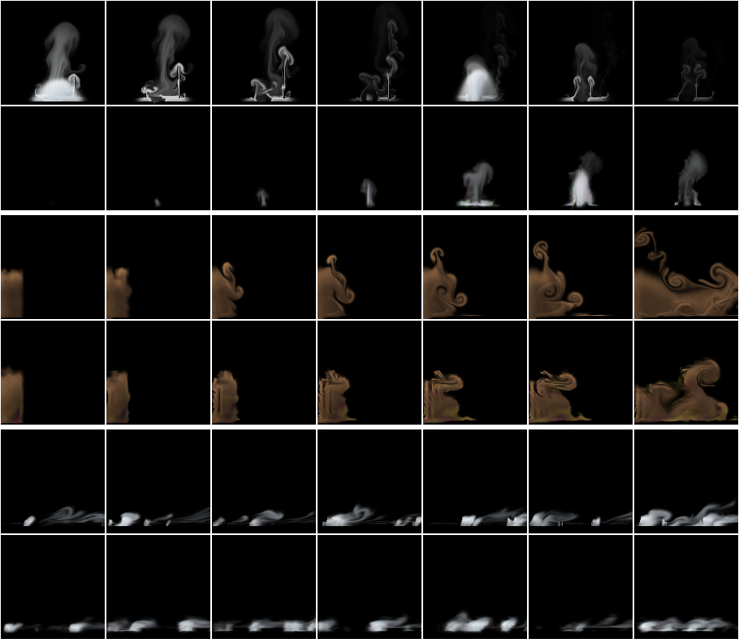
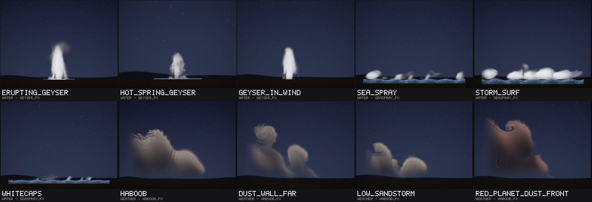
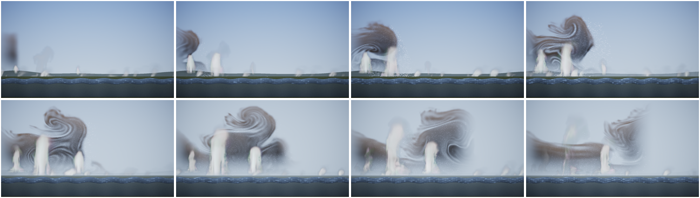

# Elements: a geyser, a haboob and sea spray

Status: **done** (21 October 2026). Audience: dev, research, artists. The presets, the training plan (§3) and the test's
design and rule (§4) were written and committed before any model was trained; each model was frozen by its SHA-256
before its one test. Since then study Q ([REPORT.md](REPORT.md) §21) tried the haboob's renderer trained again with its
first frames and the geyser's stepper fine-tuned on 30-frame windows and with 24 start points; none met its rule, and
both keep this round's files.

Three effects of the elements, after the earth and air rounds ([EFFECTS_EARTH.md](EFFECTS_EARTH.md),
[EFFECTS_AIR.md](EFFECTS_AIR.md)), from the catalogue in [TODO.md](../TODO.md): a **geyser** (#88: a periodic eruption
of a column of water and steam; it erupts, holds, collapses and steams, and is quiet between eruptions), a **haboob**
(#70 and #71: a storm's outflow running along the ground as a gravity current, a tall rolling wall of dust with dimmer
dust behind it; at its lowest a sandstorm streaming low; it plays once, for 5 s) and **sea spray** (#77: spray and
spume torn off breaking wave crests by the wind, drifting downwind and falling back into the sea, a fine spray drifting
on). They come from the project's own 2D fluid simulator with new sources, forces and drawing, and are trained and
tested as the last twenty-seven effects were: study D's recipe and protocol ([REPORT.md](REPORT.md) §6), on held-out
settings and seeds of this round's own (27,000,000 to 27,999,999).

## 1. Bottom line

- **Sea spray works, by the rule set before the test.** From its true state it follows a held-out run 1.9 dB [1.0, 2.8]
  better than the same simulation on the same 32-cell grid with the same detail layer at 1 s, and keeps its lead to 8 s
  (+2.3 at 2 s, +2.9 [1.9, 3.8] at 8 s). Played endlessly at settings and seeds it never saw, its average picture is
  5.9 dB [4.8, 7.1] closer to a real run's than the nearest training flipbook's and **ties a second real run** (+0.6
  [-1.3, +2.0]); its motion error ties the flipbook's. Its weak part is its detail: spectrum distance 0.36 against the
  flipbook's 0.10. By eye: white tufts of spray where crests break, streaming downwind and falling back, blobbier than the
  simulator's thin plumes. It answers its intensity as the simulator does (§4.7).
- **The haboob falls short of the bar without being weak.** It tracks better than the coarse simulation from 1 s (+1.1
  dB [0.3, 1.9]; +2.3 at 2 and at 4 s), but its first frames are lost to its renderer (-11.7 dB at the first frame;
  the same dynamics drawn by the simulation's renderer tie there), and played endlessly its average picture only **ties**
  the nearest flipbook's (-0.9 dB [-2.1, +0.2]), where the rule asks for it to be closer; its motion error ties too. The
  flipbook here is the whole 150-frame one-shot at a neighbouring setting, as close to a real run as a second real run
  is. **It runs at the simulator's speed** at the test's first held-out setting (24.0 against 25.3 cells/s) and 25% too
  fast at the second (20.0 against 16.0) (§4.5); the simulator's own current runs as gravity-current theory says (§2:
  Fr = 1.15 ± 0.23 on its head, Huppert and Simpson's laboratory 1.19).
- **The geyser is weak**: it ties the coarse simulation at following a run at 1 s (+1.1 dB [-0.3, +2.6]) and loses to it
  at 2 s (-2.2 [-3.8, -0.5]). Its average picture is 5.3 dB [2.1, 8.4] closer than the flipbook's (a 64-frame flipbook
  holds less than one of its cycles) and ties a second real run. **Does it erupt when its conduit says?** At the test's
  first held-out setting yes: over a minute, a column in 95% of the frames where its conduit is past the eruption level
  (the simulator's: 97%) and in 8% where it is quiet (0%); at the second, low setting (intensity 0.10) it never erupts,
  where the simulator does a third of the minute (§4.6). Within a 6 s shard its column follows the start point it plays
  more than its intensity (§4.7).
- **Cost (provisional, a shared machine):** 146 KB stored for the geyser and sea spray, 294 KB for the haboob (16 start
  points with 64-pixel fine fields and its mean state); 2.4 to 2.5 MB per instance at 128 px. At the runtime's int8
  default on the AVX-512 build, 1.03 (geyser), 0.67 (haboob) and 0.42 ms (sea spray) per 128 px frame, where study D's
  fire took 0.68 ms and its explosion 0.52 in the same rounds (§5).
- **A scene script** (`examples/scenes/coast.nvfxs`, 9 s) plays all three on a desert coast under the weather director:
  a geyser field across a bay erupts as a haboob rolls in behind it and the day turns from clear to a dust storm, the
  rising wind tearing the geysers' steam away and the spray off the breaking sea. Its keyframes are frozen (`ctest -R
  ScriptedCoastFrozen`, float on AVX2). **Ten library entries** (`library/elements.nvfxl`) use the models, three of them
  with frozen keyframes: the geysers, haboobs and sea fair, the whitecaps weak to fair (§6).
- **What it took:** a preset each, one line in the recipe (the geyser and sea spray keep fine fields with their start
  points), study M3's mean state for the one-shot, 4.2 to 4.4 hours of one thread each side by side on the shared machine
  (and two container restarts, which cost a step each and changed nothing), and no new code in the trainer, the runtime
  or the compositor.

## 2. The effects

All three are presets of the existing solver (`src/sim/sim.cpp`, in a block of their own: `add_elements_sources`,
`add_elements_forces`, `add_elements_divergence`, `elements_decay`, `render_elements`): the same grid, advection,
vorticity confinement, curl noise and pressure solve, with their own sources, forces, decay and drawing. Each has three
controls in [0, 1]:

| | geyser | haboob | seaspray |
|---|---|---|---|
| controls | intensity (the column's height: 10 to 18 m), **wind** (0 from the right, 0.5 still air, 1 from the left: it carries the steam), turbulence | intensity (the outflow's density: a stronger storm runs faster), **height** (the outflow's depth: a low sandstorm at 0, a tall wall at 1), turbulence | intensity (the sea's size: higher crests, more breaking), **gale** (the wind's strength, a near gale to a storm, blowing to the right; a game mirrors the module for the left), turbulence |
| plays | loops | **once**, 150 frames (5 s) | loops |

The haboob's second control is named `height` and sea spray's `gale` (`sim::control_names`, so the model files, the
runtime and scene scripts call them that; `nvfx_sim` takes `--height` and `--gale`); the geyser keeps `wind`. Every
force is a function of what a learned stepper sees: the state where it acts, the position, the controls and the run's
two noise fields (the curl noise's stream function ψ and the source flicker f). Nothing follows a clock of its own. The
haboob, which plays once, is made at its first step (as the explosion's burst is) and does not otherwise follow the time
since its start.

**The geyser's rhythm.** A geyser is a relaxation oscillator: its conduit is heated from below until water deep in it
boils, the boiling empties the conduit in an eruption, and it refills and heats again. A learned stepper has no clock of
its own, so the conduit's state is a noise field it sees: the source flicker at the coarse cell beside the vent (cells
62.5, 6.5 of a 128-cell frame, a coarse cell's centre, where the stepper's flicker input is exactly that value), whose
time axis is slow (0.3 per second), so it rises and falls over seconds. Its *charge* is (f + 0.14) / 0.32: below 0 the
vent only simmers; from 0 to 1 it steams harder and surges; from 1 it erupts, with a strength smoothstep(1, 1.35,
charge), holds while the charge stays high and collapses as it falls; the steam it threw up drifts off. Over 40 seeds and
two minutes each the conduit is past its eruption level 23% of the time, an eruption lasts a median 1.9 s (the 10th and
90th percentiles 0.5 and 5.3 s, some of them surges within one eruption) and the gaps between them a median 5.1 s (0.7 to
15 s): irregular, as real geysers are (Old Faithful's intervals run from about an hour to two). A geyser that should erupt
on a game's cue would be a one-shot started again, as the smoke rings are ([EFFECTS_AIR.md](EFFECTS_AIR.md) §2); this
one keeps its own irregular time.

Lengths are in cells of a 128-cell frame and times in seconds. The geyser's frame is about 25 m across, so gravity (9.8
m/s²) is 50 cells/s²; sea spray's about 12 m.

| | geyser | haboob | seaspray |
|---|---|---|---|
| what it is | a vent in a low sinter mound in the middle of the bottom of the frame (its top 8 cells up): between eruptions a wisp of steam; as the conduit's charge rises it steams and surges; then a white column of water shoots up, holds, and collapses back around the vent while its steam billows up and drifts off on the wind | a storm's cold outflow let go at the left side of the frame: it runs right along the ground as a gravity current, its head rolling up into billows, the dust it lifts from the ground making it a dark wall, and dimmer dust behind it settling out; at 5 s the front has crossed the frame at most settings | wave crests break along the sea's surface (12 cells up): white caps rise where they break and the wind tears spray off their tops; the drops fly downwind and fall back into the sea, a fine spray drifts on and evaporates |
| source | the vent, 8 to 12 cells wide (intensity), straddling the ground: steam (heat (0.45 to 0.7) × the steaming strength, at least 0.1) always, and in an eruption water ((1.1 to 1.4) × its strength) thrown up at V = sqrt(2 g H) for a column H = (50 to 90) × (0.15 + 0.85 × the eruption's strength) cells high, broken into surges by the flicker noise; the vent discharges this volume (a divergence source under it of V over its depth of 4 cells, as the explosion's hot gas expands) | at its first step a lock of cold, dusty air 26 cells wide and 30 to 64 cells deep (height), its density 0.6 to 1.2 (intensity) and lumpy with the flicker noise, half of that in dust; after it the storm goes on feeding it at the left edge (the last 10 cells): drawn (4 per second) towards that density over that depth, moving forward at 0.8 sqrt(g' h) (a constant-flux current) | where the flicker along the surface (rate 0.9 per second) is above a level set by the share of the surface where crests break, a crest rises 4 to 10 cells (intensity) where it breaks hardest, with a white cap 3 cells deep; at its top, drops (soot, 0.9) and a fine spray (heat, 0.6 to 1.1, gale) are thrown up at (25 to 55) × the crest's strength and forward at the wind's speed there; how many crests break follows Monahan and O'Muircheartaigh's (1980) whitecap cover, 3.84×10⁻⁶ U^3.41 for a wind U of 12 to 25 m/s (gale), times 1.2 to 2.4 (intensity): from 2% of the surface to 54% |
| forces | **the water flies as drops**, not as a jet of air: an extra advection moves it at its drop velocity less the air's, which is a function of the position, the controls and the eruption's strength: in the column's core (a cone of about 7 degrees, below the height the eruption throws water to, rounded at its crown) it rises at sqrt(V² - 2 g z) and fans out, more as it slows; outside and above it it falls at 40 cells per second (8 m/s), moving out from the column (8 to 22, turbulence) and high up with the wind; it drags the air in the column with it (2 per second towards 0.3 of its velocity); buoyancy 90 on the steam; the wind (drag 1.5 per second towards 40 (2 wind - 1), weaker near the ground) carries the steam; bare air loses its momentum (2 per second); the ground is still but for the vent; confinement 0.2 to 1.2, curl noise 4 to 26, damping 0.6 | weight 20 on the cold air (g' = 20 × its density, cells/s²), none on the dust: it is carried by the cold air; the rough ground holds back the air within 2 cells of it (3 per second), so the front's nose is raised; the ground under it; no damping; confinement 0.3 to 1.3, curl noise 8 to 40 | the wind over the sea, everywhere: all the air drawn (1.2 per second) towards a logarithmic profile, (30 to 90 at the top of the frame, gale) × ln(1 + z / 1.5) / ln(1 + 116 / 1.5) at a height z over the surface; buoyancy 6 on the fine spray; the surface stops what falls onto it; confinement 0.1 to 0.6, curl noise 8 to 38 |
| decay | water that comes down onto the ground away from the vent runs off (12 per second) and gives half of itself as steam; hot water flashes to steam as it flies (0.25 per second); steam 0.55 per second | **saltation**: where the air within 6 cells of the ground runs faster than half of sqrt(g' h), it lifts dust at a rate that grows as the cube of its speed (Bagnold 1941), up to twice the outflow's density; the dust settles out at 0.25 per second | the drops fall through the air at their own speed, 20 cells per second (2 m/s; an upwind step), and what falls below the surface is gone; the fine spray evaporates at 0.45 per second; clear air comes in on the upwind side |
| drawing | white, frothy water, grey-blue in its own shade (little: it is thick and aerated); soft pale steam | ochre dust, deeply shaded by itself, its opacity from the lifted dust and (less) the cold air | white drops and caps, grey-blue in their shade; the fine spray a pale haze |

All three stand on the ground or the sea: the pressure solve's closed bottom border, as fog's, dust's and the earth
effects'. Where material leaves the frame, the outermost cells take their inner neighbours' values (as the earth effects').
The geyser and sea spray warm up for 150 frames before a clip is recorded, as fog and the water do. None of them draws
its ground or sea: the scene's or the game's does.

**The haboob's front speed against gravity-current theory.** A gravity current's front runs at U = Fr sqrt(g' h), with
g' its reduced gravity and h its depth. Benjamin (1968) found that for an ideal fluid, when the current is much shallower
than the fluid around it, Fr = √2, and for an energy-conserving current filling half the depth, Fr = 1/√2 (on the
current's depth); Huppert and Simpson (1980) measured Fr = 1.19 for currents in deep surroundings in the laboratory,
the difference from √2 being the unsteady, three-dimensional motion at the front (as reported by Hogg and Woods 2001,
J. Fluid Mech. 449, 201-224). The simulator's frame is open above (deep surroundings). Measured with a scratch probe on
36 runs (nine settings of intensity and height from 0.2 to 0.8, turbulence 0.5, four seeds each, 128 cells), the front's
speed from 1.5 to 3 s (or until it is 115 cells along) and the current's head over that time (its height, the highest
cell with cold air denser than 0.25 within 25 cells behind the front, and its mean density there):

| intensity, height | U (cells/s) | sqrt(g' h₀) of the feed | U / sqrt(g' h₀) | head height h_f (cells) | head density | Fr = U / sqrt(g' h_f) |
|---|---:|---:|---:|---:|---:|---:|
| 0.2, 0.2 | 20.0 | 23.0 | 0.87 | 30.3 | 0.58 | 1.08 |
| 0.2, 0.5 | 22.5 | 26.0 | 0.86 | 38.9 | 0.57 | 1.08 |
| 0.2, 0.8 | 24.8 | 28.7 | 0.87 | 49.3 | 0.57 | 1.07 |
| 0.5, 0.2 | 22.8 | 25.7 | 0.89 | 29.3 | 0.71 | 1.14 |
| 0.5, 0.5 | 25.8 | 29.1 | 0.89 | 36.4 | 0.70 | 1.17 |
| 0.5, 0.8 | 27.7 | 32.1 | 0.86 | 44.4 | 0.69 | 1.14 |
| 0.8, 0.2 | 25.3 | 28.2 | 0.90 | 28.6 | 0.83 | 1.19 |
| 0.8, 0.5 | 28.2 | 31.9 | 0.88 | 34.2 | 0.82 | 1.21 |
| 0.8, 0.8 | 31.0 | 35.1 | 0.88 | 40.5 | 0.82 | 1.23 |

**The simulator's current runs as gravity-current theory says.** Its front's speed is a constant 0.86 to 0.90 of
sqrt(g' h) of what feeds it at every setting (so it scales as the theory's square root of the reduced gravity and the
depth), and on its head, Fr = 1.15 ± 0.23 over the 36 runs (range 0.74 to 1.51): Huppert and Simpson's laboratory value,
1.19, and under Benjamin's ideal √2. `Sim.HaboobRunsAlongTheGroundAsAGravityCurrentAtItsSpeedAndLiftsDust` checks the
first measure (at 64 cells, four seeds: 0.85). For scale: a haboob's cold pool is a few kelvin colder than the air it runs
into (g' = g Δθ/θ, about 0.1 to 0.3 m/s²) and 1 to 2 km deep, so sqrt(g' h) is 10 to 25 m/s, and at Fr about 1 its front
runs at that speed, as haboobs' do. The tile's frame is shown faster than real time; the scene sets the pace.

Every earlier effect's clips are unchanged to the byte: `Sim.StudyEffectsAreUnchangedByTheNewOnes` hashes clips of all
27 earlier effects, unchanged (and now round 10's fire three, hashed when the two round 10 branches were merged, and these three, hashed when their presets were frozen for training), and full-size clips (128 px; 64 frames, the one-shots their own length) of all 27 at two
settings were compared byte for byte before and after (54 SHA-256, identical; the data root's
`fx_elements/jobs/state/baseline_clips.sha256` and `after_clips.sha256`). Tests of the new presets:
`Sim.ElementsEffectsHaveTheirOwnControlsAndOnlyTheHaboobPlaysOnce`, `Sim.GeyserEruptsHoldsCollapsesIntoSteamAndIsQuietBetween`,
`Sim.HaboobRunsAlongTheGroundAsAGravityCurrentAtItsSpeedAndLiftsDust`, `Sim.SeaSprayIsTornOffTheCrestsDriftsDownwindAndFallsBack`,
and in the recipe `Rollout.ElementsEffectsTakeTheirRecipes`.

**How they were designed.** Each was looked at with sheets of several settings and a scratch probe that printed the
amount, extent and speed of the material over time (and the haboob's front and head). What changed on the way:
- **Geyser.** A jet of water blown up from a vent in the ground hardly rose: the closed ground let no air into the vent,
  so the pressure solve took the jet's speed away; the vent is now a volume source (water and steam come out of the
  conduit). Then the column rose as a single-phase jet does, pushing a mushroom cap ahead of it that spread into a T,
  and the water lay on the ground as a sheet. Water moved as drops (its own velocity through the air, by position, the
  eruption's strength and the controls) gives a column that rises at the drops' speed, rounds off at its crown and falls
  back around itself; water that lands runs off fast and steams.
- **Haboob.** It was first designed as a loop in the frame of the front, as in a moving-floor flume (Britter and Simpson
  1978): the air ahead coming on at the front's speed and the ground moving under it. The head was not stable in that
  frame: within 15% either way of the right speed it was pushed back into its feed or ran out of the frame, and nothing
  in a function of the state, position and noise holds it. In the ground's frame, let go from a lock and fed from
  behind, it runs as a gravity current should (above), and plays once. Its first current was low and its dust uniform; a
  deeper outflow and the dust lifted by the gust behind the front (Bagnold's cube law) give a taller head that is darker
  than the dust behind it.
- **Sea spray.** The first crests were blocks of white water with spray that stayed low; spray thrown off the crests'
  tops at the wind's speed there and lifted harder, drops falling through the air at their own speed (not pushing the
  air down, which stirs it), and thin white caps instead of whole crests read as spray torn off the sea.


How fast they move, at two settings (all controls 0.5 and all 1; cells of a 128-cell frame per second where there is
material, median and 99th percentile; the looping effects over frames 150 to 240, the haboob over its 150; a coarse cell
is 4 cells, a frame 1/30 s; the same probe for fire):

| effect | median | 99th percentile | in coarse cells a frame (99th) |
|---|---:|---:|---:|
| fire | 55 to 75 | 97 to 126 | 0.80 to 1.05 |
| geyser (the air) | 12 to 13 | 71 to 77 | 0.59 to 0.64 |
| geyser (its drops, at most) | - | 71 to 95 | 0.59 to 0.79 |
| haboob | 23 to 28 | 61 to 78 | 0.51 to 0.65 |
| seaspray | 28 to 52 | 49 to 85 | 0.41 to 0.71 |

All three move slower than fire's fastest flow, and none has a fast regular rotation (study L's lesson: magic's arms at
1.3 to 1.9 coarse cells a frame smeared on the 32-cell state).

## 3. Training

Study D's recipe (`rollout::recipe_for`), in its three saved steps (`d-train --stages12 1`, `d-tune`, `d-finish`), one
effect at a time per thread, one thread each, `nice 10`, each from a frozen copy of the tool built from the committed
presets (`DATA/fx_elements/bin`, its SHA-256 and commit beside it), by a resumable queue with a marker for every step
(`DATA/fx_elements/jobs`, logs under `DATA/fx_elements/logs`). Its branches decide the rest:
- **the geyser and sea spray** linger (the geyser's steam drifts for seconds after an eruption, sea spray's fine spray
  across the frame), so they keep 64-pixel fine fields with their 8 start points, as smoke does (one new line in the
  recipe); otherwise fire's settings: 160 runs of 240 frames with random controls and the recipe's seeds;
- **the haboob** plays once, so it takes the one-shot branch (`!sim::effect_loops(e)`: 240 runs of its 150 frames, 16
  start points at its first frame with 64-pixel fine fields, burn-in of up to 32 frames).

**Decided before any training: the haboob gets study M3's mean state** ([REPORT.md](REPORT.md) §14.9), as the smoke
ring did. Its start points are its first states, and its first state is the lock it is let go from, whose depth and
density are its controls: a start point stored at another setting would play the wrong outflow (the explosion's and
dust's fault, §14.1). The mean state moves each start point to the requested controls by a quadratic fit of the
training runs' first coarse states (`nvfx_ordered --study m3 fitmean --block 2` on its own salt-1 training runs, then
`setmean`); it is added after `d-finish` and before the model is frozen, and the file that is frozen and tested is the
one with the mean state. Nothing else from the later studies is used, for the reasons round 9 gave
([EFFECTS_AIR.md](EFFECTS_AIR.md) §3): study L's MacCormack stepper is for flows faster than these, study M's
ensemble-mean fine-tune changed nothing measurable on steam and the jet, and study O's two detail passes are for the
falling water's bands, which these do not have.

**How it ran.** The three trained side by side, one thread each, `nice 10`, from the same frozen copy of the tool (built
at commit 9744781, `fx_elements/bin`, its SHA-256 in `fx_elements/jobs/binaries.sha256`), by a resumable queue
(`fx_elements/jobs/pipeline.sh`: train, the haboob's mean state, `d-chaos`, freeze, the test), on a machine shared with
four other agents (load 5 to 14 on 4 cores). The container restarted twice on 21 October: at about 01:18 UTC, half an
hour into the three `d-train` runs, and at about 05:17, 42 minutes into the geyser's and sea spray's `d-tune` and five
minutes into the haboob's `d-finish`. Each time the queue started again from its markers (`fx_elements/jobs/state`); a
step that was cut off ran again whole, from the same tool and the same saved model before it, and its numbers are the
ones below (the tool and its inputs are deterministic, so a step run again gives the same result: the geyser's first
1,000 stepper iterations printed the same losses to the digit in both runs). No step after a completed one was redone.

| effect | runs x frames | simulation (recorded in) | stages 1-2 (loss, s) | stage 3 (loss, s) | renderer (training samples) | contrast, swirl, grow | detail score | start points | stored |
|---|---|---|---|---|---:|---|---:|---:|---:|
| geyser | 160 x 240 | 21.3 min (679 s) | 0.1142, 11043 | 0.1108, 2135 | 34.3 dB | 0.5, 0, 1 | 4.81 | 8 (64 px fine) | 146 KB |
| haboob | 240 x 150 | 20.0 min (542 s) | 0.0212, 10862 | 0.0219, 2135 | 31.6 dB | 0.5, 0, 1.5 | 0.44 | 16 (64 px fine) | 274 KB, 294 KB with the mean state |
| seaspray | 160 x 240 | 21.3 min (554 s) | 0.1075, 11016 | 0.1264, 2237 | 42.1 dB | 0.5, 0, 1 | 0.85 | 8 (64 px fine) | 146 KB |

In all 4.3 hours for the geyser (257 minutes: 196 for stages 1 and 2, 44 for stage 3, 17 for the last step), 4.4 for the
haboob (266 minutes, 6 of them its mean state) and 4.2 for sea spray (253 minutes), side by side, from 00:49 to 06:26
UTC with the restarts' losses. The loss columns are not comparable between effects (each is normalised by its own
state's scale); the geyser's and sea spray's are five times the haboob's, as fire's are larger than smoke's: sudden
eruptions and breaking crests are hard to predict a frame ahead. The calibration chose no sub-grid swirl and half the
contrast for all three, and for the haboob a stronger growth of the detail (1.5). The geyser's detail score (the
calibration's distance of its detailed rollouts from the true runs' statistics) is ten times the others': its true runs
erupt at times of their own, so two of them differ by much more than the detail does (two real runs' motion ratio is
6.5 in §4.2). **The haboob's mean state**: the quadratic fit of its training runs' first coarse states explains,
cross-validated, 88% of the variation over the control space in their heat and soot (the lock's size and density), and
10% and 1% in their velocity (a lock let go from rest has almost none); `setmean` added 20.5 KB.

Each model was frozen before its test: [fx_elements_frozen.csv](../results/experiments/fx_elements_frozen.csv) has
their SHA-256 (the files are under the data root's `fx_elements/models/d`, read-only copies under
`fx_elements/models/frozen`).

**How chaotic they are** (`nvfx_experiment d-chaos`, as [REPORT.md](REPORT.md) §6.1: active PSNR against the
undisturbed run, mean over 4 runs; [d_chaos.csv](../results/experiments/fx_elements/d_chaos.csv); seeds 27,150,000 and
up):

| effect | case | 1 frame | 0.5 s | 1 s | 2 s | 4 s | 8 s |
|---|---|---:|---:|---:|---:|---:|---:|
| geyser | start nudged by 1e-3, same seed | 85.6 | 81.5 | 80.4 | 77.6 | 75.2 | 71.8 |
| geyser | start nudged by 1e-1, same seed | 63.1 | 55.6 | 53.3 | 49.1 | 50.7 | 50.6 |
| geyser | same start, other seed | 42.7 | 20.3 | 16.3 | 14.6 | 17.4 | 10.0 |
| geyser | other start, same seed | 10.6 | 12.9 | 14.7 | 17.6 | 24.7 | 33.1 |
| haboob | start nudged by 1e-3, same seed | 99.0 | 86.4 | 82.4 | 79.4 | 75.2 (its frame 120) | - |
| haboob | start nudged by 1e-1, same seed | 75.2 | 65.1 | 61.7 | 58.5 | 58.1 | - |
| haboob | same start, other seed | 54.4 | 28.9 | 21.0 | 15.1 | 15.1 | - |
| haboob | other start, same seed | 24.9 | 27.6 | 29.2 | 28.9 | 26.2 | - |
| seaspray | start nudged by 1e-3, same seed | 71.3 | 67.1 | 66.8 | 66.3 | 70.2 | 80.6 |
| seaspray | start nudged by 1e-1, same seed | 49.4 | 42.1 | 42.7 | 47.0 | 53.8 | 57.0 |
| seaspray | same start, other seed | 19.8 | 13.8 | 10.4 | 11.4 | 12.9 | 12.0 |
| seaspray | other start, same seed | 11.7 | 16.7 | 20.9 | 27.5 | 41.5 | 52.6 |

- **The noise decides the geyser.** Another seed takes over within a second (16 dB) and, its eruptions coming at other
  times, is 10 dB away after 8 s; runs from other start points with the same seed draw together (33 dB at 8 s), since
  the seed's conduit sends them into the same eruptions.
- **The haboob is set by its lock**: a small error stays small through its 5 s, another seed takes over its head's curls
  within two seconds (15 dB), and runs from other start points (other locks) stay 25 to 29 dB apart throughout.
- **Sea spray is driven by its noise more than fire is**: another seed leaves 10 dB after a second (fire: 13, heavy gas:
  16), and runs from other start points with the same seed become nearly the same run (53 dB at
  8 s): where and when crests break is the seed's flicker, and a crest's spray falls out within a second or two.

## 4. The test

**Written before any model was trained, and committed with the presets.** Each model is frozen by its SHA-256
(`results/experiments/fx_elements_frozen.csv`) before its own test, and each test runs **once**, with `nvfx_experiment
d-eval` and `d-report` unchanged: study D's protocol ([REPORT.md](REPORT.md) §6.4 to §6.6), exactly as round 9 tested
its effects ([EFFECTS_EARTH.md](EFFECTS_EARTH.md) §4, [EFFECTS_AIR.md](EFFECTS_AIR.md) §4). The models may train
side by side on the shared machine, so the test runs in parts on this one design (`d-eval --effects geyser`, then the
others as each is frozen), each into a folder of its own under the data root (`DATA/fx_elements/test/<effect>`), the
rows then merged into one set of CSVs under `results/experiments/fx_elements`. Every run of the test is independent and
seeded by its effect, run and setting, so the split changes no number.

- **Seeds: this round's own** (`--seed-base 27000000`; this round chooses no seed below 27,000,000 or above 27,999,999):
  the held-out tracking runs 27,000,000 + run; the real runs at the held-out settings 27,100,000 + setting and
  27,110,000 + setting; the neural run 27,120,000 + setting; the coarse simulation 27,130,000 + setting; the one-minute
  runs 27,140,000 + setting; `d-chaos` 27,150,000 + run (and 27,150,999 + run). What the protocol fixes is kept, as every
  round kept it: the training runs' seeds (the recipe's, 600,000 + run), the detail calibration's (derived from the
  training runs') and study B's flipbooks' (seed 1, a baseline's construction).
- **Precision:** the runtime plays the effects as they ship, at its default precision, int8 since study K
  ([REPORT.md](REPORT.md) §13), on the AVX-512 build with VNNI, which this machine has; `d-eval` sets none, so the
  `neural` rows are int8, and `neural_dynamics_true_renderer` is the float reference implementation.
- **Tracking from the true state:** 8 held-out runs per effect (salt 2's settings, which no training or validation run
  used), each started from its true state (coarse and fine fields; the geyser and sea spray after 100 frames, the haboob
  after its first frame) with its own noise seed: 240 frames (the haboob: to its last frame, 149). The neural rollout
  through the runtime against the simulation on the same 32-cell grid with the same detail layer
  (`coarse_sim_detail`), the plain coarse simulation, holding the first frame, and the neural dynamics drawn by the
  simulation's renderer. Active PSNR at 1 and 8 frames and at 1, 2 and 8 s (the haboob: 1 and 8 frames, 1, 2 and 4 s);
  the neural run minus `coarse_sim_detail`, paired over the 8 runs.
- **Endless runs at settings never seen:** the ten held-out settings of study B (`b_test_settings`: none on study B's
  training grid), 10 s each after a 5 s warm-up of the real runs (the haboob: its 5 s from its first frame). Frame
  statistics against a real run: detail spectrum distance, motion ratio (as the error |ln ratio|), coverage distance and
  mean-frame PSNR. Compared with a second real run with another seed (the floor), the nearest of the 45 training
  flipbooks of study B's grid (made for these effects as study B made its library: 128 px, seed 1; 64 frames, looped;
  **the haboob's are its whole 150 frames**, as the avalanche's were, since 64 frames held on the last would leave more
  than half of it still), and the coarse simulation with the detail layer and without. A 64-frame flipbook of the geyser
  holds 2.1 s, less than one of its cycles: that is the baseline as study B made it, and it is reported as it falls.
- **One minute:** a 60 s neural run in shards at the first two held-out settings, cut into 10 s windows, each against
  the real 10 s run (the geyser and sea spray; the haboob plays once).
- **Statistics:** every difference paired (over runs or settings), with a 95% bootstrap interval of 10,000 resamples
  (`metrics::paired_bootstrap`); an interval across zero is a tie, reported as a tie. Every number is reported.

**The rule, decided now, as rounds 7 to 9 decided theirs.** An effect
- **works** if it tracks its runs better than `coarse_sim_detail` at 1 s (interval above zero) and, played endlessly,
  its average picture is closer than the nearest flipbook's (mean-frame PSNR interval above zero) and its motion error is
  no worse than the flipbook's (interval not above zero);
- is **weak** if it ties or loses to `coarse_sim_detail` at tracking at 1 s, or if, played endlessly, its average picture
  or its motion error loses to the flipbook's (interval on the worse side);
- otherwise **falls short**: it neither works nor is weak (as launch, ink and heavy gas did: tracking better, the average
  picture tied with the flipbook's).

Detail (spectrum distance) and coverage are reported but do not decide.

**Answered beside the rule, not by it** (scratch measurements on the test's own runs, decided now):
- *Does the learned haboob run at the simulator's speed?* At the test's first two held-out settings, the front's position
  over the 5 s (the rightmost column holding more than 3 cells' worth of cold air, as in §2, from the real run's and the
  neural run's coarse soot) and the speed from 1.5 to 3 s, real against learned.
- *Does the learned geyser erupt when its conduit says, and stay quiet between?* Over the one-minute runs at the first
  two held-out settings, the share of frames with a water column (alpha above a half over a fifth of the frame's height
  above the vent) while the conduit's charge is above 1.35, and while it is below 0, in the real run and the learned one.

**How it ran.** The design held. Each test ran once, with the frozen tool, into a folder of its own under the data root
(`fx_elements/test/EFFECT`), right after its model was frozen, all on 21 October: the haboob from 05:54 (3.6 minutes,
one thread), sea spray from 06:20 (4.0 minutes) and the geyser from 06:22 (4.0 minutes); the queue refuses to test a
model whose SHA-256 is not the frozen one, or to test twice. Their rows were merged into
[d_track.csv](../results/experiments/fx_elements/d_track.csv), [d_stats.csv](../results/experiments/fx_elements/d_stats.csv)
and [d_long.csv](../results/experiments/fx_elements/d_long.csv), and `d-report` wrote
[D_SUMMARY.md](../results/experiments/fx_elements/D_SUMMARY.md). `d-report` pairs the tracking runs at 1 and 8 frames and
at 1, 2 and 8 s; the haboob's 4 s, which the design names, was paired the same way (`metrics::paired_bootstrap`, 10,000
resamples, over the same rows of `d_track.csv`) by a scratch tool. The `neural` rows played at int8 (the runtime's
default; the AVX-512 build with VNNI).

### 4.1 Tracking from the true state

Active PSNR (dB), mean over 8 held-out runs (the haboob's last horizon is 4 s, its frame 120):

| effect | method | 1 frame | 8 frames | 1 s | 2 s | 8 s (haboob: 4 s) |
|---|---|---:|---:|---:|---:|---:|
| geyser | neural | 31.7 | 23.7 | 18.8 | 16.7 | 16.1 |
| geyser | neural dynamics, simulation's renderer | 34.8 | 23.9 | 19.0 | 16.9 | 16.2 |
| geyser | coarse simulation + detail | 31.4 | 21.7 | 17.7 | 18.9 | 18.8 |
| geyser | coarse simulation | 24.4 | 21.4 | 18.4 | 19.5 | 19.6 |
| geyser | holding the first frame | 41.6 | 25.0 | 18.3 | 16.0 | 11.0 |
| haboob | neural | 27.5 | 24.4 | 18.5 | 16.7 | 15.1 |
| haboob | neural dynamics, simulation's renderer | 38.0 | 25.5 | 18.4 | 16.7 | 15.0 |
| haboob | coarse simulation + detail | 39.2 | 27.1 | 17.4 | 14.3 | 12.9 |
| haboob | coarse simulation | 24.4 | 25.4 | 21.2 | 16.9 | 14.6 |
| haboob | holding the first frame | 43.1 | 26.5 | 14.2 | 10.9 | 9.4 |
| seaspray | neural | 30.1 | 20.6 | 17.2 | 17.1 | 17.5 |
| seaspray | neural dynamics, simulation's renderer | 30.5 | 20.5 | 17.1 | 17.1 | 17.5 |
| seaspray | coarse simulation + detail | 23.9 | 19.3 | 15.2 | 14.8 | 14.6 |
| seaspray | coarse simulation | 20.4 | 18.8 | 16.1 | 15.7 | 15.2 |
| seaspray | holding the first frame | 28.6 | 14.8 | 10.5 | 10.2 | 10.4 |

Neural minus coarse simulation + detail, paired over runs (95% intervals; bold: the neural rollout is better):

| effect | 1 frame | 8 frames | 1 s | 2 s | 8 s (haboob: 4 s) |
|---|---|---|---|---|---|
| geyser | +0.34 [-2.74, +3.13] (tie) | **+1.99 [+0.40, +3.80]** | +1.10 [-0.33, +2.57] (tie) | -2.17 [-3.80, -0.46] | -2.65 [-5.24, +0.03] (tie) |
| geyser, neural dynamics with the simulation's renderer | **+3.38 [+1.56, +5.42]** | **+2.21 [+0.47, +4.19]** | +1.22 [-0.20, +2.66] (tie) | -2.01 [-3.64, -0.33] | -2.55 [-5.24, +0.30] (tie) |
| haboob | -11.73 [-13.41, -9.62] | -2.75 [-3.76, -1.89] | **+1.06 [+0.25, +1.87]** | **+2.32 [+1.34, +3.23]** | **+2.28 [+1.60, +2.96]** |
| haboob, neural dynamics with the simulation's renderer | -1.23 [-2.89, +0.84] (tie) | -1.66 [-2.58, -0.88] | **+0.94 [+0.00, +1.90]** | **+2.30 [+1.33, +3.24]** | **+2.18 [+1.49, +2.89]** |
| seaspray | **+6.26 [+4.13, +8.63]** | +1.23 [-0.21, +2.55] (tie) | **+1.92 [+1.01, +2.83]** | **+2.30 [+0.42, +4.17]** | **+2.88 [+1.85, +3.78]** |
| seaspray, neural dynamics with the simulation's renderer | **+6.65 [+4.56, +8.95]** | +1.16 [-0.27, +2.49] (tie) | **+1.87 [+0.94, +2.83]** | **+2.29 [+0.39, +4.18]** | **+2.93 [+1.92, +3.80]** |

- **Sea spray follows a run better than the simulation on the same grid from its first frame to 8 s**, and its lead
  grows (+1.9 at 1 s, +2.9 at 8 s): crests break where the run's noise says, so a stepper that has learned where they
  break stays with the run long after the details of the spray have parted. The 32-cell simulation loses the thin crests
  and their spray at once (23.9 dB at the first frame against the learned 30.1). Its renderer is close to the truth on
  the true fields (40.5 dB), so its dynamics and its picture lead alike.
- **The haboob follows better from 1 s** (+1.1, then +2.3 at 2 and 4 s: the coarse simulation's current falls behind as
  its head's billows are lost on 32 cells), **but its first frames are lost to its renderer**: drawn by the simulation's
  renderer the same dynamics tie at the first frame (-1.2) where the learned picture loses 11.7 dB. Its renderer reaches
  only 27.9 dB on the true fields of the first frame (29.1 over its first second, 31.6 on its training samples): the
  fresh lock, a dense box of dust, is a small share of its training samples, as the explosion's fresh fireball and the
  smoke ring's fresh puff were, and it shows a magenta speck at the lock's nose. Both lose at 8 frames, when the lock is
  collapsing.
- **The geyser leads at 8 frames, ties at 1 s and loses at 2 s.** Its eruptions start and stop with the run's conduit
  (the same noise), but once a run's column and steam have decorrelated, the coarse simulation's smoother picture of the
  same eruption scores higher: holding the first frame is as good as the learned run at 1 s (18.3 against 18.8 dB).
  Its renderer is not the trouble (36 dB on the true fields).

### 4.2 Endless runs at settings never seen

Means over the 10 held-out settings (spectrum distance and coverage distance: lower is better; motion ratio: 1 is
right; mean-frame PSNR: higher is closer):

| effect | method | spectrum | motion | coverage | mean-frame PSNR |
|---|---|---:|---:|---:|---:|
| geyser | real, other seed (floor) | 0.921 | 6.50 | 0.0395 | 26.2 |
| geyser | **neural rollout (146 KB)** | 0.587 | 4.54 | 0.0382 | 25.3 |
| geyser | nearest training flipbook (64 frames) | 0.608 | 16.23 | 0.0444 | 20.0 |
| geyser | coarse simulation + detail | 1.032 | 2.24 | 0.0389 | 23.3 |
| geyser | coarse simulation | 1.330 | 2.19 | 0.0398 | 23.1 |
| haboob | real, other seed (floor) | 0.059 | 1.11 | 0.0155 | 25.9 |
| haboob | **neural rollout (294 KB)** | 0.124 | 0.97 | 0.0139 | 25.8 |
| haboob | nearest training flipbook (its 150 frames) | 0.096 | 0.86 | 0.0156 | 26.8 |
| haboob | coarse simulation + detail | 0.162 | 0.79 | 0.0251 | 24.6 |
| haboob | coarse simulation | 0.600 | 0.41 | 0.0162 | 26.2 |
| seaspray | real, other seed (floor) | 0.077 | 1.13 | 0.0121 | 29.9 |
| seaspray | **neural rollout (146 KB)** | 0.357 | 0.85 | 0.0124 | 30.5 |
| seaspray | nearest training flipbook (64 frames) | 0.099 | 1.16 | 0.0136 | 24.6 |
| seaspray | coarse simulation + detail | 0.135 | 0.57 | 0.0103 | 28.3 |
| seaspray | coarse simulation | 1.048 | 0.51 | 0.0107 | 28.5 |

Neural minus each other method, paired over the 10 settings (motion as the error |ln ratio|; bold: the neural rollout
is better):

| effect | statistic | nearest flipbook | coarse simulation + detail | real, other seed |
|---|---|---|---|---|
| geyser | spectrum distance | -0.021 [-0.271, +0.235] (tie) | -0.445 [-1.055, +0.060] (tie) | -0.334 [-0.722, +0.047] (tie) |
| geyser | mean-frame PSNR (dB) | **+5.27 [+2.12, +8.42]** | +2.03 [-0.79, +4.66] (tie) | -0.87 [-3.90, +2.12] (tie) |
| geyser | motion error | -0.310 [-0.747, +0.130] (tie) | -0.938 [-2.483, +0.206] (tie) | -0.384 [-1.134, +0.330] (tie) |
| geyser | coverage distance | -0.0063 [-0.0160, +0.0031] (tie) | - | -0.0013 [-0.0126, +0.0079] (tie) |
| haboob | spectrum distance | +0.028 [-0.005, +0.056] (tie) | -0.038 [-0.078, +0.009] (tie) | +0.065 [+0.047, +0.083] |
| haboob | mean-frame PSNR (dB) | -0.93 [-2.13, +0.19] (tie) | **+1.23 [+0.47, +2.00]** | -0.08 [-1.34, +0.87] (tie) |
| haboob | motion error | -0.039 [-0.159, +0.068] (tie) | -0.087 [-0.182, +0.021] (tie) | -0.046 [-0.140, +0.048] (tie) |
| haboob | coverage distance | -0.0018 [-0.0071, +0.0030] (tie) | - | -0.0016 [-0.0083, +0.0033] (tie) |
| seaspray | spectrum distance | +0.257 [+0.204, +0.309] | +0.222 [+0.159, +0.265] | +0.280 [+0.238, +0.325] |
| seaspray | mean-frame PSNR (dB) | **+5.88 [+4.77, +7.11]** | **+2.22 [+1.25, +3.09]** | +0.60 [-1.30, +1.96] (tie) |
| seaspray | motion error | +0.040 [-0.074, +0.163] (tie) | **-0.298 [-0.519, -0.105]** | +0.050 [-0.068, +0.168] (tie) |
| seaspray | coverage distance | -0.0011 [-0.0049, +0.0021] (tie) | - | +0.0003 [-0.0023, +0.0031] (tie) |

- **Sea spray** is, in its average picture, its motion and its cover, as close to a real run as a second real run is
  (all ties), and closer than the flipbook in its average picture by 5.9 dB: a flipbook loops its own crests in its own
  places, where a run at another seed breaks crests elsewhere. Its detail is the furthest from real of the three (0.36,
  the flipbook's 0.10): by eye (the figure below) the learned spray is soft tufts where the simulator's is thin, curling
  plumes.
- **The haboob** ties the flipbook and a second real run on everything but detail; the flipbook, its whole 150 frames at
  a neighbouring setting, is itself as close to a real run as a second real run is (26.8 against 25.9 dB), so there is
  little room to be closer. It is 1.2 dB [0.5, 2.0] closer than the coarse simulation with detail. By eye the learned
  lock breaks into vertical streaks as it collapses and its head's curls are blockier than the simulator's.
- **The geyser's numbers are dominated by when it erupts.** Two real runs at one setting differ by a factor of 6.5 in
  motion (one erupts in the 10 s window and the other not), so the motion errors are all ties with wide intervals, and
  the flipbook (2.1 s of one eruption or one quiet spell, looped) is the furthest from real in its average picture. The
  learned run's average picture ties a second real run's.



### 4.3 One minute without a restart

| effect | spectrum distance | motion ratio | mean-frame PSNR |
|---|---|---|---|
| geyser | 0.14-1.35 | 0.12-1.31 | 23.9-32.1 |
| seaspray | 0.14-0.32 | 0.65-2.05 | 26.5-31.0 |

Ranges over six 10 s windows at each of the first two held-out settings (the haboob plays once). Neither drifts: the
last windows are as good as the first. Sea spray moves too little at the first setting (0.65 to 0.82) and too much at
the second (1.23 to 2.05) in every window. At the second setting (intensity 0.10) the learned geyser is nearly still in
three windows of six (motion 0.12 to 0.19): it does not erupt there (§4.6).

### 4.4 By the rule

- **Sea spray works**: it tracks better than the coarse simulation at 1 s (+1.92 [1.01, 2.83]), its average picture is
  closer than the flipbook's (+5.88 [4.77, 7.11]) and its motion error ties the flipbook's.
- **The haboob falls short**: it tracks better than the coarse simulation at 1 s (+1.06 [0.25, 1.87]) and its motion
  error ties the flipbook's, but its average picture only ties the flipbook's (-0.93 [-2.13, +0.19]), where the rule asks
  for an interval above zero; nor does it lose anything the rule names as weak.
- **The geyser is weak**: it ties the coarse simulation at 1 s (+1.10 [-0.33, +2.57]), which the rule names as weak,
  though its average picture is closer than the flipbook's (+5.27 [2.12, 8.42]) and its motion error ties it.

### 4.5 Does the learned haboob run at the simulator's speed?

Answered beside the rule, as decided (§4), on the test's own runs at its first two held-out settings: the real run
(seed 27,100,000 + setting) and the neural run (27,120,000 + setting), both from the first frame. The design named the
front from the coarse soot; the runtime's API gives the learned run's picture and not its coarse fields, so the front was
taken from the pictures of both, the same way: the rightmost column whose alpha sums to more than 6 pixels' worth (a
scratch measurement, `fx_elements/dev/beside.cpp`). The front's position (cells of the 128-cell frame):

| | 0.5 s | 1 s | 1.5 s | 2 s | 2.5 s | 3 s | 3.5 s | 4 s | 4.5 s | speed, 1.5 to 3 s |
|---|---:|---:|---:|---:|---:|---:|---:|---:|---:|---:|
| setting 0 (0.31, 0.88, 0.74), real | 29 | 37 | 44 | 53 | 66 | 82 | 98 | 114 | 127 | 25.3 cells/s |
| setting 0, neural | 28 | 32 | 39 | 48 | 64 | 74 | 82 | 92 | 104 | 24.0 cells/s |
| setting 1 (0.10, 0.44, 0.38), real | 28 | 31 | 37 | 44 | 52 | 60 | 70 | 81 | 100 | 16.0 cells/s |
| setting 1, neural | 27 | 30 | 37 | 46 | 56 | 68 | 81 | 99 | 116 | 20.0 cells/s |

(Both start at 27, the lock's edge.) **At the first setting it does** (5% slower from 1.5 to 3 s), though it slows after
3 s and is 23 cells behind at 4.5 s. **At the second it runs 25% too fast** (20.0 against 16.0) and is 16 cells ahead at
4.5 s: its weak, shallow current runs at the speed of a stronger one (the mean state moves the lock to the controls, §3; why
the stepper then runs it fast was not studied). Both learned fronts run as a gravity current does, at a steady speed after the lock's
collapse; the simulator's own speeds against the theory are in §2.

### 4.6 Does the learned geyser erupt when its conduit says?

Answered beside the rule, as decided (§4), at the test's first two held-out settings with the one-minute runs' seeds
(27,140,000 + setting). `d-eval`'s one-minute run plays in shards, each starting again from a start point with that
point's own time, so its conduit's time jumps every 6 s; the learned run here is one continuous rollout of a minute
instead (`nvfx_instance_set_drift(0)`, the runtime's first start point for that seed), whose conduit's time is its start
point's plus the frames, against the simulator's minute with the same seed. A frame has a column when alpha is above a
half over a fifth of the frame's height above the vent (a scratch measurement, `fx_elements/dev/beside.cpp`; its first
run used 0.8 for the alpha by mistake, and was run again with the planned half, which alone is reported):

| | column, share of the minute | while the conduit is past 1.35 | while it is below 0 |
|---|---:|---:|---:|
| setting 0 (0.31, 0.88, 0.74), real | 0.29 | 0.97 (of 392 frames) | 0.00 (of 460) |
| setting 0, neural | 0.36 | 0.95 (of 392) | 0.08 (of 460) |
| setting 1 (0.10, 0.44, 0.38), real | 0.35 | 0.96 (of 450) | 0.00 (of 256) |
| setting 1, neural | 0.01 | 0.00 (of 450) | 0.00 (of 256) |

**At the first setting it does**: a column in 95% of the frames where the conduit erupts and in 8% where it is quiet
(columns lingering after an eruption). The real-against-learned video shows it too: from the same state and noise the
learned geyser erupts when the simulator's does ([videos/README.md](../videos/README.md) §5). **At the second, low
setting it never erupts** in the minute, where the simulator does in a third of it: at intensity 0.10 the learned
conduit's surges stay steam.

### 4.7 After the test: does it answer its intensity?

Not part of the test's design; asked because the geyser's demo video showed two panels at different intensities playing
the same column. Scratch measurements (`fx_elements/dev/ctrl2.cpp`, `ctrl3.cpp`) with seeds 27,210,000 to 27,210,007 and
27,200,001; wind or gale 0.5, turbulence 0.5. Over 8 seeds and 10 s, the mean cover (alpha) and the mean height of the
highest pixel with alpha above a half (share of the frame), the simulator after its 150-frame warm-up and the learned
effect as the runtime plays it (6 s shards from the start points nearest the controls):

| intensity | geyser, real: cover, top | geyser, learned | seaspray, real | seaspray, learned |
|---|---|---|---|---|
| 0.1 | 0.018, 0.13 | 0.010, 0.11 | 0.015, 0.14 | 0.014, 0.13 |
| 0.5 | 0.029, 0.17 | 0.045, 0.24 | 0.026, 0.18 | 0.024, 0.19 |
| 0.9 | 0.043, 0.23 | 0.060, 0.30 | 0.043, 0.24 | 0.040, 0.23 |

And from one start point with one seed (seed 27,200,001, for which the runtime's first shard plays start point 0 at
both settings), the mean cover over that 6 s shard at intensity 0.1 and 0.9: the geyser 0.0148 and 0.0175 (+18%), sea
spray 0.0119 and 0.0293 (x2.5). **Sea spray answers its intensity as the simulator does**, within a shard and on
average. **The geyser's answer comes mostly from which start point a shard plays** (its eight start points were stored
at other controls): from a given start its column follows that start and the noise, hardly its intensity, and on
average it grows too much with intensity (cover 0.045 at 0.5, the simulator's 0.029). A game that sets a geyser's height
gets it at the next shard, not at once.

## 5. Memory and cost

Per frame through `nvfx_render` on one pinned core, with study D's fire and explosion measured in the same session
(`nvfx_experiment d-timing`, twelve rounds back to back, 21 October 2026; [d_timing.csv](../results/experiments/fx_elements/d_timing.csv)
has the first round, [d_timing_rounds.csv](../results/experiments/fx_elements/d_timing_rounds.csv) all of them): the
least of the rounds' medians and, in brackets, the median of the rounds. All at the runtime's default precision, int8
(the AVX2 rows force the AVX2 build, whose int8 kernels the runtime takes on a CPU without VNNI; the AVX-512 row is what
this machine plays by default). **Provisional**: the machine was shared with other agents' jobs, though its load was
low during the rounds (about 1 to 2 on 4 cores); a first set of rounds that overlapped this round's own gallery renders
was discarded and run again.

| effect | stored | resident | per instance at 128 px | 64 px, AVX2 | 128 px, AVX2 | 256 px, AVX2 | 128 px, AVX-512 (the default) | restart (AVX2, 128 px) |
|---|---:|---:|---:|---:|---:|---:|---:|---:|
| geyser | 146 KB | 419 KB | 2.4 MB | 0.55 ms (0.74) | 1.17 ms (1.37) | 2.12 ms (2.49) | **1.03 ms** (1.28) | 0.3 ms |
| haboob | 294 KB | 804 KB | 2.5 MB | 0.61 ms (0.67) | 0.77 ms (0.97) | 1.37 ms (1.55) | **0.67 ms** (0.83) | 0.3 ms |
| seaspray | 146 KB | 419 KB | 2.4 MB | 0.44 ms (0.58) | 0.61 ms (0.73) | 1.15 ms (1.44) | **0.42 ms** (0.66) | 0.3 ms |
| fire (study D's, same session) | 82 KB | 163 KB | 2.4 MB | 0.48 ms (0.62) | 0.94 ms (1.19) | 2.34 ms (2.75) | 0.68 ms (0.85) | 18 ms (1 s warm-up) |
| explosion (study D's, same session) | 274 KB | 804 KB | 2.4 MB | 0.38 ms (0.47) | 0.68 ms (0.80) | 1.32 ms (1.58) | 0.52 ms (0.67) | 0.2 ms |

The same network as study D's, so the same per-pixel work (1012 multiply-adds per pixel at 128 px); what differs is how
much of the frame the detail layer and the renderer work on. The haboob and sea spray cost less than fire; the geyser
costs more (1.03 ms against 0.68 at the default): why was not studied, though its steam spreads thin over much of its
frame. All three store their fine fields with their start points and restart in a third of a millisecond. The haboob's
mean state is applied once, when it starts. For scale, the 32-cell simulation of each with its own renderer costs 2.7
(geyser: 2.9 in the median round), 7.5 (haboob: 9.3) and 4.8 ms
(sea spray: 5.9) in our scalar code, against 1.0 ms (1.2) for fire's.

## 6. The library and a scene

**Ten library entries** (`library/elements.nvfxl`), judged by eye from sheets, close shots and a walk-through of each
entry through its clip ([LIBRARY.md](LIBRARY.md) has the notes):
- the geyser: `erupting_geyser`, `hot_spring_geyser` and `geyser_in_wind`, **fair**: by the show moment a white column
  of water stands over the vent, with green and magenta fringes at its crown from the learned renderer, its drops (the
  composer's seeded spray) falling back into a seeded basin; between eruptions a faint wisp of steam. The hot spring's is
  a moderate spurt over its pool; the windy geyser's drops blow downwind, its column hardly leans. Their seeds were chosen
  (by a scratch scan of the conduit's noise) so that the conduit erupts at the catalogue's show moment.
- the haboob: `haboob`, `dust_wall_far`, `low_sandstorm` and `red_planet_dust_front`, **fair**: a rolling ochre (or rust)
  wall running right along the ground with curling billows and faint marbling, its tile's top edge softened (`feather
  0.2`); each fades out over its last 0.8 s, as the model's 5 s end. Drawn by scene-lit dust looks (`haboob_dust`,
  `rust_dust`).
- sea spray: `sea_spray` and `storm_surf` **fair**, `whitecaps` **weak to fair**: white tufts of spray along the
  composer's waves that stream downwind and fall back in motion; the storm's a lumpy line of white; the whitecaps faint
  flecks that read in motion more than in a still.

The geyser and sea spray are drawn by their own learned renderers, not field-shader looks: their steam and fine spray
are the solver's heat, which a look draws only as light (and a heat that is light lights the stage: every module here
has `glow (0, 0, 0)`). Three of them have frozen keyframes (`erupting_geyser`, `haboob`, `sea_spray`: `ctest -R
LibraryElementsKeyframesFrozen`, [frozen_elements.csv](../results/library/frozen_elements.csv), float on AVX2); they are
the same on one and two threads. What it took: a script takes seeds up to 2^24, so the library's and the scene's
module seeds are 2,700,001 and up, not this round's 27,000,000 and up (the test's seeds are its own, §4); a parameter
first named `sea` shared its name with another declaration of its entry, which the language refuses, so it is `waves`. Nothing was added to the compositor, the runtime or the
library's code.



**The scene**: `examples/scenes/coast.nvfxs` (9 s at 1280 x 720 and 30 fps, about 70 lines). A hot afternoon on a desert
coast, under the weather director ([WEATHER.md](WEATHER.md); seed 27,100,000, from clear to dust from 1.2 s over 5 s).
Across a bay three geysers stand on the far shore, each with its own start point and seed, so each erupts on its own
time; the sea breaks in the foreground (three sea spray tiles over the composer's waves, a seeded pool whose swell
grows with the wind). From 0.8 s a haboob rolls in from the left behind the geysers (one 256-pixel tile 1050 world pixels
wide, drawn by the look `dust_wall`). The director's wind drives everything: it leans the geysers' steam to the right,
its strength (12 to 25 m/s) is the spray's `gale`, so the sea breaks harder and streams more spray as the storm comes,
and its raised dust is blown sand racing along the ground; the light dims and yellows with the dust, and the haze is
kept to at most 2.5 km so that the wall stays the dust that shows (choices). Nothing was added to the compositor or the
runtime.



The video is [videos/scene_coast.mp4](../videos/scene_coast.mp4) (rendered at the runtime's int8 default;
[videos/README.md](../videos/README.md) §1); the full keyframes are under the data root's `fx_elements/scene/frozen1`
(outside git), and their SHA-256 are in
[fx_elements_frozen.csv](../results/experiments/fx_elements_frozen.csv) and `ctest -R ScriptedCoastFrozen` checks them
(pinned to float on the AVX2 build, skipped without the effects in `NEURALFX_MODELS_ELEMENTS`, by default
`$NEURALVFX_DATA/fx_elements/models/scene`). They are the same on 1 and 2 threads. It plays without an allocation in
its frame loop, at a median 51 ms per frame on 2 threads at int8 on the shared machine (the modules' steps 4.9 ms of it;
drawing the 1280 x 720 frame, its big dust tile and the sea, and the bloom the rest; provisional).

What works: the three read as a geyser field, a dust wall and a breaking sea under one storm, and one wind moves all
three. What does not, yet: the haboob is greyer than ochre in the daylight and its marbled streaks show at this size;
the geysers are soft white pillars with faint fringes; the spray is small at this scale; the daylight ground is a thin
strip of green (the composer's daylight ground is grass); late on, the dust's haze whitens the whole frame.

## 7. What it means

- **An effect whose look is where the noise puts it learns well.** Sea spray's crests break where the run's flicker
  says, and the learned stepper follows that: it leads the coarse simulation more at 8 s than at 1 s and plays endlessly
  as close to a real run as a second real run. What it does not keep is the spray's fine shape (its detail is the
  furthest from real of the three).
- **A gravity current is learnable, its speed included**, within 5% at one held-out setting; a weak current ran 25% fast.
  Its first frames are its renderer's trouble, as every one-shot's fresh state has been (the explosion, the ring): a fresh
  state is a small share of the renderer's training samples. And a one-shot of one kind of motion is hard to beat with a
  flipbook baseline that is the whole one-shot: the flipbook was as close as a second real run.
- **A clock in the noise is learnable only in part.** The geyser's conduit is a slow noise the stepper sees, and at a
  middle setting the learned geyser erupts when it says, but at a low one it never does, and within a shard its column
  follows its start point more than its intensity. Stored start points at more settings, or study M3's mean state for a
  looping effect, are the things to try; an eruption on a game's cue would be the one-shot started again (as the rings
  are).
- **The design rules held** (broad structures, speeds under a coarse cell a frame, every force a function of what the
  stepper sees), and so did the theory: the simulator's haboob runs at Fr ≈ 1.15, Huppert and Simpson's laboratory value.
- **Heat that is not fire needs a look of its own.** A field-shader look draws the solver's heat as light, so steam and
  fine spray, which are heat here, cannot be drawn by a look lit by the scene; the geyser and sea spray use their learned
  renderers, with the geyser's green and magenta fringes. A look that draws heat as white vapour is the thing to add.

## 8. Reproduce

```sh
build/nvfx_sim --effect geyser --intensity 0.7 --wind 0.6 --frames 240 --bg black --sheet geyser.png   # the presets alone
build/nvfx_sim --effect haboob --intensity 0.6 --height 0.8 --frames 150 --sheet haboob.png
build/nvfx_sim --effect seaspray --intensity 0.6 --gale 0.8 --frames 120 --bg black --sheet spray.png
D=$NEURALVFX_DATA/fx_elements
nohup setsid $D/jobs/pipeline.sh geyser &   # (and haboob, seaspray) study D's three steps, the haboob's mean state,
                                            # d-chaos, freeze, the test once (--seed-base 27000000); resumable
#   by hand, per effect E:
build/nvfx_experiment d-train --stages12 1 --effects E --root $D --results $D/rows/E --threads 1
build/nvfx_experiment d-tune   --effects E --root $D --results $D/rows/E --threads 1
build/nvfx_experiment d-finish --effects E --root $D --results $D/rows/E --threads 1
build/nvfx_ordered fitmean --effect haboob --study m3 --root $D --block 2                # the haboob's mean state
build/nvfx_ordered setmean --model haboob.finish.nvfx --meanstate $D/m3/meanstate/haboob_b2.txt --out haboob.nvfx
build/nvfx_experiment d-chaos --effects E --root $D --results $D/chaos/E --threads 1 --seed-base 27000000
build/nvfx_experiment d-eval  --effects E --root $D --results $D/test/E --figures FIGS --threads 1 --seed-base 27000000
$D/jobs/merge_rows.sh                                                                     # the rows into results/
build/nvfx_experiment d-report --root $D --results results/experiments/fx_elements      # D_SUMMARY.md
$D/jobs/timing.sh 12                                                                      # d-timing, twelve rounds
build/nvfx_scene_script --script examples/scenes/coast.nvfxs --models $D/models/scene --out coast.mp4 --keyframes DIR
build/nvfx_gallery --library library --models $NEURALVFX_DATA/library/models --only erupting_geyser,haboob,sea_spray --sheet sheet.png
$D/jobs/videos.sh                                                                         # the six videos (videos/README.md)
```

The data root's `fx_elements/jobs` holds the queue (`train.sh`, `pipeline.sh`, which refuses to test a model whose
SHA-256 is not the frozen one and refuses to test twice), the frozen tool's SHA-256 and commit (`binaries.sha256`,
`binaries.commit`), and the clips' hashes before and after the presets (`state/baseline_clips.sha256`,
`state/after_clips.sha256`); the scratch probes this document quotes are in `fx_elements/dev` (outside git): `probe` and
`froude` (§2), `horizon` (the haboob's 4 s pairs, §4), `beside` (§4.5, §4.6), `ctrl2` and `ctrl3` (§4.7), `seedscan`
(the library's geyser seeds, §6).

**Checks** after main with round 10's fire (4858d12) was merged in, on the shared machine. The merge put the three
elements after the dust explosion in `sim::Effect` (each round's block whole in `sim.cpp` and `sim.hpp`; the order of
the lists, switches and tests made to match) and changed no clip: the full-size clips of all 33 effects at two settings
are byte for byte those of each side before it (the 27 earlier and the elements' three against this branch's build
before the merge, the fire three against their own branch's; the data root's `fx_elements/jobs/state/premerge_*.sha256`
and `merged_fire2_*.sha256`), and the hash test now holds all 33. The models name their effect, not its number, so the
frozen models and keyframes were untouched. The full ctest, 539 of 539 (main's 531 and the 8 of this round: four sim
tests, a recipe test, `ScriptedCoastFrozen`, `SceneScriptChecks.coast` and `LibraryElementsKeyframesFrozen`), none
skipped; `nvfx_alloc_test`, no allocation per frame; `nvfx_gallery --check --require-models`, 234 effects, all played, 0
failed; and the Godot test, 0 failures.
