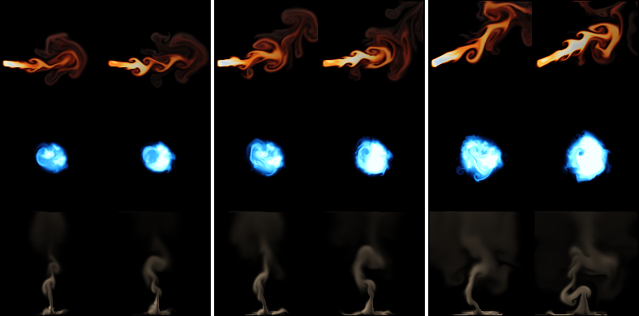
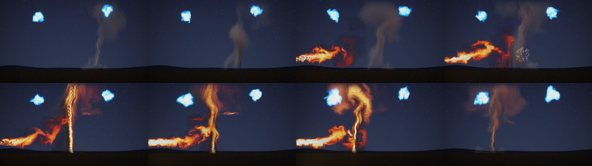

# Energy and motion effects: jet, orb and vortex

Status: **done** (14 October 2026). Audience: dev, research, artists. Three effects a game would want next to fire,
smoke, the explosion, steam and magic: a **jet** (a flamethrower or a rocket thruster: a narrow jet of burning gas from
a nozzle), an **orb** (a ball of cyan plasma that boils inside a soft boundary and breathes) and a **vortex** (a dust
devil seen from the side). They come from the project's own 2D fluid simulator with new sources, forces and drawing,
and were trained and tested exactly as steam and magic were ([EFFECTS.md](EFFECTS.md)): study D's recipe and protocol
([REPORT.md](REPORT.md) §6), on held-out settings and seeds. A scene script plays all three together (§6).

## 1. Bottom line

- **The jet works as steam did.** From its true state it follows a held-out run 2.6 dB [2.0, 3.2] better than the same
  simulation on the same 32-cell grid with the same detail layer at 1 s, and is still ahead at 2 s (+1.4) and 8 s
  (+0.9). Played endlessly at settings and seeds it never saw, its average picture is 1.9 dB [1.3, 2.6] closer to a
  real run than the nearest training flipbook's, and its motion ties the flipbook's (ratio 0.86 against 0.90; a second
  real run: 1.04). Its fine detail is worse than the flipbook's (spectrum distance 0.18 against 0.06; floor 0.05) and
  ties the coarse simulation's.
- **The orb and the vortex fall short of the rule set before the test, at tracking.** Neither follows its runs better
  than the coarse simulation with the detail layer at 1 s: the orb loses in the first frames (-3.4 dB at 1 frame, -2.1
  at 8) and ties from 1 s; the vortex loses its first frame (-2.8, the learned renderer), leads at 8 frames (+1.2) and
  at 8 s (+1.6), and ties at 1 and 2 s. By that rule both are reported as **weak**, as magic was.
- **Played endlessly, both are sound, unlike magic.** The orb's average picture, motion and coverage tie a second real
  run, its average picture is 1.3 dB [0.2, 2.3] closer than the flipbook's and its detail ties the flipbook's. The
  vortex's detail ties a second real run (0.186 against 0.190) and the flipbook, its average picture is 3.1 dB
  [1.8, 4.2] closer than the flipbook's and its motion ties both; the coarse simulation cannot hold its column at all (motion
  0.12).
- **But the vortex sometimes loses its column.** A check after the test (§4.4): at 4 of the 10 held-out settings, all
  at low intensity, the learned column dies away for up to 4.8 s in a minute, and comes back at the next shard (6.5% of
  all frames); the simulation's did not, in a minute at the same settings, nor did the jet's and the orb's.
- Each is **82 KB** stored (8 start points; fine fields grown at instance start, as fire's), 2.4 MB per instance at
  128 px. Per frame at 128 px they cost 1.0 (jet), 1.3 (orb) and 1.0 ms (vortex) where study D's fire took 1.25 ms in
  the same session, on the shared machine: provisional (§5).
- A **scene script** (`examples/scenes/firewhirl.nvfxs`) plays all three: a dust devil wanders between two plasma lamps,
  a flamethrower sets it alight and it burns as a fire whirl (§6). Nothing in the compositor changed for it.

## 2. The effects

All three are presets of the existing solver (`src/sim/sim.cpp`, in a block of their own: `add_energy_sources`,
`add_energy_forces`, `add_energy_divergence`, `energy_decay`, `render_energy`): the same grid, advection, vorticity
confinement, curl noise and pressure solve, with their own sources, forces, decay and drawing. Each has three
normalised controls. Lengths are in cells of a 128-cell frame and times in seconds.

The lesson of magic shaped them: its fast, regular spiral (a median speed of 120 to 170 cells per second, up to 1.9
coarse cells a frame) smeared on the 32-cell state. These three keep their flow at fire's and steam's speeds or below,
their structures broad, and their detail from turbulence and the dust or smoke it carries rather than from thin
regular arms. And every force is a function of what the learned stepper sees: the state where it acts, the position,
the controls and the run's two noise fields (the curl noise's stream function and the source flicker). Nothing
follows a clock of its own: the orb breathes and the vortex sways with the curl noise where they are, so a learned
model can see what drives them.

| | jet | orb | vortex |
|---|---|---|---|
| what it is | a narrow jet of burning gas from a nozzle at the left edge, nearly level; it widens and breaks up along its length, burns from bluish white through yellow and orange to dark smoke, and its end curls up | a ball of plasma in the middle of the frame that boils inside a soft boundary, throws off short wisps that fade at once, and breathes | a column of warm air rising from a patch of hot ground, which lifts dust from the floor into a funnel that sways, leans and spreads towards the top |
| source | a nozzle 5% in from the left edge and 40% up, 8 to 12 cells across (intensity), aimed 20 degrees below to 30 degrees above level (aim); heat 1.5 to 2.2 and a little soot, the gas set moving at 85 to 150 cells per second along the aim; broken up by the flicker noise at 3.0 per second (fire: 2.6) | a disc of radius 20 to 33 cells (intensity) filled with energy (the solver's heat) of 1.1 to 1.6, brightest in the middle, and a faint haze (its soot), broken up by the flicker noise at 2.2 per second; the energy swells with the pulse (below) | warm air (heat 0.5 to 0.8) over a patch of floor 9 to 17 cells wide (intensity); dust (the solver's soot) lifted from the floor within three and a half times that where the air rushes along it, at 14 to 24 per second, broken up by the flicker noise at 1.5 per second |
| forces | buoyancy 38 (fire: 150), soot weight 3; no wind; velocity damping 0.45 per second; confinement 0.8 to 4.0 and curl noise 12 to 67 (turbulence) | no buoyancy and no wind. The hot plasma is drawn to the middle (140 times its heat, in cells per second squared), which keeps it a ball and makes it boil; the air beyond its edge is held still (damped at up to 4 per second). The **pulse**: a source of divergence in its core of (1 + 5 pulse) tanh((1 + 4 pulse) ψ) per second, where ψ is the curl noise's stream function there (in [-1, 1], changing at 0.8 per second), so the ball swells and shrinks with it, more often sharply at a high pulse. Confinement 1.5 to 5, curl noise 20 to 80, damping 1 per second | buoyancy 115, dust weight 2; damping 0.35 per second. **Sway**: everywhere, the air is dragged (1.5 per second) towards a level wind of (8 + 42 sway) ψ cells per second, which leans and bends the column and makes it wander. The column draws air in at its foot and spreads as it rises (a divergence of -6 per second in the warm air near the floor, +3 (0.6 + 0.8 intensity) times the height fraction above). Little turbulence at its foot, more towards its top: confinement 0.3 to 0.8 everywhere and up to 0.5 to 3.5 more, curl noise 4 to 12 and up to 8 to 58 more, growing from 10% to 85% of the height |
| decay | heat 1.1 per second, smoke 0.4; the burning gas turns to smoke (soot grows by 0.7 times the heat per second) | energy 1.0 per second, haze 1.2; beyond the ball's edge both fade at up to 3.5 per second more | warm air 0.4 per second, dust 0.75; dust spreads sideways as it rises, at 25 (height fraction)² cells² per second: the funnel widens towards its top |
| drawing | emitted light by heat: dark red, orange, yellow, white, and bluish white at its hottest, over dark smoke shaded towards the light | emitted light: deep blue where faint, through cyan to white, over a faint blue haze | reflected light only: brown-grey dust, lit from above and to the left and shaded by itself |
| controls | intensity (flow and length), **aim**, turbulence | intensity (size and brightness), **pulse** (how strongly and how sharply it breathes), turbulence | intensity (strength and width), **sway** (how far and fast it wanders), turbulence |

The second controls are named `aim`, `pulse` and `sway` (`sim::control_names`, so the model files, the runtime and
scene scripts call them that; `nvfx_sim` takes `--aim`, `--pulse` and `--sway`). Every earlier effect's clips are
unchanged to the byte: `Sim.StudyEffectsAreUnchangedByTheNewOnes` now hashes a clip of fire, smoke and the explosion
(made before steam and magic existed) and of steam and magic (made before these three existed). Tests check what each
one is: the jet comes from the left in fire colours with dark smoke and its aim raises it
(`Sim.JetIsAFlameFromTheLeftThatItsAimRaises`); the orb stays in the middle, is cyan and its lit area swings more
with a strong pulse (`Sim.OrbIsAContainedBallOfCyanLightThatBreathesWithItsPulse`); the vortex's dust reaches the top
of the frame, is brown-grey reflected light, and wanders more with its sway
(`Sim.VortexIsAColumnOfDustThatSwaysWithItsControl`).

How fast they move, in the steady state at two settings (all controls 0.5 and all 1; cells of a 128-cell frame per
second where there is material, median and 99th percentile; a coarse cell is 4 of them, a frame 1/30 s):

| effect | median | 99th percentile | in coarse cells a frame (99th) |
|---|---:|---:|---:|
| fire | 47 to 65 | 118 to 121 | 0.98 to 1.01 |
| steam | 27 to 57 | 90 to 132 | 0.75 to 1.10 |
| magic | 118 to 168 | 191 to 223 | 1.59 to 1.86 |
| jet | 25 to 51 | 115 to 148 | 0.95 to 1.24 |
| orb | 17 to 25 | 43 to 65 | 0.36 to 0.54 |
| vortex | 20 to 36 | 100 to 136 | 0.83 to 1.14 |

**How chaotic they are** (`nvfx_experiment d-chaos --effects jet,orb,vortex`, as [REPORT.md](REPORT.md) §6.1: active
PSNR against the undisturbed run, mean over 4 runs):

| effect | case | 1 frame | 0.5 s | 1 s | 2 s | 8 s |
|---|---|---:|---:|---:|---:|---:|
| jet | start nudged by 1e-3, same seed | 71.8 | 64.6 | 62.1 | 56.9 | 44.5 |
| jet | start nudged by 1e-1, same seed | 48.9 | 34.8 | 29.5 | 26.0 | 23.7 |
| jet | same start, other seed | 36.8 | 20.9 | 16.1 | 14.8 | 15.6 |
| jet | other start, same seed | 14.0 | 14.2 | 14.6 | 16.3 | 20.2 |
| orb | start nudged by 1e-3, same seed | 82.6 | 73.2 | 72.4 | 69.4 | 58.5 |
| orb | start nudged by 1e-1, same seed | 59.3 | 48.3 | 46.7 | 44.5 | 44.3 |
| orb | same start, other seed | 19.4 | 14.6 | 12.2 | 12.1 | 13.8 |
| orb | other start, same seed | 13.0 | 17.5 | 19.1 | 23.3 | 40.1 |
| vortex | start nudged by 1e-3, same seed | 73.7 | 69.1 | 67.1 | 64.8 | 59.9 |
| vortex | start nudged by 1e-1, same seed | 51.3 | 41.6 | 37.8 | 36.5 | 42.8 |
| vortex | same start, other seed | 43.8 | 24.6 | 20.6 | 19.0 | 17.3 |
| vortex | other start, same seed | 14.8 | 16.6 | 17.8 | 19.6 | 25.4 |

- **The jet behaves as fire does**: a small error in the start stays invisible for seconds, the seed takes over within a
  second, and the noise slowly pulls runs with the same seed together.
- **The orb is forced more**, as magic was, though less: after a second its seed decides what it looks like (12 dB from
  another seed), and two runs with the same seed from different start points meet over a few seconds (40 dB at 8 s;
  magic: 47 dB).
- **The vortex's seed takes over more slowly**: its column stands where its hot ground is, so another seed is still at
  21 dB after a second and 17 dB after eight (fire: 13).

## 3. Training

Study D's recipe, unchanged (`rollout::recipe_for`: the three take fire's settings): 160 runs of 240 frames from an
empty grid with random controls and their own seeds (training salt 1), the stepper's three stages, the renderer on 200
frames of 100 runs, the detail constants chosen by matching frame statistics of endless runs against real runs at the
controls of four training runs with new seeds (validation; the test's settings and seeds are never used), and 8 start
points. Each was trained in study D's three saved steps (`d-train --stages12 1`, `d-tune`, `d-finish`), one thread
each, two at a time, on a machine shared with three other agents:

| effect | simulation | stages 1-2 (loss, s) | stage 3 (loss, s) | renderer (training samples) | contrast, swirl, grow | detail score | stored |
|---|---:|---|---|---:|---|---:|---:|
| jet | 21.3 min, recorded in 345 s | 0.0852, 7274 | 0.0997, 1436 | 34.9 dB | 1, 3, 1 | 0.69 | 82 KB |
| orb | 21.3 min, recorded in 506 s | 0.0907, 7211 | 0.0859, 1370 | 36.2 dB | 0.5, 0.5, 1 | 0.73 | 82 KB |
| vortex | 21.3 min, recorded in 506 s | 0.1082, 8172 | 0.1450, 2184 | 35.3 dB | 0.5, 1, 1 | 0.89 | 82 KB |

The last step (renderer, detail constants, start points) took 20 to 24 minutes each. About 3 to 3.5 CPU-hours per
effect in all: 2.9 h for the jet, 3.1 h for the orb, 3.5 h for the vortex (whose first 25 minutes of stages 1 and 2
were lost to a container restart and run again from the step's start; each step is saved, so nothing else was lost).

The calibration chose a strong sub-grid swirl for the jet (3, the most of any effect so far) and a halved contrast for
the orb and the vortex (new material arrives less broken up).

The jet and the orb were frozen (`results/experiments/fx_energy_frozen.csv` has their SHA-256; the files are under the
data root's `fx_energy/models/d`) and tested while the vortex was training; the vortex was frozen when its training
ended and then tested on the same design.

## 4. The test

Written before any test was run. Each model is frozen (its SHA-256 in `results/experiments/fx_energy_frozen.csv`)
before its own test, and each test runs once. The test runs in two parts on this one design: the jet and the orb were
frozen and tested while the vortex was still training (`d-eval --effects jet,orb`), and the vortex is frozen and
tested when its training ends (`d-eval --effects vortex`, its rows added to the same CSVs). Every run of the test is
independent and seeded by its effect, run and setting, so the split changes no number. It is study D's protocol,
exactly as steam and magic were tested ([EFFECTS.md](EFFECTS.md) §4; `nvfx_experiment d-eval`, then `d-report`):

- **Tracking from the true state:** 8 held-out runs per effect (salt 2: seeds and settings no training or validation
  run used), each started at 100 frames from its true state (coarse and fine fields) with its own noise seed; 240
  frames. The neural rollout through the runtime against the simulation on the same 32-cell grid with the same detail
  layer (`coarse_sim_detail`), the plain coarse simulation, and holding the first frame. Active PSNR at 1 and 8 frames
  and at 1, 2 and 8 s; the neural run minus `coarse_sim_detail`, paired over the 8 runs.
- **Endless runs at settings never seen:** the ten held-out settings of study B (`b_test_settings`: none on study B's
  training grid), 10 s each after the start, with seeds never used for these effects (900000 + k and 910000 + k for the
  two real runs, 920000 + k for the neural run, 930000 + k for the coarse simulation; training used 600000 to 600159,
  the held-out tracking runs 700000 and up, validation seeds derived from the training runs'). Frame statistics against
  a real run: detail spectrum distance, motion ratio (as the error |ln ratio|), coverage distance and mean-frame PSNR.
  Compared with a second real run with another seed (the floor), the nearest of the 45 training flipbooks of study B's
  grid (made for these effects as study B made its library: 64 frames at 128 px, seed 1; looped), the coarse
  simulation with the detail layer and without.
- **One minute:** a 60 s neural run in 6 s shards at the first two held-out settings, cut into 10 s windows, each
  against the real 10 s run.
- **Statistics:** every difference paired (over runs or settings), with a 95% bootstrap interval of 10,000 resamples
  (`metrics::paired_bootstrap`); an interval across zero is a tie. Every number is reported, ties as ties.

What would count as working, decided now: an effect **works as steam did** if it tracks its runs better than
`coarse_sim_detail` at 1 s (interval above zero) and, endless, its average picture is closer than the nearest
flipbook's and its motion error is no worse than the flipbook's. An effect that ties the coarse simulation at tracking,
or whose detail and motion lose to the flipbook, is reported as **weak**, as magic was.

### 4.1 Tracking from the true state

Active PSNR (dB), mean over 8 held-out runs:

| effect | method | 1 frame | 8 frames | 1 s | 2 s | 8 s |
|---|---|---:|---:|---:|---:|---:|
| jet | neural | 25.2 | 18.9 | 16.0 | 14.6 | 14.2 |
| jet | coarse simulation + detail | 24.0 | 16.2 | 13.4 | 13.1 | 13.4 |
| jet | coarse simulation | 19.6 | 17.2 | 14.5 | 13.9 | 14.1 |
| jet | holding the first frame | 22.6 | 13.7 | 12.9 | 13.1 | 13.3 |
| orb | neural | 29.5 | 20.9 | 16.2 | 15.6 | 15.7 |
| orb | coarse simulation + detail | 32.9 | 23.0 | 16.6 | 16.0 | 16.7 |
| orb | coarse simulation | 23.8 | 23.0 | 19.0 | 18.4 | 19.2 |
| orb | holding the first frame | 32.5 | 17.5 | 12.6 | 11.8 | 12.0 |
| vortex | neural | 30.3 | 25.1 | 21.0 | 20.4 | 18.2 |
| vortex | coarse simulation + detail | 33.1 | 23.9 | 20.3 | 19.5 | 16.6 |
| vortex | coarse simulation | 24.4 | 22.9 | 20.9 | 20.1 | 16.9 |
| vortex | holding the first frame | 34.2 | 22.8 | 19.1 | 18.4 | 17.6 |

Neural minus coarse simulation + detail, paired over runs (95% intervals):

| effect | 1 frame | 8 frames | 1 s | 2 s | 8 s |
|---|---|---|---|---|---|
| jet | +1.27 [+0.22, +2.20] | +2.63 [+2.08, +3.11] | **+2.57 [+1.98, +3.17]** | +1.44 [+0.71, +2.08] | +0.85 [+0.61, +1.11] |
| orb | -3.42 [-4.60, -2.43] | -2.09 [-3.19, -1.11] | -0.38 [-1.68, +0.89] (tie) | -0.39 [-1.69, +0.89] (tie) | -1.00 [-2.83, +0.61] (tie) |
| vortex | -2.81 [-3.98, -1.66] | +1.16 [+0.43, +1.88] | +0.62 [-0.25, +1.52] (tie) | +0.98 [-0.28, +2.15] (tie) | +1.56 [+0.82, +2.26] |

- **The jet's learned dynamics follow a run better than the simulation at the same resolution** at every horizon, as
  fire's and steam's did (fire +2.1 dB at 1 s, steam +2.6). Its renderer reaches 32.6 dB on the true fields.
- **The orb does not.** Half of its first-frame loss is its renderer (drawn by the simulation's renderer, the same
  dynamics lose 1.70 dB [0.75, 2.85] at the first frame instead of 3.42); the dynamics lose 2.1 dB at 8 frames on either
  renderer and tie from 1 s. The plain coarse simulation, without the detail layer, follows the runs best of all from 8
  frames on (19.0 dB at 1 s against 16.2): the orb is a bright ball with a smooth edge, and fine detail that does not
  match the run's costs more than a smooth ball loses.
- **The vortex's first frame is its renderer's** (with the simulation's renderer the dynamics tie there: -0.00
  [-1.34, +1.32]); its dynamics lead at 8 frames and tie at 1 and 2 s. At 8 s it is 1.6 dB ahead because the coarse
  simulation cannot keep the column at all: on 32 cells its warm foot is one or two cells wide and the column fades
  (its endless motion is 0.12 of the real's, §4.2).

### 4.2 Endless runs at settings never seen

Means over the 10 held-out settings (spectrum distance and coverage distance: lower is better; motion ratio: 1 is
right; mean-frame PSNR: higher is closer):

| effect | method | spectrum | motion | coverage | mean-frame PSNR |
|---|---|---:|---:|---:|---:|
| jet | real, other seed (floor) | 0.045 | 1.04 | 0.012 | 30.4 |
| jet | **neural rollout (82 KB)** | 0.183 | 0.86 | 0.020 | 26.3 |
| jet | nearest training flipbook | 0.061 | 0.90 | 0.019 | 24.4 |
| jet | coarse simulation + detail | 0.193 | 0.76 | 0.018 | 21.6 |
| jet | coarse simulation | 1.020 | 0.35 | 0.017 | 21.2 |
| orb | real, other seed (floor) | 0.069 | 1.04 | 0.007 | 28.8 |
| orb | **neural rollout (82 KB)** | 0.205 | 0.89 | 0.006 | 27.3 |
| orb | nearest training flipbook | 0.167 | 1.10 | 0.007 | 26.0 |
| orb | coarse simulation + detail | 0.386 | 1.09 | 0.006 | 28.7 |
| orb | coarse simulation | 0.802 | 0.71 | 0.006 | 29.1 |
| vortex | real, other seed (floor) | 0.190 | 1.01 | 0.027 | 29.3 |
| vortex | **neural rollout (82 KB)** | 0.186 | 0.81 | 0.045 | 27.4 |
| vortex | nearest training flipbook | 0.235 | 0.86 | 0.040 | 24.3 |
| vortex | coarse simulation + detail | 0.306 | 0.12 | 0.101 | 20.7 |
| vortex | coarse simulation | 0.283 | 0.07 | 0.098 | 20.7 |

Neural minus each other method, paired over the 10 settings (motion as the error |ln ratio|; bold: the neural rollout
is better):

| effect | statistic | nearest flipbook | coarse simulation + detail | real, other seed |
|---|---|---|---|---|
| jet | spectrum distance | +0.122 [+0.091, +0.153] | -0.010 [-0.028, +0.008] (tie) | +0.138 [+0.090, +0.184] |
| jet | mean-frame PSNR (dB) | **+1.89 [+1.28, +2.61]** | **+4.75 [+3.41, +5.91]** | -4.10 [-4.93, -3.25] |
| jet | motion error | -0.013 [-0.138, +0.113] (tie) | **-0.150 [-0.281, -0.028]** | +0.083 [+0.036, +0.134] |
| jet | coverage distance | +0.0009 [-0.0083, +0.0094] (tie) | - | +0.0073 [+0.0020, +0.0126] |
| orb | spectrum distance | +0.037 [-0.053, +0.132] (tie) | **-0.181 [-0.246, -0.107]** | +0.136 [+0.060, +0.230] |
| orb | mean-frame PSNR (dB) | **+1.28 [+0.23, +2.32]** | -1.40 [-3.42, +0.61] (tie) | -1.48 [-3.68, +0.39] (tie) |
| orb | motion error | -0.010 [-0.100, +0.086] (tie) | +0.038 [-0.041, +0.121] (tie) | +0.059 [-0.021, +0.139] (tie) |
| orb | coverage distance | -0.0002 [-0.0018, +0.0017] (tie) | - | -0.0001 [-0.0016, +0.0013] (tie) |
| vortex | spectrum distance | -0.050 [-0.147, +0.055] (tie) | **-0.120 [-0.189, -0.050]** | -0.004 [-0.063, +0.059] (tie) |
| vortex | mean-frame PSNR (dB) | **+3.09 [+1.77, +4.21]** | **+6.70 [+4.43, +8.60]** | -1.93 [-3.74, -0.23] |
| vortex | motion error | -0.094 [-0.328, +0.143] (tie) | **-2.267 [-2.678, -1.774]** | +0.104 [-0.006, +0.226] (tie) |
| vortex | coverage distance | +0.0047 [-0.0105, +0.0201] (tie) | - | +0.0182 [+0.0071, +0.0293] |

- **The jet** plays with the right kind of motion (tied with the 45 MB flipbook library, 14% low against the real runs)
  and an average picture closer than the flipbook's and the coarse simulation's. Its detail is the weak part: a flipbook
  of a neighbouring setting matches the real jet's fine structure closely (0.061, near the floor of 0.045), while the
  neural jet's, with its strong sub-grid swirl, is wormier (0.183, as far off as the coarse simulation's).
- **The orb** ties a second real run in its average picture, motion and coverage, and the flipbook in detail and
  motion; it is closer than the flipbook in its average picture (the flipbook shows a ball of the wrong size). Its
  detail is better than the coarse simulation's with the detail layer, but 0.14 from the floor.
- **The vortex**: two real runs of the same setting differ a lot (its sway), so its floor is high (0.190), and the
  neural vortex's detail ties it; its average picture is the closest of the generated methods; its motion ties the
  flipbook's and a second real run's (0.81 against 1.01, within the interval). Its coverage is further from the real
  than a second real run's: the column it draws is often more diffuse, and sometimes gone (§4.4).

### 4.3 One minute without a restart

| effect | spectrum distance | motion ratio | mean-frame PSNR |
|---|---|---|---|
| jet | 0.10-0.20 | 0.77-0.96 | 25.6-29.5 |
| orb | 0.09-0.32 | 0.80-1.10 | 22.3-30.4 |
| vortex | 0.07-0.16 | 0.54-1.36 | 23.2-29.8 |

Ranges over six 10 s windows at each of two held-out settings: none drifts over a minute of shards (the last windows
are as good as the first). The vortex's low motion (0.54) is a window at the first setting in which its column was
gone for a while (§4.4).

### 4.4 After the test: the vortex sometimes loses its column

The endless figure of the test showed the neural vortex at the first held-out setting nearly empty at 8 and 10 s. A
check made after the test, on the frozen models (a scratch tool, not part of the test's design;
[collapse_check.csv](../results/experiments/fx_energy/collapse_check.csv)): 60 s through the runtime at each of the 10
held-out settings with new seeds (950000 + k), and the share of frames whose cover (pixels with alpha above 16) falls
below a quarter of a real run's mean cover at that setting:

| effect | settings with such frames | frames in all | longest stretch |
|---|---:|---:|---:|
| jet | 0 of 10 | 0% | - |
| orb | 0 of 10 | 0% | - |
| vortex | 4 of 10 | 6.5% | 4.8 s |
| vortex, the simulation itself (another seed, at those four settings) | 0 of 4 | 0% | - |

All four are settings of low intensity (0.06 to 0.36; two other settings of low intensity were not affected): 17%,
17%, 4% and 26% of their frames. Played from each start point alone, without shards, at the first of them, two of the
eight start points lose the column (within 4 and within 7 seconds) and do not regrow it in the 8 s played; with
shards, the next shard brings it back. So the learned stepper sometimes loses the warm foot
of a thin column, which on the 32-cell grid is only two to four cells wide, and then regrows it no faster than the
simulation grows a column from an empty frame (about 4 s). The simulation does not lose it. Untested ways to fix it:
start points with fine fields, more training runs at low intensity, a shorter shard for this effect, or a source the
runtime keeps alive.



## 5. Memory and cost

The same network as study D's, so the same memory: 82 KB stored, 163 KB resident, 2.4 MB of working memory per
instance at 128 px. Per frame through `nvfx_render` on one pinned core (AVX2), with study D's fire measured in the same
session, on the shared machine (**provisional**: four rounds, the least of them and the range;
[d_timing_rounds.csv](../results/experiments/fx_energy/d_timing_rounds.csv), the first round in
[d_timing.csv](../results/experiments/fx_energy/d_timing.csv)):

| effect | 64 px | 128 px | 256 px | restart (128 px) |
|---|---:|---:|---:|---:|
| jet | 0.66 ms (to 1.26) | 1.01 ms (to 1.08) | 2.28 ms (to 2.45) | 19 ms (1 s warm-up) |
| orb | 0.65 ms (to 0.68) | 1.33 ms (to 1.41) | 3.76 ms (to 3.87) | 20 ms (1 s warm-up) |
| vortex | 0.64 ms (to 1.05) | 0.97 ms (to 1.10) | 2.37 ms (to 3.66) | 19 ms (1 s warm-up) |
| fire (same session) | 0.67 ms (to 0.69) | 1.25 ms (to 1.78) | 3.16 ms (to 3.56) | 20 ms |

The jet and the vortex cost what fire costs or less; the orb about 6% more at 128 px and a fifth more at 256 px. Like
fire, all three grow their fine fields at instance start, so a restart costs a 1 s warm-up (about 20 ms). For scale, the
32-cell simulation of each with its own renderer costs 2.9 (jet), 1.7 (orb) and 6.4 ms (vortex) in our scalar code,
against 1.5 ms for fire's.

**Re-timed on a quiet machine** (14 October 2026, one job at a time, the same four rounds with every rollout effect in
them; least of the rounds, and the greatest: [round5_effect_timing_quiet.csv](../results/experiments/round5_effect_timing_quiet.csv)):
at 128 px the jet 1.04 ms (to 1.38), the orb 1.31 ms (to 1.47), the vortex 1.01 ms (to 1.30), against fire's 1.26 ms
(to 1.64); at 64 px all four 0.64 to 0.69 ms; at 256 px 2.50, 3.80, 2.38 and 3.07 ms. So the jet and the vortex cost a
little less than fire and the orb about as much at 128 px and a quarter more at 256 px, as on the shared machine.
This session's machine was slower than earlier ones (the fireball took 26 ms per frame at 720p on 4 threads, against
19 to 20 ms in round 4's quiet session), so compare these with fire's in the same rounds, not with older tables.
The fire whirl scene took 26.8 to 28.8 ms per frame on 2 threads and 15.0 to 16.6 ms on 4 (two runs each), without an
allocation in its frame loop.

## 6. The scene

`examples/scenes/firewhirl.nvfxs` (10 s at 1280 x 720 and 30 fps, about 50 lines). A desert at night. A dust devil
(the vortex, drawn by a field-shader look so the scene's light colours its dust; 640 world pixels tall) wanders in
from the right between two plasma lamps (the orb, glowing cyan, bobbing and breathing). At 2.6 s a flamethrower (the
jet, from the left edge, almost level) opens up; its flame is bent by the whirl's wind (a push from the bus). When the
flame's heat reaches the whirl (a rule on the bus's heat, at 4.6 s) the whirl catches: a burst of embers, its look
blends from dust to a burning one in which its warm air glows as flame, it strengthens, and the lamps flare (their
intensity and pulse rise). At 8.2 s the flamethrower stops, and the fire whirl dies down to dust again.



The video and the full keyframes are under the data root's `fx_energy/` (outside git); the keyframes' SHA-256 are in
`results/experiments/fx_energy_frozen.csv` and `ctest -R ScriptedFireWhirlFrozen` checks them (skipped without the
effects in `NEURALFX_MODELS_ENERGY`, by default `$NEURALVFX_DATA/fx_energy/models/scene`). It plays without an
allocation in its frame loop, at 48 ms per frame on one thread on the shared machine (median of the sum of its stages:
drawing, distortion, bloom and the finish take 40 of it, the four modules' steps 3.6; provisional).

Nothing was added to the compositor. Two things to know when scripting these effects: the vortex's effect needs
another name in a script (`effect devil = "vortex.nvfx"`), because `vortex` is a field kind of the language; and the
jet always blows from the left of its tile, as fire always rises, since a tile cannot be mirrored.

What works: the three read as a flamethrower, plasma lamps and a dust devil, they couple through the bus (the flame
bends into the whirl, its heat sets it alight), and one learned vortex is both the dust devil and the fire whirl, by
a change of look. What does not, yet: the burning whirl's narrow foot shows the saw-toothed detail that magic's arms
showed; the lamps' cyan light on the dust is faint; and the whirl here is never at the low intensity where it can lose
its column (§4.4).

## 7. What it means

- **New effects still cost about 3 to 3.5 CPU-hours each and no new code in the trainer or the runtime**: a
  simulator preset (sources, forces, decay, drawing), a name, and study D's recipe gave three rollout effects of 82 KB.
- **Designing for the 32-cell state helped endless play.** Magic's endless detail and motion lost to a flipbook. None
  of these three did: all three have motion tied with the flipbook's and an average picture closer than it, and the
  orb's and the vortex's detail tie the flipbook's (the vortex's ties a second real run).
- **It did not make tracking better everywhere.** The jet, a fast turbulent flow like fire and steam, gained what they
  gained. The orb gained nothing over a coarse simulation: its look is a bright ball whose interior detail no 32-cell
  method follows, and the smooth coarse simulation follows it best. The vortex's narrow foot is two to four coarse cells
  wide; the learned stepper follows the column better than the coarse simulation (which loses it) at 8 s, but ties it at
  1 and 2 s, and sometimes loses the column itself.
- **By the rule written before the test, the orb and the vortex are weak, the jet works.** For a game, where these
  effects play endlessly, the endless statistics matter more, and there the orb and the vortex are usable; the vortex's
  lost columns at low intensity (§4.4) are the first thing to fix.

## 8. Reproduce

```sh
build/nvfx_sim --effect jet --aim 0.8 --sheet jet.png             # the simulator's presets alone (--pulse, --sway)
build/nvfx_experiment d-chaos  --effects jet,orb,vortex --root $NEURALVFX_DATA/fx_energy --results results/experiments/fx_energy
build/nvfx_experiment d-train  --effects jet --stages12 1 --root $NEURALVFX_DATA/fx_energy --results results/experiments/fx_energy --threads 1
build/nvfx_experiment d-tune   --effects jet --root $NEURALVFX_DATA/fx_energy --results results/experiments/fx_energy --threads 1
build/nvfx_experiment d-finish --effects jet --root $NEURALVFX_DATA/fx_energy --results results/experiments/fx_energy --threads 1
#   (the same for orb and vortex)
build/nvfx_experiment d-eval   --effects jet,orb,vortex --root $NEURALVFX_DATA/fx_energy --results results/experiments/fx_energy --threads 2 --figures DIR
build/nvfx_experiment d-report --root $NEURALVFX_DATA/fx_energy --results results/experiments/fx_energy    # D_SUMMARY.md
build/nvfx_experiment d-timing --effects fire,jet,orb,vortex --root ROOT --results results/experiments/fx_energy
build/nvfx_scene_script --script examples/scenes/firewhirl.nvfxs --models DIR --out firewhirl.mp4 --keyframes DIR --sheet sheet.png
```

`ROOT/models/d` for the timing holds study D's `fire.nvfx` with the three new effects. `DIR` for the scene holds
`jet.nvfx`, `orb.nvfx` and `vortex.nvfx`.
