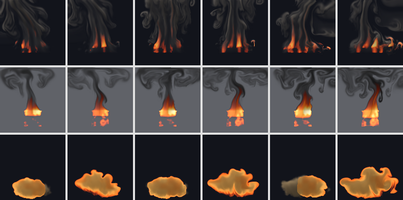
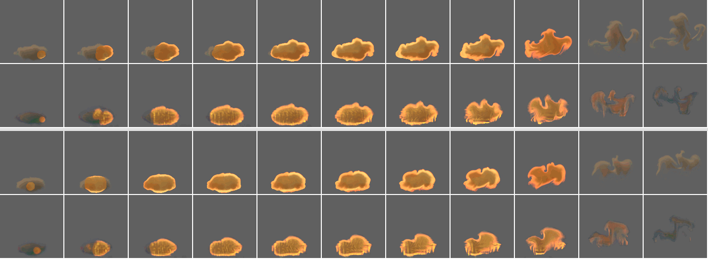
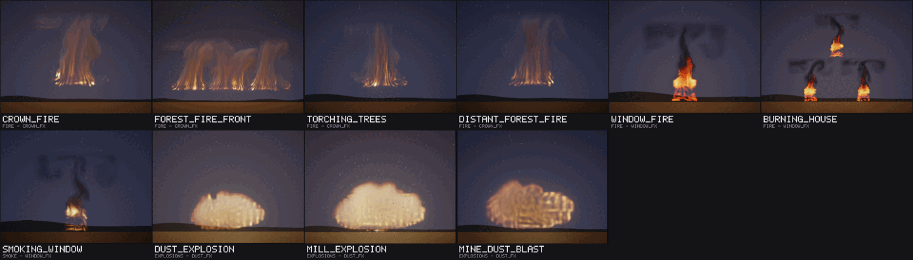
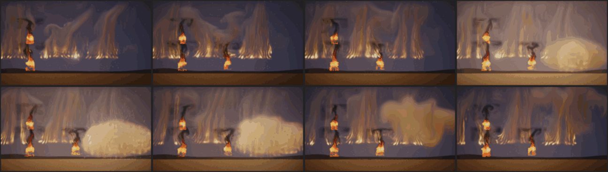

# Fire effects, round 10: a crown fire, a window fire and a dust explosion

Status: **done** (21 October 2026). Audience: dev, research, artists. The design of the test and the rule (§4) were
written and committed before any model was trained, and so was the one method of a later study that this round uses
(§3); each model was frozen by its SHA-256 before its one test.

Three more fire effects from the catalogue ([TODO.md](../TODO.md), rows 6, 8 and 31), after the air round
([EFFECTS_AIR.md](EFFECTS_AIR.md)): a **crown fire** (fire running through a forest canopy: the crowns torch, flames
stand over them and lean before the wind, embers thrown ahead light spot fires in the crowns downwind, and a tall column
of smoke rises over it and bends over in the wind; distinct from round 7's wildfire, a front of flames on the ground),
a **window fire** (a room fire venting from a window: flames pour out of the upper part of the opening and roll up the
wall over it, the room glows through the lower part, and black smoke runs up to the eave and spreads out under it as a
ceiling jet) and a **dust explosion** (a cloud of dust, in a mill or a mine, lit at one end or in its middle: a fast
deflagration runs through it, the burning gas expands into a brown-orange fireball that billows up, and it leaves a
brown pall of dust and ash; it plays once, for 4 s). They come from the project's own 2D fluid simulator with new
sources, forces and drawing, and are trained and tested as the earlier rounds' were: study D's recipe and protocol
([REPORT.md](REPORT.md) §6), on held-out settings with seeds of this round's own (26,000,000 to 26,999,999).

## 1. Bottom line

- **All three work, by the rule set before the test.** From its true state each follows a held-out run better than
  the same simulation on the same 32-cell grid with the same detail layer at 1 s: the crown fire by 2.60 dB [2.16,
  3.04], the window fire by 3.31 dB [2.91, 3.73] and the dust explosion by 8.44 dB [7.88, 9.04], the largest gain of any
  effect so far (the 32-cell simulation of its burning front goes wrong: §4.1). Played at settings and seeds they never
  saw, their average picture is closer to a real run's than the nearest training flipbook's (+1.76 dB [1.07, 2.49],
  +1.78 [1.16, 2.34] and +3.15 [2.80, 3.56]) and their motion error is no worse than the flipbook's (the two fires tie
  it; the dust explosion's is smaller, -0.589 [-0.681, -0.495], and ties a second real run).
- **Their weak part is their detail.** The two fires' detail spectra are six times further from real than the
  flipbook's (0.43 and 0.44 against 0.08 and 0.07): their learned flames and smoke carry streaks the simulator's do not.
  The dust explosion's (0.13 against 0.09) is the closest of the three, but its learned renderer gives its unlit cloud
  blue-green fringes and draws its pall faint and thin.
- **The dust explosion's flame runs through its cloud from where it was lit** (the question beside the rule, §4.5): lit
  at its right end, the learned flame's light moves across the cloud as the real one's does, reaching its far end 0.2 s
  sooner (0.50 s against 0.70 s). Lit near its middle, it starts a little right of the real spark: its start points and
  the mean state carry the spark's place only roughly (the fit explains 41% of the first states' heat).
- **Cost (provisional, a shared machine, load 1.5 to 5 on 4 cores during the rounds):** 146 KB stored for the crown and
  window fires (64-pixel fine fields with 8 start points), 294 KB for the dust explosion (16 start points and the mean
  state); 2.4 to 2.5 MB per instance at 128 px. At the runtime's int8 default on the AVX-512 build, 0.49 (crown fire),
  0.53 (window fire) and 0.65 ms (dust explosion) per 128 px frame, where study D's fire took 0.71 ms and its
  explosion 0.57 in the same rounds (§5).
- **A scene script** (`examples/scenes/forestedge.nvfxs`, 10 s) plays all three in a town at the edge of a burning
  forest: a crown fire along the skyline, a burning house's windows and one that catches, and the mill's dust explosion
  at 5 s with its shock, debris, embers and ash. Its keyframes are frozen (`ctest -R ScriptedForestEdgeFrozen`, float on
  AVX2). **Ten library entries** (`library/fire2.nvfxl`) use the models, three of them with frozen keyframes: all fair (§6).
- **What it took:** a preset each, one line in the recipe (the two fires keep fine fields with their start points, as
  smoke does), study M3's mean state for the one-shot, about 4 hours of one thread each on the shared machine (the
  three at once, and twice again from their last finished step after the container restarted), and no new code in the
  trainer, the runtime or the compositor.

## 2. The effects

All three are presets of the existing solver (`src/sim/sim.cpp`, in a block of their own: `add_fire2_sources`,
`add_fire2_forces`, `add_fire2_divergence`, `fire2_decay`, `render_fire2`). Each has three controls in [0, 1]:

| | crownfire | windowfire | dustexplosion |
|---|---|---|---|
| controls | intensity (how fierce: the zone's width, the flames' heat and lift, the smoke), wind (0.5 still air; less to the left, more to the right), turbulence | intensity (the room fire's size: the outflow's heat and speed, a lower neutral plane, more smoke), wind (along the facade), turbulence | intensity (the cloud's size and how much dust it holds), **ignition** (where it is lit: the cloud's left end at 0, its middle at 0.5, its right end at 1), turbulence |
| plays | loops | loops | **once**, 120 frames (4 s) |

Every force is a function of what a learned stepper sees: the state where it acts, the position, the controls and the
run's two noise fields (the curl noise's stream function and the source flicker). Nothing follows a clock of its own.
The dust explosion, which plays once, is made at its first step (its cloud and the spark that lights it, as the
explosion's burst is) and then burns by its own state alone: where its dust is hot it burns, giving heat and expanding,
and the heat spreads into the dust beside it, so the flame runs through the cloud as a front. It follows the time since
its start only through the slower of the two decays a learned one-shot sees as inputs (exp(-t / 1 s)), which sets how
long the cloud can burn (fully for its first 0.9 s, not at all after 2.1 s), as the mushroom's base fades with it.

**The dust explosion's length, 120 frames (4 s).** The flame runs through the cloud in its first 0.5 s (lit in its
middle) to 1 s (lit at an end); the fireball swells and billows up over the next second, burning on where its dust is
richest; by 2.5 s it has burnt out, and in the last 1.5 s its pall of dust and ash rises a little more, spreads and thins.
Three seconds (the explosion's length) would cut off the pall as it forms; five (the mushroom's) would add a second of
a fading haze, and the mushroom showed that a long one-shot, whose look changes over its length, is the hard case for
the learned stepper.

Lengths are in cells of a 128-cell frame and times in seconds; d = 2 wind - 1 and ψ is the curl noise's stream function
where the force acts.

| | crownfire | windowfire | dustexplosion |
|---|---|---|---|
| what it is | a forest canopy across the lower part of the frame (crowns from 22 cells up to their tops, 40 to 46 cells up, a tree every 16 cells; the trunks and the ground are the scene's to draw); a burning zone 60 to 80 cells wide (intensity), 8 d cells upwind of the middle, whose crowns torch in flames that stand 20 to 40 cells over the canopy and lean downwind; spot fires in the crowns beyond it; a tall column of grey-brown smoke to the top of the frame that bends over downwind | the facade seen front-on: a window 36 cells wide and 32 tall, its sill 12 cells up, its head 44; the room's hot gas pours out through the opening above the neutral plane (24 to 30 cells up, lower for a bigger fire) and its flames roll up the wall over the head; below it the room glows through the inflowing air; black smoke runs up to the eave (the top of the frame) and spreads out both ways under it as a ceiling jet | an oval cloud of dust on the ground in the middle of the frame, 60 to 88 cells wide and 28 to 40 tall (intensity), lit low in the cloud at its left end, its middle or its right end (ignition): the flame runs through it, the burning gas expands into a brown-orange fireball that billows up and burns out by 2.5 s, and a brown pall of dust and ash is left that rises a little, spreads and thins |
| source | in the crowns, through their depth: heat (1.5 to 1.9) k and an upward flow of (24 to 40) k cells per second, with k the crown's shape (1 in its middle, 0.6 between crowns) times the zone (its downwind half burning up to a quarter harder in a wind: the head) times the torching (0.5 + 0.5 smoothstep(-0.2, 0.6) of the flicker noise, rate 2.2) times (0.75 + 0.25 ψ); smoke at (1.2 to 1.8) k a second. Spot fires: 0.7 smoothstep(0.3, 0.6) of the flicker in a band beyond the zone's edges, out to 4 cells in still air, to 36 cells downwind in the strongest wind and none upwind | above the neutral plane the heat is drawn (10 per second) towards (1.3 to 1.8)(0.5 + 0.5 f) (f the flicker noise's smoothstep, rate 2.6), rising from nothing over the plane's first 40% of the way to the head, the flow upwards towards (18 to 32)(0.4 + 0.6 of that way) cells per second, and smoke at (0.3 to 0.5) a second; below the plane (and wherever the outflow is weaker) the room's glow, heat drawn (4 per second) towards (0.75 to 1)(0.35 + 0.65 f), in still air; the wall's air under the sill is still | at its first step: dust (0.7 to 1.2)(0.7 + 0.3 of its lumps) inside an edge the flicker noise makes ragged (rate 1.4), at rest, and a spark of heat 1.4, 4.5 cells across, at 0.75 of the half-width from the middle towards the lit end |
| forces | buoyancy 110, smoke weight 3; **the wind** drags material (2 per second) towards d (16 + 50 smoothstep(40, 110, y)) cells per second: slowed in the canopy, 66 d at the top of the frame, so the column bends over; a closed ground; damping 0.2; confinement 0.5 to 3.0, curl noise 8 to 53 (turbulence) | buoyancy 110, smoke weight 2; **the eave**: upward flow stops within 5 cells of the top of the frame, over a closed top border, so the smoke spreads out under it; a wind along the facade drags material (1.2 per second) towards 22 d (0.4 + 0.6 y / 128); damping 0.2; confinement 0.4 to 2.0, curl noise 8 to 48 | buoyancy 35, dust weight 5; **the burning gas expands**: a divergence of 2.5 times its burn rate in the pressure solve, which pushes the cloud out ahead of the flame and swells the fireball; a closed ground; damping 0.6; confinement 0.2 to 0.8, curl noise 4 to 24 |
| decay | above a heat of 0.4 the flames burn out at up to 1.7 per second and leave 0.6 of the heat they lose as smoke; the warm column cools at 0.3 per second, the smoke at 0.08 | once out of the window, the gas above a heat of 0.4 burns out at up to 1.6 per second and leaves 0.8 of it as black smoke; the warm smoke cools at 0.5 per second, the smoke at 0.2 | **the burn**: the heat spreads at 40 cells squared a second (0.5 to 1.5 times that with the flicker noise, so the front wrinkles), only where there is dust; where the dust is hotter than its ignition (0.35 to 0.7) it burns at up to 80 times its amount a second, up to a cap of 1.25 to 1.6 (richer where ψ is higher: its air used up) and while the cloud can burn (exp(-t / 1 s) from 0.4 down to 0.12); a unit burnt gives 4 of heat and leaves 0.9 of itself as ash; the gas cools at 1.3 per second, the dust at 0.08 |
| drawing | emitted light from a ramp that starts at 0.4 (dull red, orange, yellow, a pale yellow core), so the warm column is not seen, over grey-brown smoke lit from above and to the left | the same ramp, which also draws the room's glow, over black smoke shaded towards the light | emitted light from a brown-orange ramp that starts at 0.3, over tan-brown dust lit from above and to the left, darker where it is hot (charred) |

All three keep the study's control names but for the dust explosion's second, `ignition` (`sim::control_names`, so the
model files, the runtime and scene scripts call it that; `nvfx_sim` takes `--ignition`). The window fire's room is not
drawn either: its glow is what the flames inside show through the opening, and the facade, the window's frame and the
eave are the scene's. Every earlier effect's clips are unchanged to the byte: `Sim.StudyEffectsAreUnchangedByTheNewOnes`
hashes small clips of all 27 earlier effects, and full-size clips (128 px; the loops 64 frames, the one-shots their
length) of all 27 at two settings were compared byte for byte before and after (the data root's
`fx_fire2/jobs/state/baseline_clips.sha256` and `now_clips.sha256`). Tests of the new presets:
`Sim.Fire2EffectsHaveTheirOwnControlsAndOnlyTheDustExplosionPlaysOnce`,
`Sim.CrownFireBurnsInTheCanopyWithSpotFiresAheadAndATallColumn`,
`Sim.WindowFirePoursOutOfItsWindowUpTheWallAndSpreadsUnderTheEave`,
`Sim.DustExplosionBurnsThroughItsCloudFromWhereItIsLitIntoAFireballAndAPall`, and in the recipe
`Rollout.Fire2EffectsTakeTheirRecipes`.

**How they were designed.** Each was looked at with contact sheets at several settings (from an empty grid and in the
steady state) and a scratch probe that printed the amount, centroid and extent of the heat and the smoke over time, a
column's profile and the speed where there is material. What changed on the way:
- **Crown fire.** The first fire, a zone of crowns 16 to 38 cells up burning out fast, gave small flames in the middle
  and a faint column; burning out more slowly and a stronger lift gave one tall flame in the middle, which read as a
  bonfire. What reads as a crown fire is the crowns themselves: the canopy raised off the ground, a crown every 16
  cells (four coarse cells, so the coarse state can carry it), each crown torching in its own flame, a zone wider than
  half the frame, and a warm column that cools slowly (so it keeps rising) under flames that burn out above a heat of
  0.4 and draw no light below it (at first the column glowed dull red). A wind that only dragged the flames moved the
  smoke too little and an upwind shift of the zone undid it; a stronger wind that grows with height bends the column
  over.
- **Window fire.** The first outflow poured soot with its flames and they read as murky; its smoke kept thickening for
  seconds (the layer under the eave never settled) and a bright line marked the neutral plane, where the outflow's
  heat began with no smoke over it. Less smoke in the outflow and more from the flames as they burn out, smoke that thins
  faster, an outflow whose heat rises from nothing at the plane and a room glow wherever the outflow is weaker, and no
  burning inside the opening (gas burning there in slow air left a dark band of soot) give a window that glows, flames
  that pour from its top and black smoke that settles into a layer under the eave.
- **Dust explosion.** The first burn ran through the cloud at 35 cells a second and stopped before it reached the far
  end; it also overshot its heat in one step (the burn faster than the step) and left a uniform pale fireball. Four
  passes of the spread a step, a burn capped at what the step can give, a cap that varies with the curl noise (so the
  fireball's heat is uneven), dust that chars dark as it burns, less buoyancy (a strong rise drew the fireball out into
  fingers) and more dust left as ash give a flame that crosses the cloud in about a second from an end and half that
  from the middle, a brown-orange fireball and a pall. A square front (the five-point spread) became round with a
  nine-point one, and wrinkled with the flicker noise.



How fast they move, at two settings (all controls 0.5 and all 1; cells of a 128-cell frame per second where there is
material, median and 99th percentile; the looping effects over frames 150 to 240, the dust explosion over its 120 frames;
a coarse cell is 4 cells, a frame 1/30 s; the same probe for fire and smoke):

| effect | median | 99th percentile | in coarse cells a frame (99th) |
|---|---:|---:|---:|
| fire | 52 to 71 | 96 to 124 | 0.80 to 1.03 |
| smoke | 37 to 41 | 92 to 108 | 0.76 to 0.90 |
| crownfire | 31 to 42 | 99 to 114 | 0.82 to 0.95 |
| windowfire | 21 to 24 | 67 to 85 | 0.56 to 0.71 |
| dustexplosion | 14 | 34 to 38 | 0.28 to 0.32 |

The crown fire moves at fire's pace (its flames and column), the window fire more slowly (its outflow, then the layer
under the eave). The dust explosion's gas is slow; what moves fast in it is its flame, which crosses the cloud by burning
at about 50 to 60 cells a second (lit at an end: 0.4 to 0.5 coarse cells a frame) rather than by flowing.

## 3. Training

Study D's recipe (`rollout::recipe_for`), in its three saved steps (`d-train --stages12 1`, `d-tune`, `d-finish`), one
thread per effect, `nice 10`, each from a frozen copy of the tool, resumable (the data root's `fx_fire2/jobs`). Its
branches decide the rest: the crown fire and the window fire take fire's settings (160 runs of 240 frames, 8 start
points), but their smoke lingers (the crown fire's column, the window fire's layer under the eave), as smoke's and the
eruption's do, so they keep 64-pixel fine fields with their start points (one new line in the recipe); the dust
explosion plays once, so it takes the one-shot branch (240 runs of its 120 frames, 16 start points at its first frame
with 64-pixel fine fields). The machine is shared with four other agents and has restarted twice today, so the three
effects train at the same time, each as a job of its own that leaves its state after every step (a restart resumes at
the step that was running), each writing its rows into a folder of its own; the rows are merged afterwards. Nothing in
a run depends on another effect's.

**A method of a later study, decided before any training or validation: the dust explosion gets study M3's mean
state** ([REPORT.md](REPORT.md) §14.9), as round 9's smoke ring did ([EFFECTS_AIR.md](EFFECTS_AIR.md) §3). A one-shot
played from one of 16 stored first states at other controls stays the size of its stored start (the explosion's and
dust's fault, §14.1); the mean state moves each start point to the requested controls by a quadratic fit of the training
runs' first coarse states (`nvfx_ordered --study m3 fitmean --block 2`, on this effect's own salt-1 training runs, under
the data root's `fx_fire2`; `setmean` writes it into the finished model), and study M3 found it better on held-out
settings for both one-shots it was tried on and worse on nothing. It is added after `d-finish` and before the model is
frozen; the file that is frozen and tested is the one with the mean state. Nothing else from studies D2, L, M, M2 or M3
is used: the ensemble-mean fine-tune helped fire and magic but not steam or the jet (§14.8), the swirl at 16 pixels
changes only the detail spectrum and helps or hurts with the swirl's strength, and two detail passes are for flows faster
than a coarse cell a frame, which these are not (§2).

**How it ran.** Each effect in study D's three saved steps from the same frozen copy of the tool (built at commit
af5e16d, `fx_fire2/jobs/nvfx_experiment_train`), one thread, `nice 10`, the three at once by a resumable job each
(`fx_fire2/jobs/pipeline.sh EFFECT`: train, the dust explosion's mean state, `d-chaos`, freeze, the test; `start_all.sh`
starts or resumes all three), on a machine shared with four other agents (load 8 to 22 on 4 cores). The container
restarted twice: at 01:18 UTC, when all three were in stages 1 and 2 (at about 1,750 of their 4,000 iterations), and at
05:16, when the crown and window fires were in stage 3 and the dust explosion had begun `d-finish`. Each time the jobs
were started again and each step that was running ran again from the last finished step's saved model (the
interrupted steps' partial work is lost; a step's result does not depend on whether it ran before: the dust explosion's
losses at every logged iteration of the rerun were those of the first run). No preset changed: full-size clips of the
three at two settings are the same to the byte from the committed code as from the tool's own build
(`fx_fire2/jobs/state/*.preset.sha256`).

| effect | runs x frames | simulation (recorded in) | stages 1-2 (loss, s) | stage 3 (loss, s) | renderer (training samples) | contrast, swirl, grow | detail score | start points | stored |
|---|---|---|---|---|---:|---|---:|---:|---:|
| crownfire | 160 x 240 | 21.3 min (755 s) | 0.0463, 11099 | 0.0467, 2164 | 29.4 dB | 0.5, 0, 2 | 1.07 | 8 (64 px fine) | 146 KB |
| windowfire | 160 x 240 | 21.3 min (662 s) | 0.0331, 11005 | 0.0328, 2166 | 33.4 dB | 0.5, 1.5, 1 | 0.69 | 8 (64 px fine) | 146 KB |
| dustexplosion | 240 x 120 | 16.0 min (598 s) | 0.0307, 10761 | 0.0818, 2139 | 28.3 dB | 0.5, 0, 4 | 0.43 | 16 (64 px fine) | 274 KB, 294 KB with the mean state |

Counting only the runs that finished, 4.4 hours for the crown fire (198 minutes for stages 1 and 2, 46 for stage 3, 18
for the last step), 4.3 for the window fire and 4.3 for the dust explosion (and 6 minutes for its mean state), each
sharing the machine with the other two and four other agents' jobs. The loss columns are not comparable between effects
(each is normalised by its own state's scale). The calibration chose no sub-grid swirl for the crown fire and the dust
explosion and a moderate one (1.5) for the window fire; half the contrast for all three. **The dust explosion's mean
state**: the quadratic fit of its training runs' first coarse states explains, cross-validated, 69% of the variation
over the control space in their horizontal velocity, 54% in the vertical, 41% in the heat and 77% in the dust (the smoke
ring's: 91 to 99.9%): the spark's place moves with the ignition control, which a quadratic in the controls follows only
roughly. `setmean` added 20.1 KB.

Each model was frozen before its test: [fx_fire2_frozen.csv](../results/experiments/fx_fire2_frozen.csv) has their
SHA-256 (the files are under the data root's `fx_fire2/models/d`, copies under `fx_fire2/models/frozen`).

**How chaotic they are** (`nvfx_experiment d-chaos`, as [REPORT.md](REPORT.md) §6.1: active PSNR against the
undisturbed run, mean over 4 runs; [d_chaos.csv](../results/experiments/fx_fire2/d_chaos.csv); the tool's own seeds,
as every round's):

| effect | case | 1 frame | 0.5 s | 1 s | 2 s | 4 s | 8 s |
|---|---|---:|---:|---:|---:|---:|---:|
| crownfire | start nudged by 1e-3, same seed | 72.6 | 65.8 | 64.3 | 61.7 | 52.5 | 41.1 |
| crownfire | start nudged by 1e-1, same seed | 50.2 | 39.9 | 36.9 | 34.7 | 30.8 | 24.8 |
| crownfire | same start, other seed | 26.5 | 18.2 | 17.6 | 16.0 | 15.4 | 15.5 |
| crownfire | other start, same seed | 14.5 | 16.2 | 17.1 | 17.9 | 18.8 | 19.4 |
| windowfire | start nudged by 1e-3, same seed | 75.2 | 69.1 | 68.1 | 65.9 | 62.2 | 53.3 |
| windowfire | start nudged by 1e-1, same seed | 52.7 | 43.0 | 39.7 | 35.0 | 34.4 | 34.5 |
| windowfire | same start, other seed | 29.9 | 18.6 | 16.5 | 16.4 | 16.8 | 17.0 |
| windowfire | other start, same seed | 14.5 | 15.7 | 16.3 | 17.7 | 20.2 | 22.1 |
| dustexplosion | start nudged by 1e-3, same seed | 78.3 | 32.4 | 29.5 | 29.1 | 28.2 (its last frame) | - |
| dustexplosion | start nudged by 1e-1, same seed | 57.6 | 28.8 | 27.2 | 24.5 | 23.7 | - |
| dustexplosion | same start, other seed | 32.0 | 18.7 | 15.5 | 11.1 | 12.2 | - |
| dustexplosion | other start, same seed | 18.4 | 14.8 | 13.4 | 12.6 | 14.0 | - |

- **The crown fire and the window fire behave as fire does**: a small error stays small for seconds, and the seed takes
  over within half a second (17 to 18 dB from another seed after 1 s; fire's 13): their flames stand on their crowns
  and their window, only the tongues and the smoke move. Runs from other start points draw slowly together with the
  same seed (19 and 22 dB at 8 s).
- **The dust explosion is the most chaotic effect so far.** A nudge of a thousandth of the velocity's scale is at 32 dB
  within half a second (the smoke ring's stayed at 70): the burn is a threshold, so a slightly different flame reaches a
  slightly different cell first and the front's wrinkles part. Another seed gives another fireball within a second.

## 4. The test

**Written before any model was trained, and committed with it.** Each model is frozen by its SHA-256
(`results/experiments/fx_fire2_frozen.csv`) before its own test, and each test runs **once**, with `nvfx_experiment
d-eval` and `d-report` unchanged: study D's protocol ([REPORT.md](REPORT.md) §6.4 to §6.6), exactly as round 9 tested
its effects ([EFFECTS_EARTH.md](EFFECTS_EARTH.md) §4, [EFFECTS_AIR.md](EFFECTS_AIR.md) §4). The models train apart, so
the test runs in parts on this one design (`d-eval --effects crownfire`, then the others as each is frozen), each into a
folder of its own, the rows then merged into one set of CSVs under `results/experiments/fx_fire2`. Every run of the test
is independent and seeded by its effect, run and setting, so the split changes no number.

- **Seeds: this round's own, 26,000,000 and up** (`--seed-base 26000000`; this round owns 26,000,000 to 26,999,999 and
  uses no other seeds in its test): the held-out tracking runs 26,000,000 + run; the real runs at the held-out settings
  26,100,000 + setting and 26,110,000 + setting; the neural run 26,120,000 + setting; the coarse simulation 26,130,000 +
  setting; the one-minute runs 26,140,000 + setting. Training and validation use the recipe's own seeds (600,000 + run,
  and those derived from the training runs for the detail constants), and `d-chaos` its own, as every round's did.
- **Tracking from the true state:** 8 held-out runs per effect (salt 2's settings, which no training or validation run
  used), each started from its true state (coarse and fine fields; the crown fire and the window fire after 100 frames,
  the dust explosion after its first frame) with its own noise seed: 240 frames (the dust explosion: to its last frame,
  119). The neural rollout through the runtime against the simulation on the same 32-cell grid with the same detail
  layer (`coarse_sim_detail`), the plain coarse simulation, holding the first frame, and the neural dynamics drawn by the
  simulation's renderer. Active PSNR at 1 and 8 frames and at 1, 2 and 8 s (the dust explosion: 1 and 8 frames, 1 and 2
  s; `d-eval`'s next horizon, 4 s, is past its last frame); the neural run minus `coarse_sim_detail`, paired over the 8
  runs.
- **Endless runs at settings never seen:** the ten held-out settings of study B (`b_test_settings`: none on study B's
  training grid), 10 s each after a 5 s warm-up of the real runs (the dust explosion: its 4 s from its start). Frame
  statistics against a real run: detail spectrum distance, motion ratio (as the error |ln ratio|), coverage distance and
  mean-frame PSNR. Compared with a second real run with another seed (the floor), the nearest of the 45 training
  flipbooks of study B's grid (made for these effects as study B made its library: 64 frames at 128 px, seed 1, looped;
  the dust explosion's are 64 frames held on the last, as the explosion's and the smoke ring's, since its 120 frames are
  less than twice 64), and the coarse simulation with the detail layer and without.
- **One minute:** a 60 s neural run in shards at the first two held-out settings, cut into 10 s windows, each against
  the real 10 s run (the crown fire and the window fire; the dust explosion plays once).
- **Precision:** the runtime plays the effects as they ship, at its default precision, int8 since study K
  ([REPORT.md](REPORT.md) §13); `d-eval` sets none, so the `neural` rows are int8.
- **Statistics:** every difference paired (over runs or settings), with a 95% bootstrap interval of 10,000 resamples
  (`metrics::paired_bootstrap`); an interval across zero is a tie, reported as a tie. Every number is reported.

**The rule, decided now, as rounds 7 to 9 decided theirs.** An effect
- **works** if it tracks its runs better than `coarse_sim_detail` at 1 s (interval above zero) and, played endlessly,
  its average picture is closer than the nearest flipbook's (mean-frame PSNR interval above zero) and its motion error is
  no worse than the flipbook's (interval not above zero);
- is **weak** if it ties or loses to `coarse_sim_detail` at tracking at 1 s, or if, played endlessly, its average picture
  or its motion error loses to the flipbook's (interval on the worse side);
- otherwise **falls short**: it neither works nor is weak (as launch and ink did in round 7 and heavy gas in round 9:
  tracking better, the average picture tied with the flipbook's).

For the dust explosion the question its design raises is answered beside the rule, not by it: whether the learned flame
**runs through the cloud from where it was lit**, as the real one does, rather than the whole cloud flashing at once or the
fireball starting where a stored start point was lit. It is judged on the test's first two held-out settings, from the
real run and the neural run as `d-eval` makes them (seeds 26,100,000 + setting and 26,120,000 + setting), by eye from
their frames side by side and by the centre across the frame of the light the picture gives (pixels whose colour is above
their cover) over the first 1.5 s, and the time at which that light first reaches within a tenth of the frame of the
cloud's far end.

**How it ran.** The design held. Each test ran once, with the frozen tool, into a folder of its own under the data
root (`fx_fire2/test/EFFECT`), right after its model was frozen, on 21 October: the dust explosion first (2.4 minutes,
one thread), then the window fire (3.3 minutes) and the crown fire (3.5 minutes); their rows were merged into
[d_track.csv](../results/experiments/fx_fire2/d_track.csv), [d_stats.csv](../results/experiments/fx_fire2/d_stats.csv)
and [d_long.csv](../results/experiments/fx_fire2/d_long.csv), and `d-report` wrote
[D_SUMMARY.md](../results/experiments/fx_fire2/D_SUMMARY.md). The `neural` rows played at int8 (the runtime's default;
the AVX-512 build with VNNI).

### 4.1 Tracking from the true state

Active PSNR (dB), mean over 8 held-out runs (the dust explosion's last horizon is 2 s):

| effect | method | 1 frame | 8 frames | 1 s | 2 s | 8 s |
|---|---|---:|---:|---:|---:|---:|
| crownfire | neural | 27.0 | 21.4 | 18.7 | 17.6 | 15.9 |
| crownfire | neural dynamics, simulation's renderer | 31.3 | 21.4 | 18.4 | 17.3 | 15.6 |
| crownfire | coarse simulation + detail | 27.2 | 19.4 | 16.1 | 15.8 | 15.4 |
| crownfire | coarse simulation | 22.7 | 20.9 | 19.3 | 19.0 | 17.9 |
| crownfire | holding the first frame | 27.3 | 15.9 | 14.1 | 14.0 | 13.8 |
| windowfire | neural | 28.9 | 22.4 | 19.7 | 18.6 | 18.4 |
| windowfire | neural dynamics, simulation's renderer | 31.6 | 22.2 | 19.4 | 18.3 | 18.1 |
| windowfire | coarse simulation + detail | 32.0 | 19.8 | 16.4 | 15.7 | 16.4 |
| windowfire | coarse simulation | 23.0 | 20.2 | 18.1 | 17.1 | 17.5 |
| windowfire | holding the first frame | 29.1 | 15.9 | 13.5 | 13.5 | 14.7 |
| dustexplosion | neural | 22.0 | 18.2 | 15.2 | 13.8 | - |
| dustexplosion | neural dynamics, simulation's renderer | 30.0 | 18.6 | 14.8 | 13.3 | - |
| dustexplosion | coarse simulation + detail | 20.8 | 10.3 | 6.8 | 7.0 | - |
| dustexplosion | coarse simulation | 18.5 | 10.3 | 6.9 | 7.2 | - |
| dustexplosion | holding the first frame | 27.4 | 12.8 | 7.6 | 6.8 | - |

Neural minus coarse simulation + detail, paired over runs (95% intervals; bold: the neural rollout is better):

| effect | 1 frame | 8 frames | 1 s | 2 s | 8 s |
|---|---|---|---|---|---|
| crownfire | -0.18 [-0.70, +0.31] (tie) | **+2.06 [+1.86, +2.23]** | **+2.60 [+2.16, +3.04]** | **+1.75 [+1.29, +2.21]** | +0.54 [-0.01, +1.06] (tie) |
| crownfire, neural dynamics with the simulation's renderer | **+4.07 [+3.12, +5.03]** | **+1.97 [+1.76, +2.18]** | **+2.28 [+1.84, +2.69]** | **+1.45 [+0.98, +1.91]** | +0.23 [-0.29, +0.76] (tie) |
| windowfire | -3.13 [-4.32, -1.82] | **+2.59 [+2.09, +3.10]** | **+3.31 [+2.91, +3.73]** | **+2.86 [+2.44, +3.31]** | **+2.01 [+1.66, +2.42]** |
| windowfire, neural dynamics with the simulation's renderer | -0.48 [-1.49, +0.62] (tie) | **+2.39 [+1.91, +2.88]** | **+2.99 [+2.56, +3.40]** | **+2.55 [+2.11, +2.99]** | **+1.76 [+1.39, +2.18]** |
| dustexplosion | +1.25 [-0.17, +2.81] (tie) | **+7.86 [+7.05, +8.68]** | **+8.44 [+7.88, +9.04]** | **+6.77 [+5.98, +7.67]** | - |
| dustexplosion, neural dynamics with the simulation's renderer | **+9.17 [+7.56, +10.62]** | **+8.28 [+7.44, +9.13]** | **+8.06 [+7.49, +8.66]** | **+6.27 [+5.51, +7.12]** | - |

- **All three learned dynamics follow a run better than the simulation on the same grid from the eighth frame to 2 s**,
  the window fire to 8 s. The two fires by 2.6 and 3.3 dB at 1 s, as fire's flames did (2.1 in study D) and the
  wildfire's (3.0).
- **The dust explosion by 8.4 dB at 1 s, more than any effect so far** (the smoke ring's 7.5 was the most). That is the
  coarse simulation's failure more than the learned one's success: on 32 cells the burn's front is a cell or two wide
  and the spread of its heat between cells (its preheat zone) is not resolved, so the 32-cell flame runs through the
  cloud far too fast and burns it out in a flash (its motion ratio in §4.2 is 2.5 against the real 1.1), leaving it
  worse than holding the first frame. The learned stepper, trained on the 128-cell flame's coarse states, carries the
  front at its real pace.
- **The window fire's first frame is lost to its renderer, not its dynamics** (drawn by the simulation's renderer, the
  same dynamics tie it): its learned renderer reaches 31.6 dB on the true fields, where the coarse simulation's frame,
  drawn at full detail, is 32.0. The dust explosion's renderer is its weakest part: 22.5 dB on the true fields of its
  first frame (27 over its first second; the unlit cloud and the spark are rare in its training samples, as the smoke
  ring's fresh ring was), against the dynamics' 30.0 drawn by the simulation's renderer.
- As on fog and heavy gas, the plain coarse simulation, with no detail, scores a little higher on the crown fire from
  16 frames (19.3 dB against 18.7 at 1 s): a blurred picture is the best guess in PSNR once the detail has decorrelated,
  though far too smooth to use (its spectrum distance in §4.2: 0.71).

### 4.2 Endless runs at settings never seen

Means over the 10 held-out settings (spectrum distance and coverage distance: lower is better; motion ratio: 1 is
right; mean-frame PSNR: higher is closer):

| effect | method | spectrum | motion | coverage | mean-frame PSNR |
|---|---|---:|---:|---:|---:|
| crownfire | real, other seed (floor) | 0.051 | 1.00 | 0.0203 | 28.9 |
| crownfire | **neural rollout (146 KB)** | 0.431 | 0.93 | 0.0260 | 25.9 |
| crownfire | nearest training flipbook | 0.076 | 1.04 | 0.0199 | 24.1 |
| crownfire | coarse simulation + detail | 0.673 | 1.14 | 0.0226 | 24.1 |
| crownfire | coarse simulation | 0.710 | 0.49 | 0.0260 | 25.7 |
| windowfire | real, other seed (floor) | 0.030 | 1.01 | 0.0123 | 31.0 |
| windowfire | **neural rollout (146 KB)** | 0.439 | 0.93 | 0.0160 | 27.3 |
| windowfire | nearest training flipbook | 0.074 | 1.08 | 0.0120 | 25.5 |
| windowfire | coarse simulation + detail | 0.614 | 1.02 | 0.0382 | 23.3 |
| windowfire | coarse simulation | 0.521 | 0.50 | 0.0477 | 23.7 |
| dustexplosion | real, other seed (floor) | 0.076 | 1.07 | 0.0091 | 23.0 |
| dustexplosion | **neural rollout (294 KB)** | 0.127 | 0.89 | 0.0137 | 22.7 |
| dustexplosion | nearest training flipbook (64 frames, held) | 0.091 | 0.49 | 0.0278 | 19.6 |
| dustexplosion | coarse simulation + detail | 0.391 | 2.51 | 0.1283 | 16.4 |
| dustexplosion | coarse simulation | 0.533 | 1.96 | 0.1357 | 16.3 |

Neural minus each other method, paired over the 10 settings (motion as the error |ln ratio|; bold: the neural rollout
is better):

| effect | statistic | nearest flipbook | coarse simulation + detail | real, other seed |
|---|---|---|---|---|
| crownfire | spectrum distance | +0.355 [+0.324, +0.387] | **-0.242 [-0.286, -0.201]** | +0.380 [+0.342, +0.417] |
| crownfire | mean-frame PSNR (dB) | **+1.76 [+1.07, +2.49]** | **+1.78 [+1.27, +2.22]** | -3.00 [-3.68, -2.15] |
| crownfire | motion error | -0.041 [-0.149, +0.056] (tie) | -0.041 [-0.143, +0.058] (tie) | +0.022 [-0.052, +0.095] (tie) |
| crownfire | coverage distance | +0.0061 [+0.0021, +0.0097] | - | +0.0057 [+0.0031, +0.0083] |
| windowfire | spectrum distance | +0.365 [+0.335, +0.394] | **-0.176 [-0.195, -0.158]** | +0.409 [+0.370, +0.445] |
| windowfire | mean-frame PSNR (dB) | **+1.78 [+1.16, +2.34]** | **+3.93 [+3.38, +4.48]** | -3.70 [-4.78, -2.77] |
| windowfire | motion error | +0.001 [-0.056, +0.056] (tie) | -0.030 [-0.081, +0.025] (tie) | +0.049 [+0.019, +0.080] |
| windowfire | coverage distance | +0.0040 [-0.0018, +0.0094] (tie) | - | +0.0037 [-0.0004, +0.0080] (tie) |
| dustexplosion | spectrum distance | +0.035 [+0.012, +0.057] | **-0.264 [-0.322, -0.207]** | +0.051 [+0.026, +0.075] |
| dustexplosion | mean-frame PSNR (dB) | **+3.15 [+2.80, +3.56]** | **+6.35 [+5.31, +7.34]** | -0.29 [-0.89, +0.28] (tie) |
| dustexplosion | motion error | **-0.589 [-0.681, -0.495]** | **-0.753 [-0.894, -0.600]** | +0.033 [-0.064, +0.121] (tie) |
| dustexplosion | coverage distance | **-0.0141 [-0.0259, -0.0044]** | - | +0.0047 [-0.0007, +0.0083] (tie) |

- **The crown fire and the window fire** are closer than a neighbouring setting's flipbook in their average picture
  (whose zone or fire is the wrong size, or leans the wrong way) and tie it in motion, and they beat the coarse
  simulation with detail on everything they are compared with it on; but their detail is six times further from real
  than the flipbook's (and a little worse than the flipbook's in coverage for the crown fire). By eye (§6 and the
  videos) their learned flames and smoke carry vertical streaks the simulator's do not: the detail layer, locked to
  the coarse state, draws the column's and the plume's fine structure as lines along the flow. Both stay 3 to 4 dB
  below a second real run in their average picture.
- **The dust explosion** is, in its average picture, its motion and its coverage, as close to a real run as a second
  real run is (all three ties), and closer than the flipbook (a neighbouring setting's explosion, which then holds its
  last frame for half of its 4 s) on everything but detail, where it is a little further than the flipbook (0.127
  against 0.091) and the closest to real of the three.

### 4.3 One minute without a restart

| effect | spectrum distance | motion ratio | mean-frame PSNR |
|---|---|---|---|
| crownfire | 0.41-0.59 | 0.97-1.17 | 24.1-27.9 |
| windowfire | 0.40-0.53 | 0.87-1.08 | 27.3-29.6 |

Ranges over six 10 s windows at each of the first two held-out settings (the dust explosion plays once). Neither
drifts: the last windows are as good as the first, and the motion stays within a sixth of the real runs' in every
window.

### 4.4 By the rule

- **The crown fire works**: it tracks better than the coarse simulation at 1 s (+2.60 [2.16, 3.04]), its average picture
  is closer than the flipbook's (+1.76 [1.07, 2.49]) and its motion error ties the flipbook's (-0.041 [-0.149, +0.056]).
- **The window fire works**: +3.31 [2.91, 3.73] at 1 s, an average picture closer than the flipbook's (+1.78 [1.16,
  2.34]) and a motion error that ties it (+0.001 [-0.056, +0.056]).
- **The dust explosion works**: +8.44 [7.88, 9.04] at 1 s, an average picture closer than the flipbook's (+3.15 [2.80,
  3.56]) and a motion error smaller than it (-0.589 [-0.681, -0.495]).

The two fires' detail, far worse than the flipbook's, does not decide by the rule, but it is the thing to improve.

### 4.5 Does the learned flame run through the cloud from where it was lit?

Answered beside the rule, as decided (§4). At the test's first two held-out settings (study B's: 0.31, 0.88, 0.74, a
small cloud lit near its right end; and 0.10, 0.44, 0.38, the smallest cloud lit just left of its middle), the real run
(seed 26,100,000 + setting) and the neural run (26,120,000 + setting) as `d-eval` makes them, by the centre across the
frame of the light the picture gives (pixels whose colour is above their cover) and its extent (a scratch measurement,
not part of `d-eval`; the cloud lies from 0.21 to 0.75 of the frame at the first setting, 0.26 to 0.71 at the second):

| | 0.03 s | 0.2 s | 0.37 s | 0.53 s | 0.7 s | 1.03 s | 1.53 s | reaches the far end (within 0.1) |
|---|---|---|---|---|---|---|---|---|
| setting 0, real: centre [extent] | 0.68 [0.65, 0.72] | 0.70 [0.55, 0.77] | 0.68 [0.48, 0.79] | 0.65 [0.39, 0.80] | 0.62 [0.30, 0.82] | 0.52 [0.15, 0.83] | 0.49 [0.15, 0.86] | 0.70 s |
| setting 0, neural | 0.69 [0.67, 0.71] | 0.68 [0.41, 0.77] | 0.64 [0.39, 0.80] | 0.59 [0.31, 0.80] | 0.56 [0.22, 0.82] | 0.52 [0.20, 0.83] | 0.51 [0.21, 0.84] | 0.50 s |
| setting 1, real | (no light yet) | 0.49 [0.36, 0.62] | 0.50 [0.27, 0.73] | 0.50 [0.22, 0.76] | 0.50 [0.22, 0.76] | 0.50 [0.20, 0.77] | 0.49 [0.20, 0.79] | both ends by 0.2 s |
| setting 1, neural | (no light yet) | 0.58 [0.25, 0.66] | 0.59 [0.27, 0.75] | 0.57 [0.29, 0.77] | 0.53 [0.21, 0.79] | 0.52 [0.21, 0.80] | 0.52 [0.20, 0.80] | both ends by 0.2 s |

**It does.** Lit at its right end, the learned flame starts where the real spark is (0.69 against 0.68) and its light
moves across the cloud to the left as the real one's does, its centre within 0.06 of the real one's all the way; it runs
faster at first (its light spans 0.41 to 0.77 at 0.2 s, the real 0.55 to 0.77) and reaches the far end 0.2 s sooner.
Lit near its middle, both burn out both ways and reach both ends of the cloud within 0.2 s, but the learned flame starts
right of the real spark (its light's centre 0.58 against 0.49 at 0.2 s) and settles back to the middle only after a
second: the nearest stored start point's spark is
elsewhere, and the mean state, whose quadratic fit explains 41% of the first states' heat (§3), moves it only part of
the way. By eye (the figure below): the learned fireball is the right size and colour and rises with the real one, but
carries vertical streaks inside it, its unlit cloud shows blue-green fringes, and its pall at 3 to 4 s is thinner than
the real one and tinted.



## 5. Memory and cost

Per frame through `nvfx_render` on one pinned core, with study D's fire and explosion measured in the same session
(`nvfx_experiment d-timing`, twelve rounds back to back, 21 October 2026; [d_timing.csv](../results/experiments/fx_fire2/d_timing.csv)
has the first round, [d_timing_rounds.csv](../results/experiments/fx_fire2/d_timing_rounds.csv) all of them): the least of
the rounds' medians and, in brackets, the median of the rounds. All at the runtime's default precision, int8 (the AVX2
rows force the AVX2 build, whose int8 kernels the runtime takes on a CPU without VNNI; the AVX-512 row is what this
machine plays by default). **Provisional**: the machine was shared with four other agents' jobs (load 1.5 to 5 on 4
cores during the rounds, `nice 10`).

| effect | stored | resident | per instance at 128 px | 64 px, AVX2 | 128 px, AVX2 | 256 px, AVX2 | 128 px, AVX-512 (the default) | restart (AVX2, 128 px) |
|---|---:|---:|---:|---:|---:|---:|---:|---:|
| crownfire | 146 KB | 419 KB | 2.4 MB | 0.45 ms (0.47) | 0.73 ms (0.75) | 1.56 ms (1.76) | **0.49 ms** (0.59) | 0.35 ms |
| windowfire | 146 KB | 419 KB | 2.4 MB | 0.41 ms (0.48) | 0.62 ms (0.72) | 1.69 ms (1.86) | **0.53 ms** (0.59) | 0.31 ms |
| dustexplosion | 294 KB | 804 KB | 2.5 MB | 0.46 ms (0.52) | 0.84 ms (0.98) | 1.90 ms (2.30) | **0.65 ms** (0.81) | 0.28 ms |
| fire (study D's, same session) | 82 KB | 163 KB | 2.4 MB | 0.42 ms (0.53) | 0.89 ms (1.06) | 2.12 ms (2.61) | 0.71 ms (0.84) | 22 ms (1 s warm-up) |
| explosion (study D's, same session) | 274 KB | 804 KB | 2.4 MB | 0.44 ms (0.47) | 0.72 ms (0.84) | 1.52 ms (1.79) | 0.57 ms (0.73) | 0.26 ms |

The same network as study D's, so the same per-pixel work (1012 multiply-adds per pixel at 128 px). The two fires cost
less than fire at 128 and 256 px; the dust explosion about as much as fire (its fireball and pall cover much of its
frame). All three store their fine fields with their start points and restart in a third of a millisecond. The dust
explosion's mean state is applied once, when it starts. For scale, the 32-cell simulation of each with its own renderer
costs 2.0 to 2.3 (crown fire), 2.1 to 3.0 (window fire) and 2.1 to 2.5 ms (dust explosion: four passes of its heat's
spread a step) in our scalar code, against 1.1 to 1.2 ms for fire's.

## 6. The library and a scene

**Ten library entries** (`library/fire2.nvfxl`, which declares the three models itself, so `models.nvfxl` is unchanged),
judged by eye from sheets, a 30-second play of the loops and each one-shot through its length ([LIBRARY.md](LIBRARY.md)
has the notes):
- the crown fire: `crown_fire`, `forest_fire_front`, `torching_trees` and `distant_forest_fire`, **fair**: a row of
  crowns torching in their own tongues of flame under a tall column of smoke that leans with the wind, embers thrown up
  (the compositor's); the flames carry vertical streaks and the column ends in a soft line at its tile's top. They are
  drawn by a field-shader look (`forest_fire`), as the model's own renderer draws the column thin and dark with green
  fringes; the look lights the column from the fire below. Nothing draws the trees, so the flames stand above an empty
  band where the trunks would be.
- the window fire: `window_fire`, `burning_house` and `smoking_window`, **fair**: flames pouring out of the top of a
  window and up the wall, black smoke spreading out under the eave; the room's glow in the lower part of the opening is
  patchy, and the intensity control changes the flame less than the label suggests (the smouldering window is the model
  at its smallest drawn by a dimmer look, `smoulder`). By its own renderer.
- the dust explosion: `dust_explosion`, `mill_explosion` and `mine_dust_blast`, **fair**: the flame runs through the
  cloud from where it is lit and a fireball billows up and leaves a tan pall; drawn by a look (`dust_blast`, or
  `coal_blast` for the mine's dark dust) whose fireball is a paler orange than the model's own renderer's, which gives
  the unlit cloud blue-green fringes and draws the pall faint; streaks show inside the fireball.

Three of them have frozen keyframes (`crown_fire`, `window_fire`, `dust_explosion`: `ctest -R
LibraryFire2KeyframesFrozen`, [frozen_fire2.csv](../results/library/frozen_fire2.csv), float on AVX2); they are the same on
one and two threads. What it took: a crown fire tile's ground is its bottom (`sink 0.02`); a window fire tile's sill is
9.4% up its middle (`sink 0.094`); `glow`, `gust` and `wind` are words of the language, so the lamps and the scene's
values take other names; the library's seeds are 2,630,001 and up, as the language takes seeds up to 2^24 (16,777,216)
and the round's own are 26 million and up. Nothing was added to the compositor, the runtime or the library's code.



**The scene**: `examples/scenes/forestedge.nvfxs` (10 s at 1280 x 720 and 30 fps, about 90 lines). Night at the edge of
a forest. A crown fire runs through the trees behind the town (three crown fire tiles along the skyline, before a gusting
wind to the right, drawn by the `forest_fire` look), its embers drifting over the roofs; on the left a house burns, flames
pouring from two windows one above the other; at 2 s a window of the house in the middle catches and its fire grows over
three seconds. At 5 s the mill on the right blows up: its dust cloud (one dust explosion tile 820 world pixels wide, lit
in its middle, drawn by the `dust_blast` look) flashes through, a fireball billows up and a shock 0.3 s later shakes the
camera, flattens the window flames for a moment and throws debris and burning embers; then its pall hangs over the
wreck and ash falls. Nothing was added to the compositor or the runtime.



The video (rendered at the runtime's int8 default) and the full keyframes are under the data root's `fx_fire2/scene`
(outside git); the keyframes' SHA-256 are in [fx_fire2_frozen.csv](../results/experiments/fx_fire2_frozen.csv) and `ctest -R
ScriptedForestEdgeFrozen` checks them (pinned to float on the AVX2 build, skipped without the effects in
`NEURALFX_MODELS_FIRE2`, by default `$NEURALVFX_DATA/fx_fire2/models/scene`). They are the same on 1 and 2 threads. It
plays without an allocation in its frame loop.

What works: the three read as a forest's crown fire, a house's window fires and a mill's dust explosion in one night,
and the blast moves the fires near it. What does not, yet: nothing draws the trees, the houses or the mill (only their
fire, smoke and dust); the crown fire's smoke fills the sky as streaky curtains; the dust explosion's fireball, drawn by
the look, is paler than the model's own renderer's.

## 7. What it means

- **A flame front is learnable, and here the cheap simulation is the one that fails.** The dust explosion's burn is a
  reaction-diffusion front a few cells wide; the 32-cell simulation cannot resolve its preheat zone and burns the cloud
  out in a flash, while the learned stepper, trained on the 128-cell flame's coarse states, carries it at its real pace
  (8.4 dB better at 1 s) and from where it was lit. A coarse stepper learned from a fine one can stand in where the
  coarse physics is wrong, not only where it is costly.
- **A one-shot's start depends on a control the mean state cannot follow well.** The spark's place moves with the
  ignition control; a quadratic fit in the controls explains only 41% of the first states' heat, so a cloud lit at a
  place between the stored start points starts with its spark nearer a stored one's. A start point per control value
  that moves a feature (or a spark added at its place when the effect starts) would serve such a control better.
- **The two fires' detail is the weakest so far after the smoke ring's** (spectrum distances 0.43 and 0.44): tall
  columns and plumes along which the detail layer draws streaks. Their average picture and motion pass, as the
  wildfire's did; their look in the library needs a field-shader look or a gentler detail.
- **The design rules of the earlier rounds carried three more fires**: moderate speeds (under a coarse cell a frame),
  broad structures (a crown every four coarse cells, a window nine wide), every force a function of what the stepper
  sees. Nothing in the trainer, the runtime or the compositor changed.

## 8. Reproduce

```sh
build/nvfx_sim --effect crownfire --intensity 0.6 --wind 0.8 --sheet crown.png      # the simulator's presets alone
build/nvfx_sim --effect windowfire --intensity 0.6 --bg grey --sheet window.png
build/nvfx_sim --effect dustexplosion --intensity 0.6 --ignition 0 --frames 120 --sheet dust.png
D=$NEURALVFX_DATA/fx_fire2
cd $D/jobs && ./start_all.sh        # the three pipelines, resumable: train, the dust explosion's mean state, d-chaos,
                                    # freeze, the test once (--seed-base 26000000)
#   the mean state by hand:
build/nvfx_ordered fitmean --effect dustexplosion --study m3 --root $D --block 2
build/nvfx_ordered setmean --model $D/jobs/state/dustexplosion.finish.nvfx --meanstate $D/m3/meanstate/dustexplosion_b2.txt --out dustexplosion.nvfx
build/nvfx_experiment d-eval --effects crownfire --root $D --results $D/test/crownfire --figures FIGS --threads 1 --seed-base 26000000
$D/jobs/merge_rows.sh DIR && build/nvfx_experiment d-report --root $D --results DIR    # the rows of the three, merged
$D/jobs/timing.sh                   # twelve rounds of d-timing (fire, explosion and the three), into $D/timing/rounds
build/nvfx_scene_script --script examples/scenes/forestedge.nvfxs --models $D/models/scene --out forestedge.mp4 --keyframes DIR
build/nvfx_gallery --library library --models $NEURALVFX_DATA/library/models --only crown_fire,window_fire,dust_explosion --sheet sheet.png
```

`$D/timing/models/d` holds study D's `fire.nvfx` and `explosion.nvfx` with the three frozen models; `$D/models/scene`
holds `crownfire.nvfx`, `windowfire.nvfx` and `dustexplosion.nvfx` (`ctest -R ScriptedForestEdgeFrozen` reads it from
`NEURALFX_MODELS_FIRE2`); the library's models folder links the three (`ln -s ../../fx_fire2/models/d/{crownfire,
windowfire,dustexplosion}.nvfx .`).

**Checks** after main (c30a47e: the weather director, the FUSE sample, the detail layer made cheaper) was merged in, on
the shared machine. The merge changed no clip: full-size clips of all 27 earlier effects at two settings are byte for
byte those of main's own build before this round (`fx_fire2/jobs/state/merged_clips.sha256` against
`baseline_clips.sha256`), and the three new effects' are those their models were trained from (`*.preset.sha256`). The
build with `-DNEURALFX_WERROR=ON`; the full ctest, 531 of 531 (main's 523 and the 8 of this round: four sim tests, a
recipe test, `LibraryFire2KeyframesFrozen`, `ScriptedForestEdgeFrozen` and `SceneScriptChecks.forestedge`; the data
tests skip with exit 77 without the models); `nvfx_alloc_test`, no allocation per frame; `nvfx_gallery --check
--require-models` with every model, 224 effects, all played, 0 failed; and the Godot test, 0 failures.
