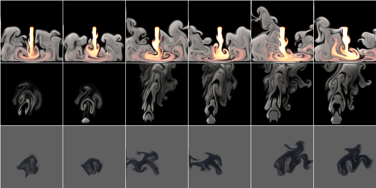
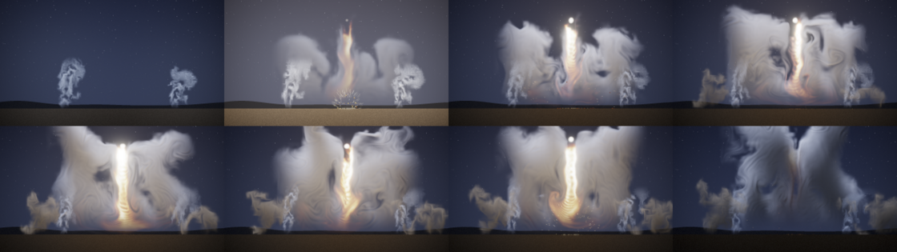

# Flow effects: launch, puffs and ink

Status: **done** (15 October 2026). Audience: dev, research, artists. Three effects for a game engine's library,
after the atmosphere and energy rounds ([EFFECTS_ATMOSPHERE.md](EFFECTS_ATMOSPHERE.md),
[EFFECTS_ENERGY.md](EFFECTS_ENERGY.md)): **launch** (a rocket's or an engine's exhaust blown down onto the ground,
billowing out both ways), **puffs** (smoke leaving a chimney or an exhaust in distinct pulses) and **ink** (a plume with
almost no buoyancy that curls and spreads slowly, as ink, blood or silt does in water). All three come from the
project's own 2D fluid simulator with new sources, forces and drawing, and are trained and tested exactly as the last
six were: study D's recipe and protocol ([REPORT.md](REPORT.md) §6), on held-out settings and seeds. A scene script plays
all three at a night launch (§6), and ten library entries play them ([LIBRARY.md](LIBRARY.md)).

## 1. Bottom line

- **None of the three works as steam did by the rule written before the test (§4); puffs is weak, launch and ink fall
  short of the bar without being weak.** Each was tested once, at the runtime's default int8, on held-out settings and
  seeds.
- **Launch and ink learned their motion.** From the true state each follows a held-out run better than the same
  simulation on the same 32-cell grid with the same detail layer: at 1 s by +1.5 dB [+1.1, +2.0] (launch) and +2.2
  [+1.9, +2.5] (ink), at 2 s by +1.4 and +1.8; both tie at 8 s. But played endlessly at settings and seeds they never
  saw, their average picture only **ties** the nearest training flipbook's (+0.3 dB [-1.3, +1.8] and +0.5 [-1.1, +2.0]),
  where the rule asks for it to be closer; their motion ties the flipbook's. Launch's detail is a little further from
  real than the flipbook's (spectrum distance +0.029 [+0.003, +0.056]); ink's ties it. Ink's average picture is 3.1 dB
  [1.9, 4.5] behind the coarse simulation's with the detail layer: the learned dye stays a more compact cloud than the
  simulation's (§4.2).
- **Puffs did not learn their pulses better than a coarse simulation.** The coarse simulation runs the same
  noise-timed source and so puffs at the same moments as the real run; the learned stepper has to learn the gate, and
  ties it at 8 frames and 1 s (-0.4 dB [-1.1, +0.5]) and falls behind at 2 s (-1.0) and 8 s (-2.1): **weak**. Endless,
  its average picture is 1.6 dB [0.6, 2.5] closer than the flipbook's and its motion ties the flipbook's.
- **All three move too fast when played endlessly** (motion ratio 1.19, 1.30 and 1.08 against 1.04, 0.96 and 0.95
  for a second real run; up to 1.5 to 2.0 in some 10 s windows of a minute's play), and none drifts over a minute.
- **The pulses are irregular.** The learned stepper has no clock, so puffs' pulses are timed by the flicker noise at the
  chimney's mouth, which it sees; the rate control takes them from about 0.5 to 2.6 a second, but the gaps between them
  vary by 56% to 90% of their mean (§2).
- **Cost (provisional, shared machine):** 146 KB stored each (64-pixel fine fields with their start points, as smoke's),
  2.4 MB per instance at 128 px; 0.47 to 0.49 ms per 128 px frame at int8 on the AVX-512 build, where study D's fire
  took 0.67 ms in the same session; restarts 0.2 to 0.3 ms (§5).
- **A scene script** (`examples/scenes/liftoff.nvfxs`) plays all three at a night launch: stacks puff vapour, the
  engine's blast billows out over the pad, sand stirred by it hangs and drifts away on the wind (ink, recoloured), and
  the rocket climbs away. Its keyframes are frozen (`ctest -R ScriptedLiftoffFrozen`); no new code (§6).
- **What it took:** a simulator preset each, one line in the recipe (they keep fine fields with their start points, as
  smoke does), 2.8 to 3.9 hours of wall-clock time each on one thread, and no new code in the trainer, the runtime or the
  compositor.

## 2. The effects

All three are presets of the existing solver (`src/sim/sim.cpp`, in a block of their own: `add_flow_sources`,
`add_flow_forces`, `flow_decay`, `render_flow`): the same grid, advection, vorticity confinement, curl noise and
pressure solve, with their own sources, forces, decay and drawing. Each has three controls normalised to [0, 1].
Lengths are in cells of a 128-cell frame and times in seconds.

The lessons of the last rounds shaped them. Magic's fast, regular spiral smeared on the 32-cell state; buoyant plumes,
jets, heavy gas and dust learned well. So these keep their flow at fire's speeds or below and their structures broad,
with their detail from turbulence rather than thin regular arms. And every force is a function of what a learned
stepper sees: the state where it acts, the position, the controls and the run's two noise fields (the curl noise's
stream function and the source flicker). Nothing follows a clock of its own; puffs' pulses are timed by the flicker
noise at the chimney's mouth (below).

| | launch | puffs | ink |
|---|---|---|---|
| what it is | an engine above the ground blows a hot, fast jet straight down; it hits the ground, runs out along it both ways and rolls up into grey-white billows that rise as they cool; brightest at the impact | warm smoke leaves a chimney's mouth at the bottom of the frame in distinct puffs, each kicked up and rolling into a ring; they rise, drift to the right on a light breeze and merge into a trail | dye released slowly a quarter of the way up the middle of the frame, in a direction that wanders; it curls and spreads into soft clouds and long tendrils and drifts with the current; no heat and no light |
| source | a nozzle in the middle, 56% up, 9 to 14 cells across (intensity), blowing straight down at 100 to 160 cells per second (intensity): heat 1.6 to 2.2 and a little soot, broken up by the flicker noise (rate 3.0 per second, as the jet's) | a mouth 36% from the left, 6 cells up, 13 to 20 cells across (intensity), open while the gate is: warm smoke (heat 0.5 to 0.8, soot 1.2 to 2.0) kicked up at 60 to 100 cells per second. **The gate** opens when the size of the flicker noise at the middle of the mouth, \|f\|, rises above a level that the rate control lowers (0.40 to 0.14; flicker rate 4 per second) | a round source of radius 6 to 10 cells (intensity), 62 cells from the left and 34 up: dye of density 1.0 to 1.8, pushed out at 12 to 24 cells per second in a direction 90 degrees plus 63 times the curl noise's stream function there (it wanders slowly), broken up by the flicker noise (rate 0.8 per second) |
| forces | buoyancy 20 (fire: 150), so the jet reaches the ground; its smoke is light (weight -8: it rises); wind up to 30 cells per second with drag 1.0 per second on the material; velocity damping 0.3 per second; confinement 0.4 to 2.0 and curl noise 8 to 38 (turbulence) | buoyancy 40, soot weight 0.5; a fixed breeze of 14 cells per second to the right, with drag 1.0 per second on the smoke; damping 0.4 per second; confinement 0.2 to 1.4 and curl noise 5 to 30 | no heat; the dye is a little lighter than the water (weight -3); **the current**: all the water is dragged (0.7 per second) towards a level flow of up to 22 cells per second to the left or the right; it is stirred everywhere by the curl noise (2 to 8, as well as 3 to 11 where the dye is); damping 0.6 per second; confinement 0.05 to 0.4 |
| ground | the atmosphere effects' ground: a band of still air 3 cells high over a closed bottom border | none (open, as fire's) | none |
| decay | heat 1.6 per second; the hot gas turns to smoke and steam as it cools (soot grows by 2.2 times the heat per second); smoke 0.15 per second | heat 0.6 per second, smoke 0.22 per second | dye 0.05 per second |
| drawing | emitted light by heat (the jet's ramp: dark red, orange, yellow, white, bluish white at its hottest) over grey-white clouds, lit from above and to the left and shaded by themselves | light grey smoke, lit from above and to the left and shaded by itself | dark blue-black dye, barely shaded, thin where it is thin |
| controls | intensity (thrust), wind (drift left or right), turbulence | intensity (puff size and strength), **rate** (pulses per second), turbulence | intensity (amount), **current** (drift left or right), turbulence |

The second controls of puffs and ink are named `rate` and `current` (`sim::control_names`, so the model files, the
runtime and scene scripts call them that; `nvfx_sim` takes `--rate` and `--current`); launch keeps the study's names.
All three loop. Every earlier effect's clips are unchanged to the byte: `Sim.StudyEffectsAreUnchangedByTheNewOnes` now
also hashes clips of jet, orb, vortex, fog, dust and cloud made before these three existed, and full-size clips (128
px, 64 frames) of all eleven earlier effects at two settings were compared byte for byte before and after. Tests of the
new presets: `Sim.FlowEffectsHaveTheirOwnControls`, `Sim.LaunchBlastsTheGroundAndBillowsOutBothWays`,
`Sim.PuffsComeInPulsesThatTheRateControlQuickens`, `Sim.InkIsSlowDarkDyeThatTheCurrentCarries`, and in the recipe
`Rollout.FlowEffectsKeepFineFieldsAsSmokeDoes`.

**Puffs' pulses.** The learned stepper has no clock: what it sees is the state, the position, the controls and the two
noise fields. So the pulses are timed by the flicker noise at the middle of the mouth, which the stepper sees as one of
its inputs (the mouth's middle is a coarse cell's centre, so it sees exactly that value), and the rate control sets the
level the noise must rise above. Pulses per second of the gate (16 seeds of 60 s each):

| rate | 0 | 0.25 | 0.5 | 0.75 | 1 |
|---|---:|---:|---:|---:|---:|
| pulses per second | 0.49 | 0.91 | 1.48 | 2.03 | 2.57 |
| gate open | 4% | 10% | 19% | 31% | 47% |
| gap between pulses, coefficient of variation | 0.90 | 0.83 | 0.76 | 0.63 | 0.56 |

The rate grows nearly in proportion to the control, but the pulses are **irregular**: the gaps between them vary by
56% to 90% of their mean, as a signal fire's or a labouring engine's do, not like a steam locomotive's steady beat. A
regular beat would need a clock that the stepper can see; the noise gives none (it is smooth value noise in time, with
random values at its lattice points), and an oscillator kept in the state (a heat that builds up and is let go) would
ask the 32-cell state and a smoothed learned step to keep a sharp threshold, the kind of structure that fails on it.

**How they were designed.** Each was looked at with `nvfx_sim --sheet` at several settings (low, middle and high
controls, and their extremes) and a scratch probe that printed the amount, centroid and extent of the material, its
speeds, and puffs' pulses. What changed on the way:
- **Launch** first drew thin orange swirls everywhere: the hot gas kept its heat as it spread and was stirred hard. It
  now cools faster (1.6 per second) and turns into smoke as it cools (2.2 times its heat), with less confinement and curl
  noise, so the light stays at the jet and the impact and the clouds are grey-white billows. With fire-like buoyancy
  the gas rose before it spread; at 20 the billows roll out along the ground first. The ground is the atmosphere
  effects' (a band of still air over a closed bottom border), which fog and dust learned.
- **Puffs** first came out of a narrow mouth as thin stalks. A wider mouth, a sharper gate and a kick of 60 to 100 cells
  per second roll each puff into a ring (a mushroom cap at 128 px). A one-sided gate (f above a level) gave 0.5 to 1.5
  pulses a second at best and merged them at high rates; the two-sided gate (\|f\| above a level) doubles the crossings,
  5 times from the lowest rate to the highest. A breeze on all the air bent the puffs into hooks; on the smoke only (as
  the other effects' wind) it leans the trail gently.
- **Ink** first released too little dye to read. A bigger, denser source fixed that; at high turbulence the curl noise
  and confinement tangled it into kinked, boxy tendrils (the value noise's lattice), so both were reduced: its curls stay
  broad and slow, as magic's lesson asks.

How fast they move, in the steady state at two settings (all controls 0.5 and all 1; cells of a 128-cell frame per
second where there is material, median and 99th percentile, measured by the same probe for fire and smoke; a coarse cell
is 4 of them, a frame 1/30 s):

| effect | median | 99th percentile | in coarse cells a frame (99th) |
|---|---:|---:|---:|
| fire | 50 to 71 | 99 to 139 | 0.82 to 1.16 |
| smoke | 37 to 52 | 106 to 156 | 0.88 to 1.30 |
| launch | 20 to 30 | 114 to 136 | 0.95 to 1.13 |
| puffs | 16 to 29 | 73 to 107 | 0.61 to 0.89 |
| ink | 7 to 15 | 18 to 27 | 0.15 to 0.23 |

Launch's jet is as fast as fire's flames; puffs are slower and ink is the slowest effect so far.



**How chaotic they are** (`nvfx_experiment d-chaos --effects launch,puffs,ink`, as [REPORT.md](REPORT.md) §6.1: active
PSNR against the undisturbed run, mean over 4 runs; [d_chaos.csv](../results/experiments/fx_flow/d_chaos.csv)):

| effect | case | 1 frame | 0.5 s | 1 s | 2 s | 8 s |
|---|---|---:|---:|---:|---:|---:|
| launch | start nudged by 1e-3, same seed | 71.1 | 64.6 | 62.9 | 60.1 | 50.1 |
| launch | start nudged by 1e-1, same seed | 46.1 | 34.9 | 32.1 | 28.5 | 23.3 |
| launch | same start, other seed | 37.8 | 17.6 | 13.0 | 10.4 | 10.3 |
| launch | other start, same seed | 10.4 | 10.2 | 10.2 | 10.4 | 13.5 |
| puffs | start nudged by 1e-3, same seed | 72.7 | 65.8 | 65.0 | 64.0 | 62.4 |
| puffs | start nudged by 1e-1, same seed | 51.4 | 39.7 | 37.7 | 36.4 | 34.1 |
| puffs | same start, other seed | 49.7 | 17.1 | 13.8 | 12.3 | 13.8 |
| puffs | other start, same seed | 9.5 | 10.1 | 10.9 | 13.2 | 21.7 |
| ink | start nudged by 1e-3, same seed | 83.8 | 73.3 | 74.6 | 74.1 | 79.1 |
| ink | start nudged by 1e-1, same seed | 60.1 | 50.4 | 49.7 | 50.3 | 57.9 |
| ink | same start, other seed | 31.0 | 21.4 | 17.8 | 15.1 | 15.6 |
| ink | other start, same seed | 14.0 | 14.0 | 14.3 | 14.8 | 22.0 |

- **Launch behaves as fire does, more so**: a small error in the start stays invisible for seconds (63 dB after 1 s, 50
  after 8 s), and the seed takes over within a second; two runs with other seeds are 10 dB apart after 2 s, the lowest
  of any effect so far (fire: 12.4), since its turbulent clouds fill most of the frame.
- **Puffs' seed decides when they come**: another seed is down to 14 dB within a second, as the pulses then come at
  other times; and runs from other starts with the same seed are pulled together (10 dB at first, 22 dB after 8 s), as
  the orb's and the cloud's are by their forcing.
- **Ink is the calmest effect so far**: an error of 1e-3 in the start is still invisible after 8 s (79 dB), and one of
  10% heals (50 dB after 1 s, 58 after 8). Its seed takes over more slowly than any other's (18 dB after 1 s, 15 after
  2), since its dye moves slowly and its noise only aims the release and stirs the water gently.

## 3. Training

Study D's recipe, unchanged but for the one branch the recipe's own logic decides (`rollout::recipe_for`): all three
linger (launch's clouds, puffs' trail and ink's dye fade over seconds), so they keep 64-pixel fine fields with their 8
start points, as smoke, fog and cloud do; otherwise fire's settings: 160 runs of 240 frames from an empty grid with
random controls and seeds of their own (training salt 1), the stepper's three stages, the renderer on 200 frames of 100
runs, the detail constants chosen by matching frame statistics of endless runs against real runs at the controls of four
training runs with new seeds (validation; the test's settings and seeds are never used), and the start points. Each was
trained in study D's three saved steps (`d-train --stages12 1`, `d-tune`, `d-finish`), one thread each, `nice 10`.
Launch trained alone; then the coordinator freed cores, and puffs and ink trained two at a time (from 00:28 and 00:40
UTC), on a machine shared with other agents (load 7 to 22 on 4 cores). No step was lost.

| effect | runs x frames | simulation | stages 1-2 (loss, s) | stage 3 (loss, s) | renderer (training samples) | contrast, swirl, grow | detail score | start points | stored |
|---|---|---:|---|---|---:|---|---:|---:|---:|
| launch | 160 x 240 | 21.3 min, recorded in 477 s | 0.0499, 6773 | 0.0515, 1203 | 31.2 dB | 1, 3, 1 | 0.37 | 8 (64 px fine) | 146 KB |
| puffs | 160 x 240 | 21.3 min, recorded in 405 s | 0.1809, 8472 | 0.5045, 2096 | 32.0 dB | 1, 1.5, 1 | 0.61 | 8 (64 px fine) | 146 KB |
| ink | 160 x 240 | 21.3 min, recorded in 497 s | 0.0182, 8307 | 0.0169, 2176 | 42.9 dB | 0.5, 1.5, 1 | 0.43 | 8 (64 px fine) | 146 KB |

The seconds are wall-clock time on a share of one core. In all, 2.8 hours for launch (21:54 to 00:40 UTC), 3.9 for ink and
3.8 for puffs, two at a time. The loss columns are not comparable between effects (each is normalised by its own
state's scale), nor stage 3's with stages 1-2's (it adds the activity term). Puffs' stage 3 loss rose more than any
effect's so far (0.18 to 0.50): matching how much the state changes from frame to frame is hard where a source switches
on and off. The calibration chose the strongest sub-grid swirl for launch (3, as for the jet), which draws its billows as
wormy lines (§4.4), and halved the contrast for ink (new dye arrives less broken up).

Each model was frozen before its test: [fx_flow_frozen.csv](../results/experiments/fx_flow_frozen.csv) has their
SHA-256 (the files are under the data root's `fx_flow/models/d`).

## 4. The test

Written before any test was run. Each model is frozen (its SHA-256 in
[fx_flow_frozen.csv](../results/experiments/fx_flow_frozen.csv)) before its own test, and each test runs once, with
`nvfx_experiment d-eval` and `d-report` unchanged. The models train one at a time (the machine is shared), so the test
runs in parts on this one design: each effect is frozen and tested when its training ends (`d-eval --effects launch`,
then `puffs`, then `ink`), its rows added to the same CSVs. Every run of the test is independent and seeded by its
effect, run and setting, so the split changes no number. It is study D's protocol ([REPORT.md](REPORT.md) §6.4 to
§6.6), exactly as the last six effects were tested ([EFFECTS_ATMOSPHERE.md](EFFECTS_ATMOSPHERE.md) §4,
[EFFECTS_ENERGY.md](EFFECTS_ENERGY.md) §4):

- **Tracking from the true state:** 8 held-out runs per effect (salt 2: seeds 700000 to 700007, with controls drawn
  from that salt; no training or validation run used them), each started after 100 frames from its true state (coarse
  and fine fields) with its own noise seed; 240 frames. The neural rollout through the runtime against the simulation
  on the same 32-cell grid with the same detail layer (`coarse_sim_detail`), the plain coarse simulation, holding the
  first frame, and the neural dynamics drawn by the simulation's renderer. Active PSNR at 1 and 8 frames and at 1, 2
  and 8 s; the neural run minus `coarse_sim_detail`, paired over the 8 runs.
- **Endless runs at settings never seen:** the ten held-out settings of study B (`b_test_settings`, its generator with
  seed 2026: none on study B's training grid), 10 s each after a 5 s warm-up of the real runs, with seeds never used for
  these effects (900000 + k and 910000 + k for the two real runs, 920000 + k for the neural run, 930000 + k for the
  coarse simulation; training used 600000 to 600159, the held-out tracking runs 700000 and up, and the validation of the
  detail constants seeds derived from the training runs'). Frame statistics against a real run: detail spectrum
  distance, motion ratio (as the error \|ln ratio\|), coverage distance and mean-frame PSNR. Compared with a second real
  run with another seed (the floor), the nearest of the 45 training flipbooks of study B's grid (made for these effects
  as study B made its library: 64 frames at 128 px, seed 1; looped), and the coarse simulation with the detail layer and
  without.
- **One minute:** a 60 s neural run in 6 s shards at the first two held-out settings, cut into 10 s windows, each
  against the real 10 s run.
- **Precision:** the runtime plays the effects as they ship, at its default precision. Since study K
  ([REPORT.md](REPORT.md) §13) that is int8 (the stepper's second convolution in 8 bits, on the AVX-512 build where the
  CPU has VNNI, as this machine's has). `d-eval` sets no precision, so the test measures int8.
- **Statistics:** every difference paired (over runs or settings), with a 95% bootstrap interval of 10,000 resamples
  (`metrics::paired_bootstrap`); an interval across zero is a tie. Every number is reported, ties as ties.

What would count as working, decided now (the energy round's rule): an effect **works as steam did** if it tracks its
runs better than `coarse_sim_detail` at 1 s (interval above zero) and, endless, its average picture is closer than the
nearest flipbook's (mean-frame PSNR interval above zero) and its motion error is no worse than the flipbook's (interval
not above zero). An effect that ties or loses to the coarse simulation at tracking at 1 s, or whose average picture or
motion loses to the flipbook, is reported as **weak**, as magic was, with what it does well and what it does badly.

**How it ran.** The design held; one thing differed from the plan: the coordinator freed cores while launch's last training
step ran, so puffs and ink trained two at a time, and ink, finished first, was tested before puffs. Each test ran once,
with the same tool, settings and seeds, into a folder of its own under the data root; their rows were appended to
[d_track.csv](../results/experiments/fx_flow/d_track.csv), [d_stats.csv](../results/experiments/fx_flow/d_stats.csv) and
[d_long.csv](../results/experiments/fx_flow/d_long.csv), and `d-report` wrote
[D_SUMMARY.md](../results/experiments/fx_flow/D_SUMMARY.md). Each took 4 to 6 minutes.

### 4.1 Tracking from the true state

Active PSNR (dB), mean over 8 held-out runs:

| effect | method | 1 frame | 8 frames | 1 s | 2 s | 8 s |
|---|---|---:|---:|---:|---:|---:|
| launch | neural | 22.8 | 15.8 | 13.2 | 12.0 | 10.4 |
| launch | neural dynamics, simulation's renderer | 23.9 | 15.9 | 13.2 | 12.0 | 10.3 |
| launch | coarse simulation + detail | 25.0 | 14.9 | 11.7 | 10.6 | 10.1 |
| launch | coarse simulation | 16.7 | 15.7 | 13.7 | 12.2 | 11.2 |
| launch | holding the first frame | 22.7 | 12.4 | 9.0 | 7.9 | 8.0 |
| puffs | neural | 25.5 | 17.6 | 14.4 | 13.6 | 13.4 |
| puffs | neural dynamics, simulation's renderer | 29.0 | 17.9 | 14.4 | 13.6 | 13.5 |
| puffs | coarse simulation + detail | 29.7 | 17.8 | 14.8 | 14.6 | 15.5 |
| puffs | coarse simulation | 18.8 | 17.1 | 16.2 | 15.8 | 16.5 |
| puffs | holding the first frame | 22.4 | 11.7 | 10.9 | 10.5 | 11.9 |
| ink | neural | 35.3 | 25.9 | 21.9 | 20.1 | 17.4 |
| ink | neural dynamics, simulation's renderer | 39.3 | 26.2 | 22.1 | 20.2 | 17.4 |
| ink | coarse simulation + detail | 29.4 | 24.6 | 19.8 | 18.3 | 17.8 |
| ink | coarse simulation | 23.2 | 23.0 | 20.8 | 19.4 | 18.7 |
| ink | holding the first frame | 37.7 | 21.0 | 14.4 | 13.0 | 12.9 |

Neural minus coarse simulation + detail, paired over runs (95% intervals; bold: the neural rollout is better):

| effect | 1 frame | 8 frames | 1 s | 2 s | 8 s |
|---|---|---|---|---|---|
| launch | -2.19 [-2.82, -1.56] | **+0.94 [+0.78, +1.12]** | **+1.53 [+1.09, +2.04]** | **+1.40 [+1.03, +1.74]** | +0.32 [-0.06, +0.75] (tie) |
| launch, neural dynamics with the simulation's renderer | -1.09 [-1.66, -0.59] | **+1.02 [+0.84, +1.20]** | **+1.50 [+1.05, +2.03]** | **+1.36 [+0.99, +1.71]** | +0.20 [-0.19, +0.62] (tie) |
| puffs | -4.26 [-7.12, -1.41] | -0.12 [-1.38, +1.22] (tie) | -0.37 [-1.12, +0.45] (tie) | -0.97 [-1.52, -0.50] | -2.07 [-2.76, -1.44] |
| puffs, neural dynamics with the simulation's renderer | -0.72 [-2.82, +1.62] (tie) | +0.15 [-1.14, +1.54] (tie) | -0.39 [-1.20, +0.51] (tie) | -0.94 [-1.53, -0.44] | -1.98 [-2.68, -1.36] |
| ink | **+5.89 [+3.10, +8.34]** | **+1.31 [+1.01, +1.61]** | **+2.18 [+1.86, +2.50]** | **+1.80 [+1.62, +1.99]** | -0.44 [-1.41, +0.46] (tie) |
| ink, neural dynamics with the simulation's renderer | **+9.92 [+7.26, +12.24]** | **+1.54 [+1.19, +1.90]** | **+2.29 [+1.95, +2.64]** | **+1.85 [+1.64, +2.06]** | -0.47 [-1.41, +0.39] (tie) |

- **Launch's and ink's learned dynamics follow a run better than the simulation at the same resolution** from 8 frames
  to 2 s, as fire's, steam's and the jet's did (launch +1.5 dB at 1 s, ink +2.2), and tie at 8 s. Launch's first frame
  is lost to both the renderer and the dynamics (the learned renderer reaches 28.8 dB on the true fields). As on fog,
  the plain coarse simulation, with no detail, scores a little higher than both from 1 s (13.7 dB against 13.2): once
  the detail has decorrelated, a blurred picture is the best guess in PSNR, though far too smooth to use (§4.2:
  spectrum distance 0.88). Ink's first
  frame (35 dB) is among the best of any effect so far (fog's 35.4): its coarse simulation, which starts from the true
  fields, is 8 dB below holding the first frame after one step, as its 32-cell release and flow put the dye somewhere
  else; the learned stepper does not. Its
  renderer reaches 37.8 dB on the true fields.
- **Puffs' learned dynamics gain nothing over the coarse simulation** and lose to it from 2 s. Here the coarse
  simulation has an advantage no other effect gave it: its source is gated by the same flicker noise, so it puffs at the
  same moments as the real run, puff for puff, while the learned stepper has to have learned the gate from the noise it
  sees. The plain coarse simulation without the detail layer follows the runs best of all from 1 s (16.2 dB against
  14.4): a soft picture of puffs in the right places beats sharp detail in slightly wrong ones.

### 4.2 Endless runs at settings never seen

Means over the 10 held-out settings (spectrum distance and coverage distance: lower is better; motion ratio: 1 is
right; mean-frame PSNR: higher is closer):

| effect | method | spectrum | motion | coverage | mean-frame PSNR |
|---|---|---:|---:|---:|---:|
| launch | real, other seed (floor) | 0.039 | 1.04 | 0.018 | 20.8 |
| launch | **neural rollout (146 KB)** | 0.122 | 1.19 | 0.081 | 16.4 |
| launch | nearest training flipbook | 0.093 | 1.10 | 0.060 | 16.1 |
| launch | coarse simulation + detail | 0.096 | 1.20 | 0.038 | 17.8 |
| launch | coarse simulation | 0.883 | 0.27 | 0.021 | 18.0 |
| puffs | real, other seed (floor) | 0.083 | 0.96 | 0.021 | 26.3 |
| puffs | **neural rollout (146 KB)** | 0.193 | 1.30 | 0.034 | 23.9 |
| puffs | nearest training flipbook | 0.138 | 1.04 | 0.024 | 22.3 |
| puffs | coarse simulation + detail | 0.128 | 0.98 | 0.024 | 24.4 |
| puffs | coarse simulation | 1.187 | 0.44 | 0.029 | 23.9 |
| ink | real, other seed (floor) | 0.088 | 0.95 | 0.009 | 28.2 |
| ink | **neural rollout (146 KB)** | 0.198 | 1.08 | 0.025 | 24.8 |
| ink | nearest training flipbook | 0.226 | 1.14 | 0.025 | 24.3 |
| ink | coarse simulation + detail | 0.164 | 1.04 | 0.010 | 27.8 |
| ink | coarse simulation | 1.026 | 0.42 | 0.009 | 28.0 |

Neural minus each other method, paired over the 10 settings (motion as the error \|ln ratio\|; bold: the neural
rollout is better):

| effect | statistic | nearest flipbook | coarse simulation + detail | real, other seed |
|---|---|---|---|---|
| launch | spectrum distance | +0.029 [+0.003, +0.056] | +0.026 [+0.004, +0.049] | +0.083 [+0.058, +0.120] |
| launch | mean-frame PSNR (dB) | +0.26 [-1.28, +1.77] (tie) | -1.42 [-2.78, +0.14] (tie) | -4.44 [-5.67, -3.14] |
| launch | motion error | +0.032 [-0.020, +0.092] (tie) | -0.055 [-0.180, +0.085] (tie) | +0.139 [+0.057, +0.255] |
| launch | coverage distance | +0.021 [-0.001, +0.044] (tie) | - | +0.063 [+0.040, +0.085] |
| puffs | spectrum distance | +0.055 [-0.037, +0.142] (tie) | +0.065 [+0.011, +0.118] | +0.110 [+0.061, +0.161] |
| puffs | mean-frame PSNR (dB) | **+1.60 [+0.60, +2.46]** | -0.50 [-1.55, +0.44] (tie) | -2.40 [-3.49, -1.02] |
| puffs | motion error | +0.046 [-0.100, +0.164] (tie) | +0.067 [-0.034, +0.171] (tie) | +0.117 [+0.001, +0.236] |
| puffs | coverage distance | +0.010 [-0.001, +0.023] (tie) | - | +0.014 [+0.003, +0.025] |
| ink | spectrum distance | -0.028 [-0.094, +0.034] (tie) | +0.034 [-0.011, +0.086] (tie) | +0.110 [+0.079, +0.149] |
| ink | mean-frame PSNR (dB) | +0.54 [-1.08, +2.01] (tie) | -3.05 [-4.46, -1.89] | -3.45 [-5.17, -2.00] |
| ink | motion error | -0.112 [-0.241, +0.026] (tie) | +0.072 [+0.014, +0.136] | +0.074 [-0.027, +0.202] (tie) |
| ink | coverage distance | -0.001 [-0.011, +0.009] (tie) | - | +0.015 [+0.011, +0.019] |

- **Launch** plays with motion tied with the flipbook's and the coarse simulation's (19% fast against the real runs'
  4%), and an average picture tied with both; its detail is a little further from real than either. Its billows are
  the hardest picture of any effect to match even for a second real run (mean-frame PSNR 20.8 dB between two real runs;
  26 to 36 for the others): the clouds fill most of the frame and move fast. Its coverage is further from real than a
  second run's (0.081 against 0.018): the learned clouds fill the frame unevenly.
- **Puffs**: an average picture closer than the flipbook's, which shows a neighbouring setting's puffs, and motion and
  coverage tied with it; detail tied with the flipbook and a little further from real than the coarse simulation's. Its
  motion is the fastest of the three (1.30) and varies most with the setting (0.97 to 1.82).
- **Ink** ties the flipbook on every statistic, in 146 KB, but its average picture is 3.1 dB behind the coarse
  simulation's with the detail layer, which grows its dye from a 5 s warm-up as the real runs do. The learned ink stays
  a more compact cloud than the real dye. Two things probably add up: its start points come from 5 s into its training
  runs and every 6 s shard starts again from one, so the learned dye is never more than about 11 s old where the real
  runs' has had 5 to 15 s to spread; and in the library, with shards of 20 s, it still stayed compact, so the learned
  stepper itself holds the dye together more than the simulation does. (Its coverage distance ties the flipbook's: the
  difference is where the dye is more than how much of the frame it covers.)

**By the rule written before the test**: launch and ink track their runs better than `coarse_sim_detail` at 1 s and
their motion error is no worse than the flipbook's, but their average picture only ties the flipbook's, where the rule
asks for an interval above zero; so neither **works as steam did**. Nor does either lose anything the rule names as
weak (the coarse simulation at tracking, the flipbook in average picture or motion): they fall between the rule's two
sentences, short of the bar. Puffs ties the coarse simulation at tracking at 1 s, so it is **weak**, whatever its endless
statistics (which are the best of the three against the flipbook).

### 4.3 One minute without a restart

| effect | spectrum distance | motion ratio | mean-frame PSNR |
|---|---|---|---|
| launch | 0.06-0.11 | 1.13-1.52 | 15.0-19.1 |
| puffs | 0.11-0.25 | 1.10-1.73 | 21.2-28.0 |
| ink | 0.14-0.24 | 0.87-2.04 | 25.4-28.7 |

Ranges over six 10 s windows at each of the first two held-out settings: none drifts (the last windows are as good as
the first). At the second setting all three move too fast in most windows (launch 1.13 to 1.52, puffs 1.19 to 1.72,
ink 1.03 to 2.04), as in their 10 s runs there.

### 4.4 After the test: launch's detail, as the library draws it

Not part of the test's design. The launch model's calibration chose the strongest sub-grid swirl (3); seen in the
library and the scene, it draws the billows as wormy, boxy lines, so both play the model with a gentler swirl (1, of
scale 9; set on the `effect` line). The same test, run once more after the test on a copy of the frozen model with that
swirl (into its own folder; [check_launch_swirl1](../results/experiments/fx_flow/check_launch_swirl1)), says what the
gentler look costs and gains:

| | tracking at 1 s, against coarse simulation + detail | at 8 s | spectrum distance | motion ratio | mean-frame PSNR against the flipbook |
|---|---|---|---:|---:|---|
| as calibrated (swirl 3), the test | +1.53 [+1.09, +2.04] | +0.32 [-0.06, +0.75] | 0.122 | 1.19 | +0.26 [-1.28, +1.77] |
| the library's (swirl 1, scale 9) | +1.88 [+1.38, +2.43] | +0.46 [+0.03, +0.93] | 0.333 | 0.84 | +0.19 [-1.37, +1.69] |

The softer billows follow a run a little better (smooth detail that does not match costs less than sharp detail that
does not), but their fine detail is far from the simulation's (0.333 against 0.122; the flipbook's 0.093) and they move
16% too slowly: the simulation's own clouds are full of small curls, which the strong swirl stands in for and the eye
reads as worms. The library and the scene take the look over the statistic.

## 5. Memory and cost

Per frame through `nvfx_render` on one pinned core, with study D's fire measured in the same session (`nvfx_experiment
d-timing`, twelve rounds back to back; [d_timing.csv](../results/experiments/fx_flow/d_timing.csv) has the first round,
[d_timing_rounds.csv](../results/experiments/fx_flow/d_timing_rounds.csv) all of them): the least of the rounds' medians
and, in brackets, the median of the rounds. All at the runtime's default precision, int8 (the AVX2 rows force the AVX2
build, whose int8 kernels the runtime takes on a CPU without VNNI; the AVX-512 row is what this machine plays by
default). **Provisional**: the machine was shared with other agents' jobs (load 6 to 8 on 4 cores during the rounds).

| effect | stored | resident | per instance at 128 px | 64 px, AVX2 | 128 px, AVX2 | 256 px, AVX2 | 128 px, AVX-512 (the default) | restart (128 px) |
|---|---:|---:|---:|---:|---:|---:|---:|---:|
| launch | 146 KB | 419 KB | 2.4 MB | 0.44 ms (0.46) | 0.67 ms (0.71) | 1.57 ms (1.66) | 0.47 ms (0.49) | 0.3 ms |
| puffs | 146 KB | 419 KB | 2.4 MB | 0.45 ms (0.46) | 0.69 ms (0.73) | 1.58 ms (1.65) | 0.49 ms (0.51) | 0.3 ms |
| ink | 146 KB | 419 KB | 2.4 MB | 0.42 ms (0.43) | 0.67 ms (0.70) | 1.51 ms (1.65) | 0.48 ms (0.50) | 0.2 ms |
| fire (study D's, same session) | 82 KB | 163 KB | 2.4 MB | 0.45 ms (0.46) | 0.88 ms (0.93) | 2.29 ms (2.50) | 0.67 ms (0.70) | 10 to 15 ms (1 s warm-up) |

The same network as study D's, so the same per-pixel work (1012 multiply-adds per pixel at 128 px) and working memory.
All three store their start points with fine fields, as smoke does, so they have smoke's memory and restart in a third
of a millisecond instead of fire's 1 s warm-up. Per frame they cost what fire costs at 64 px, about three quarters of
it at 128 px and two thirds at 256 px, where the detail layer and the renderer take most of the frame (probably because
part of their frame is empty or smooth, where fire's is detailed throughout).
For scale, the 32-cell simulation of each with its own renderer costs 2.2 (launch), 1.9 (puffs) and 2.2 ms (ink) in
our scalar code, against 1.2 ms for fire's. They should be re-timed on a quiet machine with every rollout effect, as
the last six were.

## 6. The scene

`examples/scenes/liftoff.nvfxs` (10 s at 1280 x 720 and 30 fps, about 85 lines). Night at a launch pad. Two stacks
either side of the pad puff white vapour (the puffs model, drawn by a field-shader look so that the scene lights it),
under two floodlights. At 2.5 s the engine lights: a flash, a shock, sparks, and the launch model wakes (900 world
pixels wide, at 256 pixels): its exhaust hits the pad and rolls out both ways in billows lit by its fire, while the
blast's air blows the stacks' puffs about (a push from the bus). At 3.3 s fine sand lifted off the apron beyond the
billows (the ink model, a plume with almost no buoyancy, drawn brown by a third look) hangs in the air and drifts away
on the wind (its `current`). At 7.5 s the rocket lifts off: its flame (a glow and a lamp) climbs out of the picture, the
blast's look blends from a light-giving one to one without light (what is left is smoke), and the scene's light from
its heat dims.



The video and the full keyframes are under the data root's `fx_flow/scene` (outside git); the keyframes' SHA-256 are in
[fx_flow_frozen.csv](../results/experiments/fx_flow_frozen.csv) and `ctest -R ScriptedLiftoffFrozen` checks them at
float (skipped without the effects in `NEURALFX_MODELS_FLOW`, by default `$NEURALVFX_DATA/fx_flow/models/scene`); they
are the same on 1 and 2 threads. It plays without an allocation in its frame loop, at 25.5 ms per frame on 2 threads at
the default int8 (the modules' steps 2.2 ms of it) and 31.6 ms at float (4.2 ms), median of the sum of its stages on the
shared machine (provisional).

**Nothing was added to the compositor or the runtime.** What was learned in writing it:
- **The launch model blows down only, from the middle of its tile onto its tile's ground**: a rocket that rises cannot
  take its exhaust with it, as the tile's ground would rise too. The scene leaves the blast where it is and lets the
  rocket's flame climb away as a glow, blends the blast's look to one without light, and lowers its thrust: physically
  the pad's clouds do go on billowing for a while after lift-off.
- **The library's gentler swirl suits a scene too** (`effect launch = "launch.nvfx", swirl 1, swirl_scale 9`), and so
  does a wide feather (0.25): the billows fill their tile, and its square shows otherwise.
- **Ink in air is a hanging cloud.** There is no water to draw in the compositor (its background is a night sky and
  ground), so the scene uses ink for what it is in any fluid: a plume with almost no buoyancy, here fine sand that hangs
  and drifts. Underwater uses are the library's (`underwater`), on a game's own background.

What works: the blast reads as a launch at this scale, lights the stacks' vapour and the sand, and its clouds outlast the
rocket. What does not, yet: the billows are one square-ish block (one tile); the puffs are small beside the blast; there
is no rocket to see, only its flame.

## 7. What it means

- **New effects still cost about 3 to 4 hours of one thread and no new code in the trainer, the runtime or the
  compositor**: a simulator preset, a name, and study D's recipe gave three rollout effects of 146 KB, with ten library
  entries and a scene in text.
- **A source the stepper must switch on and off is hard to learn.** Puffs' pulses are a function of what the stepper
  sees (the noise at the mouth and the rate control), so in principle it can learn them exactly; in practice its stage 3
  loss was the highest of any effect, and from the true state it follows a run no better than a coarse simulation that
  has the gate built in. Endless, where only the statistics count, its average picture beats the flipbook's.
- **A regular beat needs a clock, and the stepper has none.** Pulses timed by the noise are irregular; a steam
  locomotive's steady chuff would need an oscillator in the state (which the 32-cell state would have to keep sharp) or
  a clock among the stepper's inputs (a change to the recipe and the runtime).
- **Slow effects are where start points show.** Ink, the calmest effect so far, learned its motion best of the three
  (+2.2 dB at 1 s), but its endless average picture is behind the coarse simulation's: the learned dye stays compact.
  Start points from later in the runs, or longer shards with a stepper that lets the dye spread, are the things to try.
- **The detail calibration can choose a look the eye dislikes.** Launch's strongest swirl matches the simulation's fine
  detail best and draws worms; the library and the scene override it by eye, at a measured price (§4.4). Fixes worth
  trying, none tested here: a detail layer whose swirl follows the flow's own vorticity, or a calibration score that
  also weighs larger structures.
- **By the rule set before the test, none of the three works as steam did**; puffs is weak, launch and ink are short of
  the bar only because their average picture ties the flipbook's instead of beating it, as fog's did in the atmosphere
  round. For a game, which plays them endlessly, all three are usable (§6 and [LIBRARY.md](LIBRARY.md)), with the
  flaws named there.

## 8. Reproduce

```sh
build/nvfx_sim --effect launch --intensity 0.6 --sheet launch.png      # the simulator's presets alone
build/nvfx_sim --effect puffs --rate 0.5 --bg black --sheet puffs.png
build/nvfx_sim --effect ink --current 0.8 --sheet ink.png
R="--root $NEURALVFX_DATA/fx_flow --threads 1"
build/nvfx_experiment d-chaos  --effects launch,puffs,ink $R --results results/experiments/fx_flow
build/nvfx_experiment d-train  --effects launch --stages12 1 $R --results results/experiments/fx_flow
build/nvfx_experiment d-tune   --effects launch $R --results results/experiments/fx_flow
build/nvfx_experiment d-finish --effects launch $R --results results/experiments/fx_flow
#   (the same for puffs and ink)
build/nvfx_experiment d-eval   --effects launch $R --results DIR --figures FIGS   # the test, an effect at a time
#   (its d_track.csv, d_stats.csv and d_long.csv rows appended to those of results/experiments/fx_flow)
build/nvfx_experiment d-report --root $NEURALVFX_DATA/fx_flow --results results/experiments/fx_flow   # D_SUMMARY.md
build/nvfx_experiment d-timing --effects fire,launch,puffs,ink --root ROOT --results DIR2
build/nvfx_scene_script --script examples/scenes/liftoff.nvfxs --models DIR3 --out liftoff.mp4 --keyframes DIR --sheet sheet.png
```

`ROOT/models/d` for the timing holds study D's `fire.nvfx` with the three models; `DIR3` holds `launch.nvfx`,
`puffs.nvfx` and `ink.nvfx` (`ctest -R ScriptedLiftoffFrozen` reads it from `NEURALFX_MODELS_FLOW`). The check after the
test (§4.4) is `d-eval --effects launch` on a copy of the frozen model whose detail swirl is set to 1 and its scale to 9.
