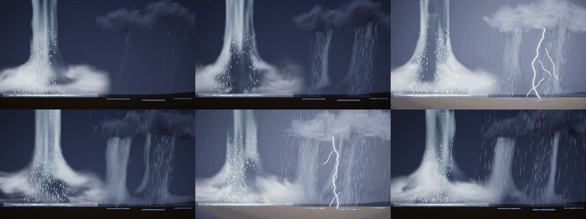

# Water: a deterministic water system

Status: **done** (15 October 2026). Audience: dev, artists, research. Waterfalls, fountains, splashes, drips, bubbles,
rain on puddles and rain shafts for scenes and the effect library, made the way the game asked for: *model the parts of
water that can be modelled, and move them with a seeded random simulation; full deterministic effects of water*. Nothing
here is trained. The motion is a small simulation in the composer whose every random number is a hash; the look is
drawn; only the mist and spray clouds are learned, and they are the library's existing fog (and steam) models fed where
the water lands, through the couplings scenes already have. A scene plays a waterfall, a storm and rain on puddles
together (§8); the library has 19 water entries (§7).

## 1. Bottom line

- **Water is three things, kept apart.** *Motion*: a seeded simulation (strands of nodes that fall and break into
  drops, drops that bounce or land, splash crowns, a damped wave equation per pool, foam, ripple rings, rising bubbles,
  rain-shaft streaks). *Look*: drawn per pixel from that state (glassy water that whitens as air gets into it, a dark
  pool surface that mirrors the sky and glints, foam, rings, a shaft's veil). *Mist*: the fog model (cold spray) or the
  steam model (a geyser's), fed by `deposit()` where water lands, as a trail's source feeds its tiles.
- **Deterministic to the bit.** The same script gives the same frames on 1, 2 and 3 threads, overlapped or not, with
  the engine layers or without (`Water.*`), and the scene's frames are the same on 1, 2 and 3 threads (§6).
- **No allocation per frame.** Capacities are fixed when the scene is made; `nvfx_alloc_test` plays a scripted scene
  with every kind and a library stage with spawns, moves, a parameter and stops: 0 allocations.
- **Its simulation is nearly free; its drawing costs what it covers.** Stepping an element takes 0.003 to 0.06 ms a
  frame and capturing its picture 0.02 to 0.14 ms; drawing it at 1280 x 720 on one thread takes 1.2 ms (drips over a
  pool) to 8 ms (a 30-strand waterfall over its pool), and 14 ms for a tank of water 1200 x 400 pixels seen through its
  side (§5). Rows are drawn in parallel with the rest of the picture. The mist module costs what any module of its size
  costs.
- **How it looks** (§7): the waterfall, the pipe's outflow, the garden fountain, the boulder's splash and the rain shaft
  read well; eleven entries are fair, with their flaws named (the geyser's and hydrant's columns are bundles of strands,
  the cascade's ledges hang in mid-air, small splashes are small); cave drips, the leaking pipe and the wake are weak in
  a still at gallery size (small things, better in motion and close up). Without rocks or terrain, falls start in
  mid-air unless their lip is above the picture. The learned mist reads as mist at a waterfall's foot, but as spray it
  is too slow and lingers.

## 2. How water is represented

| part | modelled as | moved by | drawn as |
|---|---|---|---|
| a falling sheet (`sheet`) | strands across its lip, each a ring of nodes emitted one a frame | ballistic nodes; each breaks after a time of its own (smooth noise over strands and time: the sheet tears into tongues), into a drop, spray and mist | quads between neighbouring strands' nodes that left together (the sheet), streak capsules along each strand, whiter as it falls; broken water as streaks |
| a jet (`jet`) | the same strands from a nozzle, `jets` of them fanned | the throw wanders by smooth noise (`spread`) and swings (`pulse`); nodes break near their apex | capsules that thin as they speed up and swell as they slow (what flows through stays the same); a strand is not joined where faster water has overtaken slower |
| drops and spray | a pool of drops shared by the scene | ballistic, drawn towards the wind; small ones bounce once off the ground | short streaks along their motion |
| a splash (`splash` action) | a crown: two wall strands (left and right of the crater), the crater's jet, a burst of drops | walls thrown out for 0.12 s, breaking from the rim down; the jet rises from the crater a fifth of a second later | the walls as strands, the crown's near face as faint quads between them, the jet as a strand |
| a pool (`pool`) | a 1D height field along a line (`cells`) | a damped wave equation, excited by what lands, by `wave`, by rain (`rate`); a steady `swell` on top | a surface band seen from above (`surface` tall: dark, mirroring the sky, with shimmering sheen and a bright edge), a body below it (`depth`) |
| foam | pieces on a pool's surface | carried by its current (`drift`), slowing, fading | flat patchy white ellipses on the surface |
| ripples | rings where things land on a surface seen from above | grow and fade | thin bright ellipses as flat as the surface is deep |
| drips (`drips`) | drops swelling at points along a line | swell, let go, fall as drops | a hanging drop growing |
| bubbles (`bubbles`) | rising, wobbling, growing | rise at `speed`, pop at the pool's surface (a kick, a ring, a fleck) | a rim and a glint |
| a rain shaft (`shaft`) | streaks in a region whose density profile across it swells and thins in gusts | fall at `speed`, slanted by a swaying wind | the streaks, and a soft veil as dense as the profile |
| mist and spray clouds | a module of a learned effect | the model, from what is deposited where water lands (per element, in 8 bins along x) | the module's look |

**The rules of the simulation.** Everything moves in the scene's thread (the frame's step 9, after the particles), in
script order, with a fixed step (the scene's frame time; a pool substeps for stability: `ceil(c dt / 0.45 dx)` steps,
at most 32). A random number is `hash(seed, frame, index, salt)`: a strand's, a drop's or a cell's index, never a shared
generator, so a frame's numbers do not depend on what came before or on threads. Every pool, strand ring, drop pool,
crown and ring list is sized when the scene is made; what is spawned beyond them takes the oldest's place (drops, rings,
foam, bubbles, drips, streaks, crowns) or is not emitted (a full strand).

**The pool's surface.** Heights h (up positive) and their rates v per cell, `v += dt (c^2 h_xx - 2k v - w0^2 h)`, then
`h += dt v` (symplectic Euler), `c` = `speed` (140 px/s), `k` = `damping` (1.2/s), w0 = 2/s (it settles back to its
level, so long waves do not linger), heights clamped to 0.35 of its depth. What lands kicks the rates by a Mexican hat
(down where it lands, up to its sides, its sum nothing): water pushed aside, not lost, so a waterfall landing in one place
stirs the surface without digging a hole in it (`Water.WavesSpreadDieAndKeepThePoolsWater`).

**Landing.** A node or drop that reaches its pool's surface (or its `floor` off the pool) kicks the pool by its mass
times the square root of its speed, may leave a ring (on a surface seen from above) and foam (where a lot lands fast),
throws a little water back up, and adds its mass to its element's bins; after the step each bin's mass becomes a puff
of mist: `deposit(module, x, y, radius, heat = mist_heat * q, soot = q, 0, -0.8, 0.2)`, q = 0.02 x `mist_amount` x mass.
A splash deposits a small burst at once as well.

## 3. The look

Water is shaded like the field shader's gases, so it sits in the same night: the sky's light from above and to the
left (`0.35 + 0.9 lambert`, times `brightness`), the scene's light where it is (the light field, soft-limited, with the
flash), and a highlight along the half vector of the sky's direction and the viewer's (power 24, weighted by each part's
glint). Over the screen it is laid with its coverage (premultiplied, the screen's alpha kept).
- **Sheets** are a mesh: quads between neighbouring strands' nodes that left in the same frame (unless they have drifted
  apart: a tear), streak capsules along each strand, all of a sheet drawn as one piece (the most covering part at each
  pixel), so the sheet has no seams and its streaks show through it. It is glassy at the lip and whitens with age as air
  gets into it; a quad fades as its nodes near their break, so holes open softly and the sheet thins to its streaks.
  Broken water falls as faint streaks. A sheet's normal faces the viewer, tilted a little up.
- **Jets** are strands that thin as they speed up: radius x `sqrt(v0 / v)`, clamped to 0.4 to 1.3.
- **Pools**: a surface band `surface` pixels tall seen from above, dark (the colour times 0.07 near to 0.2 far, as it
  mirrors more sky far off), with a sheen of broken streaks of the sky's light (smooth noise stretched along the
  surface, drifting and shimmering, stronger on slopes), a bright line at its edge that catches more on crests facing the
  sky, rings and foam on it; below it, the body seen through its side (a tank), darker and denser with depth. The
  surface's normal faces up (`Water.ItsLayersAgreeWithEachOther` counts it), with the waves' slope in it.
- **Rain shafts**: grey streaks (the shaft's colour, a little whiter) and a veil `0.3 x (1 - clarity) x density / 30` as
  dense as the profile, soft at its sides and its top.
- **Colours**: water reflects `colour` (0.62, 0.8, 0.95: blue-white); foam, spray and broken water are whiter.

**Engine layers** ([ENGINES.md](ENGINES.md) §11). With the layers on, the water is drawn into them as well: colour (as
on the screen), albedo (what it reflects, premultiplied, at most its alpha), emission nothing (water gives no light), a
normal (the coverage-weighted sum of unit normals: the pool's surface faces up, the sheets face the viewer, drops and
strands are shaded as cylinders and spheres) and thickness (`-log(1 - coverage)`, summed). The picture is the same with
the layers or without, the layers the same on any number of threads (`Water.ThePictureIsTheSameWithLayersOrWithout`,
`Water.TheSameLayersOnAnyNumberOfThreads`). The water is drawn over the background and under the modules, so a
waterfall's mist covers its foot.

## 4. In scripts

`water NAME = KIND` declares an element; `splash` and `wave` are actions (in rules; `wave` also in `every frame`).
[COMPOSE.md](COMPOSE.md) §5.5 has the keys of each; the checker rejects a key a kind does not take, a missing required
key, `onto` naming anything but a pool, `mist` naming anything but a module (or naming a trail), a capacity out of its
range, and `splash` under `every frame`, with the line and column (`Water.ScriptsAreCheckedWithLineAndColumn`). Library
entries take water as they take modules: the instance's prefix, its seed offset, emitting only while it is alive.

```text
module mist  = fog, size 128, width 560, at (330, ground), sink 0.03, feather 0.1, look spray, controls (0, 0.5, 0.6)
water pool   = pool, along (40, 612) to (640, 612), depth 28, surface 28, cells 192, drift 20, rate 3 * rain
water falls  = sheet, along (250, -20) to (370, -20), flow 0.85, velocity (25, 40), strands 30, capacity 96, onto pool,
               mist mist, mist_amount 0.9, mist_heat 0
at 2: splash at (200, 612), power 1.2, onto pool, mist mist
every frame: wave pool at (100 + 60 * t, 612), amount 30, width 8     # a wake
```

## 5. Cost

Per element and frame: the median over 180 frames of each element alone, interleaved in rounds of 30 frames, after a
round that puts everything in flight; thread CPU time, one thread, on the shared 4-core machine with other agents' jobs
running (load 9 to 14: provisional; wall-clock times were two to three times these and noisy). Drawing is every row of
a 1280 x 720 frame without layers; the elements are the scene's or the library's sizes (`fx_water/cost.csv` in the data
root):

| element | step (ms) | capture (ms) | draw (ms) | total (ms) |
|---|---|---|---|---|
| a pool, 1200 px, 192 cells, rain 3 (surface 28 px) | 0.005 | 0.026 | 1.96 | 2.0 |
| a sheet, 30 strands falling 630 px, with its pool | 0.055 | 0.136 | 7.88 | 8.1 |
| 7 jets (330 to 560 px/s), with their basin | 0.012 | 0.041 | 2.38 | 2.4 |
| drips, 3 a second, with their pool | 0.004 | 0.026 | 1.20 | 1.2 |
| bubbles, 12 a second, in a pool's body 1200 x 400 px seen through its side | 0.013 | 0.032 | 13.69 | 13.7 |
| a rain shaft, 260 x 450 px, density 30 | 0.011 | 0.018 | 5.27 | 5.3 |
| a splash of power 1 every second, with its pool | 0.010 | 0.032 | 2.63 | 2.7 |

What costs is the pixels water covers: a pool's surface and body are shaded per pixel (its surface's height, slope and
normals are found once per column per picture, its sheen's noise once every four pixels), and a sheet is a mesh of
quads and capsules drawn as one piece. In the scene of §8 on one thread, the four learned modules (the mist and three
clouds) stepped in 2.1 ms a frame (median), the particles stage, which holds the water's step, took 0.15 ms, and the
draw stage (background, water and modules) 30 ms of 53 in all (the same load). Memory: a node is 40 bytes, a drop 52, a
primitive of the picture 112; the scene's water holds about 3,000 nodes, 3,200 drops and 4,100 streaks, and its
picture room for about 13,000 primitives: about 2 MB in all, most of it the picture's.

## 6. Determinism

`Water.TheSameFramesOnAnyNumberOfThreads` plays a scene with every kind (pool with rain, swell and current, a sheet,
jets, drips, bubbles, a shaft, two splashes, a wake, mist into a module) on 1, 2 and 3 threads (overlapped): its 60
frames are the same to the byte; `Water.TheSameLayersOnAnyNumberOfThreads` does the same for the four layers;
`Water.AnotherSeedOtherFrames` checks that a seed changes them. The scene of §8: its six keyframes have the same
SHA-256 on 1, 2 and 3 threads (overlapped) and on 2 threads without overlap (float precision, the library's models),
and the gallery's keyframes of four water entries are the same on 2 and 3 threads. The scene's keyframes are frozen
(float precision, `results/experiments/fx_water_frozen.csv`, `neuralfx.ScriptedFallsFrozen`), as are those of the four
library entries (`results/library/frozen.csv`, `neuralfx.LibraryKeyframesFrozen` and the pack's).

## 7. The library

Nineteen entries in `library/water.nvfxl` (category `water`), each judged by eye from contact sheets and keyframes at
full size; [LIBRARY.md](LIBRARY.md) §1 (Water) has the table, the notes and the sheet:
- **Good**: `waterfall`, `pipe_outflow`, `garden_fountain`, `boulder_splash`, `rain_shaft`. The sheet tears into
  tongues and streaks and whitens as it falls; the pipe's ribbon arcs and breaks up; the fountain's column and arcs fall
  back into a rippling basin; the boulder's crown, drops, column and rings read; the shaft gusts under its cloud.
- **Fair**: `tall_waterfall`, `wide_falls`, `cascade`, `water_geyser`, `broken_hydrant`, `cannonball_splash`,
  `dive_splash`, `rain_on_puddles`, `underwater_bubbles`, `fish_tank`, `shore_waves`. The flaws named there: broken water
  below a sheet's tongues reads as a rain of streaks; the cascade's ledges hang in mid-air; the geyser's and hydrant's
  columns are bundles of strands (a little like branches) rather than solid water; the splashes are small at gallery
  size; puddles are thin strips; a body of water seen through its side reads as a pane at night.
- **Weak in a still**: `leaking_pipe`, `cave_drips`, `boat_wake`: small things (a trickle, a few drops, a bump and a
  trail of foam) that read in motion and close up but hardly in a gallery cell.

How the look got there (each change judged on the sheet and the test scene before the next): strands first jittered
node by node (zigzags; now smooth noise over strands and time), a sheet of separate strands looked like a comb (now
quads between them, drawn with the strands as one piece, half a pixel fuller so they meet without seams), it broke into
a regular grid of dashes (now tongues from smooth noise, broken nodes moved off their lattice, longer faint streaks), a
splash's crown was first a fan of separate fingers, then a box (now two walls and a faint near face that fades to the
rim, from wall angles and throws fixed per splash), a pool landed on in one place dug a permanent trough (now
zero-sum kicks and a pull back to level), its surface was a pale slab (now dark, mirroring, with sheen), a pulsing jet
folded back on itself into zigzags (strands are not joined where faster water has overtaken slower), and fog fed at the
foot of a wide fall or by a splash grew into a bank too big for spray (less mist: `mist_amount` 0.12 and 0.6).

## 8. The scene

`examples/scenes/falls.nvfxs`: 12 s at 1280 x 720. A waterfall pours from the cliff above the picture into a pool on
the left, stirring it, throwing spray, its mist (the fog model fed where the water lands) rolling out over the pool; a
bank of storm cloud (the cloud model) drifts in from the right trailing two rain shafts that fill in, thicken and slant
in the gusts; lightning flashes in it and strikes twice; then the rain arrives over the right of the picture and rings
the puddles there and the pool. Keyframes at 2, 3.5, 5.62, 7, 9.03 and 11.5 s:



By eye, in its video (`fx_water/scene/falls.mp4` in the data root): the waterfall reads well in motion, glassy where
it enters the picture, tearing into white tongues and streaks, with spray, foam and rings on the stirred pool and a
low bank of mist rolling out over it; the clouds drift in from the right and the rain shafts fill in under them,
leaning and gusting; the flashes light the whole scene, the pool included, and the bolts fork; the rain arrives over
the right and the puddles ring. Weak points: no cliff or rock is drawn (the falls come out of the night sky); the mist
is the fog model's soft bank, dense and slow to change, not a churning spray; the puddles' rings come from their own
drops, not from the rain streaks that reach them; the storm's rain does not fall on the pool's left part.

## 9. What it is not

- **Side view only, no terrain.** Water lands on its pool or on a `floor` line; there are no rocks, ledges or banks
  to fall over or around, so a cascade's ledges are pools in mid-air, and falls whose lip is in the picture start in
  mid-air.
- **One way.** The water feeds the mist; the gases, the bus's flow and the force fields do not move the water (only its
  own `wind`), and the water does not wash or cool the modules (rain's `wash` does, [COMPOSE.md](COMPOSE.md) §5.4).
- **The mist is a fog model fed from outside.** The fog model was trained on releases at the bottom of its tile, not on
  spray; fed puffs, it makes a soft white bank that spreads low and slowly, and lingers. It reads as mist at the foot of
  a waterfall; a short burst of spray (a splash) reads as a small white cloud, too slow and too long-lived for spray, so
  the splashes give it little. A geyser's steam is the steam model and rises.
- **Drawn, not rendered.** No refraction or reflection of the scene (the pool mirrors the sky's colour, not the
  picture), no caustics; the look is a stylised one, tuned by eye against the night of the other effects.
- **Not learned, by choice.** A first attempt made water presets for the project's gas simulator to train as the other
  effects were (a falling sheet and spray as dense, cold gas); before training was done, the simulator's water already
  read as smoke, so it was dropped for this design, and none of it is in the repository.

## 10. The learned layer and its test (written before the test)

After the seeded system above, the game asked for water as a learned model like fire: *model what is ordered and
leave random to random*. The body of water's motion (the falling sheet's shape and sway, the jet's arc, the pool's
churn, the mist's billowing) is now four presets of the simulator, learned with study D's recipe; the seeded system
stays as the random layer around it (spray, ripples, foam, glints).

**The presets** (`src/sim/sim.cpp`, a block of its own: `add_water_sources`, `add_water_forces`, `water_decay`,
`render_water`): `waterfall`, `fountain` (its second control is its aim), `splash` (plays once, 3 s, as dust) and
`rainshaft`. Water is the solver's soot, heavy and without heat, so it falls (as dust does); spray and mist are its heat,
light, so they rise and fade (as steam's vapour does). Falling water falls at a terminal speed, a fountain's along its
arc, a splash's crown is held up for half a second and then the crater's jet rises; water turns into spray as it falls
and into foam and mist over a pool at the bottom of the frame (a closed bottom border, as fog's and dust's ground). For
the 32-cell coarse state (the magic lesson: broad structures), water does not roll up as gas does: little vorticity
confinement and curl noise, and still air keeps little momentum of its own, so sheets and arcs stay whole; the mist
churns by a force of its own. Drawn as reflected light only: translucent blue-white water, white where spray is in it,
soft white mist (the rain grey-blue). The earlier effects' clips are unchanged (`Sim.StudyEffectsAreUnchangedByTheNewOnes`
holds the hashes of all eleven, taken before the water work began); `Sim.Water*`, `Sim.Fountain*`, `Sim.Splash*` and
`Sim.Rain*` check what each preset is.

**Predictability** (`d-chaos`, `results/experiments/fx_water/d_chaos.csv`): as for the other effects, the noise seed
decides: from the same start with another seed, a run is 24 dB (waterfall), 22 (fountain), 14 (splash) and 21
(rainshaft) from itself after half a second and 14 to 17 dB after 2 s; a perturbation of 1e-3 of the velocity stays
above 56 dB for 8 s. So tracking can only be judged over the first second or two, and endless play by its statistics.

**Training**: study D's recipe unchanged (`rollout::recipe_for`; the splash takes the one-shot branch, as dust: 240 runs
of 90 frames, 16 start points), in its three saved steps (`d-train --stages12 1`, `d-tune`, `d-finish`), one effect at
a time, one thread, `nice 10`, each from a frozen copy of the binary (`jobs/EFFECT/nvfx_experiment` under the data root),
with `--root $NEURALVFX_DATA/fx_water --results results/experiments/fx_water`.

**The test, decided now.** Each model is frozen by its SHA-256 (added to `results/experiments/fx_water_frozen.csv`)
before its test, and the test runs once. Study D's protocol (`nvfx_experiment d-eval`, then `d-report`), as for the
energy and atmosphere effects ([EFFECTS_ENERGY.md](EFFECTS_ENERGY.md) §4), with **new seeds no study has used**
(`--seed-base 7000000`):
- **Tracking from the true state:** 8 held-out runs per effect (salt 2's settings), seeds 7000000 to 7000007, each
  started at 100 frames from its true state (the splash: at its first frame), 240 frames (the splash: 89); the neural
  rollout through the runtime against the simulation on the same 32-cell grid with the same detail layer
  (`coarse_sim_detail`), the plain coarse simulation and holding the first frame. Active PSNR at 1 and 8 frames and at
  1, 2 and 8 s; the neural run minus `coarse_sim_detail`, paired over the 8 runs.
- **Endless runs at settings never seen:** study B's ten held-out settings (`b_test_settings`), 10 s each (the splash:
  its 3 s): the real runs with seeds 7100000 + k and 7110000 + k, the neural run 7120000 + k, the coarse simulation
  7130000 + k (training used 600000 to 600239, the held-out tracking runs above). Frame statistics against a real run
  (detail spectrum, motion ratio, coverage, mean-frame PSNR), compared with the second real run (the floor), the
  nearest of the 45 training flipbooks of study B's grid (made for these effects as for the others: 64 frames at
  128 px, seed 1; looped), and the coarse simulation with and without the detail layer.
- **One minute:** a 60 s neural run (seeds 7140000 + k) at the first two held-out settings, in 10 s windows against the
  real 10 s run (not the splash, which plays once).
- **Statistics:** every difference paired, with a 95% bootstrap interval of 10,000 resamples; an interval across zero
  is a tie; every number reported.

What would count as working, decided now, as before: an effect **works as steam did** if it tracks its runs better
than `coarse_sim_detail` at 1 s (interval above zero) and, endless, its average picture is closer than the nearest
flipbook's and its motion error is no worse than the flipbook's. Otherwise it is reported as **weak**, and where a
learned body is weak the library and the scene keep the seeded version for it, and say so.

## 11. Reproduce

```bash
# the tests (no data)
build/neuralfx_water_tests && build/nvfx_alloc_test
# the library's water entries: sheet and keyframes
build/nvfx_gallery --library library --models $NEURALVFX_DATA/library/models --only waterfall,tall_waterfall,... \
    --sheet water_sheet.png --keyframes water_kf --threads 2 --cell 320x240 --columns 5
# (the cost table of §5 came from a scratch program outside the repository: each element alone in a Water, stepped,
#  captured and drawn row by row, timed by thread CPU time)
# the scene, its keyframes against the frozen ones, and its video
build/nvfx_scene_script --script examples/scenes/falls.nvfxs --models $NEURALVFX_DATA/library/models \
    --keyframes falls_kf --no-video --threads 2 --precision float --verify results/experiments/fx_water_frozen.csv
build/nvfx_scene_script --script examples/scenes/falls.nvfxs --models $NEURALVFX_DATA/library/models --out falls.mp4
```
