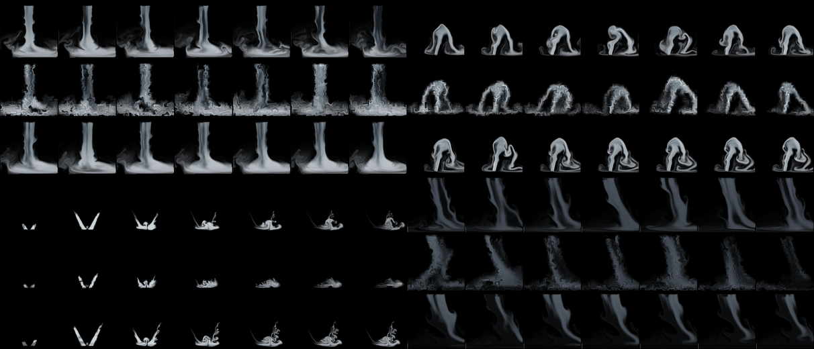
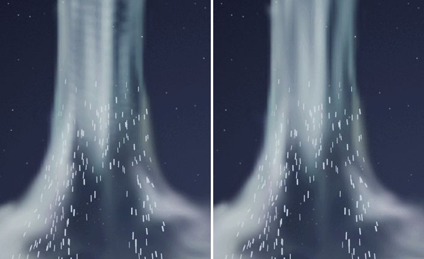
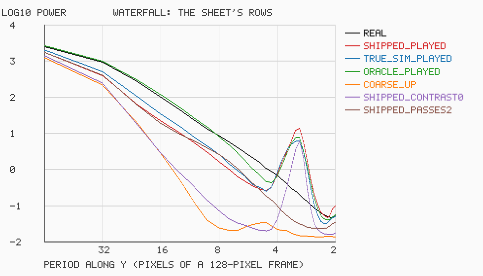

# Water: the ordered body learned, the random detail seeded

Status: **done** (15 October 2026). Audience: dev, artists, research. Waterfalls, fountains, splashes, drips, bubbles,
rain on puddles and rain shafts for scenes and the effect library, made as the game asked: *model what is ordered and
leave random to random*, every part deterministic for a seed, with a vast range of looks from the controls and seeds,
as fire is. Water has two layers:
- **the ordered body is learned**: four presets of the simulator (a waterfall, a fountain, a splash that plays once,
  a rain shaft), trained with study D's recipe into rollout effects that play as modules, like fire: start points and a
  learned stepper driven by the simulator's seeded forcing noise (§2 to §4);
- **the random detail is seeded**: a small simulation in the composer whose every random number is a hash (spray and
  drops, splash crowns, ripples and waves on pools, foam, bubbles, drips, rain streaks), drawn per pixel, with its mist
  fed into a learned module where it lands (§5, §6). It came first, as a deterministic water system of its own, and
  every part of it still plays alone where a learned body is weak or not wanted.

The two are tied through the field bus: spray is thrown off where the learned body's water is, with its velocity, and
a pool churns where that water lands (§7). A scene plays a waterfall under an incoming storm with rain on puddles
(§12); the library has 23 water entries (§11).

## 1. Bottom line

- **Two layers, as asked.** The ordered body of water is learned like fire: four new presets of the simulator
  (`waterfall`, `fountain`, `splash`, `rainshaft`), trained with study D's recipe into rollout effects (82 KB each, the
  splash 274 KB). The random detail is the composer's seeded water: spray, drops, crowns, ripples and waves, foam,
  bubbles, drips and streaks. Both are deterministic for a seed; the learned body has the range of its three controls
  and its seeds, the seeded detail the range of its keys.
- **The test, run once on seeds no study had used (7000000 and up).** All four models track their held-out runs better
  than the simulation on the same 32-cell grid with the same detail layer at 1 s: waterfall +1.8 dB [1.5, 2.1],
  fountain +2.4 [1.9, 2.9], splash +3.7 [3.4, 4.0], rain shaft +2.4 [1.6, 3.0]. Played endlessly at study B's held-out
  settings, the fountain's and the rain shaft's average pictures are closer to a real run than the nearest training
  flipbook's (+3.3 dB [1.6, 5.0], +4.6 [3.3, 5.9]), with motion tied with it: they **work as steam did**. The
  waterfall's and the splash's average pictures only tie the flipbook's (+0.9 [-0.8, 2.9], +0.1 [-1.0, 1.2]), so by
  the rule written before the test they are **weak**; their motion ties it too. All four have coarser detail than the
  flipbook (spectrum distance 0.14 to 0.29 against 0.07 to 0.14); the waterfall's is marbled by the sub-grid swirl its
  calibration chose.
- **Together.** Spray is thrown off where the learned body's water is, with its velocity, and a pool is churned where
  that water lands: both read the field bus, so the random detail follows the learned motion (§7). The library's
  `waterfall`, `fountain`, `splash` and `rain_shaft` play a learned body with seeded detail; for the weak two the drawn
  versions stay beside them (`waterfall_drawn`, and the drawn splashes), and so does `rain_shaft_drawn`. The scene
  (§12) is a learned waterfall and two learned rain shafts with seeded spray, pools, streaks and rain.
- **Deterministic to the bit, no allocation per frame.** The seeded layer gives the same frames on 1, 2 and 3
  threads, overlapped or not, with the engine layers or without (`Water.*`); the scene's frames, learned bodies
  included, are the same on 1, 2 and 3 threads; `nvfx_alloc_test` plays every kind, scripted and on a stage: 0
  allocations.
- **Cost.** A learned body costs what a module of its size costs (a 128-pixel tile's step about 0.4 ms a frame on one
  thread here; through `nvfx_render`, a whole 128 x 128 frame on a quiet machine takes 0.52 ms for the waterfall, 0.55
  for the fountain, 0.70 for the splash and 0.51 for the rain shaft at the default, int8 on AVX-512:
  [results/quiet](../results/quiet/README.md) round 6); the seeded layer's simulation next to nothing (0.003 to 0.06 ms an element), its drawing what it covers
  (1 to 8 ms an element at 1280 x 720, §9). A learned waterfall with its spray and pool drew in 3.1 ms a frame against
  5.8 for the drawn one, in a 640 x 480 scene.
- **How it looks.** The learned bodies are soft, broad and continuous, as gas models are: a sheet that falls whole and
  sways, a foot that churns and billows into mist, a fountain's bell, a rain curtain that thickens and leans; they carry
  no drops. The seeded layer gives what they lack: drops,
  spray, glints, rings and foam. Weak spots are named in §11: small things (drips, a trickle, a wake) read in motion
  rather than in a still, and nothing draws rock, so falls whose lip shows start in mid-air.
- **The splash replaced** (study O, [REPORT.md](REPORT.md) §16.3): the same model with a mean state (each of its 16
  stored first states moved to the requested controls). On 30 held-out settings its average picture is 0.40 dB [0.21,
  0.60] closer to a real run's, with closer motion and coverage and tracking from a true state the same, by a rule
  written before its validation (`o_fix/models/splash.nvfx` under the data root, SHA-256 `806a7a6c...`). It is still
  weak by this round's rule, which was not run again.
- **The horizontal bands are gone** (study O, [REPORT.md](REPORT.md) §16). The learned waterfall's sheet and the rain
  shaft's curtains carried bands across them, one frame's fall apart. The detail layer made them: once a frame it
  lays new material broken up by a noise pattern that stays put and scales the fine fields by a factor per coarse cell,
  and the fall carries each frame's stamp one frame's travel down, where the next one lands beside it (§7.1). The
  library and the scene now play both with `passes 2` on their `effect` line: the detail layer moves and locks the
  water twice a frame, and the bands are gone.

## 2. Ordered and random: what each layer models, and why

| part | ordered (learned body) | random (seeded detail) |
|---|---|---|
| a waterfall | the sheet's width, its sway and tearing, the plunge pool's churn, the mist's billowing (`waterfall` model) | drops and spray thrown off the sheet (`spray`), the pool's ripples, waves and foam (`pool`, `churn`) |
| a fountain | the jet's arc and the bell it falls in, with its aim (`fountain` model) | drops off the bell (`spray`), the basin's rings and foam |
| a splash | the crown's walls, the crater's jet, the water falling back into mist (`splash` model) | the crown's drops (`splash` action), the waves and rings it leaves |
| a rain shaft | the shaft's curtain thickening and thinning, leaning with the wind (`rainshaft` model, under the cloud model) | the streaks (`shaft`) and the rings of rain on puddles (`pool` with `rate`) |
| drips, bubbles, wakes, puddles | none: nothing ordered at this scale | all of it seeded |

**Why this split.** A learned rollout effect is good at what a coarse 32-cell state can carry over seconds: a body of
material that moves as a whole, with its detail grown from turbulence (fire, smoke, steam: [REPORT.md](REPORT.md)
§6). It is bad at what is small, sparse and many: a drop is a pixel or two, and the fine fields are grown from the
coarse state, not tracked (magic's fast thin arms were the lesson, [EFFECTS.md](EFFECTS.md)). Drops, flecks of foam,
ripples and glints are many small independent things whose statistics matter and whose individual paths do not:
exactly what a seeded simulation gives cheaply and exactly, with the right statistics by construction. Both layers are
deterministic for a seed: the learned body through its start point and the simulator's seeded forcing noise, the
seeded detail through hashes of seed, frame and index.

## 3. The learned layer: four presets of the simulator

**The presets** (`src/sim/sim.cpp`, a block of its own: `add_water_sources`, `add_water_forces`, `water_decay`,
`render_water`): `waterfall`, `fountain` (its second control is its aim), `splash` (plays once, 3 s, as dust) and
`rainshaft`. The solver has no liquid with a free surface, so water is made of the channels it has. Water is its soot,
heavy and without heat, so it falls (as dust does); spray and mist are its heat, light, so they rise and fade (as
steam's vapour does). Falling water falls at a terminal speed, a fountain's along its arc, a splash's crown is held up
for half a second and then the crater's jet rises; water turns into spray as it falls and into foam and mist over a
pool at the bottom of the frame (a closed bottom border, as fog's and dust's ground). Drawn as reflected light only:
translucent blue-white water, white where spray is in it, soft white mist (the rain grey-blue).

**What makes it learnable.** A first version of these presets, made before the seeded layer and then set aside, read
as smoke: dense material falling through still air rolled up in eddies as gas does. For the 32-cell coarse state (the
magic lesson: broad structures, moderate speeds) the presets now have little vorticity confinement and curl noise, and
still air keeps little momentum of its own (velocity damping), so sheets and arcs stay whole; the mist churns by a
force of its own. The earlier effects' clips are unchanged (`Sim.StudyEffectsAreUnchangedByTheNewOnes` holds the
hashes of all eleven, taken before the water work began); `Sim.Water*`, `Sim.Fountain*`, `Sim.Splash*` and `Sim.Rain*`
check what each preset is (its water falls or rises as it should, its controls act, the wind carries its mist).

**Predictability** (`d-chaos`, `results/experiments/fx_water/d_chaos.csv`): as for the other effects, the noise seed
decides: from the same start with another seed, a run is 24 dB (waterfall), 22 (fountain), 14 (splash) and 21
(rainshaft) from itself after half a second and 14 to 17 dB after 2 s; a perturbation of 1e-3 of the velocity stays
above 56 dB for 8 s. So tracking can only be judged over the first second or two, and endless play by its statistics.

**Training**: study D's recipe unchanged (`rollout::recipe_for`; the splash takes the one-shot branch, as dust: 240 runs
of 90 frames, 16 start points with 64-pixel fine fields), in its three saved steps (`d-train --stages12 1`, `d-tune`,
`d-finish`), one effect at a time, one thread, `nice 10`, each from a frozen copy of the binary, on the shared 4-core
machine (load 5 to 17):

| effect | runs x frames | simulation (recorded in) | stages 1-2 (loss, s) | stage 3 (loss, s) | renderer | contrast, swirl, grow | detail score | start points | stored |
|---|---|---|---|---|---:|---|---:|---:|---:|
| waterfall | 160 x 240 | 21.3 min (804 s) | 0.0333, 8241 | 0.0333, 1337 | 37.3 dB | 1, 3, 1 | 0.33 | 8 | 82 KB |
| fountain | 160 x 240 | 21.3 min (447 s) | 0.0685, 5337 | 0.0666, 1386 | 37.6 dB | 0.5, 3, 1 | 0.39 | 8 | 82 KB |
| splash | 240 x 90 | 12.0 min (163 s) | 0.0544, 4675 | 0.0572, 1165 | 40.7 dB | 1, 0, 1.5 | 0.42 | 16 (64 px fine) | 274 KB |
| rainshaft | 160 x 240 | 21.3 min (327 s) | 0.0325, 4662 | 0.0312, 1213 | 42.0 dB | 1, 3, 1 | 0.98 | 8 | 82 KB |

Wall time per effect 1 h 52 min to 3 h 20 min for the three steps (the waterfall's stages 1 and 2 took 2 h 31 min on
the busiest stretch), 10 hours in all with `d-chaos` and the four tests, from a resumable queue under the data root
(`fx_water/jobs/queue2.sh`). The loss columns are not comparable between effects (each is normalised by its own
state's scale). The detail calibration chose a strong sub-grid swirl (3) for the waterfall, the fountain and the rain
shaft and none for the splash; the library and the scene play the water models with `swirl 0` (§7), which the test
below did not see: it tested the models as frozen.

## 4. The test

**Design, written before the test** (and committed before the first model was trained). Each model was frozen by its
SHA-256 (`results/experiments/fx_water_frozen.csv`, recorded by the queue before each test) and tested once, right
after its training. Study D's protocol (`nvfx_experiment d-eval`, then `d-report`), as for the energy and atmosphere
effects ([EFFECTS_ENERGY.md](EFFECTS_ENERGY.md) §4), with **new seeds no study has used** (`--seed-base 7000000`):
- **Tracking from the true state:** 8 held-out runs per effect (salt 2's settings), seeds 7000000 to 7000007, each
  started at 100 frames from its true state (the splash: at its first frame), 240 frames (the splash: 89); the neural
  rollout through the runtime against the simulation on the same 32-cell grid with the same detail layer
  (`coarse_sim_detail`), the plain coarse simulation and holding the first frame. Active PSNR at 1 and 8 frames and at
  1, 2 and 8 s; the neural run minus `coarse_sim_detail`, paired over the 8 runs.
- **Endless runs at settings never seen:** study B's ten held-out settings (`b_test_settings`), 10 s each (the splash:
  its 3 s): the real runs with seeds 7100000 + k and 7110000 + k, the neural run 7120000 + k, the coarse simulation
  7130000 + k (training used 600000 to 600239, the held-out tracking runs above). Frame statistics against a real run
  (detail spectrum, motion ratio, coverage, mean-frame PSNR), compared with the second real run (the floor), the
  nearest of the 45 training flipbooks of study B's grid (made for these effects as for the others: 64 frames at
  128 px, seed 1; looped), and the coarse simulation with and without the detail layer.
- **One minute:** a 60 s neural run (seeds 7140000 + k) at the first two held-out settings, in 10 s windows against the
  real 10 s run (not the splash, which plays once).
- **Statistics:** every difference paired, with a 95% bootstrap interval of 10,000 resamples; an interval across zero
  is a tie; every number reported. What would count as working, decided then, as before: an effect **works as steam
  did** if it tracks its runs better than `coarse_sim_detail` at 1 s (interval above zero) and, endless, its average
  picture is closer than the nearest flipbook's and its motion error is no worse than the flipbook's. Otherwise it is
  reported as **weak**, and where a learned body is weak the library and the scene keep the seeded version for it.

**Tracking** (active PSNR, dB, mean over 8 held-out runs; the neural run minus `coarse_sim_detail` paired, with its
interval; `results/experiments/fx_water/D_SUMMARY.md` has every horizon and method):

| effect | neural 1 frame | 8 frames | 1 s | 2 s | 8 s | coarse_sim_detail 1 s | neural - coarse_sim_detail, 1 s |
|---|---:|---:|---:|---:|---:|---:|---|
| waterfall | 28.1 | 20.8 | 17.3 | 17.1 | 16.4 | 15.5 | **+1.82 [+1.52, +2.10]** |
| fountain | 29.8 | 20.2 | 16.8 | 14.9 | 13.1 | 14.4 | **+2.41 [+1.94, +2.94]** |
| splash | 20.4 | 14.7 | 13.5 | 13.8 | - | 9.8 | **+3.69 [+3.38, +3.95]** |
| rainshaft | 34.3 | 27.9 | 23.5 | 21.7 | 19.8 | 21.1 | **+2.41 [+1.62, +3.00]** |

All four lead from 8 frames on (+1.4 to +3.5 dB, intervals above zero) and stay ahead at 2 s; at 8 s the waterfall and
the fountain still lead (+3.1, +3.2), the rain shaft ties (+0.6 [-0.7, +1.9]). At the first frame the waterfall and the
fountain tie it (their learned renderer: drawn by the simulator's own renderer, the neural dynamics lead at once).

**Endless runs** (paired over the ten held-out settings; mean-frame PSNR in dB, higher is closer; motion error
|ln ratio| and spectrum distance, lower is better):

| effect | mean frame: neural - flipbook | motion error: neural - flipbook | spectrum: neural - flipbook | mean frame: neural - second real run | verdict |
|---|---|---|---|---|---|
| waterfall | +0.94 [-0.81, +2.91] (tie) | -0.053 [-0.135, +0.032] (tie) | +0.162 [+0.116, +0.203] | -5.54 [-8.20, -3.27] | **weak** (average picture ties) |
| fountain | **+3.25 [+1.57, +4.97]** | +0.093 [-0.070, +0.270] (tie) | +0.138 [+0.117, +0.158] | -4.44 [-6.49, -2.54] | **works** |
| splash | +0.09 [-0.96, +1.22] (tie) | +0.018 [-0.146, +0.183] (tie) | +0.054 [+0.014, +0.097] | -2.54 [-3.57, -1.62] | **weak** (average picture ties) |
| rainshaft | **+4.63 [+3.27, +5.94]** | -0.056 [-0.134, +0.032] (tie) | +0.152 [+0.083, +0.222] | -1.41 [-2.91, +0.09] (tie) | **works** |



*Per effect (waterfall, fountain; splash, rain shaft), rows: a real run at a held-out setting, the neural run with a
new seed, the nearest training flipbook; columns across the run.*

- **The fountain and the rain shaft work as steam did.** The rain shaft's average picture ties a second real run's;
  the fountain's is 3.3 dB closer than the flipbook's (the flipbook of a neighbouring setting draws a bell of the wrong
  size). Both move as fast as the real runs (motion tied with the flipbook and, for the rain shaft, 10% off a real run).
- **The waterfall and the splash are weak by the rule**, on its average-picture clause: they tie the nearest flipbook
  there and in motion, and lose to it in detail. For a waterfall a flipbook of a neighbouring setting is a strong
  baseline (the sheet stands where the setting puts it); for the splash, which plays once from 16 stored starts, so is
  a stored burst. They beat the coarse simulation with the detail layer in average picture (+3.4, +4.1 dB) and detail.
- **Detail is the weak part of all four**: spectrum distances 0.14 to 0.29 against a floor of 0.03 to 0.09; the
  waterfall's sheet is marbled by its strong sub-grid swirl (row 2 of the figure), which the library and the scene turn
  off (§7).
- **One minute:** none drifts. Over six 10 s windows the waterfall's, the fountain's and the rain shaft's statistics
  stay within the spread of their first windows (spectrum 0.11 to 0.30, mean frame 19 to 29 dB; `d_long.csv`).

## 5. The seeded layer: how each part is modelled

| part | modelled as | moved by | drawn as |
|---|---|---|---|
| a falling sheet (`sheet`) | strands across its lip, each a ring of nodes emitted one a frame | ballistic nodes; each breaks after a time of its own (smooth noise over strands and time: the sheet tears into tongues), into a drop, spray and mist | quads between neighbouring strands' nodes that left together (the sheet), streak capsules along each strand, whiter as it falls; broken water as streaks |
| a jet (`jet`) | the same strands from a nozzle, `jets` of them fanned | the throw wanders by smooth noise (`spread`) and swings (`pulse`); nodes break near their apex | capsules that thin as they speed up and swell as they slow (what flows through stays the same); a strand is not joined where faster water has overtaken slower |
| drops and spray | a pool of drops shared by the scene | ballistic, drawn towards the wind; small ones bounce once off the ground | short streaks along their motion |
| spray off a learned body (`spray`) | drops thrown where the field bus's soot (a learned water effect's water) is above a threshold | the bus's velocity there, plus a scatter of their own; then as every drop | as drops |
| a splash (`splash` action) | a crown: two wall strands (left and right of the crater), the crater's jet, a burst of drops | walls thrown out for 0.12 s, breaking from the rim down; the jet rises from the crater a fifth of a second later | the walls as strands, the crown's near face as faint quads between them, the jet as a strand |
| a pool (`pool`) | a 1D height field along a line (`cells`) | a damped wave equation, excited by what lands, by `wave`, by rain (`rate`), by a learned body's water falling onto it (`churn`); a steady `swell` on top | a surface band seen from above (`surface` tall: dark, mirroring the sky, with shimmering sheen and a bright edge), a body below it (`depth`) |
| foam | pieces on a pool's surface | carried by its current (`drift`), slowing, fading | flat patchy white ellipses on the surface |
| ripples | rings where things land on a surface seen from above | grow and fade | thin bright ellipses as flat as the surface is deep |
| drips (`drips`) | drops swelling at points along a line | swell, let go, fall as drops | a hanging drop growing |
| bubbles (`bubbles`) | rising, wobbling, growing | rise at `speed`, pop at the pool's surface (a kick, a ring, a fleck) | a rim and a glint |
| a rain shaft (`shaft`) | streaks in a region whose density profile across it swells and thins in gusts | fall at `speed`, slanted by a swaying wind | the streaks, and a soft veil as dense as the profile |
| mist and spray clouds | a module of a learned effect | the model, from what is deposited where water lands (per element, in 8 bins along x) | the module's look |

**The rules of the simulation.** Everything moves in the scene's thread (the frame's step 9, after the particles), in
script order, with a fixed step (the scene's frame time; a pool substeps for stability: `ceil(c dt / 0.45 dx)` steps,
at most 32). A random number is `hash(seed, frame, index, salt)`: a strand's, a drop's or a cell's index, never a shared
generator, so a frame's numbers do not depend on what came before or on threads. Every pool, strand ring, drop pool,
crown and ring list is sized when the scene is made; what is spawned beyond them takes the oldest's place (drops, rings,
foam, bubbles, drips, streaks, crowns) or is not emitted (a full strand). `spray` and `churn` read the bus as it was
published this frame (step 6), which is itself the same on any number of threads.

**The pool's surface.** Heights h (up positive) and their rates v per cell, `v += dt (c^2 h_xx - 2k v - w0^2 h)`, then
`h += dt v` (symplectic Euler), `c` = `speed` (140 px/s), `k` = `damping` (1.2/s), w0 = 2/s (it settles back to its
level, so long waves do not linger), heights clamped to 0.35 of its depth. What lands kicks the rates by a Mexican hat
(down where it lands, up to its sides, its sum nothing): water pushed aside, not lost, so a waterfall landing in one place
stirs the surface without digging a hole in it (`Water.WavesSpreadDieAndKeepThePoolsWater`).

**Landing.** A node or drop that reaches its pool's surface (or its `floor` off the pool) kicks the pool by its mass
times the square root of its speed, may leave a ring (on a surface seen from above) and foam (where a lot lands fast),
throws a little water back up, and adds its mass to its element's bins; after the step each bin's mass becomes a puff
of mist: `deposit(module, x, y, radius, heat = mist_heat * q, soot = q, 0, -0.8, 0.2)`, q = 0.02 x `mist_amount` x mass.
A splash deposits a small burst at once as well.

## 6. The seeded layer's look

Water is shaded like the field shader's gases, so it sits in the same night: the sky's light from above and to the
left (`0.35 + 0.9 lambert`, times `brightness`), the scene's light where it is (the light field, soft-limited, with the
flash), and a highlight along the half vector of the sky's direction and the viewer's (power 24, weighted by each part's
glint). Over the screen it is laid with its coverage (premultiplied, the screen's alpha kept).
- **Sheets** are a mesh: quads between neighbouring strands' nodes that left in the same frame (unless they have drifted
  apart: a tear), streak capsules along each strand, all of a sheet drawn as one piece (the most covering part at each
  pixel), so the sheet has no seams and its streaks show through it. It is glassy at the lip and whitens with age as air
  gets into it; a quad fades as its nodes near their break, so holes open softly and the sheet thins to its streaks.
  Broken water falls as faint streaks. A sheet's normal faces the viewer, tilted a little up.
- **Jets** are strands that thin as they speed up: radius x `sqrt(v0 / v)`, clamped to 0.4 to 1.3.
- **Pools**: a surface band `surface` pixels tall seen from above, dark (the colour times 0.07 near to 0.2 far, as it
  mirrors more sky far off), with a sheen of broken streaks of the sky's light (smooth noise stretched along the
  surface, drifting and shimmering, stronger on slopes), a bright line at its edge that catches more on crests facing the
  sky, rings and foam on it; below it, the body seen through its side (a tank), darker and denser with depth. The
  surface's normal faces up (`Water.ItsLayersAgreeWithEachOther` counts it), with the waves' slope in it.
- **Rain shafts**: grey streaks (the shaft's colour, a little whiter) and a veil `0.3 x (1 - clarity) x density / 30` as
  dense as the profile, soft at its sides and its top.
- **Colours**: water reflects `colour` (0.62, 0.8, 0.95: blue-white); foam, spray and broken water are whiter.

**Engine layers** ([ENGINES.md](ENGINES.md) §11). With the layers on, the seeded water is drawn into them as well:
colour (as on the screen), albedo (what it reflects, premultiplied, at most its alpha), emission nothing (water gives no
light), a normal (the coverage-weighted sum of unit normals: the pool's surface faces up, the sheets face the viewer,
drops and strands are shaded as cylinders and spheres) and thickness (`-log(1 - coverage)`, summed). The picture is the
same with the layers or without, the layers the same on any number of threads
(`Water.ThePictureIsTheSameWithLayersOrWithout`, `Water.TheSameLayersOnAnyNumberOfThreads`). The seeded water is drawn
over the background and under the modules, so a learned body and its mist cover what lies behind them; the learned
bodies go into the layers as every module does (their learned picture kept as baked light; water gives none).

## 7. Putting the layers together

The learned body is a module (a tile of its model, drawn by its learned renderer: no field-shader look, so its water is
blue-white and its mist white, as the simulator draws them); the seeded detail is placed in the world around it. Two
elements read the learned body through the field bus, where a module publishes its water as soot and its velocity:
- **`spray`** tries random points of a region each frame (`density` a second per 100 x 100 pixels); where the bus's
  soot is above `threshold` it throws a drop, more surely the more water there is, with the bus's velocity plus a
  scatter of its own (`speed`). The drops fall, drift, land on the pool or the ground and ring, foam and give mist as
  every other drop does; they follow the learned sheet because they leave it with its velocity
  (`Water.SprayIsThrownOffTheBusesWaterOnly`: none where the bus has no water).
- **A pool's `churn`** reads the bus just above each of its cells: where the body's water falls onto the surface, the
  surface is kicked (a random share each frame, so it churns rather than holds a dent), foam is left and rings spread.

Where they stand: the simulator's frame is the module's tile; its pool lies 7/128 of the tile's width above the tile's
bottom, so a module stood on the ground with `sink 0.055` has its pool at the ground, and the seeded pool is laid along
that line. A waterfall's lip is at 0.9 of the tile's height: a tile taller than the picture puts the lip above it (the
scene's waterfall), with a feather small enough not to fade the falling water where it shows. The learned bodies' strong
sub-grid swirl marbles the waterfall's sheet; the library and the scene play the water models with `swirl 0` (the
effect statement's detail setting), where its streaks fall straight, and the waterfall and the rain shaft with `passes 2`
(§7.1).

### 7.1 The bands across the falling water (study O)

With one detail pass a frame the learned waterfall's sheet and the rain shaft's curtains showed horizontal bands, a few
pixels apart, from the lip down (the left of the picture below; the scene at 3.5 s). Study O ([REPORT.md](REPORT.md)
§16) took the picture apart on 8 training runs (`nvfx_fix bands`): the power of the sheet's rows along y, against the
simulator's own frames, for the learned effect as played and with one part at a time swapped out.






- **The detail layer makes the bands; the learned body and the renderer do not.** The learned coarse state alone is
  smooth (no peak). The learned dynamics drawn by the simulator's renderer have the bands, and so does the detail layer
  driven by the simulator's own coarse states (an oracle stepper): the spectrum of every one of them has the same narrow
  peak, up to 3.5 decades above the simulator's at that period.
- **The peak sits at one frame's fall.** At intensities 0.03 to 0.13 the bands are 2.9 pixels apart (of a 128-pixel
  frame), at 0.54 to 0.59 3.05 to 3.2, at 0.78 to 0.81 3.2 to 3.4: the water's speed (85 + 30 intensity cells a
  second, 2.9 to 3.6 pixels a frame) less a little near the lip. It is not the coarse grid's 4 pixels.
- **Why.** Once a frame the detail layer locks the fine fields to the coarse state: it scales them by a factor per
  coarse cell and adds what is missing as new material broken up by the flicker noise. Neither pattern moves with the
  water. The fall carries each frame's stamp down by one frame's travel, the next stamp lands beside it, and the sum of
  stamps one travel apart repeats with that period: bands, as study L found for magic's saw-teeth around a ring
  ([REPORT.md](REPORT.md) §12.1). Without the breakup noise (`contrast 0`) the peak is lower but stays (the factors
  stamp too).
- **The fix: lock twice a frame.** With `passes 2` each pass moves the water half a frame's travel (1.5 to 1.8 pixels)
  and the stamps blend; the peak is gone at every intensity (`nvfx_fix peaks`: the largest narrow peak of the rows'
  spectrum 0.73 decades above its neighbours on average with one pass, 0.07 with two). It is a setting of the effect
  line, judged by eye, like `swirl 0`; the model file is unchanged. **At 256 pixels the travel doubles**: two passes
  leave half-travel bands (0.48), three take them off (0.20), so a 256-pixel tile wants `passes 3` (the demo videos'
  reels are 256 pixels and use 3; the library and the scene play 128-pixel tiles with 2). The rain shaft is the same
  (0.40 with one pass, 0.04 with two); the fountain has no bands (0.04 with one), and the splash's water is thrown, so
  both keep one pass.
- **Cost:** a second pass of the detail layer, which skips empty spans, so it costs what the water covers: measured
  beside one pass (`nvfx_ordered cost`, 9 interleaved repetitions on the shared machine at a load of 13, so
  provisional; [o_cost_passes.csv](../results/experiments/fix/o_cost_passes.csv)), the waterfall +0.00 ms a frame at
  128 px and +0.04 to +0.06 ms at 256 px, int8 or float.

**By eye.** The learned waterfall falls whole, sways, and churns and billows into a broad mist at its foot, which the
drawn one cannot (its mist is the fog model fed from outside, a slow low bank); the drawn one has crisper water: a glassy
lip, tongues tearing into streaks, white water. With seeded spray falling through it and a churned pool under it, the
learned one reads as a large, misty fall and the drawn one as a near, clear one. The learned rain shaft is better than
the drawn veil: curtains that thicken, thin and spread at their foot, under the seeded streaks. The learned fountain is
a bell of falling water, which the drawn jets do not make; the drawn garden fountain's thin arcs are what the learned
one cannot make. The learned splash's crown reads as two horns, the drawn crown as a cup of drops; both are kept.

**By cost** (a 640 x 480 scene, one thread, medians of 180 frames, three runs interleaved): the learned waterfall with
its spray and pool stepped its module in 0.38 ms a frame, moved its seeded water in 0.02 ms and drew everything in
3.1 ms; the drawn waterfall (a fog module for its mist, a 28-strand sheet, a pool) 0.32, 0.07 and 5.8 ms. Memory: a
learned water model is 82 KB stored (the splash 274 KB) and its module takes the working memory of any 128-pixel
module; the seeded layer's arrays are a few hundred KB (§9).

## 8. In scripts

A learned body is a module: `effect waterfall_fx = "waterfall.nvfx", swirl 0, passes 2`, then `module NAME = waterfall_fx, ...`
with its controls (intensity, wind or aim, turbulence) as for any effect. The seeded layer: `water NAME = KIND` declares
an element (`pool`, `sheet`, `jet`, `drips`, `bubbles`, `shaft`, `spray`); `splash` and `wave` are actions (in rules;
`wave` also in `every frame`). [COMPOSE.md](COMPOSE.md) §5.5 has the keys of each; the checker rejects a key a kind
does not take, a missing required key, `onto` naming anything but a pool, `mist` naming anything but a module (or
naming a trail), a capacity out of its range, and `splash` under `every frame`, with the line and column
(`Water.ScriptsAreCheckedWithLineAndColumn`). Library entries take water as they take modules: the instance's prefix,
its seed offset, emitting only while it is alive.

```text
effect waterfall_fx = "waterfall.nvfx", swirl 0, passes 2
module falls  = waterfall_fx, size 128, width 900, at (300, 616), sink 0.055, feather 0.15, start 0, seed 93,
                controls (0.65, 0.45, 0.5)
water pool    = pool, along (20, 614) to (640, 614), depth 26, surface 26, cells 192, drift 20, churn 1
water flecks  = spray, in (160, 150), size 280 x 460, threshold 0.3, speed 140, radius 1.6, onto pool
at 2: splash at (200, 614), power 1.2, onto pool
every frame: wave pool at (100 + 60 * t, 614), amount 30, width 8     # a wake
```

## 9. Cost

The learned bodies cost what modules cost (study D's runtime, [REPORT.md](REPORT.md) §7): in the scene of §12 on one
thread its six modules (a 128-pixel waterfall tile 900 pixels wide, two rain shafts and three clouds) stepped in
3.2 ms a frame (median, load about 5). The seeded layer, per element and frame: the median over 180 frames of each
element alone, interleaved in rounds of 30 frames, after a round that puts everything in flight; thread CPU time, one
thread, on the shared machine with other agents' jobs running (load 9 to 14: provisional; wall-clock times were two to
three times these and noisy). Drawing is every row of a 1280 x 720 frame without layers; the elements are the scene's
or the library's sizes (`fx_water/cost.csv` in the data root):

| element | step (ms) | capture (ms) | draw (ms) | total (ms) |
|---|---|---|---|---|
| a pool, 1200 px, 192 cells, rain 3 (surface 28 px) | 0.005 | 0.026 | 1.96 | 2.0 |
| a sheet, 30 strands falling 630 px, with its pool | 0.055 | 0.136 | 7.88 | 8.1 |
| 7 jets (330 to 560 px/s), with their basin | 0.012 | 0.041 | 2.38 | 2.4 |
| drips, 3 a second, with their pool | 0.004 | 0.026 | 1.20 | 1.2 |
| bubbles, 12 a second, in a pool's body 1200 x 400 px seen through its side | 0.013 | 0.032 | 13.69 | 13.7 |
| a rain shaft, 260 x 450 px, density 30 | 0.011 | 0.018 | 5.27 | 5.3 |
| a splash of power 1 every second, with its pool | 0.010 | 0.032 | 2.63 | 2.7 |

What costs is the pixels water covers: a pool's surface and body are shaded per pixel (its surface's height, slope and
normals are found once per column per picture, its sheen's noise once every four pixels), and a sheet is a mesh of
quads and capsules drawn as one piece. `spray` costs a bus lookup per try (`density` x area x frame time; about 90 a
frame in the scene) and its drops; `churn` one per pool cell a frame. In the scene of §12 on one thread the draw stage
(background, water and modules) took 18 ms of 43 in all, the particles stage, which holds the water's step, 0.11 ms.
Memory: a node is 40 bytes, a drop 52, a primitive of the picture 112; the picture's room for every primitive the water
may draw is most of it (about 1.5 MB for the drawn scene's 13,000).

## 10. Determinism

`Water.TheSameFramesOnAnyNumberOfThreads` plays a scene with every kind (pool with rain, swell, a current and churn, a
sheet, jets, drips, bubbles, a shaft, spray off the bus, two splashes, a wake, mist into a module) on 1, 2 and 3
threads (overlapped): its 60 frames are the same to the byte; `Water.TheSameLayersOnAnyNumberOfThreads` does the same
for the four layers; `Water.AnotherSeedOtherFrames` checks that a seed changes them. The learned bodies are
deterministic for their seed as every rollout effect is (study D). The scene of §12: its six keyframes have the same
SHA-256 on 1, 2 and 3 threads (overlapped, float precision, the library's models and the water models). They are frozen
(`results/experiments/fx_water_frozen.csv`, `neuralfx.ScriptedFallsFrozen`), as are the gallery keyframes of six water
entries (`results/library/frozen.csv`: `waterfall_drawn`, `garden_fountain`, `boulder_splash`, `rain_shaft_drawn`,
`fountain`, `rain_shaft`), which are the same on 2 and 3 threads.

## 11. The library

Twenty-three entries in `library/water.nvfxl` (category `water`), each judged by eye from contact sheets and keyframes
at full size; [LIBRARY.md](LIBRARY.md) §1 (Water) has the table, the notes and the sheet:
- **A learned body with seeded detail**: `waterfall` (fair to good: the sheet falls whole and sways into a churning,
  misty foot; weak by the test; its bands are gone since study O), `fountain` (fair: a bell of falling water, soft, with drops falling from
  it into a rippling basin), `splash` (fair: two horns of water and the crater's column, seeded drops and rings; weak by
  the test) and `rain_shaft` (good: learned curtains under the cloud model, seeded streaks; a faint green tinge at the
  foot from the learned renderer).
- **Drawn, good**: `waterfall_drawn`, `pipe_outflow`, `garden_fountain`, `boulder_splash`, `rain_shaft_drawn`.
- **Drawn, fair**: `tall_waterfall`, `wide_falls`, `cascade`, `water_geyser`, `broken_hydrant`, `cannonball_splash`,
  `dive_splash`, `rain_on_puddles`, `underwater_bubbles`, `fish_tank`, `shore_waves`: broken water below a sheet's
  tongues reads as a rain of streaks; the cascade's ledges hang in mid-air; the geyser's and hydrant's columns are
  bundles of strands rather than solid water (the learned fountain made a bell, not a column, when tried as a geyser);
  the splashes are small at gallery size; puddles are thin strips; a body of water seen through its side reads as a
  pane at night.
- **Drawn, weak in a still**: `leaking_pipe`, `cave_drips`, `boat_wake`: small things (a trickle, a few drops, a bump
  and a trail of foam) that read in motion and close up but hardly in a gallery cell.

How the drawn look got there (each change judged on the sheet and a test scene before the next): strands first
jittered node by node (zigzags; now smooth noise over strands and time), a sheet of separate strands looked like a comb
(now quads between them, drawn with the strands as one piece, half a pixel fuller so they meet without seams), it broke
into a regular grid of dashes (now tongues from smooth noise, broken nodes moved off their lattice, longer faint
streaks), a splash's crown was first a fan of separate fingers, then a box (now two walls and a faint near face that
fades to the rim, from wall angles and throws fixed per splash), a pool landed on in one place dug a permanent trough
(now zero-sum kicks and a pull back to level), its surface was a pale slab (now dark, mirroring, with sheen), a pulsing
jet folded back on itself into zigzags (strands are not joined where faster water has overtaken slower), and fog fed at
the foot of a wide fall or by a splash grew into a bank too big for spray (less mist: `mist_amount` 0.12 and 0.6).

## 12. The scene

`examples/scenes/falls.nvfxs`: 12 s at 1280 x 720. A waterfall pours from the cliff above the picture into a pool on
the left: the learned waterfall's sheet sways and its foot churns and billows into mist; seeded spray is thrown off its
water and the pool is churned where it lands. A bank of storm cloud (the cloud model) drifts in from the right trailing
two rain shafts, whose curtains (the learned rainshaft) fill in and lean with the wind under seeded streaks; lightning
flashes in it and strikes twice; then the rain arrives over the right of the picture and rings the puddles there and
the pool. Keyframes at 2, 3.5, 5.62, 7, 9.03 and 11.5 s:


By eye, in its video (`fx_water/scene/falls.mp4` in the data root): the waterfall reads as a large, misty fall, its
sheet whole and swaying with spray falling through it, its foot a broad churning mist over a foaming, rippling pool;
the rain shafts fill in under the clouds, thicken and thin and lean, the flashes light the whole scene and the bolts
fork; the rain arrives and the puddles ring. Weak points: no cliff or rock is drawn (the falls come out of the night
sky); the mist hides most of the seeded pool's rings
under the falls; the puddles' rings come from their own drops, not from the rain streaks that reach them.

## 13. What it is not

- **Side view only, no terrain.** Water lands on its pool or on a `floor` line; there are no rocks, ledges or banks
  to fall over or around, so a cascade's ledges are pools in mid-air, and falls whose lip is in the picture start in
  mid-air.
- **The learned bodies are gas models of water.** The simulator has no free surface: its water is heavy soot. A learned
  body is a soft, continuous mass, never drops; that is why the seeded layer draws the drops. Two of the four only tie a
  flipbook's average picture, and all four have coarser detail than the flipbook.
- **Mostly one way.** The learned bodies drive the seeded spray and churn through the bus; the seeded water feeds mist
  into modules; but the bus's flow and the force fields do not move the seeded water (only its own `wind`), and the
  water does not wash or cool the modules (rain's `wash` does, [COMPOSE.md](COMPOSE.md) §5.4).
- **The drawn layer's mist is a fog model fed from outside.** The fog model was trained on releases at the bottom of
  its tile, not on spray; fed puffs, it makes a soft white bank that spreads low and slowly, and lingers. A learned body
  has its own mist, which billows as it should.
- **Drawn, not rendered.** No refraction or reflection of the scene (a pool mirrors the sky's colour, not the
  picture), no caustics; the look is a stylised one, tuned by eye against the night of the other effects.

## 14. Reproduce

```bash
# the tests (no data)
build/neuralfx_water_tests && build/nvfx_alloc_test && build/neuralfx_tests --gtest_filter='Sim.*'
# the presets alone
build/nvfx_sim --effect waterfall --intensity 0.6 --sheet waterfall.png     # fountain, splash, rainshaft likewise
# the learned layer: train, freeze, test (data under $NEURALVFX_DATA/fx_water; one job at a time)
R="--root $NEURALVFX_DATA/fx_water --results results/experiments/fx_water --threads 1"
build/nvfx_experiment d-chaos --effects waterfall,fountain,splash,rainshaft $R
build/nvfx_experiment d-train --effects waterfall --stages12 1 $R      # then d-tune, d-finish; each effect in turn
build/nvfx_experiment d-eval --effects waterfall --root $NEURALVFX_DATA/fx_water --results DIR --threads 1 \
    --seed-base 7000000 --figures DIR2                                 # each effect once; rows merged, then d-report
build/nvfx_experiment d-report $R
# the models joined to the library's folder
cd $NEURALVFX_DATA/library/models && ln -s ../../fx_water/models/d/{waterfall,fountain,rainshaft}.nvfx .
ln -s ../../o_fix/models/splash.nvfx .                                # the splash since study O (REPORT §16.3)
# the library's water entries: sheet and keyframes
build/nvfx_gallery --library library --models $NEURALVFX_DATA/library/models --only waterfall,fountain,splash,... \
    --sheet water_sheet.png --keyframes water_kf --threads 2 --cell 256x192 --columns 6
# the scene, its keyframes against the frozen ones, and its video
build/nvfx_scene_script --script examples/scenes/falls.nvfxs --models $NEURALVFX_DATA/library/models \
    --keyframes falls_kf --no-video --threads 2 --precision float --verify results/experiments/fx_water_frozen.csv
build/nvfx_scene_script --script examples/scenes/falls.nvfxs --models $NEURALVFX_DATA/library/models --out falls.mp4
# (the seeded layer's cost table came from a scratch program outside the repository: each element alone in a Water,
#  stepped, captured and drawn row by row, timed by thread CPU time)
```
