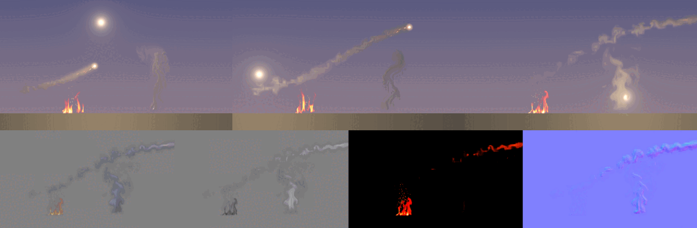

# Using NeuralVFX effects in a game engine

Status: **current**. Audience: dev. The API is `include/neuralfx/nvfx.h` (C, no dependencies) for single effects and
`include/neuralfx/nvfx_scene.h` for composed scenes played from scripts (§7), which can also give their effects alone
as lit sprites for the engine to light (§11); the reference host is `examples/c_host.c`, a Godot 4 plugin is in
`engines/godot` (§8), and a sample integration for FUSE, the owner's engine, is in `engines/fuse` ([FUSE.md](FUSE.md)). **To put it in your own engine**, start with [INTEGRATION.md](INTEGRATION.md): which API when,
the frame loop, textures, effect packs (`nvfx_pack.h`: one checked file with the models and the catalogue),
calibration, and the C++ wrapper `include/neuralfx/nvfx.hpp`.

## 1. What the runtime does

An effect is a `.nvfx` file: a small network trained for one effect. The runtime evaluates it on the CPU and writes
a premultiplied RGBA8 sprite, which the engine uploads to a texture and draws on a particle or billboard.

```c
nvfx_effect* fire;
nvfx_effect_load("fire.nvfx", &fire);           /* once, at level load; shareable between threads */

nvfx_instance* inst;
nvfx_instance_create(fire, 128, &inst);         /* per playing copy; all memory allocated here */
float controls[3] = {0.8f, 0.3f, 0.6f};          /* intensity, wind, turbulence (see nvfx_effect_control_name) */
nvfx_instance_set_controls(inst, controls, 3);
nvfx_instance_set_seed(inst, 1234);             /* which variation; looping effects drift between variations */

/* every effect update (for example at 30 Hz): */
nvfx_render(inst, time_seconds, pixels, 128 * 4);  /* no allocation, no locks */
upload_to_texture(pixels);
```

Blend the sprite with **premultiplied alpha**: `dst = src.rgb + dst * (1 - src.a)` (in most engines: source factor
ONE, destination factor ONE_MINUS_SRC_ALPHA). The same blend covers additive light (fire: colour above alpha) and
smoke (colour at most alpha).

## 2. Budget and threading

- `nvfx_render` is single-threaded and touches only the instance's own scratch memory; run different instances on
  different worker threads freely. One instance must not be rendered from two threads at once.
- Cost scales with pixels: measured costs per configuration are in [REPORT.md](REPORT.md) §7 (about 1 ms per
  128 x 128 frame for the default grid model on one AVX2 core, a quarter of that at 64 x 64).
- Evaluate effects at their own rate (20-30 Hz is plenty for fire and smoke) and blend the last two results in the
  shader if needed; share one instance between all copies of an effect that use the same controls and seed; use
  64 x 64 for distant effects (`nvfx_instance_create(effect, 64, ...)`; a grid effect renders at any multiple of 16,
  a conv effect at its native size or a half or quarter of it).
- `nvfx_bake(inst, frames, buffer)` expands an effect into an ordinary flipbook (for example at load time, or on a
  platform without the CPU budget). This saves download size, not run-time memory.

## 3. Controls

| control | how | exact? |
|---|---|---|
| learned controls (intensity, wind, turbulence for simulated effects) | `nvfx_instance_set_controls` | learned: interpolates between training settings |
| variation | `nvfx_instance_set_seed`, `nvfx_instance_set_variation` (replay a training clip), `nvfx_instance_set_drift` | learned |
| playback speed | scale the time you pass to `nvfx_render` | exact |
| hue and brightness | `nvfx_instance_set_colour` | exact (applied to the output colour) |
| precision | `nvfx_instance_set_precision`: `NVFX_PRECISION_INT8` (the default for grid frame models, and for rollout effects where the CPU has AVX-512 VNNI) or `NVFX_PRECISION_FLOAT` (rollout effects: the default elsewhere; on the AVX-512 build where the CPU has AVX-512, else AVX2, §4 and §5) | frame models: int8 changes a few pixels by a few levels (REPORT.md §7); rollout effects: an int8 run is another run of the same effect, which tracked and played as float does on held-out data (REPORT.md §13, §5 below); float is the reference network (the AVX-512 and AVX2 builds may differ in the last bits; `nvfx_set_isa` forces one) |

Looping effects wrap time; one-shot effects (explosions) hold their last frame after their duration
(`info.frames / info.fps` seconds).

## 4. Engines

Nothing here is engine-specific; these notes say where the calls go. The Godot plugin is in this repository and
tested headless (§8), as is the FUSE sample integration on a stand-in FUSE ([FUSE.md](FUSE.md)); the Unreal and Unity notes
are not built or tested.

### Unreal Engine

- Build `nvfx_shared` (`libnvfx.so` / `nvfx.dll`) or link the static `nvfx` into a runtime module; add
  `include/` to `PublicIncludePaths`.
- Own effects in a `UObject` (or an asset type that wraps the `.nvfx` bytes and calls `nvfx_effect_load_memory`).
- Render into a `UTexture2D` created with `PF_R8G8B8A8` and updated with `UpdateTextureRegions`, or into a
  `FRHITexture` from a render-thread task. Call `nvfx_render` on a worker (`UE::Tasks`) and upload on the render thread.
- Use the texture as a Niagara sprite's material texture with a premultiplied blend (Translucent, with the material
  outputting premultiplied colour, or Additive for pure emission).

### Unity

- Build `nvfx_shared` and place the library in `Assets/Plugins` (per platform). Declare the functions with
  `[DllImport("nvfx")]`; the API uses only C types and opaque pointers (`IntPtr`).
- Render into a `NativeArray<byte>` from a Burst-free `IJob` (the call is native), then `Texture2D.LoadRawTextureData`
  + `Apply(false)`; or update a texture from a native render plugin.
- Use a particle material with `Blend One OneMinusSrcAlpha`.

### Godot 4

- The GDExtension in `engines/godot` (§8): `NeuralVFXScene` plays a scene script and `NeuralVFXEffect` one effect,
  each into an `ImageTexture`.
- Draw an effect's texture with premultiplied-alpha blending (`CanvasItemMaterial.blend_mode = BLEND_MODE_PREMULT_ALPHA`,
  or a spatial material's `blend_mode = premul_alpha`). A scene's picture is opaque.

### FUSE

- The sample integration in `engines/fuse` ([FUSE.md](FUSE.md)): a small interface FUSE implements (frame clock, job
  system, view, texture uploads, render hooks) and a C++23 adapter that plays one pack's models as sprites through the
  effect manager on FUSE's jobs, a scene script and a library stage on cards in the world, and the 3D fire volume, with
  a headless demo on a stand-in FUSE whose test checks no allocation per frame and the same frames on any number of
  workers.

### Custom engines

`examples/c_host.c` is the whole integration: load, create, set controls, render in the update loop, upload. Build
the static library with your engine's compiler flags, or link the shared one. The library needs x86-64 and picks its
code at run time. Frame models run the AVX2 code when the CPU has AVX2 and SSE2 code otherwise (int8 models with a
hidden layer take the AVX-512 code where the CPU has VNNI, REPORT.md §7). Rollout effects (§5) take the AVX-512 code
where the CPU has AVX-512 (at int8 only with VNNI; at float since 15 October 2026, 0.80 of the AVX2 code's time on a
quiet machine, REPORT.md §13.10), else AVX2, else SSE2. `nvfx_set_isa` forces one ISA for every instance, scene, stage
and manager created afterwards. The ISAs' floats may differ in the last bits (SSE2's do; AVX2's and AVX-512's measured
the same to the bit on every shipped rollout model, REPORT.md §13.10, but the code does not promise it), so forcing one
gives the same frames on every CPU that has it (lockstep, tests).

## 5. Rollout effects

A `.nvfx` file can also hold a **rollout effect** (`nvfx_effect_info.arch == 3`; [REPORT.md](REPORT.md) §6): a few
stored simulation states (start points) and a small network that moves the effect forward one frame at a time. The API
is the same; what differs:

- **Shards.** A looping effect plays as a chain of shards (6 s by default, `nvfx_instance_set_drift` sets the length),
  each a fresh rollout from a start point chosen by the seed, the shard and the nearest controls, with a seed of its
  own; the next shard is rolled ahead of its turn and crossfades in over half a second. Drift never builds up beyond a
  shard (one continuous rollout, `set_drift(0)`, wanders off after 20 s or so, unless a prior is attached: below), and the frame shown depends only on the
  time and the controls.
- **One continuous run: the prior against drift (optional, fire only).** A second file, a small denoiser trained for
  the effect (`fire.ddpm`: 1.57 MB, about 19 times the 82 KB fire effect, whose own file is unchanged), keeps one
  continuous rollout alive for a minute or more without shards. Attach it once, before sharing the effect between
  threads and creating instances: `nvfx_effect_attach_prior(fire, "fire.ddpm")` (or `_memory`); then
  `nvfx_instance_set_drift(inst, 0)`. Every 16th frame one pass of the denoiser (89.5 million multiply-adds) moves the
  coarse state towards its estimate of a clean state ([DCM.md](DCM.md) G2.6, G2.13). Study G found it **ties** the 6 s
  shards on every statistic: it buys continuity (no restarts, no crossfades), not better pictures, and it was
  validated on fire only (smoke tied without it; explosions do not run long enough to drift).
  `nvfx_instance_set_prior(inst, every_frames, t, beta)` changes it (default 16, 100, 1; 0 frames turns it off); with
  shards it does nothing. **Cost** (one AVX2 core, 128 x 128, confirmed on a quiet machine): on average what shards cost (0.91 against
  0.93 ms per frame), but not evenly: the frame where the pass runs costs about 3.9 ms instead of 0.7 ms, once every
  16 frames (worst frame 4.1 ms, against 1.85 ms with shards). Running `nvfx_render` on a worker hides it from the game thread; with many such instances, start them on
  different frames so their passes fall on different frames (the pass runs on frames 16, 32, ... of each instance's
  own timeline). Memory: 1.57 MB per effect, 1.1 MB more per instance (in `nvfx_instance_scratch_bytes`).
- **Time moves forward.** `nvfx_render(inst, t, ...)` steps the shards to frame `floor(t * fps)`: normal playback
  costs one step per new frame, two during the half second before each shard change (the next shard rolling ahead) and
  two renders during the crossfade. Going backwards, or more than 2 s forwards, restarts the shard that contains `t`
  (a one-off cost of up to one shard of steps). Playback speed is exact as before: scale the time you pass.
- **It never repeats.** Every shard starts afresh, and a new seed (`nvfx_instance_set_seed`) gives new runs; changing
  it mid-play takes effect from the next shard, without a jump.
- **Variations are start points.** `nvfx_instance_set_variation(i)` restarts from start point `i` with the seed of the
  run it came from (`info.n_variations` start points).
- **Controls change the dynamics**, so a change shows within a few frames rather than at once.
- **Sizes**: any multiple of 32 from 32 to 1024. The coarse step costs the same at every size; the detail layer and the
  renderer scale with pixels.
- **One instance per playing copy.** The state belongs to the instance; two copies that should look different need two
  instances (sharing one instance shares the look, as before).
- **Memory**: the effect holds the weights and the start points (stored and resident sizes in `nvfx_effect_info`);
  each instance holds two shards' states and one set of work buffers that both shards' steps share
  (`nvfx_instance_scratch_bytes`: about 2.4 MB at 128 x 128, 1.5 MB at 64 x 64; 4.0 and 2.3 MB before they shared it).
- **Precision** (study K, [REPORT.md](REPORT.md) §13). By default (`NVFX_PRECISION_DEFAULT`, which is
  `NVFX_PRECISION_INT8` for rollout effects where the CPU has AVX-512 VNNI) the stepper's second convolution, two
  thirds of its multiply-adds, runs in
  8-bit integers: 7-bit activations with one scale per channel, 8-bit weights with one per output channel, requantised
  every step; with no ISA forced the instance then takes the AVX-512 build where the CPU has VNNI. The renderer and the
  detail layer stay float. Its frames are not float's: the effect is chaotic, so an int8 run and a float run of the
  same seed drift apart after a few seconds, as two runs do. On held-out settings and seeds it followed real runs as
  float does (within 0.03 dB at 8 frames, 1 s and 2 s; no interval's lower end below -0.07 dB) and played as
  realistically (the detail spectrum within 0.001, motion within about 1%, the average picture within 0.03 dB) on all
  eleven trained effects. It pays with VNNI: a 128 x 128 frame costs about a tenth less than float on the same build
  (18% less at 64 px, 4% at 256 px), and the AVX-512 build itself is a fifth faster than the AVX2 build; without VNNI
  (AVX2 alone) int8 saves 1 to 5%, so there the default is FLOAT (the default is resolved per CPU: int8 where the CPU
  has AVX-512 VNNI and no other ISA is forced, float elsewhere).
  `nvfx_instance_set_precision(inst, NVFX_PRECISION_FLOAT)` plays the float network (the reference). With no ISA forced
  float takes the AVX-512 build where the CPU has AVX-512 (VNNI is not needed), else AVX2 (since 15 October 2026; AVX2
  before): on a quiet machine a float frame there takes 0.80 of its time on AVX2 at 64, 128 and 256 px (REPORT.md
  §13.10). Its frames were the AVX2 build's to the bit on every shipped model measured, but the builds may round
  differently (another compiler may contract the multiply-adds differently); `nvfx_set_isa(NVFX_ISA_AVX2)` gives the
  AVX2 frames on any CPU. A change of precision starts the instance's timeline again. Scenes
  (`nvfx_scene_desc.precision`), the library's stages
  (`nvfx_stage_desc.precision`) and the effect manager (`nvfx_manager_model_desc.precision`) choose it the same way.
  The orb is the exception: study L's orb failed study K's rule at int8 (REPORT.md §13.9), so the library and the
  scenes play it at float (`precision float` on its `effect` statement); set `NVFX_PRECISION_FLOAT` for orb instances
  and for the orb's `nvfx_manager_model_desc`.
- **Drawn at half size and upscaled (study P, [STUDY_P.md](STUDY_P.md); experimental, did not pass its rule).** For an
  effect drawn large: `nvfx_instance_set_upscale(inst, NVFX_UPSCALE_BILINEAR)` plays the instance at half its size (any
  size that is a multiple of 64) and brings each frame back with the bilinear 2x; `NVFX_UPSCALE_LEARNED`, after
  `nvfx_effect_attach_upscaler(effect, "file.nvfxup")`, uses a small learned 2x with seeded micro-detail instead
  (deterministic from the instance's seed and the time). Either is a set-up call (new buffers, a new timeline); frames
  allocate nothing; the colour is applied after the upscale; empty pixels stay exactly transparent. NVFX_VERSION 7.
  **What pays is drawing at half size**: the half-size instance costs 0.29 to 0.34 of a native one at 512 px (0.34 to
  0.43 at 256 px), and against the simulator's frames it is within the null's margins of native or closer (it loses the
  native's finest filaments, which the detail layer draws at 512 px and the simulator does not have). So the cheap way
  is the engine's own: create the instance at half size and let the GPU's bilinear sampler draw it large. The learned 2x
  did not pass its rule: it costs 0.45 to 0.59 of native at 512 px (more than 0.55 for two of six effects; busy machine,
  provisional), and against native on the same seed it was not better than the bilinear 2x on PSNR, SSIM and the high
  band together for any of the six effects at 512 px on the held-out test (STUDY_P.md §6); its micro-detail, isotropic
  noise, does not draw the native's filaments.
- `nvfx_bake` renders consecutive frames from a fresh start and crossfades a few extra frames into the first ones, so
  the flipbook loops.

## 6. Memory

| what | where | size |
|---|---|---|
| effect weights | `nvfx_effect` | `info.resident_bytes`: features stay at their stored precision (8 or 16 bits); the small MLP is widened to floats |
| per instance | `nvfx_instance` | `nvfx_instance_scratch_bytes`: a few tens of KB at float precision; at int8 (the grid family's default) 60 to 400 KB, most of it the first layer evaluated at every grid point (grid_m 0.18 MB, grid_l 0.38 MB); rollout effects about 2.4 MB at 128 x 128 (85 KB more at int8), 1.1 MB more with a prior |
| prior against drift (optional, rollout effects) | `nvfx_effect`, after `nvfx_effect_attach_prior` | the denoiser's weights as floats: 1.57 MB for fire; counted in `info.resident_bytes` |
| output | the engine's buffer | size x size x 4 bytes |

## 7. Scenes: composed effects from a script

A scene ([COMPOSE.md](COMPOSE.md)) is a script (`.nvfxs`) and the rollout effects it names: modules that run on one
another through their fields (velocity, heat, soot), force fields, particles, light and rules that change the scene
over time. `include/neuralfx/nvfx_scene.h` plays one for an engine: a finished picture per frame (opaque: the scene's
own sky and ground), the field bus for gameplay, and calls with which the game drives the scene while it plays.

```c
nvfx_scene_desc d;
nvfx_scene_desc_init(&d);                  /* threads 2, overlap on, the script's size */
d.script_path = "fireball.nvfxs";          /* or d.script = text */
d.effects_dir = "effects/";                /* or loaded effects in d.effects (by the file name the script uses) */
nvfx_scene_error err;
nvfx_scene* scene;
if (nvfx_scene_create(&d, &scene, &err) != NVFX_OK)
  printf("%s\n", err.message);             /* "fireball.nvfxs:12:7: unknown module 'wrek' (did you mean 'wreck'?)" */

/* every game frame: */
nvfx_scene_step(scene, dt, NULL);          /* the scene's clock: computes the frames whose time has come */
nvfx_scene_fields f;
nvfx_scene_sample(scene, x, y, &f);        /* gameplay: f.heat > 0.1 means fire here */
nvfx_scene_set_input(scene, "wind", w);    /* a value the script reads */
nvfx_scene_trigger(scene, "explode");      /* a rule fired by name */
nvfx_scene_render(scene, rgba, stride);    /* the picture of the current frame */
upload_to_texture(rgba);
```

| what | calls |
|---|---|
| create | `nvfx_scene_desc_init`, `nvfx_scene_create` (script text or file; effects from a folder or passed in; threads, overlap, output size, the modules' precision), `nvfx_scene_free`, `nvfx_scene_get_info` (sizes, fps, length, the bus's grid, counts, memory) |
| check | `nvfx_scene_check` (parse and check without effects, for an editor's quick loop), `nvfx_scene_list_effects` (the files a script names, for hosts that read them from a package and pass them in) |
| clock | `nvfx_scene_step(dt)`, `nvfx_scene_step_frames(n)`, `nvfx_scene_seek(seconds)`, `nvfx_scene_restart`, `nvfx_scene_time`, `nvfx_scene_frame` |
| picture | `nvfx_scene_render(rgba, stride)`; with `desc.layers`, the effects alone for the engine to light: `nvfx_scene_render_layer(layer, format, pixels, stride)`, `nvfx_pixel_format_bytes` (§11) |
| fields | `nvfx_scene_sample` (heat, soot, velocity at a point), `nvfx_scene_sample_grid` (a field on a grid of points: a tile map), `nvfx_scene_field_region` (largest and mean value in a rectangle), `nvfx_scene_camera` (where the screen's top-left corner is in the world, so a pointer over the picture maps to the world) |
| inputs | `nvfx_scene_set_input`, `nvfx_scene_get_input`, `nvfx_scene_input_name` |
| rules | `nvfx_scene_trigger`, `nvfx_scene_rule_state` (times fired, last time), `nvfx_scene_rule_name` |
| modules | `nvfx_scene_module_get_info` (where, active, controls), `nvfx_scene_module_place`, `nvfx_scene_module_set_control`, `nvfx_scene_module_name`, `nvfx_scene_module_control_name` |

**The clock.** A scene runs at its script's frame rate (30 fps for the examples); frame f is at f / fps seconds. A new
scene is at frame 0, with its state computed (the modules' warm-ups run in `nvfx_scene_create`). `nvfx_scene_step`
moves the clock by the game's dt and computes the state of every frame whose time has come; `nvfx_scene_render` draws
the current frame, or copies it if it is drawn already. A game at 60 Hz draws a new picture every other call; a game
at 20 Hz computes one or two frames per call and draws the last. Frames computed without a picture change none of the
pictures after them (shading keeps no state): the fireball drawn only at its eight keyframes gives the frozen
keyframes to the bit. `nvfx_scene_seek` forwards steps; backwards, and `nvfx_scene_restart`, rebuild the scene from its
script and effects (kept in memory: no file is read) and play it to the time. A rebuild costs what creation costs and
allocates: for the fireball, 0.2 s (created in 202 ms with its files read, restarted in 173 ms, on 2 threads of a busy
machine). The scene may play on after its `length`
(the game decides: restart, stop or carry on).

**Overlap.** With 2 threads or more, each picture is drawn on a thread of its own while the next frame's state is
computed (docs/COMPOSE.md §7.3): the same pictures, faster. The state then runs a frame ahead of the picture: after
`nvfx_scene_render` of frame f, field reads see frame f + 1, and inputs, triggers and module settings given after it
act from frame f + 2 (without overlap, from the next frame). In the usual order (step, read fields, set inputs, render)
the fields read are those of the frame drawn.

**The picture.** RGBA8, rows top to bottom, alpha 255. `desc.width` and `desc.height` set another output size: the
scene is drawn at its script's size and resampled (bilinear), which does not make it cheaper; to draw fewer pixels,
write the script at a smaller size.

**Fields, for gameplay.** The field bus holds every active module's velocity, heat and soot in world space (world
pixels, y down, as in the script), in cells of `info.bus_cell` pixels (8 for the fireball), sampled bilinearly; zero
outside the bus. Heat and soot are the simulation's units (a fire's flames are about 0.2 to 2; the fireball's blast
1.4); velocity is in world pixels per second. For a tile map, `nvfx_scene_sample_grid` with the first tile's centre
and the tile size gives one value per tile; `nvfx_scene_field_region` answers "is anything in this rectangle
burning?". They read the bus of the last frame computed and cost a few bilinear lookups each.

**Driving the scene.** Three ways, each acting from the next frame computed:
- **Inputs:** a script declares `input NAME = value` and uses NAME in any expression that may change over time (a
  module's place or controls, a field's strength, a rule's condition). `nvfx_scene_set_input` sets it; starting values
  can be given in `desc.inputs`. A restart keeps the inputs' current values.
- **Triggers:** `nvfx_scene_trigger(scene, "NAME")` fires the rule `as NAME` at the start of the next frame, as if its
  condition held, if it has firings left (`at most N`; `repeat`: always). A rule only the game fires is written
  `when 0 as NAME:`. Landing rules cannot be triggered.
- **Modules:** `nvfx_scene_module_place` moves a module that is not tiled; `nvfx_scene_module_set_control` sets one of
  its learned controls. A place or control the script changes over time is set by the script again next frame, so
  give the game an input for those instead.

`examples/scenes/campfire.nvfxs` is a small scene driven this way (three inputs, four rules only the game fires); the
viewer's scene mode shows a script's inputs as sliders and its named rules as buttons ([VIEWER.md](VIEWER.md)).

**Errors.** Script errors (`NVFX_ERROR_SCRIPT`) carry the line and the column, in `nvfx_scene_error` and in the
message (`"name:line:column: message"`, with a suggestion for a misspelt word). The script is checked before any
effect is loaded; an effect that cannot be read (`NVFX_ERROR_IO`) or is not a rollout effect (`NVFX_ERROR_FORMAT`)
names its `effect` statement's line. Exceptions never cross the C boundary.

**Threads and memory.** A scene is used from one thread at a time; it runs `desc.threads` threads of its own, the
calling thread included (the picture thread is one of them). Scenes are independent of one another. Everything is
allocated by `nvfx_scene_create`: stepping, drawing, field reads and the run-time settings allocate nothing
(`nvfx_alloc_test` drives a scripted scene through the API at 60 Hz, with inputs, triggers, module moves and field
reads between frames, overlapped and not: 0 allocations). The fireball's modules take 127 MB at 1280 x 720
(`info.scratch_bytes`).

**Cost.** What the scene costs (docs/COMPOSE.md §7.3): the fireball at 1280 x 720 in 12.5 ms per frame on 4 threads
and 23.7 ms on 2 (a quiet machine), plus the copy into RGBA (0.9 ms at 1280 x 720).

**Exactness.** The API plays a script as `nvfx_scene_script` does, to the bit: every one of the fireball's 270 frames,
played from C through `libnvfx.so` (`nvfx_c_host --scene ... --expect PROFILE`), has the RGB checksum the script runner
writes in its profile (`ctest -R SceneApiFireballBitExact`); the fireball's eight keyframes through the API match the
hand-written scene's frozen ones (`SceneApi.FireballKeyframesMatchTheFrozenOnes`); and a scene that uses every
statement gives the runner's frames on 1 and 2 threads, overlapped or not, with skipped pictures, seeks and restarts
(`SceneApi.*`).

**In the shared library.** `libnvfx.so` holds the scene API with the composition code built in (position-independent,
hidden symbols, compose's own compiler flags, so its frames are the static build's). Of the library's own code it
exports the `nvfx_*` C functions and nothing else (the static libraries inside are linked with `--exclude-libs`; what
remains are a few instances of standard-library templates). The static build has the scene API in `nvfx_scene_api`
(with `neuralfx_compose`).

```sh
build/nvfx_c_host --scene examples/scenes/fireball.nvfxs --effects $NEURALVFX_DATA/experiments/models/d --out frame.pam
```

## 8. Godot 4

`engines/godot` is a GDExtension over the C API: three nodes, demo projects and a headless test. It is built against
godot-cpp at the pinned tag `godot-4.4.1-stable` (fetched by CMake) and tested with the official Godot 4.4.1 Linux
binary. It is outside the default build: `-DNEURALFX_BUILD_GODOT=ON` (needs Python 3 for godot-cpp's binding
generator; a build profile, `engines/godot/build_profile.json`, binds only the engine classes the nodes use, so
godot-cpp, libnvfx and the extension build in about 3.5 minutes on 2 cores of a busy machine). The extension (`libneuralvfx_godot.so`) and `libnvfx.so` are copied
into `engines/godot/demo/bin`, where `demo/neuralvfx.gdextension` finds them (the extension finds libnvfx next to
itself; an export copies it along). Linux x86-64 only so far.

```sh
cmake -S . -B build-godot -G Ninja -DCMAKE_BUILD_TYPE=Release -DCMAKE_CXX_COMPILER=g++-14 -DNEURALFX_BUILD_GODOT=ON
cmake --build build-godot --target nvfx_godot
engines/godot/test.sh          # downloads Godot 4.4.1 (checked), builds, and runs the demo's test headless
```

**`NeuralVFXScene`** (a `Node`): plays a scene script into `texture` (an `ImageTexture`, updated when a new frame is
drawn; `get_image()` gives the CPU image).
- Properties: `scene_script` (a `.nvfxs`: `res://`, `user://` or an absolute path), `effects_dir` (default: the
  script's folder), `threads` (2), `overlap` (on), `output_size` (0: the script's), `precision` (Default, Float or
  Int8: `nvfx_scene_desc.precision`, §5), `playing` (on), `looping`, `speed`.
- The scene: `load_scene()` (done in `_ready` when `scene_script` is set), `advance(seconds)`, `seek(seconds)`,
  `restart()`, `get_time()`, `get_frame()`, `get_length()`, `get_fps()`, `get_scene_size()`; errors in `get_error()`,
  `get_error_line()`, `get_error_column()` (and pushed to Godot's error log).
- Fields: `get_heat(position)`, `get_soot(position)`, `get_velocity(position)`, `sample(position)` (a dictionary),
  `get_field_grid(field, origin, step, count)` (a `PackedFloat32Array`, one value per tile), `get_field_max(field,
  rect)`, `get_field_mean(field, rect)`; `field` is `FIELD_HEAT`, `FIELD_SOOT`, `FIELD_U` or `FIELD_V`.
- Driving: `set_input(name, value)`, `get_input(name)`, `trigger(rule)`, `get_rule_count(rule)`,
  `move_module(module, position)`, `set_module_control(module, control, value)`, `get_module_info(module)`, and the
  names: `get_input_names()`, `get_rule_names()`, `get_module_names()`.
- Signals: `frame_drawn(frame)`, `finished` (at the script's length, when not looping; playing stops).

**`NeuralVFXEffect`** (a `Node`): one effect (an `.nvfx`: a frame model or a rollout effect) into `texture`, with
premultiplied alpha. Properties `effect_path`, `size` (128), `controls` (a `PackedFloat32Array`), `seed`, `drift`
(seconds; negative: the effect's default), `hue`, `brightness`, `playing`, `speed`, `time`; methods `load_effect()`,
`render_at(seconds)`, `get_control_names()`, `get_info()`.

**Engine layers** (§11): with `layers = true` (set before the scene loads) the node also fills `colour_texture`,
`albedo_texture`, `emission_texture` and `normal_texture` (or `get_layer_texture(LAYER_COLOUR ...)`, and
`get_layer_image(...)` for the CPU images) with every frame drawn: colour and emission as `FORMAT_RGBAH` (half floats,
linear, HDR), albedo and normal-and-thickness as `FORMAT_RGBA8` (§11's encodings). A material that lights them is a
`CanvasItem` or spatial shader that reads the four textures (§11 has the formula).

**`NeuralVFXStage`** (a `NeuralVFXScene`): a stage of the effect library (§9, [LIBRARY.md](LIBRARY.md) §5) instead of a
script. Properties `library_dir` (the catalogue), `effects_dir` (its models), `stage_size`, `ground` and `rooms` (a
Dictionary: effect name to a count, or to `[count, steal]`); methods `list_effects()`, `get_categories()`,
`get_effect_info(name)`, `spawn(effect, position, scale = 1, time = -1)` (a handle, 0 when there is no room),
`set_param`, `get_param`, `move_fx`, `stop(fx, time = -1)`, `get_fx_info(fx)`, `free_rooms(effect)`, `set_camera`,
`get_stage_script()`; everything else (stepping, the texture, the layers, the fields) is the scene node's. A moving
effect (`get_effect_info(name).moving` is not zero: a rocket, a vehicle, a carried torch, a comet) is moved with
`move_fx` every frame; its trail stays in the world behind it.

The nodes read files with `FileAccess` and pass them to the C API in memory, so they work from an exported package:
the scene node lists the script's effects (`nvfx_scene_list_effects`) and reads each from `effects_dir`. They do not
play in the editor.

```gdscript
var scene := NeuralVFXScene.new()
scene.scene_script = "res://scenes/fireball.nvfxs"
scene.effects_dir = "res://effects"
add_child(scene)                                   # loads and plays
$Sprite2D.texture = scene.texture
...
if scene.get_heat(player.position) > 0.1:          # gameplay: the player stands in fire
    player.burn()
```

**The headless test** (`engines/godot/test.sh`, all in the container): downloads the official Godot 4.4.1 Linux binary
(pinned, SHA-512 checked) into `$NEURALVFX_DATA/godot` (not in git), builds the extension and `nvfx_scene_script` in
`build-godot/`, renders the script runner's keyframe of frame 45 as the reference, imports the demo project (which
registers the extension) and runs `demo/test.gd` headless: a `NeuralVFXScene` plays the fireball for 45 frames (1.5 s,
0.3 s after the detonation) and saves the frame as PNG. Its checks, all passed:
- the frame is 1280 x 720, not black, bright where the fireball is and varied, and **its pixels are the script
  runner's frame 45, byte for byte**;
- the heat is 1.42 at the blast's centre, 0.93 over the burning wreck and 0 in the far sky; 194 of 880 tiles of 32
  pixels are burning (a heat grid as a tile map would read it);
- `frame_drawn` fired for frame 0 and each of the 45 frames, and `texture` is the scene's picture;
- the detonation rule fired once; the wreck's fire is active where the script put it, (1010, 600), with its controls;
  an unknown rule cannot be triggered;
- a broken script is reported as `broken.nvfxs:2:34: 'strenght' is not a property of field (did you mean
  'strength'?)`, line 2, column 34;
- a `NeuralVFXEffect` loads `fire.nvfx` and draws a fire at 128 x 128.

When the effect library's models are in `$NEURALVFX_DATA/library/models`, the test goes on (step 5, §9): `nvfx_gallery
--shot` draws a 960 x 540 stage with a campfire, a steam vent, a magic burst, an electric arc and a plasma orb
spawned at given times and a rocket trail moved every frame (`--spawn rocket_trail@100,330,0.8,0.1,250,-60`), and
`demo/test_library.gd` plays the same stage in a `NeuralVFXStage` with `layers` on, moving the rocket before each frame
as `nvfx_gallery` does. Its 24 checks passed: the catalogue's listing, an effect's description and a jet's anchor
(`left`, its nozzle), the rocket's `moving` velocity; the spawns, a full room and an unknown effect refused; **frame 45
the same as `nvfx_gallery`'s, byte for byte** (the moved rocket and its trail included: the layers do not change the
picture); heat over the campfire; smoke left in the world where the rocket passed a second before (0.52 soot; the rocket is
at x = 450 by then); the four layer
textures in their formats, thickness wherever the effects cover (6800 sampled pixels covered, none without), the
campfire's emission; the instances' states, a parameter, a move, a stop, the room freed and a stale handle; the stage's
script.

The 45 frames took 17 to 45 ms each on 2 threads in Godot, depending on what else ran on the shared machine. The
saved frame is `$NEURALVFX_DATA/godot/fireball_godot.png`. `demo/main.tscn` is the same scene for a window: the
fireball full screen, looping, with the heat under the mouse shown in a label.

What the plugin does not do yet: other platforms than Linux x86-64; drawing in the editor; uploading the fields as
textures for the engine's own renderer (the picture is composed on the CPU and uploaded: 3.7 MB per frame at
1280 x 720, and with the layers on 4 x 2 + 2 x 4 bytes a pixel more, 22 MB per frame at 1280 x 720). The picture's
background is opaque; the layers (§11) are the effects alone, which is what drawing a scene over the game's world needs.
The `layers` textures are filled through Godot's `Image.set_data`, which copies (the C API underneath allocates
nothing).

## 9. The effect library

[LIBRARY.md](LIBRARY.md) is a catalogue of 213 named effects (a campfire, a grenade, a steam vent, a portal, a lightning
strike, ground fog, a dust impact, a flamethrower, a plasma orb, a rocket's trail, rain, a lava flow, a candelabra, ...) built
from the twenty-seven
trained models and the compositor's procedural elements, ready to place without training. Four are **trails**
(`rocket_trail`, `vehicle_dust_wake`, `carried_torch`, `comet_trail`): the game moves them every frame with
`nvfx_stage_move`, and their smoke, dust or glow stays in the world behind them ([LIBRARY.md](LIBRARY.md) §9); five are
**procedural weather** (`rain`, `snow`, `falling_ash`, `falling_leaves`, `cherry_petals`) that rides the effects' air,
melts over fires (snow) and thins smoke (rain). `include/neuralfx/nvfx_library.h`, in `libnvfx`, lists them and plays them on a **stage**: a scene (§7) with
room for a number of instances of chosen effects, which the game spawns at a position, scale and time, drives through
named parameters, moves and stops while it plays, without allocating per frame. A stage is an ordinary `nvfx_scene`
for stepping, drawing and reading fields, so the threading, overlap and exactness of §7 hold for it
(`nvfx_stage_desc.precision` sets its learned effects' precision, as `nvfx_scene_desc.precision`), and
`nvfx_stage_desc.layers` gives its effects as lit sprites (§11). A move, like an input, acts on the next frame computed:
with overlap that is one frame later than without, so a trail moved every frame gives the same pictures on any number
of threads for one overlap setting, and pictures a move apart between the two. In Godot the node
is `NeuralVFXStage` (§8); `engines/godot/test.sh` checks that it draws the same pixels as the library's gallery tool.

## 10. Many effects: the effect manager

For more than a handful of rollout effects, `include/neuralfx/nvfx_manager.h` plays a scene's instances within a CPU
budget per game frame ([MANAGER.md](MANAGER.md)): it picks each simulation's picture size (32 to 256 px, from the
on-screen size) and update rate (30 down to 7.5 Hz, drawing the frames between by crossfade), shares one simulation
between copies (optionally offset in time), pauses what is off screen, shows unimportant far effects from a few shared
proxy simulations when the budget is short, and runs the work on its own threads or the engine's job system, with the
same pictures on any number of threads and no allocation per frame. At a locked level its frames are `nvfx_render`'s
to the bit. What it costs and what it looks like at a given budget: MANAGER.md §1 and §7. Each model's simulations
run at `nvfx_manager_model_desc.precision` (the instances' default: int8 where the CPU has AVX-512 VNNI, float elsewhere; REPORT.md §13), on the instances' ISA (§4); the planner's default costs
are float's on AVX2, so at int8, or at float on the AVX-512 build, a crowd uses less than its budget unless
`nvfx_manager_calibrate` measures the machine
(the 4 ms crowd of MANAGER.md §7 took 2.8 instead of 4.1 ms per tick with the same plan, provisional).

## 11. Lit sprites: the effects alone, for the engine to light

A scene's picture (§7) is finished and opaque: its sky, its ground and its effects, lit by the scene's own lights and
tone mapped. An engine that draws effects in its own world wants them alone, lit by its own lights, with the light
they give for its bloom and a normal for its shading. With `nvfx_scene_desc.layers = 1` (a library stage:
`nvfx_stage_desc.layers`; Godot: `layers`, §8) every picture also draws the effects alone into four **layers** of the
output's size, rows top to bottom, read with `nvfx_scene_render_layer`:

```c
nvfx_scene_desc d;
nvfx_scene_desc_init(&d);
d.script_path = "campfire.nvfxs";
d.layers = 1;                                       /* the picture is the same with them or without */
nvfx_scene_create(&d, &scene, &err);
/* every game frame: */
nvfx_scene_step(scene, dt, NULL);
nvfx_scene_render_layer(scene, NVFX_LAYER_COLOUR, NVFX_FORMAT_RGBA16F, colour, w * 8);     /* no allocation */
nvfx_scene_render_layer(scene, NVFX_LAYER_EMISSION, NVFX_FORMAT_RGBA16F, emission, w * 8);
nvfx_scene_render_layer(scene, NVFX_LAYER_ALBEDO, NVFX_FORMAT_RGBA8, albedo, w * 4);
nvfx_scene_render_layer(scene, NVFX_LAYER_NORMAL, NVFX_FORMAT_RGBA8, normal, w * 4);
upload(colour, emission, albedo, normal);           /* nvfx_pixel_format_bytes(format): 4, 8 or 16 bytes a pixel */
```

| layer | what it holds | RGBA16F, RGBA32F | RGBA8 | what the engine does with it |
|---|---|---|---|---|
| `NVFX_LAYER_COLOUR` | the effects as the scene lights them (its lights, its lamps, a fire's light on its own smoke), premultiplied; rgb may exceed a (light); a is coverage | linear, premultiplied, HDR | rgb clamped to [0, 1] and gamma-encoded (2.2), premultiplied; a linear | draws them as the scene would, without its sky: a premultiplied sprite (ONE, ONE_MINUS_SRC_ALPHA) over its world |
| `NVFX_LAYER_ALBEDO` | what they reflect, unlit: smoke's grey, dust's brown, a flake's white; premultiplied; a = the colour's | linear, premultiplied | gamma 2.2, premultiplied; a linear | lights them with its own lights (below) |
| `NVFX_LAYER_EMISSION` | the light they give: flames, hot gas, embers, sparks, glows, arcs, rings; a = 0 | linear HDR rgb | RGBM: light = rgb x a x 8 (up to 8) | adds it (ONE, ONE), feeds it to its bloom; its bright spots are where to put real lights |
| `NVFX_LAYER_NORMAL` | the normal (x right, y up, z towards the viewer; (0, 0, 1) where nothing is) and in a the thickness, an optical depth | xyz in [-1, 1], a = thickness | rgb = n x 0.5 + 0.5, a = thickness / (1 + thickness) | shades them (n . l), and uses the thickness for soft particles, refraction strength or a volume's opacity, 1 - exp(-thickness) |

What holds, and is tested (`Layers.*`, `neuralfx.LitHostExample`): the picture is the same, to the bit, with the
layers on or off; the layers are the same for the same calls and on any number of threads; the albedo's alpha is the
colour's; the thickness is 0 exactly where alpha is 0, and positive wherever something covers; the normals are unit
vectors; the albedo is at most its alpha (a reflectance at most 1); a field-shader look's albedo and emission are its
own (`Layers.AShaderLooksAlbedoAndEmissionAreItsOwn`); and the encodings are the ones above (decoded, RGBA16F and RGBA8
give the float layers back within their precision).

**How an engine lights them** (per pixel, premultiplied; `examples/lit_host.c` does this on the CPU, a shader does the
same):

```
n      = normal.xyz (RGBA8: normal.rgb * 2 - 1)
diffuse = sum over lights of colour_l * attenuation_l * max(0, (dot(n, l) + w) / (1 + w))   (w ~ 0.6: smoke is not a hard surface)
out    = albedo.rgb * (ambient + diffuse) + emission.rgb + background * (1 - albedo.a)
bloom  += emission.rgb
```

The colour layer alone, `out = colour.rgb + background * (1 - colour.a)`, gives the scene's own lighting of its
effects over the engine's background. The emission is premultiplied light: it is added whether or not anything covers.



*`nvfx_lit_host` (top): a stage with chimney smoke, a campfire and a rocket trail moved across it, its layers read
every frame as RGBA32F and relit over a background of the host's own by an orbiting warm point light and a cool
ambient, at frames 40, 80 and 120: the smoke and the trail brighten as the light passes them. Bottom: frame 120's
colour layer and albedo over grey, its emission (the campfire's flames and embers, the rocket's hot exhaust) and its
normals.*

**What is in them, and what is not.** In: the modules (learned or drawn by a field-shader look), trails, and the
particles (embers, sparks, debris, flakes, weather, glows, arcs, rings). Not in: the sky, the ground and its scorch
marks, the light the scene throws on its ground, shock fronts and heat haze (they bend the picture behind them, which
is the engine's own distortion pass), bloom, flashes and tone mapping. A camera shake moves the layers as it moves the
picture. How each effect fills them:
- **drawn by a field-shader look** (smoke, steam, fog, dust, the trails, ...): the albedo is the look's soot albedo and
  tint, the emission its heat ramp, the thickness the soot's optical depth (density x soot), the normal that of the
  fine soot field read as a height field (its slopes times the look's `relief`, as the shader's own relief lighting);
- **drawn by its learned renderer** (a fire's, an orb's own picture): the colour is the picture; for the models that
  give light (fire, explosion, magic, jet, orb) it is emission too and the albedo is the colour clamped to its alpha,
  for the others it is albedo; the thickness is -ln(1 - alpha), the normal from the soot field's slopes;
- **particles**: embers, sparks, glows, arcs and rings are light (colour and emission); debris, flakes and weather
  cover what is under them (albedo, a flat normal facing the viewer, their thickness), with glowing debris and ash as
  emission too. Weather is drawn unlit in the picture, so its colour layer is its albedo (and a glowing flake's light).
  The third round's elements ([COMPOSE.md](COMPOSE.md) §4.10) follow the same split: hail, spatter, its stains and
  shards cover (a shard's glint is light); beams, aurora, rainbow, meteors, shields and glints are light only.

**Units.** The colour and the emission are linear, in the scene's units times its exposure and fade, before its tone
mapping: an engine applies its own exposure and tone mapping (the picture's look is the scene's tone map of them over
its sky). The albedo is a reflectance (0 to 1).

**Formats for upload.** All are tightly packed RGBA, rows top to bottom, at the output's size (resampled as the
picture is), with a stride of your choice:

| `nvfx_pixel_format` | bytes | upload as | decode |
|---|---|---|---|
| `NVFX_FORMAT_RGBA16F` | 8 | GL `RGBA16F` / `GL_HALF_FLOAT`; D3D `DXGI_FORMAT_R16G16B16A16_FLOAT`; Vulkan `VK_FORMAT_R16G16B16A16_SFLOAT`; Unity `RGBAHalf`; Unreal `PF_FloatRGBA`; Godot `Image.FORMAT_RGBAH` | none: linear floats (IEEE half, rounded to the nearest even) |
| `NVFX_FORMAT_RGBA32F` | 16 | `RGBA32F` / `R32G32B32A32_FLOAT`; Godot `FORMAT_RGBAF` | none |
| `NVFX_FORMAT_RGBA8` | 4 | `RGBA8` / `R8G8B8A8_UNORM`; Godot `FORMAT_RGBA8` (not an sRGB format: decode in the shader) | colour, albedo: rgb^2.2 (premultiplied, a linear); emission: rgb x a x 8; normal: rgb x 2 - 1, thickness a / (1 - a) |

RGBA16F suits the colour and the emission (HDR); RGBA8 suits the albedo and the normal (the Godot nodes use these:
24 bytes a pixel for the four). A gamma of 2.2 is close to the sRGB curve, so an sRGB texture format decodes the
colour and albedo within a few levels if the shader cannot.

**When.** `nvfx_scene_render_layer` gives the layers of the current frame: drawn with the picture (it draws them if the
picture has not been drawn), so `nvfx_scene_render` and the four reads of one game frame see one frame. With overlap
the layers are drawn on the picture thread with the picture, while the next frame's state is computed; the reads run
on the calling thread.

**Cost and memory.** On one thread of the busy shared machine, a 960 x 540 stage with chimney smoke, a campfire and a
moving rocket trail: drawing the layers added 3.5 to 6 ms to a picture of 12.5 to 17.6 ms (medians of 120 frames,
stages with and without layers interleaved); reading all four took about 7 ms as RGBA16F (the processor's F16C
conversion where it has one) and about 7 ms as RGBA8 in a game loop (cache-cold), 5 to 7 ms warm in any of the three
formats: mostly memory bandwidth, as empty pixels are written without being computed. Only what was drawn in last
frame is cleared before the layers are drawn again. The layers
take 4 x 16 bytes a pixel (33 MB at 960 x 540, 59 MB at 1280 x 720) plus three rows per task of the compositor; nothing
is allocated after creation (`nvfx_alloc_test` reads a layer every frame, cycling through the four and the three
formats: 0 allocations).

**The example.** `examples/lit_host.c` (built as `nvfx_lit_host`, plain C over `libnvfx`):

```sh
build/nvfx_lit_host library $NEURALVFX_DATA/library/models out/ --frames 120 --threads 2
build/nvfx_lit_host --self-test library        # ctest neuralfx.LitHostExample: no learned effects needed
```

It plays the stage of the figure, reads the four layers every frame and relights them as above with a light that
circles the scene, writing every 20th frame as PNG with its four layers (RGBA8). Its self-test plays procedural
effects (sparks, a healing circle and snow, one moved) and checks that the layers are the same for the same calls and
on 2 and 3 threads, that the picture is the same with the layers on and off, that thickness is 0 exactly where alpha
is 0, that the albedo's alpha is the colour's and that the normals are unit vectors.

**Limits.** The layers are screen-space images of the output's size, not textures per effect: an engine draws them
as one full-screen sprite (or a sprite over the stage's area), not as separate billboards. The normal is a shading
normal made from the soot field's slopes, not a surface's; thick smoke has a rounded normal at its edges and a flat
one inside. Shock fronts and heat haze are not in them, and the scene's own flashes and ground light are not either.
Thickness is the effects' optical depth as drawn, not their depth in the world, so soft particles from it fade by how
thick the smoke is, not by how far it is from the geometry.

## 12. Volumes: learned 3D effects (experimental, study N)

`include/neuralfx/nvfx_volume.h` plays a learned **3D** effect: a 3D rollout model ([STUDY_3D.md](STUDY_3D.md)) whose
state is a coarse 16 x 24 x 16 grid moved by a learned stepper, with 64 x 96 x 64 fields of temperature and soot carried
by its flow and broken up by seeded noise. It is a small demo of the PC plan's 3D effects ([TODO.md](../TODO.md)), not a
finished product: one effect (a fire), trained on our own 3D simulator, measured as STUDY_3D.md says. An engine gets the
same state two ways:

- **as 3D textures**, for its own volume renderer (a GPU ray marcher or a fog volume): temperature, soot, extinction per
  world unit (as this library's renderer has it) and velocity (world units per second), float or half, x fastest, then
  y (up), then z;
- **as a picture for a camera**, ray-marched on the CPU (emission by Planck's law through the CIE 1931 colour matching
  functions, soot's absorption and single scattering, one fixed exposure and tone curve) into premultiplied RGBA8:
  blend with `dst = src.rgb + dst * (1 - src.a)`.

```c
#include <neuralfx/nvfx_volume.h>

nvfx_volume_effect* fx;  nvfx_volume* vol;
nvfx_volume_effect_load("fire3d.nvfx3", &fx);      /* immutable; share it between volumes and threads */
nvfx_volume_create(fx, 4, &vol);                  /* 4 threads of its own (the caller's included); 1 = only the caller */
const float c[3] = {0.7f, 0.5f, 0.6f};            /* intensity, wind (along x; 0.5 none), turbulence */
nvfx_volume_set_controls(vol, c, 3);
nvfx_volume_set_seed(vol, 42);
nvfx_volume_info info;
nvfx_volume_effect_get_info(fx, &info);           /* size[3]: the textures; extent[3]: the box in world units */

/* every game frame */
nvfx_volume_step_to(vol, game_time);              /* frame floor(t * 30); no allocation */
nvfx_volume_read(vol, NVFX_VOLUME_EXTINCTION, NVFX_VOLUME_HALF, texels, bytes);  /* a 3D texture for the GPU */
/* or a CPU picture for any camera: */
nvfx_volume_look_at la = {{2.f, 1.f, 1.5f}, {0.f, 0.6f, 0.f}, {0.f, 1.f, 0.f}, 45.f, 16.f / 9.f, 0.f, 0.f};
nvfx_volume_camera cam;
nvfx_volume_camera_look_at(&la, &cam);            /* or fill cam.view and cam.proj from the engine's camera */
nvfx_volume_render(vol, &cam, 640, 360, rgba, 640 * 4);
```

**Space.** The volume fills `[-ex/2, ex/2] x [0, ey] x [-ez/2, ez/2]` of its own units (`info.extent`: 1 x 1.5 x 1),
its floor at y = 0; place it by folding its transform into the view matrix. Cameras are column-major OpenGL-style
matrices, so an engine passes its own (after converting its conventions), from any side.

**Time and variety.** Every frame is a function of the time, the seed, the controls and the variation, as the 2D
rollout effects' are: 8 s shards, each a fresh rollout from one of the stored start points nearest the controls (chosen
by the seed and the shard) with noise of its own, rolled ahead and crossfaded in over 0.5 s. It plays forever without
repeating. `nvfx_volume_set_shard(vol, 0)` plays one continuous rollout; `nvfx_volume_set_variation` fixes the start
point. Going back in time or far ahead restarts the shard's rollout (a start runs a 24-frame warm-up).

**Threads and memory.** A volume owns its worker threads (`threads` at creation); the fields and the pictures are the
same to the bit on any number (tested), and nothing is allocated after creation (`nvfx_alloc_test`). A volume needs
31 MB (two shards' fine fields, one shared set of step buffers, the renderer's prepared volume; `nvfx_volume_scratch_bytes`);
the effect file is 268 KB (14,218 weights at 16 bits, 8 start states at 8 bits). `examples/volume_host.c` is the whole
loop in plain C. The cost per frame is in STUDY_3D.md §8 (provisional): about 70 ms a step and 50 ms a 256 x 256 picture on one
busy core, so a volume suits one hero effect, or baking; an engine draws the textures on its GPU.

**What it is not.** No int8 path, no SIMD beyond an AVX2 convolution, no scenes, library, manager or Godot node for
volumes yet; one trained effect. Its teacher is our own 3D solver, not a validated fire code. The trained fire runs
away when the wind blows towards -x (a wind control of 0.3 or below: a second fire grows at the box's upwind edge
until the next shard; STUDY_3D.md §11); keep the wind control between 0.4 and 0.8, where it was seen to behave, and
keep its shards (played as one continuous rollout, `nvfx_volume_set_shard(vol, 0)`, it fills its box at every wind
within 30 s; STUDY_3D.md §14.7). Study N2 fixed the cause (ambient air at the model's open edges; such files are
`.nvfx3` version 2, which this library loads) and trained a model that does not run away, but by its rule it did not
replace this one (§14).
