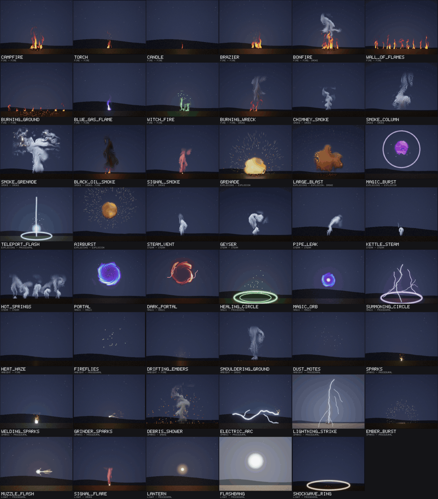
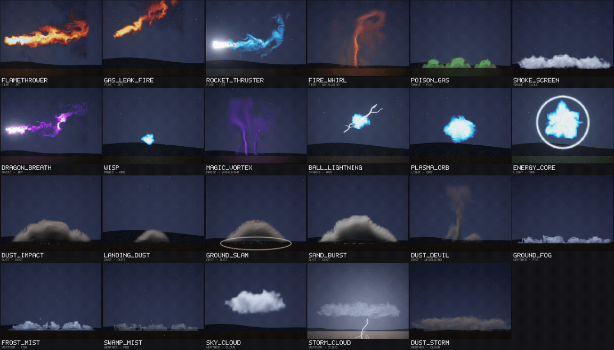
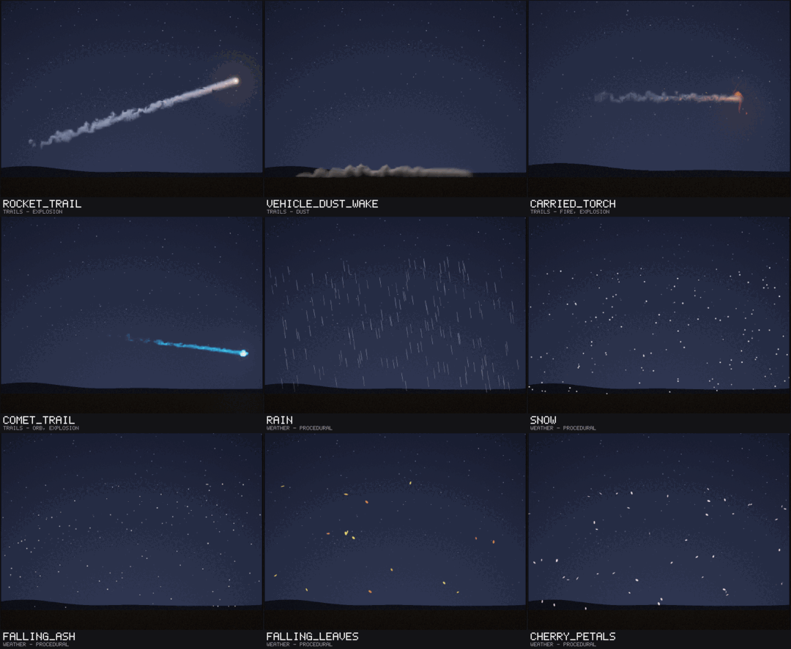
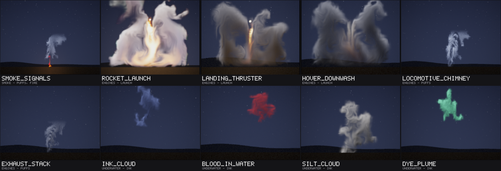
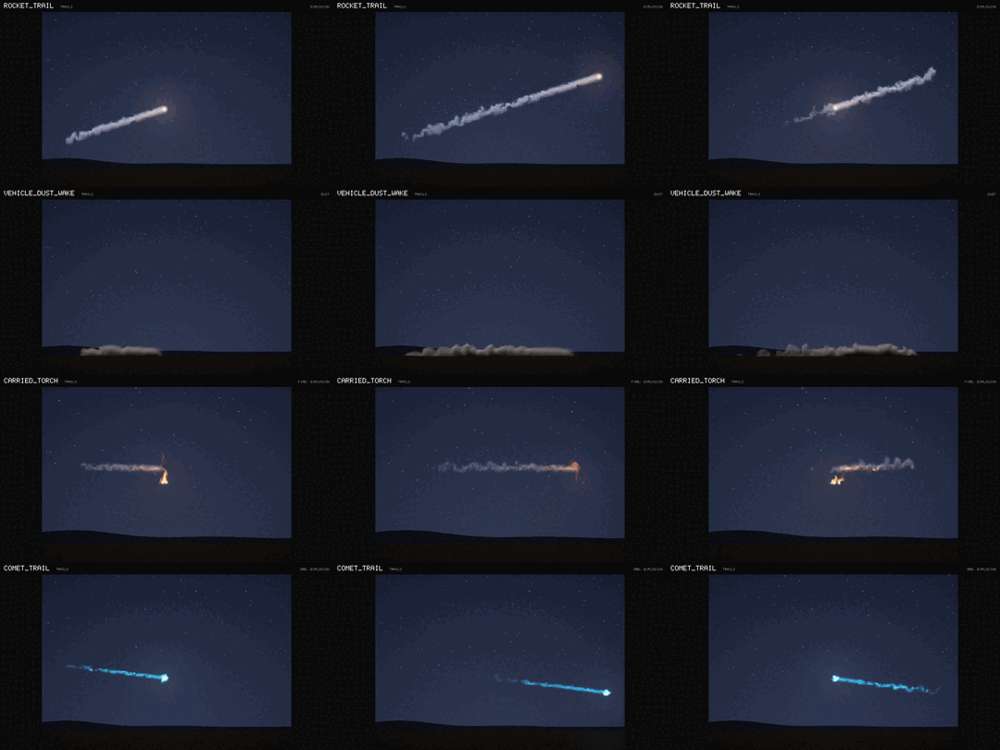

# The effect library

A catalogue of 89 named, ready-to-use effects that a game lists, places and drives without training anything: a
campfire, a grenade, a steam vent, a portal, a lightning strike, ground fog, a dust impact, a flamethrower, a plasma
orb, a dust devil, a rocket's smoke trail, rain, a rocket launch, a locomotive's chimney, an ink cloud. Each plays the
fourteen trained rollout models (fire, smoke, explosion v2, steam and magic; fog, dust and cloud,
[EFFECTS_ATMOSPHERE.md](EFFECTS_ATMOSPHERE.md); jet, orb and vortex, [EFFECTS_ENERGY.md](EFFECTS_ENERGY.md); launch,
puffs and ink, [EFFECTS_FLOW.md](EFFECTS_FLOW.md)) and the compositor's procedural elements (embers, sparks, shock fronts, scorch marks, flashes, lights, bolts, rings), at
a size, with parameters mapped onto the models' controls and looks. The 23 entries of the six newer models were added
with the recipe of §6, in text; the only code they needed is a third anchor, for the jet's nozzle. The nine newest
entries needed two features of the compositor: **trails** (`rocket_trail`, `vehicle_dust_wake`, `carried_torch`,
`comet_trail`: effects that move and leave their smoke, dust or glow in the world behind them, §9) and **procedural
weather** (`rain`, `snow`, `falling_ash`, `falling_leaves`, `cherry_petals`, §2.1). The ten entries of launch, puffs and
ink came after them, in text again, with two new categories, `engines` and `underwater`, and no code.









*Every entry alone on a stage fitted to its box, at the moment its catalogue says shows it well (`nvfx_gallery`).*

| category | entries | of them round 5's models | of them trails and weather | learned | procedural only |
|---|---|---|---|---|---|
| fire | 14 | 4 | 0 | 14 | 0 |
| smoke | 8 | 2 | 0 | 8 | 0 |
| explosions | 5 | 0 | 0 | 4 | 1 |
| steam (and water) | 5 | 0 | 0 | 5 | 0 |
| magic | 8 | 3 | 0 | 6 | 2 |
| ambient | 5 | 0 | 0 | 3 | 2 |
| sparks (and debris) | 8 | 1 | 0 | 2 | 6 |
| light | 7 | 2 | 0 | 3 | 4 |
| dust | 5 | 5 | 0 | 5 | 0 |
| trails | 4 | 0 | 4 | 4 | 0 |
| weather | 11 | 6 | 5 | 6 | 5 |
| engines | 5 | 0 | 0 | 5 | 0 |
| underwater | 4 | 0 | 0 | 4 | 0 |
| **all** | **89** | **23** | **9** | **69** | **20** |

`engines`, `underwater` and one smoke entry (`smoke_signals`) are the ten of launch, puffs and ink, marked *(flow)*.

**What is learned and what is not.** Only fourteen things move by a trained model: fire, smoke, an explosion, steam,
magic, fog, dust, cloud, a jet, an orb, a vortex, an engine's blast on the ground (launch), smoke in puffs and a plume
with almost no buoyancy (ink). Everything else in an entry is the compositor's: particles (embers,
sparks, debris), shock fronts, scorch marks, flashes, camera shakes, and the glows this library adds (lightning and
electric arcs, rings, discs and motes of light, lamps; rain, snow, ash and leaves). Entries that use no model at all
say *(procedural)* in their description. A trail's material is learned (it plays in the explosion or dust model's
tiles), but where it appears is the compositor's: it is put into the model's state along the source's path, as a
script's `heat` field and `transfer` add material. **A recolour is a look, not new dynamics**: blue gas, green witch
fire, the violet magic burst, the red dark portal, the coloured smokes and fogs, the blue rocket exhaust, the cyan
comet's tail and the violet dragon breath and magic vortex move exactly as their model's orange fire, grey smoke,
explosion, white fog, jet or dust column does; a field-shader look draws them in another colour (`hue`, `tint`).
Nothing here was trained for the library. Entries marked *(new)* are those of round 5's six models, *(trail)* and
*(weather)* the nine that came next, *(flow)* the ten of launch, puffs and ink.

## 1. The catalogue

`library/*.nvfxl`, one file per category plus `models.nvfxl` (the learned effects and shared looks). Sizes are the
effect's box in world pixels at scale 1; *base* anchors stand on the spawn point (bottom centre), *centre* anchors are
centred on it, *left* anchors (the jets) have the spawn point at the middle of the box's left edge, their nozzle.
*Plays* lists the learned models first, then the looks and procedural elements. The last column is how each looks in the
gallery and its video, judged by eye: **good** (usable as it is), **fair** (usable, with the flaw named), **weak** (kept
because it is still the best the models give for it, flaw named). Entries that looked bad were changed (start points,
sizes, smoke placed where the flames are) or replaced: §8 says which.

### Fire (14)

| effect | what it is | plays | box, anchor | runs | parameters (default) | how it looks |
|---|---|---|---|---|---|---|
| `campfire` | A campfire: three flames of the fire model over glowing coals, embers and a warm light on the ground | fire; embers, lamp, scorch | 240 x 300, base | loop | intensity (0.75), wind (0.5) | Good: three flames read as one fire; the embers, the scorch and the warm light on the ground carry it. |
| `torch` | A torch's flame, small and lively, with a few embers; its anchor is the torch's head | fire; embers, lamp | 100 x 190, base | loop | intensity (0.6), wind (0.5) | Good: a small lively flame. |
| `candle` | A candle flame: the fire model at its smallest and calmest, with a soft light | fire; lamp | 40 x 70, base | loop | intensity (0.3) | Fair: at 40 pixels the model's flame is a few pixels wide and flickers more than a candle does. |
| `brazier` | A brazier: a strong, tall flame that throws up a shower of embers now and then; its anchor is the bowl's rim | fire; embers, lamp, burst | 200 x 300, base | loop | intensity (0.85) | Good (after moving its main flame to the calm start point); its ember gusts every 1.9 s are regular. |
| `bonfire` | A bonfire: five flames of the fire model in a heap, a column of smoke above, a storm of embers | fire, smoke; look smoke, embers, lamp, scorch | 400 x 560, base | loop | intensity (0.9), wind (0.5) | Good: the smoke rises out of the flames; heavy (six modules, about 40 ms a frame on one thread). |
| `wall_of_flames` | A wall of flames: nine flames of the fire model in a row, 900 world pixels wide, embers flying | fire; embers, lamp | 900 x 360, base | loop | intensity (0.9), wind (0.5) | Fair: reads as nine tongues side by side rather than one wall of fire. |
| `burning_ground` | Burning ground: a carpet of low flames (spilt oil, a burnt field), eight small flames of the fire model | fire; embers, lamp, scorch | 640 x 140, base | loop | intensity (0.45) | Fair: sparse low flames over glowing patches; better in the distance than close up. |
| `blue_gas_flame` | A blue gas flame: the fire model, calm, recoloured blue by a field-shader look, with a blue light | fire; look gas, lamp | 120 x 190, base | loop | intensity (0.55) | Good: a believable blue flame (the orange fire's motion, recoloured). |
| `witch_fire` | Witch fire: two flames of the fire model recoloured green by a field-shader look, green motes, a green light | fire; look witch, glow, lamp | 220 x 300, base | loop | intensity (0.75) | Good: green flames and motes (a recolour). |
| `burning_wreck` | A burning wreck: a strong, ragged fire under a column of dark smoke, embers and a red light | fire, smoke; look sooty, embers, lamp | 340 x 520, base | loop | intensity (0.8), wind (0.6) | Good: dark smoke rising out of a ragged fire; the smoke is thin at 128 pixels. |
| `flamethrower` (new) | A flamethrower: a roaring jet of burning gas from its nozzle (the anchor), widening, breaking up and curling into smoke; it blows to the right | jet; lamp | 520 x 300, left | loop | intensity (0.8), aim (0) | Good: a roaring jet that widens, breaks up and curls into smoke at its end; it blows to the right only. |
| `gas_leak_fire` (new) | A burning gas leak: a roaring, flickering jet of flame from a broken pipe (the anchor), angled up; it blows to the right | jet; lamp | 300 x 240, left | loop | intensity (0.55) | Good: a small, flickering jet angled up. |
| `rocket_thruster` (new) | A rocket thruster: a fierce blue-white exhaust with a white-hot core at the nozzle (the anchor), the jet recoloured; it blows to the right | jet; look thrust, glow, lamp | 420 x 200, left | loop | intensity (0.9) | Fair: a blue exhaust behind a white-hot core, but its tail curls up as a flame does rather than streaming straight. |
| `fire_whirl` (new) | A fire whirl: a spinning column of flame rising from burning ground, swaying (the vortex model, its warm air drawn as flame) | whirlwind; look whirl_fire, embers, lamp | 320 x 480, base | loop | intensity (0.85), sway (0.7) | Fair: a thin swaying column of flame under a wide orange haze, which can show its tile's square edge. |

### Smoke (8)

| effect | what it is | plays | box, anchor | runs | parameters (default) | how it looks |
|---|---|---|---|---|---|---|
| `chimney_smoke` | Chimney smoke: a thin grey plume that leans with the wind; its anchor is the chimney's top | smoke; look smoke | 260 x 440, base | loop | intensity (0.35), wind (0.65) | Good: a thin leaning plume. |
| `smoke_column` | A column of smoke: the smoke model at its largest, rising from its base (a distant fire, a burning town) | smoke; look smoke | 560 x 680, base | loop | intensity (0.8), wind (0.5) | Fair: a large plume, but wispy rather than a dense column, and its swirly detail shows at this size. |
| `smoke_grenade` | A smoke grenade: a hiss of sparks, then thick white smoke billows out low for eight seconds and thins | smoke; look smoke_white, ceiling, sparks | 520 x 360, base | once, 12 s | intensity (0.9) | Fair: billows and spreads under its ceiling, but late in its life the cloud turns streaked and marbled, and it rises more than grenade smoke. |
| `black_oil_smoke` | Black oil smoke: a dark, rolling column of smoke over burning oil, lit red from below by its flames | smoke, fire; look oil, lamp | 520 x 620, base | loop | intensity (1), wind (0.55) | Fair: dark, and lit red from below, but thinner than real oil smoke: the model's plume is narrow. |
| `poison_gas` (new) | Poison gas: a heavy green gas that pours out low and rolls along the ground (the fog model, recoloured) | fog; look toxic, lamp | 600 x 120, base | loop | intensity (0.8), wind (0.5) | Good: a heavy green gas that stays on the ground (it replaced poison_smoke, whose smoke always rose); its three releases show as humps. |
| `signal_smoke` | Signal smoke: a plume of red smoke from a flare on the ground | smoke; look signal, glow, lamp | 300 x 480, base | loop | intensity (0.6), wind (0.6) | Good: a red plume over a glowing flare. |
| `smoke_screen` (new) | A smoke screen: a thick white wall of smoke that lingers where it was laid and boils slowly (the cloud model) | cloud; look screen | 700 x 240, base | loop | intensity (0.9), wind (0.5) | Good: a thick white wall of smoke that lingers and boils. |
| `smoke_signals` (flow) | Smoke signals: a small fire on the ground sends up distinct puffs of grey smoke (the puffs model over the fire model) | puffs, fire; look smoke, lamp | 300 x 520, base | loop | rate (0.15) | Fair: a small fire under puffs of grey smoke that roll up and drift; the puffs come irregularly (their timing is the model's noise), now and then two close together. |

### Explosions (5)

| effect | what it is | plays | box, anchor | runs | parameters (default) | how it looks |
|---|---|---|---|---|---|---|
| `grenade` | A grenade: a ball of fire from the explosion model, a shock front, a flash, embers, debris and a scorch mark | explosion; look cloud, flash, shake, shock, scorch, burst | 340 x 360, base | once, 3 s | power (1) | Good: fireball, sparks, shock front, flash and scorch; the best of the one-shots. |
| `large_blast` | A large blast: a big fireball that rises and cools, handed over to the smoke model, which carries the smoke on | explosion, smoke; look cloud, look smoke, flash, shake, shock, scorch, burst | 640 x 700, base | once, 9 s | power (1) | Fair: a big blobby fireball with swirl patterns on its surface; the hand-over to the smoke model works. |
| `magic_burst` | A magic burst: the explosion model recoloured violet, a ring of light, a violet flash and glowing motes | explosion; look burst_violet, flash, ring, glow, shock | 360 x 360, centre | once, 2.2 s | power (1) | Good: a violet ball (the explosion, recoloured), a ring and motes. |
| `teleport_flash` | A teleport flash: a column of light, a flash, an expanding ring on the ground and sparkles (procedural) | arc, glow, ring, lamp, flash | 240 x 360, base | once, 1.2 s | hue_shift (0) | Good: a clean column of light and a ring. |
| `airburst` | An airburst: an explosion in the air (no scorch), its embers falling as it fades | explosion; look cloud, flash, shake, shock, burst | 380 x 380, centre | once, 3 s | power (1) | Good: a fireball in the air with sparks flying out. |

### Steam and water (5)

| effect | what it is | plays | box, anchor | runs | parameters (default) | how it looks |
|---|---|---|---|---|---|---|
| `steam_vent` | A steam vent: a jet of white vapour from a hole in the ground, hissing unevenly | steam; look vapour | 280 x 400, base | loop | intensity (0.6), wind (0.5) | Fair: a white jet that breaks into puffs; how it looks depends on the seed (the shards' healing replaces a jet that dies). |
| `geyser` | A geyser: a gentle hiss that erupts into a tall column of steam every eight seconds, then dies down | steam; look vapour | 420 x 700, base | loop | period (8) | Fair: the eruption reads; the column is wispy at the top. |
| `pipe_leak` | A leaking pipe: a small, fast jet of steam bent sideways; its anchor is the leak | steam; look vapour | 200 x 200, base | loop | intensity (0.5), wind (0.95) | Good: a bent white jet. |
| `kettle_steam` | Steam from a kettle or a cooking pot: a small, slow wisp; its anchor is the spout | steam; look vapour | 90 x 140, base | loop | intensity (0.3) | Good: a small wisp. |
| `hot_springs` | Hot springs: wisps of steam rising from pools across the ground and drifting with the air, five steam modules | steam; look mist, wind | 700 x 300, base | loop | intensity (0.5) | Fair: five wisps across the ground; it was waterfall mist, renamed because the steam model makes plumes, not a veil. |

### Magic (8)

| effect | what it is | plays | box, anchor | runs | parameters (default) | how it looks |
|---|---|---|---|---|---|---|
| `portal` | A magic portal: the magic model opening over two seconds, spinning, its violet light on everything around | magic; glow, lamp | 440 x 440, centre | loop | spin (0.8), intensity (0.95) | Good: the magic model's spiral at its best. |
| `dark_portal` | A dark portal: the magic model recoloured blood red over black mist, crackling with red arcs | magic; look void, arc, lamp | 440 x 440, centre | loop | spin (0.6) | Good: red over black, crackling with arcs (a recolour). |
| `healing_circle` | A healing circle: a green ring of light on the ground, motes rising through it and a soft green light (procedural) | ring, glow, lamp | 320 x 260, base | loop | intensity (0.8) | Good: a clean ring and rising motes. |
| `magic_orb` | A magic orb: a small spinning knot of the magic model with a bright core and a violet light | magic; glow, lamp | 140 x 140, centre | loop | spin (0.7) | Good: a small spinning knot with a bright core. |
| `summoning_circle` | A summoning circle: a violet ring on the ground with arcs of energy leaping up from it and a portal's light (procedural) | ring, arc, lamp | 420 x 360, base | loop | intensity (0.9) | Good: lively arcs over the ring. |
| `dragon_breath` (new) | Dragon breath: a long, wide gout of violet fire from the anchor (the jet's flame recoloured: it moves as the orange one); it blows to the right | jet; look drake, lamp | 640 x 340, left | loop | intensity (0.95), aim (5) | Good: a long violet gout of fire (the jet, recoloured). |
| `wisp` (new) | A wisp: a small pale ball of cyan light that bobs and drifts about its place (the orb model, small) | orb; lamp | 120 x 120, centre | loop | intensity (0.3) | Fair: a small cyan ball that bobs about; it reads as a wisp in motion, and only in the orb's cyan. |
| `magic_vortex` (new) | A magic vortex: a swaying column of violet fire rising from the ground (the vortex model recoloured), motes circling it | whirlwind; look arcane, glow, lamp | 320 x 480, base | loop | intensity (0.8), sway (0.5) | Fair: a swaying violet column, at times split in two. |

### Ambient (5)

| effect | what it is | plays | box, anchor | runs | parameters (default) | how it looks |
|---|---|---|---|---|---|---|
| `heat_haze` | Heat haze: shimmering air over hot ground or an engine, the fire model's heat with nothing drawn | fire; look invisible | 320 x 320, base | loop | intensity (0.6) | Works in motion only: a still shows nothing, the shimmer is subtle, and the invisible fire's heat lights the scene a little. |
| `fireflies` | Fireflies: small yellow-green lights wandering and blinking in the dark (procedural) | glow | 360 x 240, centre | loop | count (16) | Good, and small. |
| `drifting_embers` | Drifting embers: embers rising on warm air and drifting away, as over a burnt-out fire (carried by the flow of an invisible fire) | fire; look invisible, embers | 360 x 360, base | loop | density (1) | Faint: a few embers carried up by an invisible fire's flow; reads in motion, hardly in a still. |
| `smouldering_ground` | Smouldering ground: thin smoke and a dull red glow where a fire has burnt out | smoke; look smoke, lamp, burst | 420 x 300, base | loop | intensity (0.18) | Fair: a thin wisp and a dull red glow; the wisp rises higher than smoulder smoke would. |
| `dust_motes` | Dust motes: specks of dust drifting slowly through a beam of light (procedural) | glow, lamp | 300 x 300, centre | loop | count (24) | Fair: faint by design; needs a dark scene. |

### Sparks and debris (8)

| effect | what it is | plays | box, anchor | runs | parameters (default) | how it looks |
|---|---|---|---|---|---|---|
| `sparks` | A fountain of sparks thrown up from a point, falling back (a fuse, a broken cable; procedural) | sparks, lamp | 200 x 220, base | loop | count (8) | Fair: a small fountain of the fireball's short fuse sparks. |
| `welding_sparks` | Welding: a blue-white flickering arc light with sparks spraying from it (procedural) | glow, sparks, lamp | 220 x 200, base | loop | count (14) | Good: a flickering arc light and sparks. |
| `grinder_sparks` | A grinder's sparks: a fast spray of sparks thrown sideways from a point 40 world pixels above the anchor (procedural) | glow, burst, lamp | 360 x 200, base | loop | density (0.8), direction (1) | Fair: a sideways spray of short sparks; it replaced a spark shower whose sparks died before they fell far. |
| `debris_shower` | A shower of debris: rocks and burning fragments thrown up and falling back, with a puff of dust | smoke; look dust, ceiling, burst, shock | 400 x 300, base | once, 3 s | power (1) | Good: debris and embers thrown up, with a puff of dust from the smoke model. |
| `electric_arc` | An electric arc jumping between two points 200 world pixels apart, flickering, with sparks (procedural) | arc, sparks, lamp | 260 x 120, base | loop | intensity (1) | Good: a lively flickering arc. |
| `lightning_strike` | A lightning strike: a branching bolt from the sky to its anchor, struck three times, a flash and a scorch (procedural) | arc, flash, lamp, scorch, shock, burst | 360 x 700, base | once, 1.2 s | power (1) | Good: a branching bolt struck three times, a flash and a scorch. |
| `ember_burst` | An ember burst: a log collapsing in a fire, a puff of embers thrown up that drift and cool (procedural) | burst, lamp | 360 x 360, base | once, 3.5 s | power (1) | Good: a puff of embers that drift and cool. |
| `ball_lightning` (new) | Ball lightning: a crackling ball of plasma drifting about, throwing short arcs (the orb model with procedural arcs) | orb; arc, lamp | 200 x 200, centre | loop | intensity (0.5) | Good: a boiling ball with arcs crackling off it. |

### Light (7)

| effect | what it is | plays | box, anchor | runs | parameters (default) | how it looks |
|---|---|---|---|---|---|---|
| `muzzle_flash` | A muzzle flash: a white-hot core, a long spike along the barrel and short side spikes, sparks, a flash of light (procedural) | glow, arc, lamp, burst | 160 x 100, centre | once, 0.12 s | direction (1) | Good; it lasts 0.12 s. |
| `signal_flare` | A burning signal flare on the ground: a red glare that flickers, sparks and a trail of pink smoke | smoke; look signal, glow, sparks, lamp | 200 x 320, base | loop | intensity (1) | Good: a red glare and pink smoke. |
| `lantern` | A lantern: a steady warm point of light with a soft halo and a gentle flicker (procedural) | glow, lamp | 120 x 120, centre | loop | intensity (1) | Good: a warm point with a soft halo. |
| `flashbang` | A flashbang: a white flash that blinds the whole scene for a moment, a bang (a shock front) and sparks (procedural) | flash, glow, shake, shock, burst | 400 x 300, centre | once, 1.5 s | power (1) | Good: the whole picture whites out, as it should. |
| `shockwave_ring` | A shockwave ring: a glowing ring racing out along the ground and a shock front bending the air (procedural) | ring, shock, scorch | 600 x 260, base | once, 1.2 s | power (1) | Good: the ring and the bending air read well. |
| `plasma_orb` (new) | A plasma orb: a ball of cyan plasma that boils inside a soft edge and breathes, lighting what is near in cyan | orb | 140 x 140, centre | loop | intensity (0.5), pulse (0.4) | Good: a boiling cyan ball that lights what is near it. |
| `energy_core` (new) | An energy core: a bright ball of plasma that throbs hard, inside a ring of light | orb; ring, lamp | 200 x 200, centre | loop | intensity (0.85) | Good: a bright ball that throbs hard inside a ring of light. |

### Dust (5)

| effect | what it is | plays | box, anchor | runs | parameters (default) | how it looks |
|---|---|---|---|---|---|---|
| `dust_impact` (new) | A dust impact: dust thrown up where something heavy hits the ground, rolling out low both ways and settling | dust; look dirt, burst | 480 x 200, base | once, 3.5 s | power (0.85) | Good: the dust model's burst rolls out low and settles; the finest detail of the new entries. |
| `landing_dust` (new) | Landing dust: a small puff of dust where someone lands, running out low both ways | dust; look dirt | 240 x 80, base | once, 2.5 s | power (0.4) | Good: small and quick. |
| `ground_slam` (new) | A ground slam: a heavy blow on the ground: a shock front, a ring racing out, flying rocks, a camera shake and a wide wall of dust | dust; look dirt, ring, shake, shock, burst | 680 x 260, base | once, 3.5 s | power (1) | Good: the ring, the shake, the rocks and a wide wall of dust read as one heavy blow. |
| `sand_burst` (new) | A sand burst: a shell or a heavy blow in sand throws up a tall spray of pale sand that rolls out and settles | dust; look sand, burst | 560 x 280, base | once, 3.5 s | power (1) | Good: a tall pale spray that rolls out; the rocks thrown are the compositor's dark debris, not sand. |
| `dust_devil` (new) | A dust devil: a column of dust rising from hot ground, swaying and spreading towards its top (the vortex model) | whirlwind; look devil_dust | 300 x 420, base | loop | intensity (0.65), sway (0.6) | Fair: the column sways and spreads at its top into a haze; its intensity is kept at 0.5 or more, as the model can lose a thin column. |

### Trails (4)

Effects that move: the game moves the instance every frame (`nvfx_stage_move`) and what it leaves stays in the world
behind it (§9). *Runs* gives the velocity the gallery moves it at (`moving`, world pixels a second, at scale 1);
the gallery's thumbnail shows each after `show` seconds of travel through its box.

| effect | what it is | plays | box, anchor | runs | parameters (default) | how it looks |
|---|---|---|---|---|---|---|
| `rocket_trail` (trail) | A rocket's trail: a white-hot exhaust at the source and smoke left behind it in the world, billowing, spreading and fading (move it every frame) | explosion; trail, look exhaust, glow, lamp, burst | 900 x 420, centre | loop, moving (280, -90) | density (0.7), fire (0.6) | Good: a white-hot point with a short glowing exhaust, and a long white trail that billows, widens and drifts up a little where it was left, then fades over two or three seconds; a turn leaves a bent trail, as it should. Near the source the smoke is a narrow, even line for a few frames before the model breaks it up. |
| `vehicle_dust_wake` (trail) | A vehicle's dust wake: dust thrown up behind it as it drives, rolling out low along the ground and settling where it was left (move it every frame) | dust; trail, look dirt | 900 x 220, base | loop, moving (220, 0) | density (0.7), height (0.5) | Fair to good: a low brown wake that rolls into puffs and settles where it was left. The freshest dust, right behind the vehicle, is a flat even band for about a second before the model breaks it into puffs (noise in the amount helps a little), and once in the walk-through a faint straight seam showed between two tiles. |
| `carried_torch` (trail) | A carried torch: its flame leans away from the way it moves, its hot gas and smoke stream out behind it and stay in the world; its anchor is the torch's head (move it every frame) | fire, explosion; look flame, trail, look torch_smoke, embers, lamp | 700 x 320, centre | loop, moving (180, 0) | intensity (0.65) | Fair: the hot gas glows orange behind the flame and streams back into a wavy grey smoke trail, which reads well. The flame itself is small, thin and ragged, with curling tongues, and leans only a little: the fire model leans with its wind control, and pushed further (to show a fast torch) it became a thin red streak. |
| `comet_trail` (trail) | A comet or a spell's trail: a ball of cyan plasma that leaves a glowing tail behind it, cooling and fading (the orb and the explosion's tail, recoloured; move it every frame) | orb, explosion; trail, look comet, glow, lamp | 900 x 360, centre | loop, moving (300, 40) | intensity (0.7) | Good: a bright cyan head and a glowing tail that frays and fades behind it (the explosion's hot gas, recoloured); the head is the orb model, small at this size. |

### Weather (11)

| effect | what it is | plays | box, anchor | runs | parameters (default) | how it looks |
|---|---|---|---|---|---|---|
| `ground_fog` (new) | Ground fog: a low white bank of fog lying along the ground and rolling slowly, four releases of the fog model | fog; look fogbank | 900 x 120, base | loop | intensity (0.7), wind (0.55) | Good: a continuous low bank that rolls slowly; its four releases still show as gentle humps. |
| `frost_mist` (new) | Frost mist: a thin, pale blue mist creeping over frozen ground, calm and slow | fog; look rime | 560 x 100, base | loop | intensity (0.5) | Fair: pale and thin by design; it needs a dark ground to read. |
| `swamp_mist` (new) | Swamp mist: a murky grey-green mist hanging over still water, with a few faint marsh lights drifting in it | fog; look marsh, glow | 760 x 140, base | loop | intensity (0.6) | Fair: murky and faint, and its marsh lights are small. |
| `sky_cloud` (new) | A cloud: a white mass that boils slowly and drifts, lit by the moon and the scene | cloud; look fleece | 520 x 260, centre | loop | wind (0.6), intensity (0.8) | Good: a soft white cloud that boils slowly (drawn by a look: the cloud model's own renderer gave colour fringes). |
| `storm_cloud` (new) | A storm cloud: a dark bank of cloud drifting, lit from inside by lightning every few seconds, a bolt below it | cloud; look storm, lamp, arc, flash | 1100 x 360, centre | loop | wind (0.62), every (5) | Fair: a flash lights the bank from inside and the bolt reads, but between flashes the bank is dark and thin. |
| `dust_storm` (new) | A dust storm: a wall of brown dust rolling past, puffs forming upwind and thinning downwind (the cloud model) | cloud; look grit | 1300 x 300, base | loop | intensity (0.95), wind (0.85) | Fair: a low brown band rolling past, not a towering wall. |
| `rain` (weather) | Rain (procedural): streaks falling through the box, slanted by the wind; it thins the smoke it falls through | rain | 960 x 540, base | loop | density (3), wind (120), size (1) | Good: thin slanted streaks of different lengths falling fast; reads in a still and in motion. How it thins smoke is subtle (§9, `weather.nvfxs`). |
| `snow` (weather) | Snow (procedural): flakes drifting down and fluttering, carried by the wind and by the air of effects around them; they melt over fires | snow | 960 x 540, base | loop | density (2.5), wind (30), size (1) | Fair: flakes that fall slowly, flutter and drift, lifted by a fire's air and gone over it; in motion it is snow, but in a still at night the flakes look like stars. |
| `falling_ash` (weather) | Falling ash (procedural): grey flakes drifting down after a fire, a few still glowing, carried by the air | ash | 960 x 540, base | loop | density (2), wind (20), size (1) | Weak to fair: slow grey flakes with a few glowing ones; at night it reads as grey snow, and the glowing flecks are few and small. Better over a burnt, lit scene than in the gallery's dark one. |
| `falling_leaves` (weather) | Falling leaves (procedural): autumn leaves tumbling and swaying down, blown by the wind | leaves | 960 x 540, base | loop | density (0.35), wind (60), size (1) | Fair: leaves in four autumn colours that tumble (they narrow and widen as they turn) and swing as they fall; small and few at the defaults, and flat shapes, not leaf shapes. |
| `cherry_petals` (weather) | Cherry petals (procedural): small pink petals drifting and tumbling on a light breeze | leaves | 960 x 540, base | loop | density (0.6), wind (70), size (1) | Fair: small pink petals that tumble and drift; pleasant in motion, specks in a still. |

### Engines (5)

The launch model (an engine's exhaust blown down onto the ground, rolling out both ways in billows) and the puffs model
(smoke in pulses), [EFFECTS_FLOW.md](EFFECTS_FLOW.md). `library/engines.nvfxl`.

| effect | what it is | plays | box, anchor | runs | parameters (default) | how it looks |
|---|---|---|---|---|---|---|
| `rocket_launch` (flow) | A rocket launch pad: the engine's exhaust blasts the pad and rolls out both ways in billowing grey-white clouds that rise, bright where it hits | launch; glow, lamp | 760 x 500, base | loop | thrust (0.8), wind (0.55) | Good: a white-hot jet into the pad and soft white billows both ways, lit by the fire. The library draws the launch model with a gentler sub-grid swirl than its calibration chose (swirl 1 against 3, in `models.nvfxl`), which drew the billows as wormy lines; the clouds fill the tile, and at times its square shows at the top corners. |
| `landing_thruster` (flow) | A landing thruster: a lander's engine firing down at dusty ground, kicking up a low brown cloud both ways (the launch model, recoloured) | launch; look blast_dust, glow, lamp | 360 x 240, base | loop | thrust (0.4) | Fair: a thin flame into a brown cloud thrown both ways; the cloud is large for so small a flame. |
| `hover_downwash` (flow) | A hovering craft's downwash: a strong draught blown down at the ground, throwing up dust that rolls out both ways (the launch model's flow, drawn without its flame) | launch; look downwash | 420 x 220, base | loop | power (0.5) | Fair: dust blown out both ways that rises in two columns; the draught itself is invisible, so it reads as dust thrown up by something above. |
| `locomotive_chimney` (flow) | A steam locomotive's chimney: grey-white puffs of steam and smoke that roll up and drift away into a trail; its anchor is the chimney's top (the puffs model) | puffs; look chuff | 300 x 460, base | loop | rate (0.4), intensity (0.65) | Fair: puffs leave the chimney and roll up, but a little above it they merge into a wavy column; the pulses are irregular, not a locomotive's steady beat (the model's noise times them). |
| `exhaust_stack` (flow) | A truck's exhaust stack: dark diesel smoke in quick puffs as the engine works; its anchor is the top of the stack | puffs; look diesel | 200 x 340, base | loop | rate (0.7), intensity (0.4) | Fair: quick grey puffs merging into a short trail; faint at night. |

### Underwater (4)

The ink model, a plume with almost no buoyancy that curls and spreads slowly and drifts with the current
([EFFECTS_FLOW.md](EFFECTS_FLOW.md)), recoloured by looks. `library/underwater.nvfxl`. The stage behind them is the
library's night; a game draws its own water.

| effect | what it is | plays | box, anchor | runs | parameters (default) | how it looks |
|---|---|---|---|---|---|---|
| `ink_cloud` (flow) | An ink cloud: a squid's ink spreading from where it was released (the anchor) into soft, slowly curling clouds and tendrils | ink; look squid_ink | 360 x 360, centre | loop | amount (0.7), current (0.5) | Fair: a slowly curling blue-black cloud around its release, lifted a little so that it reads at night (dark ink would vanish against the night); it stays compact rather than spreading far (§8). |
| `blood_in_water` (flow) | Blood in water: a thin red plume curling away from a wound (the anchor) and drifting with the current | ink; look blood | 340 x 300, centre | loop | amount (0.35), current (0.8) | Fair: a red plume streaming with the current at low turbulence; it bunches into a compact blob now and then, and at higher turbulence it curls into blocky arms. |
| `silt_cloud` (flow) | Stirred silt: a brown cloud rising off the bottom where something disturbed it, spreading and drifting slowly | ink; look silt | 520 x 300, base | loop | amount (0.8), current (0.6) | Fair: a pale cloud rising off the bottom and drifting; paler than silt in the gallery's night, and its edges boxy at times (the lattice above). |
| `dye_plume` (flow) | A dye plume: a bright green tracer dye curling slowly out of a nozzle (the anchor) in still water | ink; look dye | 300 x 400, centre | loop | amount (0.5) | Weak to fair: a green blob with short, blocky arms rather than a long curling plume. |

## 2. The format

A catalogue is written in the scene-script language ([COMPOSE.md](COMPOSE.md) §4), with two more statements. Each
file declares, before its first entry, the learned effects and the field-shader looks its entries share; then entries,
each an `entry` line, its `param` lines and the statements of a small scene:

```
effect fire = "fire.nvfx"                                    # once per catalogue (models.nvfxl)
look gas = like flame, hue 225, emission 2.8, soot_density 0.4

entry blue_gas_flame, category fire, size 120 x 190, anchor base, loop, show 2,
      about "A blue gas flame: the fire model, calm, recoloured blue by a field-shader look, with a blue light"
param intensity = 0.55, range (0.2, 1), about "how big it burns"
module flame = fire, size 64, width 110 * scale, at (X, Y), sink 0.05, feather 0.15, look gas, start 0, seed 81,
               controls (0.55, 0.5, 0.2), intensity intensity, glow (0.3, 0.55, 1.6)
field cool = lamp, at (X, Y - 20 * scale), radius 50 * scale, strength 0.6 * intensity, colour (0.35, 0.55, 1)
```

| statement | keys |
|---|---|
| `entry NAME` | `category C` (fire, smoke, explosions, steam, magic, ambient, sparks, light, dust, trails, weather, or a new one), `size W x H` (its box at scale 1, world pixels), `anchor base`, `centre` or `left` (the middle of the box's left edge: a jet's nozzle), `loop` (plays until stopped) or `once S` (a one-shot of S seconds), `show S` (a moment that shows it, seconds after the spawn; the gallery's), `moving (VX, VY)` (it is meant to move: the velocity, world pixels a second at scale 1, that the gallery and its checks move it at and that the catalogue reports; a trail, §9), `about "..."` (one line) |
| `param NAME = DEFAULT` | `range (LO, HI)` (values set are clamped to it), `about "..."` |

In an entry, `t` is the time since the spawn, `X` and `Y` the anchor, `scale` the scale it was spawned at, `variant`
a number in [0, 1) that differs from spawn to spawn, and `alive` 1 while it plays (0 once stopped or ended). A
parameter is a value by its name. An entry may declare modules (single ones: tiles stay where they are declared),
fields, emitters, trails (`trail NAME = EFFECT ...`, [COMPOSE.md](COMPOSE.md) §5.3: material left in the world
along a moving source's path), `let`s, its own looks, rules (`at T:` and `when ...:`, which fire once per spawn, or every time
with `repeat`), `every frame:` couplings, a flash (`light flash (r, g, b)`) and a camera shake (`camera x ..., y ...`).
The stage owns the picture, the clock, the bus, the particles and the camera's place; an entry cannot set them, read
another instance, or wait for a shock front by number (fronts are counted over the whole stage). The parser and checker
give every error as `file.nvfxl:line:column: message`.

**Why the scene-script language.** An entry is a small composed scene: modules of a model at a size and place, with
their controls tied to parameters, fields that act on them, emitters, and rules over time (the grenade's flash at 0,
its shock front, its scorch mark fading). The scene language already says all of that, and it already has the parser,
the checker with line and column, the runtime that plays without allocating and gives the same frames on any number of
threads, the overlap of drawing with the next frame, the field bus that couples effects, and the tools
(`nvfx_scene_script`, the viewer). A table format (JSON, TOML, a C++ registry) would have needed a second language for
the behaviour or a second runtime; it would not have let an entry be anything a scene can be. With the scene language,
an entry is checked and played by the same code as every scene, and a stage is itself a scene script
(`nvfx_stage_script`, `nvfx_gallery --print-stage`) that the scene tools check and play like any other (its rooms
stay empty until their inputs are set).

**What a stage does to an entry.** A stage is one scene with *rooms*: for each effect it hosts, a number of instances
that may play at once. Each room gets a copy of its entry, renamed (`s3_flame`, `s3__X`, `s3__intensity`), whose
anchor, scale, variant, parameters, spawn time and end time are the scene's **inputs**. A spawn sets them; nothing is
built when a game spawns, moves or stops an effect, so a stage plays without allocating after it is created. The copy
is rewritten so that:
- `t` is the time since the spawn, and the entry's rules fire once per spawn (they become `repeat` rules guarded by
  "not fired since this spawn");
- its learned modules start at stage creation, asleep (`waiting`: their warm-up happens then, not in a frame); the
  first spawn wakes them, later spawns restart them from their start point with a seed that changes with `variant`;
- a stop, or the end of a one-shot, stops its modules, gates its emitters, fields, flashes and shakes with `alive`, and
  frees its room (with `steal`, a spawn when every room is busy takes the oldest's);
- looping modules play in **shards** of 8 seconds (`shards`, [COMPOSE.md](COMPOSE.md) §4.3): a fresh rollout starts
  ahead of time and takes over in a half-second blend, so a fire or a smoke plume never drifts or dies however long it
  plays; a shard that fades early is replaced at once;
- a trail's pool of tiles is made with the stage; it leaves material only while its instance is `alive`, so a stop
  leaves what is there to fade where it is, and a new spawn starts a new path (a jump: nothing is drawn between where
  the last one ended and where this one starts);
- flashes and camera shakes of all instances add up.

`nvfx_gallery --library library --print NAME` prints an entry alone as the stage plays it.

### 2.1 Procedural elements added for the library

All in the compositor (`src/compose`), allocation-free (pre-sized pools), deterministic, and tested
(`tests/test_library.cpp`, `tests/test_engine_features.cpp`). None is learned but the trail's material: they are
drawn, and say so in the entries that use them.

| element | what it is | used by |
|---|---|---|
| `emit arc` | a lightning bolt or an electric arc between two points: midpoint displacement with forks, a core and a halo, a new shape every frame or `rate` times a second | `lightning_strike`, `electric_arc`, `dark_portal`, `summoning_circle`, `teleport_flash`, `muzzle_flash` |
| `emit ring` | a glowing ring, squashed into an ellipse on the ground | `shockwave_ring`, `healing_circle`, `summoning_circle`, `magic_burst`, `teleport_flash` |
| `emit glow` | a soft disc of light, or motes wandering and flickering | `lantern`, `fireflies`, `dust_motes`, `witch_fire`, `welding_sparks`, `portal`, ... |
| `field lamp` | a light that is not on the bus: lights smoke and steam around it in its colour | most entries (the warm light of a fire, a portal's violet) |
| `hue` (look) | the field shader's emitted colours turned about the grey axis: recolours | `blue_gas_flame`, `witch_fire`, `magic_burst`, `dark_portal` |
| `burst ... sparks` | short fast bright embers thrown within a cone | `muzzle_flash`, `grinder_sparks`, `lightning_strike`, `flashbang` |
| `emit rain`, `snow`, `ash`, `leaves` | weather (allocation-free, deterministic, tested by `Weather.*` in `tests/test_engine_features.cpp`): particles that fill a rectangle at a `density` (per 100 x 100 world pixels) and fall through it with a `wind`, riding the bus's flow; rain is drawn as streaks and can `wash` smoke out of the modules it falls on, snow `melt`s over heat, ash has a few `glowing` flakes, leaves (and petals) tumble and swing as they fall ([COMPOSE.md](COMPOSE.md) §4.6 and §5.4) | `rain`, `snow`, `falling_ash`, `falling_leaves`, `cherry_petals` |
| `trail` | not procedural: tiles of a learned effect laid on a grid in the world, fed along a moving source's path ([COMPOSE.md](COMPOSE.md) §5.3, §9 here) | `rocket_trail`, `vehicle_dust_wake`, `carried_torch`, `comet_trail` |

## 3. The API

`include/neuralfx/nvfx_library.h`, in `libnvfx` (C, as the scene API, [ENGINES.md](ENGINES.md) §7):

```c
nvfx_library_desc ld;
nvfx_library_desc_init(&ld);
ld.catalogue_dir = "library/";                         /* every *.nvfxl in it */
ld.models_dir = "effects/";                            /* fire.nvfx, smoke.nvfx, ... vortex.nvfx */
nvfx_library* lib;
nvfx_scene_error err;
if (nvfx_library_open(&ld, &lib, &err) != NVFX_OK) printf("%s\n", err.message);   /* "fire.nvfxl:12:7: ..." */

nvfx_stage_room rooms[] = {{"campfire", 4, 0}, {"grenade", 8, 1}};   /* up to 4 campfires, 8 grenades (stealing) */
nvfx_stage_desc sd;
nvfx_stage_desc_init(&sd);                             /* 960 x 540, 30 fps, 2 threads */
sd.rooms = rooms;
sd.n_rooms = 2;
nvfx_stage* stage;
nvfx_stage_create(lib, &sd, &stage, &err);             /* loads the models, warms them up: the only allocations */
nvfx_scene* scene = nvfx_stage_scene(stage);

nvfx_fx fire;
nvfx_stage_spawn(stage, "campfire", 300, 470, 1.0f, -1.0, &fire);  /* anchor at (300, 470), scale 1, now */
nvfx_stage_set_param(stage, fire, "intensity", 0.4f);
/* every frame: */ nvfx_scene_step(scene, dt, NULL); nvfx_scene_render(scene, rgba, stride);
nvfx_stage_stop(stage, fire, -1.0);
```

- **Listing**: `nvfx_library_count`, `_find`, `_get_effect` (name, category, description, the models and procedural
  elements it uses, its box, anchor, loop or duration, a moment to show it, and for a moving effect the velocity it is
  shown at, `move_x` and `move_y`), `_get_param` (name, description,
  default, range), `_category_count` and `_category`, `_list_models` (the model files an effect needs).
- **Stages**: `nvfx_stage_create` builds the scene with the rooms asked for and loads the models they need;
  `nvfx_stage_scene` is an ordinary `nvfx_scene` (step, render, sample fields, overlap). `nvfx_stage_spawn` (position,
  scale, time; `NVFX_ERROR_MEMORY` when the effect has no free room and no `steal`), `_set_param` and `_get_param`
  (clamped to the range), `_move`, `_stop` (now or at a time; a pending spawn is cancelled), `_get_fx` (waiting,
  playing, ended; where, its scale, its age), `_free_rooms`, `_set_camera`, `_clear`. A handle is a room and a
  generation: it goes stale when its room is used again.
- **Moving effects** (trails, §9): call `nvfx_stage_move` every frame, before stepping, with where the instance is;
  its modules follow it and its trail's material stays in the world. A move acts on the next frame computed (with
  overlap, the frame after: [ENGINES.md](ENGINES.md) §7), as any input.
- **Engine layers**: with `nvfx_stage_desc.layers = 1` the stage's scene also draws its effects alone into colour,
  albedo, emission and normal-and-thickness layers, read with `nvfx_scene_render_layer` (lit sprites:
  [ENGINES.md](ENGINES.md) §11).
- **No allocation per frame**, and none in spawn, move, parameters or stop (they set the scene's inputs):
  `nvfx_alloc_test` counts them (a stage with 21 spawns over 149 frames, with and without overlap: 0; a stage with the
  engine layers read every frame, a trail moved every frame, jumping, stopped and spawned again, and weather: 0), as
  does `nvfx_gallery --check` for every entry (a moving one moved every frame).
- **Deterministic**: the same calls at the same times give the same frames, on any number of threads and with or
  without overlap (`Library.TheSameCallsGiveTheSameFramesOnAnyThreads`). Moves are the exception to "with or without":
  a move made every frame acts a frame later with overlap, so a moving trail gives the same frames on any number of
  threads for one overlap setting (`Trails.AMovedInstanceGivesTheSameFramesOnAnyNumberOfThreads`), and slightly
  different ones between the two. An instance's random choices come from its
  room's seeds and its `variant` (from the spawn count), not from the clock.
- **Threads**: as scenes. A library is read-only once opened and may be shared; a stage is used from one thread at a
  time and runs `threads` workers of its own.
- **Errors**: a catalogue error gives the file, line and column; an error found only when the models are loaded (a
  control name the model does not have) is reported against the catalogue, not the generated stage
  (`bad.nvfxl:3:47: ...`).

`examples/library_host.c` is the same in plain C (built as `nvfx_library_host`): given a catalogue and the models'
folder it lists the catalogue and plays a stage of a few effects (spawned, a parameter set, one moved, one stopped, the
cost per frame and the heat under each), and with `--self-test` it checks the API without data (listing, a catalogue
error, spawns, no room, steal, stop, rooms freed, camera, clear, the same frames on 1 and 3 threads).

## 4. The gallery

The models' folder, `$NEURALVFX_DATA/library/models` by default, holds the eleven learned effects under the names
`models.nvfxl` gives them: the v2 fire, smoke and explosion, study D's steam and magic, and round 5's fog, dust, cloud,
jet, orb and vortex. Links are enough:

```sh
mkdir -p $NEURALVFX_DATA/library/models && cd $NEURALVFX_DATA/library/models
ln -s ../../v2/models/fire.nvfx ../../v2/models/smoke.nvfx ../../v2/models/explosion.nvfx .
ln -s ../../fx/models/d/steam.nvfx ../../fx/models/d/magic.nvfx .
ln -s ../../fx_atmos/models/d/fog.nvfx ../../fx_atmos/models/d/dust.nvfx ../../fx_atmos/models/d/cloud.nvfx .
ln -s ../../fx_energy/models/d/jet.nvfx ../../fx_energy/models/d/orb.nvfx ../../fx_energy/models/d/vortex.nvfx .
```

`tools/nvfx_gallery.cpp` plays every entry through the C API, each alone on a stage fitted to its box:

```
nvfx_gallery --library library --models DATA/library/models --sheet sheet.png --video walk.mp4 --threads 2
nvfx_gallery --library library --models DATA/library/models --video new.mp4 --clip 2.4 --only a,b,c   # 2.4 s each
nvfx_gallery --library library --models DATA/library/models --keyframes DIR --verify results/library/frozen.csv --only a,b
nvfx_gallery --library library [--models DIR] --check [--require-models]
nvfx_gallery --library library --list [--markdown]        # the catalogue (the table above comes from it)
nvfx_gallery --library library --print NAME               # an entry alone, as the stage plays it
nvfx_gallery --starts DATA/library/models/fire.nvfx       # a model's start points and their controls
nvfx_gallery --library library --models DIR --shot 960x540 --ground 470 --spawn campfire@220,470,1,0.3 ... --frames 45 --png f.png
nvfx_gallery --library library --models DIR --shot 960x540 --spawn rocket_trail@100,330,0.8,0.1,250,-60 --frames 45 --png f.png
```

A moving entry (`moving (VX, VY)`) is moved every frame, in the sheet, the video, the keyframes and the check: through
its box at its velocity, half its `show` time before the anchor point at the spawn and half after it at the show, then
back and forth. In `--shot`, `--spawn NAME@X,Y,SCALE,AT,VX,VY` moves the instance before each frame to
(X + VX s, Y + VY s), s the seconds since its spawn (the Godot test does the same).

- `--sheet`: a labelled contact sheet (name, category, one-shot or loop), each cell at the entry's `show` moment.
- `--video`: a walk through every entry (or those of `--only`), 4 seconds each (one-shots: their length; `--clip S`:
  S seconds each), with its name.
- `--check`: the catalogue parsed and every entry checked as a stage of its own; every entry whose models are present
  (procedural ones always) played as two instances, its parameters set to both ends of their ranges, one moved, one
  stopped and spawned again, heap allocations counted in the frame loop and in those calls (0 for each), and something
  drawn.
- `--keyframes` and `--verify`: each entry's `show` frame as PNG, compared by SHA-256 with frozen rows
  (`library_keyframe,NAME,file,bytes,sha256`; `results/library/frozen.csv` also records the SHA-256 of the eleven model
  files they were made with).
- `--shot`: a stage played as a game would (frame 0 drawn, the spawns, then N frames): the Godot test's reference.

Outputs go under `$NEURALVFX_DATA/library` (the sheet, the video, keyframes); only the sheets in `docs/figures`
(`library_sheet.png`, `library_sheet_new.png`, `library_sheet_engine.png`, scaled down, and the trails' strip
`trails_over_time.png`) are in git.

**Tests** (`ctest`): `neuralfx.LibraryCatalogueCheck` (no data: the catalogue and every procedural entry);
`neuralfx.LibraryHostExample` (the C example's self-test); `neuralfx.LibraryCataloguePlays` (every entry, with the
eleven models in `NEURALFX_MODELS_LIBRARY`, by default `$NEURALVFX_DATA/library/models`; skipped without them);
`neuralfx.LibraryKeyframesFrozen` (the keyframes of `campfire`, `blue_gas_flame`, `grenade`, `steam_vent`, `portal`,
`lightning_strike`, `ground_fog`, `dust_impact`, `flamethrower`, `plasma_orb`, `dust_devil`, and two moving ones,
`rocket_trail` and `vehicle_dust_wake`, against `results/library/frozen.csv`, on 2 threads; skipped without the
models); the `Library.*`, `Glows.*`, `Lamps.*`, `Trails.*`, `Layers.*` and `Weather.*` unit
tests; the library stage and the engine features' stage in `nvfx_alloc_test`; `neuralfx.LitHostExample` (lit sprites,
[ENGINES.md](ENGINES.md) §11).

## 5. Godot

`NeuralVFXStage` (engines/godot, [ENGINES.md](ENGINES.md) §8) is a `NeuralVFXScene` that plays a stage: set
`library_dir` (the catalogue), `effects_dir` (the models), `stage_size`, `ground` and `rooms` (a Dictionary of effect
name to count, or to `[count, steal]`), then:

```gdscript
var stage := NeuralVFXStage.new()
stage.library_dir = "res://library"
stage.effects_dir = "res://effects"
stage.rooms = {"campfire": 2, "grenade": [4, true]}
add_child(stage)
print(stage.list_effects(), stage.get_categories(), stage.get_effect_info("campfire"))
var fx := stage.spawn("campfire", Vector2(300, 470))      # scale 1, now; 0 when there is no room
stage.set_param(fx, "intensity", 0.4)
stage.move_fx(fx, Vector2(320, 470))
stage.stop(fx)

var rocket := stage.spawn("rocket_trail", Vector2(100, 330), 0.8)
func _process(delta):                                        # a moving effect: moved every frame
    stage.move_fx(rocket, rocket_position)                  # its smoke stays in the world behind it
```

`get_effect_info(name).moving` is the velocity a moving effect is shown at (`Vector2.ZERO` for one that stands). With
`layers = true` (set before it is added to the tree) the stage also gives the engine layers as textures
(`get_layer_texture(LAYER_EMISSION)`, ...: [ENGINES.md](ENGINES.md) §11).

`demo/library.tscn` (`library.gd`) is the same in a window: left and right choose one of 29 effects, a click spawns it
under the mouse, a right click stops the last; a comet flies a loop over the scene all the while, moved every frame,
and a moving effect spawned with a click then follows the mouse, leaving its trail. The headless test (`engines/godot/test.sh`, step 5) has `nvfx_gallery
--shot` draw a stage with five library effects (a campfire, a steam vent, a magic burst, an electric arc and a plasma
orb) spawned at given times and a rocket trail moved every frame, and `demo/test_library.gd` play the same stage in a
`NeuralVFXStage` in Godot 4.4.1, with the engine layers on: the listing, an effect's description and a jet's anchor,
the rocket's `moving` velocity, the spawns, a full room and an unknown effect refused, the frame the same to the byte as
`nvfx_gallery`'s (the rocket moved before each frame in both), heat over the campfire, the rocket's smoke left behind
it in the world, the four layer textures and their formats, thickness wherever the effects cover, the campfire's
emission, a parameter, a move, a stop, a stale handle.

## 6. Adding effects

**A new trained model**: one line in `library/models.nvfxl` and entries that play it, in a new or existing file; no
code, no rebuild. This is how fog, dust, cloud, jet, orb and vortex joined (23 entries; the jet also needed an anchor
at the left edge of the box, below); for example the dust impact:

```
effect dust = "dust.nvfx"                                     # models.nvfxl; the file goes into the models folder
look dirt = shader, emission 0, soot_density 2.2, soot_albedo 0.6, sky 0.45, shadow 0.4, scene_light 1.2, relief 3,
            tint (0.8, 0.62, 0.42)                            # (the moor scene's look: dust has no heat to draw)

entry dust_impact, category dust, size 480 x 200, anchor base, once 3.5, show 0.8,
      about "A dust impact: dust thrown up where something heavy hits the ground, rolling out low both ways and settling"
param power = 0.85, range (0.3, 1), about "how hard the hit"
module heap = dust, size 128, width 480 * scale, at (X, Y), sink 0.03, feather 0.1, look dirt, start 9, seed 601,
              controls (0.85, 0.5, 0.4), intensity power, opacity 1 - smooth((t - 2.4) / 1)
at 0:
  burst at (X, Y - 4 * scale), radius 8 * scale, embers 0, debris 12, speed 260 * scale * power
```

Then:
1. `nvfx_gallery --library library --check` (the catalogue, without the model), and with `--models` (it plays);
2. pick start points by their controls (`nvfx_gallery --starts DATA/library/models/fog.nvfx` lists them): a module's
   `start N` should have controls near the ones it plays at (a start point of a weak fire played at full intensity
   grows slowly and looks young, one of a strong side wind leans for its first seconds); the shards pick the nearest
   start point by controls for every later shard anyway;
3. look at it: `nvfx_gallery --sheet ... --only dust_impact` and `--video`, and play loops for half a minute or more
   (`--shot ... --frames 900`); adjust the size, the look, the parameters' ranges (a range that reaches controls the
   model never saw in training gives what it gives);
4. if the entry should be guarded against changes, add it to `--only` of `neuralfx.LibraryKeyframesFrozen` and its
   row to `results/library/frozen.csv` (`nvfx_gallery --keyframes DIR --only NAME` writes the rows to copy into
   `DIR/keyframes.csv`).

A model with other control names is used by them (`spin 0.8` for magic, `aim`, `pulse` and `sway` for the jet, the
orb and the vortex). A new category is just a new name in `category` (`dust` and `weather` came with round 5,
`trails` with the trails).

**What adding six models taught** (no step of the recipe changed; these are things to know):
- **Read the model's document first**: where its material sits in the tile decides where the module stands. Fog lies
  in the bottom quarter of its tile and spreads along it, so ground fog is several narrow releases side by side (one
  wide release stands up like a cumulus); the cloud's mass sits in the middle of its tile, so a smoke screen's tiles
  stand half below the ground; the orb is a ball in the middle of its tile; the jet's nozzle is 5% in from the left
  edge and 40% up.
- **A model that blows one way needs its own anchor.** The jet always blows to the right, as fire always rises (a tile
  cannot be mirrored), so its entries are `anchor left`: the spawn point is the nozzle and the box lies to its right.
  Their `aim` parameter is in degrees (-20 to 30) and mapped onto the control (`aim (aim + 20) / 50`).
- **Models without heat need a look.** Fog, dust and cloud carry soot only; their entries draw them with field-shader
  looks lit by the scene (the moor scene's frost, storm and dirt; at night a denser one than the moor's for fog). The
  cloud model's own renderer gave colour fringes, so even the white cloud has a look.
- **A one-shot model plays as the explosion does**: `once`, and its module faded out by `opacity` before the end.
- **Names**: `vortex` is a field of the language, so the vortex model is `effect whirlwind = "vortex.nvfx"`; locals such
  as `core` and `by` are words of the language too, and the checker says so with the line and column.
- **The start point by controls matters most for the control you can see.** A rocket exhaust at low turbulence
  started its later shards from the start point of a jet aimed down (the nearest by all three controls); a turbulence
  of 0.45 made the level one nearest.
- **Keep a model inside the range where it holds up.** The vortex can lose a thin column at low intensity
  ([EFFECTS_ENERGY.md](EFFECTS_ENERGY.md) §4.4), so its entries' intensity ranges start at 0.5. Fog lifted high stays up
  as pale plumes ([EFFECTS_ATMOSPHERE.md](EFFECTS_ATMOSPHERE.md) §6), so no entry pushes fog.

**What adding launch, puffs and ink taught** (ten entries, `engines.nvfxl` and `underwater.nvfxl`, text only):
- **A model's calibrated detail can look worse than its statistics are.** The launch model's calibration chose the
  strongest sub-grid swirl (3), the one that brings its endless detail spectrum closest to a real run's; on screen it
  draws the billows as wormy, boxy lines. The library plays it with `swirl 1, swirl_scale 9` on its `effect` line (as it
  plays smoke and the explosion with their own), and the billows are soft. A check after the test measured the price:
  the detail spectrum's distance from real runs goes from 0.12 to 0.33 ([EFFECTS_FLOW.md](EFFECTS_FLOW.md) §4.4).
- **Read where the source is.** Puffs' mouth is 36% from the left of its tile and 5% up, so a chimney's module stands
  at (X + 0.137 w, Y + 0.05 w); ink's release is in the middle, 27% up, so (X + 0.012 w, Y + 0.27 w); launch's nozzle
  is 56% up the middle of its tile (the entries put a glow there).
- **A plume that reaches the top of its tile shows the tile's edge**: puffs' trail rises out of its tile, so its entries
  take a feather of 0.3.
- **Dark looks need a light background.** Ink carries no heat and no light; drawn as dark as ink is, it vanished against
  the gallery's night, so the gallery's `squid_ink` is lifted to a blue-grey. On a game's lit water a darker look
  (`soot_albedo` about 0.1) is the ink it should be.
- **The ink model's shape depends on its turbulence**: at 0.2 or below the dye streams along the current; at the
  middle it curls into short, blocky arms set along the frame's axes (the curl noise's lattice, which the simulator
  has too). Blood and the dye plume play at low turbulence.
- **Slow effects stay young.** Ink's start points come from 3 s into its training runs, when the dye is still near its
  release, and every shard starts from one; ink in the library stays a compact cloud. Longer shards (20 s instead of 8)
  did not spread it further: the model keeps it compact.
- **Names**: `glow` and `wash` are words of the language; the signal fire's lamp is `warm` and the downwash's module
  `draught`.

**A new look** (a recolour) is a `look` line before the first entry of a file (shared) or inside an entry (its own).
It changes colours, not motion; say so in the entry's description.

## 7. Costs and limits

- **A stage's cost is its picture and its playing instances.** A sleeping room costs memory only (its modules are
  made and warmed up, but neither step nor draw). In the gallery, on one thread of a busy shared machine, drawing the
  stage itself took about 2.5 ms at 320 x 240, growing with its area (about 30 ms at 1120 x 840); on top of that a fire
  flame of 128 pixels took about 3 ms, one of 64 pixels about 1 ms, a smoke or steam tile of 256 pixels about 15 ms,
  and the procedural elements little. `nvfx_gallery` prints each entry's time per frame.
- **Spawning a learned effect again costs a warm-up**: a later spawn restarts its modules from a start point, which
  runs that start point's warm-up in the frame (16 to 20 ms for a fire or steam module of 128 pixels, more for 256).
  The first spawn of a room does not (its modules warmed up at stage creation). The shards of looping modules each
  warm up a fresh rollout every 8 seconds the same way, spread over the frames by their offsets.
- **Scale**: learned modules keep their pixels; far above scale 1 they blur, far below they waste work. The
  procedural elements scale cleanly.
- **The picture is the stage's**: a stage draws its own background (the scene's night sky and ground) into an opaque
  frame; a game composites it as it composites a scene (ENGINES.md). Effects light each other and the scene's smoke
  through the bus, but not the game's own geometry.
- **Thin flames**: the fire model makes one flame per tile, so wide fires are several flames side by side; seen
  close they read as separate tongues.
- **One-shot explosions** use the explosion model's medium start points; the strongest fill their tile and square off
  at its edges.
- **Jets blow to the right only** (the model's direction; a tile cannot be mirrored), between 20 degrees down and 30
  up. A game that needs a flame to the left has none yet.
- **The vortex** can lose its column at low intensity, so its entries stay at 0.5 or above; its column and the orb's
  ball follow their training runs no better than a coarse simulation (the test of [EFFECTS_ENERGY.md](EFFECTS_ENERGY.md)),
  but both play endlessly without trouble, which is what a library entry does.
- **Fog stays where it is put**: nothing in the library pushes it, as fog lifted by a blast stays up as pale plumes.
  Fog, dust and cloud give no light and no heat haze.
- **Trails** cost what their playing tiles cost: a rocket at its speed keeps about a dozen 64-pixel tiles playing
  (their steps 5.5 ms a frame on one thread; with their drawing 12 to 20 ms, §9). Their pools are fixed when the stage is made: a source much faster than the entry's
  `moving` velocity, or a game that moves it far each frame, runs out of tiles and takes the oldest, so its trail is
  shorter; a move of more than two tile widths in a frame is a jump and leaves nothing between. A trail's tiles keep
  their size at any scale. Trail media are the explosion and dust models: fire, smoke and steam have learned sources of
  their own at the bottom of every tile, which a trail would have to quiet.
- **The launch model blows down only**, at the middle of its tile, onto the tile's own ground (as jets blow right). A
  rocket that rises leaves the tile's nozzle where it was: the lift-off scene fades the blast's light and keeps its
  clouds ([EFFECTS_FLOW.md](EFFECTS_FLOW.md) §6).
- **Puffs are irregular**: the pulses are timed by the model's noise, from about one every two seconds (`rate` 0) to two
  and a half a second (`rate` 1); a locomotive's steady beat is not in the model.
- **Ink is slow and stays compact** (above), and its arms can look blocky at middle turbulence.
- **Weather is drawn unlit** (its own colours, not lit by the scene's lights or lamps: snow by a campfire does not glow)
  and fills a rectangle (the entry's box at its scale); a game that wants rain over the whole screen spawns it with a
  box as large as the screen, or several. Rain thins smoke inside its rectangle only.

## 8. Judged by eye: what changed

Every entry was looked at in the contact sheet and the walk-through video, and the bad ones changed or replaced:
- **Long loops** drifted: a smoke plume broke up after about half a minute, and some seeds of fire and steam died out
  within seconds. Looping modules now play in shards of 8 seconds that blend into each other, each starting from the
  start point nearest the module's controls, and a shard that fades early is replaced at once (`shards`,
  [COMPOSE.md](COMPOSE.md) §4.3).
- **Explosions** from the strongest start points fill their tile and show its square edge; the one-shots use the
  medium ones.
- **Smoke above fires** (`bonfire`, `burning_wreck`) floated as a separate cloud above the flames; their smoke tiles
  now stand in the flames, so the smoke rises out of them.
- **Boxes the tiles could not fill** (`smoke_column`, `black_oil_smoke`): two side-by-side tiles 360 pixels wide under a
  700-pixel box made a short, thin plume; one larger tile (600 to 640 pixels) fills the box.
- **`brazier`** started its main flame from a start point of strong turbulence and side wind, which made a thin red
  streak for its first seconds; it now starts from the calm one.
- **`steam_vent`** was hard to see (the vapour look too dark) and one seed lost its jet; a brighter look, another seed
  and the shards' healing fixed both.
- **Replaced**: `waterfall_mist` (a ceiling over five steam plumes made a flat slab, not a veil: the plumes are now
  `hot_springs`, which is what they look like); `spark_shower` (sparks pouring down from a point died before they had
  fallen far: now `grinder_sparks`, a sideways spray); `drifting_embers` (procedural embers fell straight back to the
  ground: they now ride the flow of an invisible fire, so they rise).
- **Kept although weak**: the faint `drifting_embers` and `heat_haze`, which read in motion only.

The six newer models' entries (round 5) were judged the same way, from sheets, a 30-second play of every loop and a
walk-through video:
- **`poison_smoke` was replaced by `poison_gas`**: the smoke model always rises, and held down by a ceiling it spread
  into a marbled mushroom; the fog model is a heavy gas that stays on the ground.
- **Fog at night** was nearly invisible with the moor's look (the moor's ground is lighter): the fog entries use a
  denser look, releases closer together and of different sizes, so they join into one bank.
- **The smoke screen** stood above the ground until its tiles were set half below it (the cloud's mass is in the
  middle of its tile); **the dust storm** became three large tiles low down, from three small floating puffs.
- **The white cloud** is drawn by a look: the cloud model's own renderer gave pink and green fringes.
- **The rocket thruster** lost its exhaust after half a minute: its later shards started from a jet aimed down (see
  §6); a higher turbulence fixed it.
- **The fire whirl** glowed as a large orange square (the warm air at the top of its tile drawn as flame); a dimmer
  look keeps the column and a softer haze.

The trails and the weather were judged the same way, from the sheet, a strip of each trail over time (below) and
walk-through videos:
- **Thin material was lost.** A source that left a fixed, small amount a frame left almost nothing once it moved: spread
  along its path, the deposit was too thin and the models dropped it (their closure never saw thin, isolated material).
  The entries' deposits grow with the trail's speed and are dense where they land (§9).
- **The torch's flame** leaned so far at first (the fire's wind control from its speed) that it became a thin red streak,
  and its smoke rose from far above the flame, so the two looked unrelated (a "jellyfish"). Now the lean is small, the
  flame larger, and the trail starts at the flame as hot gas that glows and cools into smoke; still only fair.
- **The dust wake** was a flat even band; noise in how much it leaves breaks it a little earlier.
- **Ash, snow and petals** were too faint at night: bigger, lighter and denser now; ash still reads as grey snow.

The ten entries of launch, puffs and ink were judged from the sheet, strips of frames over time (the rocket launch
to 30 s, blood to 20 s, the chimneys over their first 5 s), every loop's frame after 30 s of play (all still alive and in
place), and the scene that uses all three models (`examples/scenes/liftoff.nvfxs`, 10 s):
- **The rocket launch** first showed wormy, boxy lines all through its billows (the model's calibrated sub-grid swirl,
  above); with a gentler swirl they are soft.
- **The chimneys** showed their tile's flat top edge where the trail left it; a wider feather hides it.
- **The ink cloud** vanished at night (a dark look on a dark stage); it is lifted to a blue-grey. **Blood** curled into a
  pinwheel of blocky arms at middle turbulence; at 0.2 and a stronger current it streams as a plume.
- **The truck's exhaust** was too dark to see; its look is lighter. The landing thruster's and the downwash's dust took
  a softer look (less relief) after showing fine, hair-like streaks.

## 9. Trails

A trail entry is an effect that moves: a rocket, a vehicle, a carried torch, a comet. The game moves its instance
every frame with `nvfx_stage_move` (Godot: `move_fx`); the parts that follow the anchor (a torch's flame, the comet's
head, glows, sparks) move with it, and its **trail** leaves material in the world along the path, where it stays,
billows, spreads, fades and is taken again further along ([COMPOSE.md](COMPOSE.md) §5.3 has the mechanism: tiles of a
learned effect on a grid fixed in the world, switched on along the path, sharing bands as a domain's tiles do, fading
once left and recycled).



*Each trail moved through its box at its `moving` velocity and back (the gallery's path); left to right, 1.5, 3 and
4.5 s after the spawn: the trail is drawn behind the source, stays where it was left, and fades while the source comes
back past it.*

**How the entries are written** (`library/trails.nvfxl`):

```
entry rocket_trail, category trails, size 900 x 420, anchor centre, loop, show 3, moving (280, -90), about "..."
param density = 0.7, range (0.2, 1), about "how much smoke"
param fire = 0.6, range (0, 1), about "how hot the exhaust: the glowing part just behind the rocket"
let speed = hypot(smoke.vx, smoke.vy)                           # the trail's own velocity, world pixels a second
let pace = min(2, speed / 260)
trail smoke = explosion, size 64, width 192, band 8, tiles 20, at (X, Y), look exhaust, age 3, hold 1.2, fade 1.5,
      soot 0.6 * density * pace, heat (0.05 + 0.3 * fire) * pace, radius 10 * scale, kick -0.2, controls (0.5, 0.5, 0.5),
      seed 701
emit glow, at (X, Y), radius 5 * scale, colour (1, 0.92, 0.75), brightness 3.5
field glare = lamp, at (X, Y), radius 60 * scale, strength 1.1, colour (1, 0.7, 0.4)
at 0, repeat:
  burst at (X, Y), radius 2 * scale, embers 0, sparks 1, speed 260 * scale, direction (-smoke.vx, 0.01 - smoke.vy), cone 35,
        if speed > 40
```

- **`moving (VX, VY)`** says the entry is meant to move, and at what speed it is shown; the catalogue reports it
  (`move_x`, `move_y`; Godot's `moving`).
- **The source** is `at (X, Y)`: the anchor, so moving the instance moves it. A trail's velocity, `smoke.vx` and
  `smoke.vy` (world pixels a second, smoothed over about 0.15 s), drives the rest: how much is left (`pace`), the
  sparks thrown back, the torch's lean (`wind 0.5 - lean`).
- **What it leaves grows with its speed** (`pace`): about the same per world pixel of path, dense enough that the
  model keeps it. A source standing still leaves nothing (the torch a little smoke).
- **Media without a learned source.** The trails play the explosion model (rocket, torch, comet) and the dust model
  (vehicle) started empty at `age 3`: neither has a learned source left then, so nothing appears but what the source
  puts there. The explosion's heat makes the fresh material rise a little and glow under a field-shader look (the
  exhaust behind the rocket, the torch's hot gas, the comet's cyan tail: recolours of the explosion's hot gas).
- **The pool** (`tiles`) is sized for the path's length over `hold` plus two or three `fade` at the `moving` speed;
  when every tile plays, the one fed longest ago is taken again (its material vanishes).
- **Stop and spawn**: a stop leaves the trail to fade where it is; a spawn starts a new path (§2).

**What they cost.** Each entry alone on a 960 x 540 stage, moved at its `moving` velocity, one thread of the busy
shared machine (two runs, medians of 120 frames, step and picture): the stage alone took 9 to 11 ms a frame; on top of
it `rocket_trail` 12 to 20 ms, `comet_trail` 6 to 13, `carried_torch` 7 to 12 (its flame included) and
`vehicle_dust_wake` 2 to 7. The weather entries cost little: over 300 frames rain added 0.9 ms a frame and leaves 0.2
to 0.6 ms. A trail is as dear as the tiles it keeps playing, steps and drawing; a faster source, a longer `hold` or
`fade`, or a wider `radius` keep more.

**Testing.** `Trails.*` (`tests/test_engine_features.cpp`, no data: a small model made in the test): tiles on a grid
in the world along the path, material that stays where it was left and fades, a short pool taking the tiles fed
longest ago, the same frames on any number of threads (a script and a stage's instance moved every frame), the
trail's velocity and the checker's messages, and a stage's instance moved every frame leaving its trail behind;
`nvfx_alloc_test` moves a trail every frame (with a jump, a stop and a new spawn) without allocating;
`nvfx_gallery --check` moves every moving entry; the frozen keyframes of `rocket_trail` and `vehicle_dust_wake`
(`neuralfx.LibraryKeyframesFrozen`, 2 threads: a move acts a frame later with overlap, so the keyframes depend on
overlap, not on the number of threads); the Godot test moves a rocket trail every frame and compares its frame with
`nvfx_gallery --shot`'s, byte for byte.

**Writing a new trail entry**: pick a medium without a learned source of its own (the explosion or dust started late;
or quiet a fire's or smoke's source with `quiet`), a tile `width` about the size of what it leaves a second or two
after, `radius` about the source's size, a deposit that scales with speed, `hold` and `fade` for how long it should
stay, a pool big enough, then look at it moving (`nvfx_gallery --sheet`, `--video`, `--shot ... --spawn
NAME@X,Y,SCALE,AT,VX,VY`), and at a still source and a fast one.
