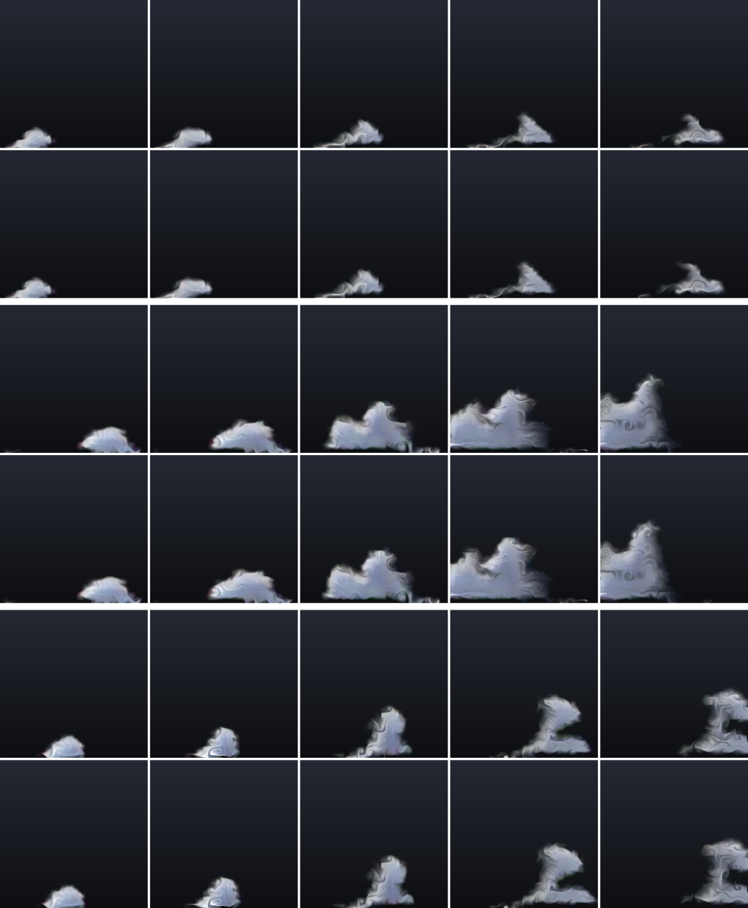
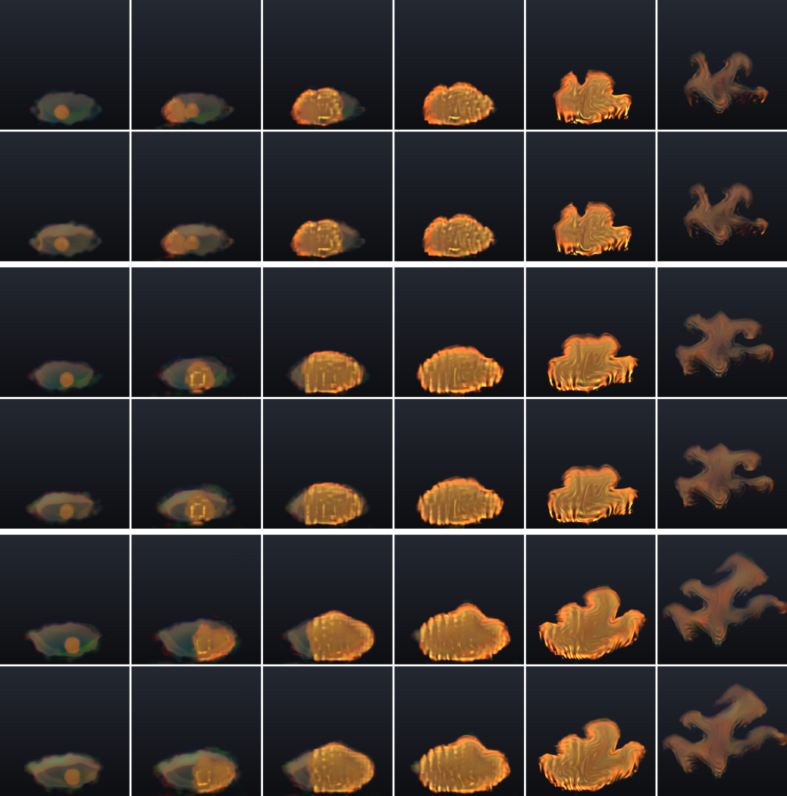
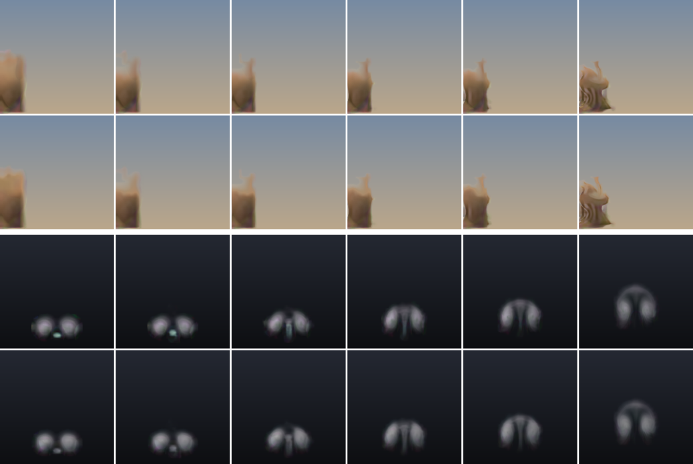
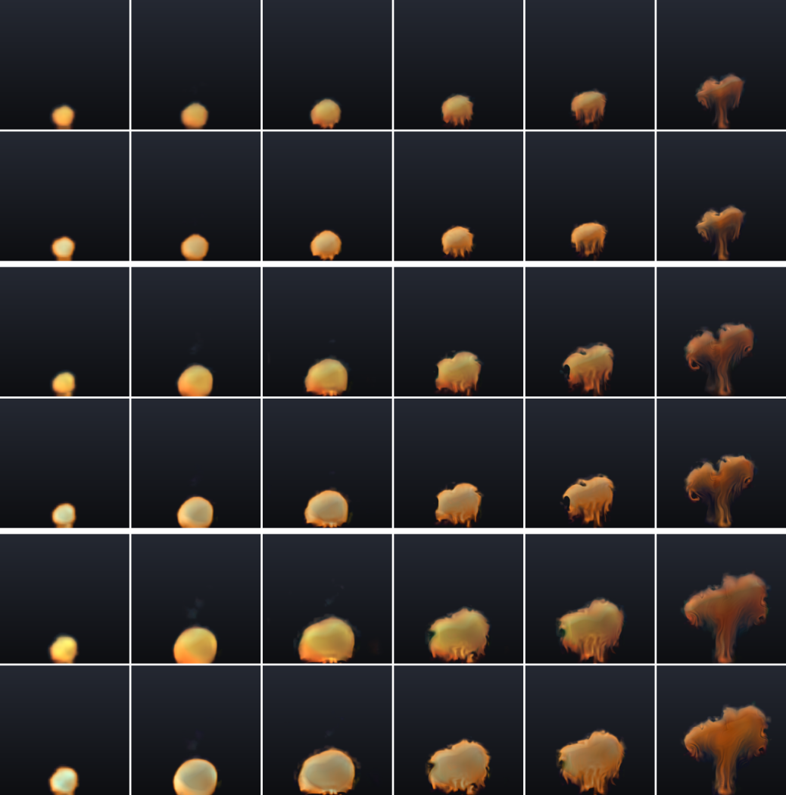
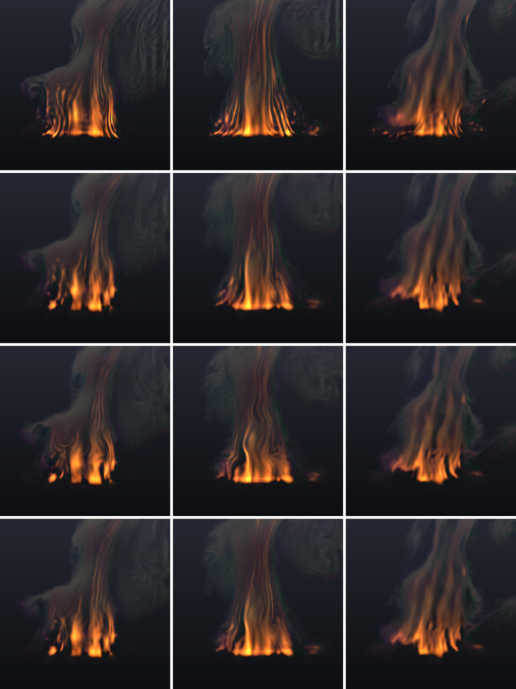
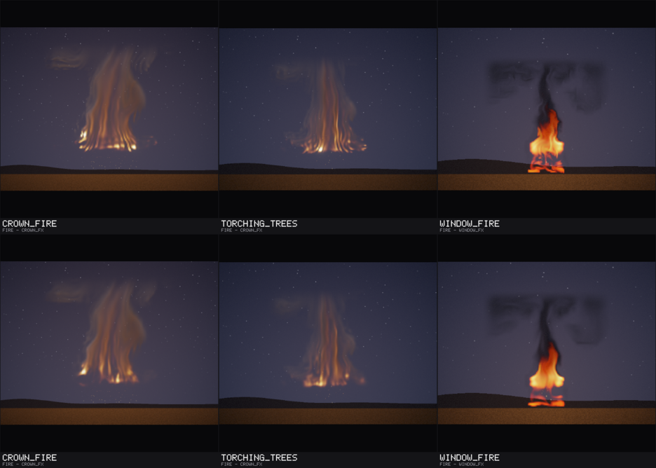
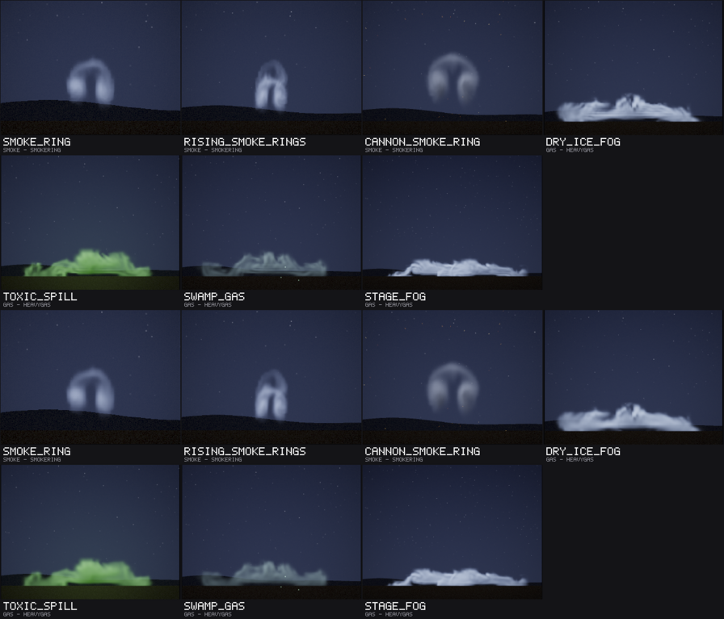

# Study Q: the weak spots of rounds 9 and 10, fixed and measured

Status: **finished** (21 October 2026; begun by one agent, which was stopped, and finished by a second from the jobs it
left running, §0). Audience: dev, research, artists. The plan of the model changes and the form of their rule (§4) were
written and committed before any of the study's numbers; the rule's numbers (the margins and the number of settings)
come from a probe on training settings and are committed before validation; each chosen file is frozen by its SHA-256
before its one test. [REPORT.md](REPORT.md) §21 has the summary.

Study Q does for the weak spots of rounds 9 and 10 ([EFFECTS_EARTH.md](EFFECTS_EARTH.md),
[EFFECTS_AIR.md](EFFECTS_AIR.md), [EFFECTS_FIRE2.md](EFFECTS_FIRE2.md), [EFFECTS_ELEMENTS.md](EFFECTS_ELEMENTS.md)) what
study O did for earlier ones ([REPORT.md](REPORT.md) §16): each weak spot is taken apart first, to find which part makes
it (the learned stepper, the detail layer, the learned renderer, the way it is played); a fix in how an effect is played
(its detail settings, passes, tiles or look in the library and the scenes) is judged by eye from frames before and after,
with a check on training settings beside it; a fix that changes a model goes through a rule written before validation,
with margins sized by a null probe (study M3's lesson, §14.9), validated, frozen and tested once on held-out settings with
fresh seeds, and replaces a shipped model only if it passes.

Seeds: study Q's range, 33,000,000 to 33,499,999 (§4.5). Code: `tools/nvfx_fix.cpp` (`parts`, the taking apart) and
`tools/nvfx_ordered.cpp` (`--study q`: `refit`, `starts`, `train`, `fitmean`, `setmean`, `val --split probeq | valq |
checkq`, `test`). Every file is under the data root's `q_fix` (outside git); tables under `results/experiments/q_fix`.

## 0. Where the study stands (handoff)

Final (21 October 2026, 14:10 UTC). One agent began the study and was stopped at 11:10 UTC; a second took it over from
the jobs it left running (the data root's `q_fix/jobs/*.sh`, their markers `jobs/*.done`, logs `q_fix/logs/`), killed
none and finished it: at the handoff the avalanche's `u60` was training, the smoke ring's validation, the dust
explosion's and the geyser's null probes were running and their candidates' probes waiting; the haboob had stopped at
validation. Every step is committed in the order the rule asks (the commits' times show each rule's numbers before its
validation, each freeze before its test).

| weak spot | where it ended | what was done (committed) | left (§9) |
|---|---|---|---|
| avalanche | **replaced** (§4.8, §6) | `u30` passed its test: tracking at 1 s +0.34 dB [+0.18, +0.50], the mean frame +0.16 [+0.04, +0.28], every measure within its margin; links, models/, frozen hashes, three videos | its start points |
| geyser | **stopped at validation** (§4.7) | none meets the rule: `u30` better on both targets but its first frame past its margin | its tracking with the first frame kept |
| haboob's first frame | **stopped at validation** (§4.7) | `rf`: the first frame +2.55 dB but its detail past its margin | a refit that keeps the detail |
| crown and window fires' streaks | **fixed by eye** (§5.1) | detail settings in the library and the town; frozen hashes, videos | - |
| heavy gas | **fixed by eye** (§5.1) | `soften 0.1` (its thin bright lines) | its start points (its tied mean picture) |
| candle | **nothing to change** (§3.7) | the diagnosis | - |
| smoke ring | **fixed by eye** (§5.1); its refit **stopped at validation** (§4.7) | `soften 0.4` for its looks; `rf`: the first frame +3.52 dB but its motion past its margin | a refit that keeps the motion |
| mushroom's cap | the cap **left** (§3.7); its renderer **replaced** (§4.1, §4.8, §6) | `rf` (added before its probe) passed its test: the first frame +2.04 dB [+1.97, +2.12], every measure within its margin; links, models/, frozen rows, two videos | the cap (its stepper) |
| dust explosion's renderer | **replaced** (§4.8, §6) | `rf` passed its test: the first frame +2.85 dB [+2.54, +3.16], every measure within its margin; links, models/, frozen rows, two videos | - |

## 1. Bottom line

- **Three shipped models are replaced**, each by its one test on held-out settings with fresh seeds, under a rule whose
  numbers were committed before its validation (§4.8):
  - **the avalanche** (`u30`: its stepper fine-tuned on 30-frame windows) follows a held-out run from its true state
    0.34 dB [0.18, 0.50] better at 1 s and 0.62 [0.41, 0.84] at 2 s, and its average picture is 0.16 dB [0.04, 0.28]
    closer to a real run's (60 settings). By eye it is much as before, and by its round's own test it is still weak:
    from its start points the cloud stays smaller than the simulator's;
  - **the dust explosion** (`rf`: its renderer trained again with the first frames among its samples): its first frame
    is 2.85 dB [2.54, 3.16] closer, the unlit cloud grey-beige where it had blue-green fringes (10 settings);
  - **the mushroom** (`rf` on study O's file): its first frame 2.04 dB [1.97, 2.12] closer, its detail and motion
    closer through the run (60 settings); the cap's raggedness, its stepper's, is unchanged.
- **Three stopped at validation and keep their files**, each better on a target and past a margin elsewhere: the
  haboob's refit (the first frame +2.55 dB, its dust's detail further, +0.013 [+0.006, +0.022] against a margin of
  +0.02), the smoke ring's (the first frame +3.52 dB, its motion further, +0.023 [+0.015, +0.030] against +0.02) and the
  geyser's 30-frame fine-tune (+0.41 dB at 1 s and +0.20 in the mean frame, but -0.19 [-0.28, -0.11] at the first frame
  against -0.20). More start points (`s24`) helped the geyser on nothing; the mean state brought the avalanche's
  average picture closer (+0.84 dB) but its detail further, past its margin.
- **Fixed by eye, with no model change** (§5.1): the crown fire's and the window fire's vertical streaks (their detail
  settings; on training runs the spectrum distance 0.48 → 0.10 and 0.51 → 0.17, at a price in motion), heavy gas's thin
  bright lines (`soften 0.1`) and the smoke ring's detail where its looks draw it (`soften 0.4`).
- **What makes each weak spot** (§3): the avalanche's stepper and start points; the fires' detail layer (the crown
  fire's lock, the window fire's swirl), not their models; the one-shots' first frames, their renderers' (the recipe
  never shows a renderer a fresh state); heavy gas's and the geyser's endless numbers, their start points'.
- **Left** (§9): the avalanche's and heavy gas's start points, the geyser's tracking with its first frame kept, the
  haboob's and the ring's first frames without the losses their refits brought, the mushroom's cap; the candle had
  nothing a setting could fix.

## 2. The weak spots

From the rounds' documents, worst first:

| effect | weak spot | the round's own reading |
|---|---|---|
| avalanche | follows a held-out run 2.2 dB worse than the coarse simulation with the same detail at 1 s; its learned cloud grows and billows less than the simulator's | weak (EFFECTS_EARTH.md §4) |
| geyser | ties the coarse simulation at 1 s and loses at 2 s; within a shard it follows its start point more than its intensity | weak (EFFECTS_ELEMENTS.md §4, §4.7) |
| haboob | its first frame is lost to its renderer (-11.7 dB); its mean picture ties the flipbook's | falls short (EFFECTS_ELEMENTS.md §4) |
| crown fire, window fire | vertical streaks in the fine detail (spectrum distance 0.43 and 0.44, six times the flipbook's) | work (EFFECTS_FIRE2.md §4) |
| heavy gas | its mean picture ties the flipbook's; its rolling fronts come out as horizontal streaks | falls short (EFFECTS_AIR.md §4) |
| smoke ring | its fine detail is the least real of any effect (spectrum distance 0.72); its first frame is 4.8 dB behind | works (EFFECTS_AIR.md §4) |
| dust explosion | its renderer fringes the unlit cloud and draws the pall faint | works (EFFECTS_FIRE2.md §4.5) |
| candle | a ragged, torn flame up close; blue-green fringes on the smoke | works (EFFECTS_AIR.md §4.6) |
| mushroom | the cap turns ragged after 3 to 4 s (study O's model) | weak, then replaced by study O (REPORT §16.3) |

## 3. Diagnosis

Each weak spot was taken apart with `nvfx_fix parts` (as study O's `bands` took the waterfall apart, but over the whole
frame), on training runs (salt 1, runs 0 to 3 unless said; diagnosis only, at float), the real frames against the
learned effect with one part at a time swapped:

| method | what it is |
|---|---|
| `shipped` | the runtime as an engine plays it: shards from the stored start points nearest the controls, a seed of its own (study Q's 33,460,000 + 100 r); a one-shot from its start, a looping effect from 2 s |
| `true` | the reference rollout from the run's true state (coarse and fine fields, the run's seed): the learned stepper, detail layer and renderer |
| `true_sim` | the same states drawn by the simulator's renderer (the learned renderer taken out) |
| `coarse_up` | the learned coarse state alone, upsampled, the simulator's renderer |
| `oracle` | the run's true coarse state of every frame moving the detail layer (a perfect stepper), the simulator's renderer |
| `oracle_up` | the true coarse state alone, upsampled |
| `rend_true` | the learned renderer on the run's true fields (the renderer alone) |

Measured over a looping effect's 90 frames from frame 100 or a one-shot's whole length: study D's frame statistics against
the real frames (detail spectrum distance, motion ratio, coverage distance, mean-frame PSNR), the luminance's 2D power in
bands of period as log10 over the real frames' (64 to 16, 16 to 8, 8 to 2.5 and 2.5 to 2 pixels of a 128-pixel frame),
how much of the fine band (8 to 2.5 px) lies along x rather than y (log10 Px/Py: above the real frames' means more
vertical structure), active PSNR at 1, 8 and 30 frames, and for a one-shot the cover's size and height over time and the
renderer on the true fields frame by frame from the first. Tables: the data root's `q_fix/diag/<effect>/parts_*.csv`.

### 3.1 The avalanche: the stepper grows the cloud too little, and its start points make it smaller still

Six training runs, the whole 148 frames:

| method | spectrum | motion | cover dist. | mean frame (dB) | tracking at 1 s (dB) | cover at 1 s / 2 s / 4 s | its height (share of the frame) at 1 / 2 / 4 s |
|---|---:|---:|---:|---:|---:|---|---|
| real | | | | | | 0.021 / 0.027 / 0.020 | 0.052 / 0.075 / 0.098 |
| shipped | 0.198 | 1.02 | 0.0134 | 28.8 | 8.0 | 0.014 / 0.012 / 0.004 | 0.051 / 0.076 / 0.057 |
| true | 0.134 | 0.97 | 0.0045 | 34.6 | 13.1 | 0.018 / 0.023 / 0.013 | 0.051 / 0.066 / 0.081 |
| true_sim | 0.128 | 0.99 | 0.0045 | 34.7 | 13.1 | 0.018 / 0.023 / 0.013 | 0.051 / 0.066 / 0.082 |
| coarse_up | 0.338 | 0.78 | 0.0037 | 35.3 | 15.2 | 0.021 / 0.025 / 0.014 | 0.052 / 0.067 / 0.073 |
| oracle | 0.128 | 1.19 | 0.0004 | 40.1 | 16.6 | 0.020 / 0.027 / 0.019 | 0.054 / 0.077 / 0.099 |
| oracle_up | 0.312 | 0.87 | 0.0017 | 40.2 | 18.1 | 0.023 / 0.029 / 0.020 | 0.055 / 0.077 / 0.099 |
| rend_true | 0.016 | 0.99 | 0.0002 | 57.9 | 31.2 | 0.021 / 0.027 / 0.019 | 0.052 / 0.076 / 0.098 |

- **Not the renderer** (on the true fields 57.9 dB in the mean frame, 30 to 36 dB a frame, its first frame the best) and
  **not the detail layer**: driven by the true coarse states it keeps the cloud's size and height and follows the run
  (16.6 dB at 1 s).
- **The stepper**: from the true state the learned cloud has 86%, 85% and 65% of the real cover at 1, 2 and 4 s and sits
  lower (its centre at 0.066 of the frame at 2 s against 0.075, 0.081 against 0.098 at 4 s): it runs, but does not swell
  and rise as the simulator's entrainment makes it; drawn by the simulator's renderer the same. Its training windows (16
  frames, after a burn-in of up to 32) see little of a growth that lasts two to three seconds. Candidates: `u30`, `u60`.
- **And its start points**: as shipped, from one of its 16 stored first states (taken at other controls) with a seed of
  its own, the cloud has 67%, 44% and 20% of the real cover at 1, 2 and 4 s; its average picture is 5.8 dB further from
  the real one's than from the true state. A stored first state at another intensity and direction releases another slab
  in another place. Candidate: `ms` (the mean state, which moves a start point to the controls asked for: the fit explains,
  cross-validated, 72% and 74% of the first states' velocity and 56% of their snow over the control space).

### 3.2 The crown fire and the window fire: the detail layer's lock, not the model

| effect | method | spectrum | motion | fine band 8-2.5 px | finest 2.5-2 px | Px/Py (real) |
|---|---|---:|---:|---:|---:|---:|
| crown fire | shipped (grow 2, contrast 0.5, swirl 0) | 0.479 | 0.80 | +0.41 | +0.60 | +0.40 (+0.26) |
| | true_sim | 0.496 | 0.91 | +0.45 | +0.70 | +0.30 |
| | oracle | 0.510 | 1.26 | +0.50 | +0.68 | +0.34 |
| | **oracle, grow 1** | **0.050** | 0.99 | +0.07 | -0.05 | +0.26 |
| | rend_true | 0.096 | 0.98 | -0.12 | -0.09 | +0.29 |
| window fire | shipped (grow 1, contrast 0.5, swirl 1.5 at 6 px) | 0.506 | 0.92 | +0.43 | +0.84 | +0.10 (-0.11) |
| | true_sim | 0.481 | 0.90 | +0.43 | +0.78 | -0.00 |
| | oracle | 0.460 | 1.10 | +0.40 | +0.75 | +0.08 |
| | **oracle, swirl 0** | **0.169** | 1.02 | +0.27 | +0.11 | +0.10 |
| | rend_true | 0.021 | 1.01 | -0.03 | -0.00 | -0.06 |

- **The detail layer draws the streaks**: with a perfect stepper (the true coarse states) and the simulator's renderer
  it is as far from real as the learned effect (0.51 and 0.46), with three times the real power at periods of 2.5 to 8
  pixels and five to seven times at 2 to 2.5; the learned renderer on the true fields is close to real (0.10, 0.02).
- **The crown fire's is its lock's growth** (`grow 2`, the calibration's choice): where a rising column carries material
  into a coarse cell, the lock scales the fine pattern already there up by as much as twice instead of adding new
  material broken up by the noise, so every streak the column carries up is kept and strengthened. With `grow 1` the same
  oracle is 0.050 from real, the floor's distance (two real runs: 0.05), and its streaks lie as the real ones do (Px/Py
  +0.26).
- **The window fire's is its sub-grid swirl** (1.5 pixels a frame at a 6-pixel scale): small regular eddies stirred into
  the flame and its smoke draw fine curls and lines; without it the oracle is 0.17.
- Played as shipped the learned coarse state adds less than the oracle's error, so the settings that matter are the
  detail layer's (§5.1).

### 3.3 Heavy gas: its start points, then its thin bright lines

| method | spectrum | motion | cover dist. | mean frame (dB) | 64-16 px | 8-2.5 px | 2.5-2 px |
|---|---:|---:|---:|---:|---:|---:|---:|
| shipped | 0.308 | 1.47 | 0.0236 | 19.5 | +0.23 | +0.26 | +0.53 |
| true_sim | 0.091 | 1.13 | 0.0020 | 29.8 | +0.00 | +0.00 | -0.05 |
| oracle | 0.140 | 1.20 | 0.0020 | 33.3 | -0.03 | -0.01 | -0.20 |
| rend_true | 0.024 | 1.01 | 0.0002 | 52.5 | -0.00 | +0.02 | +0.05 |

From the true state the learned gas is close to real in detail, motion and cover (0.09, 1.13, 0.002); as shipped, from
one of its 8 stored start points at other controls, it is a different layer (the coarse band +0.23, the cover ten times
as far, the average picture 10 dB further): the tied mean picture is its start points'. The thin bright lines along its
fronts that read as streaks are the fine band's excess as shipped; `soften 0.1` takes most of it (§5.1). A model fix for
the start points (more of them, as the geyser's `s24`) was not made in this study (§9).

### 3.4 The smoke ring: the detail layer adds the fine structure, and the renderer adds its own

The ring's real smoke is smooth (it spreads). The detail layer driven by the true coarse states adds three times the real
fine power (the oracle 0.67 from real); softening the fine fields takes it off (`soften 0.4`: the oracle 0.04, the learned
stepper drawn by the simulator's renderer 0.15). But the learned renderer on the true fields is itself 0.45 to 0.60 from
real (ten times the real power at 2 to 2.5 pixels), so the bare model stays far from real whatever the detail layer
does (as shipped with `soften 0.4`: 0.47). The library and the crypt draw the ring by looks, which take the fields, not
the learned renderer: there `soften 0.4` is the fix (§5.1). Its first frame (below) is the renderer's too.

### 3.5 The first frames of the haboob, the smoke ring and the dust explosion: the renderer's samples

The learned renderer on the true fields, frame by frame from the run's first (training runs 100 to 103, which are not
among the renderer's samples):

| effect | 1st | 2nd | 5th | 10th | 15th | 30th | the renderer's samples (frames) |
|---|---:|---:|---:|---:|---:|---:|---|
| haboob | 27.9 | 28.2 | 28.9 | 29.6 | 29.8 | 29.4 | 10 to 139 |
| smoke ring | 26.0 | 25.7 | 27.2 | 31.4 | 32.9 | 35.4 | 10 to 109 |
| dust explosion | 22.4 | 22.6 | 23.2 | 24.5 | 25.9 | 27.6 | 10 to 109 |
| avalanche (for comparison) | 36.5 | 32.7 | 31.3 | 30.0 | 30.0 | 31.1 | 10 to 139 |

The recipe takes the renderer's training samples at frames 10 to length - 10 of each run (`finish_model`), so a one-shot's
fresh state (the haboob's lock, the ring's two dense cores, the dust explosion's unlit cloud and spark) is never among
them; the renderers are 2 to 9 dB weaker there than later in the run. By eye the current haboob's renderer draws a magenta
speck at the lock's nose, the ring's a green-cyan blob at the opening, the dust explosion's green and magenta fringes round
the unlit cloud. The refit `rf` (§4.1) on the same runs: the haboob 30.4, 30.9, 31.9, 32.5, 32.1 and 30.9 dB; the ring
32.0, 32.2, 33.4, 34.5, 34.9, 35.9; the dust explosion 28.3, 28.4, 28.4, 28.7, 28.9, 27.9.

The haboob's -11.7 dB at the first frame (EFFECTS_ELEMENTS.md §4.1) is mostly a different thing: the coarse simulation with
the detail layer starts from the true fine fields and draws them with the simulator's own renderer, so its first frame is
nearly the true one (39 dB), where any learned renderer of the haboob is about 30 dB on the true fields. A refit closes
part of the renderer's own gap; it cannot close that one.

### 3.6 The geyser: its start points and its eruptions

| method | spectrum | motion | cover dist. | mean frame (dB) | tracking at 1 s (dB) |
|---|---:|---:|---:|---:|---:|
| shipped | 0.667 | 1.62 | 0.0216 | 25.4 | 18.6 |
| true | 0.215 | 0.90 | 0.0041 | 35.5 | 22.3 |
| true_sim | 0.227 | 0.90 | 0.0040 | 35.7 | 22.5 |
| oracle | 0.166 | 0.99 | 0.0001 | 43.4 | 32.4 |
| rend_true | 0.031 | 1.02 | 0.0002 | 55.1 | 45.0 |

Not the renderer (45 dB on the true fields). From the true state the learned stepper follows the run less well than the
true coarse states would (22.3 against 32.4 dB at 1 s): its column and steam part from the run's within a second; as
shipped, from its 8 start points at other controls and other moments of the conduit's cycle, it is far further (the mean
frame 10 dB, the cover five times). Candidates: `u30` (following a run), `s24` (start points nearer the controls).

### 3.7 The dust explosion's detail, the candle and the mushroom

- **The dust explosion's detail is not at fault** by these measures (as shipped 0.128, the oracle 0.068; `grow 1` makes it
  worse, 0.42): its weak part is its renderer (§3.5).
- **The candle** as the library plays it (`swirl 1, swirl_scale 9`): 0.245 as shipped, 0.199 with the oracle, and every
  detail setting tried (softening, contrast 0, swirl 0) is further from real; its renderer on the true fields is 46 dB in
  the mean frame. Its ragged, torn flame was the calibrated swirl (3), which the library already overrides
  (EFFECTS_AIR.md §4.6); its fringes are its learned renderer's on the learned fields, which the library's look
  (`candlelight`) does not use. Nothing more was changed (§9).
- **The mushroom** (study O's model, 4 runs): its cap's raggedness is not a detail setting (softening, `grow 1` and contrast
  0 each move the spectrum as shipped from 0.199 to 0.199, 0.356 and 0.321) nor its cover (from the true state 0.086,
  0.120 and 0.174 of the frame at 1, 2 and 4 s against the real 0.091, 0.118 and 0.163); study O's diagnosis stands (REPORT
  §16.7: a stepper that sees the cap's whole life) and the cap is left (§9). Found on the way: its renderer on the true
  fields is 15.0 dB at the first frame, 19.6 at the tenth and 24.2 at the thirtieth (42.4 dB in the mean frame), the
  weakest first second of any effect taken apart here: the fresh fireball, outside the renderer's samples (§3.5). The
  library draws the mushroom with a look, so this shows only in its own renderer's frames.

## 4. The model changes: the plan and the rule (committed before any of their numbers)

### 4.1 Candidates

Each is a file built from the shipped model by one change, with the tools named; nothing else in the file changes.

| effect (shipped file, SHA-256) | candidate | what it is | why (the weak spot) |
|---|---|---|---|
| avalanche (`fx_earth/models/d/avalanche.nvfx`, `77bf9d9d...`) | `ms` | study M3's mean state: fitted to the first coarse states of its 240 training runs (salt 1), quadratic in the controls per block of 2 x 2 cells (`fitmean --block 2`, `setmean`), so a start point stored at other controls is moved to the requested ones | its 16 start points are at other intensities; its endless average picture lost to the flipbook by 2.9 dB |
| | `u30` | the stepper fine-tuned from its weights by 600 iterations of the activity stage on windows of 30 frames (`train --activity-stage 600 --mean-stage 0 --unroll 30 --lr-ft 7e-4`), as study O's mushroom `u30` | it falls behind from 1 s: the cloud's growth is a slow, cumulative process the 16-frame windows of training see little of |
| | `u60` | the same on windows of 60 frames (`--unroll 60`) | the growth lasts two to three seconds |
| | `ms_u30` | `u30` with the mean state | both |
| geyser (`fx_elements/models/d/geyser.nvfx`, `43095b69...`) | `u30` | as the avalanche's `u30` | it ties at 1 s and loses at 2 s |
| | `s24` | 24 start points instead of 8, taken from its training runs as the recipe takes them (`starts --count 24`: farthest-point order in control space, so its first 8 are the current ones; frame 150, 64-pixel fine fields) | a shard plays one of the three start points nearest the controls, and with 8 of them those are far off: its column follows the start point more than its intensity |
| | `s24_u30` | `u30` with the 24 start points | both |
| haboob (`fx_elements/models/d/haboob.nvfx`, `b7aa8a4f...`) | `rf` | the renderer trained again as the recipe trains it (fresh weights, the recipe's options), on the recipe's 200 samples and 100 more, one from each of the first 100 training runs at one of its first 15 frames (run i: frame i mod 15; `refit --early 15`) | the recipe's samples are frames 10 to length - 10 of each run: a one-shot's first frames (the fresh lock) are never among them |
| smoke ring (`fx_air/models/d/smokering.nvfx`, `4a2188b2...`) | `rf` | as the haboob's | its first frame is 4.8 dB behind, lost to the renderer |
| dust explosion (`fx_fire2/models/d/dustexplosion.nvfx`, `65057a10...`) | `rf` | as the haboob's | its renderer fringes the unlit cloud (its first frames) and draws the pall faint |

The diagnosis (§3) may add or drop a candidate before the probe's second step; any change is written here, with its
reason, before validation. The fine-tunes run on 2 threads with seeds 33,470,001 and up (the trainer's own; the training
runs are the recipe's, salt 1); the renderer refits on 1 thread (the result depends on the thread count).

**Added on 21 October at 12:00 UTC, before any of its probe** (by the agent that took the study over, §0): the
**mushroom** (study O's file, `o_fix/models/mushroom.nvfx`, SHA-256 `4a2f08a05eed33a85584b670eb009b606ecb1443089429b15beca703a46c97cc`)
gets `rf`, as the haboob's (the renderer trained again with 100 samples from its runs' first 15 frames; the same targets:
the first frame and the mean frame). Why: the taking apart found its renderer the weakest of any effect in a one-shot's
first second (§3.7: 15.0 dB on the true fields at the first frame, 24.2 at the thirtieth), the cause §3.5 found for the
others, and the dust explosion's refit has since passed its test (§4.8). It does not touch the cap's raggedness, which is
the stepper's (§3.7) and stays left (§9). Its probe (the null first, its margins committed before `rf` is played), its
rule's numbers, validation and test follow §4.2 to §4.4 unchanged, with the binary of validation (`nvfx_ordered_q3`, the
same evaluation code as the probe's `q1`, §4.4) for every step.

### 4.2 The probe (development, training settings only)

As study M3's and study O's (REPORT §14.9.1, §16.3): the controls of salt-1 training runs 0 to 39 (40 settings); per
setting 8 real runs (the reference) and 8 more (the floor); 8 plays per model through the runtime as shipped (float, the
frozen tests' precision; one-shots their whole length from the first frame, looping effects 10 s after a 5 s warm-up of
the real runs); tracking 2 runs per setting from the true state (each from an empty grid; a looping effect after 100
frames), through the runtime. In two steps: the current model and **the null** (the current model with fresh seeds)
first, which fix the margins (written to `results/experiments/q_fix/q_margins.csv` and committed before any candidate is
played on the probe); then the candidates, whose paired spread fixes **the number of settings N** for each effect's
validation and test: the smallest multiple of 10 at which, for every candidate of the effect and every measure that is not
a target it improves on the probe, a candidate leaving that measure truly unchanged passes its margin with probability at
least 0.9, by resampling the probe's settings and in the normal form with the SD at the upper end of its one-sided 80%
interval; at most 60 (if the cap binds, the power at 60 is stated before validation). Every candidate of §4.1 goes to
validation (the plan names no selection on the probe, so none is made there; written after the first probe, before any
validation).

### 4.3 The rule (its form fixed now; its numbers from the probe, committed before validation)

**Measures** (each paired over the settings, candidate minus current model): tracking from the true state at the first
frame, at 1 s and at 2 s (active PSNR; each setting's mean over its 2 runs); and the endless statistics of studies M, M2
and M3, 8 runs pooled per setting: the detail spectrum distance, |ln motion ratio|, the coverage and emission distances
and the mean-frame PSNR. 95% paired bootstrap with 10,000 resamples (`metrics::paired_bootstrap`, seed 2026).

**Targets**, declared with each candidate (§4.1): the renderer refits (`rf`) target the first frame and the mean
frame; every other candidate targets tracking at 1 s and the mean frame.

A candidate **replaces** the current model when
1. it is **better on at least one of its targets** (that interval above zero), and
2. **every measure is within its margin**, its targets included: each tracking horizon and the mean-frame PSNR at least
   their margins (dB), the spectrum, motion, coverage and emission distances at most theirs.

Each **margin** is the larger of study K's at the measure's scale (tracking -0.20 dB at each horizon, the mean frame
-0.10 dB, spectrum and motion +0.02, coverage and emission 10% of the current model's mean distance on the probe, at
least 0.0001) and the null's RMS change at a setting (over the probe's 40 settings); tracking has no null (a tracked run
takes its own seed, so the same model plays the same frames) and keeps -0.20 dB.

**The choice**, on validation, among an effect's candidates that meet the rule: the largest mean-frame gain among those
better on the mean frame; if none is, the largest gain at tracking at 1 s; if none, at the first frame. An effect with
none stops there (a null, reported with its numbers). The strict reading (no interval entirely on the worse side of zero)
and study K's margins are reported beside each decision and do not decide.

### 4.4 Validation and the test

**Validation**: study G's 10 validation settings and more drawn the same way (`validation_settings(N, N)`), N the
effect's from the probe. **The test, once per effect** with a chosen candidate: study B's 10 held-out settings and more
drawn the same way (`test_settings(N)`). Before it the file is copied to the data root's `q_fix/models/<effect>.nvfx` and
frozen by SHA-256 in `results/experiments/q_fix/q_frozen.csv`; `nvfx_ordered --study q test` refuses any other file and
runs once (a marker under `q_fix`). The same tool binary for the probe, validation and the test.

An effect that meets the rule on the test is **replaced**: the shared links in the data root's `library/models` and in
every scene folder holding it are repointed at the new file (the old targets logged in `q_fix/logs/links_before.txt`),
after the full ctest has passed with the new links; every frozen hash that changes is updated in the same change (at
float, pinned to the AVX2 build with `--isa avx2`), and the videos that show it are rendered again. Reported beside, not
deciding: the distance to the floor before and after, the cost, and for a replaced model its round's own test (`d-eval`,
tracking against the coarse simulation with detail, endless against the nearest flipbook) run again with fresh seeds.

**The tool binary.** The rule's numbers are read from a committed table, `results/experiments/q_fix/q_rule.csv` (an
effect's N and its eight margins; `valq` and `testq` refuse an effect without a row), so that one binary validates and
tests every effect: `nvfx_ordered` built at the commit that adds the table's reader (the data root's
`q_fix/bin/nvfx_ordered_q3`, SHA-256 `4ee12407c321c3164b2be97cb589620f38449045e8b7c7cd2eb229baaf400e8e`). The probe ran
on an earlier build (`nvfx_ordered_q1`, `ff55e409...`) of the same evaluation code (what changed between them: the reader
of the table, `graft` and a log message of `starts`).

### 4.5 Seeds

Study Q's range, 33,000,000 to 33,499,999 (library and script seeds stay below 2^25 = 33,554,432); per run seed
base + 100 s + k (setting s, run k):

| use | real runs (the floor: + 50) | plays | the null's plays | tracking |
|---|---:|---:|---:|---:|
| the probe (`probeq`) | 33,000,000 | 33,010,000 | 33,020,000 | 33,030,000 |
| a library setting's check (`checkq`, not a decision) | 33,040,000 | 33,050,000 | - | 33,060,000 |
| validation (`valq`) | 33,100,000 | 33,150,000 | - | 33,180,000 |
| the test (`testq`) | 33,200,000 | 33,250,000 | - | 33,280,000 |
| a replaced model's round test again (`d-eval --seed-base 33300000`) | 33,300,000 to 33,450,999 | | | |
| diagnosis, figures, the trainers' seeds | 33,460,000 to 33,499,999 | | | |

### 4.6 The probe and the rule's numbers (each effect's committed before its validation)

The probe's tables: [q_margins.csv](../results/experiments/q_fix/q_margins.csv) (the null's margins, committed for each
effect before its candidates were played on the probe), [q_power.csv](../results/experiments/q_fix/q_power.csv) and
`q_probe_*.csv`; the numbers each effect's validation and test use: [q_rule.csv](../results/experiments/q_fix/q_rule.csv).

**The haboob.** The null (the current model with fresh seeds, 40 training settings) moves its spectrum distance at a
setting by 0.017 (RMS), its motion by 5.7%, its coverage distance by 0.0036 and its mean frame by 0.85 dB: margins
tracking -0.20 dB at each horizon, spectrum **+0.02** (study K's), |ln motion ratio| **+0.0566**, coverage **+0.0036**,
emission **+0.0001**, mean frame **-0.85 dB**. `rf` (SHA-256 `807e51674c37cdb53c82f423e3a78518215c110ab0df2a51720b28656e57e334`)
on the probe: the first frame **+2.53 dB [+2.44, +2.63]**, the mean frame **+0.11 [+0.07, +0.14]**, tracking at 1 s
+0.15 [+0.12, +0.19] and at 2 s +0.05 [+0.02, +0.08] (better), the spectrum distance +0.010 [+0.007, +0.014] (worse, within
its margin), motion, coverage and emission no worse: it meets the rule's form. Every measure that is not a target it
improves passes its margin, if truly unchanged, with probability 1.00 at 10 settings by resampling, and needs at most 5
in the normal form at the SD's upper 80% bound: **N = 10** (study B's ten held-out settings for the test, study G's ten
for validation).

**The smoke ring.** The null moves its spectrum distance at a setting by 0.039 (RMS), its motion by 1.9%, its coverage
distance by 0.00036 and its mean frame by 1.70 dB: margins tracking -0.20 dB, spectrum **+0.0387**, |ln motion ratio|
**+0.02** (study K's), coverage **+0.00036**, emission **+0.0001**, mean frame **-1.70 dB**. `rf` (SHA-256
`98f87eaca58c41c5a191f302c529b804813f5512d8b0db4b25b2bfd603555486`) on the probe: the first frame **+3.56 dB [+3.41,
+3.71]**, the spectrum distance **-0.073 [-0.077, -0.070]** (0.717 → 0.643; better), coverage and emission closer, the mean
frame +0.06 [-0.00, +0.12] (a tie), tracking at 1 s a tie and at 2 s -0.12 [-0.17, -0.07] (worse, within its margin), its
motion error +0.011 [+0.001, +0.021] (worse, its interval's end just past the margin of +0.02): on the probe it does not
quite meet the rule's form. The number of settings at which every measure that is not an improved target passes if truly
unchanged: by resampling 0.95 at 30 settings for tracking at 1 s and the motion; in the normal form at the SD's upper 80%
bound the motion needs 35: **N = 40**.

**The dust explosion.** The null moves its spectrum distance at a setting by 0.013 (RMS), its motion by 3.4%, its coverage
distance by 0.0025, its emission distance by 0.00018 and its mean frame by 1.13 dB: margins tracking -0.20 dB, spectrum
**+0.02** (study K's), |ln motion ratio| **+0.0343**, coverage **+0.0025**, emission **+0.000177**, mean frame **-1.13
dB**. `rf` (SHA-256 `a0f273ea278b3a60f0ea4e96db5177258faf0fcd21ffa020ac2ca65d78bed520`) on the probe: the first frame
**+3.27 dB [+3.09, +3.46]** (21.96 → 25.23 dB), the mean frame **+0.018 [+0.002, +0.034]** (both targets better),
tracking at 1 s +0.11 [+0.09, +0.13] (better) and at 2 s a tie, the spectrum distance -0.004 [-0.006, -0.003] (better),
its motion error +0.003 [+0.002, +0.005] and coverage distance +0.0002 [+0.0001, +0.0003] (worse, each a tenth of its
margin), emission a tie: it meets the rule's form. Every measure that is not a target it improves passes its margin, if
truly unchanged, with probability 1.00 at 10 settings by resampling and needs 1 setting in the normal form at the SD's
upper 80% bound: **N = 10** (study G's ten validation settings, study B's ten held-out ones).

**The geyser.** An erupting geyser is chaotic (another seed, another eruption), and the null shows it: it moves the
spectrum distance at a setting by 0.125 (RMS), the motion by 22%, the coverage distance by 0.0070 and the mean frame by
3.11 dB. Margins: tracking -0.20 dB at each horizon, spectrum **+0.125**, |ln motion ratio| **+0.217**, coverage
**+0.0070**, emission **+0.0001** (study K's), mean frame **-3.11 dB**. On the probe:
- `u30` (SHA-256 `262f3c8fd46e56efbb606aabcaa9156ea84e8305800fc5d5180cf8d1a375aa05`): tracking at 1 s **+0.28 dB [+0.13, +0.42]** (better: a target), at 2 s +0.21
  [-0.06, +0.47], the first frame -0.09 [-0.13, -0.05], the spectrum distance +0.011 [+0.004, +0.019] and coverage +0.0003
  [+0.0000, +0.0005] (worse, each well within its margin), motion, emission and the mean frame ties (+0.04 [-0.07,
  +0.16]): it meets the rule's form.
- `s24` (`3cef97755ca4b0b3451179423a3fa7201ae0cac4d32b3c2d96020022ebbf3cd6`): the same frames from a true state (start points play no part there); in endless play no better on any measure:
  the mean frame +0.14 [-0.82, +1.10], the spectrum distance +0.043 [-0.022, +0.111], its motion error +0.064 [-0.016,
  +0.147] (the motion ratio 1.05 → 0.91), emission a little closer: better on no target.
- `s24_u30` (`bbeed0d23c88af8d3c25eb415304b6a522ab7bbb666f9b7684f2184ad3571ffa`): `u30`'s tracking and `s24`'s endless play, its spectrum's interval reaching past its margin (+0.056 [-0.013,
  +0.127]).

The number of settings: tracking at 2 s, which `u30` improves but which is not its target, spreads widely (an SD of 0.87
dB between settings): if truly unchanged it would pass its margin of -0.20 dB with probability 0.48 at 60 settings by
resampling and needs 246 in the normal form; `s24`'s spectrum needs 39. The cap binds: **N = 60**, at which a candidate
whose held measures are truly unchanged and whose improved targets are as measured meets the rule's form with
probability 0.47 (`u30`), 0.99 (`s24`) and 0.46 (`s24_u30`) (q_power.csv), stated here before validation.

**A correction to §4.1, before validation.** `starts` reports (the data root's `q_fix/logs/starts_geyser.log`) that none
of `s24`'s first 8 start points has the current file's controls, where §4.1 said its first 8 are the current ones. The
recipe's rule is the same (farthest-point order over the salt-1 training runs' controls from the run nearest the middle)
and the round recorded the same 160 runs, so the cause was not traced; `s24` is therefore 24 start points chosen afresh
by that rule, not the current 8 and 16 more. It is the candidate §4.1 names in every other respect and is validated as
it is.

**The avalanche.** The null moves its spectrum distance at a setting by 0.024 (RMS), its motion by 16% (|ln motion
ratio| 0.163), its coverage distance by 0.0075 and its mean frame by 1.98 dB: margins tracking -0.20 dB at each horizon,
spectrum **+0.0237**, |ln motion ratio| **+0.163**, coverage **+0.0075**, emission **+0.0001** (study K's), mean frame
**-1.98 dB**. On the probe (the four candidates, `u60` played after its training ended; q_power.csv):
- `ms` (SHA-256 `be39b93f68d8e1051d45bc58828f0203fb9072fe9bd82f46fa29ccda82bafd4a`): the same frames from a true state
  (the mean state moves a start at its own controls by nothing); in endless play its motion error -0.131 [-0.213, -0.057]
  and coverage distance -0.0033 [-0.0065, -0.0004] better, the mean frame +0.58 [-0.01, +1.16] (a tie), the spectrum
  distance worse, +0.0235 [+0.0108, +0.0366], its interval's end past its margin (+0.0237): better on no target.
- `u30` (`d6161c1d09116e2b00a959011192de85c20378a815623ff5c3249fc49013ec67`): tracking at 1 s **+0.29 dB [+0.12, +0.47]**
  (a target) and at 2 s +0.65 [+0.44, +0.87], the spectrum distance -0.006 [-0.011, -0.002], the mean frame +0.11 [-0.04,
  +0.27] (a tie): it meets the rule's form.
- `ms_u30` (`bcc04822fdcdfd9eaf53694a2594bca5d55fcc2ca5ab930e961a8995ffc985b4`): `u30`'s tracking, the mean frame **+0.80
  [+0.16, +1.44]** (a target), motion and coverage better as `ms`'s, the spectrum distance +0.016 [+0.003, +0.029], its
  interval's end past its margin.
- `u60` (`9ca9d84f7c5f3c0bd18f5126bfade5c8e0eaffb15fce4eac48d13dc537901c2d`): tracking at 1 s **+0.38 [+0.12, +0.65]**,
  at 2 s +1.06 [+0.82, +1.31] and the mean frame **+0.27 [+0.02, +0.53]** (both targets better), the spectrum distance
  -0.007 [-0.012, -0.003]; but the first frame -0.35 [-0.49, -0.22], past its margin (-0.20): the long windows trade the
  first frames for the later ones.

The number of settings: tracking at 2 s, which every fine-tune improves but which is no candidate's target, spreads with
an SD of 0.71 to 0.81 dB between settings: if truly unchanged it would pass its margin with probability 0.48 to 0.62 at
60 settings by resampling and needs 162 to 215 in the normal form; `u60`'s first frame needs 62 there, `ms`'s spectrum
41. The cap binds: **N = 60**, at which a candidate whose held measures are truly unchanged and whose improved targets
are as measured meets the rule's form with probability 0.99 (`ms`), 0.62 (`u30`), 0.60 (`ms_u30`) and 0.45 (`u60`)
(q_power.csv), stated here before validation. (The probe's rows for `u60` went into git with the dust explosion's
replacement, 9d77cbf, before this; nothing of the avalanche's validation had run.)

**The mushroom** (added to the plan before its probe, §4.1). The null moves its spectrum distance at a setting by 0.024
(RMS), its motion by 5.0%, its coverage distance by 0.0037 and its mean frame by 1.07 dB: margins tracking -0.20 dB at
each horizon, spectrum **+0.0236**, |ln motion ratio| **+0.0502**, coverage **+0.0037**, emission **+0.0001** (study
K's), mean frame **-1.07 dB**. `rf` (SHA-256 `c1cd25a276bd3b2a9e0578e631ed85ad9cd9286d5625d30b2c987b2cd9004209`) on the
probe: the first frame **+2.16 dB [+2.06, +2.27]** (15.85 → 18.01 dB; better, a target), tracking at 1 s +0.06 [+0.03,
+0.10], the spectrum distance -0.042 [-0.070, -0.015] (0.171 → 0.128), the motion error -0.066 [-0.068, -0.063] (the
motion ratio 0.82 → 0.88) and emission better; the mean frame -0.05 [-0.07, -0.04], tracking at 2 s -0.03 [-0.05, -0.01]
and coverage +0.0005 [+0.0003, +0.0006] worse, each a twentieth of its margin or less: it meets the rule's form. The
number of settings: the spectrum distance, which `rf` improves but which is not its target, spreads widely between
settings (an SD of 0.090: at a few settings the new renderer's detail is much closer to real, at others a little
further); if truly unchanged it would pass its margin with probability 0.53 at 60 settings by resampling and needs 191
in the normal form. The cap binds: **N = 60**, at which the rule's form passes with probability 0.53 if every held
measure is truly unchanged (q_power.csv), stated here before validation.

### 4.7 Validation (the choice)

Candidate minus current model on study G's validation settings extended to the effect's N, the study's seeds, 8 runs
pooled per setting, tracking 2 runs per setting ([q_val_compareq.csv](../results/experiments/q_fix/q_val_compareq.csv),
[q_val_choice.csv](../results/experiments/q_fix/q_val_choice.csv)):

**The haboob (10 settings): none meets the rule.** `rf` is better on both its targets, the first frame **+2.55 dB
[+2.37, +2.70]** (28.8 → 31.3 dB) and the mean frame **+0.15 [+0.13, +0.17]**, and at 1 and 2 s (+0.21, +0.07), its
coverage and emission closer; but its detail spectrum distance is worse, +0.013 [+0.006, +0.022] (0.093 → 0.106), and that
interval's worse end lies past its margin (+0.02). The refit renderer draws the haboob's dust with a little more fine
structure than the current one (on the probe +0.010 [+0.007, +0.014], within the margin at 40 settings); with 10 settings
the interval is wider. N was sized for measures a candidate leaves unchanged; a real loss of half the margin's size needs
more. By the rule the haboob stops at validation and keeps its model; its first frame stays the renderer's weak part.

**The smoke ring (40 settings): none meets the rule.** `rf` is better on one of its targets, the first frame **+3.52 dB
[+3.36, +3.69]** (25.4 → 28.9 dB), and on detail, coverage and emission (the spectrum distance **-0.075 [-0.079,
-0.072]**, 0.699 → 0.624); its mean frame ties (+0.05 [-0.01, +0.12]), tracking at 1 s ties (-0.05 [-0.11, +0.02]) and
at 2 s is a little worse (-0.11 [-0.17, -0.05], within its margin of -0.20); but its motion error is worse, **+0.023
[+0.015, +0.030]** (|ln motion ratio| 0.039 → 0.062: the motion ratio 0.978 → 0.944 of the real runs'), and the whole
interval lies past its margin (+0.02). The probe showed the same loss at half the size (+0.011 [+0.001, +0.021], §4.6):
the refit renderer draws the ring's smoke with less change from frame to frame than the current one. By the rule the ring
stops at validation and keeps its model; its first frame stays the renderer's weak part, and its looks (which take the
fields, not the renderer) keep the by-eye fix of §5.1.

**The dust explosion (10 settings): `rf` meets the rule and is chosen.** It is better on its first target, the first
frame **+3.46 dB [+3.20, +3.73]** (21.9 → 25.4 dB), and at 1 s (+0.09 [+0.05, +0.12]) and on detail (-0.004 [-0.007,
-0.001]); its mean frame ties (+0.03 [-0.01, +0.06]); at 2 s it is a little worse (-0.04 [-0.07, -0.01], a fifth of its
margin), its motion error too (+0.004 [+0.001, +0.006], a ninth of its margin), coverage and emission tie. Every interval
lies within its margin. By study M's strict reading two intervals lie wholly on the worse side (tracking at 2 s and the
motion), by study K's margins none is outside: reported, not deciding.

**Frozen** before its test ([q_frozen.csv](../results/experiments/q_fix/q_frozen.csv)): the data root's
`q_fix/models/dustexplosion.nvfx` (read-only; 301,443 bytes, SHA-256
`a0f273ea278b3a60f0ea4e96db5177258faf0fcd21ffa020ac2ca65d78bed520`), validated and tested by `nvfx_ordered_q3`.

**The avalanche (60 settings): `u30` meets the rule and is chosen; it is the only one that does.**

| candidate | tracking: first frame | at 1 s (target) | at 2 s | spectrum | \|ln motion\| | coverage | mean frame (target) | reading |
|---|---|---|---|---|---|---|---|---|
| `ms` | +0.00 | -0.00 [-0.00, +0.00] | -0.00 | **+0.024 [+0.005, +0.040]** (margin +0.024) | -0.098 [-0.163, -0.035] | -0.0036 | **+0.84 [+0.24, +1.48]** | the spectrum past its margin: no |
| `u30` | +0.01 [-0.05, +0.07] | **+0.46 [+0.31, +0.63]** | +0.69 [+0.51, +0.88] | -0.002 [-0.006, +0.002] | -0.006 [-0.020, +0.008] | -0.0005 [-0.0010, -0.0001] | +0.12 [-0.01, +0.26] | **meets it** |
| `ms_u30` | +0.01 | +0.46 [+0.31, +0.62] | +0.69 | **+0.022 [+0.004, +0.039]** | -0.037 [-0.108, +0.032] | -0.0037 | **+0.93 [+0.28, +1.66]** | the spectrum past its margin: no |
| `u60` | **-0.35 [-0.50, -0.21]** (margin -0.20) | +0.45 [+0.24, +0.65] | +1.00 [+0.80, +1.19] | -0.004 [-0.007, -0.000] | -0.001 [-0.024, +0.022] | -0.0010 | +0.24 [+0.03, +0.46] | the first frame past its margin: no |

The mean state brings the avalanche's average picture closer (+0.8 to +0.9 dB: a start point at other controls moved to
the ones asked for) and its motion and coverage too, but draws its detail further from real (the spectrum distance
0.135 → 0.159), and that interval reaches past its margin, as on the probe. The 60-frame fine-tune follows a run best at
2 s and improves the mean frame, but loses 0.35 dB at the first frame, as on the probe. `u30` follows a run from its true
state 0.46 dB better at 1 s and 0.69 at 2 s, and changes nothing else past a tie but a coverage a little closer and an
emission distance larger by 4 x 10^-7 (wholly on the worse side by study M's strict reading, a two-hundredth of its
margin). By the rule (§4.3) `u30` is chosen, better at 1 s, the only candidate that meets it.

**Frozen** before its test: the data root's `q_fix/models/avalanche.nvfx` (read-only; 280,927 bytes, the size of the
old file, SHA-256 `d6161c1d09116e2b00a959011192de85c20378a815623ff5c3249fc49013ec67`), validated and tested by
`nvfx_ordered_q3`.

**The geyser (60 settings): none meets the rule.**

| candidate | tracking: first frame | at 1 s (target) | at 2 s | spectrum | \|ln motion\| | coverage | mean frame (target) | reading |
|---|---|---|---|---|---|---|---|---|
| `u30` | **-0.19 [-0.28, -0.11]** (margin -0.20) | **+0.41 [+0.27, +0.58]** | +0.39 [+0.15, +0.66] | +0.007 [+0.001, +0.013] | +0.013 [-0.001, +0.026] | +0.0000 | **+0.20 [+0.08, +0.32]** | the first frame past its margin: no |
| `s24` | 0 | 0 | 0 | +0.044 [-0.012, +0.100] | +0.066 [-0.012, +0.144] | +0.0014 [-0.0010, +0.0038] | -0.08 [-0.96, +0.84] | better on no target: no |
| `s24_u30` | -0.19 [-0.28, -0.11] | +0.41 [+0.27, +0.58] | +0.39 | +0.049 [-0.009, +0.108] | +0.061 [-0.016, +0.138] | +0.0014 | +0.03 [-0.85, +0.94] | the first frame past its margin: no |

The 30-frame fine-tune is better on both its targets: it follows a run 0.41 dB better at 1 s and 0.39 at 2 s, and its
average picture is 0.20 dB closer to a real run's. But it loses 0.19 dB at the first frame, and that interval's worse end
(-0.28) lies past its margin (-0.20); on the probe the same loss was half the size (-0.09 [-0.13, -0.05]). More start
points (`s24`) bring the endless picture no closer (a tie, with the widest interval of any candidate here: another
eruption, another picture) and move the motion and detail further, within their wide margins. By the rule the geyser
stops at validation and keeps its model. What it needed, a fine-tune that keeps the first frames (its first frame is a
fresh state the long windows' loss weighs little), is left (§9).

**The mushroom (60 settings): `rf` meets the rule and is chosen.** It is better on one of its targets, the first frame
**+2.07 dB [+1.99, +2.16]** (16.0 → 18.1 dB), and at 1 s (+0.07 [+0.04, +0.10]), on detail (the spectrum distance
**-0.047 [-0.072, -0.022]**, 0.180 → 0.133), motion (**-0.063 [-0.066, -0.059]**: the motion ratio 0.82 → 0.88) and
emission; the mean frame is a little worse (-0.05 [-0.07, -0.04], a twentieth of its margin of -1.07 dB), tracking at
2 s (-0.02 [-0.03, -0.00]) and coverage (+0.0004 [+0.0003, +0.0006], an eighth of its margin) too. Every interval lies
within its margin; by study M's strict reading three lie wholly on the worse side (reported, not deciding). The mushroom
is study O's file (REPORT §16.3); its stepper and its mean state are unchanged.

**Frozen** before its test: the data root's `q_fix/models/mushroom.nvfx` (read-only; 301,443 bytes, the size of study
O's file, SHA-256 `c1cd25a276bd3b2a9e0578e631ed85ad9cd9286d5625d30b2c987b2cd9004209`), validated and tested by
`nvfx_ordered_q3`.

### 4.8 The test (once)

Study B's held-out settings extended to the effect's N (`test_settings(N)`), the test's seeds (real 33,200,000 + 100 s +
k, the floor + 50, plays 33,250,000, tracking 33,280,000), the file frozen before it ran, the binary of validation, once
(the marker `q_fix/test_<effect>.done`; [q_test_compareq.csv](../results/experiments/q_fix/q_test_compareq.csv),
[q_test_decision.csv](../results/experiments/q_fix/q_test_decision.csv), `q_test_*.csv`). Candidate minus current model,
95% paired bootstrap intervals with 10,000 resamples (margins in brackets):

**The dust explosion, `rf` (10 settings): it meets the rule, and is replaced.**

| measure | current → `rf` | difference [95% interval] | margin | reading |
|---|---|---|---|---|
| tracking, the first frame (dB) | 21.75 → 24.60 | **+2.85 [+2.54, +3.16]** | -0.20 | better (a target; at 10 of 10 settings, the least +2.06) |
| tracking at 1 s (dB) | 15.30 → 15.40 | **+0.11 [+0.08, +0.14]** | -0.20 | better |
| tracking at 2 s (dB) | 13.81 → 13.79 | -0.02 [-0.05, +0.01] | -0.20 | tie |
| detail spectrum distance | 0.120 → 0.119 | -0.001 [-0.005, +0.002] | +0.020 | tie |
| \|ln motion ratio\| (motion ratio) | 0.129 (0.881) → 0.132 (0.878) | +0.004 [+0.001, +0.006] | +0.034 | worse, within its margin (a ninth of it) |
| coverage distance | 0.0088 → 0.0091 | +0.0002 [-0.0001, +0.0005] | +0.0025 | tie |
| emission distance | 0.00106 → 0.00106 | -0.000002 [-0.000017, +0.000014] | +0.00018 | tie |
| mean-frame PSNR (dB) | 29.64 → 29.64 | +0.005 [-0.023, +0.033] | -1.13 | tie (a target) |

The refit renderer draws the dust explosion's first frame 2.85 dB closer to the simulator's on the true fields, and the
first second a little closer too (+0.11 dB at 1 s); its average picture, detail, coverage and light are the same, and its
motion error is larger by 0.004 (a ninth of its margin; by study M's strict reading the one interval wholly on the worse
side). Distance to the floor (a second set of 8 real runs per setting): the mean frame 2.51 dB below it before and after
(the floor 32.15 dB), the spectrum distance 0.120 → 0.119 (the floor's 0.014), the coverage distance 0.0088 → 0.0091
(0.0036). On validation the same picture: the first frame +3.46 dB, the mean frame a tie.

**The avalanche, `u30` (60 settings): it meets the rule, and is replaced.**

| measure | current → `u30` | difference [95% interval] | margin | reading |
|---|---|---|---|---|
| tracking, the first frame (dB) | 24.52 → 24.53 | +0.01 [-0.04, +0.06] | -0.20 | tie |
| tracking at 1 s (dB) | 12.88 → 13.22 | **+0.34 [+0.18, +0.50]** | -0.20 | better (a target; at 42 of 60 settings, the worst -0.80) |
| tracking at 2 s (dB) | 11.55 → 12.17 | **+0.62 [+0.41, +0.84]** | -0.20 | better |
| detail spectrum distance | 0.122 → 0.116 | **-0.006 [-0.009, -0.003]** | +0.024 | better |
| \|ln motion ratio\| (motion ratio) | 0.315 (1.13) → 0.324 (1.18) | +0.009 [-0.003, +0.020] | +0.163 | tie |
| coverage distance | 0.0136 → 0.0133 | -0.0003 [-0.0009, +0.0003] | +0.0075 | tie |
| emission distance | 0.00009 → 0.00010 | +0.0000004 [+0.0000003, +0.0000005] | +0.0001 | worse, a two-hundredth of its margin |
| mean-frame PSNR (dB) | 29.00 → 29.15 | **+0.16 [+0.04, +0.28]** | -1.98 | better (a target; at 37 of 60 settings, the worst -0.59) |

The 30-frame fine-tune follows a held-out run from its true state 0.34 dB better at 1 s and 0.62 at 2 s, its average
picture is 0.16 dB closer to a real run's and its detail a little closer; its motion and coverage tie; its emission
distance is larger by 4 x 10^-7 (the avalanche gives no light; wholly on the worse side by study M's strict reading, a
two-hundredth of its margin). Distance to the floor: the mean frame 11.97 → **11.82 dB** below it (the floor 40.97 dB),
the spectrum distance 0.122 → **0.116** (the floor's 0.033), the coverage distance 0.0136 → 0.0133 (0.0015): most of the
avalanche's distance from real stays, which is its start points' (§3.1: the mean state, which moves them, drew the detail
further from real and did not meet the rule).

**Its round's own test again** (beside, not deciding; round 9's frozen `d-eval` binary, `--seed-base 33300000`, the
current and the new file on the same seeds; [deval_avalanche/](../results/experiments/q_fix/deval_avalanche)): tracking a
held-out run against the coarse simulation with detail at 1 s **-3.52 dB [-5.92, -1.10] → -2.47 [-5.12, -0.00]** (still
behind it, by a dB less), at 2 s -4.20 [-6.41, -2.05] → -3.00 [-5.45, -0.66]; endless, the mean picture against the
nearest flipbook's -3.37 [-6.82, -0.70] → -3.54 [-6.85, -0.99] (behind it as before; that test plays fewer settings and
other seeds, and its interval is ten times study Q's). By the round's own rule the avalanche stays weak.

**How it looks.** Below, the current file above the new one at the reel's three settings (its own renderer, 256 px, seed
33,465,021, at 0.5, 1, 2, 3 and 4 s): from the same start point the two clouds are hard to tell apart; the new one is a
little fuller at 3 to 4 s. As with study O's mushroom, the numbers move more than the picture: what the test measured is
where the cloud is over many runs from a true state, not a shape one sees in one run. The cloud as shipped stays smaller
than the simulator's, which is its start points' (§3.1).



**The dust explosion's round test again** (reported beside, not deciding; `d-eval` from the round's frozen binary, `--seed-base
33300000`, the current and the new file on the same seeds;
[deval_dustexplosion/](../results/experiments/q_fix/deval_dustexplosion)): tracking a held-out run over the coarse
simulation with detail at 1 s **+8.69 dB [+8.06, +9.29] → +8.81 [+8.19, +9.41]**, at the first frame -0.78 [-4.06,
+1.87] → +2.80 [-0.17, +5.07] (both ties: the coarse simulation starts from the true fine fields, §3.5); endless, the mean
picture closer than the nearest flipbook's by **+3.79 dB [+3.15, +4.35] → +3.80 [+3.16, +4.36]**, motion and coverage as
before. It works by the round's rule as before.

**How it looks.** The first frames are where it changes (below: the current file above the new one at three settings,
its own renderer at 256 px, seed 33,465,011, at 0, 0.1, 0.33, 0.67, 1.5 and 3 s; `nvfx_fix strip`): the unlit cloud and
the spark, which the current renderer draws blue-green with green and magenta fringes, are grey-beige with thin fringes,
as the dust is; from about half a second, once the flame has run through the cloud, the two are hard to tell apart (the
streaks inside the fireball and the faint pall are the same). The library's three dust-explosion entries and the
forest-edge town draw it with the field shader's looks (`dust_blast`, `coal_blast`), which take the fields and not the
renderer, so their frames do not change at all (§6).



The refits of the haboob and the smoke ring that stopped at validation do the same to their first frames (below: the
current renderer above the refit, at (0.5, 0.5, 0.5), seed 33,465,001, at 0, 1, 5, 10, 15 and 30 frames): the haboob's
magenta tint at the lock's foot and the ring's green-cyan blob at the opening go. They were not replaced: the haboob's
refit draws its dust with more fine structure, the ring's with less motion, each past its margin (§4.7).



**The mushroom, `rf` (60 settings): it meets the rule, and is replaced.**

| measure | current → `rf` | difference [95% interval] | margin | reading |
|---|---|---|---|---|
| tracking, the first frame (dB) | 15.98 → 18.02 | **+2.04 [+1.97, +2.12]** | -0.20 | better (a target; at 60 of 60 settings, the least +1.38) |
| tracking at 1 s (dB) | 14.44 → 14.51 | **+0.07 [+0.04, +0.10]** | -0.20 | better |
| tracking at 2 s (dB) | 13.89 → 13.85 | -0.04 [-0.06, -0.02] | -0.20 | worse, within its margin (a fifth of it) |
| detail spectrum distance | 0.166 → 0.130 | **-0.036 [-0.059, -0.013]** | +0.024 | better |
| \|ln motion ratio\| (motion ratio) | 0.192 (0.83) → 0.129 (0.88) | **-0.062 [-0.066, -0.058]** | +0.050 | better |
| coverage distance | 0.0150 → 0.0154 | +0.0004 [+0.0003, +0.0005] | +0.0037 | worse, within its margin (an eighth) |
| emission distance | 0.00008 → 0.00005 | **-0.00003 [-0.00003, -0.00002]** | +0.0001 | better |
| mean-frame PSNR (dB) | 28.80 → 28.75 | -0.05 [-0.07, -0.03] | -1.07 | worse, within its margin (a twentieth; a target) |

The refit renderer draws the mushroom's first frame 2.04 dB closer to the simulator's, at every one of the 60 settings,
and its detail and motion closer to real through the whole run (the spectrum distance 0.166 → 0.130, the motion ratio
0.83 → 0.88 of the real); its average picture is 0.05 dB further, its cover a little larger, tracking at 2 s 0.04 dB
lower, each well within its margin (three intervals wholly on the worse side by study M's strict reading). Distance to
the floor: the mean frame 5.64 → 5.69 dB below it (the floor 34.44 dB), the spectrum distance 0.166 → **0.130** (the
floor's 0.033), the coverage distance 0.0150 → 0.0154 (0.0056).

**Its round's own test again** (beside, not deciding; `d-eval --seed-base 33300000`, the current and the new file on the
same seeds, from this branch's build, since round 7's frozen binary cannot read study O's file with its mean state;
[deval_mushroom/](../results/experiments/q_fix/deval_mushroom)): tracking against the coarse simulation with detail at
the first frame **-6.64 dB [-7.54, -5.89] → -4.53 [-5.52, -3.79]** (the coarse simulation starts from the true fields,
§3.5), at frame 8 +0.21 [-0.47, +0.97] (a tie) → **+1.67 [+0.81, +2.52]**, at 1 s -0.12 [-1.37, +1.19] → -0.12
[-1.35, +1.19] (ties); endless, the mean picture against the nearest flipbook's -0.76 [-1.93, +0.33] → -0.81 [-1.97,
+0.28] (ties), the motion error against the flipbook's +0.114 [+0.006, +0.249] (worse) → +0.061 [-0.049, +0.192] (a
tie).

**How it looks.** Below, study O's file above the new one at the reel's three settings (its own renderer, 256 px, seed
33,465,031, at 0, 0.1, 0.33, 0.67, 1 and 2 s): the young fireball, which the current renderer draws a saturated
yellow-orange with a hot orange base and, at the large setting, green tints at its edge, is paler, cream at its heart
under an orange rim, without the green; from about 1 s, as the cap forms, the two are alike. The cap's raggedness after 3
to 4 s is the stepper's and is unchanged (§3.7, §9). The library's three mushroom entries and the prairie draw it with
the explosions' look (`cloud`), which takes the fields, so their frames do not change (§6).



## 5. Fixes with no model change

### 5.1 The detail settings of four effects, in the library and the scenes, judged by eye

The detail layer's settings are set by an effect's line in the library and in a scene, as study O set `passes` and the
round set the candle's swirl; the model files are unchanged. `soften` (study D2's softening of the fine fields, which the
runtime has had since study D2) is now a key of an effect line too (`src/compose/script.cpp`, `script_run.cpp`, 0 to 1;
`Script.AnEffectsSoftenSmoothsItsDetailLayer`), and of `nvfx_reel`'s DETAIL field. Tried on the same training runs as §3
(the methods `shipped` and `oracle` with each setting), then judged by eye from strips at 256 px and the library's entries
before and after:

| effect | setting chosen | spectrum distance as shipped (4 runs): before → after | motion ratio: before → after | the fine band 8-2.5 px: before → after | others tried |
|---|---|---|---|---|---|
| crown fire | `grow 1, contrast 1` | 0.479 → **0.100** | 0.80 → 0.69 | +0.41 → +0.06 | `grow 1` (0.296, motion 0.54: too calm), `grow 1, swirl 1, swirl_scale 9, contrast 1` (0.150, 0.76: swirl worms in the column), `grow 1.5` (0.255), softening (0.168, motion 0.56), contrast 0 (0.469), `passes 2` (0.771: worse) |
| window fire | `swirl 1, swirl_scale 9, soften 0.2, contrast 0.75` | 0.506 → **0.174** | 0.92 → 0.79 | +0.43 → +0.24 | swirl 0 (0.408), `swirl 1, swirl_scale 9` (0.364), `soften 0.2` (0.278), the same with contrast 1 (0.255, motion 0.95), contrast 0 (0.485), `passes 2` (0.555) |
| heavy gas | `soften 0.1` | 0.308 → **0.263** | 1.47 → 1.27 | +0.26 → +0.02 | `soften 0.2` (0.391: too smooth), contrast 0.5 (0.293), `swirl 1, swirl_scale 9` (0.165 but motion 2.6), `passes 2` (0.391) |
| smoke ring | `soften 0.4` (for its looks) | 0.689 → 0.471 (its learned renderer); the fields drawn by the simulator's renderer 0.782 → **0.151** | 0.88 → 0.87 | +0.29 → +0.06 | `soften 0.1`, `0.2` (0.557, 0.510), contrast 0 (0.682), `swirl 1, swirl_scale 9` (0.845) |

- **The crown fire's streaks are gone by eye** (the strip: before, the flames' base is a comb of vertical streaks; after,
  separate tongues of flame), at a price in motion: the detail layer's fine structure now changes less from frame to frame
  (0.69 of the real against 0.80; the round's endless test had 0.93).
- **The window fire's** flame loses its curls and lines and reads as a rounded flame pouring out; it too moves less (0.79
  against 0.92).
- **Heavy gas's** thin bright lines along its fronts are softened into billows; its layer, which is its start points'
  (§3.3), is unchanged.
- **The ring's** looks draw its fields, which are now nearly as smooth as the real smoke; its own renderer adds fine
  structure of its own (§3.4), so a bare model drawn by it changes less.
- Nothing else in the picture changes; the dust explosion and the candle keep their settings (§3.7).

Applied in `library/fire2.nvfxl` (the crown and window fires), `library/models.nvfxl` (the ring and the gas, which the air
entries share), `examples/scenes/forestedge.nvfxs` and `crypt.nvfxs`. Frozen hashes updated (float, pinned to the AVX2
build with `--isa avx2`): the library's `crown_fire`, `window_fire` (`results/library/frozen_fire2.csv`), `smoke_ring` and
`dry_ice_fog` (`frozen_air.csv`); the forest-edge town's and the crypt's eight keyframes each (`fx_fire2_frozen.csv`,
`fx_air_frozen.csv`). The entries that did not change were played again and give their frozen hashes (`dust_explosion`,
`candelabra`). The cost: a softening pass over the fine fields where the effect has material (study D2's, before the
advection).







## 6. What changed

- **Models replaced** (each met the rule on its test, §4.8):
  - **the dust explosion** is now the data root's `q_fix/models/dustexplosion.nvfx` (`rf`: the renderer trained again
    with the first frames among its samples; 301,443 bytes, the size of the old file, SHA-256
    `a0f273ea278b3a60f0ea4e96db5177258faf0fcd21ffa020ac2ca65d78bed520`; in git `models/2d/dustexplosion.nvfx`, its row in
    `models/SHA256SUMS`). The shared links moved, their old targets in `q_fix/logs/links_before.txt`:
    `library/models/dustexplosion.nvfx` (was `../../fx_fire2/models/d/dustexplosion.nvfx`) and
    `fx_fire2/models/scene/dustexplosion.nvfx` (was `../d/dustexplosion.nvfx`); `models/layout.txt` already maps both to
    `2d/dustexplosion.nvfx`, and `models/restore.sh` reports 0 different. The round's file is untouched under
    `fx_fire2/models/d` and `fx_fire2/models/frozen`.
  - **the avalanche** is now `q_fix/models/avalanche.nvfx` (`u30`: the stepper fine-tuned on 30-frame windows; 280,927
    bytes, the size of the old file, SHA-256 `d6161c1d09116e2b00a959011192de85c20378a815623ff5c3249fc49013ec67`; in git
    `models/2d/avalanche.nvfx`). The links moved (old targets logged): `library/models/avalanche.nvfx` (was
    `../../fx_earth/models/d/avalanche.nvfx`) and `fx_earth/models/scene/avalanche.nvfx` (was
    `/root/nvfx-data/fx_earth/models/d/avalanche.nvfx`; the volcano scene's folder, whose script does not play it);
    `models/layout.txt` maps both to `2d/avalanche.nvfx`. The round's file is untouched under `fx_earth/models/d` and
    `fx_earth/models/frozen`.
  - **the mushroom** is now `q_fix/models/mushroom.nvfx` (`rf`: study O's file with its renderer trained again with
    the first frames among its samples; its stepper and mean state study O's; 301,443 bytes, SHA-256
    `c1cd25a276bd3b2a9e0578e631ed85ad9cd9286d5625d30b2c987b2cd9004209`; in git `models/2d/mushroom.nvfx`). The links moved
    (old targets logged): `library/models/mushroom.nvfx` and `fx_blaze/models/scene/mushroom.nvfx` (both were study O's
    `o_fix/models/mushroom.nvfx`); `models/layout.txt` maps both to `2d/mushroom.nvfx`. Study O's file and round 7's are
    untouched.
- **Frozen hashes** (float, pinned to the AVX2 build with `--isa avx2`): the frozen tests that play the dust explosion
  were run with private copies of the two folders holding the new file before the links moved, and give their frozen
  keyframes to the bit (the library's `dust_explosion`, the forest-edge town's eight keyframes: both draw it by looks,
  which do not use the renderer); only the model rows changed: `results/library/frozen_fire2.csv`'s `dustexplosion` and
  a row for the new file in `results/experiments/fx_fire2_frozen.csv` (`dustexplosion_q`). The avalanche: the library's
  `avalanche` keyframe changes (the old file still gives the old hash on this build, so the change is the model's;
  `results/library/frozen.csv`, its keyframe and model rows; `LibraryKeyframesFrozen` and `PackLibraryKeyframesFrozen`
  pass with it), and a row for the new file in `fx_earth_frozen.csv` (`avalanche_q`); no scene plays it. The mushroom:
  the library's `distant_mushroom` and the prairie's eight keyframes give their frozen hashes with the new file (looks);
  only `frozen.csv`'s model row changed, and a row for the new file in `fx_blaze_frozen.csv` (`mushroom_q`).
- **Videos re-rendered** (videos/README.md): `effect_dustexplosion` (its own renderer; seed 33,490,011) and
  `real_vs_learned_fire2` (round 10's held-out seeds; the crown and window fires' columns are the same frames).
  `library_fire2` and `scene_forestedge` draw it by looks and do not change. The avalanche: `effect_avalanche` (seed
  33,490,021), `real_vs_learned_earth` (round 9's held-out seeds; the lava and eruption columns the same frames) and
  `library_earth` (its four avalanche entries; the others played again). The mushroom: `effect_mushroom` (seed 1, as
  study O's) and `real_vs_learned_round7` (round 7's held-out runs; the other five columns the same frames);
  `library_round7` and `scene_prairie` draw it by looks and do not change.
- **By eye, no model change** (§5.1): the crown fire, the window fire, heavy gas and the smoke ring's detail settings in
  the library and the scenes; their frozen hashes and videos.
- **Code**: `nvfx_fix parts` (the taking apart) and `strip --also` (rows of other files); `nvfx_ordered --study q`
  (`refit`, `starts`, `graft`, `val --split probeq | valq | checkq`, `test`, the rule's numbers from `q_rule.csv`); `soften`
  as an effect line's key and in `nvfx_reel`'s DETAIL field.

## 7. Reproduce

The data root's `q_fix/jobs/*.sh` ran every step (resumable, a marker `jobs/*.done` for each); in short, with
`B=q_fix/bin/nvfx_ordered_q3` (`q1` for the first probes; the same evaluation code), `D` the data root, `R` this folder's
`results/experiments/q_fix`, each `nice -n 10`:

```
# the taking apart (diagnosis, training runs; tables in q_fix/diag/EFFECT)
q_fix/bin/nvfx_fix parts --effect avalanche --model $D/fx_earth/models/d/avalanche.nvfx --runs 6 --threads 1 --out diag/avalanche
q_fix/bin/nvfx_fix parts --effect crownfire --model ... --variants "g1:grow=1/..." --runs 4 --threads 1 --out diag/crownfire_v
# the candidates (§4.1)
$B --study q --threads 1 refit --effect haboob --model $D/fx_elements/models/d/haboob.nvfx --early 15 --out cand/haboob/rf.nvfx
$B --study q --root $D --threads 2 fitmean --effect avalanche --block 2;  $B setmean --model ... --meanstate meanstate/avalanche_b2.txt --out cand/avalanche/ms.nvfx
$B --study q --root $D --threads 2 train --effect avalanche --model ... --out cand/avalanche/u30.nvfx --activity-stage 600 --mean-stage 0 --unroll 30 --lr-ft 7e-4 --seed 33470001
$B --study q --root $D --threads 2 starts --effect geyser --model ... --count 24 --out cand/geyser/s24.nvfx
$B graft --model cand/geyser/u30.nvfx --starts-from cand/geyser/s24.nvfx --out cand/geyser/s24_u30.nvfx
# the probe: the null first (its margins committed), then the candidates (q_power.csv)
$B --study q --threads 1 --results $R val --effect E --split probeq --current FILE --null --prefix q_probe
$B --study q --threads 1 --results $R val --effect E --split probeq --current FILE --cand NAME=F,... --null --prefix q_probe
# validation and the test, by the committed rule (q_rule.csv); the chosen file frozen first (jobs/freeze.sh)
$B --study q --threads 2 --results $R --rule $R/q_rule.csv val --effect E --split valq --current FILE --cand NAME=F,... --prefix q_val
$B --study q --threads 1 --results $R --rule $R/q_rule.csv test --effect E --current FILE --cand NAME=$D/q_fix/models/E.nvfx --frozen $R/q_frozen.csv
# figures
q_fix/bin/nvfx_fix_q3 strip --model CURRENT --also rf=NEW --controls 0.5,0.5,0.5 --size 256 --times 0,0.033,0.167,0.333,0.5,1 --seed 33465001 --out F.png
```

The results depend on nothing but the seeds and the files (the geyser's and the avalanche's validation and the avalanche's
and the mushroom's tests ran on 2 threads, the rest on 1: every run and
every play is its own job, so the thread count changes no number: two of the avalanche's probe settings computed again
from nothing on 2 threads give its tracking and statistics to the last digit; the renderer refits ran on 1 thread, which
does matter there).

## 8. Checks

After merging main at 458aaab (still main's head at the end): the full build with warnings as errors
(`-DNEURALFX_WERROR=ON`); the full ctest, **541 of 541**, none skipped, with the moved links (the frozen tests that play
each replaced file had passed before: with private copies of the model folders holding the new files for the dust
explosion and the mushroom, and `LibraryKeyframesFrozen` and the pack's after the avalanche's links moved);
`nvfx_alloc_test` (no allocation per frame; the volume on 1 and 3 threads, 0 allocations in 84 frames each);
`nvfx_gallery --check --require-models` over the whole library with its models (234 effects, 234 played, 0 failed); the
Godot test (`engines/godot/test.sh`: the fireball and the library stage, 0 failures each); `models/restore.sh` against
the data root (0 placed, 75 already there, 0 different). README's test count is 541 (main's 539, main's new 3D test and
`Script.AnEffectsSoftenSmoothsItsDetailLayer`).

## 9. What is left

- **The avalanche's start points.** As shipped, from 16 stored first states at other controls, its cloud is smaller than
  the simulator's (§3.1), and that is most of its distance from real (11.8 dB below the floor in the mean frame after
  study Q). The mean state moves a start point to the controls asked and brought the average picture 0.84 dB [0.24,
  1.48] closer on validation, but drew the detail further from real (the spectrum distance +0.024 [+0.005, +0.040]
  against a margin of +0.024); a likely cause, not checked: the moved coarse state no longer matches the fine fields
  stored with it. To try: the mean state with the fine fields regrown from the moved coarse state (as fire grows its own
  at instance start), on a probe of its own.
- **The geyser's tracking with its first frame kept.** `u30` follows a run better at 1 and 2 s and its average picture
  is closer, but it loses 0.19 dB at the first frame, past the margin. To try: a fine-tune that keeps the first frames
  (fewer iterations, or windows that start at the first frame), with a new probe and validation (its test settings are
  unused). More start points did nothing (§4.7); within a shard it still follows its start point more than its
  intensity.
- **The haboob's and the smoke ring's first frames.** Their refits fix them (+2.55 and +3.52 dB) but, trained from fresh
  weights, change the rest of the run's look: the haboob's detail and the ring's motion past their margins. To try:
  fine-tuning the current renderer on its samples and the early ones rather than training it again.
- **Heavy gas's start points** (its tied mean picture, §3.3): not tried. The geyser's `s24` suggests more start points
  alone are not enough; start points nearer the asked controls, or a mean state for a looping effect, would be the
  candidates.
- **The mushroom's cap** after 3 to 4 s: its stepper's, as study O found (REPORT §16.7): a stepper that sees the cap's
  whole life (windows of the effect's 150 frames, as `u60` began for the avalanche, which traded the first frame for it).
- **The candle**: its ragged flame was the calibrated swirl, which the library already overrides; its fringes are its
  own renderer's, which the library's look does not use (§3.7). Nothing more to do in the library; a refit for its bare
  renderer was not tried.
- **The haboob's -11.7 dB at the first frame against the coarse simulation** is mostly that the coarse simulation starts
  from the true fields drawn by the simulator's own renderer (§3.5): no learned renderer closes it.
