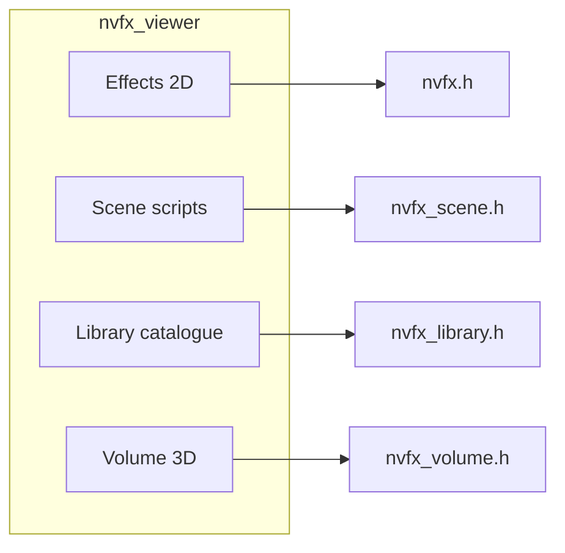

# NeuralVFX effects viewer — comprehensive plan

Status: **current** (25 October 2026). Audience: dev, artists, engine integrators.

This document extends [VIEWER.md](VIEWER.md). It defines what “a comprehensive effects viewer” means for NeuralVFX, how it maps to existing runtimes, and the phased delivery. Pre-rendered demo MP4s under `videos/` are **not** the viewer; they are regression artefacts (`nvfx_scene_script`, `nvfx_3d video`, `nvfx_gallery`).

## 1. Goals

| Goal | Why |
|------|-----|
| **Live playback** through the same APIs a game uses | No surrogate renderer; what you see is what ships |
| **Every major surface** in one app | 2D rollout instances, composed scenes, library catalogue, 3D volumes |
| **Inspectable** | Controls, cost (ms/frame), metadata, availability of weights |
| **Authoring** | Scene script editing (existing); spawn library entries; tune hres volumes |
| **Repeatable** | Headless screenshots/tests (existing pattern with Xvfb) |

Non-goals: training, footage ingest, pack authoring UI, GPU ray marching (engines use `nvfx_volume_read` + their renderer).

## 2. What exists today (`nvfx_viewer`)

| Mode | API | Content |
|------|-----|---------|
| **Effects** | `nvfx.h` | One or more `.nvfx` files; optional reference clip, BC3 flipbook, live `sim::Fluid` |
| **Scene** | `nvfx_scene.h` | Live `.nvfxs` edit; inputs, rules, field probe |

Built with **GLFW + OpenGL 3 + Dear ImGui** (`NEURALFX_BUILD_VIEWER=ON`). See [VIEWER.md](VIEWER.md).

## 3. Target modes (comprehensive viewer)



### 3.1 Effects (keep, extend lightly)

- Already: sliders, variation/shard, cost, sim comparison.
- Later: precision / ISA toggles; open file dialog; drag-drop `.nvfx`.

### 3.2 Scene (keep)

- Already: full live-edit workflow per COMPOSE §4.
- Later: syntax highlight; pack-backed effects folder.

### 3.3 Library (new — **phase 1 implemented**)

Browse the **240-entry catalogue** (`library/*.nvfxl`) and play any entry on a **dedicated mini-stage** (gallery `shot_for` layout).

| Panel | Content |
|-------|---------|
| **Catalogue** | Search, category filter, name + one-line `about` |
| **Metadata** | `models` / `elements`, loop vs one-shot, box, anchor, `moving`, `show` |
| **Parameters** | Per-instance sliders (`nvfx_stage_set_param`) |
| **Preview** | Stage picture; spawn at 0.2 s; moving entries follow gallery path |
| **Paths** | `catalogue_dir`, `models_dir`; missing-model warning |

**Discovery:** directory catalogue + `$NEURALVFX_DATA/library/models` (not hres `.nvfx3`). **Packs:** phase 2 — `nvfx_library_open_pack` after file picker.

**Rooms:** one room `{name, 1, 0}` per preview; stage recreated on selection (gallery pattern).

### 3.4 Volume (new — **phase 1 implemented**)

Interactive **learned 3D fire/smoke** (`.nvfx3`) via `nvfx_volume_*` — same path as `nvfx_3d video --kind orbit` and FUSE’s quad preview, but real-time scrub and camera.

| Panel | Content |
|-------|---------|
| **Model** | Combo: shipped `models/3d/*.nvfx3`, data-root hres artefacts |
| **Picture** | CPU `nvfx_volume_render` each frame (premultiplied RGBA8) |
| **Camera** | Orbit (drag), zoom (wheel); `nvfx_volume_camera_look_at` |
| **Playback** | Play/pause, time scrub, speed, loop |
| **Controls** | intensity, wind, turbulence; seed; shard length |
| **Cost** | Rolling ms for `step_to` + render |

Defaults: `models/3d/fire.nvfx3`, `fire_hres.nvfx3`, `smoke.nvfx3`, `smoke_hres.nvfx3`; `$NEURALVFX_DATA/hres_3d/fire/models/hres_fire.nvfx3`.

**Performance budget (quiet machine, STUDY_3D §14):** ~9 ms/step + ~14 ms @ 256² @ 4 threads → ~30 Hz interactive with downscaled picture; 512² or hres for inspection, not 60 Hz.

**Later:** dual view (side + top like `video --kind wind`); field slice debug; `read` + GL 3D texture preview for integrators.

### 3.5 Integrations (phase 2–3)

| Surface | Viewer affordance |
|---------|-------------------|
| **Effect pack** `.nvfxp` | Open pack → library + embedded models; verify checksums |
| **FUSE stand-in** | Optional “export frame sequence” compatible with `nvfx_fuse_demo` timing |
| **Godot** | Viewer remains the reference; Godot demo keeps parity tests |
| **Manager** | Stress mode: N instances, budget slider (MANAGER.md) |
| **Coupled fire+smoke** | `nvfx_3d video --kind coupled` logic as optional volume preset |

## 4. Architecture

- **Shell:** `viewer/main.cpp` — GLFW loop, mode menu, delegates to `*Ui::frame`.
- **Session pattern:** heavy work off UI thread where needed (`SceneSession`); Library/Volume keep playback on UI thread with throttled sim time.
- **Rendering:** `viewer/texture.hpp` uploads RGBA8 for all picture panels.
- **Shared helpers:** orbit camera math (from `tools/nvfx_3d.cpp` `View`), gallery `shot_for` (duplicated minimal in `library_ui.cpp` to avoid linking gallery).

## 5. Data layout

| Data | Path | Viewer mode |
|------|------|-------------|
| Catalogue | repo `library/` | Library |
| 2D weights | `$NEURALVFX_DATA/library/models` | Library, Scene `--effects` |
| Study D | `experiments/models/d` | Scene default fallback |
| 3D shipped | `models/3d/*.nvfx3` | Volume |
| Hres training | `$NEURALVFX_DATA/hres_3d/*/models/*.nvfx3` | Volume (optional list) |

## 6. CLI (target)

```text
nvfx_viewer [effects.nvfx ...] [--clip CLIP] [--demo]
nvfx_viewer --scene script.nvfxs [--effects DIR] ...
nvfx_viewer --library [--catalogue DIR] [--models DIR]
nvfx_viewer --volume [model.nvfx3] [--threads N]
```

Menu bar switches modes at runtime (window resize hints for Scene/Library/Volume).

## 7. Testing

| Test | What |
|------|------|
| `neuralfx.ViewerHeadless.*` | Windowless library/volume play, luma gates (`viewer/headless_test.cpp`) |
| `neuralfx.Viewer*` (Xvfb) | Effects demo, scene stand-ins, broken edit, library `sparks`, volume `fire_hres`, optional campfire/smoke with data |
| `tools/viewer_test.sh` | Restores library models when needed; runs the full regex above |
| **Allocation** | Optional extension of `nvfx_alloc_test` per mode |

## 8. Phased delivery

| Phase | Deliverable | Status |
|-------|-------------|--------|
| **1** | Plan (this doc) + Library + Volume modes in `nvfx_viewer` | **Done** (152587b) |
| **2** | Pack open; volume wind/side-by-side; library category thumbnails cache |
| **3** | Manager stress; coupled volume; Windows installer note |
| **4** | Polish: file dialogs, recent lists, persist settings JSON |

## 9. References

- [VIEWER.md](VIEWER.md) — current user guide  
- [LIBRARY.md](LIBRARY.md) — catalogue and gallery  
- [INTEGRATION.md](INTEGRATION.md) — which API when  
- [ENGINES.md](ENGINES.md) §12 — volume matrices and cost  
- [STUDY_3D_HRES.md](STUDY_3D_HRES.md) — hres fire/smoke artefacts  
- [FUSE.md](FUSE.md) — engine integration (Desktop/FUSE)  
- Subagent audits (2026-10-25): viewer codebase, volume API, library browsing  
