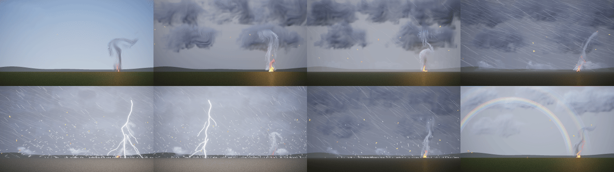

# The weather director in 2D

Status: **done** (21 October 2026; moist air, §3.11, the wet ground's water, §3.12, the storm across the scene, §3.13,
the sun and its shafts, §3.14, and the cloud deck as a layer, §3.15, added 24 October). Audience: dev, artists, research. Code: `src/compose/weather.hpp`
and `weather.cpp` (namespace `nfx::compose::wx`), the `weather` statement of the scene language ([COMPOSE.md](COMPOSE.md)
§4), the physical keys of `emit rain` and `emit snow`, hail's `speed`, the day's sky (`frame daylight, overcast,
visibility`), the library entry `weather_director` (`library/weather.nvfxl`). Tests: `tests/test_weather_director.cpp`
(39), `nvfx_alloc_test`, the four `Frame.*` tests of `tests/test_script.cpp`, and the frozen keyframes of
`examples/scenes/weather_day.nvfxs` (`ScriptedWeatherDayFrozen` in `results/experiments/weather_frozen.csv` must be
refrozen once on a machine with the library models; it skips here, exit 77, until then).
Seeds: 28,500,000 to 28,599,999. No model was trained for it, and no new C call was added.

This is the TODO's "weather director in 2D", ahead of the 3D weather system ([TODO.md](../TODO.md), "Weather
systems"): a small weather state that moves between regimes in the order real weather keeps and drives the layers that
already exist. Every number it hands a layer comes from a relation in the literature (§3) or is a choice this page names
as one (§3.10).



*`examples/scenes/weather_day.nvfxs`, 40 s: clear; clouding over; rain; the gust front and a thunderstorm (two of its six
flashes, hail in the heaviest cells, the hills lost in the rain); clearing in reverse, with a rainbow. The video is
`videos/scene_weather_day.mp4`.*

## 1. In brief

- **The state** (`wx::Member`, read by a script as `sky.rain`, ...): cloud cover, rain rate (mm/h), snow rate (mm/h of
  melted water), hail, the wind now and its mean (m/s at 10 m), gustiness, visibility (m), temperature (C), the rate of
  lightning (flashes a minute), the load of dust, the fog's extinction, the relative humidity and the water standing on
  the ground (mm); and what follows from them: everything's extinction, the wind along x, its Beaufort force, a learned
  module's lean, leaves in motion, dust raised, the trees' sway (a hook: §3.6), the daylight, the lightning's light now, the number of flashes, where
  the last struck, the time since, the dew point and the cloud deck's base (m above the ground: §3.11), the ground's
  wetness, its puddles and the evaporation drying it (§3.12), the air the wind has carried past the camera and where a
  transition's front stands along x (m: §3.13), the sun's hour, elevation and place across the picture, the direct
  sunlight on the ground and its shafts (§3.14), the regime it heads for and how far it has come.
- **Seven regimes**: clear, overcast, rain, storm, snow, fog, dust storm. Each is a target state (§2.1), varied by the seed
  each time it is asked for, with weather noise around it.
- **Transitions in the order real weather keeps** (§2.2): clouds build before rain; the gust front (the wind, its gusts,
  the drop in temperature) arrives before the downpour; lightning and hail come with the heaviest rain; it clears in
  reverse. Deterministic from the seed and the targets asked for, continuous at every frame, interruptible.
- **Weather noise** (§2.3): gusts and rain cells are seeded Ornstein-Uhlenbeck processes stepped exactly, the gusts at the
  Kaimal integral time scale of the surface wind, the rain cells log-normal over minutes; lightning is a Poisson process at
  the rate of the moment, a flash 1 to 5 return strokes.
- **Relations from the literature** (§3): Koschmieder's visibility; Marshall and Palmer's drop sizes; Atlas, Srivastava and
  Sekhon's fall speeds (checked against Gunn and Kinzer's measurements); the rain's extinction from the two; Locatelli and
  Hobbs's snowflakes; the Beaufort scale and what the wind does at each force; Kasten and Czeplak's daylight under cloud;
  the CIE overcast sky; IEC 61400-1's Kaimal length scale; a hailstone's drag; the Magnus formula's dew point and Espy's
  cloud base (the cloud deck's first relation: where its base is), aviation's ceiling and Koschmieder's haze along the
  slant path for the deck as a layer (its second: when the cover is a layer and where its underside meets the haze,
  §3.15; drawn through `frame deck` and `frame foot`, [COMPOSE.md](COMPOSE.md) §5.4); the rain filling the
  ground's depression storage and Penman's drying power of the air emptying it (the wet ground's first relation: how
  much water stands on it; drawn through `frame wet` and `frame puddle`, COMPOSE §4.11); Taylor's hypothesis, by which the weather at the camera is a pattern
  the mean wind carries across the scene (the moving storm's first relation: where its front is; nothing draws it yet);
  the sun's place from the hour, Kasten and Czeplak's diffuse fraction for the direct beam under cloud and Beer-Lambert's
  law along its slant path through the weather, and the sun's shafts where a broken deck's beams light hazy air (the
  sun's first relation: where it stands, how much reaches the ground and whether its shafts show; nothing draws it yet).
- **It drives the layers that exist** (§4): physical rain and snow (sizes, speeds, counts and streaks from the rate),
  hail, the cloud and fog models (opacity, look, lean), the storm layers (a bolt where the flash struck, its lamp, the
  flash), the wind every module feels (its learned `wind` control and a wind field), leaves, and the sky's light.
- **Control** (§5): a `weather` statement with a schedule in a script; in an engine, an `input` the script hands to the
  director's `regime` (`nvfx_scene_set_input`), the state read back with `nvfx_scene_get_input(scene, "sky.rain")`, the
  flashes counted by a rule (`nvfx_scene_rule_state`); on a library stage, the entry's parameter (`nvfx_stage_set_param`).
  No new C call.
- **Deterministic, no allocation per frame, about 1 microsecond a step** (§6).

## 2. The state, the regimes and the transitions

### 2.1 The regimes' targets

Each target is a choice inside what is observed for such weather (the American Meteorological Society's rain classes:
light under 2.5 mm/h, moderate to 7.6, heavy above; the WMO's: fog under 1 km, a dust storm under 1 km and a severe one
under 200 m; the US weather service's snow by visibility, FMH-1), not a fit. The visibility, the daylight, the dew point
and the cloud base follow from the rest (§3).

| regime | cloud | precipitation (mm/h) | hail | mean wind (m/s; force) | gustiness | temperature (C) | lightning (/min) | fog | dust | rain cells | humidity | visibility | daylight | dew point (C) | cloud base |
|---|---|---|---|---|---|---|---|---|---|---|---|---|---|---|---|
| clear | 0.10 | 0 | 0 | 3 (2.3) | 0.20 | 22 | 0 | 0 | 0 | | 0.55 | 40 km | 1.00 | 12.5 | 1180 m |
| overcast | 0.95 | 0 | 0 | 5 (3.3) | 0.18 | 17 | 0 | 0 | 0 | | 0.75 | 40 km | 0.37 | 12.5 | 560 m |
| rain | 1 | 6 (moderate) | 0 | 7 (4.1) | 0.22 | 13 | 0 | 0 | 0 | 300 s, 0.35 | 0.90 | 3.2 km | 0.25 | 11.4 | 200 m |
| storm | 1 | 40 (heavy) | 0.6 | 11 (5.6) | 0.40 | 16 | 20 | 0 | 0 | 90 s, 0.5 | 0.85 | 1.0 km | 0.25 | 13.5 | 315 m |
| snow | 1 | 1.5 (as snow) | 0 | 4 (2.8) | 0.20 | -4 | 0 | 0 | 0 | 400 s, 0.3 | 0.90 | 550 m | 0.25 | -5.4 | 175 m |
| fog | 1 | 0 | 0 | 1 (1.1) | 0.10 | 8 | 0 | 26 km^-1 | 0 | | 1 | 150 m | 0.25 | 8 | 0 (at the ground) |
| dust storm | 0.30 | 0 | 0 | 15 (6.9) | 0.30 | 34 | 0 | 0 | 0.6 | | 0.15 | 330 m | 0.99 | 3.7 | 3.8 km |

Clear air's own extinction is 0.098 km^-1 (a 40 km day). The storm's 16 C against the clear day's 22 C is the gust
front's cold outflow. 20 flashes a minute is a vigorous storm's total (in-cloud and to ground). The humidity is the
relative humidity at the ground, chosen so that the cloud base it gives (§3.11) is where such a deck stands: fair-weather
cumulus about 1200 m up, an overcast deck 500 to 600 m, the low deck under steady rain or snow about 200 m, fog
saturated (cloud at the ground), a dust storm's dry air with a base far above the dust.

**Seeded variability.** Each request (the start included) varies its regime's target with the seed and the request's
number: cloud +-0.04 (a standard deviation), precipitation x exp(0.25 g), hail x exp(0.2 g), wind x exp(0.15 g),
gustiness x exp(0.1 g), temperature +-1.5 C, lightning x exp(0.3 g), fog x exp(0.25 g), dust x exp(0.2 g), humidity
+-0.08 (1 - h) (so saturated air stays saturated: fog's base stays at the ground), g a standard normal from a hash. So
no two storms of a seed are the same, and a seed's are always the same.

### 2.2 Transitions

A request (`Director::request(to, seconds)`) starts from the state as it is (mid-transition too: nothing jumps) and runs
a progress p from 0 to 1 over the time asked for (at least 1 s). Each quantity moves in a window of p of its own, by a
smoothstep, its window depending on whether it rises or falls:

| quantity | rising | falling |
|---|---|---|
| cloud, humidity (the air moistens as the clouds build, dries as they break) | 0 to 0.45 | 0.55 to 1 |
| mean wind, gustiness | 0.30 to 0.50 | 0.35 to 0.80 |
| temperature (the air mass, with the front) | 0.30 to 0.55 | 0.30 to 0.55 |
| precipitation (and the rain cells' time and spread) | 0.45 to 0.80 | 0.15 to 0.55 |
| lightning | 0.65 to 0.95 | 0 to 0.30 |
| hail | 0.70 to 0.90 | 0 to 0.25 |
| fog | 0.20 to 0.90 | 0 to 0.60 |
| dust | 0.40 to 0.80 | 0.15 to 0.60 |

Building, the clouds come first, then the gust front, then the rain, then the lightning and the hail; clearing, the
reverse: the lightning stops, the rain eases, the wind drops, the clouds break. What else follows from it, measured by
`WeatherDirector.TransitionsKeepTheOrderOfRealWeather` (each at half its change):
- clear to storm: the wind is at 90 % of its rise while the rain is under a fifth of its own;
- clear to dust storm (a haboob): the wind before the dust it raises;
- clear to snow (a cold front): the clouds, then the cold, then the snow; on the way the precipitation falls as rain,
  then sleet, then snow as the air passes 2 C and 0 C (§2.3);
- fog to clear: the fog lifts into low cloud before the sky clears, and the cloud base rises all the way (it never
  falls back in that transition), from the ground past 700 m, as the air dries;
- clear to storm: the humidity makes half its change with the cloud, before the rain: the deck comes down ahead of the
  downpour.

Rain to snow is the fastest change of the state: the temperature crossing 2 to 0 C turns the precipitation to snow,
which hides 13 times what rain does per mm/h (§3.4), so the visibility falls within a second or two of a 20 s
transition. It is continuous (its per-step change halves with the step) but it is the reason the jump test allows the
extinction 4 km^-1 a frame.

### 2.3 Weather noise

Every noise is an Ornstein-Uhlenbeck process (Uhlenbeck and Ornstein 1930) of unit variance stepped exactly
(Gillespie 1996: x' = a x + sqrt(1 - a^2) n, a = exp(-dt / tau)), then smoothed by a first-order filter of s seconds and
brought back to unit variance (an OU smoothed over s has the variance tau / (tau + s)), so the state is smooth from frame
to frame: its per-step change halves when the step does (`WeatherDirector.NothingJumps`). Its random numbers are a hash
of the seed, the step and a channel.

| noise | time scale | smoothing | what it does | measured (`WeatherNoise.*`) |
|---|---|---|---|---|
| gusts | Kaimal's integral time scale L_u / U, L_u = 8.1 x 0.7 z = 56.7 m at z = 10 m (IEC 61400-1), 1 to 30 s | 1 s (gusts are measured as 3-second means) | the wind now = mean x (1 + gustiness x noise) | a storm: the spread over the mean 0.356 for a gustiness of 0.355; autocorrelation at tau (5.4 s) 0.453, the process's 0.451; 0.02 at 8 tau |
| rain cells | the regime's (90 s in a storm, 300 to 400 s in steady rain or snow) | 3 s | precipitation x exp(spread x noise - spread^2 / 2): log-normal, its mean kept | spread of ln R 0.475 for 0.5; autocorrelation at 90 s 0.387 (e^-1 = 0.368, the smoothing adds a little) |
| cloud | 90 s | 5 s | cover +- 0.6 c (1 - c) x noise | |
| temperature | 120 s | 5 s | +- 0.3 C x noise | |
| fog | 40 s | 3 s | extinction x exp(0.2 x noise) | |

**Lightning** is a Poisson process at the rate of the moment, which is the base rate times r^2 / exp(spread^2) (r the
rain cells' factor: the flashes fall in the heavier rain, the mean rate kept). A flash has one return stroke 17 % of the
time and otherwise 2 to 5 (3 on average), 40 to 100 ms apart, the first at full light, the later ones at 0.5 to 0.9 of it,
each decaying over 45 ms (after Rakov and Uman 2003: typically 3 to 5 strokes about 60 ms apart). A new flash takes over
from the last. Measured over 3000 s of storm: 1432 flashes for 1444.5 expected; the rain at the flashes 1.66 times the
storm's mean.

**Hail** falls in the heavy cells only: the regime's hail times smooth((r - 0.9) / 0.6), so none in cells lighter than
0.9 of the storm's mean rate and all of it in those 1.5 times as heavy.

**Rain or snow**: the precipitation's share that falls as snow is a ramp from all rain at 2 C to all snow at 0 C (a simple
partition, not a fit: §3.10).

**Dust** is raised as the cube of the wind (the gusts' factor cubed, normalised: sand's flux goes as u*^3, Bagnold 1941)
and follows it over 5 s (a choice: it mixes and settles).

## 3. The relations

### 3.1 Visibility: Koschmieder

A black object at distance x against the horizon sky shows the contrast C = exp(-sigma x), sigma the extinction; at the
eye's threshold of 2 %, the visibility is V = ln(50) / sigma = 3.912 / sigma (Koschmieder 1924). The director adds the
extinctions of clear air, fog, rain (§3.3), snow (§3.4) and dust and gives V = 3912 / sigma m (sigma in km^-1). The day's
sky (§4.6) uses the same law to veil the hills and the ground, and `WeatherDay.TheHillsFadeIntoTheHazeAsKoschmiederSays`
measures it in the picture: the hills' contrast at 4 km and 2 km against 40 km is exp(-3.912 x 2 km (1/V - 1/40 km)) to
within 0.03.

### 3.2 Drop sizes: Marshall and Palmer

N(D) = N0 exp(-Lambda D), N0 = 8000 m^-3 mm^-1, Lambda = 4.1 R^-0.21 mm^-1, R in mm/h (Marshall and Palmer 1948). The drops
drawn are those from 0.5 to 6 mm (smaller ones are drizzle and invisible at the scales drawn; larger ones break up):
there are (N0 / Lambda)(exp(-0.5 Lambda) - exp(-6 Lambda)) of them a cubic metre, from 251 at 1 mm/h to 1801 at 50 mm/h,
their mean diameter 0.74 to 1.05 mm. Each drop's diameter is drawn by the distribution's inverse from a hash.

**The rain's extinction** follows: drops much larger than the wavelength remove twice their cross-section (the extinction
paradox, van de Hulst 1957), so sigma = 2 integral of (pi / 4) D^2 N(D) dD = pi N0 / Lambda^3 = 0.365 R^0.63 km^-1:

| rain (mm/h) | 1 | 5 | 10 | 25 | 50 | 100 |
|---|---:|---:|---:|---:|---:|---:|
| visibility from the rain alone | 10.7 km | 3.9 km | 2.5 km | 1.4 km | 0.91 km | 0.59 km |

### 3.3 Fall speeds: Atlas, Srivastava and Sekhon

v(D) = 9.65 - 10.3 exp(-0.6 D) m/s, D in mm (Atlas, Srivastava and Sekhon 1973; 0 below 0.03 mm, where the fit turns
negative). Against Gunn and Kinzer's (1949) measured terminal velocities it is within 1.4 %:

| D (mm) | 1 | 2 | 3 | 4 | 5 |
|---|---:|---:|---:|---:|---:|
| Atlas (m/s) | 4.00 | 6.55 | 7.95 | 8.72 | 9.14 |
| Gunn and Kinzer (m/s) | 4.03 | 6.49 | 8.06 | 8.83 | 9.09 |

**The two together.** The rain rate implied by Marshall-Palmer drops falling at Atlas's speeds, 6 pi 10^-4 integral of
D^3 v(D) N(D) dD, should give R back. It gives a little more: 18 % at 1 mm/h, 16 % at 10, 13 % at 25, 9 % at 50, 5 % at
100 (`WeatherRelations.MarshallPalmerAndAtlasTogetherGiveBackTheRate`). That is what each was fitted to (Marshall and
Palmer's counts at the ground, Atlas's speeds in still air), and is left as it is: the director draws the distribution
the rate names, not one rescaled to close the loop.

**What the rain drawn does with them** (`emit rain, rate R`, §4.1): each drop falls at its own v(D) times the scale (world
pixels a metre), its streak is the distance it falls while the shutter is open, and the count in the region is the
distribution's number in the slab drawn. Measured in a scene (`WeatherScript.ThePhysicalRainHoldsItsDistribution`, at 2,
20 and 60 mm/h): the drops in the region within 8 % of Marshall-Palmer's number, their mean fall speed within 3 % of
Atlas's mean over the distribution, every streak within 1 % of its fall in half a frame. So heavier rain has more, bigger,
faster drops, and longer streaks.

### 3.4 Snowflakes: Locatelli and Hobbs

For aggregates of unrimed radiating assemblages of dendrites, from 2 to 10 mm (Locatelli and Hobbs 1974, Table 1):
V = 0.8 D^0.16 m/s and M = 0.073 D^1.4 mg, D the maximum dimension in mm. Unrimed aggregates fall at about 1 m/s whatever
their size (0.89 m/s at 2 mm, 1.16 at 10). The flakes' sizes are an assumption: exponential, slope 0.4 mm^-1, on 2 to
10 mm (mean 4.2 mm). Their number follows from the mass flux: S / 3600 kg m^-2 s^-1 (S in mm/h of melted water) over
their mean M V: 475 flakes a cubic metre at 1 mm/h.

**Snow's extinction** is twice the flakes' cross-section with a flake covering 0.3 of the circle around it (an assumption:
aggregates are open; Rasmussen and colleagues 1999 find the visibility at a given rate varying by a factor of 3 to 10
with the snow): 1 mm/h gives 825 m, inside the US weather service's "moderate snow" (0.5 to 1 km, FMH-1); 0.5 mm/h 1.6 km,
3 mm/h 280 m. Per mm/h of water, snow hides about 13 times what rain does.

### 3.5 Hail

A sphere of ice (900 kg m^-3) in air (1.2 kg m^-3) at the drag coefficient of a sphere at high Reynolds number (0.6):
v = sqrt(4 g D rho_ice / (3 C_d rho_air)), 12.8 m/s at 10 mm, 18 m/s at 20 mm. The director gives hail as a share (§2.3);
the scene draws its stones at 12.8 m/s (`emit hail, speed`).

### 3.6 Wind: the Beaufort scale

v = 0.836 B^(3/2) m/s at 10 m (WMO); each whole force falls inside its band of the WMO's table
(`WeatherRelations.TheBeaufortScale`). What the wind does on land at each force, and what the layers show of it:

| force | m/s (formula) | on land (WMO) | what the director's layers do |
|---|---:|---|---|
| 0 calm | 0 | smoke rises vertically | `lean` 0.5: a learned module's `wind` control at still air |
| 1 light air | 0.84 | direction of wind shown by smoke drift, but not by wind vanes | smoke and flames lean a little (`lean` grows with the wind, all the way at a gale) |
| 2 light breeze | 2.36 | wind felt on face; leaves rustle | |
| 3 gentle breeze | 4.34 | leaves and small twigs in constant motion | `leaves` from 0 (force 2) to 1 (force 4): leaves blow |
| 4 moderate breeze | 6.69 | raises dust and loose paper; small branches are moved | `lift` from 0 (force 3.5) to 1 (force 5): dust raised (a scene may lay it with the rain); `trees` 0: they stand |
| 5 to 7 | 9.35 to 15.5 | small trees sway; large branches in motion; whole trees in motion | `trees` from 0 (force 4) to 1 (force 7): 0.26 at 5, 0.74 at 6 (a hook: nothing draws trees yet) |
| 8 gale | 18.9 | breaks twigs off trees; generally impedes progress | `lean` 1: the full lean; `trees` 1 |
| 9 to 12 | 22.6 to 34.8 | structural damage, trees uprooted, devastation | |

The leaves, the dust and the trees follow the wind now, gusts included: a gust makes the leaves fly and the trees bend.

**Trees, the hook.** `sky.trees` is the trees' sway by the Beaufort force, a smoothstep from force 4 ("small branches are
moved": 0) to force 7 ("whole trees in motion": 1), with force 5 ("small trees in leaf begin to sway") and 6 ("large
branches in motion") between; it saturates there (a gale breaks twigs, a storm uproots: neither is a sway). It is the
amplitude a foliage layer bends by; the direction is the wind's, `sky.u`'s sign, and `sky.lean` (0.5 still air, 1 at a
gale) is the same signed control a learned module takes. No layer draws trees yet; until one does a scene shows the wind
in foliage with what there is: a module's `wind sky.lean` (what the smoke and the cloud masses do, §4.5), `emit leaves,
density ... * sky.leaves` for what blows off (§4.1), `emit ash` or dust with `sky.lift` for what is raised, and `sky.trees`
for whatever stands and bends (a sprite's shear, a stand-in's rotation, an engine's own trees through
`nvfx_scene_get_input(scene, "sky.trees")`). The test is `WeatherRelations.TheBeaufortScale`: the bands, the director
carrying it with the wind now (a clear day's light breeze moves no tree; a storm has them in motion), and the name.

### 3.7 Daylight under cloud: Kasten and Czeplak

G(N) / G(0) = 1 - 0.75 (N/8)^3.4, N the cloud in oktas (Kasten and Czeplak 1980): `sky.light` = 1 - 0.75 cloud^3.4, 0.93
at half cover, 0.25 overcast. It is an average over cloud types: a thunderstorm's sky is darker than any overcast, and
the scene darkens it further by a choice of its own (§4.6).

### 3.8 The overcast sky

The CIE standard overcast sky: the luminance at elevation theta is (1 + 2 sin theta) / 3 of the zenith's (Moon and Spencer
1942, adopted by the CIE in 1955). The day's sky greys into it with `overcast` (§4.6).

### 3.9 The gusts' time scale

The Kaimal spectrum of IEC 61400-1 (edition 3, Annex B) has the longitudinal integral length scale L_u = 8.1 Lambda_1,
Lambda_1 = 0.7 z below 60 m: 56.7 m at 10 m; for the Kaimal spectrum S(0) = 4 sigma^2 L_u / U, so its integral time scale
is L_u / U (5.7 s at 10 m/s). The OU has a Lorentzian spectrum with the same integral time scale (it falls as f^-2 at high
frequency where Kaimal's falls as f^-5/3, so it has a little less fast gusting).

### 3.10 What is a choice, not a relation

| what | the choice | why |
|---|---|---|
| the regimes' targets (§2.1) | inside the observed classes | they set a regime, not measure one |
| the regimes' humidities (§2.1) | set so the cloud base (§3.11) stands where such a deck does | the humidity is not simulated; the base that follows from it is the relation's |
| the transitions' windows (§2.2) | their order is the observed one; their widths are not measured | a time-lapse wants them readable; real fronts take tens of minutes |
| the rain cells' times (90 to 400 s) and spreads | of the order of rain gauges' minute-scale variability | not fitted to data |
| cloud, temperature and fog noise | small, slow | decoration around the targets |
| rain to snow between 2 and 0 C | a linear ramp | a common simple partition |
| snowflakes' sizes, their area ratio 0.3 | exponential on 2 to 10 mm, mean 4.2 mm | put 1 mm/h inside FMH-1's moderate snow |
| the ground's depression storage, 1.5 mm, and the film that darkens it, 0.1 mm (§3.12) | an impervious surface's (ASCE: 1.3 to 2.5 mm); a film the roughness of pavement or soil | one ground for every scene; no infiltration, so grass puddles as pavement does |
| the drying by Penman's E_a alone (§3.12) | his aerodynamic term, not the full equation | the full equation needs the net radiation; the state now says where the sun is (§3.14) but not its irradiance in W/m^2, which the hour's and the season's air mass would set |
| the sun at 45 N on the equinox, the camera facing south (§3.14) | one latitude, one date, one heading | nothing in the state says the place, the date or the camera's heading; a script's `hour` is the one control, and the equinox makes it symmetric (up at 6, down at 18, 45 degrees at noon) |
| the weather's layer along the beam, 300 m, and the lit depth of a shaft, 500 m (§3.14) | a radiation fog's depth; the width of a gap's beam seen from the side | the state has no depth: fog is 100 to 300 m deep, a haboob 1 to 2 km, rain fills the depth below its base; any depth over 200 m hides the sun in fog and in a full dust storm alike |
| the shafts' 4 c (1 - c) (§3.14) | lit air beside shadowed air, most in a half-broken deck | the geometric share of the sky that shadows times the share that lets beams through; the deck's structure (the size of its gaps) is not in the state |
| the deck's ramp, 4 to 6 oktas (§3.15) | the ICAO's ceiling begins at more than half the sky; the ramp is two oktas wide about it | a step at 5 oktas would jump; the WMO's amounts are reported in whole oktas, so no observation says how sharp the edge is |
| the deck's foot at the visibility's horizontal distance, atan(base / V) (§3.15) | within a degree of the 2 % threshold's asin(base / V) below 20 degrees | the asin pins at 90 with an infinite slope once the base is beyond the visibility, which rain turning to snow does in a frame (29 degrees a frame measured; the atan 9.5) |
| the front carried at the mean wind of the moment (§3.13) | Taylor's U is the mean wind, and the state has one: the old air's until the gust front, the new air's after | a storm's gust front is a gravity current that runs at about its own outflow's speed, so the choice is right once the wind has turned; before, the front crawls at the old wind; a front's own speed (Benjamin's) would need the outflow's depth and density, which nothing in the state says |
| dust's extinction, 3.912 / 0.2 km^-1 at a load of 1 | the WMO's severe dust storm | the load is in its units, not a mass |
| dust following the wind's cube over 5 s | Bagnold's u*^3, a lag of its own | no measurement of the lag here |
| lightning's stroke light, 45 ms | of the order of a return stroke's luminosity and its continuing current | not measured |
| the drops drawn, 0.5 to 6 mm, in a slab 0.15 to 0.5 m deep | a slab of the near field | how many of the near drops to draw is the artist's |
| the wind at eye height, 0.72 of the 10 m wind (the scene's) | a log profile over grass, z0 = 3 cm, at 2 m | the scene's, not the director's |

### 3.11 Moist air: the dew point and the cloud base

The cloud deck's first relation: where its base is. The state carries the relative humidity at the ground (`sky.humidity`,
0 to 1: the regime's target, blended in the cloud's window, with no noise of its own), and from it and the temperature:

- **The saturation vapour pressure** over water by the Magnus formula with Alduchov and Eskridge's (1996) coefficients,
  e_s(T) = 6.1094 exp(17.625 T / (T + 243.04)) hPa, within 0.4 % of the measured values from -40 to 50 C
  (`wx::saturation_vapour_hpa`; checked against Sonntag's 1990 table from -20 to 40 C).
- **The dew point** (`sky.dewpoint`, C) is its inverse at the humidity's share of it: with g = ln h + 17.625 T / (T + 243.04),
  T_d = 243.04 g / (17.625 - g), never above the air's temperature (`wx::dew_point`). 20 C at 50 % gives the textbook
  9.3 C; saturated air's dew point is its own temperature.
- **The cloud base** (`sky.base`, m above the ground) is the lifting condensation level by Espy's rule: a parcel lifted dry
  cools at 9.8 K/km while its dew point falls at about 1.8 K/km, so the two meet 125 m up for each degree the dew point is
  below the air, h = 125 (T - T_d), at least 0 (`wx::cloud_base_m`). Against Lawrence's (2005) fit
  h = (20 + T/5)(100 - RH) m for RH above 50 %, Espy's rule agrees to about 15 % (`WeatherRelations.DewPointAndCloudBase`).

The dew point follows the temperature's noise at the blend's humidity, so the base, 125 m a degree of the spread, hardly
moves with it (the jump test allows it 60 m a frame; rain to snow, the fastest change, moves it less). Where each regime's
base stands is in §2.1's table: fair-weather cumulus about 1200 m, an overcast deck 560 m, the low deck under steady rain
or snow about 200 m, a storm's 315 m, fog 0 (saturated: cloud at the ground), a dust storm's dry air 3.8 km. A base
rising is weather clearing: in fog to clear it climbs without a step back from the ground past 700 m.

**What reads it.** `sky.base`, `sky.dewpoint` and `sky.humidity` are values a script or an engine
(`nvfx_scene_get_input(scene, "sky.base", &m)`) can read; no `frame` key maps the base height. The deck's cover and
foot are §3.15 and draw through `frame deck` and `frame foot` ([COMPOSE.md](COMPOSE.md) §5.4). The three humid-air
members add to the state without moving any other regime field; wiring the day scene's `frame` keys to `sky.*` moves
`ScriptedWeatherDayFrozen` (see the header).

### 3.12 Wet ground: the water standing on it

The wet ground's first relation: how much water stands on the ground and how fast the air dries it. The state carries
the water on the ground (`sky.water`, mm, the director's own integral: it is not a target of any regime), filled by the
rain and emptied by evaporation, and from it what a layer would draw:

- **The rain fills it.** Each frame adds the rain's mm/h over 3600 a second (the rain now, cells and all; snow adds
  nothing: it lies, and nothing lies yet, §9) up to the surface's **depression storage**, the water a surface holds in
  its hollows before the rest runs off: 1.5 mm, an impervious surface's (pavement 1.3 to 2.5 mm in the ASCE's
  manual, 1.6 mm in Tholin and Keifer's 1960 Chicago design values; a choice, §3.10: there is one ground for every
  scene, and it does not infiltrate). Moderate rain (6 mm/h) fills it in 15 minutes, a storm's 40 mm/h in 2.3.
- **The air dries it** by Dalton's law with Penman's (1948) wind function, the aerodynamic term of his open-water
  evaporation, the "drying power of the air": E_a = 0.35 (1 + u/100)(e_s - e) mm/day with u in miles a day and e in
  mmHg, which in m/s and hPa is E_a = 0.2625 (1 + 0.537 U_2)(e_s(T) - e), U_2 the wind at 2 m and e_s - e the vapour
  pressure deficit, e_s by the Magnus formula of §3.11 and e = h e_s (`wx::evaporation_mm_h`, in mm/h). The 2 m wind is
  0.723 of the director's 10 m wind (a log profile over grass, z0 = 3 cm: `wx::wind_2m`), gusts included. Saturated
  air dries nothing: fog keeps the ground wet, to the bit. Penman's full equation adds a radiation term and weights
  E_a by gamma / (Delta + gamma); E_a alone (a choice, §3.10: nothing in the state says where the sun is) is about
  what the full equation gives on a sunny temperate day and more than it gives under cloud. 20 C, 50 % and 2 m/s
  give 6.3 mm a day (0.26 mm/h): a 1 mm puddle lasts about four hours.
- **The ground darkens** (`sky.wet`, 0 to 1) as the film fills its roughness, a smoothstep over the first 0.1 mm (Lekner
  and Dorf 1988 explain why wet things are darker: the water's surface returns to the ground the light it would have
  scattered out; how thick a film it takes is the surface's roughness, 0.1 mm a choice): half dark after 30 s of
  moderate rain, 4.5 s of a storm's. **Puddles** (`sky.puddle`, 0 to 1) are the share of the depression storage filled,
  and `sky.evaporation` is the drying now, mm/h. The ground starts as long such weather leaves it: full where the
  rain beats the drying (rain, storm), dry elsewhere.

| regime | drying (mm/h) | the film (0.1 mm) dries in | the puddles (1.5 mm) dry in |
|---|---:|---:|---:|
| clear (22 C, 55 %, 3 m/s) | 0.28 | 21 min | 5.3 h |
| overcast (17 C, 75 %, 5 m/s) | 0.16 | 39 min | 9.7 h |
| rain (13 C, 90 %, 7 m/s) | 0.06 | (filling: 6 mm/h) | |
| storm (16 C, 85 %, 11 m/s) | 0.16 | (filling: 40 mm/h) | |
| snow (-4 C, 90 %, 4 m/s) | 0.013 | 7.7 h | (over water, not ice: a limit) |
| fog (saturated) | 0 | never | never |
| dust storm (34 C, 15 %, 15 m/s) | 3.4 | 1.8 min | 27 min |

Measured (`WeatherDirector.TheGroundWetsInTheRainAndDriesByPenman`, seed 28,500,200): a clear day's drying 0.33 mm/h and
its ground dry; the rain requested, the ground half dark 25 s after the regime arrives (the rain began midway through
the transition), the water the rain less the drying to 1 % until the storage is full, 8.3 mm fallen in the hour and
1.5 mm held; cleared, the water only falls, by 0.22 mm in the hour (what the evaporation member summed to, within
0.002 mm), the puddles outlasting it and the ground still dark; rain to fog, the water constant to the bit once the
air saturates; a dust storm's air drying at 2.3 mm/h, a rainy day's at 0.05. The jump test holds the water to 0.005 mm
a frame (the heaviest rain's mm/h over 3600, a thirtieth of a second of it) and the evaporation to 0.3 mm/h a frame (it
follows the gusts), both halving at 60 fps.

**What reads it.** `sky.water`, `sky.wet`, `sky.puddle` and `sky.evaporation` are values a script or an engine
(`nvfx_scene_get_input(scene, "sky.wet", &w)`) can read. The picture reads the wet ground through `frame wet` and
`frame puddle` ([COMPOSE.md](COMPOSE.md) §4.11, built 24 October 2026): the keys default to 0 so every scene before
stays as it was, to the bit; `examples/scenes/weather_day.nvfxs` wires `wet sky.wet, puddle sky.puddle`, and
`src/compose/compose.cpp` darkens the ground rows by `lerp(1, 0.6, wet)` and lays puddles in the texture's hollows
with Fresnel mirroring (the rain's rings on them remain open). The cloud base is still numbers only. Beyond what the
keys draw, what this relation leaves out: infiltration
(Horton's curve, so that grass drinks what pavement holds), snow lying and melting into the film, ice below 0 C, dew
  in the saturated night, and the rain's splashes (`emit rain`'s `wash` is the smoke's, not the ground's).

### 3.13 The storm moves across the scene: Taylor's hypothesis

The moving storm's first relation: where its front is. The state is the weather at the camera, one place; Taylor's
hypothesis (1938) is what makes it a pattern across the scene. Taylor, measuring turbulence at a fixed anemometer,
reasoned that "if the velocity of the air stream which carries the eddies is very much greater than the turbulent
velocity, one may assume that the sequence of changes in u at the fixed point are simply due to the passage of an
unchanging pattern of turbulent motion over the point": f(x, t) = f(x - U t), the pattern frozen and carried at the
mean wind U. It is how the gusts' time scale of §3.9 comes from Kaimal's length scale in the first place (L_u / U), and it
holds where the gusts are small against the mean (a turbulence intensity well under 1: the regimes' are 0.1 to 0.4).
Applied to the director, everything the camera sees over a time t is a length U t of weather along the wind
(`wx::taylor_length_m`): a rain cell that lasts its e-folding time at the camera is that long along x (a storm's, 90 s at
11 m/s, about 1 km; steady rain's, 300 s at 7 m/s, 2 km; snow's 1.6 km; a haboob's dust cells 4.5 km), the gusts' length
is Kaimal's 56.7 m whatever the wind (inside the time scale's 1 to 30 s), and a transition over T seconds is a band U T wide crossing the scene, its
cross-section the order of §2.2 (the clouds at its leading edge, the gust front behind them, then the rain, the
lightning and the hail), which is the storm moving across the scene. Two members carry it:

- **`sky.carried`** (m along +x) is the air the mean wind has carried past the camera since the start, the integral of
  the mean wind in the wind's direction (`direction` of the `weather` statement: +x or -x; the mean, not the gusts, as
  Taylor's U is). It is Taylor's coordinate: the weather now at a point x metres along +x from the camera is the
  camera's when `carried` was `carried - x` (downwind points see what the camera saw; upwind points what it will
  see). It never resets, and moves a frame by the mean wind's metres (a storm's 0.37 m at 30 fps; the jump test holds it
  under 1 m and halving at 60 fps).
- **`sky.front`** (m along +x from the camera) is where the transition's front stands: the leading edge of the weather it
  heads for, which is at the camera at the request (the first of the new weather, the clouds, begins at the camera when
  the transition does) and then goes downwind at the mean wind of the moment: `front = carried - carried at the request`.
  A point at x along +x is in the new weather once the front has passed it, direction x (x - front) < 0: for a wind
  along +x, every x below `front`. Where the transition at the camera is linear in time, the progress at x is
  p(x) = p - x / (direction U T) by Taylor (U steady): a layer x metres downwind sees the storm begin x / U seconds
  after the camera does, and the whole band has crossed it x / U seconds after the camera's transition ends (so with the
  camera at p = 1 the downwind side of a wide scene is still in the transition: a scene wanting it done everywhere waits
  for `front` to pass its downwind edge). A new request puts a new front at the camera (as it puts `progress` at 0;
  the old front goes on downwind untracked, so a layer should take the front for the regime it heads for, `sky.regime`);
  before any request, `front` is `carried`: the start's weather has been coming since the start.

The front moves at the mean wind of the moment, a choice (§3.10): until the gust front's window (§2.2, 0.30 to 0.50 of
the transition) it crawls at the old air's wind, then runs at the new air's. For a storm requested over 60 s from a
clear day that is about 50 m at the breeze, 90 m while the wind rises and 330 m at the storm's wind, 470 m in all:
further than the breeze would have carried it (170 m), less than the storm's own wind would have (670 m).

Measured (`WeatherDirector.TheStormMovesAcrossTheSceneWithTheWind`, seed 28,500,200): a minute of the clear day's
breeze (2.87 m/s for this seed) carries 172 m of air past the camera, each frame the mean wind's metres to 1e-4 m, and
with `direction -1` the same the other way, to the bit; the storm requested over 60 s (its wind 11.1 m/s), the front
leaves the camera and only goes on, at every frame the air carried since the request to 0.01 m, 470 m when the
transition ends; a layer 200 m downwind sees the storm begin 35.8 s after the camera does (between 200 m at the
storm's wind, 18 s, and at the breeze, 70 s); a clearing requested then puts its front at the camera again with the air
carried kept.

**What reads it.** Nothing yet, as with the cloud base and the wet ground: `sky.carried` and `sky.front` are values a
script or an engine (`nvfx_scene_get_input(scene, "sky.front", &f)`) can read, and the day scene and the library entry
are unchanged (two members add to the state without moving any other, so the frozen keyframes hold). What a scene would
do with them: a layer standing x metres along +x from the camera (`s` its pixels a metre, `x = (X_layer - X) / s`)
comes on with the new weather as the front passes it, `opacity smooth((sky.front - x) / 50)` for a wind along +x
(50 m: the edge's softness, an artist's choice), so a storm's rain region, its cloud masses and its lamp fill the
picture from the upwind side at the wind's speed instead of everywhere at once, and a far rain shaft (the learned one,
wired by hand) stands where the front is, `at (X + s * sky.front, ...)`; Taylor's coordinate `sky.carried` scrolls a
drawn cell pattern (a texture of the rain's log-normal cells, 1 km to a cell in a storm) past the camera with the air.
What this relation leaves out: a front is a line in it, with no depth across the wind and no shape (a shelf cloud's arc,
a haboob's wall); it moves at the wind, not at a gravity current's own speed (Benjamin 1968: Fr sqrt(g' h), Fr 1.19 by
Huppert and Simpson, the TODO's haboob measure); the pattern is frozen (cells neither grow nor decay as they cross; a
storm's do, over their 90 s); and only the camera's history is in the state, so upwind points, which are ahead of the
camera, are known only to the extent the transition is linear.

### 3.14 The sun and its shafts

The sun's first relation: where it stands, how much of its direct light reaches the ground under the weather, and
whether its shafts (crepuscular rays) show. The state carries the solar hour (`sky.hour`, 0 to 24, wrapping; the
script's `hour` expression sets it each frame, §5.1, else noon), and from it, the cloud and the extinction:

- **Where it stands.** At latitude phi on the equinox (declination 0) the standard geometry (Iqbal 1983) gives
  sin(elevation) = cos(phi) cos(H) for the hour angle H = 15 (hour - 12) degrees, and the sun's east-west component is
  -sin(H). The director takes phi = 45 N and a camera facing south (a choice, §3.10): **`sky.elevation`** (degrees;
  `wx::sun_elevation_deg`) rises from 0 at 6 through 20.7 at 8 and 30 at 9 to 45 at noon and back to 0 at 18, negative
  through the night; **`sky.sunx`** (`wx::sun_across`) is sin(H), -1 as the sun rises on the left of the picture, 0 at
  noon, 1 as it sets on the right (in the southern hemisphere a camera facing north sees the mirror image: `-sky.sunx`).
- **How much reaches the ground.** Kasten and Czeplak (1980), from the same Hamburg data as the daylight of §3.7, give
  the diffuse fraction of the global irradiance under N oktas as D/G = 0.3 + 0.7 (N/8)^2, so the direct beam is
  1 - D/G = 0.7 (1 - cloud^2) of the global (`wx::sun_share`): 70 % of a clear sky's (the rest is skylight), 52 % at half
  cover, 13 % at 7 oktas, none under 8. The beam then crosses the weather on its slant path: Beer-Lambert's exp(-sigma L
  / sin(elevation)), sigma everything's extinction (§3.1, km^-1) and L the depth of the layer the weather fills, 300 m
  (a radiation fog's; a choice), so the path is twice as long at 30 degrees as overhead and infinite at the horizon
  (`wx::beam_transmittance`, 0 at or below it). Clear air at noon passes 0.96 of the beam; a 2 km haze 0.43; fog at
  150 m visibility 2 x 10^-5; a severe dust storm's load 0.007: fog and a full haboob hide the sun whatever L above
  200 m. **`sky.sun`** is the product, the direct sunlight on the ground as a share of a clear day's daylight:
  sun_share(cloud) x daylight(cloud) (§3.7) x the transmittance.
- **The shafts** are lit air beside shadowed air, seen by what the lit air scatters toward the eye (single scattering).
  They need the deck's shadows and its gaps' beams, 4 c (1 - c) (0 under a clear sky, where nothing shadows, and under
  an overcast one, where nothing is lit; 1 at half cover: a choice, §3.10, for the deck's structure is not in the state),
  the beam through the weather (the transmittance above) and air that scatters enough of it, 1 - exp(-sigma D) over the
  depth D of lit air along the line of sight, 500 m (a gap's beam seen from the side; a choice). **`sky.shaft`**
  (`wx::shaft_visibility`, 0 to 1) is the product: clear air (sigma 0.098 km^-1) shows under 0.05 at any cover, haze
  of a 2 km day under a half-broken deck 0.27, a 4 km day 0.26, air thick enough to hide the sun hides the shafts too.

| regime (noon) | cloud | direct share | daylight | transmittance | `sun` | `shaft` |
|---|---:|---:|---:|---:|---:|---:|
| clear | 0.10 | 0.69 | 1.00 | 0.96 | 0.67 | 0.01 |
| overcast | 0.95 | 0.07 | 0.37 | 0.96 | 0.04 | 0.01 |
| rain | 1 (the seed's 0.92 to 1) | 0 to 0.11 | 0.25 to 0.43 | 0.62 (6 mm/h) | 0.01 | 0.04 |
| storm | 1 | 0 to 0.11 | 0.25 to 0.43 | 0.21 (40 mm/h) | 0.002 | 0.02 |
| snow | 1 | 0 to 0.11 | 0.25 to 0.43 | 0.14 (1.5 mm/h) | 0.000 | 0.001 |
| fog | 1 | 0 | 0.25 | 2 x 10^-5 | 0 | 0 |
| dust storm | 0.30 | 0.64 | 0.99 | 0.007 (at the load; 0.78 in its thin moments) | 0.03 | 0.04 |

(Means over half an hour of noise, seed 28,500,200; a regime's cloud target of 1 is varied by the seed to as low as
0.92, a deck with a few gaps, through which Kasten and Czeplak let 7 oktas' 8 % of the light, so the sun under rain is
little, not zero.) The shafts show most in the transitions, where a broken deck stands over air already hazy: clear to
fog peaks at 0.20 (p 0.27: cloud 0.75, a 3.4 km visibility), clear to dust at 0.27 (p 0.50: cloud 0.41, 2.5 km),
dust to clear at 0.24; storm to clear and fog to clear show under 0.05, because in this director's order the rain and
the fog are gone before the deck breaks (§2.2) and the air behind them is clear. In a dust storm the load follows the
gusts' cube (§2.3), so the sun comes and goes with them, 0.03 on average against the clear day's 0.67, and its shafts
stand in the thinner dust, more than on the clear day (`WeatherDirector.TheSunStandsByTheHourAndShowsThroughBrokenCloud`).
The hour moves the sun and nothing else: setting it is a frame's operation on the sun's five members (the cloud, the
rain, the daylight stay to the bit), so a scene may run the sun across its sky (`hour 6 + t / 2`) or hold it. The jump
test holds `sun` to 0.05 a frame and `shaft` to 0.05 (measured: 0.006 and 0.003), both halving at 60 fps; they carry
the cloud's noise and the dust's.

**What reads it.** Nothing yet, as with the cloud base, the wet ground and the front: `sky.hour`, `sky.elevation`,
`sky.sunx`, `sky.sun` and `sky.shaft` are values a script or an engine (`nvfx_scene_get_input(scene, "sky.sun", &s)`;
an `input hour` handed to the director's `hour` sets it from the game) can read, and the day scene and the library
entry are unchanged (five members add to the state without moving any other; the daylight of §3.7 and §4.6 does not
follow the hour, so no frame changes). What a scene would do with them: a lamp or a glint at the sun's place
(`at (X + 600 * sky.sunx, horizon - R * sin(sky.elevation))`, brightness `sky.sun`), the rainbow of the day scene placed
opposite it (its centre at the antisolar point: `-sky.sunx`, 42 degrees from it), the hills and the ground lit from the
sun's side by `sky.sun` and flat by the skylight, a `frame shaft` key drawing rays from the cloud gaps toward the ground
on the sun's side with `sky.shaft` as their strength (the learned rain shaft and a lamp's cone stand in meanwhile), and
Penman's full equation for the drying (§3.12) once an irradiance is derived. What this relation leaves out: the sun's
irradiance in W/m^2 (the air mass's own dimming, Linke's turbidity, the season: the daylight stays the regime's, so a
clear 8 o'clock is as bright as noon and only lower), the colour of the hour, the shadows the sun casts, cloud shadows
moving with the deck, and the shafts' geometry (where each gap is, which the deck's structure would say).

### 3.15 The cloud deck

`sky.base` remains Espy's lifting condensation level (§3.11). **`sky.deck`** (`wx::deck_cover(cloud)`) is how much of the
sky that base organises into a layer rather than scattered puffs: 0 below four oktas, rising smoothly to 1 by six oktas
(broken to overcast). **`sky.foot`** (`wx::deck_foot_deg(base, visibility)`) is where Koschmieder's haze hides the
underside: the elevation in degrees above the horizon at which the underside stands at the visibility's distance,
atan(base / visibility). In fog the foot is 0; in clear air with a 1.2 km base it sits just above the horizon; in a dust
storm a high base vanishes into the haze below about 85°. **`wx::deck_contrast(base, visibility, elevation)`** is the
underside's contrast against the horizon sky at any elevation, by which a layer fades toward its foot.

**The relation.** A ceiling, in aviation's sense, is the base of the lowest layer covering more than half the sky (ICAO
Annex 3; FMH-1 chapter 9): broken, 5 to 7 oktas, or overcast, 8; up to scattered (3 to 4 oktas) the clouds are puffs with
sky between them and no layer. So `deck` is the cover's share as a layer, a smoothstep from 4 oktas (`wx::kDeckScattered`,
0: the puffs alone) to 6 (`wx::kDeckBroken`, 1: a layer), half a layer at the ICAO's 5; the ramp's width is a choice
(§3.10). The layer's underside is a horizontal plane at the base h: at horizontal distance x it stands atan(h / x) above
the horizon, along a slant path h / sin(elevation), and Koschmieder (§3.1) gives its contrast against the horizon sky
there as exp(-sigma h / sin(elevation)), sigma = 3.912 / V, which is the 2 % threshold where that path is the
visibility. So the deck is seen out to the visibility, its underside standing atan(h / V) above the horizon there, the
foot, and below the foot the haze has it: at the foot the contrast is at most 2 % (the slant path there is
sqrt(1 + (h / V)^2) of V, a little more than V), 2 % exactly for a deck high and far (fair-weather cumulus at the
horizon), and above the foot the deck shows, clearer overhead (`WeatherRelations.TheDeckUndersideFadesIntoTheHazeByKoschmieder`).
The foot is the atan of the visibility's horizontal distance rather than the asin of the 2 % threshold itself (they
agree within a degree below 20 degrees and by 3 to 4 in a storm's rain or snow) because the asin pins at 90 with an
infinite slope once the base is beyond the visibility, which rain turning to snow does in a frame: measured through the
jump test's transitions, the asin foot moved 29 degrees in one frame and the atan 9.5, halving at 60 fps (the jump test
holds it to 12).

| regime | base | visibility | `deck` | `foot` | underside's contrast overhead |
|---|---:|---:|---:|---:|---:|
| clear | 1370 m | 40 km | 0 (puffs) | 2.0° | 0.88 |
| overcast | 630 m | 40 km | 1 | 0.9° | 0.94 |
| rain | 220 m | 2.5 km | 1 | 5.3° | 0.70 |
| storm | 350 m | 860 m | 1 | 24° (13 to 35 with the cells) | 0.20 |
| snow | 200 m | 360 m | 1 | 29° | 0.12 |
| fog | 0 | 230 m | 1 | 0 (the fog is the cloud, at the ground) | 1 |
| dust storm | 5.6 km | 490 m | 0 | 85° | 0.000 |

(Means over half an hour, seed 28,500,200.) An overcast deck is lower than fair-weather cumulus and as far away, so its
foot is nearer the horizon still; the low decks under rain, storm and snow stand degrees to tens of degrees up as their
haze thickens; a dust storm's few clouds are no deck and their base is beyond its visibility. Through the transitions
(`WeatherDirector.TheDeckFormsBeforeTheRainAndItsFootFollowsTheHaze`, the same seed): a storm requested over 60 s has a
deck (half a layer, the cover at 0.63) 15.8 s in, before the rain (half its rate at 37.5 s), as §2.2's order says, and
in the storm its foot averages 23 degrees; clearing over 60 s, the rain is under 1 mm/h at 30.8 s and the deck breaks
at 43.1 s, the foot back at 1.5 degrees; fog coming in under a lowering deck lifts the foot to 5.9 degrees at p 0.31 (a
base of 190 m under 1.8 km of haze) before the deck reaches the ground. What this relation leaves out: the deck's
thickness and the grey of its underside (a scene takes the daylight under it, §3.7, and the CIE gradient, §3.8, as
`frame overcast` does), a frontal deck whose base is set aloft rather than at the ground's lifting condensation level
(§3.11), the Earth's curvature (a 1.2 km deck dips below the horizon at 120 km, three times the clearest visibility
here), and the pannus and scud below a rain deck, which are the puffs of §4.3 by the script's wiring. **What reads it.**
The picture reads the deck through `frame deck` and `frame foot` ([COMPOSE.md](COMPOSE.md) §5.4, built 24 October
2026; `deck_drift` is still designed only): the day scene writes `deck sky.deck, foot sky.foot`, and
`src/compose/compose.cpp` paints the underside over the day dome with `wx::deck_contrast` below the foot's row; scenes
can still gate cloud masses with `sky.deck` in module opacity. The puffs of §4.3 stand in front without a change.

## 4. The layers it drives

The director only says how much of each there is; every layer is one the scene language had, wired by expressions of
`sky.*`, so an artist can reweigh any of it. `examples/scenes/weather_day.nvfxs` is the reference wiring;
`weather_director` in `library/weather.nvfxl` the same for a library stage.

### 4.1 Rain and snow by the physics

`emit rain` and `emit snow` take four more keys; with `rate`, the emitter is the director's physics (without it, it is the
emitter it was, to the bit):

| key | meaning | default |
|---|---|---|
| `rate` | mm/h (snow: of melted water): rain's drops sized by Marshall-Palmer (§3.2) and falling at Atlas's speeds (§3.3); snow's flakes by Locatelli and Hobbs (§3.4) | (off) |
| `scale` | world pixels a metre where they fall (the near field: 600 is about 3 m from a 50 mm lens on 1280 px) | 600 |
| `depth` | metres of the slab drawn: the count is the distribution's number in it (unless `density` says) | 0.5 |
| `shutter` | rain: seconds the shutter is open: each streak is the distance its drop falls in it | half a frame (180 degrees) |

`radius` multiplies a drop's or a flake's own width there (D times the scale). The region is filled from the distribution
at once; what feeds it from the top is weighted by fall speed (the faster drops cross it sooner), so the drops in it keep
the distribution. The words reserve nothing: a module may still be named `depth` or `shutter`.

### 4.2 Hail

`emit hail, density 1.6 * sky.hail, speed 12.8 * 150`: the director's share, and the stones' speed (§3.5) at a scale.
`speed` is new on `emit hail` (default 560 world pixels a second, as before).

### 4.3 Clouds and fog

The cloud model's masses show by the cover (each a share of the sky: `opacity smooth((sky.cloud - share) / 0.25)`), grey
as the daylight under them falls (`look fleece to storm by ...`), and lean with the wind (`wind sky.lean`). The fog model's
releases are as thick as the fog's extinction makes a path (`opacity 1 - exp(-0.05 * sky.fog)`: 50 m), or in the day scene
as the whole extinction makes 80 m of air (spray and mist in the downpour). The director now says where the deck's base
is (`sky.base`, §3.11) but no layer stands at it yet: the masses are puffs in a band wherever the script put them.

### 4.4 The storm

The thunderstorm entry's layers, driven: `emit arc` where the last flash struck (`bx = X + 520 * sky.bolt`), the same
channel for each of its strokes (`seed 28500100 + 2 * sky.strike`, `rate 0.001`: a new shape for each flash, not each
frame), brightness `3.4 * sky.flash`; a lamp in the cloud where it struck; `light flash (...) * sky.flash`. A rule
`when sky.since == 0 as thunder, repeat:` fires on each flash (for a game's thunder).

### 4.5 The wind every module feels

A learned module's `wind` control takes `sky.lean` (0.5 still air, its full lean at a gale); a `wind` field pushes the
material a little (`velocity (0.02 * eye, 0), on plume`; strong pushes put a learned fire out, [COMPOSE.md](COMPOSE.md)
§5). Particles drift with it (`wind (eye * scale, 0)`), so rain slants as its drops take the wind's speed.

### 4.6 The sky's light

Three new keys of `frame` (all off by default: the night sky of every scene before, to the bit):

| key | meaning |
|---|---|
| `daylight` | the sun's and the sky's light, 1 a clear day: the sky's blue (deeper overhead), the hills lit and the ground's grass |
| `overcast` | 0 the clear blue sky to 1 the CIE overcast sky (§3.8); the stars hide as it greys |
| `visibility` | metres: Koschmieder's haze veils the hills (2 km away), the ground (500 m at the horizon to 24 m at the bottom of the picture) and the sky (2 km at the horizon to 600 m overhead) |

The day scene writes `daylight sky.light * (1 - 0.55 * dark)` (Kasten and Czeplak, darker still in the storm: a choice),
`overcast sky.cloud`, `visibility sky.visibility`, and lets the camera's exposure follow the daylight halfway in stops
(`exposure 1.05 / sqrt(sky.light)`), as a camera or an eye adapts.

## 5. Control

### 5.1 In a script

```text
weather NAME [, seed S] [, regime R] [, over D] [, direction 1 | -1] [, hour H] [:
  REGIME at T [, over D]
  ...]
```

- `seed`: a whole number to 33,554,432 (seeds pass through a float: above 16,777,216 only even ones; an odd one there is an
  error). `direction`: the wind blows along +x (1) or -x (-1). `hour`: the solar hour the sun stands at (§3.14), an
  expression re-evaluated each frame (`hour 6 + t / 2` runs it across the sky; an input hands it to the game), 0 to 24
  and wrapping; without it, noon.
- `regime` is where it heads: an expression, re-evaluated each frame, whose regime names are values (clear 0, overcast 1,
  rain 2, storm 3, snow 4, fog 5, dust 6); a change starts a transition over `over` seconds (evaluated then; default 60).
  A scene starts in the regime it gives at t = 0.
- With a schedule (the lines under it, or after the colon separated by `;`), `regime` is where it starts (a constant)
  and each line says from when it heads where; a line's `over` is its own, else the statement's.
- `NAME.member` is a value anywhere (`sky.rain`, `sky.visibility`, ...; §1). The director steps first in each frame,
  before the rules (step 0 of [COMPOSE.md](COMPOSE.md) §4.7), so everything in the frame reads its state for that frame.
- The checker gives the line and the column: a misspelt regime (`'strom' is not a regime ... (did you mean 'storm'?)`),
  a schedule out of order, a scheduled weather's regime that is not a constant, a member it has not (`a weather has no
  'rainn' (did you mean 'rain'?)`), a weather used as a value.

### 5.2 In an engine

No new C call: the script hands an input to the director, and the game sets it.

```text
input weather = 0          # the game's: 0 clear ... 6 dust
input change = 30          # seconds a change takes
weather sky, seed 28500010, regime weather, over change
when sky.since == 0 as thunder, repeat:
```

```c
nvfx_scene_set_input(scene, "weather", 3);            /* a storm, over the next 30 s */
float rain, vis;
nvfx_scene_get_input(scene, "sky.rain", &rain);       /* the weather's members read by NAME.member: mm/h */
nvfx_scene_get_input(scene, "sky.visibility", &vis);  /* m: for the game's fog, AI, audio */
int flashes;
nvfx_scene_rule_state(scene, "thunder", &flashes, NULL);   /* a new flash: play the thunder (light 3 s a km later) */
```

`nvfx_scene_get_input` reads a weather's members by `NAME.member` when no input has that name (the one change of the C
API's behaviour: a name it rejected before). On a library stage, `weather_director` takes `regime` and `change` as
parameters (`nvfx_stage_set_param`), and its members are read as `sN_sky.member` (an instance's names start `sN_`, N its
place among the stage's instances in the order of the rooms: `s0_` for a first room of one); each room has
its own director, which runs from the stage's start whether its instance plays or not (an entry's weather has no
schedule: its times would be the stage's). An entry cannot read another instance, so `weather_director` carries its own
layers rather than driving the other weather entries.

## 6. Determinism, threads, allocation, cost

- **Deterministic**: the same seed and the same requests at the same steps give the same state to the bit
  (`WeatherDirector.ItIsDeterministic`); its random numbers are hashes, never the scene's generator, so a scene draws the
  same random numbers with the director and the layers it drives as without (`WeatherScript.ItKeepsTheScenesRandomNumbers`;
  a director that drives nothing changes no pixel); the frames are the same on 1 and 3 threads and overlapped.
- **The seed of the day scene** (28,500,002) was the second tried: its storm flashes six times; the first twenty seeds
  give 0 to 16 flashes in that storm, 4 to 5 most often. Everything else in the scene is as the first seed had it.
- **No allocation per frame**: the director is a fixed set of floats; `nvfx_alloc_test` plays a scene through every
  regime with every layer the director drives (overlapped and not, with the engine layers and without) and a scene
  driven by an input through the C API, reading the weather back every frame: 0 allocations.
- **Cost**: a step is about 1 microsecond (one core of the shared machine at a load of 17, the best of seven runs of
  300,000 steps). The layers cost what they cost without it: the day scene's median frame is 16.4 ms on 2 threads at the
  runtime's default (float 17.3; the modules' steps 3.6 ms of it) on a quiet machine (round 7 of the quiet re-timing,
  six rounds, [15.9, 16.9]; [scenes_summary.csv](../results/quiet/round7/scenes_summary.csv)), nearly all of it the
  cloud, fog, fire and smoke modules and the picture at 1280 x 720. On the busy machine it took 76 ms.

## 7. The day scene

`examples/scenes/weather_day.nvfxs`, 40 s at 1280 x 720 and 30 fps, about 100 lines; the effects are the library's
(cloud, fog, fire and smoke). The schedule is a time-lapse (a real day takes hours): overcast at 3 s over 7, rain at 11
over 5, storm at 17 over 4, clear at 30 over 8. The gusts and the rain cells keep their own time scales.

| time | the weather | what shows |
|---|---|---|
| 0 to 3 s | clear: a few fair-weather clouds, a light breeze (force 2 to 3) | blue sky, the campfire's smoke leaning a little |
| 3 to 10 s | clouding over | the cloud masses show one by one as the cover passes their shares, greying as the daylight under them falls; the sky greys into the overcast sky; the exposure opens |
| 11 to 16 s | rain (6 mm/h) | thin, short streaks; the hills grey in the haze (3 km) |
| 17 to 21 s | the storm comes in | the gust front first (the wind to force 5 to 6, leaves flying, the smoke and the flames bent over), then the downpour (40 to 60 mm/h: long slanted streaks, mist low over the ground, the hills gone at 1 km), then lightning |
| 21 to 30 s | the storm | six flashes in all, each a forked bolt where it struck, the cloud lit from inside, hail bouncing in the heaviest cells |
| 30 to 38 s | clearing in reverse | the lightning stops first, the rain eases and stops by 34 s, the wind drops, the clouds break and whiten, a double rainbow from 33.6 s |
| 38 to 40 s | clear | |

**By eye.** The order of things reads: the clouds before the rain, the leaves and the bent smoke before the downpour, the
bolts in its heaviest part, and it all undoing in reverse. The day sky, the overcast greying and the haze over the hills
work as relations should (the hills fade at the visibility the rain leaves). What does not, yet:
- the rain at 600 world pixels a metre with the wind's speed is long, bright and slanted; it is what drops near a camera
  do in a strong wind, but it reads heavier than the rate;
- the cloud model's masses are still puffs in a band in front of the deck layer (`frame deck`/`foot` wired to `sky.*` in
  this scene; §3.11's base is numbers only, not a picture);
- the storm's sky is a flat dark grey; nothing draws the cloud base height, rain shafts in the distance or the anvil;
- the wet ground and the deck draw (`frame wet`, `puddle`, `deck`, `foot`; §3.12, §3.15), but rain makes no rings on the
  puddles and nothing draws trees for the Beaufort forces 5 to 9 (the director says how far they sway,
  `sky.trees`, §3.6; no layer bends by it yet);
- the flash lights the scene evenly (the frame's flash): there is no shadow or direction to it;
- the rainbow is the procedural one, placed by the script, not by the sun's direction; nothing in the scene says where the
  sun is;
- the video (`videos/scene_weather_day.mp4`: 960 x 540, two passes at 900 kbit/s to stay under 5 MB) loses most of the
  rain's finest streaks, which are thinner than a pixel; the keyframes above show the rain as drawn.

## 8. Tests

`tests/test_weather_director.cpp`, its own program (it counts allocations):
- **the relations** (`WeatherRelations.*`): Koschmieder (and every frame's visibility against its extinction);
  Marshall-Palmer (the number, the mean and the sampling against numerical integrals, the extinction against geometric
  optics); Atlas against Gunn and Kinzer; the two together giving back the rate; the Beaufort bands and effects; Kasten and
  Czeplak; Locatelli and Hobbs (the number against the mass flux, FMH-1's moderate snow); hail's drag; the Magnus
  formula against Sonntag's table, the dew point's inverse closing (e_s(T_d) / e_s(T) is the humidity) and Espy's cloud
  base against Lawrence's fit; Penman's drying power against his own units (0.35 (1 + u/100) mm/day in miles a day
  and mmHg), zero in saturated air, linear in the wind and the deficit, the depression storage inside the ASCE's range
  and the 2 m wind by the log profile; the deck (its cover a layer from 4 to 6 oktas, half at the ICAO's 5; its foot
  at the horizon for a high base far away and in the dust for a base beyond the visibility; its underside's contrast
  Koschmieder's along the slant path, at most 2 % at the foot and 2 % for a high deck far away, more above the foot,
  none at the horizon, 1 for a base at the ground; the foot smooth where the base passes the visibility);
- **the noise** (`WeatherNoise.*`): the gusts' mean, spread and autocorrelation against the OU's; the rain cells' spread and
  e-folding time; lightning's Poisson count and the flashes in the heavier rain; hail only in heavy cells, snow only in the
  cold;
- **the director** (`WeatherDirector.*`): determinism; no jumps (the most each member moves in a frame through every
  transition and two interrupted ones, and halving at 60 fps; the humidity, the dew point, the base, the water, the
  wetness, the puddles and the evaporation among them); the ground wetting and drying (dry on a clear day; in the rain
  the water the rain less the drying until the storage is full, the ground half dark when half the film has fallen,
  the excess run off; cleared, only falling, by what the evaporation summed to, the puddles outlasting the hour; fog
  keeping it wet to the bit; a dust storm drying fastest, snow not wetting it); the storm across the scene (the air
  carried past the camera the mean wind's integral, frame by frame and the other way with the direction, to the bit;
  a transition's front leaving the camera at the request and only going on downwind, the air carried since, further
  than the old wind and less than the new would take it; a layer 200 m downwind reached between 200 m at either wind;
  a new request's front at the camera with the air carried kept); the sun (a clear noon's sun 0.55 to 0.7 of the
  daylight and its shafts under 0.05, every frame's `sun` and `shaft` the relations' of the frame's cloud, extinction
  and elevation; the hour moving the sun and nothing else, morning on the left and lower, afternoon on the right, night
  none, wrapping, NaN noon, a step keeping it; fog coming in under a building deck dimming the sun without a rise and
  showing shafts over 0.1 while the deck is broken, then none; an overcast's sun under 0.06, rain's under 0.03, a dust
  storm's under half a clear day's with more shafts; the members by name); the deck (a clear day's puffs no layer and
  the foot of their high base at the horizon; a storm's deck a layer before its rain, solid in the storm with its foot
  15 to 35 degrees up in the rain's haze; clearing, the rain gone before the deck breaks and the foot back at the
  horizon; fog coming in lifting the foot past 4 degrees before the deck reaches the ground, where base, foot and the
  gap to a full deck are 0 to the bit; a dust storm's few clouds no deck, their base lost in the dust more than halfway
  up the sky; every frame's `deck` and `foot` the relations' of the frame's cloud, base and visibility; the members by
  name); each regime reaching its targets (exactly,
  and on average over an hour of noise, for four seeds; the humidity its target's,
  fog saturated with its base at the ground, clear's base 700 to 2000 m, rain's and snow's 50 to 500 m, dust's above
  2.5 km; the sun the relations' at noon, under 0.08 beneath the full-cover regimes' decks, over 0.4 on the clear
  day); the order of transitions (the humidity with the cloud, before the rain; the base rising all the way as fog
  clears); a request starting from where it is;
- **the script** (`WeatherScript.*`): the parser, the printer and the checker's messages (`hour` an expression, printed
  back); the scene and the engine reading the weather (an input drives it, `nvfx_scene_get_input` reads it, a rule
  counts the flashes; an `input hour` places the sun: 9 in the morning 30 degrees up on the left, 20 set); the physical rain's
  distribution, streaks and counts; snow and hail; the scene's random numbers kept; the same frames on any number of
  threads;
- **the library** (`WeatherLibrary.*`): an entry's weather renamed with its room, two rooms with their own weather, a
  parameter set through the C API, a schedule refused;
- **the day** (`WeatherDay.*`): the night as it was, to the bit; the hills' contrast against Koschmieder;
- **no allocation** (`WeatherAllocation.NoneAFrame`).

And in ctest: `neuralfx.ScriptedWeatherDayFrozen` (the scene's eight keyframes against their SHA-256 in
`results/experiments/weather_frozen.csv`, float on the AVX2 build as the other frozen tests; skipped, exit 77, without the
library's models) and `neuralfx.SceneScriptChecks.weather_day`.

Checked before the branch's last push (main at c846c80): the full ctest, 518 of 518, none skipped; `nvfx_alloc_test`;
`nvfx_gallery --check --require-models` (214 of 214 played); the Godot test (0 failures).

## 9. Limits

- **It is a director, not a weather model.** Nothing is simulated: no cloud physics, no fronts, no terrain, no diurnal
  cycle; the humidity is a target of each regime (§2.1), and only the dew point and the cloud base follow from it by
  relations (§3.11). The 3D weather system of the TODO (regional simulations learned as a coarse 3D rollout) is what
  would make the targets come from physics; this makes their local effects coherent and ordered meanwhile.
- **The deck's base is a number; its underside is a picture when wired.** Espy's rule sets `sky.base`; `sky.deck` and
  `sky.foot` say how much of the sky is a layer and where haze hides its underside (§3.15). The scene reads them through
  `frame deck` and `frame foot` ([COMPOSE.md](COMPOSE.md) §5.4; `deck_drift` is still not built). Scenes with no wiring
  stay unchanged.
- **2D and one place**: the state is the weather at the camera, the same everywhere in the picture unless a layer reads
  where the front is (§3.13: Taylor's hypothesis carries the camera's weather along x at the mean wind, so a storm can
  come in from upwind and cross the scene at the wind's speed, but the front is a line with no shape, moving at the
  wind rather than at a gravity current's speed, and no layer reads it yet); a rain shaft does not stand in the distance
  (the learned rain shaft could, wired by hand at the front).
- **The transitions' windows and the regimes' targets are choices** (§3.10): the order is the observed one, the
  durations are whatever the script asks.
- **The relations hold where they were measured**: Marshall-Palmer for widespread rain (it overestimates small drops,
  and convective rain is better fitted by other N0); Atlas's speeds near sea level (drops fall faster in thinner air);
  Locatelli and Hobbs for one kind of aggregate; Kasten and Czeplak averaged over cloud types; Koschmieder for a black
  object against the horizon sky by day. The rain implied by the first two together is 5 to 18 % more than the rate
  (§3.3).
- **Snow's visibility rests on an assumed area ratio** (0.3) and an assumed size distribution, set so that 1 mm/h is
  FMH-1's moderate snow; real snow varies by a factor of 3 to 10 at a given rate.
- **The day sky is not a sky model**: no sun is drawn, there is no direction to the light and no colour of the hour; the
  overcast sky is the CIE's gradient in a fixed grey; dust does not dim the daylight (a haboob's darkness is not drawn).
  The director now says where the sun stands, how much of its direct light comes through and whether its shafts show
  (§3.14), but at one latitude and date, with the daylight still the regime's (a clear dawn as bright as noon), with no
  irradiance, no shadows and no shaft geometry, and no layer reads it yet.
- **Rain and snow do not settle; the wet ground is optional.** Rain makes no splashes, snow does not lie; weather
  particles are unlit ([COMPOSE.md](COMPOSE.md) §4.9). The director says how wet the ground is (§3.12), and a scene
  may wire `frame wet` and `frame puddle` to draw it ([COMPOSE.md](COMPOSE.md) §4.11, built 24 October 2026); keys
  default to 0 so earlier scenes stay bit-identical. Still one impervious ground for every scene, no snow in the film,
  no ice below 0 C, no dew, and no rings on the puddles while it rains.
- **A flash lights the scene evenly**; the bolt's place is random across the scene and lightning does not ignite fires.
- **The engine reads the state by name** (`nvfx_scene_get_input`), one value a call; the flashes by a rule's count.
- **Library rooms have weather each**: two rooms of `weather_director` on a stage are two weathers.

## References

- Alduchov, O. A. and Eskridge, R. E. (1996). Improved Magnus form approximation of saturation vapor pressure. *Journal
  of Applied Meteorology* 35, 601-609.
- American Society of Civil Engineers (1992). *Design and Construction of Urban Stormwater Management Systems* (Manual
  of Practice 77): depression storage, 1.3 to 2.5 mm on impervious surfaces; Tholin, A. L. and Keifer, C. J. (1960). The
  hydrology of urban runoff. *Transactions of the ASCE* 125, 1308-1379 (1.6 mm, Chicago).
- Atlas, D., Srivastava, R. C. and Sekhon, R. S. (1973). Doppler radar characteristics of precipitation at vertical
  incidence. *Reviews of Geophysics and Space Physics* 11, 1-35.
- Bagnold, R. A. (1941). *The Physics of Blown Sand and Desert Dunes*. Methuen.
- Benjamin, T. B. (1968). Gravity currents and related phenomena. *Journal of Fluid Mechanics* 31, 209-248 (a front's
  own speed, which the director does not use: §3.13).
- Gillespie, D. T. (1996). Exact numerical simulation of the Ornstein-Uhlenbeck process and its integral. *Physical
  Review E* 54, 2084-2091.
- Gunn, R. and Kinzer, G. D. (1949). The terminal velocity of fall for water droplets in stagnant air. *Journal of
  Meteorology* 6, 243-248.
- IEC 61400-1, edition 3 (2005). Wind turbines, Part 1: Design requirements. Annex B, the Kaimal spectrum.
- International Civil Aviation Organization. *Annex 3 to the Convention on International Civil Aviation: Meteorological
  Service for International Air Navigation*, chapter 1 (the ceiling: the base of the lowest layer of cloud below 6000 m
  covering more than half the sky; the amounts FEW, SCT, BKN and OVC in oktas, §3.15; FMH-1 chapter 9 says the same).
- Iqbal, M. (1983). *An Introduction to Solar Radiation*. Academic Press (the sun's elevation and azimuth from the hour
  angle, the latitude and the declination; Beer-Lambert's attenuation of the direct beam along the air mass).
- Kaimal, J. C., Wyngaard, J. C., Izumi, Y. and Coté, O. R. (1972). Spectral characteristics of surface-layer turbulence.
  *Quarterly Journal of the Royal Meteorological Society* 98, 563-589.
- Kasten, F. and Czeplak, G. (1980). Solar and terrestrial radiation dependent on the amount and type of cloud. *Solar
  Energy* 24, 177-189 (the global irradiance under cloud, §3.7, and the diffuse fraction D/G = 0.3 + 0.7 (N/8)^2, §3.14).
- Koschmieder, H. (1924). Theorie der horizontalen Sichtweite. *Beiträge zur Physik der freien Atmosphäre* 12, 33-53 and
  171-181.
- Lawrence, M. G. (2005). The relationship between relative humidity and the dewpoint temperature in moist air: a simple
  conversion and applications. *Bulletin of the American Meteorological Society* 86, 225-233 (the dew point, and the
  cloud base at 125 m/K after Espy).
- Lekner, J. and Dorf, M. C. (1988). Why some things are darker when wet. *Applied Optics* 27, 1278-1280.
- Locatelli, J. D. and Hobbs, P. V. (1974). Fall speeds and masses of solid precipitation particles. *Journal of
  Geophysical Research* 79, 2185-2197.
- Marshall, J. S. and Palmer, W. McK. (1948). The distribution of raindrops with size. *Journal of Meteorology* 5, 165-166.
- Moon, P. and Spencer, D. E. (1942). Illumination from a non-uniform sky. *Illuminating Engineering* 37, 707-726 (the CIE
  standard overcast sky, 1955).
- Penman, H. L. (1948). Natural evaporation from open water, bare soil and grass. *Proceedings of the Royal Society A*
  193, 120-145 (the aerodynamic term E_a = 0.35 (1 + u/100)(e_s - e), the drying power of the air; its metric form in
  Shuttleworth, W. J. (1993), Evaporation, in *Handbook of Hydrology*, McGraw-Hill, chapter 4).
- Office of the Federal Coordinator for Meteorology (FMH-1). *Federal Meteorological Handbook No. 1: Surface Weather
  Observations and Reports*: snow's intensity by visibility.
- Rakov, V. A. and Uman, M. A. (2003). *Lightning: Physics and Effects*. Cambridge University Press.
- Rasmussen, R. M., Vivekanandan, J., Cole, J., Myers, B. and Masters, C. (1999). The estimation of snowfall rate using
  visibility. *Journal of Applied Meteorology* 38, 1542-1563.
- Sonntag, D. (1990). Important new values of the physical constants of 1986, vapour pressure formulations based on the
  ITS-90, and psychrometer formulae. *Zeitschrift für Meteorologie* 40, 340-344 (the table the Magnus fit is checked
  against).
- Taylor, G. I. (1938). The spectrum of turbulence. *Proceedings of the Royal Society A* 164, 476-490 (the frozen-pattern
  hypothesis: what a fixed point sees in time is the pattern the mean wind carries past it).
- Uhlenbeck, G. E. and Ornstein, L. S. (1930). On the theory of the Brownian motion. *Physical Review* 36, 823-841.
- van de Hulst, H. C. (1957). *Light Scattering by Small Particles*. Wiley (the extinction paradox).
- World Meteorological Organization. *Manual on Codes* (WMO-No. 306) and the Beaufort scale (v = 0.836 B^(3/2) m/s);
  *International Cloud Atlas*: fog and dust storm by visibility.
