# Demo videos

NeuralVFX replaces VFX flipbooks with small learned effects. Each of its thirty-three trained effects (fire, smoke, an
explosion, steam, magic, fog, dust, cloud, a flamethrower's jet, a plasma orb and a dust devil; since round 7 also a
wildfire, coals, a mushroom cloud, an engine's launch blast, smoke puffs and ink; the bodies of four kinds of
water, a waterfall, a fountain, a splash and a rain shaft; since round 9 also lava, a volcanic eruption and an
avalanche, and a candle, a smoke ring and heavy gas; since round 10 also a forest crown fire, a window fire and a dust
explosion, and a geyser, a haboob and sea spray) is one file of 42 to 294 KB. It holds a few stored
simulation states and a small network that moves the effect forward one frame at a time, driven by noise. So an effect
plays for as long as it is wanted without repeating, follows artist controls (intensity, wind, turbulence) and can be
scripted into scenes where effects push, light and feed one another. Water adds a second, seeded layer drawn by the
composer (drops, spray, pools, foam, rings), every random number a hash of a seed. **Everything here ran on
the CPU**: no GPU was used to train, play or render any of it.

What the docs measure (these videos were not timed: they were rendered at low priority on a busy shared 4-core
machine, so how long they took says nothing about cost):

- **One learned effect** costs about 0.54 ms per 128 x 128 frame on one core at int8 with AVX-512 VNNI, the runtime's
  default on such a CPU (0.32 ms at 64 px, 1.37 ms at 256 px; mean over the eleven effects, provisional;
  [REPORT.md](../docs/REPORT.md) §13.6), and 0.8 to 0.9 ms in float on one AVX2 core (§6.7). An instance needs 2.4 MB
  of working memory at 128 px.
- **Round 7's six** cost 0.50 (wildfire), 0.72 (coals) and 0.73 ms (mushroom), and 0.47 to 0.49 ms (launch, puffs,
  ink) per 128 px frame at int8 on the AVX-512 build (provisional, the shared machine;
  [EFFECTS_BLAZE.md](../docs/EFFECTS_BLAZE.md) §5, [EFFECTS_FLOW.md](../docs/EFFECTS_FLOW.md) §5).
- **Water** (round 8): a learned body costs what a module costs (a 128-pixel tile's step about 0.4 ms a frame on one
  thread); the seeded layer's simulation 0.003 to 0.06 ms an element and its drawing 1 to 8 ms an element at
  1280 x 720 (provisional; [EFFECTS_WATER.md](../docs/EFFECTS_WATER.md) §1, §9).
- **Round 9's three** (earth) cost 0.49 (lava), 0.48 (eruption) and 0.44 ms (avalanche) per 128 px frame at int8 on
  the AVX-512 build (provisional, the shared machine; [EFFECTS_EARTH.md](../docs/EFFECTS_EARTH.md) §5).
- **Round 10's three** (fire) cost 0.49 (crown fire), 0.53 (window fire) and 0.65 ms (dust explosion) per 128 px
  frame at int8 on the AVX-512 build (provisional, the shared machine; [EFFECTS_FIRE2.md](../docs/EFFECTS_FIRE2.md) §5).
- **Round 10's elements** cost 1.03 (geyser), 0.67 (haboob) and 0.42 ms (sea spray) per 128 px frame at int8 on the
  AVX-512 build (provisional, the shared machine, where study D's fire took 0.68 ms in the same rounds;
  [EFFECTS_ELEMENTS.md](../docs/EFFECTS_ELEMENTS.md) §5).
- **Study N's 3D fire** costs about 70 ms a step and 50 ms a 256 x 256 picture on one busy core (provisional;
  [STUDY_3D.md](../docs/STUDY_3D.md) §8); a volume needs 31 MB.
- **The fireball scene** runs at 80 frames per second at 1280 x 720 on 4 threads ([COMPOSE.md](../docs/COMPOSE.md) §7.3).
- **A crowd of about 165 effects** fits a 4 ms budget per 60 Hz tick on one core once the manager has measured the machine
  ([MANAGER.md](../docs/MANAGER.md) §1 and §7.1).
- **A library stage** costs about 2.5 ms to draw at 320 x 240, plus about 3 ms per 128-pixel fire flame, on one thread
  of the shared machine ([LIBRARY.md](../docs/LIBRARY.md) §7).

**Reading the tables.** *Learned* means the effect's motion comes from a trained model; *procedural* means the
compositor draws it (particles, sparks, embers, debris, shock fronts, flashes, glows, lights, rain, snow, the sky and
the ground). A learned effect is drawn either by its own learned renderer or by a *field-shader look*, which colours the
model's heat and soot fields so that the scene's lights fall on them; a **recolour** (blue gas, green witch fire, a
violet burst) is such a look, not new dynamics. All learned effects play at the runtime's default precision, **int8**
(this CPU has AVX-512 VNNI); the docs' frozen keyframes are the float path's, so these frames are not those to the bit.
The orb too: these were rendered before study K's rule on study L's orb sent it to float ([REPORT.md](../docs/REPORT.md)
§13.9), so the fire whirl's lamps and the library's orb entries play at float from now on, a run that differs from
these by about 0.08 dB in the average picture.
The library's fire in these videos is v2's (but in `library_fire`, rendered again for study O with v3): study M replaced it afterwards ([REPORT.md](../docs/REPORT.md) §14) with a
fire that is closer to real runs on average (+0.39 dB in the mean picture, a detail spectrum 0.023 nearer) but looks the
same frame by frame, so the videos were not re-rendered.
Likewise the dust: study M3 ([REPORT.md](../docs/REPORT.md) §14.9) replaced the library's dust and explosion with
models whose start points follow the requested controls (+1.3 and +2.9 dB closer to real runs in the average picture).
The explosion entries name their start points and play as before; the dust in these videos (the moor, the dust
effects, the dust impact) is the earlier model's.
Study O ([REPORT.md](../docs/REPORT.md) §16) replaced the mushroom and the splash (a mean state, and for the mushroom a
stepper fine-tuned on 30-frame windows; +1.18 and +0.40 dB closer to real runs in the average picture): the videos
that play them were rendered again with the new files (`effect_mushroom`, `effect_splash`, `scene_prairie`,
`library_round7`, `real_vs_learned_round7`, `library_water`).
Every video is H.264 (yuv420p, +faststart, no audio). Click a poster to open its video.

**87 videos, 101.2 MB (96.5 MiB) in all**, each at most 5 MB, with 87 JPEG posters (1.1 MB in all).

## 1. Showcase scenes

Scene scripts ([COMPOSE.md](../docs/COMPOSE.md) §4) played by `nvfx_scene_script --script examples/scenes/NAME.nvfxs
--models DIR --out NAME.mp4 --threads 2`, 1280 x 720 at 30 fps, then encoded at CRF 24 (`-preset slow`). Each played
without a heap allocation in its frame loop.

| | Video | What it shows | Learned / procedural | Models, precision | Rendered | How it looks |
|---|---|---|---|---|---|---|
| <a href="scene_fireball.mp4"></a> | **The fireball** | Night; a wreck burns; a charge explodes, the shock front sets off the wreck, embers light new fires, the cloud rises, caps and turns to smoke, a smoke column grows from the crater ([COMPOSE.md](../docs/COMPOSE.md) §6) | Learned: the fires (their own renderer), the explosion's cloud in six tiles and the smoke sky in eight (drawn by field-shader looks). Procedural: fuse sparks, flash, shock front, embers, debris, scorch, camera shake, light, sky, ground | Study D's v1 fire (82 KB), smoke (146 KB), explosion (274 KB) (`$NEURALVFX_DATA/experiments/models/d`); int8 | `fireball.nvfxs`, 9 s, 3.0 MB | Reads as the documented scene; the smoke has a marbled, swirly texture from the shader's relief |
| <a href="scene_firewall.mp4"></a> | **The firewall** | A wall of fire in a gusting gale; a woodpile catches; water puts out the left of the wall in steam; a vortex ring tears the flames out; the smoke is drawn into a knot (§5.2) | Learned: six fire tiles, eight smoke tiles (shader look). Procedural: embers, the wind, gusts, water, the ring, the knot (force fields), light | Study D's v1 fire and smoke; int8 | `firewall.nvfxs`, 9 s, 3.4 MB | The "wall" is a row of six flames, not a sheet of fire; thin stretched smoke shows banding, as documented |
| <a href="scene_portal.mp4"></a> | **The portal** (study L's magic) | Two steam vents; a portal opens between them and lights the steam violet; a pulse lights two braziers; the portal collapses in a burst that bends the flames and blows the steam away ([EFFECTS.md](../docs/EFFECTS.md) §6, §9) | Learned: the portal (magic, its own renderer), the steam (shader look), the braziers (fire), the burst (explosion, shader look). Procedural: the pulse (shock front), embers, flash, glow light | Magic v3 of study L (82 KB), steam (82 KB), v2 fire (42 KB) and explosion (274 KB) (`fx/models/scene`); int8 | `portal.nvfxs`, 10 s, 2.7 MB | The portal's arms are smooth and spin (the old saw-teeth are gone); the burst is a flat ball in its first frames; the braziers are small single flames |
| <a href="scene_moor.mp4"></a> | **The moor** | Storm cloud drifting over a foggy moor with a campfire; lightning strikes twice, the dust rolls out through the fog and pushes it aside, the second strike bends the flames ([EFFECTS_ATMOSPHERE.md](../docs/EFFECTS_ATMOSPHERE.md) §6) | Learned: fog (5 modules), cloud (3), dust bursts (all shader looks), the campfire. Procedural: the lightning's flash (no bolt), shock, debris, embers, scorch, light | Fog (146 KB), dust (274 KB), cloud (146 KB), v2 fire (`fx_atmos/models/scene`); int8 | `moor.nvfxs`, 10 s, 2.5 MB | Each reads as what it is; lifted fog stays up as pale plumes; there is a flash but no bolt to see |
| <a href="scene_firewhirl.mp4"></a> | **The fire whirl** (study L's orb and vortex) | A dust devil wanders between two plasma lamps; a flamethrower opens up, its flame bends into the whirl, the whirl catches and burns as a column of fire, the lamps flare, then it dies down to dust ([EFFECTS_ENERGY.md](../docs/EFFECTS_ENERGY.md) §6, §9) | Learned: the jet (its own renderer), the lamps (orb, own renderer), the whirl (vortex, a dust look blending to a burning one). Procedural: embers, light | Jet (82 KB), orb and vortex v3 of study L (82 KB each) (`fx_energy/models/scene`); int8 | `firewhirl.nvfxs`, 10 s, 3.4 MB | Reads as a flamethrower, lamps and a dust devil; the burning column is braided (the detail layer locking once a frame); the lamps' light on the dust is faint |
| <a href="scene_weather.mp4"></a> | **Weather and trails** | A smoke column, its right half washed by rain; a campfire under snow that melts in its heat; a rocket leaves a smoke trail across the sky; a truck leaves a dust wake ([COMPOSE.md](../docs/COMPOSE.md) §5.3) | Learned: the column (smoke), the campfire (fire), the rocket's trail (explosion model tiles), the dust wake (dust model tiles), all but the fire by shader looks. Procedural: rain, snow, the rocket's glow and glare, embers, the lamp | The library's fire, smoke, explosion, dust (`library/models`); int8 | `weather.nvfxs`, 8 s, 2.4 MB | The trails stay where they were left and fade; the rain's thinning of the column is subtle; rain and snow are unlit |
| <a href="scene_prairie.mp4">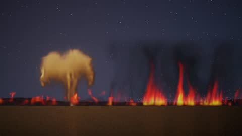</a> | **The prairie** (round 7) | Night on a prairie: a grass fire's front burns on the right, the ground it burnt glows as coals; at 2 s a blast on the horizon and a mushroom cloud climbs and darkens; at 4 s its shock wave lays the flames down, the coals flare and ash falls ([EFFECTS_BLAZE.md](../docs/EFFECTS_BLAZE.md) §6) | Learned: the front (four wildfire tiles) and the burnt ground (three coals tiles), by their own renderers; the mushroom (drawn by the explosions' look `cloud`). Procedural: the flash and afterglow, the shock front, camera shake, embers, sparks, ash, light | Wildfire (82 KB), coals (82 KB), mushroom (294 KB, study O's since it replaced round 7's) (`fx_blaze/models/scene`); int8 | `prairie.nvfxs`, 8 s, 2.5 MB; re-rendered for study O | The three read as a grass fire, burnt ground and a distant mushroom cloud; the coals are a thin strip at this scale; the front's smoke ends in a soft line at its tiles' tops; since study O the fireball is bigger and brighter and its cap wider on a clearer stem (the scene asks a calm start point for stronger controls, which the mean state now follows); the cap is still ragged, and late on the cloud looks more like a tree of smoke |
| <a href="scene_liftoff.mp4">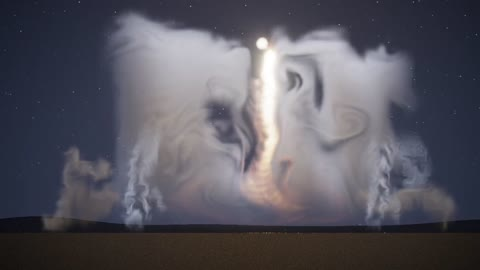</a> | **The lift-off** (round 7) | Night at a launch pad: two stacks puff vapour under floodlights; at 2.5 s the engine lights and its exhaust billows out over the pad both ways; sand stirred by the blast hangs and drifts away; at 7.5 s the rocket's flame climbs out of the picture and the clouds go on billowing ([EFFECTS_FLOW.md](../docs/EFFECTS_FLOW.md) §6) | Learned: the blast (launch, played with the library's gentler swirl and, since study O, 2 detail passes and two outer tiles that carry its billows on), the stacks' puffs, the sand (ink, recoloured brown), all by field-shader looks. Procedural: the flash, shock, embers and debris, the rocket's flame (a glow and a lamp), the floodlights | Launch, puffs, ink (146 KB each) (`fx_flow/models/scene`); int8 | `liftoff.nvfxs`, 10 s, 1.9 MB; re-rendered for study O | The blast reads as a launch and lights the vapour and the sand; its billows spill past the blowing tile on both sides into curls (before study O they were one square block with straight sides, [EFFECTS_FLOW.md](../docs/EFFECTS_FLOW.md) §6.1), and the stripes along the jet are gone; late on the right-hand cloud is still a tall block; the puffs are small beside the blast; there is no rocket to see, only its flame |
| <a href="scene_falls.mp4">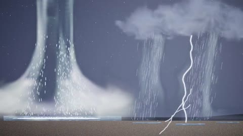</a> | **The falls** (water) | A waterfall pours into a pool on the left; a bank of storm cloud drifts in from the right trailing two rain shafts that fill in and lean; lightning flashes and strikes twice; the rain arrives over the right and rings the puddles and the pool ([EFFECTS_WATER.md](../docs/EFFECTS_WATER.md) §12) | Learned: the waterfall's sheet, foot and mist, the two rain shafts' curtains (the learned bodies, `swirl 0`; `passes 2` since study O), the storm cloud (shader look). Seeded: the spray thrown off the learned water, the pool's ripples, waves and foam, the rain streaks and the puddles' rings. Procedural: the lightning bolts and flashes, light | Waterfall, rainshaft (82 KB each), cloud (146 KB) (`library/models`); int8 | `falls.nvfxs`, 12 s, CRF 25 (to stay under 5 MB), 3.9 MB; re-rendered for study O | A large, misty fall whose sheet sways with spray through it, a foaming pool, rain shafts that thicken and lean, forked bolts. No cliff or rock is drawn, so the falls come out of the night sky; the mist hides most of the pool's rings. The horizontal bands the sheet and the curtains carried before study O are gone: its streaks fall straight ([EFFECTS_WATER.md](../docs/EFFECTS_WATER.md) §7.1) |
| <a href="scene_volcano.mp4">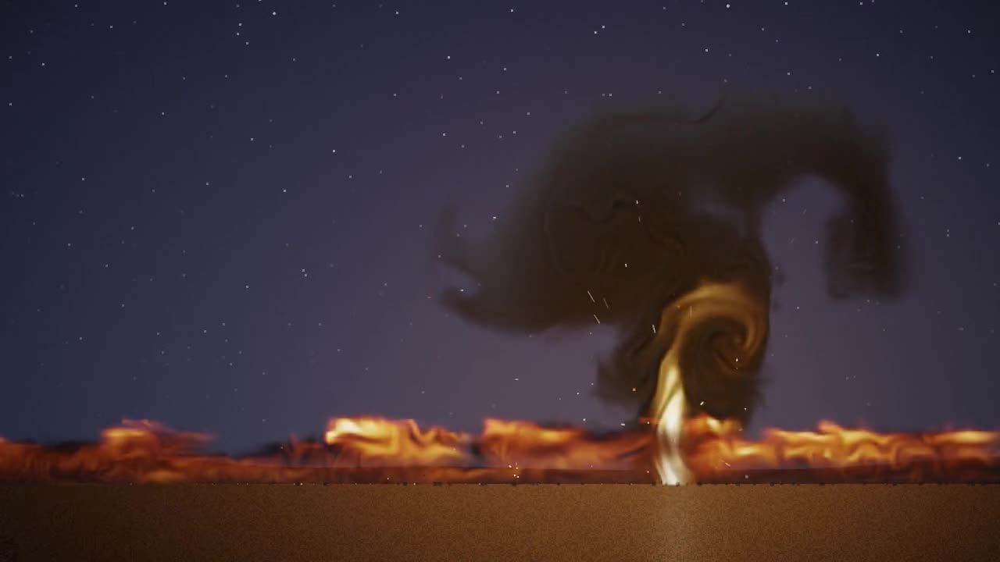</a> | **The volcano** (earth, round 9) | Night at an eruption: an ash column rises right of centre into an umbrella; a blast at 2.5 s and a second hit at 3.3 s surge its rate; a lava river runs along the foreground; bombs and spatter are thrown out; ash falls from 3.5 s; lightning forks in the plume from 4 s and lights the sky ([EFFECTS_EARTH.md](../docs/EFFECTS_EARTH.md) §6) | Learned: the eruption's column and umbrella (the `ash` look, `swirl 1, swirl_scale 9`), the lava river (four overlapping tiles of the lava model, the `magma` look; it lights the ground). Procedural: the bombs, spatter and sparks, the falling ash, the lightning and its flash, the vent's and the river's lamps, the shock of the blast, the sky and the ground | Eruption, lava (146 KB each) (`fx_earth/models/scene`, links to the round's models); int8 | `volcano.nvfxs`, 9 s, CRF 24, 1.9 MB | A dark, billowing umbrella over a column whose lower part glows gold and curls like a flame vortex rather than an incandescent jet; the bolts read well. The lava river is a bright band of curling orange with darker streaks: from this distance it reads as much as a line of low fire as crusted rock (the learned crust is streaks, not plates and seams). No mountain is drawn, so the eruption rises from flat ground, and the plume looks near rather than on the horizon |
| <a href="scene_crypt.mp4">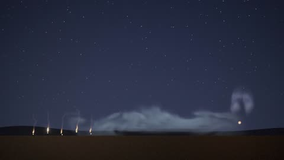</a> | **The crypt** (air) | The floor of a ruined crypt at night: five candles burn on the left, a cold vapour spills out of a broken tomb and flows along the floor, a censer puffs a ring of incense every 1.6 s; at 2.5 s the door is thrown open, a draught leans the candles, drives the vapour to the right and drifts the rings, until it swings to at 6.2 s ([EFFECTS_AIR.md](../docs/EFFECTS_AIR.md) §6) | Learned: the candles (the candle model, drawn by the look `candlelight`), the vapour (one heavy gas tile, look `miasma`), the rings (three smoke ring modules started in turn, look `incense`). Procedural: the wicks' and the coals' glows, the lamps, moonlight, leaves | Candle (82 KB), smokering (294 KB), heavygas (146 KB) (`fx_air/models/scene`); the ring's and the gas's fine fields softened (`soften 0.4`, `0.1`) since study Q; int8 | `crypt.nvfxs`, 9 s, CRF 24, 1.2 MB; re-rendered for study Q | The three read as candles, a crypt's cold vapour and a censer's rings, and one draught moves all three; nothing draws the candles, the tomb or the censer; the candles are small at this scale, the vapour's tile shows a soft flat top at times and the rings are pale and ghostly; since study Q the vapour's fronts are softer billows and the rings smoother ([STUDY_Q.md](../docs/STUDY_Q.md) §5.1) |
| <a href="scene_forestedge.mp4">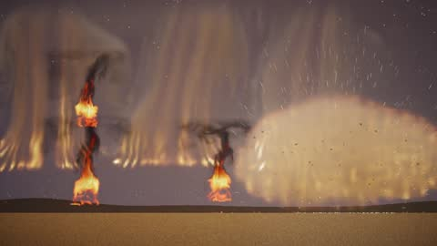</a> | **The forest-edge town** (round 10 fire) | Night at the edge of a burning forest: a crown fire runs through the trees behind the town, embers drifting over the roofs; flames pour from two windows of a house on the left; at 2 s a window of the house in the middle catches; at 5 s the mill on the right blows up, a dust explosion whose shock shakes the town and flattens the window flames, then a pall of dust and falling ash ([EFFECTS_FIRE2.md](../docs/EFFECTS_FIRE2.md) §6) | Learned: the forest (three crown fire tiles, drawn by the look `forest_fire`), the windows (three window fire tiles, own renderer), the mill's blast (one dust explosion tile, look `dust_blast`). Procedural: embers, debris, the shock, flash, lamps, ash, camera shake | Crownfire (146 KB), windowfire (146 KB), dustexplosion (294 KB) (`fx_fire2/models/scene`); the two fires with the library's detail settings since study Q; int8 | `forestedge.nvfxs`, 10 s, CRF 24, 2.1 MB; re-rendered for study Q | The three read as a forest's crown fire, a house's window fires and a mill's dust explosion in one night, and the blast moves the fires near it; nothing draws the trees, the houses or the mill; the crown fire's smoke fills the sky as curtains (since study Q its flames are tongues rather than streaks, [STUDY_Q.md](../docs/STUDY_Q.md) §5.1); the fireball, drawn by its look, is a paler orange than the model's own renderer's |
| <a href="scene_weather_day.mp4">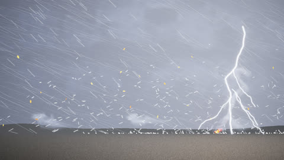</a> | **A day's weather** (the weather director) | 40 s of weather from one small state ([WEATHER.md](../docs/WEATHER.md)): a clear day with a campfire; clouds build until it is overcast; rain; the gust front (leaves flying, the smoke and the flames bent over) and a thunderstorm: a downpour, six flashes, hail in the heaviest cells, the hills lost in the rain; then it clears in reverse (the lightning stops, the rain eases, the wind drops, the clouds break) and a double rainbow shows | Learned: the clouds (five cloud tiles, by looks that grey as the daylight falls), the mist in the downpour (three fog tiles), the campfire (fire) and its smoke (smoke, a look). Procedural: the director, the rain by its physics (Marshall-Palmer drops at Atlas's speeds), hail, leaves, the bolts and their light, the rainbow, the day sky and its haze | The library's cloud, fog, fire and smoke (`library/models`); int8 | `weather_day.nvfxs`, 40 s; scaled to 960 x 540 (lanczos) and encoded in two passes at 900 kbit/s to stay under 5 MB, 4.8 MB | The order of things reads: the clouds before the rain, the leaves and the bent smoke before the downpour, the bolts in its heaviest part, and it undoing in reverse. **The encoding loses most of the rain's finest streaks** (thinner than a pixel; at 5 MB for 40 s even CRF 27 at 960 x 540 needs 6.7 MB): the keyframes in WEATHER.md show the rain as drawn. Near the camera in the storm's wind the rain is long and slanted and reads heavier than its rate; the cloud masses are puffs in a band, not a deck; the storm sky is a flat grey; the ground does not get wet |
| <a href="scene_coast.mp4">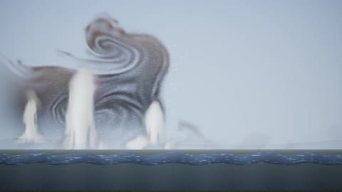</a> | **The coast** (elements) | A hot afternoon on a desert coast: across a bay three geysers steam and erupt on the far shore, each on its own time, and the sea breaks in the foreground; from 0.8 s a haboob rolls in behind the geysers from the left as the weather director turns the day from clear to a dust storm: the wind rises, the geysers' steam is torn to the right, the sea breaks harder and spray streams off its crests, blown sand races along the ground and the light dims and yellows ([EFFECTS_ELEMENTS.md](../docs/EFFECTS_ELEMENTS.md) §6) | Learned: the haboob (one 256 px tile 1050 px wide, drawn by the look `dust_wall`), the geysers (three tiles) and the spray (three tiles along the sea), both by their own renderers. Procedural: the sea's waves (a seeded pool with a swell), the spray drops, the blown sand, the weather director's light and haze | Geyser (146 KB), haboob (294 KB, with its mean state), seaspray (146 KB) (`fx_elements/models/scene`); int8 | `coast.nvfxs`, 9 s, 1.8 MB | The three read as a geyser field, a dust wall and a breaking sea under one storm, and one wind moves all three. The haboob is a big rolling cloud with marbled streaks, greyer than ochre in the daylight; the geysers are soft white pillars with faint green and magenta fringes; the spray stays low on the waves and is small at this scale; the daylight ground is a thin strip of green (the composer's daylight ground is grass); late on the dust's haze whitens the whole frame |
| <a href="scene_campfire.mp4"></a> | **The campfire, driven by the game** | A campfire the game drives through inputs and rules ([ENGINES.md](../docs/ENGINES.md) §7): a gust at 2.5 s, the log beside it catches at 4 s, a breeze and the flames lean at 5.5 s, more fuel at 7 s, a second gust at 8 s, doused at 9.3 s, relit at 10.5 s | Learned: the two fires, the smoke sky (shader look). Procedural: the gusts' embers, the scorch, light | Study D's v1 fire and smoke; int8 | `campfire.nvfxs` with `--trigger blow@2.5 --trigger light_log@4 --set breeze=1.5@5.5 --set lean=0.7@5.5 --set fuel=1@7 --trigger blow@8 --trigger douse@9.3 --trigger relight@10.5 --set fuel=0.7@10.5`; the script's 960 x 540, scaled to 1280 x 720 (lanczos); 12 s, 3.2 MB | The events read clearly; the smoke shows as puffs above the flames rather than a column (the script hands the fires' top rows to a sky domain) |

## 2. Each learned effect alone, at three settings

`nvfx_reel` (this repository's demo tool, `tools/nvfx_reel.cpp`): one model, three control settings side by side,
each rendered at 256 px through `nvfx_render`, composited over a dark gradient and scaled x1.5 with a bilinear filter
(to 384 px), 1280 x 576 at 30 fps, 9 s (the mushroom and the avalanche 12 s), CRF 26, seed 1 (round 9's: seeds of its
own, 6390201 and up; round 10's elements 27200003, 27200011 and 27200021, the geyser and the haboob 12 s). Ink, a dark dye with no light of its own,
is shown over a pale water-coloured gradient instead, and so is the eruption's dark ash (a grey-blue one), the haboob's dust over a pale sky-to-sand one and sea spray over a dark sea-blue one. The four water clips are the learned body alone, played with
`swirl 0` as the library and the scene play them (`nvfx_reel`'s DETAIL field; the waterfall's, fountain's and rain
shaft's calibration chose 3, the splash's 0): `nvfx_reel` draws no seeded layer, so their drops, spray and pools are in
the scene and the library walk-through below. The runtime's default playback: 6 s shards, each a fresh rollout
from one of the three stored start points nearest the controls, crossfaded. One-shots (explosion, dust) start again with
the next seed when they end. Everything in these clips is learned, drawn by the effect's own renderer; nothing is
procedural but the labels.

| | Video | Settings (intensity, second control, turbulence) | Model | Rendered | How it looks |
|---|---|---|---|---|---|
| <a href="effect_fire.mp4"></a> | **Fire** | 0.25, 0.5, 0.3; 0.6, 0.15 (wind left), 0.5; 0.95, 0.75 (wind right), 0.7 | `fire.nvfx`, v2 (42 KB: v1 with 6-bit start states) | 0.4 MB | Good: one flame per tile, leaning with the wind, never the same twice. At strong wind with turbulence 0.9 the flame can go out until the next shard (seen while choosing settings; not shown) |
| <a href="effect_smoke.mp4"></a> | **Smoke** | 0.3, 0.5, 0.2; 0.6, 0.2, 0.6; 0.95, 0.8, 0.9 | `smoke.nvfx` (146 KB) | 0.5 MB | Good: plumes that billow and lean; a marbled texture in thick smoke |
| <a href="effect_explosion.mp4"></a> | **Explosion** (one-shot) | 0.15, 0.5, 0.3; 0.35, 0.25, 0.6; 0.5, 0.9, 0.3 | `explosion.nvfx`, v2 (274 KB) | 0.2 MB | Fair: a fireball that rolls up into a dark cloud; its first frames are a smooth yellow-green ball (the learned renderer draws a fresh fireball poorly, REPORT §6.4). Settings were chosen so that only medium start points play: the strongest fill a tile and square off at its edges (LIBRARY.md §7) |
| <a href="effect_steam.mp4"></a> | **Steam** | 0.3, 0.5, 0.3; 0.6, 0.2, 0.5; 0.95, 0.6, 0.8 | `steam.nvfx` (82 KB) | 0.6 MB | Good: a vent's jet of vapour; marbled texture; at high turbulence some vapour wraps in at the tile's left edge now and then |
| <a href="effect_magic.mp4"></a> | **Magic** (study L) | 0.3, 0.2 (slow spin), 0.3; 0.6, 0.5, 0.5; 0.95, 0.95 (fast spin), 0.8 | `magic.nvfx`, v3 (82 KB) | 0.5 MB | Good: a spinning violet portal with smooth arms and a bright rim; the settings change its size, brightness and spin |
| <a href="effect_jet.mp4"></a> | **Jet** (flamethrower) | 0.4, 0.15 (aimed low), 0.3; 0.7, 0.5, 0.5; 1.0, 0.9 (aimed high), 0.8 | `jet.nvfx` (82 KB) | 0.8 MB | Good: a turbulent flame that blows to the right (the only direction the model knows) |
| <a href="effect_orb.mp4"></a> | **Orb** (study L) | 0.3, 0.1 (calm), 0.3; 0.6, 0.5, 0.5; 0.95, 0.95 (strong pulse), 0.8 | `orb.nvfx`, v3 (82 KB) | 0.3 MB | Fair: a boiling cyan ball; the settings show mostly as size and brightness |
| <a href="effect_vortex.mp4"></a> | **Vortex** (dust devil, study L) | 0.5, 0.1 (still), 0.3; 0.75, 0.5, 0.5; 1.0, 0.9 (wandering), 0.8 | `vortex.nvfx`, v3 (82 KB) | 0.4 MB | Fair: a dust column under a haze of dust that fills the tile. Below intensity 0.5 the column can die and not regrow (fewer losses since study L, not none), so no lower setting is shown |
| <a href="effect_fog.mp4"></a> | **Fog** | 0.3, 0.5, 0.3; 0.6, 0.2, 0.5; 0.95, 0.85, 0.9 | `fog.nvfx` (146 KB) | 0.1 MB | Good: low ground fog that rolls with the wind |
| <a href="effect_dust.mp4"></a> | **Dust** (one-shot) | 0.3, 0.5, 0.3; 0.6, 0.2, 0.5; 1.0, 0.85, 0.9 | `dust.nvfx` (274 KB) | 0.2 MB | Good: a burst of dust that spreads along the ground and curls |
| <a href="effect_cloud.mp4"></a> | **Cloud** | 0.3, 0.5, 0.3; 0.6, 0.2, 0.5; 0.95, 0.85, 0.9 | `cloud.nvfx` (146 KB) | 0.1 MB | Fair: a drifting cloud; faint green and magenta fringes at its edges from the learned renderer |
| <a href="effect_wildfire.mp4">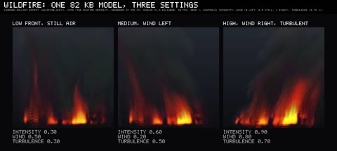</a> | **Wildfire** (round 7) | 0.3, 0.5, 0.3; 0.6, 0.2 (wind left), 0.5; 0.9, 0.8 (wind right), 0.7 | `wildfire.nvfx` (82 KB) | 0.5 MB | Good: a continuous front of flames across the tile, leaning with the wind (it works by the rule, [EFFECTS_BLAZE.md](../docs/EFFECTS_BLAZE.md) §4.4); its dark smoke is faint over the night sky |
| <a href="effect_coals.mp4">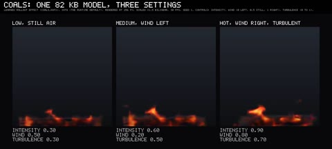</a> | **Coals** (round 7) | 0.3, 0.5, 0.3; 0.6, 0.2, 0.5; 0.9, 0.8, 0.7 | `coals.nvfx` (82 KB) | 0.2 MB | Good to fair: a low glowing bed with small flames (it works by the rule); the learned bed glows dimmer and more evenly than the simulator's, and is dim at intensity 0.3 |
| <a href="effect_mushroom.mp4">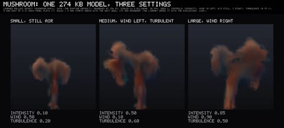</a> | **Mushroom** (one-shot, round 7) | 0.1, 0.5, 0.2; 0.5, 0.1, 0.6; 0.85, 0.9, 0.5 | `mushroom.nvfx` (294 KB), study O's since it replaced round 7's (a mean state and a 30-frame fine-tune) | 0.3 MB; re-rendered for study O | Weak to the eye, if less so by the rule (study O's test: its average picture 1.18 dB closer to a real run's): a fireball rises on a stem into a cap and darkens, but the cap turns ragged and hangs down like branches after 3 to 4 s, and its own renderer adds blue and green fringes (the library draws it with the explosions' look). Beside round 7's the large setting's cloud is bigger, as its controls ask, the others much the same. It plays 5 s, holds 1 s and starts again with the next seed |
| <a href="effect_launch.mp4">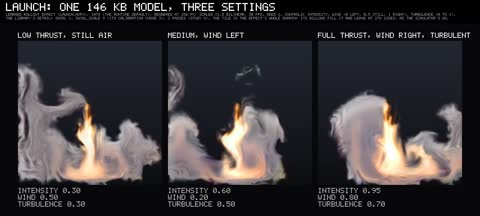</a> | **Launch** (round 7) | 0.3, 0.5, 0.3; 0.6, 0.2, 0.5; 0.95, 0.8, 0.7 | `launch.nvfx` (146 KB), played with the library's swirl 1, scale 9 (`nvfx_reel`'s DETAIL field; its calibration chose 3) and, since study O, 2 detail passes | 0.8 MB; re-rendered for study O | Short of the bar by the rule ([EFFECTS_FLOW.md](../docs/EFFECTS_FLOW.md) §4): the jet hits the ground and billows out both ways, but the billows fill the tile and run out at its sides, and the settings change it less than the labels suggest. The square is the effect's whole domain, which the simulator's billows fill too (study O, §6.1 there): the lift-off scene carries them on in two outer tiles; this reel shows the bare tile |
| <a href="effect_puffs.mp4">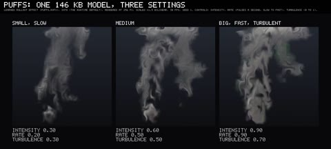</a> | **Puffs** (round 7) | 0.3, 0.2 (slow), 0.3; 0.6, 0.5, 0.5; 0.9, 0.9 (fast), 0.7 | `puffs.nvfx` (146 KB) | 0.6 MB | Weak by the rule: a column of grey smoke whose pulses are irregular and hard to tell apart (the model has no clock); green and magenta fringes now and then |
| <a href="effect_ink.mp4">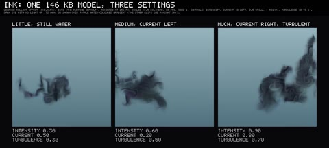</a> | **Ink** (round 7) | 0.3, 0.5 (still), 0.3; 0.6, 0.2 (current left), 0.5; 0.9, 0.8 (current right), 0.7 | `ink.nvfx` (146 KB) | 0.2 MB | Short of the bar by the rule: dark dye curls, spreads and drifts with the current, but stays a more compact cloud than the simulator's, and leaves the tile at its sides |
| <a href="effect_waterfall.mp4">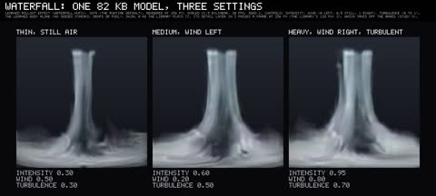</a> | **Waterfall** (water) | 0.3, 0.5, 0.3; 0.6, 0.2 (wind left), 0.5; 0.95, 0.8 (wind right), 0.7 | `waterfall.nvfx` (82 KB), swirl 0, 3 detail passes at this 256-px size (the library's 128 px: 2; study O) | 0.4 MB; re-rendered for study O | Weak by the rule ([EFFECTS_WATER.md](../docs/EFFECTS_WATER.md) §4: its average picture only ties the flipbook's): a soft sheet that falls whole in straight streaks, sways and spreads into a churning, misty foot; no drops (the seeded layer draws those); it starts in mid-air at the tile's top; a red speck at a corner of the lip now and then (the learned renderer). The horizontal bands of one detail pass a frame are gone (§7.1 there) |
| <a href="effect_fountain.mp4">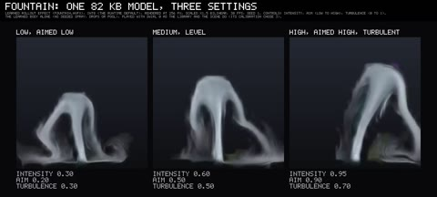</a> | **Fountain** (water) | 0.3, 0.2 (aimed low), 0.3; 0.6, 0.5, 0.5; 0.95, 0.9 (aimed high), 0.7 | `fountain.nvfx` (82 KB), swirl 0 | 0.3 MB | Works by the rule: a soft arc and bell of falling water whose height and lean follow the controls; a faint green and violet tinge at its foot now and then |
| <a href="effect_splash.mp4">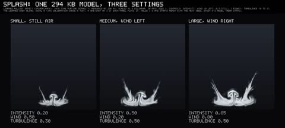</a> | **Splash** (one-shot, water) | 0.2, 0.5, 0.3; 0.5, 0.2, 0.5; 0.85, 0.8, 0.5 | `splash.nvfx` (294 KB), swirl 0; study O's since it replaced round 8's (a mean state) | 0.2 MB; re-rendered for study O | Weak by round 8's rule; study O's brought its average picture 0.40 dB closer to a real run's, which barely shows (the small setting's walls a little taller): a crown's two walls rise and fall back into a low, swirling mist; small in its tile. A 3 s one-shot: each panel plays it, holds 1 s and starts again with the next seed |
| <a href="effect_rainshaft.mp4">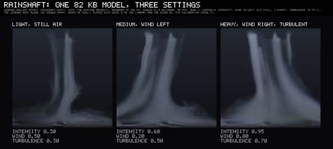</a> | **Rain shaft** (water) | 0.3, 0.5, 0.3; 0.6, 0.2, 0.5; 0.95, 0.8, 0.7 | `rainshaft.nvfx` (82 KB), swirl 0, 3 detail passes at 256 px (the library: 2 at 128 px; study O) | 0.3 MB; re-rendered for study O | Works by the rule: grey-blue curtains that thicken, thin and lean with the wind and spread at the ground, without the bands one pass laid across them; a faint green tinge at the foot from the learned renderer, as [EFFECTS_WATER.md](../docs/EFFECTS_WATER.md) §11 reports; no streaks (seeded) |
| <a href="effect_lava.mp4">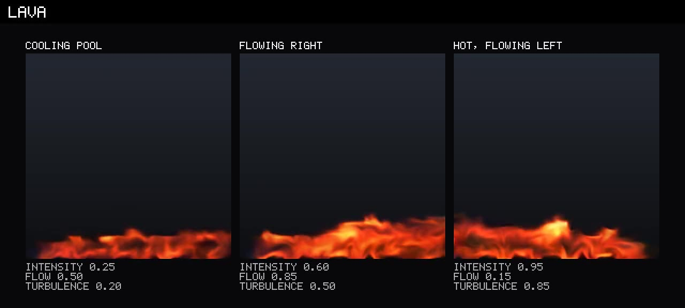</a> | **Lava** (earth, round 9) | 0.25, 0.5 (level: a pool), 0.2; 0.6, 0.85 (flowing right), 0.5; 0.95, 0.15 (flowing left), 0.85 | `lava.nvfx` (146 KB) | 0.3 MB | Works by the rule ([EFFECTS_EARTH.md](../docs/EFFECTS_EARTH.md) §4): a glowing band of molten rock along the tile's bottom, thicker and brighter with intensity and heaped on the downhill side; its top curls and flickers like low flames, and its crust is darker streaks rather than the simulator's dark plates split by bright seams; the cooling pool is a thin, dim strip |
| <a href="effect_eruption.mp4">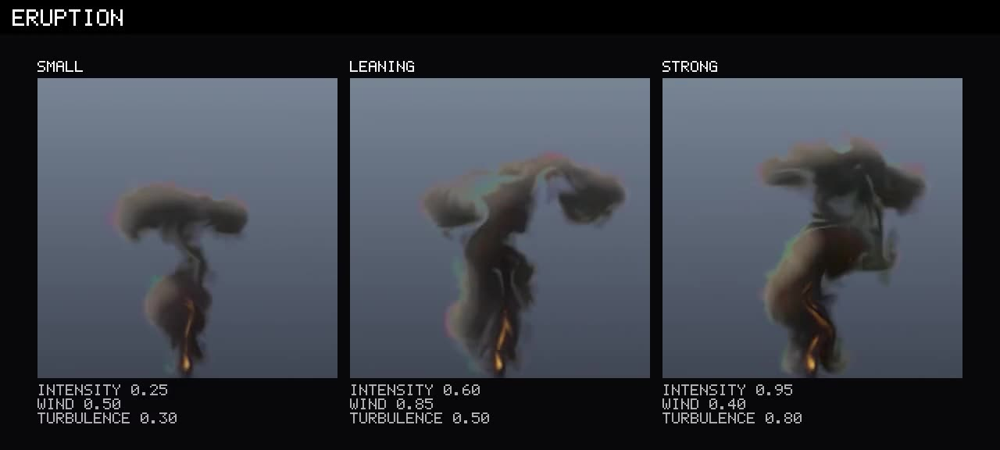</a> | **Eruption** (earth, round 9) | 0.25, 0.5 (still air), 0.3; 0.6, 0.85 (wind right), 0.5; 0.95, 0.4, 0.8 | `eruption.nvfx` (146 KB), swirl 1, swirl scale 9 as the library and the scene play it (its calibration chose 3, which draws the ash as worms); over a grey-blue gradient | 0.3 MB | Works narrowly by the rule: a dark ash column from a thin incandescent jet, spreading into a flat umbrella that leans downwind and grows with intensity; faint green and violet fringes at the umbrella's edges (the learned renderer); the jet is a thin flame rather than a wide vent |
| <a href="effect_avalanche.mp4">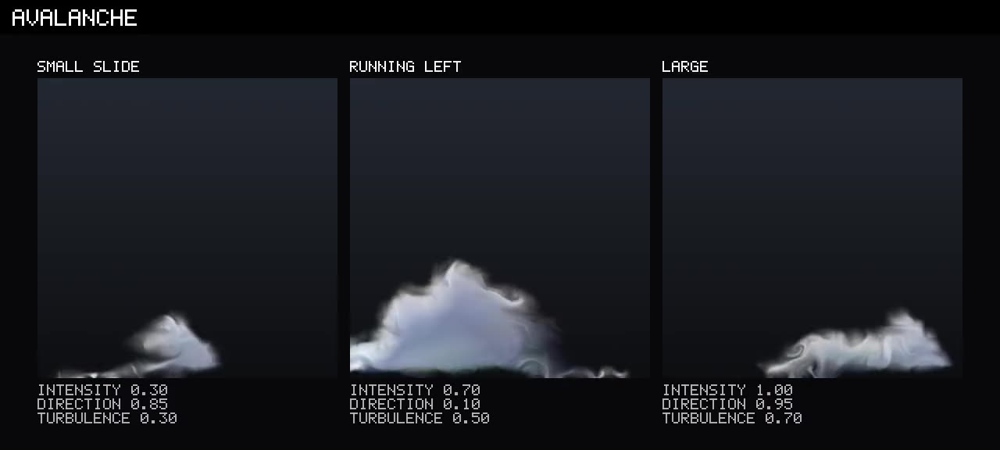</a> | **Avalanche** (one-shot, earth, round 9) | 0.3, 0.85 (runs right), 0.3; 0.7, 0.1 (runs left), 0.5; 1.0, 0.95, 0.7 | `avalanche.nvfx` (274 KB) | 0.2 MB | Weak by the rule: a white powder cloud that slides along the ground in its direction and settles; it billows less than the simulator's, and here the largest setting's cloud is no taller than the middle one's; hard edges where it meets the tile's side, faint violet fringes. A 5 s one-shot: each panel plays it, holds 1 s and starts again with the next seed |
| <a href="effect_candle.mp4">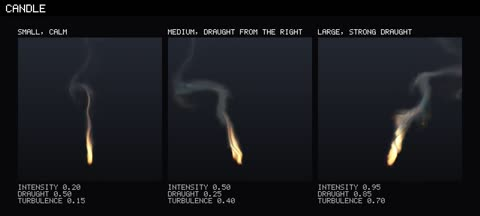</a> | **Candle** (air) | 0.2, 0.5 (still air), 0.15; 0.5, 0.25 (a draught from the right), 0.4; 0.95, 0.85 (a strong draught from the left), 0.7; with the library's detail (`swirl 1, swirl_scale 9`) | `candle.nvfx` (82 KB) | 0.2 MB | Fair to the eye, though it works by the rule ([EFFECTS_AIR.md](../docs/EFFECTS_AIR.md) §4.4): a flame on its wick with a wisp of smoke, leaning and fluttering in a draught, but narrower and more ragged than the simulator's teardrop; its own renderer gives the large flame's smoke blue-green fringes (the library draws it with a look) |
| <a href="effect_smokering.mp4">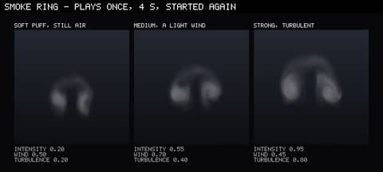</a> | **Smoke ring** (one-shot, air) | 0.2, 0.5, 0.2; 0.55, 0.7 (a light wind to the right), 0.4; 0.95, 0.45, 0.8 | `smokering.nvfx` (294 KB, with study M3's mean state) | 0.1 MB | Good: a ring seen side-on, two rolled cores under a hood of smoke, rising, spreading and breaking up, as its test found it keeps its shape ([EFFECTS_AIR.md](../docs/EFFECTS_AIR.md) §4.5); its first frames carry faint magenta and green tints. It plays 4 s, holds 1 s and starts again with the next seed |
| <a href="effect_heavygas.mp4">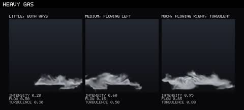</a> | **Heavy gas** (air) | 0.2, 0.5 (both ways), 0.3; 0.6, 0.15 (flowing left), 0.5; 0.95, 0.85 (flowing right), 0.8; with the library's detail since study Q (`soften 0.1`), seed 33490003 | `heavygas.nvfx` (146 KB) | 0.2 MB; re-rendered for study Q | Fair: a low white vapour poured out and flowing along the floor the way its `flow` sends it, with soft rolling fronts; since study Q softer, without the thin bright streaks along its fronts ([STUDY_Q.md](../docs/STUDY_Q.md) §5.1), its release thinning and swelling (it falls short by the rule: its average picture only ties a flipbook's) |
| <a href="effect_crownfire.mp4">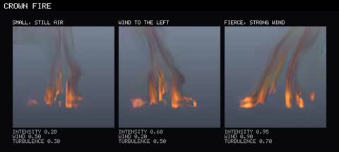</a> | **Crown fire** (round 10 fire) | 0.2, 0.5 (still air), 0.3; 0.6, 0.2 (wind to the left), 0.5; 0.95, 0.9 (a strong wind to the right), 0.7; over a grey-blue gradient; with the library's detail since study Q (`grow 1, contrast 1`), seed 33490001 | `crownfire.nvfx` (146 KB) | 0.4 MB; re-rendered for study Q | Works by the rule ([EFFECTS_FIRE2.md](../docs/EFFECTS_FIRE2.md) §4.4): a row of crowns torching in their own flames under a dark column of smoke that leans with the wind; before study Q its detail layer drew the flames and the column as a comb of vertical streaks (its lock grew the structure a rising column carries: [STUDY_Q.md](../docs/STUDY_Q.md) §3.2), now separate tongues of flame (its spectrum distance on training runs 0.48 to 0.10, its motion 0.80 to 0.69 of the real); the column has faint green fringes (the library draws it with a look) |
| <a href="effect_windowfire.mp4">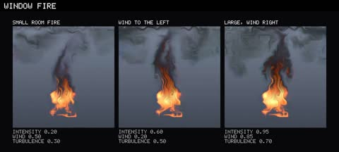</a> | **Window fire** (round 10 fire) | 0.2, 0.5, 0.3; 0.6, 0.2 (wind to the left), 0.5; 0.95, 0.85 (wind to the right), 0.7; over a grey-blue gradient; with the library's detail since study Q (`swirl 1, swirl_scale 9, soften 0.2, contrast 0.75`), seed 33490002 | `windowfire.nvfx` (146 KB) | 0.5 MB; re-rendered for study Q | Works by the rule: flames pour out of the window's upper part and up the wall (since study Q rounded, without the curls and lines its small swirl drew, [STUDY_Q.md](../docs/STUDY_Q.md) §5.1), black smoke rises and spreads out under the eave as a ceiling jet; the room's glow below is patchy and the settings change the flame less than their labels suggest |
| <a href="effect_dustexplosion.mp4">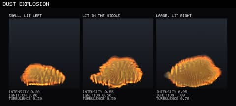</a> | **Dust explosion** (one-shot, round 10 fire) | 0.2, 0 (lit at the cloud's left end), 0.3; 0.55, 0.5 (lit in its middle), 0.5; 0.95, 1 (lit at its right end), 0.7 | `dustexplosion.nvfx` (294 KB, with study M3's mean state) | 0.4 MB | Works by the rule: the flame runs through the cloud from where it was lit into a brown-orange fireball that billows up and burns out; streaks inside the fireball, blue-green fringes on the unlit cloud and a faint, tinted pall (its own renderer). It plays 4 s, holds 1 s and starts again with the next seed |
| <a href="effect_geyser.mp4">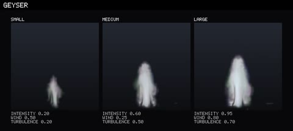</a> | **Geyser** (elements) | 0.2, 0.5 (still air), 0.2; 0.6, 0.25 (wind from the right), 0.5; 0.95, 0.8 (wind from the left), 0.7; 12 s, seed 27200003 (at 27200001 the small and medium panels played the same start point and looked alike) | `geyser.nvfx` (146 KB) | 0.2 MB | Weak by the rule ([EFFECTS_ELEMENTS.md](../docs/EFFECTS_ELEMENTS.md) §4: it ties the coarse simulation at 1 s): the vents steam, surge and erupt into white columns that collapse into steam, each on its own irregular time; the columns grow with intensity, though what a shard plays follows its start point more than the controls (§4.6); the strongest throw a broad billow with green and magenta fringes at its foot; the wind leans the steam only a little |
| <a href="effect_haboob.mp4">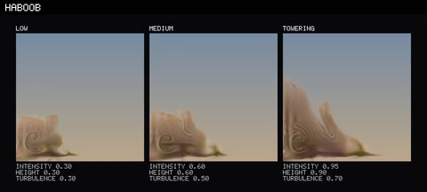</a> | **Haboob** (one-shot, elements) | 0.3, 0.3 (low), 0.3; 0.6, 0.6, 0.5; 0.95, 0.9 (towering), 0.7; over a pale sky-to-sand gradient; 12 s | `haboob.nvfx` (294 KB, with study M3's mean state) | 0.2 MB | Falls short by the rule (it tracks better than the coarse simulation, its average picture ties the flipbook's): a dust front let go at the left runs right along the ground, its head rolling up into curls, taller and faster with the controls, dust left behind it; a magenta speck at the lock's nose in its first frames (the learned renderer loses the first frame, §4.1) and dark green-violet streaks along the ground. It plays 5 s, holds 1 s and starts again with the next seed |
| <a href="effect_seaspray.mp4">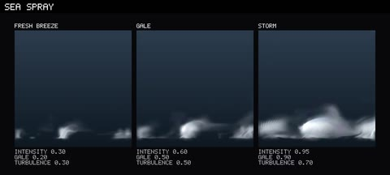</a> | **Sea spray** (elements) | 0.3, 0.2 (a fresh breeze), 0.3; 0.6, 0.5 (a gale), 0.5; 0.95, 0.9 (a storm), 0.7; over a dark sea-blue gradient | `seaspray.nvfx` (146 KB) | 0.2 MB | Works by the rule: white tufts of spray where crests break, streaming downwind and falling back, more and bigger with the controls, the storm's running together into a line of white; blobbier than the simulator's thin plumes (its detail is further from real than a flipbook's, §4.2). `nvfx_reel` draws no sea: the library and the scene put it over the composer's waves |

## 3. Controllability

| | Video | What it shows | Learned / procedural | Models, precision | Rendered | How it looks |
|---|---|---|---|---|---|---|
| <a href="controls_sweep.mp4"></a> | **Controls, swept live** | Fire and smoke while the controls change every frame: intensity 0.5 to 1 to 0.15 and back to 0.6 (0 to 10.5 s), then wind from still (0.5) to full left (0) and full right (1) and back (11 to 19 s); turbulence stays 0.5. Bars and values show the controls, a clock the time | All learned (own renderers); the bars are labels | The library's fire (42 KB) and smoke (146 KB); int8 | `nvfx_reel --bars --timer`, keys linear in between; 256 px scaled x2 bilinear, 1280 x 720, 30 fps, 19 s, CRF 26, 1.0 MB | Good: the effects follow without a restart; the flame grows and shrinks with intensity and both lean with the wind |

## 4. Never repeats

| | Video | What it shows | Learned / procedural | Models, precision | Rendered | How it looks |
|---|---|---|---|---|---|---|
| <a href="never_repeats.mp4"></a> | **60 seconds, no loop** | Fire and smoke at fixed controls (0.7, 0.5, 0.5) for a minute with a clock. Nothing is stored but a few start states, so there is no loop: the runtime plays 6 s shards, each a fresh rollout from a stored start point with noise of its own, crossfaded over 0.5 s | All learned | The library's fire and smoke; int8 | `nvfx_reel --timer`, 256 px scaled x1.5 bilinear, 960 x 540, 30 fps, 60 s, CRF 26, 2.1 MB | Good: a minute of fire and smoke with no repeat and no gap; the flame's size wanders from shard to shard |

## 5. Real against learned

The simulator's run on top and the learned effect below, both started from the same state. `nvfx_reel`'s `real:` and
`learned:` panels follow study D's tracking ([REPORT.md](../docs/REPORT.md) §6.4): held-out run 1 of each effect (salt 2:
controls 0.67, 0.24, 0.56 and a seed that training never used) is simulated for 100 frames (one-shots: 1); its state
becomes the only start point of a copy of the model, which then plays one continuous rollout with the run's noise seed,
beside the simulation's own continuation. One-shots start again every 3.5 s with the next held-out run (2, 3, ...).
Both are 128 px (the simulator's size), scaled x1.7 bilinear, 1280 x 720, 30 fps, 10 s, CRF 26. **Both are chaotic:
like two runs of the simulator they part after a second or two. What should match is the look and the motion, not the
pixels.**

| | Video | Effects | Learned / procedural | Models, precision | Rendered | How it looks |
|---|---|---|---|---|---|---|
| <a href="real_vs_learned_fire_smoke.mp4"></a> | **Fire, smoke, steam, explosion** | Top: the simulator (`src/sim`, its own renderer). Bottom: the learned effect | Top: simulation. Bottom: learned (own renderer) | The library's fire, smoke, steam, explosion; int8 | 0.5 MB | Nearly the same picture for the first half second, then the same kind of flame, plume and cloud on different paths; the learned explosion's first frames are smoother and greener than the simulator's |
| <a href="real_vs_learned_energy.mp4"></a> | **Magic, jet, orb, vortex** | As above | As above | The library's magic, jet, orb, vortex (study L's v3 for magic, orb and vortex); int8 | 0.6 MB | The portal, the jet and the dust devil keep the simulator's look throughout; the learned orb is often rounder than the simulator's lobed ball |
| <a href="real_vs_learned_round7.mp4">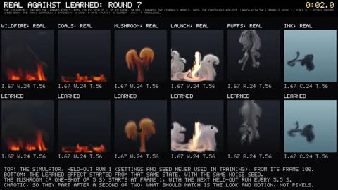</a> | **Round 7: wildfire, coals, mushroom, launch, puffs, ink** | As above, in six columns at x1.55 for 11 s; ink over a pale water-coloured gradient; launch with the library's swirl 1, scale 9 and, since study O, 2 detail passes; the mushroom (5 s) starts again with the next held-out run every 5.5 s | As above | The library's six round 7 models (the mushroom study O's since it replaced round 7's); int8 | 0.8 MB; re-rendered for study O | Wildfire, coals and ink stay close in look and motion; the learned launch's billows are boxier; the learned puffs make a noisy column where the simulator's pulses are distinct; the learned mushroom loses its clean stem and cap within a second, as its test found; study O's mushroom, which follows a run 0.85 dB better at 1 s on its test, looks the same here |
| <a href="real_vs_learned_water.mp4">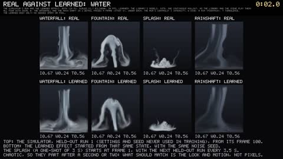</a> | **Water: waterfall, fountain, splash, rain shaft** | As above, the learned body only (no seeded spray or pool), all four with `swirl 0` and the waterfall and the rain shaft in 2 detail passes, as the library plays them; the splash (3 s) starts again with the next held-out run every 3.5 s | Top: simulation. Bottom: learned body (own renderer) | The library's four water models; int8 | 0.5 MB; re-rendered for study O | Close for the first half second, then the same kinds of sheet, bell and curtain on their own paths; the learned waterfall's sheet now falls in streaks as the simulator's does (it was banded before study O), softer and with fewer gaps; the learned splash's crown falls into a flatter mist |
| <a href="real_vs_learned_earth.mp4">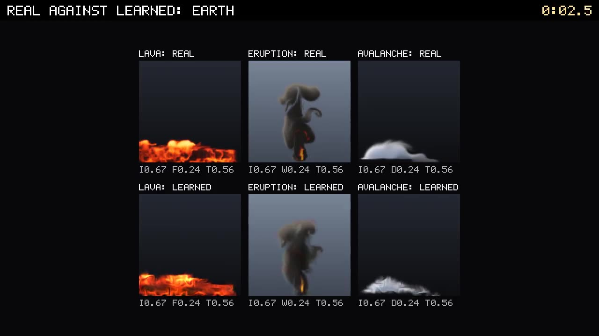</a> | **Earth: lava, eruption, avalanche** | As above but on round 9's own held-out seeds (`--seed-base 6000000`: held-out run 1, controls 0.67, 0.24, 0.56); the eruption with `swirl 1, swirl_scale 9` over a grey-blue gradient; the avalanche (5 s) starts again every 5.5 s with the next held-out run; 11 s | Top: simulation. Bottom: learned (own renderer) | The library's lava, eruption and avalanche; int8 | 0.3 MB | Lava stays close for longer than the others: the same band with a bright bubble on it, the learned one smoother; the eruption's column and umbrella match for a second, then part, the learned umbrella flatter; the learned avalanche's cloud is lower and thinner than the simulator's from the first second, as its test found |
| <a href="real_vs_learned_air.mp4">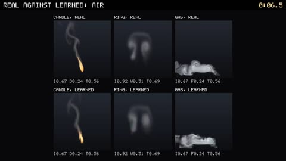</a> | **Air: candle, smoke ring, heavy gas** | As above, in three columns at x2 for 11 s; the candle with the library's swirl 1, scale 9; the ring (4 s) starts again with the next held-out run every 4.5 s | Top: simulation. Bottom: learned (own renderers) | The library's three air models; int8 | 0.2 MB | The candle's flame and wisp lean and waver as the simulator's, its flame narrower; the learned ring rises and rolls with the real one and holds its two cores, softer; the learned gas flows the same way in the same layer, streakier, its release thinner |
| <a href="real_vs_learned_fire2.mp4">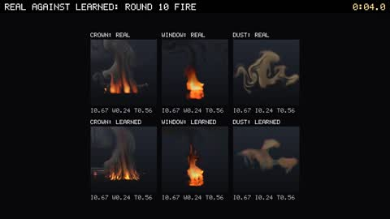</a> | **Round 10 fire: crown fire, window fire, dust explosion** | As above, in three columns at x1.7 for 11 s, from held-out run 1 of each with round 10's own seeds (`--seed-base 26000000`); the dust explosion (4 s) starts again with the next held-out run after its length and 0.5 s | Top: simulation. Bottom: learned (own renderers) | The library's three round 10 models; int8 | 0.4 MB | The learned crown fire's crowns torch and its column leans as the simulator's, streakier and darker; the window fire's flames and plume match in place and size, the learned flames narrower; the dust explosion's flame runs the same way through the cloud and its fireball rises with the real one, with streaks inside and fringes on the unlit cloud |
| <a href="real_vs_learned_elements.mp4">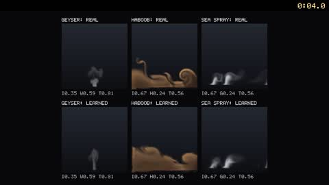</a> | **Elements: geyser, haboob, sea spray** | As above but on round 10's own held-out seeds (`--seed-base 27000000`), in three columns at x2 for 11 s: the geyser's held-out run 8 (controls 0.35, 0.59, 0.81), chosen because its conduit erupts within the 11 s (run 1's stays quiet), the haboob's and sea spray's run 1; the haboob (5 s) starts again every 5.5 s with the next held-out run | Top: simulation. Bottom: learned (own renderers) | The library's three elements models; int8 | 0.2 MB | The learned geyser steams and then erupts when the real one does, at 4 to 5 s (its conduit is the run's noise, which both share), its column as tall, softer, with faint fringes; the learned haboob runs with the real front, its curls softer; the learned spray rises where the real crests break and soon parts from it, blobbier |
| <a href="real_vs_learned_atmosphere.mp4"></a> | **Fog, dust, cloud** | As above | As above | The library's fog, dust, cloud; int8 | 0.2 MB | Close in shape and motion; the learned cloud has faint colour fringes the simulator's grey cloud lacks |

## 6. The library, by category

The effect library ([LIBRARY.md](../docs/LIBRARY.md)): 234 named, ready-made effects, 149 in the twelve category
walk-throughs, round 7's 20 (19 new, and `wall_of_flames` rewritten on the wildfire model), the 23 water entries, the
10 earth entries, the 12 air entries, round 10's 10 fire entries and its 10 elements entries in walk-throughs of their
own (the air walk-through played in three runs and round 10's fire in two, their loops with `--clip 2.4` and their
one-shots at their length, joined and encoded once at CRF 27; the elements' loops with `--clip 5` or `3.5`, encoded at
CRF 26). Each entry was played alone on a
stage fitted to its box by `nvfx_gallery --library library --models DIR --only NAME --video NAME.mp4 --clip S --threads 2`
(960 x 540, 30 fps, its name, category and models in the bar on top), one run per entry so each gets its own length:
loops a few seconds each, one-shots their length and half a second (explosions: and a second), at most 4 to 7 s. The
clips are joined in the order of the catalogue's files (`library/*.nvfxl`) and encoded once at CRF 26. The library's own judgement of each entry
(good, fair, weak) is in LIBRARY.md's tables. Round 7 moved `wall_of_flames` from the fire category's file to its own and
rewrote it, so the fire walk-through now has 16 entries; the walk-throughs before round 7 played the orb at int8 (see
above).

| | Video | Entries | Learned / procedural | Models, precision | Rendered | How it looks |
|---|---|---|---|---|---|---|
| <a href="library_fire.mp4"></a> | **Fire** | 16: campfire, torch, candle, brazier, bonfire, burning ground, blue gas flame, witch fire, burning wreck, flamethrower, gas leak fire, rocket thruster, fire whirl, candle cluster, blue and green torches (the wall of flames, rewritten, is in round 7's walk-through) | All 16 learned; procedural embers, sparks, glows, lights, scorch. Recolours: blue gas, witch fire, the blue and green torches, the thruster's blue | Fire (study M's v3 since this walk-through was rendered again for study O), smoke, jet, vortex; int8 | Loops 2.4 s each; 38.4 s, 1.7 MB; re-rendered for study O | Good: the fires read well; one flame per tile, so wide fires are rows of tongues; the rocket thruster's exhaust streams and fades (until study O its tail curled up like a flame); the fire whirl's haze shows its tile's square edge (LIBRARY.md: fair) |
| <a href="library_smoke.mp4"></a> | **Smoke** | 10: chimney smoke, smoke column, smoke grenade, black oil smoke, poison gas, signal smoke, smoke screen, incense, white and dark chimney smoke | All 10 learned (shader looks). Recolours: poison gas, signal smoke, black oil smoke, the white and dark chimneys | Smoke, fog, cloud, fire; int8 | Loops 2.6 s; the 12 s smoke grenade cut at 4.5 s; 27.9 s, 1.1 MB | Good: plumes that billow and lean; thick smoke shows the shader's marbled texture |
| <a href="library_explosions.mp4"></a> | **Explosions** | 5: grenade, large blast, magic burst, teleport flash, airburst | 4 learned, 1 procedural (teleport flash); flash, shock front, debris, embers and scorch are procedural. Recolour: the violet magic burst | Explosion, smoke; int8 | One-shots, their length and 1 s (at most 7 s: the 9 s large blast is cut); 20.4 s, 1.2 MB | Good: fireballs with their flash, shock and debris, rolling into smoke; the clouds show the marbled texture |
| <a href="library_steam.mp4"></a> | **Steam and water** | 7: steam vent, geyser, pipe leak, kettle steam, hot springs, steaming cup, sewer steam | All 7 learned (shader looks) | Steam; int8 | Loops 3 s; 21 s, 1.1 MB | Good: jets and wisps of white vapour at very different sizes |
| <a href="library_magic.mp4"></a> | **Magic** | 8: portal, dark portal, healing circle, magic orb, summoning circle, dragon breath, wisp, magic vortex | 6 learned, 2 procedural (the healing and summoning circles: rings, arcs, glows). Recolours: the red dark portal, the violet dragon breath and magic vortex | Magic, jet, orb, vortex (study L's v3 for magic, orb, vortex); int8 | Loops 3 s; 24 s, 0.9 MB | Good: the portals spin with smooth arms; the magic vortex is a faint column |
| <a href="library_buffs.mp4"></a> | **Buffs and magic** | 14: heal aura, buff glow, level up, teleport arrive, teleport vanish, holy beam, resurrection light, curse, poison cloud, fire aura, ice shards, frost aura, electric aura, spirit wisps | 5 learned (curse: smoke; poison cloud: cloud; fire aura: fire; ice shards and frost aura: fog, all recoloured), 9 procedural (rings, beams, glints, glows, arcs) | Smoke, cloud, fire, fog; int8 | Loops 2.5 s; one-shots their length and 0.5 s; 36.9 s, 1.2 MB | Good: mostly crisp procedural light; the learned ones are recolours of smoke, cloud, fire and fog |
| <a href="library_weather.mp4"></a> | **Weather and sky** | 31: ground fog, frost mist, swamp mist, sky cloud, storm cloud, dust storm, rain, snow, falling ash, falling leaves, cherry petals, drizzle, downpour, hailstorm, sleet, blizzard, snow flurry, thunderstorm, distant lightning, sandstorm, red dust storm, tornado, waterspout, aurora, rainbow, meteor shower, shooting star, wind gust, desert and exhaust shimmer, morning mist | 15 learned (fogs, clouds, dust storms, the tornado and waterspout, the shimmers), 16 procedural (rain, snow, ash, leaves, petals, hail, sleet, lightning, aurora, rainbow, meteors, gusts) | Fog, cloud, dust, vortex, jet, fire; int8 | Loops 1.9 s each; 58.9 s, 2.9 MB | Good on the whole: rain and snow read as streaks and flakes (unlit); the tornado is a giant dust devil (LIBRARY.md: weak); the two shimmers are distortions, hard to see at this size; distant lightning flashes only now and then |
| <a href="library_dust.mp4"></a> | **Dust** | 5: dust impact, landing dust, ground slam, sand burst, dust devil | All 5 learned; debris and shock procedural | Dust, vortex; int8 | One-shots their length and 0.5 s, the dust devil 5 s; 20 s, 0.7 MB | Good: bursts that roll out along the ground; the dust devil spreads into a haze at its top |
| <a href="library_trails.mp4"></a> | **Trails** | 4: rocket trail, vehicle dust wake, carried torch, comet trail | All 4 learned (their material plays in explosion, dust and fire tiles left in the world); the sources' glows are procedural. Recolour: the comet's cyan tail | Explosion, dust, fire, orb; int8 | Moved through their boxes as the gallery moves them; 5 s each; 20 s, 0.4 MB | Good: the smoke and dust stay where they were left and fade |
| <a href="library_sparks_light.mp4"></a> | **Sparks and light** | 20: sparks, welding sparks, grinder sparks, debris shower, electric arc, lightning strike, ember burst, ball lightning, muzzle flash, signal flare, lantern, flashbang, shockwave ring, plasma orb, energy core, beacon, quest marker, pickup sparkle, coin glint, gold glitter | 5 learned (debris shower and signal flare: smoke; ball lightning, plasma orb, energy core: orb), 15 procedural | Smoke, orb; int8 | Loops 2.4 s; one-shots their length and 0.5 s (at least 1.5 s); 48 s, 2.2 MB | Good: crisp sparks, arcs and bolts; the lightning strike lights the whole stage; the muzzle flash lasts 0.12 s by design |
| <a href="library_combat.mp4"></a> | **Combat** | 23: bullet impacts (stone, dirt, metal, wood), blood spray, sparks on metal, muzzle flashes (rifle, shotgun, energy), tracer, laser beam, plasma bolt, frag and incendiary grenades, small and medium explosions, EMP blast, shield bubble, shield hit, force field, red, green and violet smoke grenades | 12 learned, 11 procedural (beams, shields, spatter, shards, flashes). Recolours: the coloured smoke grenades | Explosion, smoke, fire, dust, orb; int8 | Loops 2.2 s; one-shots their length and 0.5 s, at most 4 s (the 12 s smoke grenades and the 8 s incendiary are cut); 59.4 s, 3.5 MB | Good: beams, bolts and shields are crisp; impacts and muzzle flashes are brief by design |
| <a href="library_ambient.mp4"></a> | **Ambient** | 5: heat haze, fireflies, drifting embers, smouldering ground, dust motes | 3 learned (heat haze and drifting embers: an invisible fire whose heat drives the haze and the embers; smouldering ground: smoke), 2 procedural | Fire, smoke; int8 | Loops 4 s; 20 s, 0.8 MB | Quiet by design; the heat haze is a distortion seen only in motion |
| <a href="library_round7.mp4">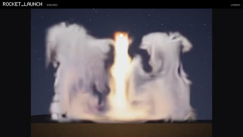</a> | **Round 7** | 20: wall of flames (rewritten), grass fire, burning field, ember bed, forge, lava cracks, burnt ground, nuke, mushroom blast, distant mushroom (`library/blaze.nvfxl`); rocket launch, landing thruster, hover downwash, locomotive chimney, exhaust stack, smoke signals (`library/engines.nvfxl`); ink cloud, blood in water, silt cloud, dye plume (`library/underwater.nvfxl`) | All 20 learned; procedural flashes, shock rings, sparks, embers, glows and lights. Recolours: lava cracks (coals), the underwater dyes (ink: blue-black, red, pale silt, green), the thrusters' dust | Wildfire, coals, mushroom (study O's since it replaced round 7's), launch (swirl 1, scale 9 and, since study O, 2 detail passes), puffs, ink, fire; int8 | Loops 2.4 s; one-shots their length and 0.5 s (6 to 6.5 s); 59.8 s, 2.2 MB; re-rendered for study O | The wildfire's three are good; the coals' fair (glowing patches more than a heap; lava cracks weak to fair); the mushroom's fair (the flash, stem and darkening read; since study O the nuke's cap is a little broader and rounder at first, but the cap is still ragged and turns into a tree of smoke; mushroom_blast and distant_mushroom look the same); rocket launch good, the other engines fair (irregular puffs); the underwater dyes fair (compact, blocky at times; dye plume weak to fair), shown on the gallery's night stage since the library leaves the water to the game's background |
| <a href="library_water.mp4">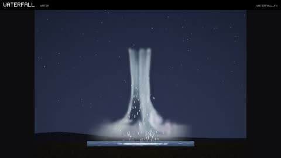</a> | **Water** | 23: waterfall, waterfall drawn, tall waterfall, wide falls, cascade, pipe outflow, leaking pipe, cave drips, fountain, garden fountain, water geyser, broken hydrant, splash, boulder splash, cannonball splash, dive splash, rain on puddles, rain shaft, rain shaft drawn, underwater bubbles, fish tank, boat wake, shore waves (`library/water.nvfxl`) | **A learned body with seeded detail** (4): waterfall, fountain, splash, rain shaft (under the cloud model). **Seeded water with a learned mist** (7): the drawn falls, cascade and pipe outflow, the hydrant and the boulder splash over the fog model, the geyser over steam, the drawn rain shaft under the cloud model. **Seeded only** (12): drips, the garden fountain's jets, the small splashes, rain on puddles, bubbles, wakes and waves | Waterfall, fountain, splash, rainshaft (swirl 0; the waterfall and the rain shaft in 2 detail passes since study O, and the splash study O's since it replaced round 8's), fog, steam, cloud; int8 | Loops 2.3 s; one-shots their length and 0.5 s; 58.2 s, 2.8 MB; re-rendered for study O (its splash again for the new model) | The learned rain shaft good, the learned waterfall fair to good (its sheet no longer banded), fountain and splash fair (LIBRARY.md; the replaced splash looks the same); the drawn falls, pipe outflow, garden fountain, boulder splash and drawn rain shaft good; the cascade's ledges hang in mid-air, the geyser and hydrant are bundles of strands, puddles are thin strips; drips, the boat wake and the late small splashes are faint in a still and read in motion; no rock is drawn anywhere |
| <a href="library_earth.mp4">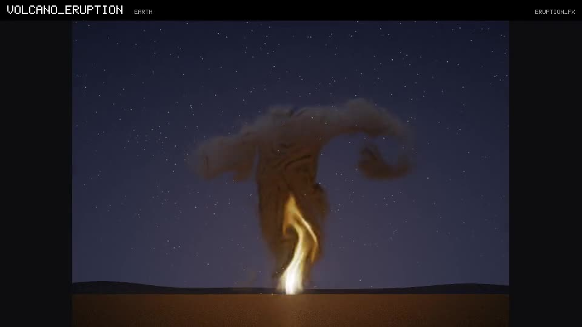</a> | **Earth** (round 9) | 10: lava flow, lava pool, lava crack glow, volcano eruption, distant volcano, ash column, avalanche, snow slide, rock slide dust, pyroclastic flow (`library/earth.nvfxl`) | All 10 learned (lava, eruption, avalanche; looks `magma`, `ash`, `powder`, `rockdust`, `pyro`); procedural bombs, spatter, debris, lightning, falling ash and snow, lamps and camera shake | Lava, eruption (`swirl 1, swirl_scale 9`), avalanche; int8 | Loops 3 s (the volcano 3.5 s); one-shots 6 s; 42.5 s, 1.2 MB | Ash column and volcano eruption good to fair, the rest fair and lava crack glow weak to fair (LIBRARY.md): the lava entries are bright curling bands whose crust is streaks, the pool's domes blocky; the eruptions' columns glow gold at the base and spread into umbrellas; the avalanche clouds billow up and settle but are cut hard on their leading side, with dark marbled lines inside; the rockslide's dust is grey more than brown; no slope or mountain is drawn anywhere |
| <a href="library_air.mp4">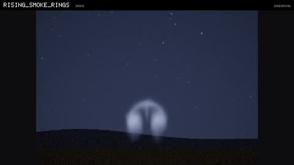</a> | **Air** | 12: candle flame, candelabra, storm lantern, torch in draught, birthday candles, rising smoke rings, smoke ring, cannon smoke ring, dry-ice fog, toxic spill, swamp gas, stage fog (`library/air.nvfxl`) | All 12 learned, drawn by field-shader looks (`candlelight`, `incense`, `powder`, `dry_ice`, `poison_gas`, `marsh_gas`); procedural glows, lamps, a flash, sparks and embers | Candle (swirl 1, scale 9), smokering (soften 0.4 since study Q), heavygas (soften 0.1 since study Q); int8 | Loops 4 s; the one-shots their length; 49.9 s, CRF 26, 1.3 MB; re-rendered for study Q | The candles fair (they read at small sizes; narrow flames with a faint red glow in the wisp), smoke ring good, the repeated and cannon rings fair, the gases fair (low vapour layers; since study Q their fronts are soft billows rather than thin bright streaks, [STUDY_Q.md](../docs/STUDY_Q.md) §5.1; `stage_fog`'s two releases stay two humps) |
| <a href="library_fire2.mp4">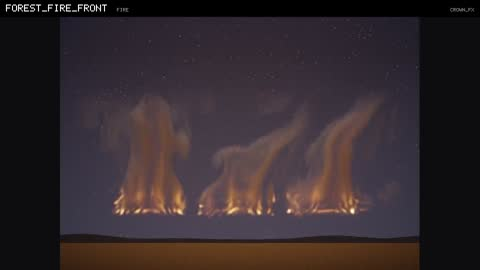</a> | **Fire, round 10** | 10: crown fire, forest fire front, torching trees, distant forest fire, window fire, burning house, smoking window, dust explosion, mill explosion, mine dust blast (`library/fire2.nvfxl`) | All 10 learned: the crown fires drawn by the look `forest_fire`, the dust explosions by `dust_blast` and `coal_blast`, the smouldering window by `smoulder`, the other window fires by their own renderer; procedural embers, ash, debris, a shock, flashes, lamps and camera shake | Crownfire (grow 1, contrast 1 since study Q), windowfire (swirl 1, scale 9, soften 0.2, contrast 0.75 since study Q), dustexplosion; int8 | Loops 4 s; the one-shots their length; 42.7 s, CRF 26, 1.3 MB; re-rendered for study Q | All fair (LIBRARY.md): the crown fires read as torching crowns under a smoke column lit by the fire (since study Q their flames are tongues rather than a comb of vertical streaks, [STUDY_Q.md](../docs/STUDY_Q.md) §5.1), floating over an empty band where the trees would be; the window fires as flames up a wall under a black ceiling jet (since study Q rounded, without the curls and lines of their small swirl); the dust explosions' flame runs through the cloud and leaves a tan pall, their fireball a paler orange than the model's own renderer's |
| <a href="library_elements.mp4">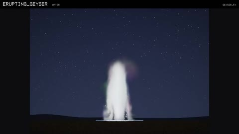</a> | **Elements** (round 10) | 10: erupting geyser, hot spring geyser, geyser in wind, haboob, dust wall far, low sandstorm, red planet dust front, sea spray, storm surf, whitecaps (`library/elements.nvfxl`) | All 10 learned: the geysers and the sea by their own renderers, the haboobs by field-shader looks (`haboob_dust`, `rust_dust`); procedural spray drops, blown sand, and the sea entries' seeded pool and swell | Geyser, haboob, seaspray; int8 | The geysers 5 s each (`--clip 5`, so that their show moment's eruption is in), the sea 3.5 s, the haboobs their 6 s; 49.5 s, CRF 26, 1.2 MB | The geysers fair (an eruption by the show moment: a white column with fringes at its crown, the quiet phase's steam faint), the haboobs fair (rolling ochre fronts with faint marbling and soft tile edges, fading out at the end of their 5 s), sea spray and storm surf fair (white tufts along the sea that stream downwind in motion), whitecaps weak to fair (faint) (LIBRARY.md) |

## 7. Many effects at once

| | Video | What it shows | Learned / procedural | Models, precision | Rendered | How it looks |
|---|---|---|---|---|---|---|
| <a href="crowd.mp4"></a> | **A crowd of 165 effects** | `nvfx_crowd`'s fly-through ([MANAGER.md](../docs/MANAGER.md) §7): rows of identical torches, fires, smoke columns and steam vents over a field 80 m by 160 m, explosions going off ahead at 1.5 a second, a fire dying and another starting every half second; 164 instances on average, 132 on screen. The effect manager plans every tick for a budget of 16 ms per 60 Hz tick on 4 threads: about 63 simulations, 16 of them paused off screen, and about 107 instances shown from shared proxies (the planner's figures of MANAGER.md's 16 ms row) | All the effects learned; the sky and ground are the tool's flat colours | v2 fire, smoke and explosion, steam; int8 | `nvfx_crowd --budget 16 --threads 4 --cores 0,1 --seconds 20 --video crowd.mp4`: four threads pinned to two cores at low priority (the plan comes from the cost model, never from measured time, so the pictures are the planned ones); every other 60 Hz tick, 1280 x 720, 30 fps, 20 s; labels by ffmpeg drawtext; CRF 24, 1.8 MB | Fair: a benchmark's view, not a beauty render: plain sprites on a flat field; smoke near the camera shows its square tile edges; the rows of torches are visibly copies |

## 8. Lit sprites

| | Video | What it shows | Learned / procedural | Models, precision | Rendered | How it looks |
|---|---|---|---|---|---|---|
| <a href="lit_sprites.mp4"></a> | **Lit sprites** | `nvfx_lit_host`'s stage (chimney smoke, a campfire, a rocket trail moved across it) read as an engine reads its layers ([ENGINES.md](../docs/ENGINES.md) §11) and lit by the host. Top left: the relit picture, albedo x (a cool ambient + a warm point light circling the scene, by the normals) + emission, over the host's own sky and ground. Top right: the albedo layer over grey. Bottom: the emission layer and the normal layer | Learned: the smoke, the fire, the trail's material; procedural: embers, the rocket's glow. The light, the sky and the ground are the host's | The library's smoke, fire, explosion; int8 | `nvfx_lit_host library MODELS OUT --frames 300 --threads 2 --raw -` piped to ffmpeg (`--raw` is new: every frame's four quadrants as raw RGB); four 640 x 360 quadrants, 1280 x 720, 30 fps, 10 s; labels by ffmpeg drawtext; CRF 24, 0.5 MB | Good: the smoke and the trail brighten as the light passes them; the rocket leaves the stage after about 3.5 s and its trail stays |

## 8b. In an engine: FUSE

| | Video | What it shows | Learned / procedural | Models, precision | Rendered | How it looks |
|---|---|---|---|---|---|---|
| <a href="fuse_demo.mp4">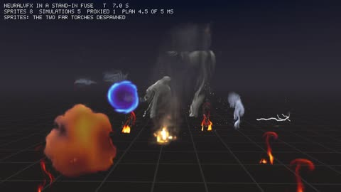</a> | **NeuralVFX in FUSE** (a sample integration) | `nvfx_fuse_demo`'s 10 s sequence ([FUSE.md](../docs/FUSE.md) §8), everything from one effect pack through the adapter FUSE would use: six torches sharing one simulation offset in time, two smoke columns, two explosions despawned when they finish and a magic portal as sprites through the effect manager (5 ms budget on FUSE's jobs); the campfire script on a card at the left, driven by its rules and inputs (a gust, the log catching, the game's wind, doused and relit); library entries on a stage at the right (a brazier, a steam vent, an electric arc, a magic burst, a lightning strike); the learned 3D fire in the middle. The HUD names each event and shows the manager's plan | Learned: every sprite, the scene's fires and smoke, the stage's brazier, steam and burst, the 3D fire's motion. Procedural: the scene's and the stage's embers, sparks, arc and lightning; the 3D fire's look is its volume renderer. The sky, the ground grid and the HUD are the stand-in's | The library's fire, smoke, explosion, magic, steam; study N2's 3D fire (C4); int8 (the volume float) | `nvfx_fuse_demo --pack fuse_demo.nvfxp --video fuse_demo.mp4`: 60 Hz, every other frame drawn by the stand-in's software renderer (premultiplied, sRGB textures) at 1280 x 720, 30 fps, 10 s; CRF 24 (`-preset slow`), 1.3 MB | Fair: an engine's view, not a beauty render: flat sprites and cards over a dark grid, the cards' effects small in their scenes; soft sprite edges hide the smoke's and the explosions' domain tops; the explosions are soft orange balls; the 3D fire is small in its box, as in §9 |

## 9. A 3D fire (study N)

Study N's small 3D demo ([STUDY_3D.md](../docs/STUDY_3D.md)): a 3D fire learned as a 16 x 24 x 16 state that drives
seeded 64 x 96 x 64 detail, from our own 3D simulator (not a validated fire code). `nvfx_3d video --kind KIND` plays the
chosen model (`chosen.nvfx3`, 268 KB, float: there is no int8 path for volumes) through the volume C API
(`nvfx_volume.h`: 8 s shards crossfaded over 0.5 s) and draws every frame with the study's volume renderer (Planck
emission through the CIE 1931 colour matching functions, soot absorption and single scattering, one fixed exposure),
over a floor grid and sky the tool draws; 1280 x 720, 30 fps, CRF 24 (`-preset slow`). Demo seeds 9,900,000 and up,
which no measured run uses. **The look (colour, glow, smoke shading) is physics-based rendering of the fields, not
learned; what is learned is how the fields move.**

**The fire videos play study N2's model C4, by the owner's decision (15 October 2026), not by the study's rule**
([STUDY_3D.md](../docs/STUDY_3D.md) §14). N2 let ambient air in at the model's open edges and retrained it with long
rollouts; C4 does not run away at any wind over 30 s, and on N2's held-out test it beat study N's model at tracking
(+1.95 dB in pictures at 1 s) and on every endless statistic but motion (a tie). By N2's rule, written before
validation, it did not pass: on validation its edge check missed by 3% on one side (a peak of 5.29 against a bound of
5.12 taken from one simulated run). The owner chose to show it anyway; study N's videos are in the git history.
Study N's smoke model (the last row) is unchanged; it runs away when played for 30 s without shards, which its 8 s
shards hide.

| | Video | What it shows | Learned / procedural | Models, precision | Rendered | How it looks |
|---|---|---|---|---|---|---|
| <a href="3d_fire_orbit.mp4">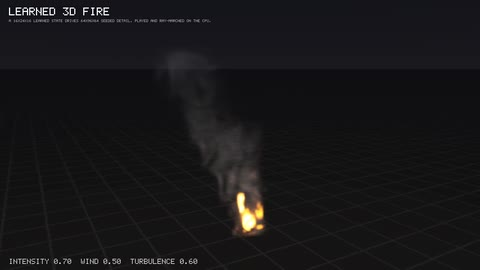</a> | **The 3D fire, walked around** | The camera circles the fire once, rising and falling a little; controls 0.7, 0.5, 0.6 (no wind), seed 9,950,001 | Learned: the fire's motion (the coarse state); seeded: the 64 x 96 x 64 detail; rendered: the volume renderer. Procedural: the floor and sky | `chosen.nvfx3` of study N2 (C4, edges open; `$NEURALVFX_DATA/n2_3d/models`); float | `--kind orbit`, 12 s, 1.3 MB | One small flame under a straight grey smoke column from every side. The flame is smaller than the simulation's and its base still breaks into bright, blocky spots |
| <a href="3d_real_vs_learned.mp4">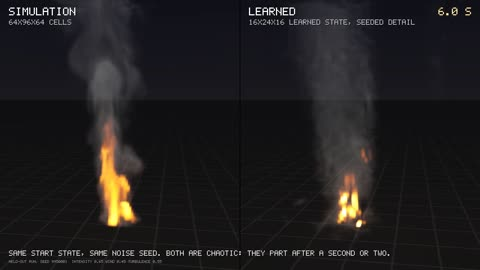</a> | **Real against learned, in 3D** | Left: the 3D simulator (64 x 96 x 64). Right: the learned model from the same state (a held-out run after 100 frames: controls 0.65, 0.45, 0.55, seed 9,950,000) with the same noise seed, one continuous rollout. **Both are chaotic: they part after a second or two**, as the caption says | Left: simulation. Right: learned (C4). Both drawn by the same volume renderer | C4; float | `--kind real-vs-learned`, 10 s, 1.0 MB | They part within two seconds and keep a similar smoke column; the simulation's flame is a tall orange tongue where the learned one is short, whiter and broken into hot spots |
| <a href="3d_wind.mp4">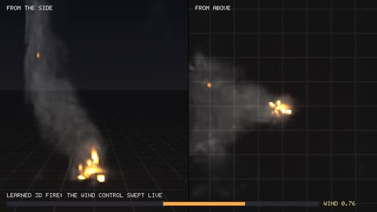</a> | **Wind, swept live** | Side (left) and top (right) at once while the wind control sweeps from none (0.5) to full towards -x (0) by 4.8 s, to full towards +x (1) by 9 s and back to none; intensity 0.7, turbulence 0.5, seed 9,950,002 | As the orbit | C4; float | `--kind wind`, 12 s, 0.6 MB | **One fire throughout: the second fire study N's model grew at the upwind edge is gone.** The plume still follows the control slowly, leaning with the wind a second or two late |
| <a href="3d_smoke_orbit.mp4">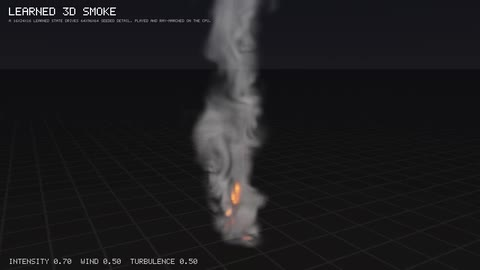</a> | **3D smoke, walked around** (a demo only) | The camera circles a learned 3D smoke column once; controls 0.7, 0.5, 0.5, seed 9,900,005. Trained after the study's test on the same recipe, **not validated or tested** | As the orbit | `smoke3d.nvfx3` (study N's smoke, 268 KB; `$NEURALVFX_DATA/n_3d/models`); float | `--kind orbit --model .../smoke3d.nvfx3 --title "LEARNED 3D SMOKE"`, 12 s, 1.2 MB | A thick grey column that billows and rises out of the frame from every side; small orange specks glow at its base, which the simulated smoke (too cool to glow) does not have |

## 9b. Drawn at half size and upscaled (study P)

Study P ([STUDY_P.md](../docs/STUDY_P.md)) asked whether a large effect drawn at half size and brought back by a small
learned 2x with seeded micro-detail looks as good as drawing it at full size. `nvfx_study_p video` plays one seed three
ways at 512 px, side by side: **N**, an instance created at 512 px; **B**, an instance at 256 px brought to 512 by the
bilinear 2x (what a GPU's sampler gives); **L**, the same 256 px frames brought to 512 by the study's chosen learned 2x
(`cand_shared.nvfxup`, the shared net, gain 0.10, 30 noise slices a second). B and L are the very frames an instance with
`nvfx_instance_set_upscale` draws. Below each panel the outlined 170 px crop, twice as large (nearest neighbour). Over a
dark gradient, 1584 x 976, 30 fps, CRF 24 (`-preset slow`). Seeds 3,900,301 to 3,900,303, which no measured run uses.
**The learned 2x did not pass its rule** (STUDY_P.md §6): what the videos show is that B and L look alike, and both
softer than N in the finest filaments.

| | Video | What it shows | Learned / procedural | Models, precision | Rendered | How it looks |
|---|---|---|---|---|---|---|
| <a href="upscale_explosion.mp4">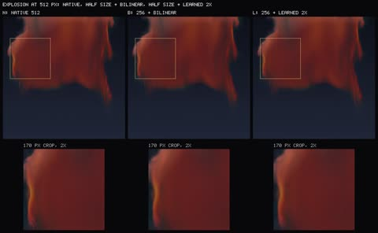</a> | **An explosion, three ways** | A strong burst (controls 0.85, 0.5, 0.6, seed 3,900,301), its 89 frames; the crop on its left flank | All three learned (the same model and seed); L adds the learned 2x and its noise | The library's explosion (study M3's); int8 | `--effect explosion --crop 30,90,170`, 3 s, 0.4 MB | The same fireball in all three, the same motion; N's flank is crisper, B and L slightly soft and hard to tell apart |
| <a href="upscale_mushroom.mp4">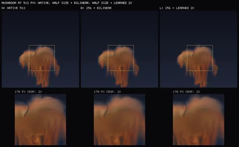</a> | **A mushroom cloud, three ways** | Controls 0.8, 0.5, 0.6, seed 3,900,302, its 149 frames; the crop on the cap | As above | The mushroom as this study froze it (`fx_blaze/models/d`, before study O replaced the library's); int8 | `--effect mushroom --crop 180,230,170`, 5 s, 0.5 MB | The same cap and stem; N's streaks in the stem are sharper; L's edges a little firmer than B's |
| <a href="upscale_waterfall.mp4">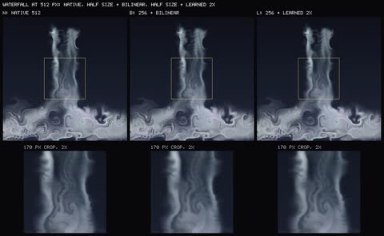</a> | **A waterfall, three ways** | Controls 0.6, 0.5, 0.6, seed 3,900,303, 10 s; the crop on the falling sheet | As above (the learned body only, no seeded spray or pool) | The library's waterfall file, one detail pass a frame (the library now plays it with `passes 2`, study O); int8 | `--effect waterfall --crop 170,170,170`, 10 s, 3.3 MB | N's thin zig-zag streaks are sharp where B and L blur them; L is no closer to N than B |

## 10. Later

Every effect that has merged is above: round 7's six, study N's 3D fire, the water, round 9's earth and air, and round
10's fire and elements. Nothing is still to come here
but the PC plan ([TODO.md](../TODO.md)): every effect in 3D, trained on large simulations on a PC.

## Reproduce

The tools are in this repository; the models are under the data root (`$NEURALVFX_DATA`, outside git; LIBRARY.md §4
links the library's thirty-three). Build as the main README says, then for example:

```sh
build/nvfx_scene_script --script examples/scenes/fireball.nvfxs --models $NEURALVFX_DATA/experiments/models/d --out fireball.mp4
build/nvfx_reel --out fire.mp4 --seconds 9 --size 256 --zoom 1.5 --width 1280 --height 576 --title "FIRE" \
    --panel "SMALL|$M/fire.nvfx|0:0.25,0.5,0.3" --panel "MEDIUM|$M/fire.nvfx|0:0.6,0.15,0.5" --panel "LARGE|$M/fire.nvfx|0:0.95,0.75,0.7"
build/nvfx_reel --out track.mp4 --seconds 10 --zoom 1.7 --compact --timer --columns 1 \
    --panel "FIRE: REAL|real:fire:1" --panel "FIRE: LEARNED|learned:fire:1:$M/fire.nvfx"
build/nvfx_reel --out launch.mp4 --seconds 9 --size 256 --zoom 1.5 --width 1280 --height 576 --title "LAUNCH" \
    --panel "LOW|$M/launch.nvfx|0:0.3,0.5,0.3|swirl=1,swirl_scale=9"            # a detail setting, as an effect line sets it
build/nvfx_reel --out ink.mp4 --seconds 9 --size 256 --zoom 1.5 --width 1280 --height 576 --title "INK" \
    --bg 150,180,190,80,112,126 --panel "LITTLE|$M/ink.nvfx|0:0.3,0.5,0.3"         # dark dye over a pale gradient
build/nvfx_scene_script --script examples/scenes/prairie.nvfxs --models $NEURALVFX_DATA/fx_blaze/models/scene --out prairie.mp4
build/nvfx_scene_script --script examples/scenes/falls.nvfxs --models $M --out falls.mp4
build/nvfx_reel --out waterfall.mp4 --seconds 9 --size 256 --zoom 1.5 --width 1280 --height 576 --title "WATERFALL" \
    --panel "THIN|$M/waterfall.nvfx|0:0.3,0.5,0.3|swirl=0,passes=3"              # the learned body (3 passes at 256 px)
build/nvfx_scene_script --script examples/scenes/volcano.nvfxs --models $NEURALVFX_DATA/fx_earth/models/scene --out volcano.mp4 --threads 2
build/nvfx_scene_script --script examples/scenes/weather_day.nvfxs --models $M --out weather_day_crf19.mp4 --threads 3
ffmpeg -i weather_day_crf19.mp4 -vf scale=960:540:flags=lanczos -c:v libx264 -preset slow -b:v 900k -pass 1 -an -f mp4 /dev/null
ffmpeg -i weather_day_crf19.mp4 -vf scale=960:540:flags=lanczos -c:v libx264 -preset slow -b:v 900k -pass 2 -pix_fmt yuv420p \
    -movflags +faststart -an scene_weather_day.mp4                                  # two passes to fit 5 MB
build/nvfx_reel --out eruption.mp4 --seconds 9 --size 256 --zoom 1.5 --width 1280 --height 576 --title "ERUPTION" --seed 6390211 \
    --bg 120,132,150,64,70,84 --panel "SMALL|$M/eruption.nvfx|0:0.25,0.5,0.3|swirl=1,swirl_scale=9"    # dark ash over a pale gradient
build/nvfx_reel --out earth.mp4 --seconds 11 --zoom 1.7 --compact --timer --columns 3 --seed-base 6000000 \
    --panel "LAVA: REAL|real:lava:1" --panel "LAVA: LEARNED|learned:lava:1:$M/lava.nvfx"    # round 9's own held-out seeds
build/nvfx_scene_script --script examples/scenes/forestedge.nvfxs --models $NEURALVFX_DATA/fx_fire2/models/scene --out forestedge.mp4 --threads 2
build/nvfx_reel --out dust.mp4 --seconds 10 --size 256 --zoom 1.5 --width 1280 --height 576 --title "DUST EXPLOSION" \
    --panel "SMALL, LIT LEFT|$M/dustexplosion.nvfx|0:0.2,0,0.3"                     # the second control is where it is lit
build/nvfx_reel --out fire2.mp4 --seconds 11 --zoom 1.7 --compact --timer --columns 3 --seed-base 26000000 \
    --panel "CROWN: REAL|real:crownfire:1" --panel "CROWN: LEARNED|learned:crownfire:1:$M/crownfire.nvfx"   # round 10's own held-out seeds
build/nvfx_gallery --library library --models $M --only campfire --video campfire.mp4 --clip 2.4
build/nvfx_crowd --budget 16 --threads 4 --seconds 20 --video crowd.mp4
build/nvfx_lit_host library $M OUT --frames 300 --raw - | ffmpeg -f rawvideo -pix_fmt rgb24 -s 1280x720 -r 30 -i - lit.mp4
# the FUSE sample integration (docs/FUSE.md §8): the pack the test makes, then the demo with its own ffmpeg pipe
build/nvfx_pack pack fuse_demo.nvfxp --library library --models $M --add examples/scenes/campfire.nvfxs,fire3d.nvfx3 --threads 2
build/engines/fuse/nvfx_fuse_demo --pack fuse_demo.nvfxp --video fuse_demo.mp4 --out OUT       # fire3d.nvfx3: study N2's chosen.nvfx3
# round 10's elements (M as above; the scene's models in $NEURALVFX_DATA/fx_elements/models/scene)
build/nvfx_reel --out effect_geyser.mp4 --seconds 12 --size 256 --zoom 1.5 --width 1280 --height 576 --title "GEYSER" --seed 27200003 \
    --panel "SMALL|$M/geyser.nvfx|0:0.2,0.5,0.2" --panel "MEDIUM|$M/geyser.nvfx|0:0.6,0.25,0.5" --panel "LARGE|$M/geyser.nvfx|0:0.95,0.8,0.7"
build/nvfx_reel --out effect_haboob.mp4 --seconds 12 --size 256 --zoom 1.5 --width 1280 --height 576 --title "HABOOB" --seed 27200011 \
    --bg 118,138,162,186,166,138 --panel "LOW|$M/haboob.nvfx|0:0.3,0.3,0.3" ...          # and MEDIUM, TOWERING as in the table
build/nvfx_reel --out effect_seaspray.mp4 --seconds 9 --size 256 --zoom 1.5 --width 1280 --height 576 --title "SEA SPRAY" --seed 27200021 \
    --bg 44,60,78,14,24,34 --panel "FRESH BREEZE|$M/seaspray.nvfx|0:0.3,0.2,0.3" ...
build/nvfx_reel --out real_vs_learned_elements.mp4 --seconds 11 --zoom 2 --compact --timer --columns 3 --seed-base 27000000 \
    --panel "GEYSER: REAL|real:geyser:8" --panel "HABOOB: REAL|real:haboob:1" --panel "SEA SPRAY: REAL|real:seaspray:1" \
    --panel "GEYSER: LEARNED|learned:geyser:8:$M/geyser.nvfx" ...                     # and the haboob's and sea spray's learned panels
build/nvfx_scene_script --script examples/scenes/coast.nvfxs --models $NEURALVFX_DATA/fx_elements/models/scene --out coast_crf19.mp4 --threads 2
ffmpeg -i coast_crf19.mp4 -c:v libx264 -preset slow -crf 24 -pix_fmt yuv420p -movflags +faststart -an scene_coast.mp4
build/nvfx_gallery --library library --models $M --only erupting_geyser --video erupting_geyser.mp4 --clip 5 --threads 2   # each entry; joined
# (the data root's fx_elements/jobs/videos.sh makes all six)
# study Q (docs/STUDY_Q.md): the library's detail settings in a reel's DETAIL field (soften: the fine fields' softening), seeds 33490001 up
build/nvfx_reel --out effect_crownfire.mp4 --seconds 9 --size 256 --zoom 1.5 --width 1280 --height 576 --title "CROWN FIRE" --seed 33490001 \
    --bg 120,132,150,64,70,84 --panel "SMALL, STILL AIR|$M/crownfire.nvfx|0:0.2,0.5,0.3|grow=1,contrast=1" ...      # and the two others of the table
build/nvfx_reel --out effect_windowfire.mp4 ... --panel "SMALL ROOM FIRE|$M/windowfire.nvfx|0:0.2,0.5,0.3|swirl=1,swirl_scale=9,soften=0.2,contrast=0.75" ...
build/nvfx_reel --out effect_heavygas.mp4 ... --panel "LITTLE, BOTH WAYS|$M/heavygas.nvfx|0:0.2,0.5,0.3|soften=0.1" ...
# (the data root's q_fix/jobs/videos_a.sh makes those and the two scenes and the two library walks)
# study N's 3D videos (the model: $NEURALVFX_DATA/n_3d/models/chosen.nvfx3 unless --model says otherwise)
build/nvfx_3d video --kind orbit --model $NEURALVFX_DATA/n2_3d/models/chosen.nvfx3 --out 3d_fire_orbit.mp4 --seconds 12 --controls 0.7,0.5,0.6 --seed 9950001
build/nvfx_3d video --kind real-vs-learned --model $NEURALVFX_DATA/n2_3d/models/chosen.nvfx3 --out 3d_real_vs_learned.mp4 --seconds 10 --controls 0.65,0.45,0.55 --seed 9950000
build/nvfx_3d video --kind wind --model $NEURALVFX_DATA/n2_3d/models/chosen.nvfx3 --out 3d_wind.mp4 --seconds 12 --controls 0.7,0.5,0.5 --seed 9950002
build/nvfx_3d video --kind orbit --model $NEURALVFX_DATA/n_3d/models/smoke3d.nvfx3 --title "LEARNED 3D SMOKE" \
    --out 3d_smoke_orbit.mp4 --seconds 12 --controls 0.7,0.5,0.5 --seed 9900005
# study P (the models frozen in $NEURALVFX_DATA/p_upscale/models, the chosen upscaler in p_upscale/nets)
build/nvfx_study_p video --effect explosion --net cand_shared --size 512 --controls 0.85,0.5,0.6 --seed 3900301 --crop 30,90,170 --out upscale_explosion.mp4
build/nvfx_study_p video --effect mushroom --net cand_shared --size 512 --controls 0.8,0.5,0.6 --seed 3900302 --crop 180,230,170 --out upscale_mushroom.mp4
build/nvfx_study_p video --effect waterfall --net cand_shared --size 512 --controls 0.6,0.5,0.6 --seed 3900303 --crop 170,170,170 --seconds 10 --out upscale_waterfall.mp4
```

(`M=$NEURALVFX_DATA/library/models`.) `nvfx_reel`'s header lists every option.
