# Demo videos

NeuralVFX replaces VFX flipbooks with small learned effects. Each of its eleven trained effects (fire, smoke, an
explosion, steam, magic, fog, dust, cloud, a flamethrower's jet, a plasma orb and a dust devil) is one file of 42 to
274 KB. It holds a few stored simulation states and a small network that moves the effect forward one frame at a time,
driven by noise. So an effect plays for as long as it is wanted without repeating, follows artist controls (intensity,
wind, turbulence) and can be scripted into scenes where effects push, light and feed one another. **Everything here
ran on the CPU**: no GPU was used to train, play or render any of it.

What the docs measure (these videos were not timed: they were rendered at low priority on a busy shared 4-core
machine, so how long they took says nothing about cost):

- **One learned effect** costs about 0.54 ms per 128 x 128 frame on one core at int8 with AVX-512 VNNI, the runtime's
  default on such a CPU (0.32 ms at 64 px, 1.37 ms at 256 px; mean over the eleven effects, provisional;
  [REPORT.md](../docs/REPORT.md) §13.6), and 0.8 to 0.9 ms in float on one AVX2 core (§6.7). An instance needs 2.4 MB
  of working memory at 128 px.
- **The fireball scene** runs at 80 frames per second at 1280 x 720 on 4 threads ([COMPOSE.md](../docs/COMPOSE.md) §7.3).
- **A crowd of about 165 effects** fits a 4 ms budget per 60 Hz tick on one core once the manager has measured the machine
  ([MANAGER.md](../docs/MANAGER.md) §1 and §7.1).
- **A library stage** costs about 2.5 ms to draw at 320 x 240, plus about 3 ms per 128-pixel fire flame, on one thread
  of the shared machine ([LIBRARY.md](../docs/LIBRARY.md) §7).

**Reading the tables.** *Learned* means the effect's motion comes from a trained model; *procedural* means the
compositor draws it (particles, sparks, embers, debris, shock fronts, flashes, glows, lights, rain, snow, the sky and
the ground). A learned effect is drawn either by its own learned renderer or by a *field-shader look*, which colours the
model's heat and soot fields so that the scene's lights fall on them; a **recolour** (blue gas, green witch fire, a
violet burst) is such a look, not new dynamics. All learned effects play at the runtime's default precision, **int8**
(this CPU has AVX-512 VNNI); the docs' frozen keyframes are the float path's, so these frames are not those to the bit.
Every video is H.264 (yuv420p, +faststart, no audio). Click a poster to open its video.

**37 videos, 49.1 MB in all**, each at most 5 MB, with 37 JPEG posters (437 KB in all).

## 1. Showcase scenes

Scene scripts ([COMPOSE.md](../docs/COMPOSE.md) §4) played by `nvfx_scene_script --script examples/scenes/NAME.nvfxs
--models DIR --out NAME.mp4 --threads 2`, 1280 x 720 at 30 fps, then encoded at CRF 24 (`-preset slow`). Each played
without a heap allocation in its frame loop.

| | Video | What it shows | Learned / procedural | Models, precision | Rendered | How it looks |
|---|---|---|---|---|---|---|
| <a href="scene_fireball.mp4">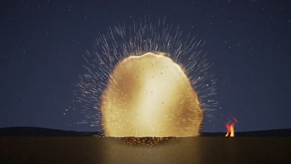</a> | **The fireball** | Night; a wreck burns; a charge explodes, the shock front sets off the wreck, embers light new fires, the cloud rises, caps and turns to smoke, a smoke column grows from the crater ([COMPOSE.md](../docs/COMPOSE.md) §6) | Learned: the fires (their own renderer), the explosion's cloud in six tiles and the smoke sky in eight (drawn by field-shader looks). Procedural: fuse sparks, flash, shock front, embers, debris, scorch, camera shake, light, sky, ground | Study D's v1 fire (82 KB), smoke (146 KB), explosion (274 KB) (`$NEURALVFX_DATA/experiments/models/d`); int8 | `fireball.nvfxs`, 9 s, 3.0 MB | Reads as the documented scene; the smoke has a marbled, swirly texture from the shader's relief |
| <a href="scene_firewall.mp4">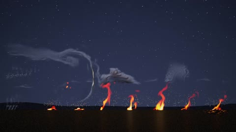</a> | **The firewall** | A wall of fire in a gusting gale; a woodpile catches; water puts out the left of the wall in steam; a vortex ring tears the flames out; the smoke is drawn into a knot (§5.2) | Learned: six fire tiles, eight smoke tiles (shader look). Procedural: embers, the wind, gusts, water, the ring, the knot (force fields), light | Study D's v1 fire and smoke; int8 | `firewall.nvfxs`, 9 s, 3.4 MB | The "wall" is a row of six flames, not a sheet of fire; thin stretched smoke shows banding, as documented |
| <a href="scene_portal.mp4">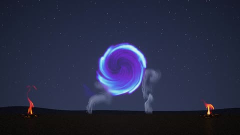</a> | **The portal** (study L's magic) | Two steam vents; a portal opens between them and lights the steam violet; a pulse lights two braziers; the portal collapses in a burst that bends the flames and blows the steam away ([EFFECTS.md](../docs/EFFECTS.md) §6, §9) | Learned: the portal (magic, its own renderer), the steam (shader look), the braziers (fire), the burst (explosion, shader look). Procedural: the pulse (shock front), embers, flash, glow light | Magic v3 of study L (82 KB), steam (82 KB), v2 fire (42 KB) and explosion (274 KB) (`fx/models/scene`); int8 | `portal.nvfxs`, 10 s, 2.7 MB | The portal's arms are smooth and spin (the old saw-teeth are gone); the burst is a flat ball in its first frames; the braziers are small single flames |
| <a href="scene_moor.mp4">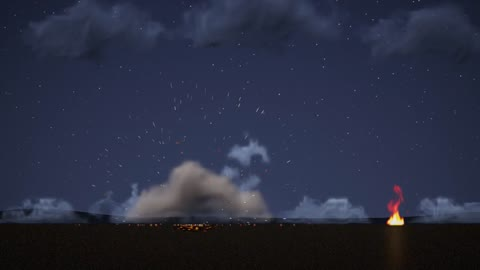</a> | **The moor** | Storm cloud drifting over a foggy moor with a campfire; lightning strikes twice, the dust rolls out through the fog and pushes it aside, the second strike bends the flames ([EFFECTS_ATMOSPHERE.md](../docs/EFFECTS_ATMOSPHERE.md) §6) | Learned: fog (5 modules), cloud (3), dust bursts (all shader looks), the campfire. Procedural: the lightning's flash (no bolt), shock, debris, embers, scorch, light | Fog (146 KB), dust (274 KB), cloud (146 KB), v2 fire (`fx_atmos/models/scene`); int8 | `moor.nvfxs`, 10 s, 2.5 MB | Each reads as what it is; lifted fog stays up as pale plumes; there is a flash but no bolt to see |
| <a href="scene_firewhirl.mp4">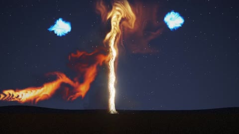</a> | **The fire whirl** (study L's orb and vortex) | A dust devil wanders between two plasma lamps; a flamethrower opens up, its flame bends into the whirl, the whirl catches and burns as a column of fire, the lamps flare, then it dies down to dust ([EFFECTS_ENERGY.md](../docs/EFFECTS_ENERGY.md) §6, §9) | Learned: the jet (its own renderer), the lamps (orb, own renderer), the whirl (vortex, a dust look blending to a burning one). Procedural: embers, light | Jet (82 KB), orb and vortex v3 of study L (82 KB each) (`fx_energy/models/scene`); int8 | `firewhirl.nvfxs`, 10 s, 3.4 MB | Reads as a flamethrower, lamps and a dust devil; the burning column is braided (the detail layer locking once a frame); the lamps' light on the dust is faint |
| <a href="scene_weather.mp4">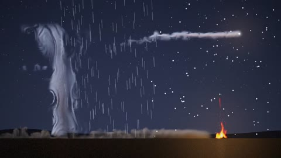</a> | **Weather and trails** | A smoke column, its right half washed by rain; a campfire under snow that melts in its heat; a rocket leaves a smoke trail across the sky; a truck leaves a dust wake ([COMPOSE.md](../docs/COMPOSE.md) §5.3) | Learned: the column (smoke), the campfire (fire), the rocket's trail (explosion model tiles), the dust wake (dust model tiles), all but the fire by shader looks. Procedural: rain, snow, the rocket's glow and glare, embers, the lamp | The library's fire, smoke, explosion, dust (`library/models`); int8 | `weather.nvfxs`, 8 s, 2.4 MB | The trails stay where they were left and fade; the rain's thinning of the column is subtle; rain and snow are unlit |
| <a href="scene_campfire.mp4">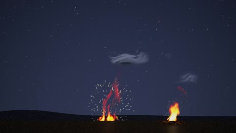</a> | **The campfire, driven by the game** | A campfire the game drives through inputs and rules ([ENGINES.md](../docs/ENGINES.md) §7): a gust at 2.5 s, the log beside it catches at 4 s, a breeze and the flames lean at 5.5 s, more fuel at 7 s, a second gust at 8 s, doused at 9.3 s, relit at 10.5 s | Learned: the two fires, the smoke sky (shader look). Procedural: the gusts' embers, the scorch, light | Study D's v1 fire and smoke; int8 | `campfire.nvfxs` with `--trigger blow@2.5 --trigger light_log@4 --set breeze=1.5@5.5 --set lean=0.7@5.5 --set fuel=1@7 --trigger blow@8 --trigger douse@9.3 --trigger relight@10.5 --set fuel=0.7@10.5`; the script's 960 x 540, scaled to 1280 x 720 (lanczos); 12 s, 3.2 MB | The events read clearly; the smoke shows as puffs above the flames rather than a column (the script hands the fires' top rows to a sky domain) |

## 2. Each learned effect alone, at three settings

`nvfx_reel` (this repository's demo tool, `tools/nvfx_reel.cpp`): one model, three control settings side by side,
each rendered at 256 px through `nvfx_render`, composited over a dark gradient and scaled x1.5 with a bilinear filter
(to 384 px), 1280 x 576 at 30 fps, 9 s, CRF 26, seed 1. The runtime's default playback: 6 s shards, each a fresh rollout
from one of the three stored start points nearest the controls, crossfaded. One-shots (explosion, dust) start again with
the next seed when they end. Everything in these clips is learned, drawn by the effect's own renderer; nothing is
procedural but the labels.

| | Video | Settings (intensity, second control, turbulence) | Model | Rendered | How it looks |
|---|---|---|---|---|---|
| <a href="effect_fire.mp4">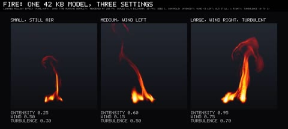</a> | **Fire** | 0.25, 0.5, 0.3; 0.6, 0.15 (wind left), 0.5; 0.95, 0.75 (wind right), 0.7 | `fire.nvfx`, v2 (42 KB: v1 with 6-bit start states) | 0.4 MB | Good: one flame per tile, leaning with the wind, never the same twice. At strong wind with turbulence 0.9 the flame can go out until the next shard (seen while choosing settings; not shown) |
| <a href="effect_smoke.mp4">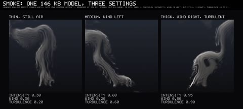</a> | **Smoke** | 0.3, 0.5, 0.2; 0.6, 0.2, 0.6; 0.95, 0.8, 0.9 | `smoke.nvfx` (146 KB) | 0.5 MB | Good: plumes that billow and lean; a marbled texture in thick smoke |
| <a href="effect_explosion.mp4">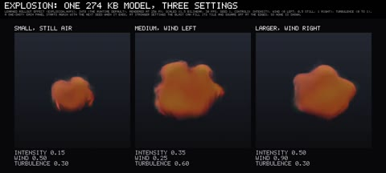</a> | **Explosion** (one-shot) | 0.15, 0.5, 0.3; 0.35, 0.25, 0.6; 0.5, 0.9, 0.3 | `explosion.nvfx`, v2 (274 KB) | 0.2 MB | Fair: a fireball that rolls up into a dark cloud; its first frames are a smooth yellow-green ball (the learned renderer draws a fresh fireball poorly, REPORT §6.4). Settings were chosen so that only medium start points play: the strongest fill a tile and square off at its edges (LIBRARY.md §7) |
| <a href="effect_steam.mp4">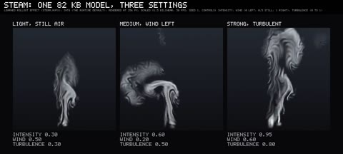</a> | **Steam** | 0.3, 0.5, 0.3; 0.6, 0.2, 0.5; 0.95, 0.6, 0.8 | `steam.nvfx` (82 KB) | 0.6 MB | Good: a vent's jet of vapour; marbled texture; at high turbulence some vapour wraps in at the tile's left edge now and then |
| <a href="effect_magic.mp4">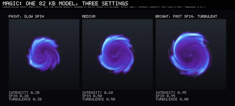</a> | **Magic** (study L) | 0.3, 0.2 (slow spin), 0.3; 0.6, 0.5, 0.5; 0.95, 0.95 (fast spin), 0.8 | `magic.nvfx`, v3 (82 KB) | 0.5 MB | Good: a spinning violet portal with smooth arms and a bright rim; the settings change its size, brightness and spin |
| <a href="effect_jet.mp4">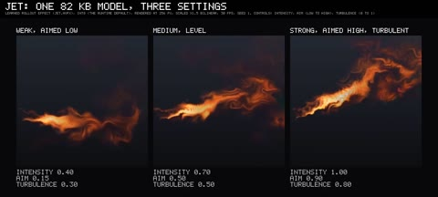</a> | **Jet** (flamethrower) | 0.4, 0.15 (aimed low), 0.3; 0.7, 0.5, 0.5; 1.0, 0.9 (aimed high), 0.8 | `jet.nvfx` (82 KB) | 0.8 MB | Good: a turbulent flame that blows to the right (the only direction the model knows) |
| <a href="effect_orb.mp4">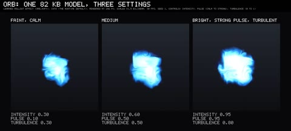</a> | **Orb** (study L) | 0.3, 0.1 (calm), 0.3; 0.6, 0.5, 0.5; 0.95, 0.95 (strong pulse), 0.8 | `orb.nvfx`, v3 (82 KB) | 0.3 MB | Fair: a boiling cyan ball; the settings show mostly as size and brightness |
| <a href="effect_vortex.mp4">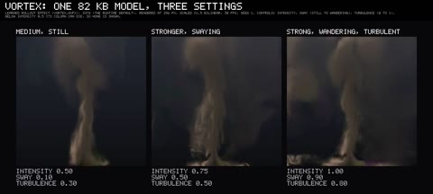</a> | **Vortex** (dust devil, study L) | 0.5, 0.1 (still), 0.3; 0.75, 0.5, 0.5; 1.0, 0.9 (wandering), 0.8 | `vortex.nvfx`, v3 (82 KB) | 0.4 MB | Fair: a dust column under a haze of dust that fills the tile. Below intensity 0.5 the column can die and not regrow (fewer losses since study L, not none), so no lower setting is shown |
| <a href="effect_fog.mp4">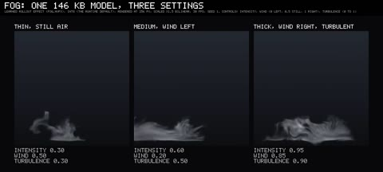</a> | **Fog** | 0.3, 0.5, 0.3; 0.6, 0.2, 0.5; 0.95, 0.85, 0.9 | `fog.nvfx` (146 KB) | 0.1 MB | Good: low ground fog that rolls with the wind |
| <a href="effect_dust.mp4">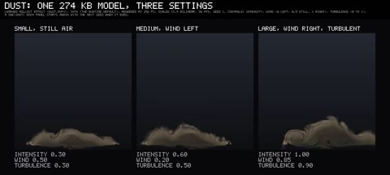</a> | **Dust** (one-shot) | 0.3, 0.5, 0.3; 0.6, 0.2, 0.5; 1.0, 0.85, 0.9 | `dust.nvfx` (274 KB) | 0.2 MB | Good: a burst of dust that spreads along the ground and curls |
| <a href="effect_cloud.mp4">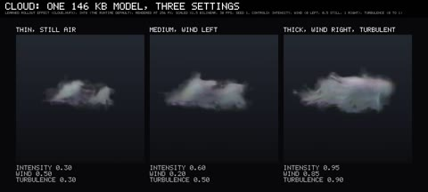</a> | **Cloud** | 0.3, 0.5, 0.3; 0.6, 0.2, 0.5; 0.95, 0.85, 0.9 | `cloud.nvfx` (146 KB) | 0.1 MB | Fair: a drifting cloud; faint green and magenta fringes at its edges from the learned renderer |

## 3. Controllability

| | Video | What it shows | Learned / procedural | Models, precision | Rendered | How it looks |
|---|---|---|---|---|---|---|
| <a href="controls_sweep.mp4">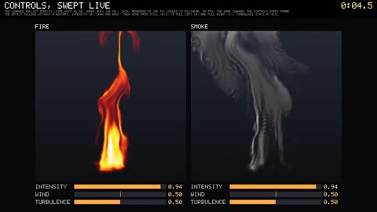</a> | **Controls, swept live** | Fire and smoke while the controls change every frame: intensity 0.5 to 1 to 0.15 and back to 0.6 (0 to 10.5 s), then wind from still (0.5) to full left (0) and full right (1) and back (11 to 19 s); turbulence stays 0.5. Bars and values show the controls, a clock the time | All learned (own renderers); the bars are labels | The library's fire (42 KB) and smoke (146 KB); int8 | `nvfx_reel --bars --timer`, keys linear in between; 256 px scaled x2 bilinear, 1280 x 720, 30 fps, 19 s, CRF 26, 1.0 MB | Good: the effects follow without a restart; the flame grows and shrinks with intensity and both lean with the wind |

## 4. Never repeats

| | Video | What it shows | Learned / procedural | Models, precision | Rendered | How it looks |
|---|---|---|---|---|---|---|
| <a href="never_repeats.mp4">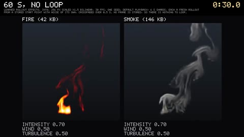</a> | **60 seconds, no loop** | Fire and smoke at fixed controls (0.7, 0.5, 0.5) for a minute with a clock. Nothing is stored but a few start states, so there is no loop: the runtime plays 6 s shards, each a fresh rollout from a stored start point with noise of its own, crossfaded over 0.5 s | All learned | The library's fire and smoke; int8 | `nvfx_reel --timer`, 256 px scaled x1.5 bilinear, 960 x 540, 30 fps, 60 s, CRF 26, 2.1 MB | Good: a minute of fire and smoke with no repeat and no gap; the flame's size wanders from shard to shard |

## 5. Real against learned

The simulator's run on top and the learned effect below, both started from the same state. `nvfx_reel`'s `real:` and
`learned:` panels follow study D's tracking ([REPORT.md](../docs/REPORT.md) §6.4): held-out run 1 of each effect (salt 2:
controls 0.67, 0.24, 0.56 and a seed that training never used) is simulated for 100 frames (one-shots: 1); its state
becomes the only start point of a copy of the model, which then plays one continuous rollout with the run's noise seed,
beside the simulation's own continuation. One-shots start again every 3.5 s with the next held-out run (2, 3, ...).
Both are 128 px (the simulator's size), scaled x1.7 bilinear, 1280 x 720, 30 fps, 10 s, CRF 26. **Both are chaotic:
like two runs of the simulator they part after a second or two. What should match is the look and the motion, not the
pixels.**

| | Video | Effects | Learned / procedural | Models, precision | Rendered | How it looks |
|---|---|---|---|---|---|---|
| <a href="real_vs_learned_fire_smoke.mp4">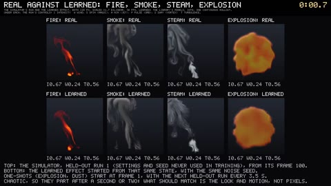</a> | **Fire, smoke, steam, explosion** | Top: the simulator (`src/sim`, its own renderer). Bottom: the learned effect | Top: simulation. Bottom: learned (own renderer) | The library's fire, smoke, steam, explosion; int8 | 0.5 MB | Nearly the same picture for the first half second, then the same kind of flame, plume and cloud on different paths; the learned explosion's first frames are smoother and greener than the simulator's |
| <a href="real_vs_learned_energy.mp4">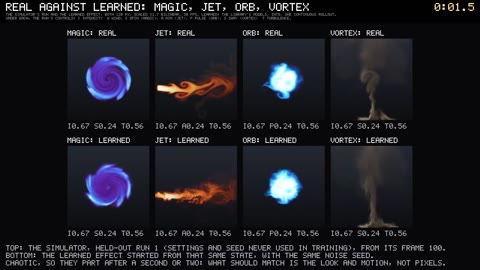</a> | **Magic, jet, orb, vortex** | As above | As above | The library's magic, jet, orb, vortex (study L's v3 for magic, orb and vortex); int8 | 0.6 MB | The portal, the jet and the dust devil keep the simulator's look throughout; the learned orb is often rounder than the simulator's lobed ball |
| <a href="real_vs_learned_atmosphere.mp4">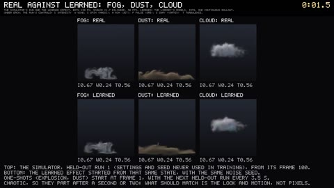</a> | **Fog, dust, cloud** | As above | As above | The library's fog, dust, cloud; int8 | 0.2 MB | Close in shape and motion; the learned cloud has faint colour fringes the simulator's grey cloud lacks |

## 6. The library, by category

The effect library ([LIBRARY.md](../docs/LIBRARY.md)): 149 named, ready-made effects. Each entry was played alone on a
stage fitted to its box by `nvfx_gallery --library library --models DIR --only NAME --video NAME.mp4 --clip S --threads 2`
(960 x 540, 30 fps, its name, category and models in the bar on top), one run per entry so each gets its own length:
loops a few seconds each, one-shots their length and half a second (explosions: and a second), at most 4 to 7 s. The
clips are joined in the order of the catalogue's files (`library/*.nvfxl`) and encoded once at CRF 26. The library's own judgement of each entry
(good, fair, weak) is in LIBRARY.md's tables.

| | Video | Entries | Learned / procedural | Models, precision | Rendered | How it looks |
|---|---|---|---|---|---|---|
| <a href="library_fire.mp4">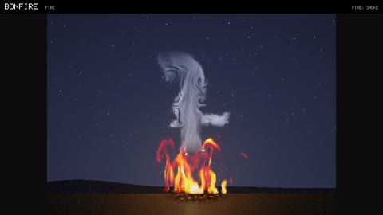</a> | **Fire** | 17: campfire, torch, candle, brazier, bonfire, wall of flames, burning ground, blue gas flame, witch fire, burning wreck, flamethrower, gas leak fire, rocket thruster, fire whirl, candle cluster, blue and green torches | All 17 learned; procedural embers, sparks, glows, lights, scorch. Recolours: blue gas, witch fire, the blue and green torches, the thruster's blue | Fire, smoke, jet, vortex; int8 | Loops 2.4 s each; 40.8 s, 1.8 MB | Good: the fires read well; one flame per tile, so wide fires are rows of tongues; the fire whirl's haze shows its tile's square edge (LIBRARY.md: fair) |
| <a href="library_smoke.mp4">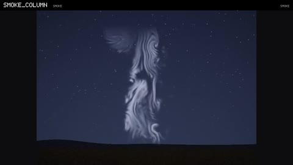</a> | **Smoke** | 10: chimney smoke, smoke column, smoke grenade, black oil smoke, poison gas, signal smoke, smoke screen, incense, white and dark chimney smoke | All 10 learned (shader looks). Recolours: poison gas, signal smoke, black oil smoke, the white and dark chimneys | Smoke, fog, cloud, fire; int8 | Loops 2.6 s; the 12 s smoke grenade cut at 4.5 s; 27.9 s, 1.1 MB | Good: plumes that billow and lean; thick smoke shows the shader's marbled texture |
| <a href="library_explosions.mp4">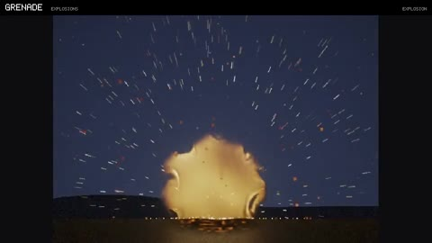</a> | **Explosions** | 5: grenade, large blast, magic burst, teleport flash, airburst | 4 learned, 1 procedural (teleport flash); flash, shock front, debris, embers and scorch are procedural. Recolour: the violet magic burst | Explosion, smoke; int8 | One-shots, their length and 1 s (at most 7 s: the 9 s large blast is cut); 20.4 s, 1.2 MB | Good: fireballs with their flash, shock and debris, rolling into smoke; the clouds show the marbled texture |
| <a href="library_steam.mp4">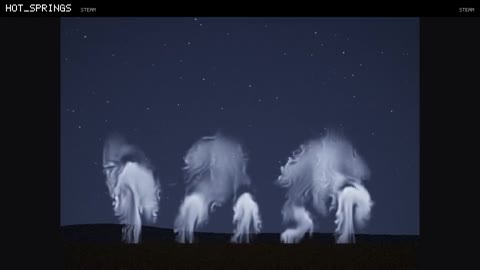</a> | **Steam and water** | 7: steam vent, geyser, pipe leak, kettle steam, hot springs, steaming cup, sewer steam | All 7 learned (shader looks) | Steam; int8 | Loops 3 s; 21 s, 1.1 MB | Good: jets and wisps of white vapour at very different sizes |
| <a href="library_magic.mp4">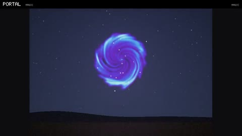</a> | **Magic** | 8: portal, dark portal, healing circle, magic orb, summoning circle, dragon breath, wisp, magic vortex | 6 learned, 2 procedural (the healing and summoning circles: rings, arcs, glows). Recolours: the red dark portal, the violet dragon breath and magic vortex | Magic, jet, orb, vortex (study L's v3 for magic, orb, vortex); int8 | Loops 3 s; 24 s, 0.9 MB | Good: the portals spin with smooth arms; the magic vortex is a faint column |
| <a href="library_buffs.mp4">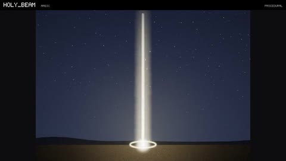</a> | **Buffs and magic** | 14: heal aura, buff glow, level up, teleport arrive, teleport vanish, holy beam, resurrection light, curse, poison cloud, fire aura, ice shards, frost aura, electric aura, spirit wisps | 5 learned (curse: smoke; poison cloud: cloud; fire aura: fire; ice shards and frost aura: fog, all recoloured), 9 procedural (rings, beams, glints, glows, arcs) | Smoke, cloud, fire, fog; int8 | Loops 2.5 s; one-shots their length and 0.5 s; 36.9 s, 1.2 MB | Good: mostly crisp procedural light; the learned ones are recolours of smoke, cloud, fire and fog |
| <a href="library_weather.mp4">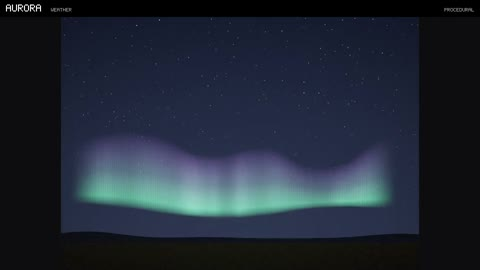</a> | **Weather and sky** | 31: ground fog, frost mist, swamp mist, sky cloud, storm cloud, dust storm, rain, snow, falling ash, falling leaves, cherry petals, drizzle, downpour, hailstorm, sleet, blizzard, snow flurry, thunderstorm, distant lightning, sandstorm, red dust storm, tornado, waterspout, aurora, rainbow, meteor shower, shooting star, wind gust, desert and exhaust shimmer, morning mist | 15 learned (fogs, clouds, dust storms, the tornado and waterspout, the shimmers), 16 procedural (rain, snow, ash, leaves, petals, hail, sleet, lightning, aurora, rainbow, meteors, gusts) | Fog, cloud, dust, vortex, jet, fire; int8 | Loops 1.9 s each; 58.9 s, 2.9 MB | Good on the whole: rain and snow read as streaks and flakes (unlit); the tornado is a giant dust devil (LIBRARY.md: weak); the two shimmers are distortions, hard to see at this size; distant lightning flashes only now and then |
| <a href="library_dust.mp4">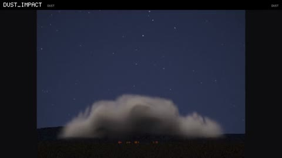</a> | **Dust** | 5: dust impact, landing dust, ground slam, sand burst, dust devil | All 5 learned; debris and shock procedural | Dust, vortex; int8 | One-shots their length and 0.5 s, the dust devil 5 s; 20 s, 0.7 MB | Good: bursts that roll out along the ground; the dust devil spreads into a haze at its top |
| <a href="library_trails.mp4">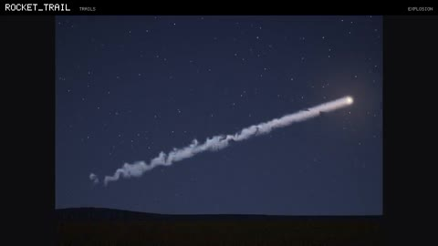</a> | **Trails** | 4: rocket trail, vehicle dust wake, carried torch, comet trail | All 4 learned (their material plays in explosion, dust and fire tiles left in the world); the sources' glows are procedural. Recolour: the comet's cyan tail | Explosion, dust, fire, orb; int8 | Moved through their boxes as the gallery moves them; 5 s each; 20 s, 0.4 MB | Good: the smoke and dust stay where they were left and fade |
| <a href="library_sparks_light.mp4">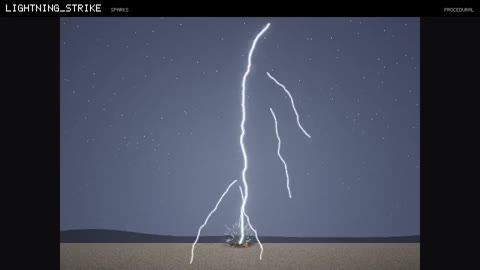</a> | **Sparks and light** | 20: sparks, welding sparks, grinder sparks, debris shower, electric arc, lightning strike, ember burst, ball lightning, muzzle flash, signal flare, lantern, flashbang, shockwave ring, plasma orb, energy core, beacon, quest marker, pickup sparkle, coin glint, gold glitter | 5 learned (debris shower and signal flare: smoke; ball lightning, plasma orb, energy core: orb), 15 procedural | Smoke, orb; int8 | Loops 2.4 s; one-shots their length and 0.5 s (at least 1.5 s); 48 s, 2.2 MB | Good: crisp sparks, arcs and bolts; the lightning strike lights the whole stage; the muzzle flash lasts 0.12 s by design |
| <a href="library_combat.mp4">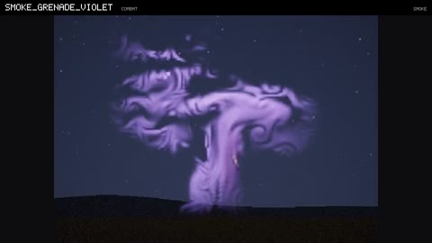</a> | **Combat** | 23: bullet impacts (stone, dirt, metal, wood), blood spray, sparks on metal, muzzle flashes (rifle, shotgun, energy), tracer, laser beam, plasma bolt, frag and incendiary grenades, small and medium explosions, EMP blast, shield bubble, shield hit, force field, red, green and violet smoke grenades | 12 learned, 11 procedural (beams, shields, spatter, shards, flashes). Recolours: the coloured smoke grenades | Explosion, smoke, fire, dust, orb; int8 | Loops 2.2 s; one-shots their length and 0.5 s, at most 4 s (the 12 s smoke grenades and the 8 s incendiary are cut); 59.4 s, 3.5 MB | Good: beams, bolts and shields are crisp; impacts and muzzle flashes are brief by design |
| <a href="library_ambient.mp4">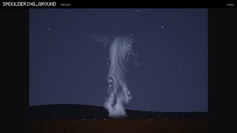</a> | **Ambient** | 5: heat haze, fireflies, drifting embers, smouldering ground, dust motes | 3 learned (heat haze and drifting embers: an invisible fire whose heat drives the haze and the embers; smouldering ground: smoke), 2 procedural | Fire, smoke; int8 | Loops 4 s; 20 s, 0.8 MB | Quiet by design; the heat haze is a distortion seen only in motion |

## 7. Many effects at once

| | Video | What it shows | Learned / procedural | Models, precision | Rendered | How it looks |
|---|---|---|---|---|---|---|
| <a href="crowd.mp4">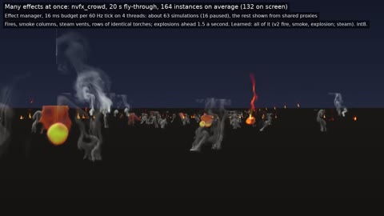</a> | **A crowd of 165 effects** | `nvfx_crowd`'s fly-through ([MANAGER.md](../docs/MANAGER.md) §7): rows of identical torches, fires, smoke columns and steam vents over a field 80 m by 160 m, explosions going off ahead at 1.5 a second, a fire dying and another starting every half second; 164 instances on average, 132 on screen. The effect manager plans every tick for a budget of 16 ms per 60 Hz tick on 4 threads: about 63 simulations, 16 of them paused off screen, and about 107 instances shown from shared proxies (the planner's figures of MANAGER.md's 16 ms row) | All the effects learned; the sky and ground are the tool's flat colours | v2 fire, smoke and explosion, steam; int8 | `nvfx_crowd --budget 16 --threads 4 --cores 0,1 --seconds 20 --video crowd.mp4`: four threads pinned to two cores at low priority (the plan comes from the cost model, never from measured time, so the pictures are the planned ones); every other 60 Hz tick, 1280 x 720, 30 fps, 20 s; labels by ffmpeg drawtext; CRF 24, 1.8 MB | Fair: a benchmark's view, not a beauty render: plain sprites on a flat field; smoke near the camera shows its square tile edges; the rows of torches are visibly copies |

## 8. Lit sprites

| | Video | What it shows | Learned / procedural | Models, precision | Rendered | How it looks |
|---|---|---|---|---|---|---|
| <a href="lit_sprites.mp4">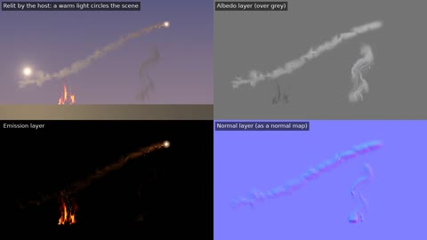</a> | **Lit sprites** | `nvfx_lit_host`'s stage (chimney smoke, a campfire, a rocket trail moved across it) read as an engine reads its layers ([ENGINES.md](../docs/ENGINES.md) §11) and lit by the host. Top left: the relit picture, albedo x (a cool ambient + a warm point light circling the scene, by the normals) + emission, over the host's own sky and ground. Top right: the albedo layer over grey. Bottom: the emission layer and the normal layer | Learned: the smoke, the fire, the trail's material; procedural: embers, the rocket's glow. The light, the sky and the ground are the host's | The library's smoke, fire, explosion; int8 | `nvfx_lit_host library MODELS OUT --frames 300 --threads 2 --raw -` piped to ffmpeg (`--raw` is new: every frame's four quadrants as raw RGB); four 640 x 360 quadrants, 1280 x 720, 30 fps, 10 s; labels by ffmpeg drawtext; CRF 24, 0.5 MB | Good: the smoke and the trail brighten as the light passes them; the rocket leaves the stage after about 3.5 s and its trail stays |

## 9. Later

The newest effects are still being trained or built: **wildfire, coals, mushroom, launch, puffs, ink and water**.
Their videos come when they merge.

## Reproduce

The tools are in this repository; the models are under the data root (`$NEURALVFX_DATA`, outside git; LIBRARY.md §4
links the library's eleven). Build as the main README says, then for example:

```sh
build/nvfx_scene_script --script examples/scenes/fireball.nvfxs --models $NEURALVFX_DATA/experiments/models/d --out fireball.mp4
build/nvfx_reel --out fire.mp4 --seconds 9 --size 256 --zoom 1.5 --width 1280 --height 576 --title "FIRE" \
    --panel "SMALL|$M/fire.nvfx|0:0.25,0.5,0.3" --panel "MEDIUM|$M/fire.nvfx|0:0.6,0.15,0.5" --panel "LARGE|$M/fire.nvfx|0:0.95,0.75,0.7"
build/nvfx_reel --out track.mp4 --seconds 10 --zoom 1.7 --compact --timer --columns 1 \
    --panel "FIRE: REAL|real:fire:1" --panel "FIRE: LEARNED|learned:fire:1:$M/fire.nvfx"
build/nvfx_gallery --library library --models $M --only campfire --video campfire.mp4 --clip 2.4
build/nvfx_crowd --budget 16 --threads 4 --seconds 20 --video crowd.mp4
build/nvfx_lit_host library $M OUT --frames 300 --raw - | ffmpeg -f rawvideo -pix_fmt rgb24 -s 1280x720 -r 30 -i - lit.mp4
```

(`M=$NEURALVFX_DATA/library/models`.) `nvfx_reel`'s header lists every option.
